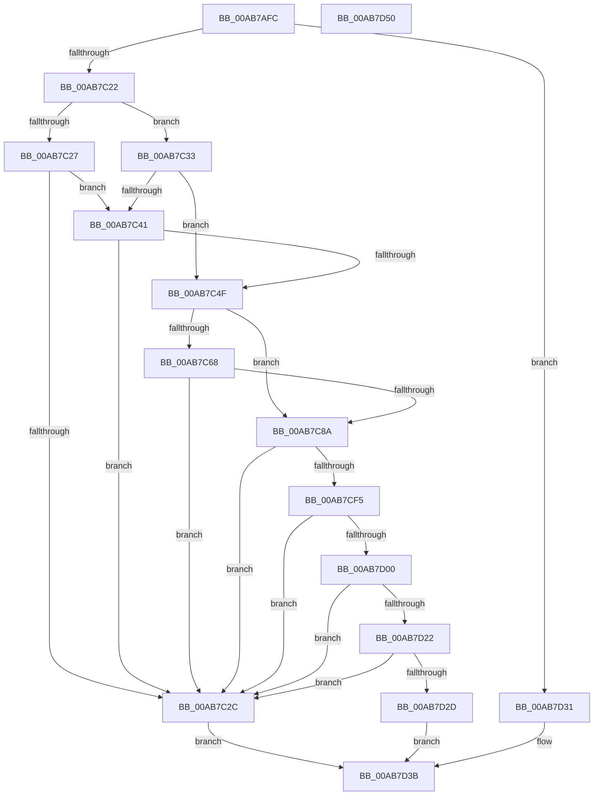

# ExpFirmwareAccessAppContainerCheck

- RVA: `0x00AB7AFC`–`0x00AB7D51` (길이 `597` bytes)
- VA: `0x0000000140AB7AFC`
- 실행 섹션: `PAGE`
- PDB 이름 있음: `예`; PDB Function 태그: `아니요`
- unwind 정보 RVA: `0x000BD0F0`
- 디코드: `124`개 명령, `597/597` bytes 표시
- 미해석 바이트: `0` (있으면 어셈블리에 `.byte`로 보존)

> 이 문서는 커널 이미지의 기계어와 PDB 기호를 분석해 생성했습니다. 4번과 5번은 함수 원형과 자료형을 바이너리 사용 방식에서 추정한 C 해석이며 원본 소스 복구 결과는 아닙니다.

## 1. Dependencies

- 직접 호출 지점: **10**; 고유 호출 대상: **7**
- 직접 호출자로 확인된 함수: **3**
- RIP 상대 이미지 참조: **19**

### Outgoing calls
- `0x00AB7C38` → [ExpCapabilityCheck](../A2/ExpCapabilityCheck_function_00A20300.md) (function, `0x00A20300`)
- `0x00AB7C46` → [ExpCapabilityCheck](../A2/ExpCapabilityCheck_function_00A20300.md) (function, `0x00A20300`)
- `0x00AB7C7C` → [RtlRunOnceExecuteOnce](../95/RtlRunOnceExecuteOnce_function_0095DC00.md) (function, `0x0095DC00`)
- `0x00AB7C9C` → [RtlInitializeSid](../9E/RtlInitializeSid_function_009EB720.md) (function, `0x009EB720`)
- `0x00AB7CA8` → [RtlSubAuthoritySid](../../text/45/RtlSubAuthoritySid_function_00456D10.md) (function, `0x00456D10`)
- `0x00AB7CBD` → [RtlSubAuthoritySid](../../text/45/RtlSubAuthoritySid_function_00456D10.md) (function, `0x00456D10`)
- `0x00AB7CE8` → [ZwQueryInformationToken](../../text/6A/ZwQueryInformationToken_function_006AD4F0.md) (function, `0x006AD4F0`)
- `0x00AB7D15` → [RtlCheckTokenMembershipEx](../../text/3A/RtlCheckTokenMembershipEx_function_003A5A30.md) (function, `0x003A5A30`)
- `0x00AB7D36` → [ExpCapabilityCheck](../A2/ExpCapabilityCheck_function_00A20300.md) (function, `0x00A20300`)
- `0x00AB7D42` → [_security_check_cookie](../../text/6A/_security_check_cookie_function_006AC640.md) (function, `0x006AC640`)

### Direct callers
- [NtSetSystemEnvironmentValueEx](../7C/NtSetSystemEnvironmentValueEx_function_007CE990.md) at `0x007CEAED`
- [NtQuerySystemEnvironmentValueEx](../95/NtQuerySystemEnvironmentValueEx_function_00952180.md) at `0x009524C9`
- [ExpGetSystemFirmwareTableInformation](../A3/ExpGetSystemFirmwareTableInformation_function_00A38A2C.md) at `0x00A38C2C`

### Static image references
- `0x00AB7B0A` → RVA `0x00E0A740` (`.data`; read)
- `0x00AB7B18` → RVA `0x00B087D0` (`PAGE`; read)
- `0x00AB7B38` → RVA `0x00B08768` (`PAGE`; read)
- `0x00AB7B41` → RVA `0x00B0876C` (`PAGE`; read)
- `0x00AB7B55` → RVA `0x00B08808` (`PAGE`; read)
- `0x00AB7B60` → RVA `0x00B087F0` (`PAGE`; read)
- `0x00AB7B73` → RVA `0x00B08780` (`PAGE`; read)
- `0x00AB7B7F` → RVA `0x00B087B8` (`PAGE`; read)
- `0x00AB7B89` → RVA `0x00B087A0` (`PAGE`; read)
- `0x00AB7BC7` → RVA `0x00B08760` (` ?? ::NNGAKEGL::`string'`; read)
- `0x00AB7BD4` → RVA `0x00B087C0` (` ?? ::NNGAKEGL::`string'`; read)
- `0x00AB7BDF` → RVA `0x00B087E0` (`PAGE`; read)
- `0x00AB7BEA` → RVA `0x00B08800` (`PAGE`; read)
- `0x00AB7BF7` → RVA `0x00B08770` (` ?? ::NNGAKEGL::`string'`; read)
- `0x00AB7C02` → RVA `0x00B08790` (`PAGE`; read)
- `0x00AB7C0D` → RVA `0x00B087B0` (`PAGE`; read)
- `0x00AB7C6B` → RVA `0x00659800` (`ExpInitExpCheckTestSigningInfo`; read)
- `0x00AB7C75` → RVA `0x00E685C0` (`.data`; read)
- `0x00AB7C81` → RVA `0x00EFAB78` (`.data`; read)

## 2. Other-region calls and transfers

- 다른 실행 섹션으로 향하는 call: **5**
  - `0x00AB7CA8` → [RtlSubAuthoritySid](../../text/45/RtlSubAuthoritySid_function_00456D10.md) (`PAGE` → `.text`)
  - `0x00AB7CBD` → [RtlSubAuthoritySid](../../text/45/RtlSubAuthoritySid_function_00456D10.md) (`PAGE` → `.text`)
  - `0x00AB7CE8` → [ZwQueryInformationToken](../../text/6A/ZwQueryInformationToken_function_006AD4F0.md) (`PAGE` → `.text`)
  - `0x00AB7D15` → [RtlCheckTokenMembershipEx](../../text/3A/RtlCheckTokenMembershipEx_function_003A5A30.md) (`PAGE` → `.text`)
  - `0x00AB7D42` → [_security_check_cookie](../../text/6A/_security_check_cookie_function_006AC640.md) (`PAGE` → `.text`)
- 별도 외부 분기/꼬리 이동을 확인하지 못했습니다.

## 3. Assembly (complete function range)

```asm
00AB7AFC  40 55                           push rbp
00AB7AFE  48 8D 6C 24 B0                  lea rbp, [rsp - 0x50]
00AB7B03  48 81 EC 50 01 00 00            sub rsp, 0x150
00AB7B0A  48 8B 05 2F 2C 35 00            mov rax, qword ptr [rip + 0x352c2f]
00AB7B11  48 33 C4                        xor rax, rsp
00AB7B14  48 89 45 40                     mov qword ptr [rbp + 0x40], rax
00AB7B18  0F 28 0D B1 0C 05 00            movaps xmm1, xmmword ptr [rip + 0x50cb1]
00AB7B1F  33 C0                           xor eax, eax
00AB7B21  48 83 64 24 40 00               and qword ptr [rsp + 0x40], 0
00AB7B27  0F 57 C0                        xorps xmm0, xmm0
00AB7B2A  83 64 24 3C 00                  and dword ptr [rsp + 0x3c], 0
00AB7B2F  83 64 24 34 00                  and dword ptr [rsp + 0x34], 0
00AB7B34  48 89 45 88                     mov qword ptr [rbp - 0x78], rax
00AB7B38  8B 05 2A 0C 05 00               mov eax, dword ptr [rip + 0x50c2a]
00AB7B3E  89 45 98                        mov dword ptr [rbp - 0x68], eax
00AB7B41  0F B7 05 24 0C 05 00            movzx eax, word ptr [rip + 0x50c24]
00AB7B48  66 89 45 9C                     mov word ptr [rbp - 0x64], ax
00AB7B4C  48 8D 45 90                     lea rax, [rbp - 0x70]
00AB7B50  48 89 44 24 70                  mov qword ptr [rsp + 0x70], rax
00AB7B55  0F B7 05 AC 0C 05 00            movzx eax, word ptr [rip + 0x50cac]
00AB7B5C  0F 29 4D B0                     movaps xmmword ptr [rbp - 0x50], xmm1
00AB7B60  0F 28 0D 89 0C 05 00            movaps xmm1, xmmword ptr [rip + 0x50c89]
00AB7B67  66 89 45 E8                     mov word ptr [rbp - 0x18], ax
00AB7B6B  48 8D 45 A0                     lea rax, [rbp - 0x60]
00AB7B6F  0F 29 4D D0                     movaps xmmword ptr [rbp - 0x30], xmm1
00AB7B73  0F 28 0D 06 0C 05 00            movaps xmm1, xmmword ptr [rip + 0x50c06]
00AB7B7A  48 89 44 24 60                  mov qword ptr [rsp + 0x60], rax
00AB7B7F  8B 05 33 0C 05 00               mov eax, dword ptr [rip + 0x50c33]
00AB7B85  0F 29 4D 00                     movaps xmmword ptr [rbp], xmm1
00AB7B89  0F 28 0D 10 0C 05 00            movaps xmm1, xmmword ptr [rip + 0x50c10]
00AB7B90  89 45 38                        mov dword ptr [rbp + 0x38], eax
00AB7B93  48 8D 45 F0                     lea rax, [rbp - 0x10]
00AB7B97  66 C7 44 24 38 00 05            mov word ptr [rsp + 0x38], 0x500
00AB7B9E  48 C7 44 24 68 0C 00 0E 00      mov qword ptr [rsp + 0x68], 0xe000c
00AB7BA7  48 C7 44 24 58 48 00 4A 00      mov qword ptr [rsp + 0x58], 0x4a0048
00AB7BB0  0F 29 4D 20                     movaps xmmword ptr [rbp + 0x20], xmm1
00AB7BB4  48 C7 44 24 48 4A 00 4C 00      mov qword ptr [rsp + 0x48], 0x4c004a
00AB7BBD  48 89 44 24 50                  mov qword ptr [rsp + 0x50], rax
00AB7BC2  0F 11 44 24 78                  movups xmmword ptr [rsp + 0x78], xmm0
00AB7BC7  F2 0F 10 05 91 0B 05 00         movsd xmm0, qword ptr [rip + 0x50b91]
00AB7BCF  F2 0F 11 45 90                  movsd qword ptr [rbp - 0x70], xmm0
00AB7BD4  0F 28 05 E5 0B 05 00            movaps xmm0, xmmword ptr [rip + 0x50be5]
00AB7BDB  0F 29 45 A0                     movaps xmmword ptr [rbp - 0x60], xmm0
00AB7BDF  0F 28 05 FA 0B 05 00            movaps xmm0, xmmword ptr [rip + 0x50bfa]
00AB7BE6  0F 29 45 C0                     movaps xmmword ptr [rbp - 0x40], xmm0
00AB7BEA  F2 0F 10 05 0E 0C 05 00         movsd xmm0, qword ptr [rip + 0x50c0e]
00AB7BF2  F2 0F 11 45 E0                  movsd qword ptr [rbp - 0x20], xmm0
00AB7BF7  0F 28 05 72 0B 05 00            movaps xmm0, xmmword ptr [rip + 0x50b72]
00AB7BFE  0F 29 45 F0                     movaps xmmword ptr [rbp - 0x10], xmm0
00AB7C02  0F 28 05 87 0B 05 00            movaps xmm0, xmmword ptr [rip + 0x50b87]
00AB7C09  0F 29 45 10                     movaps xmmword ptr [rbp + 0x10], xmm0
00AB7C0D  F2 0F 10 05 9B 0B 05 00         movsd xmm0, qword ptr [rip + 0x50b9b]
00AB7C15  F2 0F 11 45 30                  movsd qword ptr [rbp + 0x30], xmm0
00AB7C1A  85 C9                           test ecx, ecx
00AB7C1C  0F 84 0F 01 00 00               je 0x140ab7d31
00AB7C22  83 E9 01                        sub ecx, 1
00AB7C25  74 0C                           je 0x140ab7c33
00AB7C27  83 F9 01                        cmp ecx, 1
00AB7C2A  74 15                           je 0x140ab7c41
00AB7C2C  32 C0                           xor al, al
00AB7C2E  E9 08 01 00 00                  jmp 0x140ab7d3b
00AB7C33  48 8D 4C 24 58                  lea rcx, [rsp + 0x58]
00AB7C38  E8 C3 86 F6 FF                  call 0x140a20300
00AB7C3D  84 C0                           test al, al
00AB7C3F  75 0E                           jne 0x140ab7c4f
00AB7C41  48 8D 4C 24 48                  lea rcx, [rsp + 0x48]
00AB7C46  E8 B5 86 F6 FF                  call 0x140a20300
00AB7C4B  84 C0                           test al, al
00AB7C4D  74 DD                           je 0x140ab7c2c
00AB7C4F  65 48 8B 04 25 88 01 00 00      mov rax, qword ptr gs:[0x188]
00AB7C58  48 8B 88 B8 00 00 00            mov rcx, qword ptr [rax + 0xb8]
00AB7C5F  80 B9 FA 05 00 00 81            cmp byte ptr [rcx + 0x5fa], 0x81
00AB7C66  74 22                           je 0x140ab7c8a
00AB7C68  45 33 C9                        xor r9d, r9d
00AB7C6B  48 8D 15 8E 1B BA FF            lea rdx, [rip - 0x45e472]
00AB7C72  45 33 C0                        xor r8d, r8d
00AB7C75  48 8D 0D 44 09 3B 00            lea rcx, [rip + 0x3b0944]
00AB7C7C  E8 7F 5F EA FF                  call 0x14095dc00
00AB7C81  80 3D F0 2E 44 00 00            cmp byte ptr [rip + 0x442ef0], 0
00AB7C88  74 A2                           je 0x140ab7c2c
00AB7C8A  41 B0 02                        mov r8b, 2
00AB7C8D  C6 44 24 30 00                  mov byte ptr [rsp + 0x30], 0
00AB7C92  48 8D 54 24 34                  lea rdx, [rsp + 0x34]
00AB7C97  48 8D 4C 24 78                  lea rcx, [rsp + 0x78]
00AB7C9C  E8 7F 3A F3 FF                  call 0x1409eb720
00AB7CA1  33 D2                           xor edx, edx
00AB7CA3  48 8D 4C 24 78                  lea rcx, [rsp + 0x78]
00AB7CA8  E8 63 F0 99 FF                  call 0x140456d10
00AB7CAD  BA 01 00 00 00                  mov edx, 1
00AB7CB2  48 8D 4C 24 78                  lea rcx, [rsp + 0x78]
00AB7CB7  C7 00 20 00 00 00               mov dword ptr [rax], 0x20
00AB7CBD  E8 4E F0 99 FF                  call 0x140456d10
00AB7CC2  41 B9 08 00 00 00               mov r9d, 8
00AB7CC8  4C 8D 44 24 40                  lea r8, [rsp + 0x40]
00AB7CCD  48 C7 C1 FA FF FF FF            mov rcx, 0xfffffffffffffffa
00AB7CD4  C7 00 20 02 00 00               mov dword ptr [rax], 0x220
00AB7CDA  48 8D 44 24 3C                  lea rax, [rsp + 0x3c]
00AB7CDF  41 8D 51 0B                     lea edx, [r9 + 0xb]
00AB7CE3  48 89 44 24 20                  mov qword ptr [rsp + 0x20], rax
00AB7CE8  E8 03 58 BF FF                  call 0x1406ad4f0
00AB7CED  85 C0                           test eax, eax
00AB7CEF  0F 88 37 FF FF FF               js 0x140ab7c2c
00AB7CF5  83 7C 24 3C 08                  cmp dword ptr [rsp + 0x3c], 8
00AB7CFA  0F 85 2C FF FF FF               jne 0x140ab7c2c
00AB7D00  48 8B 4C 24 40                  mov rcx, qword ptr [rsp + 0x40]
00AB7D05  4C 8D 4C 24 30                  lea r9, [rsp + 0x30]
00AB7D0A  41 B8 01 00 00 00               mov r8d, 1
00AB7D10  48 8D 54 24 78                  lea rdx, [rsp + 0x78]
00AB7D15  E8 16 DD 8E FF                  call 0x1403a5a30
00AB7D1A  85 C0                           test eax, eax
00AB7D1C  0F 88 0A FF FF FF               js 0x140ab7c2c
00AB7D22  80 7C 24 30 00                  cmp byte ptr [rsp + 0x30], 0
00AB7D27  0F 84 FF FE FF FF               je 0x140ab7c2c
00AB7D2D  B0 01                           mov al, 1
00AB7D2F  EB 0A                           jmp 0x140ab7d3b
00AB7D31  48 8D 4C 24 68                  lea rcx, [rsp + 0x68]
00AB7D36  E8 C5 85 F6 FF                  call 0x140a20300
00AB7D3B  48 8B 4D 40                     mov rcx, qword ptr [rbp + 0x40]
00AB7D3F  48 33 CC                        xor rcx, rsp
00AB7D42  E8 F9 48 BF FF                  call 0x1406ac640
00AB7D47  48 81 C4 50 01 00 00            add rsp, 0x150
00AB7D4E  5D                              pop rbp
00AB7D4F  C3                              ret
00AB7D50  CC                              int3
```

## 4. C-style interpretation (structured pseudocode)

```c
__int64 __fastcall ExpFirmwareAccessAppContainerCheck(int a1, __int64 a2, int a3, int a4)
{
    __int64 result;
    __int64 v_rsp;
    unsigned __int64 v_stack_m100;
    unsigned __int64 v_stack_m108;
    unsigned __int64 v_stack_m110;
    unsigned __int64 v_stack_m118;
    unsigned int v_stack_m11C;
    unsigned __int16 v_stack_m120;
    unsigned int v_stack_m124;
    unsigned __int8 v_stack_m128;
    unsigned __int64 v_stack_m138;
    unsigned __int64 v_stack_m18;
    unsigned int v_stack_m20;
    unsigned __int64 v_stack_m28;
    unsigned __int64 v_stack_m38;
    unsigned __int64 v_stack_m48;
    unsigned __int64 v_stack_m58;
    unsigned __int64 v_stack_m68;
    unsigned __int16 v_stack_m70;
    unsigned __int64 v_stack_m78;
    unsigned __int64 v_stack_m88;
    unsigned __int64 v_stack_m98;
    unsigned __int64 v_stack_mA8;
    unsigned __int64 v_stack_mB8;
    unsigned __int16 v_stack_mBC;
    unsigned int v_stack_mC0;
    unsigned __int64 v_stack_mC8;
    unsigned __int64 v_stack_mD0;
    unsigned __int64 v_stack_mE0;
    unsigned __int64 v_stack_mE8;
    unsigned __int64 v_stack_mF0;
    unsigned __int64 v_stack_mF8;

    v_rsp = (v_rsp) - (336);
    result = (*(unsigned __int64 *)(v_rip + 3484719)) ^ (v_rsp);
    v_stack_m18 = result;
    result = 0;
    v_stack_mD0 = 0;
    v_stack_mC0 = (unsigned int)((unsigned int)(*(unsigned int *)(v_rip + 330794)));
    v_stack_mBC = (unsigned __int16)(*(unsigned __int16 *)(v_rip + 330788));
    v_stack_mE8 = v_stack_mC8;
    v_stack_mA8 = v_xmm1;
    v_stack_m70 = (unsigned __int16)(*(unsigned __int16 *)(v_rip + 330924));
    v_stack_m88 = v_xmm1;
    v_stack_mF8 = v_stack_mB8;
    v_stack_m58 = v_xmm1;
    v_stack_m20 = (unsigned int)((unsigned int)(*(unsigned int *)(v_rip + 330803)));
    v_stack_m120 = 0x500ULL;
    v_stack_mF0 = 0xE000CULL;
    v_stack_m100 = 0x4A0048ULL;
    v_stack_m38 = v_xmm1;
    v_stack_m110 = 0x4C004AULL;
    v_stack_m108 = v_stack_m68;
    v_stack_mE0 = v_xmm0;
    v_stack_mC8 = v_xmm0;
    v_stack_mB8 = v_xmm0;
    v_stack_m98 = v_xmm0;
    v_stack_m78 = v_xmm0;
    v_stack_m68 = v_xmm0;
    v_stack_m48 = v_xmm0;
    v_stack_m28 = v_xmm0;
    if (a1 == 0) goto loc_00AB7D31;
    a1 = (unsigned int)((a1) - (1));
    if (condition_is_equal) goto loc_00AB7C33;
    if (a1 == 1) goto loc_00AB7C41;
loc_00AB7C2C:
    result = 0;
    goto loc_00AB7D3B;
loc_00AB7C33:
    result = ExpCapabilityCheck(v_stack_m100, a2, a3, a4);
    if ((unsigned __int8)(result) != 0) goto loc_00AB7C4F;
loc_00AB7C41:
    result = ExpCapabilityCheck(v_stack_m110, a2, a3, a4);
    if ((unsigned __int8)(result) == 0) goto loc_00AB7C2C;
loc_00AB7C4F:
    if ((*(unsigned __int8 *)(*(unsigned __int64 *)(*(unsigned __int64 *)(gs_base + (0 + 392)) + 184) + 1530)) == 129) goto loc_00AB7C8A;
    a4 = 0;
    a3 = 0;
    result = RtlRunOnceExecuteOnce(v_rip + 3868996, v_rip - 4580466, a3, a4);
    if ((*(unsigned __int8 *)(v_rip + 4468464)) == 0) goto loc_00AB7C2C;
loc_00AB7C8A:
    v_stack_m128 = 0;
    result = RtlInitializeSid(v_stack_mE0, v_stack_m124, 2, a4);
    a2 = 0;
    result = RtlSubAuthoritySid(v_stack_mE0, a2, 2, a4);
    *(unsigned int *)(result) = 32;
    result = RtlSubAuthoritySid(v_stack_mE0, 1, 2, a4);
    *(unsigned int *)(result) = 544;
    v_stack_m138 = v_stack_m11C;
    result = ZwQueryInformationToken(-6, 8 + 11, v_stack_m118, 8);
    if (sign_flag) goto loc_00AB7C2C;
    if (v_stack_m11C != 8) goto loc_00AB7C2C;
    result = RtlCheckTokenMembershipEx(v_stack_m118, v_stack_mE0, 1, v_stack_m128);
    if (sign_flag) goto loc_00AB7C2C;
    if (v_stack_m128 == 0) goto loc_00AB7C2C;
    goto loc_00AB7D3B;
loc_00AB7D31:
    result = ExpCapabilityCheck(v_stack_mF0, v_stack_mE0, 1, v_stack_m128);
loc_00AB7D3B:
    a1 = (v_stack_m18) ^ (v_rsp);
    result = _security_check_cookie(a1, v_stack_mE0, 1, v_stack_m128);
    v_rsp = (v_rsp) + (336);
    return result;
}
```

## 5. (Beta) C Style

```c
int64_t ExpFirmwareAccessAppContainerCheck(int32_t Arg1, int64_t Arg2, int32_t Arg3, int32_t Arg4)
{
    int64_t result;
    int64_t local_rsp;
    uint64_t v_stack_m100;
    uint64_t v_stack_m108;
    uint64_t v_stack_m110;
    uint64_t v_stack_m118;
    uint32_t v_stack_m11C;
    uint16_t v_stack_m120;
    uint32_t v_stack_m124;
    uint8_t v_stack_m128;
    uint64_t v_stack_m138;
    uint64_t v_stack_m18;
    uint32_t v_stack_m20;
    uint64_t v_stack_m28;
    uint64_t v_stack_m38;
    uint64_t v_stack_m48;
    uint64_t v_stack_m58;
    uint64_t v_stack_m68;
    uint16_t v_stack_m70;
    uint64_t v_stack_m78;
    uint64_t v_stack_m88;
    uint64_t v_stack_m98;
    uint64_t v_stack_mA8;
    uint64_t v_stack_mB8;
    uint16_t v_stack_mBC;
    uint32_t v_stack_mC0;
    uint64_t v_stack_mC8;
    uint64_t v_stack_mD0;
    uint64_t v_stack_mE0;
    uint64_t v_stack_mE8;
    uint64_t v_stack_mF0;
    uint64_t v_stack_mF8;

    local_rsp = (local_rsp) - (336);
    result = (*(uint64_t *)(v_rip + 0x352C2F)) ^ (local_rsp);
    v_stack_m18 = result;
    result = 0;
    v_stack_mD0 = 0;
    v_stack_mC0 = (uint32_t)((uint32_t)(*(uint32_t *)(v_rip + 0x50C2A)));
    v_stack_mBC = (uint16_t)(*(uint16_t *)(v_rip + 0x50C24));
    v_stack_mE8 = v_stack_mC8;
    v_stack_mA8 = v_xmm1;
    v_stack_m70 = (uint16_t)(*(uint16_t *)(v_rip + 0x50CAC));
    v_stack_m88 = v_xmm1;
    v_stack_mF8 = v_stack_mB8;
    v_stack_m58 = v_xmm1;
    v_stack_m20 = (uint32_t)((uint32_t)(*(uint32_t *)(v_rip + 0x50C33)));
    v_stack_m120 = 0x500ULL;
    v_stack_mF0 = 0xE000CULL;
    v_stack_m100 = 0x4A0048ULL;
    v_stack_m38 = v_xmm1;
    v_stack_m110 = 0x4C004AULL;
    v_stack_m108 = v_stack_m68;
    v_stack_mE0 = v_xmm0;
    v_stack_mC8 = v_xmm0;
    v_stack_mB8 = v_xmm0;
    v_stack_m98 = v_xmm0;
    v_stack_m78 = v_xmm0;
    v_stack_m68 = v_xmm0;
    v_stack_m48 = v_xmm0;
    v_stack_m28 = v_xmm0;
    if (Arg1 == 0) goto loc_00AB7D31;
    Arg1 = (uint32_t)((Arg1) - (1));
    if (condition_is_equal) goto loc_00AB7C33;
    if (Arg1 == 1) goto loc_00AB7C41;
loc_00AB7C2C:
    result = 0;
    goto loc_00AB7D3B;
loc_00AB7C33:
    result = ExpCapabilityCheck(v_stack_m100, Arg2, Arg3, Arg4);
    if ((uint8_t)(result) != 0) goto loc_00AB7C4F;
loc_00AB7C41:
    result = ExpCapabilityCheck(v_stack_m110, Arg2, Arg3, Arg4);
    if ((uint8_t)(result) == 0) goto loc_00AB7C2C;
loc_00AB7C4F:
    if ((*(uint8_t *)(*(uint64_t *)(*(uint64_t *)(gs_base + (0 + 0x188)) + 0xB8) + 0x5FA)) == 129) goto loc_00AB7C8A;
    Arg4 = 0;
    Arg3 = 0;
    result = RtlRunOnceExecuteOnce(v_rip + 3868996, v_rip - 4580466, Arg3, Arg4);
    if ((*(uint8_t *)(v_rip + 0x442EF0)) == 0) goto loc_00AB7C2C;
loc_00AB7C8A:
    v_stack_m128 = 0;
    result = RtlInitializeSid(v_stack_mE0, v_stack_m124, 2, Arg4);
    Arg2 = 0;
    result = RtlSubAuthoritySid(v_stack_mE0, Arg2, 2, Arg4);
    *(uint32_t *)(result) = 32;
    result = RtlSubAuthoritySid(v_stack_mE0, 1, 2, Arg4);
    *(uint32_t *)(result) = 544;
    v_stack_m138 = v_stack_m11C;
    result = ZwQueryInformationToken(-6, 8 + 11, v_stack_m118, 8);
    if (sign_flag) goto loc_00AB7C2C;
    if (v_stack_m11C != 8) goto loc_00AB7C2C;
    result = RtlCheckTokenMembershipEx(v_stack_m118, v_stack_mE0, 1, v_stack_m128);
    if (sign_flag) goto loc_00AB7C2C;
    if (v_stack_m128 == 0) goto loc_00AB7C2C;
    goto loc_00AB7D3B;
loc_00AB7D31:
    result = ExpCapabilityCheck(v_stack_mF0, v_stack_mE0, 1, v_stack_m128);
loc_00AB7D3B:
    Arg1 = (v_stack_m18) ^ (local_rsp);
    result = _security_check_cookie(Arg1, v_stack_mE0, 1, v_stack_m128);
    local_rsp = (local_rsp) + (336);
    return result;
}
```

## 6. Execution-region graph

[열기: 2D/3D 그래프와 함수 탐색 컨트롤 패널](../../../control-panel.html?section=page&rva=0x00AB7AFC&view=graph)

- 2D 그래프는 위에서 아래로 흐르고, 3D 그래프는 빈 공간을 드래그해 회전합니다. Shift+드래그는 이동, 휠은 확대·축소, 함수 노드 선택은 대상 보고서 이동입니다.

### Static fallback


