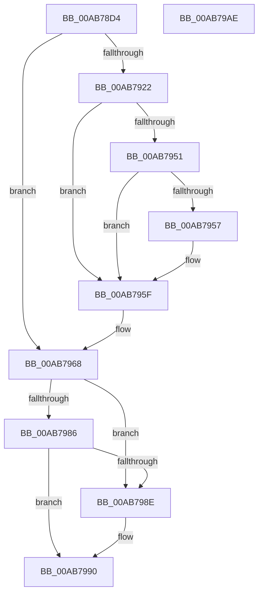

# ExpReadComPlusPackage

- RVA: `0x00AB78D4`–`0x00AB79AF` (길이 `219` bytes)
- VA: `0x0000000140AB78D4`
- 실행 섹션: `PAGE`
- PDB 이름 있음: `예`; PDB Function 태그: `아니요`
- unwind 정보 RVA: `0x000BD078`
- 디코드: `59`개 명령, `219/219` bytes 표시
- 미해석 바이트: `0` (있으면 어셈블리에 `.byte`로 보존)

> 이 문서는 커널 이미지의 기계어와 PDB 기호를 분석해 생성했습니다. 4번과 5번은 함수 원형과 자료형을 바이너리 사용 방식에서 추정한 C 해석이며 원본 소스 복구 결과는 아닙니다.

## 1. Dependencies

- 직접 호출 지점: **4**; 고유 호출 대상: **4**
- 직접 호출자로 확인된 함수: **1**
- RIP 상대 이미지 참조: **4**

### Outgoing calls
- `0x00AB7917` → [ZwOpenKey](../../text/6A/ZwOpenKey_function_006AD310.md) (function, `0x006AD310`)
- `0x00AB7946` → [ZwQueryValueKey](../../text/6A/ZwQueryValueKey_function_006AD3B0.md) (function, `0x006AD3B0`)
- `0x00AB7963` → [ZwClose](../../text/6A/ZwClose_function_006AD2B0.md) (function, `0x006AD2B0`)
- `0x00AB7999` → [_security_check_cookie](../../text/6A/_security_check_cookie_function_006AC640.md) (function, `0x006AC640`)

### Direct callers
- [ExpQuerySystemInformation](../A5/ExpQuerySystemInformation_function_00A57858.md) at `0x00A58B17`

### Static image references
- `0x00AB78E6` → RVA `0x00E0A740` (`.data`; read)
- `0x00AB78F6` → RVA `0x00E09320` (`.data`; read)
- `0x00AB793F` → RVA `0x00E092D0` (`.data`; read)
- `0x00AB7968` → RVA `0x00FC5008` (`ALMOSTRO`; read)

## 2. Other-region calls and transfers

- 다른 실행 섹션으로 향하는 call: **4**
  - `0x00AB7917` → [ZwOpenKey](../../text/6A/ZwOpenKey_function_006AD310.md) (`PAGE` → `.text`)
  - `0x00AB7946` → [ZwQueryValueKey](../../text/6A/ZwQueryValueKey_function_006AD3B0.md) (`PAGE` → `.text`)
  - `0x00AB7963` → [ZwClose](../../text/6A/ZwClose_function_006AD2B0.md) (`PAGE` → `.text`)
  - `0x00AB7999` → [_security_check_cookie](../../text/6A/_security_check_cookie_function_006AC640.md) (`PAGE` → `.text`)
- 별도 외부 분기/꼬리 이동을 확인하지 못했습니다.

## 3. Assembly (complete function range)

```asm
00AB78D4  48 89 5C 24 08                  mov qword ptr [rsp + 8], rbx
00AB78D9  48 89 7C 24 10                  mov qword ptr [rsp + 0x10], rdi
00AB78DE  55                              push rbp
00AB78DF  48 8B EC                        mov rbp, rsp
00AB78E2  48 83 EC 60                     sub rsp, 0x60
00AB78E6  48 8B 05 53 2E 35 00            mov rax, qword ptr [rip + 0x352e53]
00AB78ED  48 33 C4                        xor rax, rsp
00AB78F0  48 89 45 F8                     mov qword ptr [rbp - 8], rax
00AB78F4  33 C0                           xor eax, eax
00AB78F6  4C 8D 05 23 1A 35 00            lea r8, [rip + 0x351a23]
00AB78FD  21 45 D0                        and dword ptr [rbp - 0x30], eax
00AB7900  48 8D 4D D8                     lea rcx, [rbp - 0x28]
00AB7904  48 21 45 D8                     and qword ptr [rbp - 0x28], rax
00AB7908  0F 57 C0                        xorps xmm0, xmm0
00AB790B  0F 11 45 E0                     movups xmmword ptr [rbp - 0x20], xmm0
00AB790F  8D 50 01                        lea edx, [rax + 1]
00AB7912  89 45 F0                        mov dword ptr [rbp - 0x10], eax
00AB7915  33 FF                           xor edi, edi
00AB7917  E8 F4 59 BF FF                  call 0x1406ad310
00AB791C  8B D8                           mov ebx, eax
00AB791E  85 C0                           test eax, eax
00AB7920  78 46                           js 0x140ab7968
00AB7922  48 8B 4D D8                     mov rcx, qword ptr [rbp - 0x28]
00AB7926  48 8D 45 D0                     lea rax, [rbp - 0x30]
00AB792A  48 89 44 24 28                  mov qword ptr [rsp + 0x28], rax
00AB792F  4C 8D 4D E0                     lea r9, [rbp - 0x20]
00AB7933  44 8D 47 02                     lea r8d, [rdi + 2]
00AB7937  C7 44 24 20 14 00 00 00         mov dword ptr [rsp + 0x20], 0x14
00AB793F  48 8D 15 8A 19 35 00            lea rdx, [rip + 0x35198a]
00AB7946  E8 65 5A BF FF                  call 0x1406ad3b0
00AB794B  8B D8                           mov ebx, eax
00AB794D  85 C0                           test eax, eax
00AB794F  78 0E                           js 0x140ab795f
00AB7951  83 7D E4 04                     cmp dword ptr [rbp - 0x1c], 4
00AB7955  75 08                           jne 0x140ab795f
00AB7957  83 7D E8 04                     cmp dword ptr [rbp - 0x18], 4
00AB795B  0F 44 7D EC                     cmove edi, dword ptr [rbp - 0x14]
00AB795F  48 8B 4D D8                     mov rcx, qword ptr [rbp - 0x28]
00AB7963  E8 48 59 BF FF                  call 0x1406ad2b0
00AB7968  48 8B 0D 99 D6 50 00            mov rcx, qword ptr [rip + 0x50d699]
00AB796F  83 C8 FF                        or eax, 0xffffffff
00AB7972  F0 0F B1 B9 E0 02 00 00         lock cmpxchg dword ptr [rcx + 0x2e0], edi
00AB797A  B9 00 00 00 80                  mov ecx, 0x80000000
00AB797F  8D 04 0B                        lea eax, [rbx + rcx]
00AB7982  85 C1                           test ecx, eax
00AB7984  75 08                           jne 0x140ab798e
00AB7986  81 FB 34 00 00 C0               cmp ebx, 0xc0000034
00AB798C  75 02                           jne 0x140ab7990
00AB798E  33 DB                           xor ebx, ebx
00AB7990  8B C3                           mov eax, ebx
00AB7992  48 8B 4D F8                     mov rcx, qword ptr [rbp - 8]
00AB7996  48 33 CC                        xor rcx, rsp
00AB7999  E8 A2 4C BF FF                  call 0x1406ac640
00AB799E  48 8B 5C 24 70                  mov rbx, qword ptr [rsp + 0x70]
00AB79A3  48 8B 7C 24 78                  mov rdi, qword ptr [rsp + 0x78]
00AB79A8  48 83 C4 60                     add rsp, 0x60
00AB79AC  5D                              pop rbp
00AB79AD  C3                              ret
00AB79AE  CC                              int3
```

## 4. C-style interpretation (structured pseudocode)

```c
__int64 __fastcall ExpReadComPlusPackage(void)
{
    __int64 result;
    __int64 v_rbx;
    __int64 v_rdi;
    __int64 v_rsp;
    unsigned __int64 v_stack_m10;
    unsigned int v_stack_m18;
    unsigned int v_stack_m1C;
    unsigned int v_stack_m20;
    unsigned int v_stack_m24;
    unsigned __int64 v_stack_m28;
    unsigned __int64 v_stack_m30;
    unsigned int v_stack_m38;
    unsigned __int64 v_stack_m40;
    unsigned int v_stack_m48;
    unsigned __int64 v_stack_p10;
    unsigned __int64 v_stack_p8;

    v_stack_p8 = v_rbx;
    v_stack_p10 = v_rdi;
    v_rsp = (v_rsp) - (96);
    result = (*(unsigned __int64 *)(v_rip + 3485267)) ^ (v_rsp);
    v_stack_m10 = result;
    result = 0;
    v_stack_m28 = v_xmm0;
    v_stack_m18 = 0;
    v_rdi = 0;
    result = ZwOpenKey(v_stack_m30, result + 1, v_rip + 3480099, a4);
    if (sign_flag) goto loc_00AB7968;
    v_stack_m40 = v_stack_m38;
    v_stack_m48 = 20;
    result = ZwQueryValueKey(v_stack_m30, v_rip + 3479946, v_rdi + 2, v_stack_m28);
    if (sign_flag) goto loc_00AB795F;
    if (v_stack_m24 == 4) {
        if (v_stack_m20 == 4) { v_rdi = v_stack_m1C; }
    }
    result = ZwClose(v_stack_m30, v_rip + 3479946, v_rdi + 2, v_stack_m28);
loc_00AB7968:
    result = (unsigned int)((result) | (0xFFFFFFFFULL));
    if ((((unsigned int)((unsigned int)(0x80000000ULL))) & ((unsigned int)((unsigned int)((unsigned int)(result)) + (unsigned int)(0x80000000ULL) * 1))) != 0) goto loc_00AB798E;
    v_rbx = (unsigned int)((unsigned int)(result));
    if (((unsigned int)((unsigned int)((unsigned int)(result)))) == 0xC0000034ULL) {
        v_rbx = 0;
    }
    a1 = (v_stack_m10) ^ (v_rsp);
    result = _security_check_cookie(a1, v_rip + 3479946, v_rdi + 2, v_stack_m28);
    v_rsp = (v_rsp) + (96);
    return result;
}
```

## 5. (Beta) C Style

```c
void ExpReadComPlusPackage(void)
{
    int64_t result;
    int64_t local_rbx;
    int64_t local_rdi;
    int64_t local_rsp;
    uint64_t v_stack_m10;
    uint32_t v_stack_m18;
    uint32_t v_stack_m1C;
    uint32_t v_stack_m20;
    uint32_t v_stack_m24;
    uint64_t v_stack_m28;
    uint64_t v_stack_m30;
    uint32_t v_stack_m38;
    uint64_t v_stack_m40;
    uint32_t v_stack_m48;
    uint64_t v_stack_p10;
    uint64_t v_stack_p8;

    v_stack_p8 = local_rbx;
    v_stack_p10 = local_rdi;
    local_rsp = (local_rsp) - (96);
    result = (*(uint64_t *)(v_rip + 0x352E53)) ^ (local_rsp);
    v_stack_m10 = result;
    result = 0;
    v_stack_m28 = v_xmm0;
    v_stack_m18 = 0;
    local_rdi = 0;
    result = ZwOpenKey(v_stack_m30, result + 1, v_rip + 3480099, a4);
    if (sign_flag) goto loc_00AB7968;
    v_stack_m40 = v_stack_m38;
    v_stack_m48 = 20;
    result = ZwQueryValueKey(v_stack_m30, v_rip + 3479946, local_rdi + 2, v_stack_m28);
    if (sign_flag) goto loc_00AB795F;
    if (v_stack_m24 == 4) {
        if (v_stack_m20 == 4) { local_rdi = v_stack_m1C; }
    }
    result = ZwClose(v_stack_m30, v_rip + 3479946, local_rdi + 2, v_stack_m28);
loc_00AB7968:
    result = (uint32_t)((result) | (0xFFFFFFFFULL));
    if ((((uint32_t)((uint32_t)(0x80000000ULL))) & ((uint32_t)((uint32_t)((uint32_t)(result)) + (uint32_t)(0x80000000ULL) * 1))) != 0) goto loc_00AB798E;
    local_rbx = (uint32_t)((uint32_t)(result));
    if (((uint32_t)((uint32_t)((uint32_t)(result)))) == 0xC0000034ULL) {
        local_rbx = 0;
    }
    a1 = (v_stack_m10) ^ (local_rsp);
    result = _security_check_cookie(a1, v_rip + 3479946, local_rdi + 2, v_stack_m28);
    local_rsp = (local_rsp) + (96);
    return result;
}
```

## 6. Execution-region graph

[열기: 2D/3D 그래프와 함수 탐색 컨트롤 패널](../../../control-panel.html?section=page&rva=0x00AB78D4&view=graph)

- 2D 그래프는 위에서 아래로 흐르고, 3D 그래프는 빈 공간을 드래그해 회전합니다. Shift+드래그는 이동, 휠은 확대·축소, 함수 노드 선택은 대상 보고서 이동입니다.

### Static fallback


