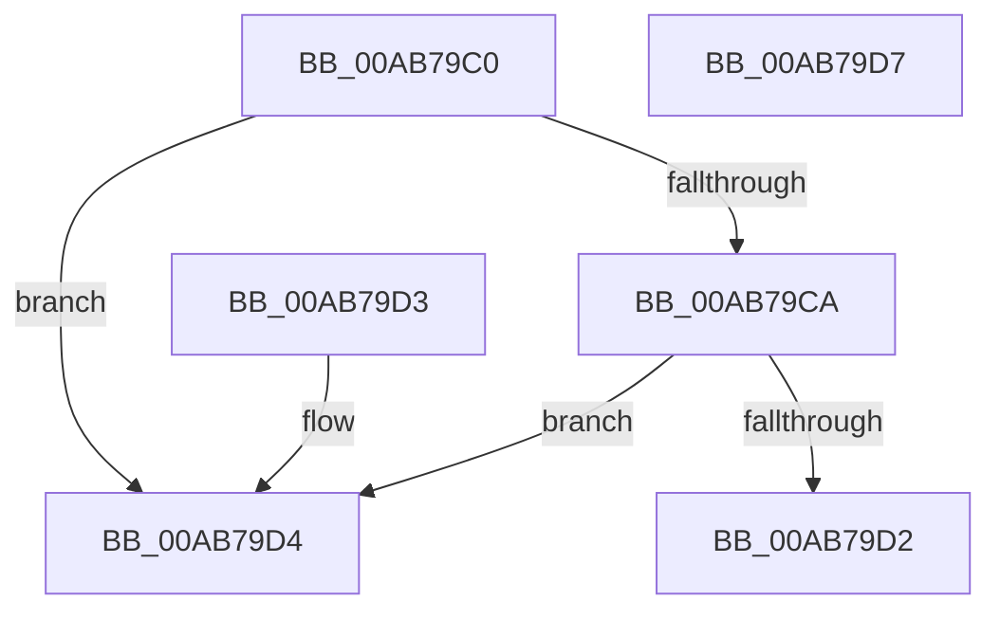

# ExpReducedLicenseData

- RVA: `0x00AB79C0`–`0x00AB79D8` (길이 `24` bytes)
- VA: `0x0000000140AB79C0`
- 실행 섹션: `PAGE`
- PDB 이름 있음: `예`; PDB Function 태그: `아니요`
- unwind 정보 RVA: `0x000DB714`
- 디코드: `10`개 명령, `24/24` bytes 표시
- 미해석 바이트: `0` (있으면 어셈블리에 `.byte`로 보존)

> 이 문서는 커널 이미지의 기계어와 PDB 기호를 분석해 생성했습니다. 4번과 5번은 함수 원형과 자료형을 바이너리 사용 방식에서 추정한 C 해석이며 원본 소스 복구 결과는 아닙니다.

## 1. Dependencies

- 직접 호출 지점: **0**; 고유 호출 대상: **0**
- 직접 호출자로 확인된 함수: **1**
- RIP 상대 이미지 참조: **2**

### Outgoing calls
- 직접 디코드된 call 명령이 없습니다.

### Direct callers
- [SLUpdateLicenseDataInternal](../7C/SLUpdateLicenseDataInternal_function_007C9C04.md) at `0x007C9DC6`

### Static image references
- `0x00AB79C2` → RVA `0x00FC41C4` (`.data`; read)
- `0x00AB79CA` → RVA `0x00FC4148` (`.data`; read)

## 2. Other-region calls and transfers

- 다른 실행 섹션으로 향하는 call: **0**
- 별도 외부 분기/꼬리 이동을 확인하지 못했습니다.

## 3. Assembly (complete function range)

```asm
00AB79C0  33 C0                           xor eax, eax
00AB79C2  39 05 FC C7 50 00               cmp dword ptr [rip + 0x50c7fc], eax
00AB79C8  75 0A                           jne 0x140ab79d4
00AB79CA  38 05 78 C7 50 00               cmp byte ptr [rip + 0x50c778], al
00AB79D0  75 02                           jne 0x140ab79d4
00AB79D2  C3                              ret
00AB79D3  CC                              int3
00AB79D4  B0 01                           mov al, 1
00AB79D6  C3                              ret
00AB79D7  CC                              int3
```

## 4. C-style interpretation (structured pseudocode)

```c
__int64 __fastcall ExpReducedLicenseData(void)
{
    __int64 result;

    result = 0;
    if ((*(unsigned int *)(v_rip + 5294076)) != 0) goto loc_00AB79D4;
    if ((*(unsigned __int8 *)(v_rip + 5293944)) != 0) goto loc_00AB79D4;
    return result;
loc_00AB79D4:
    return 1;
}
```

## 5. (Beta) C Style

```c
void ExpReducedLicenseData(void)
{
    int64_t result;

    result = 0;
    if ((*(uint32_t *)(v_rip + 0x50C7FC)) != 0) goto loc_00AB79D4;
    if ((*(uint8_t *)(v_rip + 0x50C778)) != 0) goto loc_00AB79D4;
    return result;
loc_00AB79D4:
    return 1;
}
```

## 6. Execution-region graph

[열기: 2D/3D 그래프와 함수 탐색 컨트롤 패널](../../../control-panel.html?section=page&rva=0x00AB79C0&view=graph)

- 2D 그래프는 위에서 아래로 흐르고, 3D 그래프는 빈 공간을 드래그해 회전합니다. Shift+드래그는 이동, 휠은 확대·축소, 함수 노드 선택은 대상 보고서 이동입니다.

### Static fallback


