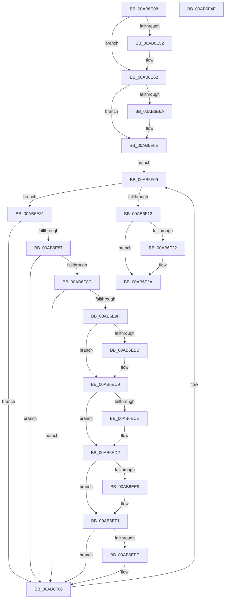

# ExpWnfInvalidateDataStores

- RVA: `0x00AB6E08`–`0x00AB6F50` (길이 `328` bytes)
- VA: `0x0000000140AB6E08`
- 실행 섹션: `PAGE`
- PDB 이름 있음: `예`; PDB Function 태그: `아니요`
- unwind 정보 RVA: `0x000BCF54`
- 디코드: `94`개 명령, `328/328` bytes 표시
- 미해석 바이트: `0` (있으면 어셈블리에 `.byte`로 보존)

> 이 문서는 커널 이미지의 기계어와 PDB 기호를 분석해 생성했습니다. 4번과 5번은 함수 원형과 자료형을 바이너리 사용 방식에서 추정한 C 해석이며 원본 소스 복구 결과는 아닙니다.

## 1. Dependencies

- 직접 호출 지점: **10**; 고유 호출 대상: **8**
- 직접 호출자로 확인된 함수: **1**
- RIP 상대 이미지 참조: **2**

### Outgoing calls
- `0x00AB6E38` → [KeAbPreAcquire](../../text/21/KeAbPreAcquire_function_00210230.md) (function, `0x00210230`)
- `0x00AB6E5D` → [ExfAcquirePushLockSharedEx](../../text/21/ExfAcquirePushLockSharedEx_function_0021044C.md) (function, `0x0021044C`)
- `0x00AB6E96` → [memcmp](../../text/6C/memcmp_function_006C6B10.md) (function, `0x006C6B10`)
- `0x00AB6EAB` → [KeAbPreAcquire](../../text/21/KeAbPreAcquire_function_00210230.md) (function, `0x00210230`)
- `0x00AB6EC4` → [ExfAcquirePushLockExclusiveEx](../../text/20/ExfAcquirePushLockExclusiveEx_function_0020FC90.md) (function, `0x0020FC90`)
- `0x00AB6EEC` → [ExfTryToWakePushLock](../../text/26/ExfTryToWakePushLock_function_00265DD0.md) (function, `0x00265DD0`)
- `0x00AB6EF4` → [KeAbPostRelease](../../text/2E/KeAbPostRelease_function_002E1600.md) (function, `0x002E1600`)
- `0x00AB6F01` → [ZwClose](../../text/6A/ZwClose_function_006AD2B0.md) (function, `0x006AD2B0`)
- `0x00AB6F25` → [ExfReleasePushLockShared](../../text/26/ExfReleasePushLockShared_function_00263440.md) (function, `0x00263440`)
- `0x00AB6F2D` → [KeAbPostRelease](../../text/2E/KeAbPostRelease_function_002E1600.md) (function, `0x002E1600`)

### Direct callers
- [ExWnfHiveUnloaded](../9A/ExWnfHiveUnloaded_function_009AF900.md) at `0x009AF9F6`

### Static image references
- `0x00AB6E26` → RVA `0x00FD9C88` (`PAGEDATA`; read)
- `0x00AB6E6E` → RVA `0x00FD82B0` (`PAGEDATA`; read)

## 2. Other-region calls and transfers

- 다른 실행 섹션으로 향하는 call: **10**
  - `0x00AB6E38` → [KeAbPreAcquire](../../text/21/KeAbPreAcquire_function_00210230.md) (`PAGE` → `.text`)
  - `0x00AB6E5D` → [ExfAcquirePushLockSharedEx](../../text/21/ExfAcquirePushLockSharedEx_function_0021044C.md) (`PAGE` → `.text`)
  - `0x00AB6E96` → [memcmp](../../text/6C/memcmp_function_006C6B10.md) (`PAGE` → `.text`)
  - `0x00AB6EAB` → [KeAbPreAcquire](../../text/21/KeAbPreAcquire_function_00210230.md) (`PAGE` → `.text`)
  - `0x00AB6EC4` → [ExfAcquirePushLockExclusiveEx](../../text/20/ExfAcquirePushLockExclusiveEx_function_0020FC90.md) (`PAGE` → `.text`)
  - `0x00AB6EEC` → [ExfTryToWakePushLock](../../text/26/ExfTryToWakePushLock_function_00265DD0.md) (`PAGE` → `.text`)
  - `0x00AB6EF4` → [KeAbPostRelease](../../text/2E/KeAbPostRelease_function_002E1600.md) (`PAGE` → `.text`)
  - `0x00AB6F01` → [ZwClose](../../text/6A/ZwClose_function_006AD2B0.md) (`PAGE` → `.text`)
  - `0x00AB6F25` → [ExfReleasePushLockShared](../../text/26/ExfReleasePushLockShared_function_00263440.md) (`PAGE` → `.text`)
  - `0x00AB6F2D` → [KeAbPostRelease](../../text/2E/KeAbPostRelease_function_002E1600.md) (`PAGE` → `.text`)
- 별도 외부 분기/꼬리 이동을 확인하지 못했습니다.

## 3. Assembly (complete function range)

```asm
00AB6E08  48 89 5C 24 08                  mov qword ptr [rsp + 8], rbx
00AB6E0D  48 89 6C 24 10                  mov qword ptr [rsp + 0x10], rbp
00AB6E12  48 89 74 24 20                  mov qword ptr [rsp + 0x20], rsi
00AB6E17  57                              push rdi
00AB6E18  41 54                           push r12
00AB6E1A  41 55                           push r13
00AB6E1C  41 56                           push r14
00AB6E1E  41 57                           push r15
00AB6E20  48 83 EC 20                     sub rsp, 0x20
00AB6E24  8B EA                           mov ebp, edx
00AB6E26  4C 8D 25 5B 2E 52 00            lea r12, [rip + 0x522e5b]
00AB6E2D  4C 8B F1                        mov r14, rcx
00AB6E30  45 33 C0                        xor r8d, r8d
00AB6E33  49 8B CC                        mov rcx, r12
00AB6E36  33 D2                           xor edx, edx
00AB6E38  E8 F3 93 75 FF                  call 0x140210230
00AB6E3D  48 8B D8                        mov rbx, rax
00AB6E40  B9 11 00 00 00                  mov ecx, 0x11
00AB6E45  33 C0                           xor eax, eax
00AB6E47  F0 48 0F B1 0D 38 2E 52 00      lock cmpxchg qword ptr [rip + 0x522e38], rcx
00AB6E50  74 10                           je 0x140ab6e62
00AB6E52  4D 8B CC                        mov r9, r12
00AB6E55  4C 8B C3                        mov r8, rbx
00AB6E58  33 D2                           xor edx, edx
00AB6E5A  49 8B CC                        mov rcx, r12
00AB6E5D  E8 EA 95 75 FF                  call 0x14021044c
00AB6E62  45 33 FF                        xor r15d, r15d
00AB6E65  48 85 DB                        test rbx, rbx
00AB6E68  74 04                           je 0x140ab6e6e
00AB6E6A  C6 43 0A 01                     mov byte ptr [rbx + 0xa], 1
00AB6E6E  48 8B 1D 3B 14 52 00            mov rbx, qword ptr [rip + 0x52143b]
00AB6E75  4C 8D 2D 34 14 52 00            lea r13, [rip + 0x521434]
00AB6E7C  E9 88 00 00 00                  jmp 0x140ab6f09
00AB6E81  4C 39 7B F8                     cmp qword ptr [rbx - 8], r15
00AB6E85  74 7F                           je 0x140ab6f06
00AB6E87  39 6B 14                        cmp dword ptr [rbx + 0x14], ebp
00AB6E8A  75 7A                           jne 0x140ab6f06
00AB6E8C  4C 8B C5                        mov r8, rbp
00AB6E8F  48 8D 53 18                     lea rdx, [rbx + 0x18]
00AB6E93  49 8B CE                        mov rcx, r14
00AB6E96  E8 75 FC C0 FF                  call 0x1406c6b10
00AB6E9B  85 C0                           test eax, eax
00AB6E9D  75 67                           jne 0x140ab6f06
00AB6E9F  48 8D 7B F0                     lea rdi, [rbx - 0x10]
00AB6EA3  45 33 C0                        xor r8d, r8d
00AB6EA6  48 8B CF                        mov rcx, rdi
00AB6EA9  33 D2                           xor edx, edx
00AB6EAB  E8 80 93 75 FF                  call 0x140210230
00AB6EB0  F0 48 0F BA 2F 00               lock bts qword ptr [rdi], 0
00AB6EB6  48 8B F0                        mov rsi, rax
00AB6EB9  73 0E                           jae 0x140ab6ec9
00AB6EBB  4C 8B C7                        mov r8, rdi
00AB6EBE  48 8B D0                        mov rdx, rax
00AB6EC1  48 8B CF                        mov rcx, rdi
00AB6EC4  E8 C7 8D 75 FF                  call 0x14020fc90
00AB6EC9  48 85 F6                        test rsi, rsi
00AB6ECC  74 04                           je 0x140ab6ed2
00AB6ECE  C6 46 0A 01                     mov byte ptr [rsi + 0xa], 1
00AB6ED2  48 8B 73 F8                     mov rsi, qword ptr [rbx - 8]
00AB6ED6  48 83 C8 FF                     or rax, 0xffffffffffffffff
00AB6EDA  4C 89 7B F8                     mov qword ptr [rbx - 8], r15
00AB6EDE  F0 48 0F C1 07                  lock xadd qword ptr [rdi], rax
00AB6EE3  24 06                           and al, 6
00AB6EE5  3C 02                           cmp al, 2
00AB6EE7  75 08                           jne 0x140ab6ef1
00AB6EE9  48 8B CF                        mov rcx, rdi
00AB6EEC  E8 DF EE 7A FF                  call 0x140265dd0
00AB6EF1  48 8B CF                        mov rcx, rdi
00AB6EF4  E8 07 A7 82 FF                  call 0x1402e1600
00AB6EF9  48 85 F6                        test rsi, rsi
00AB6EFC  74 08                           je 0x140ab6f06
00AB6EFE  48 8B CE                        mov rcx, rsi
00AB6F01  E8 AA 63 BF FF                  call 0x1406ad2b0
00AB6F06  48 8B 1B                        mov rbx, qword ptr [rbx]
00AB6F09  49 3B DD                        cmp rbx, r13
00AB6F0C  0F 85 6F FF FF FF               jne 0x140ab6e81
00AB6F12  B8 11 00 00 00                  mov eax, 0x11
00AB6F17  F0 4C 0F B1 3D 68 2D 52 00      lock cmpxchg qword ptr [rip + 0x522d68], r15
00AB6F20  74 08                           je 0x140ab6f2a
00AB6F22  49 8B CC                        mov rcx, r12
00AB6F25  E8 16 C5 7A FF                  call 0x140263440
00AB6F2A  49 8B CC                        mov rcx, r12
00AB6F2D  E8 CE A6 82 FF                  call 0x1402e1600
00AB6F32  48 8B 5C 24 50                  mov rbx, qword ptr [rsp + 0x50]
00AB6F37  48 8B 6C 24 58                  mov rbp, qword ptr [rsp + 0x58]
00AB6F3C  48 8B 74 24 68                  mov rsi, qword ptr [rsp + 0x68]
00AB6F41  48 83 C4 20                     add rsp, 0x20
00AB6F45  41 5F                           pop r15
00AB6F47  41 5E                           pop r14
00AB6F49  41 5D                           pop r13
00AB6F4B  41 5C                           pop r12
00AB6F4D  5F                              pop rdi
00AB6F4E  C3                              ret
00AB6F4F  CC                              int3
```

## 4. C-style interpretation (structured pseudocode)

```c
__int64 __fastcall ExpWnfInvalidateDataStores(__int64 a1, int a2, int a3)
{
    __int64 result;
    __int64 v_r15;
    __int64 v_rsp;
    unsigned __int64 v_stack_p10;
    unsigned __int64 v_stack_p20;
    unsigned __int64 v_stack_p8;

    v_stack_p8 = v_rbx;
    v_stack_p10 = v_rbp;
    v_stack_p20 = v_rsi;
    v_rsp = (v_rsp) - (32);
    a3 = 0;
    a2 = 0;
    result = KeAbPreAcquire(v_rip + 5385819, a2, a3, a4);
    result = 0;
    if (!(condition_is_equal)) {
        a4 = v_rip + 5385819;
        a3 = 0;
        a2 = 0;
        a1 = v_rip + 5385819;
        result = ExfAcquirePushLockSharedEx(a1, a2, a3, a4);
    }
    v_r15 = 0;
    if (result != 0) {
        *(unsigned __int8 *)(result + 10) = 1;
    }
    goto loc_00AB6F09;
loc_00AB6E81:
    if ((*(unsigned __int64 *)(*(unsigned __int64 *)(v_rip + 5379131) - 8)) == 0) goto loc_00AB6F06;
    if ((*(unsigned int *)(*(unsigned __int64 *)(v_rip + 5379131) + 20)) != ((unsigned int)((unsigned int)(a2)))) goto loc_00AB6F06;
    result = memcmp(a1, *(unsigned __int64 *)(v_rip + 5379131) + 24, (unsigned int)(a2), a4);
    if ((unsigned int)(result) != 0) goto loc_00AB6F06;
    a3 = 0;
    a2 = 0;
    result = KeAbPreAcquire(*(unsigned __int64 *)(v_rip + 5379131) - 16, a2, a3, a4);
    if (!(condition_is_above_or_equal)) {
        a3 = *(unsigned __int64 *)(v_rip + 5379131) - 16;
        a2 = result;
        a1 = *(unsigned __int64 *)(v_rip + 5379131) - 16;
        result = ExfAcquirePushLockExclusiveEx(a1, a2, a3, a4);
    }
    if (result != 0) {
        *(unsigned __int8 *)(result + 10) = 1;
    }
    result = (result) | (-1);
    *(unsigned __int64 *)(*(unsigned __int64 *)(v_rip + 5379131) - 8) = 0;
    result = (unsigned __int8)((result) & (6));
    if (((unsigned __int8)(result)) == 2) {
        a1 = *(unsigned __int64 *)(v_rip + 5379131) - 16;
        result = ExfTryToWakePushLock(a1, a2, a3, a4);
    }
    result = KeAbPostRelease(*(unsigned __int64 *)(v_rip + 5379131) - 16, a2, a3, a4);
    if (*(unsigned __int64 *)(*(unsigned __int64 *)(v_rip + 5379131) - 8) != 0) {
        a1 = *(unsigned __int64 *)(*(unsigned __int64 *)(v_rip + 5379131) - 8);
        result = ZwClose(a1, a2, a3, a4);
    }
loc_00AB6F09:
    if ((*(unsigned __int64 *)(*(unsigned __int64 *)(v_rip + 5379131))) != (v_rip + 5379124)) goto loc_00AB6E81;
    result = 17;
    if ((*(unsigned __int64 *)(*(unsigned __int64 *)(v_rip + 5379131))) != (v_rip + 5379124)) {
        a1 = v_rip + 5385819;
        result = ExfReleasePushLockShared(a1, a2, a3, a4);
    }
    result = KeAbPostRelease(v_rip + 5385819, a2, a3, a4);
    v_rsp = (v_rsp) + (32);
    return result;
}
```

## 5. (Beta) C Style

```c
int64_t ExpWnfInvalidateDataStores(int64_t Arg1, int32_t Arg2, int32_t Arg3)
{
    int64_t result;
    int64_t local_r15;
    int64_t local_rsp;
    uint64_t v_stack_p10;
    uint64_t v_stack_p20;
    uint64_t v_stack_p8;

    v_stack_p8 = local_rbx;
    v_stack_p10 = local_rbp;
    v_stack_p20 = local_rsi;
    local_rsp = (local_rsp) - (32);
    Arg3 = 0;
    Arg2 = 0;
    result = KeAbPreAcquire(v_rip + 5385819, Arg2, Arg3, a4);
    result = 0;
    if (!(condition_is_equal)) {
        a4 = v_rip + 5385819;
        Arg3 = 0;
        Arg2 = 0;
        Arg1 = v_rip + 5385819;
        result = ExfAcquirePushLockSharedEx(Arg1, Arg2, Arg3, a4);
    }
    local_r15 = 0;
    if (result != 0) {
        *(uint8_t *)(result + 0xA) = 1;
    }
    goto loc_00AB6F09;
loc_00AB6E81:
    if ((*(uint64_t *)(*(uint64_t *)(v_rip + 0x52143B) - 0x8)) == 0) goto loc_00AB6F06;
    if ((*(uint32_t *)(*(uint64_t *)(v_rip + 0x52143B) + 0x14)) != ((uint32_t)((uint32_t)(Arg2)))) goto loc_00AB6F06;
    result = memcmp(Arg1, *(uint64_t *)(v_rip + 0x52143B) + 24, (uint32_t)(Arg2), a4);
    if ((uint32_t)(result) != 0) goto loc_00AB6F06;
    Arg3 = 0;
    Arg2 = 0;
    result = KeAbPreAcquire(*(uint64_t *)(v_rip + 0x52143B) - 16, Arg2, Arg3, a4);
    if (!(condition_is_above_or_equal)) {
        Arg3 = *(uint64_t *)(v_rip + 0x52143B) - 16;
        Arg2 = result;
        Arg1 = *(uint64_t *)(v_rip + 0x52143B) - 16;
        result = ExfAcquirePushLockExclusiveEx(Arg1, Arg2, Arg3, a4);
    }
    if (result != 0) {
        *(uint8_t *)(result + 0xA) = 1;
    }
    result = (result) | (-1);
    *(uint64_t *)(*(uint64_t *)(v_rip + 0x52143B) - 0x8) = 0;
    result = (uint8_t)((result) & (6));
    if (((uint8_t)(result)) == 2) {
        Arg1 = *(uint64_t *)(v_rip + 0x52143B) - 16;
        result = ExfTryToWakePushLock(Arg1, Arg2, Arg3, a4);
    }
    result = KeAbPostRelease(*(uint64_t *)(v_rip + 0x52143B) - 16, Arg2, Arg3, a4);
    if (*(uint64_t *)(*(uint64_t *)(v_rip + 0x52143B) - 0x8) != 0) {
        Arg1 = *(uint64_t *)(*(uint64_t *)(v_rip + 0x52143B) - 0x8);
        result = ZwClose(Arg1, Arg2, Arg3, a4);
    }
loc_00AB6F09:
    if ((*(uint64_t *)(*(uint64_t *)(v_rip + 0x52143B))) != (v_rip + 5379124)) goto loc_00AB6E81;
    result = 17;
    if ((*(uint64_t *)(*(uint64_t *)(v_rip + 0x52143B))) != (v_rip + 5379124)) {
        Arg1 = v_rip + 5385819;
        result = ExfReleasePushLockShared(Arg1, Arg2, Arg3, a4);
    }
    result = KeAbPostRelease(v_rip + 5385819, Arg2, Arg3, a4);
    local_rsp = (local_rsp) + (32);
    return result;
}
```

## 6. Execution-region graph

[열기: 2D/3D 그래프와 함수 탐색 컨트롤 패널](../../../control-panel.html?section=page&rva=0x00AB6E08&view=graph)

- 2D 그래프는 위에서 아래로 흐르고, 3D 그래프는 빈 공간을 드래그해 회전합니다. Shift+드래그는 이동, 휠은 확대·축소, 함수 노드 선택은 대상 보고서 이동입니다.

### Static fallback


