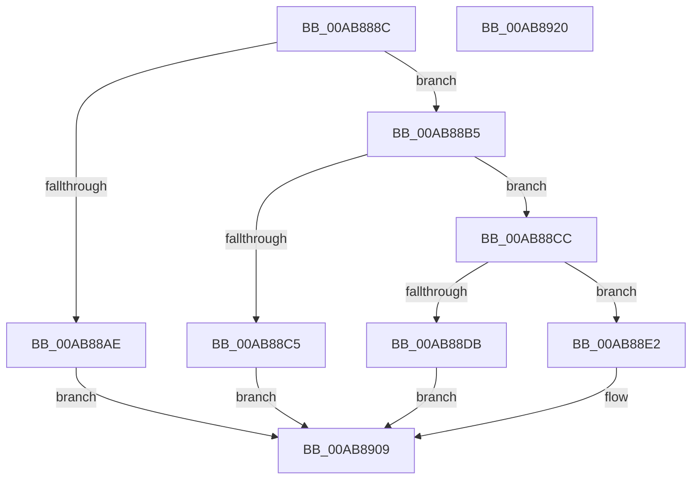

# HalpQueryPrimaryInterruptInformation

- RVA: `0x00AB888C`–`0x00AB8921` (길이 `149` bytes)
- VA: `0x0000000140AB888C`
- 실행 섹션: `PAGE`
- PDB 이름 있음: `예`; PDB Function 태그: `아니요`
- unwind 정보 RVA: `0x0005C954`
- 디코드: `45`개 명령, `149/149` bytes 표시
- 미해석 바이트: `0` (있으면 어셈블리에 `.byte`로 보존)

> 이 문서는 커널 이미지의 기계어와 PDB 기호를 분석해 생성했습니다. 4번과 5번은 함수 원형과 자료형을 바이너리 사용 방식에서 추정한 C 해석이며 원본 소스 복구 결과는 아닙니다.

## 1. Dependencies

- 직접 호출 지점: **4**; 고유 호출 대상: **4**
- 직접 호출자로 확인된 함수: **1**
- RIP 상대 이미지 참조: **1**

### Outgoing calls
- `0x00AB88BC` → [HalpIsInterruptTypeSecondary](../../text/2D/HalpIsInterruptTypeSecondary_function_002D2510.md) (function, `0x002D2510`)
- `0x00AB88CE` → [HalpFindSecondaryIcEntry](../../text/2D/HalpFindSecondaryIcEntry_function_002D219C.md) (function, `0x002D219C`)
- `0x00AB88EF` → [guard_dispatch_icall](../../text/6B/guard_dispatch_icall_function_006BAAD0.md) (function, `0x006BAAD0`)
- `0x00AB88FB` → [HalpReleaseSecondaryIcEntryShared](../../text/48/HalpReleaseSecondaryIcEntryShared_function_00488FD0.md) (function, `0x00488FD0`)

### Direct callers
- [HalpSecondaryInterruptQueryPrimaryInformation](HalpSecondaryInterruptQueryPrimaryInformation_function_00AB8830.md) at `0x00AB8861`

### Static image references
- `0x00AB88A5` → RVA `0x00E10424` (`.data`; read)

## 2. Other-region calls and transfers

- 다른 실행 섹션으로 향하는 call: **4**
  - `0x00AB88BC` → [HalpIsInterruptTypeSecondary](../../text/2D/HalpIsInterruptTypeSecondary_function_002D2510.md) (`PAGE` → `.text`)
  - `0x00AB88CE` → [HalpFindSecondaryIcEntry](../../text/2D/HalpFindSecondaryIcEntry_function_002D219C.md) (`PAGE` → `.text`)
  - `0x00AB88EF` → [guard_dispatch_icall](../../text/6B/guard_dispatch_icall_function_006BAAD0.md) (`PAGE` → `.text`)
  - `0x00AB88FB` → [HalpReleaseSecondaryIcEntryShared](../../text/48/HalpReleaseSecondaryIcEntryShared_function_00488FD0.md) (`PAGE` → `.text`)
- 별도 외부 분기/꼬리 이동을 확인하지 못했습니다.

## 3. Assembly (complete function range)

```asm
00AB888C  48 89 5C 24 08                  mov qword ptr [rsp + 8], rbx
00AB8891  48 89 6C 24 10                  mov qword ptr [rsp + 0x10], rbp
00AB8896  48 89 74 24 18                  mov qword ptr [rsp + 0x18], rsi
00AB889B  57                              push rdi
00AB889C  48 83 EC 20                     sub rsp, 0x20
00AB88A0  33 FF                           xor edi, edi
00AB88A2  48 8B EA                        mov rbp, rdx
00AB88A5  40 38 3D 78 7B 35 00            cmp byte ptr [rip + 0x357b78], dil
00AB88AC  75 07                           jne 0x140ab88b5
00AB88AE  BF BB 00 00 C0                  mov edi, 0xc00000bb
00AB88B3  EB 54                           jmp 0x140ab8909
00AB88B5  8B 59 38                        mov ebx, dword ptr [rcx + 0x38]
00AB88B8  8B D3                           mov edx, ebx
00AB88BA  8B 09                           mov ecx, dword ptr [rcx]
00AB88BC  E8 4F 9C 81 FF                  call 0x1402d2510
00AB88C1  84 C0                           test al, al
00AB88C3  75 07                           jne 0x140ab88cc
00AB88C5  BF 0D 00 00 C0                  mov edi, 0xc000000d
00AB88CA  EB 3D                           jmp 0x140ab8909
00AB88CC  8B CB                           mov ecx, ebx
00AB88CE  E8 C9 98 81 FF                  call 0x1402d219c
00AB88D3  48 8B F0                        mov rsi, rax
00AB88D6  48 85 C0                        test rax, rax
00AB88D9  75 07                           jne 0x140ab88e2
00AB88DB  BF 21 A1 00 C0                  mov edi, 0xc000a121
00AB88E0  EB 27                           jmp 0x140ab8909
00AB88E2  48 8B 40 58                     mov rax, qword ptr [rax + 0x58]
00AB88E6  4C 8B C5                        mov r8, rbp
00AB88E9  48 8B 4E 20                     mov rcx, qword ptr [rsi + 0x20]
00AB88ED  8B D3                           mov edx, ebx
00AB88EF  E8 DC 21 C0 FF                  call 0x1406baad0
00AB88F4  8B D8                           mov ebx, eax
00AB88F6  B2 01                           mov dl, 1
00AB88F8  48 8B CE                        mov rcx, rsi
00AB88FB  E8 D0 06 9D FF                  call 0x140488fd0
00AB8900  81 FB 16 00 00 C0               cmp ebx, 0xc0000016
00AB8906  0F 45 FB                        cmovne edi, ebx
00AB8909  48 8B 5C 24 30                  mov rbx, qword ptr [rsp + 0x30]
00AB890E  8B C7                           mov eax, edi
00AB8910  48 8B 6C 24 38                  mov rbp, qword ptr [rsp + 0x38]
00AB8915  48 8B 74 24 40                  mov rsi, qword ptr [rsp + 0x40]
00AB891A  48 83 C4 20                     add rsp, 0x20
00AB891E  5F                              pop rdi
00AB891F  C3                              ret
00AB8920  CC                              int3
```

## 4. C-style interpretation (structured pseudocode)

```c
__int64 __fastcall HalpQueryPrimaryInterruptInformation(__int64 a1, __int64 a2)
{
    __int64 result;
    __int64 v_rdi;
    __int64 v_rsp;
    unsigned __int64 v_stack_p10;
    unsigned __int64 v_stack_p18;
    unsigned __int64 v_stack_p8;

    v_stack_p8 = v_rbx;
    v_stack_p10 = v_rbp;
    v_stack_p18 = v_rsi;
    v_rsp = (v_rsp) - (32);
    v_rdi = 0;
    if ((*(unsigned __int8 *)(v_rip + 3505016)) != 0) goto loc_00AB88B5;
    goto loc_00AB8909;
loc_00AB88B5:
    result = HalpIsInterruptTypeSecondary((unsigned int)(*(unsigned int *)(a1)), (unsigned int)((unsigned int)((unsigned int)(*(unsigned int *)(a1 + 56)))), a3, a4);
    if ((unsigned __int8)(result) != 0) goto loc_00AB88CC;
    goto loc_00AB8909;
loc_00AB88CC:
    result = HalpFindSecondaryIcEntry((unsigned int)((unsigned int)((unsigned int)(*(unsigned int *)(a1 + 56)))), (unsigned int)((unsigned int)((unsigned int)(*(unsigned int *)(a1 + 56)))), a3, a4);
    if (result != 0) goto loc_00AB88E2;
    goto loc_00AB8909;
loc_00AB88E2:
    result = guard_dispatch_icall(*(unsigned __int64 *)(result + 32), (unsigned int)((unsigned int)((unsigned int)(*(unsigned int *)(a1 + 56)))), a2, a4);
    result = HalpReleaseSecondaryIcEntryShared(result, 1, a2, a4);
    v_rdi = (unsigned int)(0xC000A121ULL);
    if (((unsigned int)((unsigned int)((unsigned int)(result)))) != 0xC0000016ULL) { v_rdi = (unsigned int)((unsigned int)((unsigned int)(result))); }
loc_00AB8909:
    v_rsp = (v_rsp) + (32);
    return (unsigned int)((unsigned int)(v_rdi));
}
```

## 5. (Beta) C Style

```c
int64_t HalpQueryPrimaryInterruptInformation(void *Arg1, int64_t Arg2)
{
    uint8_t *arg1 = (uint8_t *)Arg1;

    int64_t result;
    int64_t local_rdi;
    int64_t local_rsp;
    uint64_t v_stack_p10;
    uint64_t v_stack_p18;
    uint64_t v_stack_p8;

    v_stack_p8 = local_rbx;
    v_stack_p10 = local_rbp;
    v_stack_p18 = local_rsi;
    local_rsp = (local_rsp) - (32);
    local_rdi = 0;
    if ((*(uint8_t *)(v_rip + 0x357B78)) != 0) goto loc_00AB88B5;
    goto loc_00AB8909;
loc_00AB88B5:
    result = HalpIsInterruptTypeSecondary((uint32_t)(*(uint32_t *)(arg1)), (uint32_t)((uint32_t)((uint32_t)(*(uint32_t *)(arg1 + 0x38)))), a3, a4);
    if ((uint8_t)(result) != 0) goto loc_00AB88CC;
    goto loc_00AB8909;
loc_00AB88CC:
    result = HalpFindSecondaryIcEntry((uint32_t)((uint32_t)((uint32_t)(*(uint32_t *)(arg1 + 0x38)))), (uint32_t)((uint32_t)((uint32_t)(*(uint32_t *)(arg1 + 0x38)))), a3, a4);
    if (result != 0) goto loc_00AB88E2;
    goto loc_00AB8909;
loc_00AB88E2:
    result = guard_dispatch_icall(*(uint64_t *)(result + 0x20), (uint32_t)((uint32_t)((uint32_t)(*(uint32_t *)(arg1 + 0x38)))), Arg2, a4);
    result = HalpReleaseSecondaryIcEntryShared(result, 1, Arg2, a4);
    local_rdi = (uint32_t)(0xC000A121ULL);
    if (((uint32_t)((uint32_t)((uint32_t)(result)))) != 0xC0000016ULL) { local_rdi = (uint32_t)((uint32_t)((uint32_t)(result))); }
loc_00AB8909:
    local_rsp = (local_rsp) + (32);
    return (uint32_t)((uint32_t)(local_rdi));
}
```

### 관측된 메모리 오프셋

구조체 형식이 확인되지 않은 접근은 인자 기준의 오프셋으로만 기록했습니다.

| 기준 인자 | 오프셋 표현 | 폭 (bit) | 접근 |
|---|---:|---:|---|
| `Arg1` | `+ 0x0` | `32` | `R` |
| `Arg1` | `+ 0x38` | `32` | `R` |

## 6. Execution-region graph

[열기: 2D/3D 그래프와 함수 탐색 컨트롤 패널](../../../control-panel.html?section=page&rva=0x00AB888C&view=graph)

- 2D 그래프는 위에서 아래로 흐르고, 3D 그래프는 빈 공간을 드래그해 회전합니다. Shift+드래그는 이동, 휠은 확대·축소, 함수 노드 선택은 대상 보고서 이동입니다.

### Static fallback


