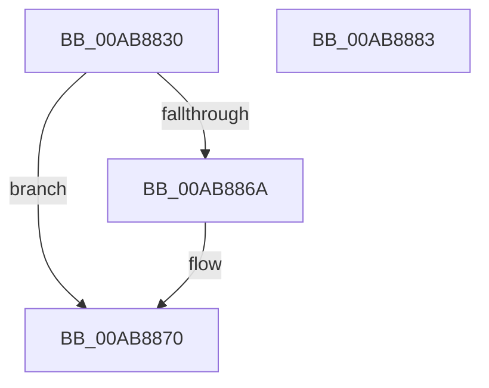

# HalpSecondaryInterruptQueryPrimaryInformation

- RVA: `0x00AB8830`–`0x00AB8884` (길이 `84` bytes)
- VA: `0x0000000140AB8830`
- 실행 섹션: `PAGE`
- PDB 이름 있음: `예`; PDB Function 태그: `아니요`
- unwind 정보 RVA: `0x000A06A8`
- 디코드: `24`개 명령, `84/84` bytes 표시
- 미해석 바이트: `0` (있으면 어셈블리에 `.byte`로 보존)

> 이 문서는 커널 이미지의 기계어와 PDB 기호를 분석해 생성했습니다. 4번과 5번은 함수 원형과 자료형을 바이너리 사용 방식에서 추정한 C 해석이며 원본 소스 복구 결과는 아닙니다.

## 1. Dependencies

- 직접 호출 지점: **2**; 고유 호출 대상: **2**
- 직접 호출자로 확인된 함수: **0**
- RIP 상대 이미지 참조: **1**

### Outgoing calls
- `0x00AB8861` → [HalpQueryPrimaryInterruptInformation](HalpQueryPrimaryInterruptInformation_function_00AB888C.md) (function, `0x00AB888C`)
- `0x00AB8878` → [_security_check_cookie](../../text/6A/_security_check_cookie_function_006AC640.md) (function, `0x006AC640`)

### Direct callers
- 이 함수 시작 RVA로 연결되는 직접 call은 확인되지 않았습니다. 간접 호출은 완전히 역산할 수 없습니다.

### Static image references
- `0x00AB8836` → RVA `0x00E0A740` (`.data`; read)

## 2. Other-region calls and transfers

- 다른 실행 섹션으로 향하는 call: **1**
  - `0x00AB8878` → [_security_check_cookie](../../text/6A/_security_check_cookie_function_006AC640.md) (`PAGE` → `.text`)
- 별도 외부 분기/꼬리 이동을 확인하지 못했습니다.

## 3. Assembly (complete function range)

```asm
00AB8830  40 53                           push rbx
00AB8832  48 83 EC 50                     sub rsp, 0x50
00AB8836  48 8B 05 03 1F 35 00            mov rax, qword ptr [rip + 0x351f03]
00AB883D  48 33 C4                        xor rax, rsp
00AB8840  48 89 44 24 48                  mov qword ptr [rsp + 0x48], rax
00AB8845  0F 57 C0                        xorps xmm0, xmm0
00AB8848  48 8B DA                        mov rbx, rdx
00AB884B  33 C0                           xor eax, eax
00AB884D  48 8D 54 24 20                  lea rdx, [rsp + 0x20]
00AB8852  0F 11 44 24 20                  movups xmmword ptr [rsp + 0x20], xmm0
00AB8857  48 89 44 24 40                  mov qword ptr [rsp + 0x40], rax
00AB885C  0F 11 44 24 30                  movups xmmword ptr [rsp + 0x30], xmm0
00AB8861  E8 26 00 00 00                  call 0x140ab888c
00AB8866  85 C0                           test eax, eax
00AB8868  78 06                           js 0x140ab8870
00AB886A  8B 4C 24 24                     mov ecx, dword ptr [rsp + 0x24]
00AB886E  89 0B                           mov dword ptr [rbx], ecx
00AB8870  48 8B 4C 24 48                  mov rcx, qword ptr [rsp + 0x48]
00AB8875  48 33 CC                        xor rcx, rsp
00AB8878  E8 C3 3D BF FF                  call 0x1406ac640
00AB887D  48 83 C4 50                     add rsp, 0x50
00AB8881  5B                              pop rbx
00AB8882  C3                              ret
00AB8883  CC                              int3
```

## 4. C-style interpretation (structured pseudocode)

```c
__int64 __fastcall HalpSecondaryInterruptQueryPrimaryInformation(__int64 a1, __int64 a2)
{
    __int64 result;
    __int64 v_rsp;
    unsigned __int64 v_stack_m10;
    unsigned __int64 v_stack_m18;
    unsigned __int64 v_stack_m28;
    unsigned int v_stack_m34;
    unsigned __int64 v_stack_m38;

    v_rsp = (v_rsp) - (80);
    result = (*(unsigned __int64 *)(v_rip + 3481347)) ^ (v_rsp);
    v_stack_m10 = result;
    result = 0;
    v_stack_m38 = v_xmm0;
    v_stack_m18 = 0;
    v_stack_m28 = v_xmm0;
    result = HalpQueryPrimaryInterruptInformation(a1, v_stack_m38, a3, a4);
    if (!(sign_flag)) {
        a1 = v_stack_m34;
        *(unsigned int *)(a2) = (unsigned int)(a1);
    }
    a1 = (v_stack_m10) ^ (v_rsp);
    result = _security_check_cookie(a1, v_stack_m38, a3, a4);
    v_rsp = (v_rsp) + (80);
    return result;
}
```

## 5. (Beta) C Style

```c
int64_t HalpSecondaryInterruptQueryPrimaryInformation(int64_t Arg1, void *Arg2)
{
    uint8_t *arg2 = (uint8_t *)Arg2;

    int64_t result;
    int64_t local_rsp;
    uint64_t v_stack_m10;
    uint64_t v_stack_m18;
    uint64_t v_stack_m28;
    uint32_t v_stack_m34;
    uint64_t v_stack_m38;

    local_rsp = (local_rsp) - (80);
    result = (*(uint64_t *)(v_rip + 0x351F03)) ^ (local_rsp);
    v_stack_m10 = result;
    result = 0;
    v_stack_m38 = v_xmm0;
    v_stack_m18 = 0;
    v_stack_m28 = v_xmm0;
    result = HalpQueryPrimaryInterruptInformation(Arg1, v_stack_m38, a3, a4);
    if (!(sign_flag)) {
        Arg1 = v_stack_m34;
        *(uint32_t *)(arg2) = (uint32_t)(Arg1);
    }
    Arg1 = (v_stack_m10) ^ (local_rsp);
    result = _security_check_cookie(Arg1, v_stack_m38, a3, a4);
    local_rsp = (local_rsp) + (80);
    return result;
}
```

### 관측된 메모리 오프셋

구조체 형식이 확인되지 않은 접근은 인자 기준의 오프셋으로만 기록했습니다.

| 기준 인자 | 오프셋 표현 | 폭 (bit) | 접근 |
|---|---:|---:|---|
| `Arg2` | `+ 0x0` | `32` | `W` |

## 6. Execution-region graph

[열기: 2D/3D 그래프와 함수 탐색 컨트롤 패널](../../../control-panel.html?section=page&rva=0x00AB8830&view=graph)

- 2D 그래프는 위에서 아래로 흐르고, 3D 그래프는 빈 공간을 드래그해 회전합니다. Shift+드래그는 이동, 휠은 확대·축소, 함수 노드 선택은 대상 보고서 이동입니다.

### Static fallback


