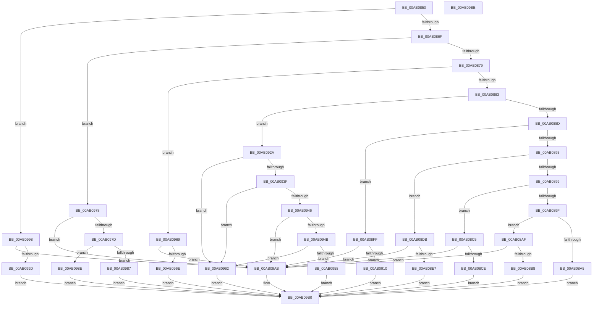

# HalpSetSystemInformation

- RVA: `0x00AB0850`–`0x00AB09BC` (길이 `364` bytes)
- VA: `0x0000000140AB0850`
- 실행 섹션: `PAGE`
- PDB 이름 있음: `예`; PDB Function 태그: `아니요`
- unwind 정보 RVA: `0x00068D5C`
- 디코드: `98`개 명령, `364/364` bytes 표시
- 미해석 바이트: `0` (있으면 어셈블리에 `.byte`로 보존)

> 이 문서는 커널 이미지의 기계어와 PDB 기호를 분석해 생성했습니다. 4번과 5번은 함수 원형과 자료형을 바이너리 사용 방식에서 추정한 C 해석이며 원본 소스 복구 결과는 아닙니다.

## 1. Dependencies

- 직접 호출 지점: **10**; 고유 호출 대상: **9**
- 직접 호출자로 확인된 함수: **0**
- RIP 상대 이미지 참조: **2**

### Outgoing calls
- `0x00AB08A5` → [HaliSetSystemInformation](../70/HaliSetSystemInformation_function_0070BF54.md) (function, `0x0070BF54`)
- `0x00AB08BB` → [HalpUnregisterPmuNotification](../AC/HalpUnregisterPmuNotification_function_00ACAB7C.md) (function, `0x00ACAB7C`)
- `0x00AB08D1` → [HalpRegisterPmuNotification](../70/HalpRegisterPmuNotification_function_0070C38C.md) (function, `0x0070C38C`)
- `0x00AB08F5` → [guard_dispatch_icall](../../text/6B/guard_dispatch_icall_function_006BAAD0.md) (function, `0x006BAAD0`)
- `0x00AB0920` → [guard_dispatch_icall](../../text/6B/guard_dispatch_icall_function_006BAAD0.md) (function, `0x006BAAD0`)
- `0x00AB0936` → [HalpGetCpuInfo](../../text/49/HalpGetCpuInfo_function_00498A70.md) (function, `0x00498A70`)
- `0x00AB095B` → [HalpRegisterProcessorTraceInterruptHandler](../../text/56/HalpRegisterProcessorTraceInterruptHandler_function_00563F10.md) (function, `0x00563F10`)
- `0x00AB0971` → [HalpRegisterTimerInterruptHandler](../../text/56/HalpRegisterTimerInterruptHandler_function_00564050.md) (function, `0x00564050`)
- `0x00AB0991` → [HalpRegisterProfileSourceInterruptHandler](../../text/56/HalpRegisterProfileSourceInterruptHandler_function_00563FB0.md) (function, `0x00563FB0`)
- `0x00AB09A4` → [HalpSetProfileSourceInterval](../../text/4F/HalpSetProfileSourceInterval_function_004FC36C.md) (function, `0x004FC36C`)

### Direct callers
- 이 함수 시작 RVA로 연결되는 직접 call은 확인되지 않았습니다. 간접 호출은 완전히 역산할 수 없습니다.

### Static image references
- `0x00AB08E7` → RVA `0x00E03B20` (`.data`; read)
- `0x00AB094B` → RVA `0x00FC1C44` (`.data`; read)

## 2. Other-region calls and transfers

- 다른 실행 섹션으로 향하는 call: **7**
  - `0x00AB08F5` → [guard_dispatch_icall](../../text/6B/guard_dispatch_icall_function_006BAAD0.md) (`PAGE` → `.text`)
  - `0x00AB0920` → [guard_dispatch_icall](../../text/6B/guard_dispatch_icall_function_006BAAD0.md) (`PAGE` → `.text`)
  - `0x00AB0936` → [HalpGetCpuInfo](../../text/49/HalpGetCpuInfo_function_00498A70.md) (`PAGE` → `.text`)
  - `0x00AB095B` → [HalpRegisterProcessorTraceInterruptHandler](../../text/56/HalpRegisterProcessorTraceInterruptHandler_function_00563F10.md) (`PAGE` → `.text`)
  - `0x00AB0971` → [HalpRegisterTimerInterruptHandler](../../text/56/HalpRegisterTimerInterruptHandler_function_00564050.md) (`PAGE` → `.text`)
  - `0x00AB0991` → [HalpRegisterProfileSourceInterruptHandler](../../text/56/HalpRegisterProfileSourceInterruptHandler_function_00563FB0.md) (`PAGE` → `.text`)
  - `0x00AB09A4` → [HalpSetProfileSourceInterval](../../text/4F/HalpSetProfileSourceInterval_function_004FC36C.md) (`PAGE` → `.text`)
- 별도 외부 분기/꼬리 이동을 확인하지 못했습니다.

## 3. Assembly (complete function range)

```asm
00AB0850  48 89 5C 24 10                  mov qword ptr [rsp + 0x10], rbx
00AB0855  57                              push rdi
00AB0856  48 83 EC 20                     sub rsp, 0x20
00AB085A  C6 44 24 30 00                  mov byte ptr [rsp + 0x30], 0
00AB085F  49 8B F8                        mov rdi, r8
00AB0862  8B DA                           mov ebx, edx
00AB0864  44 8B C9                        mov r9d, ecx
00AB0867  85 C9                           test ecx, ecx
00AB0869  0F 84 29 01 00 00               je 0x140ab0998
00AB086F  41 83 E9 01                     sub r9d, 1
00AB0873  0F 84 FF 00 00 00               je 0x140ab0978
00AB0879  41 83 E9 09                     sub r9d, 9
00AB087D  0F 84 E6 00 00 00               je 0x140ab0969
00AB0883  41 83 E9 09                     sub r9d, 9
00AB0887  0F 84 9D 00 00 00               je 0x140ab092a
00AB088D  41 83 E9 01                     sub r9d, 1
00AB0891  74 6C                           je 0x140ab08ff
00AB0893  41 83 E9 01                     sub r9d, 1
00AB0897  74 42                           je 0x140ab08db
00AB0899  41 83 E9 03                     sub r9d, 3
00AB089D  74 26                           je 0x140ab08c5
00AB089F  41 83 F9 01                     cmp r9d, 1
00AB08A3  74 0A                           je 0x140ab08af
00AB08A5  E8 AA B6 C5 FF                  call 0x14070bf54
00AB08AA  E9 01 01 00 00                  jmp 0x140ab09b0
00AB08AF  83 FB 08                        cmp ebx, 8
00AB08B2  0F 82 F3 00 00 00               jb 0x140ab09ab
00AB08B8  48 8B CF                        mov rcx, rdi
00AB08BB  E8 BC A2 01 00                  call 0x140acab7c
00AB08C0  E9 EB 00 00 00                  jmp 0x140ab09b0
00AB08C5  83 FB 18                        cmp ebx, 0x18
00AB08C8  0F 82 DD 00 00 00               jb 0x140ab09ab
00AB08CE  48 8B CF                        mov rcx, rdi
00AB08D1  E8 B6 BA C5 FF                  call 0x14070c38c
00AB08D6  E9 D5 00 00 00                  jmp 0x140ab09b0
00AB08DB  81 FB 10 01 00 00               cmp ebx, 0x110
00AB08E1  0F 85 C4 00 00 00               jne 0x140ab09ab
00AB08E7  48 8B 05 32 32 35 00            mov rax, qword ptr [rip + 0x353232]
00AB08EE  48 8B CF                        mov rcx, rdi
00AB08F1  48 8B 40 60                     mov rax, qword ptr [rax + 0x60]
00AB08F5  E8 D6 A1 C0 FF                  call 0x1406baad0
00AB08FA  E9 B1 00 00 00                  jmp 0x140ab09b0
00AB08FF  8D 82 E0 FE FF FF               lea eax, [rdx - 0x120]
00AB0905  3D F6 01 00 00                  cmp eax, 0x1f6
00AB090A  0F 87 9B 00 00 00               ja 0x140ab09ab
00AB0910  48 8B 05 09 32 35 00            mov rax, qword ptr [rip + 0x353209]
00AB0917  33 D2                           xor edx, edx
00AB0919  48 8B CF                        mov rcx, rdi
00AB091C  48 8B 40 58                     mov rax, qword ptr [rax + 0x58]
00AB0920  E8 AB A1 C0 FF                  call 0x1406baad0
00AB0925  E9 86 00 00 00                  jmp 0x140ab09b0
00AB092A  4C 8D 4C 24 30                  lea r9, [rsp + 0x30]
00AB092F  45 33 C0                        xor r8d, r8d
00AB0932  33 D2                           xor edx, edx
00AB0934  33 C9                           xor ecx, ecx
00AB0936  E8 35 81 9E FF                  call 0x140498a70
00AB093B  84 C0                           test al, al
00AB093D  74 23                           je 0x140ab0962
00AB093F  80 7C 24 30 02                  cmp byte ptr [rsp + 0x30], 2
00AB0944  75 1C                           jne 0x140ab0962
00AB0946  83 FB 08                        cmp ebx, 8
00AB0949  75 60                           jne 0x140ab09ab
00AB094B  8B 05 F3 12 51 00               mov eax, dword ptr [rip + 0x5112f3]
00AB0951  83 E0 41                        and eax, 0x41
00AB0954  3C 41                           cmp al, 0x41
00AB0956  75 0A                           jne 0x140ab0962
00AB0958  48 8B 0F                        mov rcx, qword ptr [rdi]
00AB095B  E8 B0 35 AB FF                  call 0x140563f10
00AB0960  EB 4E                           jmp 0x140ab09b0
00AB0962  B8 BB 00 00 C0                  mov eax, 0xc00000bb
00AB0967  EB 47                           jmp 0x140ab09b0
00AB0969  83 FB 08                        cmp ebx, 8
00AB096C  75 3D                           jne 0x140ab09ab
00AB096E  49 8B 08                        mov rcx, qword ptr [r8]
00AB0971  E8 DA 36 AB FF                  call 0x140564050
00AB0976  EB 38                           jmp 0x140ab09b0
00AB0978  83 FB 08                        cmp ebx, 8
00AB097B  75 2E                           jne 0x140ab09ab
00AB097D  8B 05 C1 12 51 00               mov eax, dword ptr [rip + 0x5112c1]
00AB0983  A8 01                           test al, 1
00AB0985  75 07                           jne 0x140ab098e
00AB0987  B8 01 00 00 C0                  mov eax, 0xc0000001
00AB098C  EB 22                           jmp 0x140ab09b0
00AB098E  49 8B 08                        mov rcx, qword ptr [r8]
00AB0991  E8 1A 36 AB FF                  call 0x140563fb0
00AB0996  EB 18                           jmp 0x140ab09b0
00AB0998  83 FB 08                        cmp ebx, 8
00AB099B  75 0E                           jne 0x140ab09ab
00AB099D  41 8B 08                        mov ecx, dword ptr [r8]
00AB09A0  49 8D 50 04                     lea rdx, [r8 + 4]
00AB09A4  E8 C3 B9 A4 FF                  call 0x1404fc36c
00AB09A9  EB 05                           jmp 0x140ab09b0
00AB09AB  B8 04 00 00 C0                  mov eax, 0xc0000004
00AB09B0  48 8B 5C 24 38                  mov rbx, qword ptr [rsp + 0x38]
00AB09B5  48 83 C4 20                     add rsp, 0x20
00AB09B9  5F                              pop rdi
00AB09BA  C3                              ret
00AB09BB  CC                              int3
```

## 4. C-style interpretation (structured pseudocode)

```c
__int64 __fastcall HalpSetSystemInformation(int a1, __int64 a2, __int64 a3)
{
    __int64 result;
    __int64 v_rsp;
    unsigned __int64 v_stack_p10;
    unsigned __int8 v_stack_p8;

    v_stack_p10 = v_rbx;
    v_rsp = (v_rsp) - (32);
    v_stack_p8 = 0;
    if (a1 == 0) goto loc_00AB0998;
    a4 = (unsigned int)(((unsigned int)(a1)) - (1));
    if (condition_is_equal) goto loc_00AB0978;
    a4 = (unsigned int)((a4) - (9));
    if (condition_is_equal) goto loc_00AB0969;
    a4 = (unsigned int)((a4) - (9));
    if (condition_is_equal) goto loc_00AB092A;
    a4 = (unsigned int)((a4) - (1));
    if (condition_is_equal) goto loc_00AB08FF;
    a4 = (unsigned int)((a4) - (1));
    if (condition_is_equal) goto loc_00AB08DB;
    a4 = (unsigned int)((a4) - (3));
    if (condition_is_equal) goto loc_00AB08C5;
    if (((unsigned int)(a4)) == 1) goto loc_00AB08AF;
    result = HaliSetSystemInformation(a1, a2, a3, a4);
    goto loc_00AB09B0;
loc_00AB08AF:
    if (((unsigned int)((unsigned int)((unsigned int)(a2)))) < 8) goto loc_00AB09AB;
    result = HalpUnregisterPmuNotification(a3, a2, a3, a4);
    goto loc_00AB09B0;
loc_00AB08C5:
    if (((unsigned int)((unsigned int)((unsigned int)(a2)))) < 24) goto loc_00AB09AB;
    result = HalpRegisterPmuNotification(a3, a2, a3, a4);
    goto loc_00AB09B0;
loc_00AB08DB:
    if (((unsigned int)((unsigned int)((unsigned int)(a2)))) != 272) goto loc_00AB09AB;
    result = guard_dispatch_icall(a3, a2, a3, a4);
    goto loc_00AB09B0;
loc_00AB08FF:
    if (((unsigned int)(a2 - 288)) > 502) goto loc_00AB09AB;
    a2 = 0;
    result = guard_dispatch_icall(a3, a2, a3, a4);
    goto loc_00AB09B0;
loc_00AB092A:
    a3 = 0;
    a2 = 0;
    a1 = 0;
    result = HalpGetCpuInfo(a1, a2, a3, v_stack_p8);
    if ((unsigned __int8)(result) == 0) goto loc_00AB0962;
    if (v_stack_p8 != 2) goto loc_00AB0962;
    if (((unsigned int)((unsigned int)((unsigned int)(a2)))) != 8) goto loc_00AB09AB;
    result = (unsigned int)(((unsigned int)(*(unsigned int *)(v_rip + 5313267))) & (65));
    if (((unsigned __int8)(result)) != 65) goto loc_00AB0962;
    result = HalpRegisterProcessorTraceInterruptHandler(*(unsigned __int64 *)(a3), a2, a3, v_stack_p8);
    goto loc_00AB09B0;
loc_00AB0962:
    goto loc_00AB09B0;
loc_00AB0969:
    if (((unsigned int)((unsigned int)((unsigned int)(a2)))) != 8) goto loc_00AB09AB;
    result = HalpRegisterTimerInterruptHandler(*(unsigned __int64 *)(a3), a2, a3, v_stack_p8);
    goto loc_00AB09B0;
loc_00AB0978:
    if (((unsigned int)((unsigned int)((unsigned int)(a2)))) != 8) goto loc_00AB09AB;
    if ((((unsigned __int8)((unsigned int)(*(unsigned int *)(v_rip + 5313217)))) & (1)) != 0) goto loc_00AB098E;
    goto loc_00AB09B0;
loc_00AB098E:
    result = HalpRegisterProfileSourceInterruptHandler(*(unsigned __int64 *)(a3), a2, a3, v_stack_p8);
    goto loc_00AB09B0;
loc_00AB0998:
    if (((unsigned int)((unsigned int)((unsigned int)(a2)))) != 8) goto loc_00AB09AB;
    result = HalpSetProfileSourceInterval((unsigned int)(*(unsigned int *)(a3)), a3 + 4, a3, v_stack_p8);
    goto loc_00AB09B0;
loc_00AB09AB:
loc_00AB09B0:
    v_rsp = (v_rsp) + (32);
    return (unsigned int)(0xC0000004ULL);
}
```

## 5. (Beta) C Style

```c
int64_t HalpSetSystemInformation(int32_t Arg1, void *Arg2, void *Arg3)
{
    uint8_t *arg2 = (uint8_t *)Arg2;
    uint8_t *arg3 = (uint8_t *)Arg3;

    int64_t result;
    int64_t local_rsp;
    uint64_t v_stack_p10;
    uint8_t v_stack_p8;

    v_stack_p10 = local_rbx;
    local_rsp = (local_rsp) - (32);
    v_stack_p8 = 0;
    if (Arg1 == 0) goto loc_00AB0998;
    a4 = (uint32_t)(((uint32_t)(Arg1)) - (1));
    if (condition_is_equal) goto loc_00AB0978;
    a4 = (uint32_t)((a4) - (9));
    if (condition_is_equal) goto loc_00AB0969;
    a4 = (uint32_t)((a4) - (9));
    if (condition_is_equal) goto loc_00AB092A;
    a4 = (uint32_t)((a4) - (1));
    if (condition_is_equal) goto loc_00AB08FF;
    a4 = (uint32_t)((a4) - (1));
    if (condition_is_equal) goto loc_00AB08DB;
    a4 = (uint32_t)((a4) - (3));
    if (condition_is_equal) goto loc_00AB08C5;
    if (((uint32_t)(a4)) == 1) goto loc_00AB08AF;
    result = HaliSetSystemInformation(Arg1, Arg2, Arg3, a4);
    goto loc_00AB09B0;
loc_00AB08AF:
    if (((uint32_t)((uint32_t)((uint32_t)(Arg2)))) < 8) goto loc_00AB09AB;
    result = HalpUnregisterPmuNotification(Arg3, Arg2, Arg3, a4);
    goto loc_00AB09B0;
loc_00AB08C5:
    if (((uint32_t)((uint32_t)((uint32_t)(Arg2)))) < 24) goto loc_00AB09AB;
    result = HalpRegisterPmuNotification(Arg3, Arg2, Arg3, a4);
    goto loc_00AB09B0;
loc_00AB08DB:
    if (((uint32_t)((uint32_t)((uint32_t)(Arg2)))) != 272) goto loc_00AB09AB;
    result = guard_dispatch_icall(Arg3, Arg2, Arg3, a4);
    goto loc_00AB09B0;
loc_00AB08FF:
    if (((uint32_t)(Arg2 - 288)) > 502) goto loc_00AB09AB;
    Arg2 = 0;
    result = guard_dispatch_icall(Arg3, Arg2, Arg3, a4);
    goto loc_00AB09B0;
loc_00AB092A:
    Arg3 = 0;
    Arg2 = 0;
    Arg1 = 0;
    result = HalpGetCpuInfo(Arg1, Arg2, Arg3, v_stack_p8);
    if ((uint8_t)(result) == 0) goto loc_00AB0962;
    if (v_stack_p8 != 2) goto loc_00AB0962;
    if (((uint32_t)((uint32_t)((uint32_t)(Arg2)))) != 8) goto loc_00AB09AB;
    result = (uint32_t)(((uint32_t)(*(uint32_t *)(v_rip + 0x5112F3))) & (65));
    if (((uint8_t)(result)) != 65) goto loc_00AB0962;
    result = HalpRegisterProcessorTraceInterruptHandler(*(uint64_t *)(arg3), Arg2, Arg3, v_stack_p8);
    goto loc_00AB09B0;
loc_00AB0962:
    goto loc_00AB09B0;
loc_00AB0969:
    if (((uint32_t)((uint32_t)((uint32_t)(Arg2)))) != 8) goto loc_00AB09AB;
    result = HalpRegisterTimerInterruptHandler(*(uint64_t *)(arg3), Arg2, Arg3, v_stack_p8);
    goto loc_00AB09B0;
loc_00AB0978:
    if (((uint32_t)((uint32_t)((uint32_t)(Arg2)))) != 8) goto loc_00AB09AB;
    if ((((uint8_t)((uint32_t)(*(uint32_t *)(v_rip + 0x5112C1)))) & (1)) != 0) goto loc_00AB098E;
    goto loc_00AB09B0;
loc_00AB098E:
    result = HalpRegisterProfileSourceInterruptHandler(*(uint64_t *)(arg3), Arg2, Arg3, v_stack_p8);
    goto loc_00AB09B0;
loc_00AB0998:
    if (((uint32_t)((uint32_t)((uint32_t)(Arg2)))) != 8) goto loc_00AB09AB;
    result = HalpSetProfileSourceInterval((uint32_t)(*(uint32_t *)(arg3)), Arg3 + 4, Arg3, v_stack_p8);
    goto loc_00AB09B0;
loc_00AB09AB:
loc_00AB09B0:
    local_rsp = (local_rsp) + (32);
    return (uint32_t)(0xC0000004ULL);
}
```

### 관측된 메모리 오프셋

구조체 형식이 확인되지 않은 접근은 인자 기준의 오프셋으로만 기록했습니다.

| 기준 인자 | 오프셋 표현 | 폭 (bit) | 접근 |
|---|---:|---:|---|
| `Arg2` | `- 0x120` | `32` | `R` |
| `Arg3` | `+ 0x0` | `32` | `R` |
| `Arg3` | `+ 0x0` | `64` | `R` |
| `Arg3` | `+ 0x4` | `64` | `R` |

## 6. Execution-region graph

[열기: 2D/3D 그래프와 함수 탐색 컨트롤 패널](../../../control-panel.html?section=page&rva=0x00AB0850&view=graph)

- 2D 그래프는 위에서 아래로 흐르고, 3D 그래프는 빈 공간을 드래그해 회전합니다. Shift+드래그는 이동, 휠은 확대·축소, 함수 노드 선택은 대상 보고서 이동입니다.

### Static fallback


