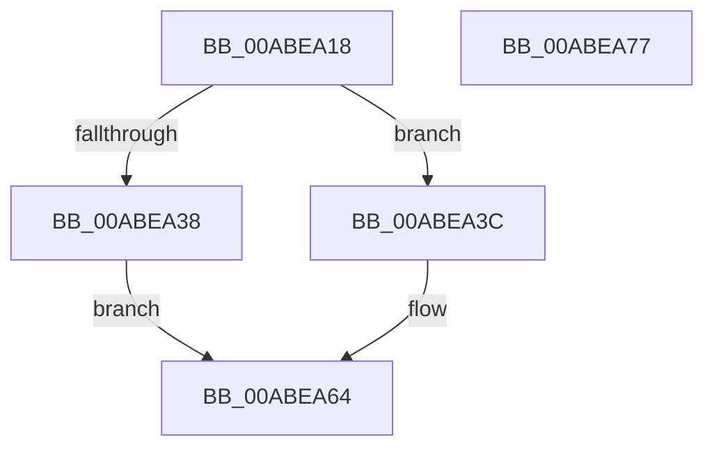

# HvpLogEntryCheckHeaderChecksum

- RVA: `0x00ABEA18`–`0x00ABEA78` (길이 `96` bytes)
- VA: `0x0000000140ABEA18`
- 실행 섹션: `PAGE`
- PDB 이름 있음: `예`; PDB Function 태그: `아니요`
- unwind 정보 RVA: `0x000BD6E0`
- 디코드: `26`개 명령, `96/96` bytes 표시
- 미해석 바이트: `0` (있으면 어셈블리에 `.byte`로 보존)

> 이 문서는 커널 이미지의 기계어와 PDB 기호를 분석해 생성했습니다. 4번과 5번은 함수 원형과 자료형을 바이너리 사용 방식에서 추정한 C 해석이며 원본 소스 복구 결과는 아닙니다.

## 1. Dependencies

- 직접 호출 지점: **2**; 고유 호출 대상: **2**
- 직접 호출자로 확인된 함수: **1**
- RIP 상대 이미지 참조: **2**

### Outgoing calls
- `0x00ABEA51` → [SymCryptMarvin32](../../text/51/SymCryptMarvin32_function_0051F308.md) (function, `0x0051F308`)
- `0x00ABEA6C` → [_security_check_cookie](../../text/6A/_security_check_cookie_function_006AC640.md) (function, `0x006AC640`)

### Direct callers
- [HvpIsLogEntryHeaderCoherent](../AA/HvpIsLogEntryHeaderCoherent_function_00AA0934.md) at `0x00AA0991`

### Static image references
- `0x00ABEA1E` → RVA `0x00E0A740` (`.data`; read)
- `0x00ABEA4A` → RVA `0x00E2CB20` (`.data`; read)

## 2. Other-region calls and transfers

- 다른 실행 섹션으로 향하는 call: **2**
  - `0x00ABEA51` → [SymCryptMarvin32](../../text/51/SymCryptMarvin32_function_0051F308.md) (`PAGE` → `.text`)
  - `0x00ABEA6C` → [_security_check_cookie](../../text/6A/_security_check_cookie_function_006AC640.md) (`PAGE` → `.text`)
- 별도 외부 분기/꼬리 이동을 확인하지 못했습니다.

## 3. Assembly (complete function range)

```asm
00ABEA18  40 53                           push rbx
00ABEA1A  48 83 EC 30                     sub rsp, 0x30
00ABEA1E  48 8B 05 1B BD 34 00            mov rax, qword ptr [rip + 0x34bd1b]
00ABEA25  48 33 C4                        xor rax, rsp
00ABEA28  48 89 44 24 28                  mov qword ptr [rsp + 0x28], rax
00ABEA2D  81 39 48 76 4C 45               cmp dword ptr [rcx], 0x454c7648
00ABEA33  48 8B D9                        mov rbx, rcx
00ABEA36  74 04                           je 0x140abea3c
00ABEA38  33 C0                           xor eax, eax
00ABEA3A  EB 28                           jmp 0x140abea64
00ABEA3C  4C 8D 4C 24 20                  lea r9, [rsp + 0x20]
00ABEA41  41 B8 20 00 00 00               mov r8d, 0x20
00ABEA47  48 8B D3                        mov rdx, rbx
00ABEA4A  48 8D 0D CF E0 36 00            lea rcx, [rip + 0x36e0cf]
00ABEA51  E8 B2 08 A6 FF                  call 0x14051f308
00ABEA56  48 8B 4B 20                     mov rcx, qword ptr [rbx + 0x20]
00ABEA5A  33 C0                           xor eax, eax
00ABEA5C  48 3B 4C 24 20                  cmp rcx, qword ptr [rsp + 0x20]
00ABEA61  0F 94 C0                        sete al
00ABEA64  48 8B 4C 24 28                  mov rcx, qword ptr [rsp + 0x28]
00ABEA69  48 33 CC                        xor rcx, rsp
00ABEA6C  E8 CF DB BE FF                  call 0x1406ac640
00ABEA71  48 83 C4 30                     add rsp, 0x30
00ABEA75  5B                              pop rbx
00ABEA76  C3                              ret
00ABEA77  CC                              int3
```

## 4. C-style interpretation (structured pseudocode)

```c
__int64 __fastcall HvpLogEntryCheckHeaderChecksum(__int64 a1)
{
    __int64 result;
    __int64 v_rsp;
    unsigned __int64 v_stack_m10;
    unsigned __int64 v_stack_m18;

    v_rsp = (v_rsp) - (48);
    result = (*(unsigned __int64 *)(v_rip + 3456283)) ^ (v_rsp);
    v_stack_m10 = result;
    if ((*(unsigned int *)(a1)) == 0x454C7648ULL) goto loc_00ABEA3C;
    result = 0;
    goto loc_00ABEA64;
loc_00ABEA3C:
    result = SymCryptMarvin32(v_rip + 3596495, a1, 32, v_stack_m18);
    result = 0;
    result = ((*(unsigned __int64 *)(a1 + 32)) == v_stack_m18) ? 1 : 0;
loc_00ABEA64:
    a1 = (v_stack_m10) ^ (v_rsp);
    result = _security_check_cookie(a1, a1, 32, v_stack_m18);
    v_rsp = (v_rsp) + (48);
    return result;
}
```

## 5. (Beta) C Style

```c
int64_t HvpLogEntryCheckHeaderChecksum(void *Arg1)
{
    uint8_t *arg1 = (uint8_t *)Arg1;

    int64_t result;
    int64_t local_rsp;
    uint64_t v_stack_m10;
    uint64_t v_stack_m18;

    local_rsp = (local_rsp) - (48);
    result = (*(uint64_t *)(v_rip + 0x34BD1B)) ^ (local_rsp);
    v_stack_m10 = result;
    if ((*(uint32_t *)(arg1)) == 0x454C7648ULL) goto loc_00ABEA3C;
    result = 0;
    goto loc_00ABEA64;
loc_00ABEA3C:
    result = SymCryptMarvin32(v_rip + 3596495, Arg1, 32, v_stack_m18);
    result = 0;
    result = ((*(uint64_t *)(arg1 + 0x20)) == v_stack_m18) ? 1 : 0;
loc_00ABEA64:
    Arg1 = (v_stack_m10) ^ (local_rsp);
    result = _security_check_cookie(Arg1, Arg1, 32, v_stack_m18);
    local_rsp = (local_rsp) + (48);
    return result;
}
```

### 관측된 메모리 오프셋

구조체 형식이 확인되지 않은 접근은 인자 기준의 오프셋으로만 기록했습니다.

| 기준 인자 | 오프셋 표현 | 폭 (bit) | 접근 |
|---|---:|---:|---|
| `Arg1` | `+ 0x0` | `32` | `R` |
| `Arg1` | `+ 0x20` | `64` | `R` |

## 6. Execution-region graph

[열기: 2D/3D 그래프와 함수 탐색 컨트롤 패널](../../../control-panel.html?section=page&rva=0x00ABEA18&view=graph)

- 2D 그래프는 위에서 아래로 흐르고, 3D 그래프는 빈 공간을 드래그해 회전합니다. Shift+드래그는 이동, 휠은 확대·축소, 함수 노드 선택은 대상 보고서 이동입니다.

### Static fallback


