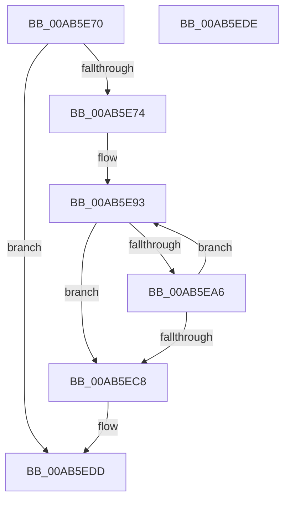

# HvpUpdateRecoveryVector

- RVA: `0x00AB5E70`–`0x00AB5EDF` (길이 `111` bytes)
- VA: `0x0000000140AB5E70`
- 실행 섹션: `PAGE`
- PDB 이름 있음: `예`; PDB Function 태그: `아니요`
- unwind 정보 RVA: `0x000BCDA0`
- 디코드: `36`개 명령, `111/111` bytes 표시
- 미해석 바이트: `0` (있으면 어셈블리에 `.byte`로 보존)

> 이 문서는 커널 이미지의 기계어와 PDB 기호를 분석해 생성했습니다. 4번과 5번은 함수 원형과 자료형을 바이너리 사용 방식에서 추정한 C 해석이며 원본 소스 복구 결과는 아닙니다.

## 1. Dependencies

- 직접 호출 지점: **1**; 고유 호출 대상: **1**
- 직접 호출자로 확인된 함수: **2**
- RIP 상대 이미지 참조: **0**

### Outgoing calls
- `0x00AB5EB9` → [RtlSetBits](../../text/3E/RtlSetBits_function_003E1610.md) (function, `0x003E1610`)

### Direct callers
- [HvpApplyLegacyLogFile](../7F/HvpApplyLegacyLogFile_function_007F66D0.md) at `0x007F68B4`
- [HvpApplyIncrementalLogFile](../AA/HvpApplyIncrementalLogFile_function_00AA06A8.md) at `0x00AA0786`

### Static image references
- 디코드된 RIP-relative 메모리 참조가 없습니다.

## 2. Other-region calls and transfers

- 다른 실행 섹션으로 향하는 call: **1**
  - `0x00AB5EB9` → [RtlSetBits](../../text/3E/RtlSetBits_function_003E1610.md) (`PAGE` → `.text`)
- 별도 외부 분기/꼬리 이동을 확인하지 못했습니다.

## 3. Assembly (complete function range)

```asm
00AB5E70  85 D2                           test edx, edx
00AB5E72  74 69                           je 0x140ab5edd
00AB5E74  48 89 5C 24 08                  mov qword ptr [rsp + 8], rbx
00AB5E79  48 89 74 24 10                  mov qword ptr [rsp + 0x10], rsi
00AB5E7E  48 89 7C 24 18                  mov qword ptr [rsp + 0x18], rdi
00AB5E83  41 56                           push r14
00AB5E85  48 83 EC 20                     sub rsp, 0x20
00AB5E89  4D 8B F0                        mov r14, r8
00AB5E8C  8B F2                           mov esi, edx
00AB5E8E  48 8B D9                        mov rbx, rcx
00AB5E91  33 FF                           xor edi, edi
00AB5E93  8B 13                           mov edx, dword ptr [rbx]
00AB5E95  8B 4B 04                        mov ecx, dword ptr [rbx + 4]
00AB5E98  45 8B 0E                        mov r9d, dword ptr [r14]
00AB5E9B  C1 EA 09                        shr edx, 9
00AB5E9E  C1 E9 09                        shr ecx, 9
00AB5EA1  41 3B D1                        cmp edx, r9d
00AB5EA4  73 22                           jae 0x140ab5ec8
00AB5EA6  8D 04 11                        lea eax, [rcx + rdx]
00AB5EA9  45 8B C1                        mov r8d, r9d
00AB5EAC  44 2B C2                        sub r8d, edx
00AB5EAF  41 3B C1                        cmp eax, r9d
00AB5EB2  44 0F 46 C1                     cmovbe r8d, ecx
00AB5EB6  49 8B CE                        mov rcx, r14
00AB5EB9  E8 52 B7 92 FF                  call 0x1403e1610
00AB5EBE  FF C7                           inc edi
00AB5EC0  48 83 C3 08                     add rbx, 8
00AB5EC4  3B FE                           cmp edi, esi
00AB5EC6  72 CB                           jb 0x140ab5e93
00AB5EC8  48 8B 5C 24 30                  mov rbx, qword ptr [rsp + 0x30]
00AB5ECD  48 8B 74 24 38                  mov rsi, qword ptr [rsp + 0x38]
00AB5ED2  48 8B 7C 24 40                  mov rdi, qword ptr [rsp + 0x40]
00AB5ED7  48 83 C4 20                     add rsp, 0x20
00AB5EDB  41 5E                           pop r14
00AB5EDD  C3                              ret
00AB5EDE  CC                              int3
```

## 4. C-style interpretation (structured pseudocode)

```c
__int64 __fastcall HvpUpdateRecoveryVector(__int64 a1, int a2, __int64 a3)
{
    __int64 result;
    __int64 v_rbx;
    __int64 v_rdi;
    __int64 v_rsp;
    unsigned __int64 v_stack_p10;
    unsigned __int64 v_stack_p18;
    unsigned __int64 v_stack_p8;

    if (a2 == 0) goto loc_00AB5EDD;
    v_stack_p8 = v_rbx;
    v_stack_p10 = v_rsi;
    v_stack_p18 = v_rdi;
    v_rsp = (v_rsp) - (32);
    v_rdi = 0;
loc_00AB5E93:
    a2 = (unsigned int)(((unsigned int)(*(unsigned int *)(a1))) >> (9));
    a1 = (unsigned int)(((unsigned int)(*(unsigned int *)(a1 + 4))) >> (9));
    if (a2 >= ((unsigned int)((unsigned int)(*(unsigned int *)(a3))))) goto loc_00AB5EC8;
    a3 = (unsigned int)(((unsigned int)((unsigned int)((unsigned int)(*(unsigned int *)(a3))))) - (a2));
    if (((unsigned int)(a1 + a2 * 1)) <= ((unsigned int)((unsigned int)(*(unsigned int *)(a3))))) { a3 = (unsigned int)(a1); }
    result = RtlSetBits(a3, a2, a3, (unsigned int)(*(unsigned int *)(a3)));
    v_rdi = (unsigned int)((v_rdi) + 1);
    v_rbx = (a1) + (8);
    if (((unsigned int)(v_rdi)) < ((unsigned int)((unsigned int)(a2)))) goto loc_00AB5E93;
loc_00AB5EC8:
    v_rsp = (v_rsp) + (32);
loc_00AB5EDD:
    return result;
}
```

## 5. (Beta) C Style

```c
int64_t HvpUpdateRecoveryVector(void *Arg1, int32_t Arg2, void *Arg3)
{
    uint8_t *arg1 = (uint8_t *)Arg1;
    uint8_t *arg3 = (uint8_t *)Arg3;

    int64_t result;
    int64_t local_rbx;
    int64_t local_rdi;
    int64_t local_rsp;
    uint64_t v_stack_p10;
    uint64_t v_stack_p18;
    uint64_t v_stack_p8;

    if (Arg2 == 0) goto loc_00AB5EDD;
    v_stack_p8 = local_rbx;
    v_stack_p10 = local_rsi;
    v_stack_p18 = local_rdi;
    local_rsp = (local_rsp) - (32);
    local_rdi = 0;
loc_00AB5E93:
    Arg2 = (uint32_t)(((uint32_t)(*(uint32_t *)(arg1))) >> (9));
    Arg1 = (uint32_t)(((uint32_t)(*(uint32_t *)(arg1 + 0x4))) >> (9));
    if (Arg2 >= ((uint32_t)((uint32_t)(*(uint32_t *)(arg3))))) goto loc_00AB5EC8;
    Arg3 = (uint32_t)(((uint32_t)((uint32_t)((uint32_t)(*(uint32_t *)(arg3))))) - (Arg2));
    if (((uint32_t)(Arg1 + Arg2 * 1)) <= ((uint32_t)((uint32_t)(*(uint32_t *)(arg3))))) { Arg3 = (uint32_t)(Arg1); }
    result = RtlSetBits(Arg3, Arg2, Arg3, (uint32_t)(*(uint32_t *)(arg3)));
    local_rdi = (uint32_t)((local_rdi) + 1);
    local_rbx = (Arg1) + (8);
    if (((uint32_t)(local_rdi)) < ((uint32_t)((uint32_t)(Arg2)))) goto loc_00AB5E93;
loc_00AB5EC8:
    local_rsp = (local_rsp) + (32);
loc_00AB5EDD:
    return result;
}
```

### 관측된 메모리 오프셋

구조체 형식이 확인되지 않은 접근은 인자 기준의 오프셋으로만 기록했습니다.

| 기준 인자 | 오프셋 표현 | 폭 (bit) | 접근 |
|---|---:|---:|---|
| `Arg1` | `+ 0x0` | `32` | `R` |
| `Arg1` | `+ 0x4` | `32` | `R` |
| `Arg3` | `+ 0x0` | `32` | `R` |

## 6. Execution-region graph

[열기: 2D/3D 그래프와 함수 탐색 컨트롤 패널](../../../control-panel.html?section=page&rva=0x00AB5E70&view=graph)

- 2D 그래프는 위에서 아래로 흐르고, 3D 그래프는 빈 공간을 드래그해 회전합니다. Shift+드래그는 이동, 휠은 확대·축소, 함수 노드 선택은 대상 보고서 이동입니다.

### Static fallback


