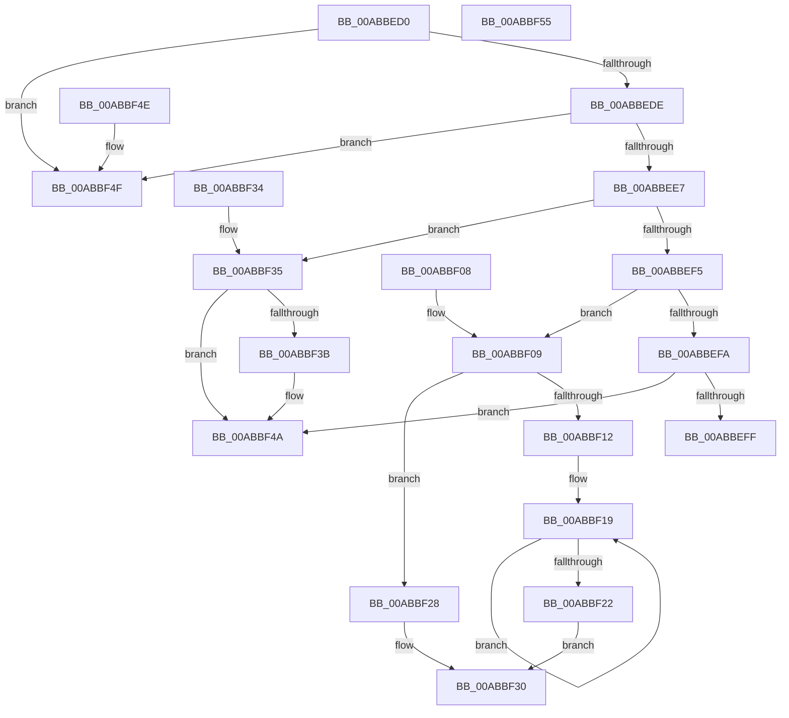

# IidGetDeviceIdBufferSize

- RVA: `0x00ABBED0`–`0x00ABBF56` (길이 `134` bytes)
- VA: `0x0000000140ABBED0`
- 실행 섹션: `PAGE`
- PDB 이름 있음: `예`; PDB Function 태그: `아니요`
- unwind 정보 RVA: `0x000DB714`
- 디코드: `47`개 명령, `134/134` bytes 표시
- 미해석 바이트: `0` (있으면 어셈블리에 `.byte`로 보존)

> 이 문서는 커널 이미지의 기계어와 PDB 기호를 분석해 생성했습니다. 4번과 5번은 함수 원형과 자료형을 바이너리 사용 방식에서 추정한 C 해석이며 원본 소스 복구 결과는 아닙니다.

## 1. Dependencies

- 직접 호출 지점: **0**; 고유 호출 대상: **0**
- 직접 호출자로 확인된 함수: **1**
- RIP 상대 이미지 참조: **0**

### Outgoing calls
- 직접 디코드된 call 명령이 없습니다.

### Direct callers
- [HalpIommuCloneDeviceId](../../text/4E/HalpIommuCloneDeviceId_function_004E4228.md) at `0x004E4243`

### Static image references
- 디코드된 RIP-relative 메모리 참조가 없습니다.

## 2. Other-region calls and transfers

- 다른 실행 섹션으로 향하는 call: **0**
- 별도 외부 분기/꼬리 이동을 확인하지 못했습니다.

## 3. Assembly (complete function range)

```asm
00ABBED0  45 33 C9                        xor r9d, r9d
00ABBED3  4C 8B C2                        mov r8, rdx
00ABBED6  4C 89 0A                        mov qword ptr [rdx], r9
00ABBED9  48 85 C9                        test rcx, rcx
00ABBEDC  74 71                           je 0x140abbf4f
00ABBEDE  8B 01                           mov eax, dword ptr [rcx]
00ABBEE0  FF C8                           dec eax
00ABBEE2  83 F8 04                        cmp eax, 4
00ABBEE5  77 68                           ja 0x140abbf4f
00ABBEE7  48 C7 02 18 00 00 00            mov qword ptr [rdx], 0x18
00ABBEEE  8B 11                           mov edx, dword ptr [rcx]
00ABBEF0  83 EA 01                        sub edx, 1
00ABBEF3  74 40                           je 0x140abbf35
00ABBEF5  83 EA 01                        sub edx, 1
00ABBEF8  74 0F                           je 0x140abbf09
00ABBEFA  83 FA 03                        cmp edx, 3
00ABBEFD  74 4B                           je 0x140abbf4a
00ABBEFF  4D 89 08                        mov qword ptr [r8], r9
00ABBF02  B8 BB 00 00 C0                  mov eax, 0xc00000bb
00ABBF07  C3                              ret
00ABBF08  CC                              int3
00ABBF09  48 8B 51 08                     mov rdx, qword ptr [rcx + 8]
00ABBF0D  48 85 D2                        test rdx, rdx
00ABBF10  74 16                           je 0x140abbf28
00ABBF12  41 8B C1                        mov eax, r9d
00ABBF15  48 83 C9 FF                     or rcx, 0xffffffffffffffff
00ABBF19  48 FF C1                        inc rcx
00ABBF1C  44 38 0C 0A                     cmp byte ptr [rdx + rcx], r9b
00ABBF20  75 F7                           jne 0x140abbf19
00ABBF22  48 83 C1 19                     add rcx, 0x19
00ABBF26  EB 08                           jmp 0x140abbf30
00ABBF28  B8 0D 00 00 C0                  mov eax, 0xc000000d
00ABBF2D  49 8B C9                        mov rcx, r9
00ABBF30  49 89 08                        mov qword ptr [r8], rcx
00ABBF33  C3                              ret
00ABBF34  CC                              int3
00ABBF35  4C 39 49 10                     cmp qword ptr [rcx + 0x10], r9
00ABBF39  74 0F                           je 0x140abbf4a
00ABBF3B  0F B7 41 0E                     movzx eax, word ptr [rcx + 0xe]
00ABBF3F  48 8D 04 45 18 00 00 00         lea rax, [rax*2 + 0x18]
00ABBF47  49 89 00                        mov qword ptr [r8], rax
00ABBF4A  41 8B C1                        mov eax, r9d
00ABBF4D  C3                              ret
00ABBF4E  CC                              int3
00ABBF4F  B8 0D 00 00 C0                  mov eax, 0xc000000d
00ABBF54  C3                              ret
00ABBF55  CC                              int3
```

## 4. C-style interpretation (structured pseudocode)

```c
__int64 __fastcall IidGetDeviceIdBufferSize(__int64 a1, __int64 a2, __int64 a3, int a4)
{
    __int64 result;

    a4 = 0;
    *(unsigned __int64 *)(a2) = 0;
    if (a1 == 0) goto loc_00ABBF4F;
    result = (unsigned int)(((unsigned int)(*(unsigned int *)(a1))) - 1);
    if (((unsigned int)(result)) > 4) goto loc_00ABBF4F;
    *(unsigned __int64 *)(a2) = 24;
    a2 = (unsigned int)(((unsigned int)(*(unsigned int *)(a1))) - (1));
    if (condition_is_equal) goto loc_00ABBF35;
    a2 = (unsigned int)((a2) - (1));
    if (condition_is_equal) goto loc_00ABBF09;
    if (((unsigned int)(a2)) == 3) goto loc_00ABBF4A;
    *(unsigned __int64 *)(a2) = 0;
    return (unsigned int)(0xC00000BBULL);
loc_00ABBF09:
    if (*(unsigned __int64 *)(a1 + 8) == 0) goto loc_00ABBF28;
    a1 = (a1) | (-1);
loc_00ABBF19:
    a1 = (a1) + 1;
    if ((*(unsigned __int8 *)(*(unsigned __int64 *)(a1 + 8) + a1 * 1)) != 0) goto loc_00ABBF19;
    a1 = (a1) + (25);
    goto loc_00ABBF30;
loc_00ABBF28:
loc_00ABBF30:
    *(unsigned __int64 *)(a2) = 0;
    return (unsigned int)(0xC000000DULL);
loc_00ABBF35:
    result = (unsigned int)(0xC000000DULL);
    if ((*(unsigned __int64 *)(0 + 16)) != 0) {
        result = *(unsigned __int16 *)(0 + 14);
        result = result * 2 + 24;
        *(unsigned __int64 *)(a2) = result;
    }
    return 0;
loc_00ABBF4F:
    return (unsigned int)(0xC000000DULL);
}
```

## 5. (Beta) C Style

```c
int64_t IidGetDeviceIdBufferSize(int64_t Arg1, void *Arg2, int64_t Arg3, int32_t Arg4)
{
    uint8_t *arg2 = (uint8_t *)Arg2;

    int64_t result;

    Arg4 = 0;
    *(uint64_t *)(arg2) = 0;
    if (Arg1 == 0) goto loc_00ABBF4F;
    result = (uint32_t)(((uint32_t)(*(uint32_t *)(Arg1))) - 1);
    if (((uint32_t)(result)) > 4) goto loc_00ABBF4F;
    *(uint64_t *)(arg2) = 24;
    Arg2 = (uint32_t)(((uint32_t)(*(uint32_t *)(Arg1))) - (1));
    if (condition_is_equal) goto loc_00ABBF35;
    Arg2 = (uint32_t)((Arg2) - (1));
    if (condition_is_equal) goto loc_00ABBF09;
    if (((uint32_t)(Arg2)) == 3) goto loc_00ABBF4A;
    *(uint64_t *)(arg2) = 0;
    return (uint32_t)(0xC00000BBULL);
loc_00ABBF09:
    if (*(uint64_t *)(Arg1 + 0x8) == 0) goto loc_00ABBF28;
    Arg1 = (Arg1) | (-1);
loc_00ABBF19:
    Arg1 = (Arg1) + 1;
    if ((*(uint8_t *)(*(uint64_t *)(Arg1 + 0x8) + Arg1 * 1)) != 0) goto loc_00ABBF19;
    Arg1 = (Arg1) + (25);
    goto loc_00ABBF30;
loc_00ABBF28:
loc_00ABBF30:
    *(uint64_t *)(arg2) = 0;
    return (uint32_t)(0xC000000DULL);
loc_00ABBF35:
    result = (uint32_t)(0xC000000DULL);
    if ((*(uint64_t *)(0 + 0x10)) != 0) {
        result = *(uint16_t *)(0 + 0xE);
        result = result * 2 + 24;
        *(uint64_t *)(arg2) = result;
    }
    return 0;
loc_00ABBF4F:
    return (uint32_t)(0xC000000DULL);
}
```

### 관측된 메모리 오프셋

구조체 형식이 확인되지 않은 접근은 인자 기준의 오프셋으로만 기록했습니다.

| 기준 인자 | 오프셋 표현 | 폭 (bit) | 접근 |
|---|---:|---:|---|
| `Arg2` | `+ 0x0` | `64` | `W` |

## 6. Execution-region graph

[열기: 2D/3D 그래프와 함수 탐색 컨트롤 패널](../../../control-panel.html?section=page&rva=0x00ABBED0&view=graph)

- 2D 그래프는 위에서 아래로 흐르고, 3D 그래프는 빈 공간을 드래그해 회전합니다. Shift+드래그는 이동, 휠은 확대·축소, 함수 노드 선택은 대상 보고서 이동입니다.

### Static fallback


