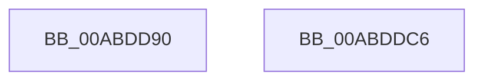

# IoFastQueryNetworkAttributes

- RVA: `0x00ABDD90`–`0x00ABDDC7` (길이 `55` bytes)
- VA: `0x0000000140ABDD90`
- 실행 섹션: `PAGE`
- PDB 이름 있음: `예`; PDB Function 태그: `아니요`
- unwind 정보 RVA: `0x0006C2A4`
- 디코드: `12`개 명령, `55/55` bytes 표시
- 미해석 바이트: `0` (있으면 어셈블리에 `.byte`로 보존)

> 이 문서는 커널 이미지의 기계어와 PDB 기호를 분석해 생성했습니다. 4번과 5번은 함수 원형과 자료형을 바이너리 사용 방식에서 추정한 C 해석이며 원본 소스 복구 결과는 아닙니다.

## 1. Dependencies

- 직접 호출 지점: **1**; 고유 호출 대상: **1**
- 직접 호출자로 확인된 함수: **0**
- RIP 상대 이미지 참조: **0**

### Outgoing calls
- `0x00ABDDBC` → [IopFastQueryNetworkAttributes](IopFastQueryNetworkAttributes_function_00ABDDD0.md) (function, `0x00ABDDD0`)

### Direct callers
- 이 함수 시작 RVA로 연결되는 직접 call은 확인되지 않았습니다. 간접 호출은 완전히 역산할 수 없습니다.

### Static image references
- 디코드된 RIP-relative 메모리 참조가 없습니다.

## 2. Other-region calls and transfers

- 다른 실행 섹션으로 향하는 call: **0**
- 별도 외부 분기/꼬리 이동을 확인하지 못했습니다.

## 3. Assembly (complete function range)

```asm
00ABDD90  48 83 EC 58                     sub rsp, 0x58
00ABDD94  65 48 8B 04 25 88 01 00 00      mov rax, qword ptr gs:[0x188]
00ABDD9D  45 8B D0                        mov r10d, r8d
00ABDDA0  44 8A 80 32 02 00 00            mov r8b, byte ptr [rax + 0x232]
00ABDDA7  48 8B 84 24 80 00 00 00         mov rax, qword ptr [rsp + 0x80]
00ABDDAF  48 89 44 24 28                  mov qword ptr [rsp + 0x28], rax
00ABDDB4  4C 89 4C 24 20                  mov qword ptr [rsp + 0x20], r9
00ABDDB9  45 8B CA                        mov r9d, r10d
00ABDDBC  E8 0F 00 00 00                  call 0x140abddd0
00ABDDC1  48 83 C4 58                     add rsp, 0x58
00ABDDC5  C3                              ret
00ABDDC6  CC                              int3
```

## 4. C-style interpretation (structured pseudocode)

```c
__int64 __fastcall IoFastQueryNetworkAttributes(__int64 a1, __int64 a2, int a3, __int64 a4, __int64 a5)
{
    __int64 result;
    __int64 v_rsp;
    unsigned __int64 v_stack_m30;
    unsigned __int64 v_stack_m38;

    v_rsp = (v_rsp) - (88);
    v_stack_m30 = a5;
    v_stack_m38 = a4;
    result = IopFastQueryNetworkAttributes(a1, a2, *(unsigned __int8 *)(*(unsigned __int64 *)(gs_base + (0 + 392)) + 562), (unsigned int)((unsigned int)((unsigned int)(a3))));
    v_rsp = (v_rsp) + (88);
    return result;
}
```

## 5. (Beta) C Style

```c
int64_t IoFastQueryNetworkAttributes(int64_t Arg1, int64_t Arg2, int32_t Arg3, int64_t Arg4, int64_t Arg5)
{
    int64_t result;
    int64_t local_rsp;
    uint64_t v_stack_m30;
    uint64_t v_stack_m38;

    local_rsp = (local_rsp) - (88);
    v_stack_m30 = Arg5;
    v_stack_m38 = Arg4;
    result = IopFastQueryNetworkAttributes(Arg1, Arg2, *(uint8_t *)(*(uint64_t *)(gs_base + (0 + 0x188)) + 0x232), (uint32_t)((uint32_t)((uint32_t)(Arg3))));
    local_rsp = (local_rsp) + (88);
    return result;
}
```

## 6. Execution-region graph

[열기: 2D/3D 그래프와 함수 탐색 컨트롤 패널](../../../control-panel.html?section=page&rva=0x00ABDD90&view=graph)

- 2D 그래프는 위에서 아래로 흐르고, 3D 그래프는 빈 공간을 드래그해 회전합니다. Shift+드래그는 이동, 휠은 확대·축소, 함수 노드 선택은 대상 보고서 이동입니다.

### Static fallback


