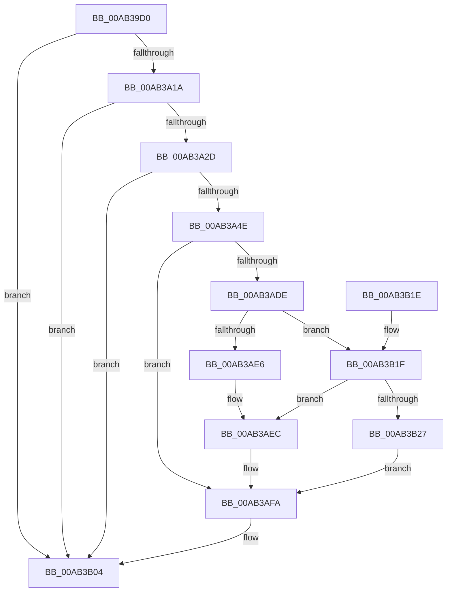

# IoWMIExecuteMethod

- RVA: `0x00AB39D0`–`0x00AB3B43` (길이 `371` bytes)
- VA: `0x0000000140AB39D0`
- 실행 섹션: `PAGE`
- PDB 이름 있음: `예`; PDB Function 태그: `아니요`
- unwind 정보 RVA: `0x000BCAB8`
- 디코드: `104`개 명령, `371/371` bytes 표시
- 미해석 바이트: `0` (있으면 어셈블리에 `.byte`로 보존)

> 이 문서는 커널 이미지의 기계어와 PDB 기호를 분석해 생성했습니다. 4번과 5번은 함수 원형과 자료형을 바이너리 사용 방식에서 추정한 C 해석이며 원본 소스 복구 결과는 아닙니다.

## 1. Dependencies

- 직접 호출 지점: **6**; 고유 호출 대상: **4**
- 직접 호출자로 확인된 함수: **0**
- RIP 상대 이미지 참조: **0**

### Outgoing calls
- `0x00AB3A3D` → [ExAllocatePool2](../../poolcode/B8/ExAllocatePool2_function_00B820F0.md) (function, `0x00B820F0`)
- `0x00AB3A89` → [memcpy](../../text/6C/memcpy_function_006C6840.md) (function, `0x006C6840`)
- `0x00AB3A9F` → [memcpy](../../text/6C/memcpy_function_006C6840.md) (function, `0x006C6840`)
- `0x00AB3AD3` → [WmipQuerySetExecuteSI](../9E/WmipQuerySetExecuteSI_function_009E0574.md) (function, `0x009E0574`)
- `0x00AB3AFF` → [ExFreePoolWithTag](../../poolcode/B8/ExFreePoolWithTag_function_00B82870.md) (function, `0x00B82870`)
- `0x00AB3B3C` → [memcpy](../../text/6C/memcpy_function_006C6840.md) (function, `0x006C6840`)

### Direct callers
- 이 함수 시작 RVA로 연결되는 직접 call은 확인되지 않았습니다. 간접 호출은 완전히 역산할 수 없습니다.

### Static image references
- 디코드된 RIP-relative 메모리 참조가 없습니다.

## 2. Other-region calls and transfers

- 다른 실행 섹션으로 향하는 call: **5**
  - `0x00AB3A3D` → [ExAllocatePool2](../../poolcode/B8/ExAllocatePool2_function_00B820F0.md) (`PAGE` → `POOLCODE`)
  - `0x00AB3A89` → [memcpy](../../text/6C/memcpy_function_006C6840.md) (`PAGE` → `.text`)
  - `0x00AB3A9F` → [memcpy](../../text/6C/memcpy_function_006C6840.md) (`PAGE` → `.text`)
  - `0x00AB3AFF` → [ExFreePoolWithTag](../../poolcode/B8/ExFreePoolWithTag_function_00B82870.md) (`PAGE` → `POOLCODE`)
  - `0x00AB3B3C` → [memcpy](../../text/6C/memcpy_function_006C6840.md) (`PAGE` → `.text`)
- 별도 외부 분기/꼬리 이동을 확인하지 못했습니다.

## 3. Assembly (complete function range)

```asm
00AB39D0  48 89 5C 24 10                  mov qword ptr [rsp + 0x10], rbx
00AB39D5  48 89 4C 24 08                  mov qword ptr [rsp + 8], rcx
00AB39DA  55                              push rbp
00AB39DB  56                              push rsi
00AB39DC  57                              push rdi
00AB39DD  41 54                           push r12
00AB39DF  41 55                           push r13
00AB39E1  41 56                           push r14
00AB39E3  41 57                           push r15
00AB39E5  48 83 EC 40                     sub rsp, 0x40
00AB39E9  4C 8B B4 24 A0 00 00 00         mov r14, qword ptr [rsp + 0xa0]
00AB39F1  45 8B E8                        mov r13d, r8d
00AB39F4  0F B7 02                        movzx eax, word ptr [rdx]
00AB39F7  4C 8B E2                        mov r12, rdx
00AB39FA  41 8B E9                        mov ebp, r9d
00AB39FD  BF 9A 00 00 C0                  mov edi, 0xc000009a
00AB3A02  45 8B 16                        mov r10d, dword ptr [r14]
00AB3A05  45 3B CA                        cmp r9d, r10d
00AB3A08  45 0F 47 D1                     cmova r10d, r9d
00AB3A0C  83 C0 46                        add eax, 0x46
00AB3A0F  8D 70 07                        lea esi, [rax + 7]
00AB3A12  3B F0                           cmp esi, eax
00AB3A14  0F 82 EA 00 00 00               jb 0x140ab3b04
00AB3A1A  83 E6 F8                        and esi, 0xfffffff8
00AB3A1D  8B C6                           mov eax, esi
00AB3A1F  44 8B FE                        mov r15d, esi
00AB3A22  F7 D0                           not eax
00AB3A24  44 3B D0                        cmp r10d, eax
00AB3A27  0F 87 D7 00 00 00               ja 0x140ab3b04
00AB3A2D  41 03 F2                        add esi, r10d
00AB3A30  B9 40 00 00 00                  mov ecx, 0x40
00AB3A35  8B D6                           mov edx, esi
00AB3A37  41 B8 57 6D 69 70               mov r8d, 0x70696d57
00AB3A3D  E8 AE E6 0C 00                  call 0x140b820f0
00AB3A42  48 8B D8                        mov rbx, rax
00AB3A45  48 85 C0                        test rax, rax
00AB3A48  0F 84 B6 00 00 00               je 0x140ab3b04
00AB3A4E  48 83 60 10 00                  and qword ptr [rax + 0x10], 0
00AB3A53  48 8D 4B 46                     lea rcx, [rbx + 0x46]
00AB3A57  83 60 0C 00                     and dword ptr [rax + 0xc], 0
00AB3A5B  C7 40 2C 00 80 00 00            mov dword ptr [rax + 0x2c], 0x8000
00AB3A62  89 30                           mov dword ptr [rax], esi
00AB3A64  44 89 68 38                     mov dword ptr [rax + 0x38], r13d
00AB3A68  C7 40 30 44 00 00 00            mov dword ptr [rax + 0x30], 0x44
00AB3A6F  44 89 78 3C                     mov dword ptr [rax + 0x3c], r15d
00AB3A73  89 68 40                        mov dword ptr [rax + 0x40], ebp
00AB3A76  41 0F B7 04 24                  movzx eax, word ptr [r12]
00AB3A7B  66 89 43 44                     mov word ptr [rbx + 0x44], ax
00AB3A7F  45 0F B7 04 24                  movzx r8d, word ptr [r12]
00AB3A84  49 8B 54 24 08                  mov rdx, qword ptr [r12 + 8]
00AB3A89  E8 B2 2D C1 FF                  call 0x1406c6840
00AB3A8E  8B 4B 3C                        mov ecx, dword ptr [rbx + 0x3c]
00AB3A91  44 8B C5                        mov r8d, ebp
00AB3A94  48 8B 94 24 A8 00 00 00         mov rdx, qword ptr [rsp + 0xa8]
00AB3A9C  48 03 CB                        add rcx, rbx
00AB3A9F  E8 9C 2D C1 FF                  call 0x1406c6840
00AB3AA4  8B 03                           mov eax, dword ptr [rbx]
00AB3AA6  41 B1 09                        mov r9b, 9
00AB3AA9  48 8B 8C 24 80 00 00 00         mov rcx, qword ptr [rsp + 0x80]
00AB3AB1  45 33 C0                        xor r8d, r8d
00AB3AB4  89 84 24 98 00 00 00            mov dword ptr [rsp + 0x98], eax
00AB3ABB  33 D2                           xor edx, edx
00AB3ABD  48 8D 84 24 98 00 00 00         lea rax, [rsp + 0x98]
00AB3AC5  48 89 44 24 30                  mov qword ptr [rsp + 0x30], rax
00AB3ACA  89 74 24 28                     mov dword ptr [rsp + 0x28], esi
00AB3ACE  48 89 5C 24 20                  mov qword ptr [rsp + 0x20], rbx
00AB3AD3  E8 9C CA F2 FF                  call 0x1409e0574
00AB3AD8  8B F8                           mov edi, eax
00AB3ADA  85 C0                           test eax, eax
00AB3ADC  78 1C                           js 0x140ab3afa
00AB3ADE  8B 4B 2C                        mov ecx, dword ptr [rbx + 0x2c]
00AB3AE1  F6 C1 20                        test cl, 0x20
00AB3AE4  74 39                           je 0x140ab3b1f
00AB3AE6  8B 43 30                        mov eax, dword ptr [rbx + 0x30]
00AB3AE9  41 2B C7                        sub eax, r15d
00AB3AEC  83 C0 07                        add eax, 7
00AB3AEF  BF 23 00 00 C0                  mov edi, 0xc0000023
00AB3AF4  83 E0 F8                        and eax, 0xfffffff8
00AB3AF7  41 89 06                        mov dword ptr [r14], eax
00AB3AFA  33 D2                           xor edx, edx
00AB3AFC  48 8B CB                        mov rcx, rbx
00AB3AFF  E8 6C ED 0C 00                  call 0x140b82870
00AB3B04  48 8B 9C 24 88 00 00 00         mov rbx, qword ptr [rsp + 0x88]
00AB3B0C  8B C7                           mov eax, edi
00AB3B0E  48 83 C4 40                     add rsp, 0x40
00AB3B12  41 5F                           pop r15
00AB3B14  41 5E                           pop r14
00AB3B16  41 5D                           pop r13
00AB3B18  41 5C                           pop r12
00AB3B1A  5F                              pop rdi
00AB3B1B  5E                              pop rsi
00AB3B1C  5D                              pop rbp
00AB3B1D  C3                              ret
00AB3B1E  CC                              int3
00AB3B1F  8B 43 40                        mov eax, dword ptr [rbx + 0x40]
00AB3B22  41 39 06                        cmp dword ptr [r14], eax
00AB3B25  72 C5                           jb 0x140ab3aec
00AB3B27  48 8B 8C 24 A8 00 00 00         mov rcx, qword ptr [rsp + 0xa8]
00AB3B2F  41 89 06                        mov dword ptr [r14], eax
00AB3B32  8B 53 3C                        mov edx, dword ptr [rbx + 0x3c]
00AB3B35  44 8B 43 40                     mov r8d, dword ptr [rbx + 0x40]
00AB3B39  48 03 D3                        add rdx, rbx
00AB3B3C  E8 FF 2C C1 FF                  call 0x1406c6840
00AB3B41  EB B7                           jmp 0x140ab3afa
```

## 4. C-style interpretation (structured pseudocode)

```c
__int64 __fastcall IoWMIExecuteMethod(__int64 a1, __int64 a2, int a3, int a4, __int64 a5, __int64 a6)
{
    __int64 result;
    __int64 v_r10;
    __int64 v_rsi;
    __int64 v_rsp;
    unsigned __int64 v_stack_m48;
    unsigned int v_stack_m50;
    unsigned __int64 v_stack_m58;
    unsigned __int64 v_stack_p10;
    unsigned int v_stack_p20;
    unsigned __int64 v_stack_p8;

    v_stack_p10 = v_rbx;
    v_stack_p8 = a1;
    v_rsp = (v_rsp) - (64);
    v_r10 = (unsigned int)(*(unsigned int *)(a5));
    if (a4 > ((unsigned int)((unsigned int)(*(unsigned int *)(a5))))) { v_r10 = a4; }
    result = (unsigned int)((*(unsigned __int16 *)(a2)) + (70));
    if (((unsigned int)(result + 7)) < ((unsigned int)(result))) goto loc_00AB3B04;
    v_rsi = (unsigned int)((result + 7) & (0xFFFFFFF8ULL));
    result = (unsigned int)(~((unsigned int)((unsigned int)(v_rsi))));
    if (((unsigned int)(v_r10)) > ((unsigned int)(result))) goto loc_00AB3B04;
    v_rsi = (unsigned int)((v_rsi) + ((unsigned int)(v_r10)));
    result = ExAllocatePool2(64, (unsigned int)((unsigned int)(v_rsi)), (unsigned int)(0x70696D57ULL), a4);
    if (result == 0) goto loc_00AB3B04;
    *(unsigned int *)(result + 44) = 0x8000ULL;
    *(unsigned int *)(result) = (unsigned int)(v_rsi);
    *(unsigned int *)(result + 56) = (unsigned int)((unsigned int)(a3));
    *(unsigned int *)(result + 48) = 68;
    *(unsigned int *)(result + 60) = (unsigned int)((unsigned int)((unsigned int)(v_rsi)));
    *(unsigned int *)(result + 64) = (unsigned int)((unsigned int)(a4));
    *(unsigned __int16 *)(result + 68) = (unsigned __int16)(*(unsigned __int16 *)(a2));
    result = memcpy(result + 70, *(unsigned __int64 *)(a2 + 8), *(unsigned __int16 *)(a2), a4);
    a1 = ((unsigned int)(*(unsigned int *)(result + 60))) + (result);
    result = memcpy(a1, a6, (unsigned int)((unsigned int)((unsigned int)(a4))), a4);
    a3 = 0;
    v_stack_p20 = (unsigned int)((unsigned int)(*(unsigned int *)(result)));
    a2 = 0;
    v_stack_m48 = v_stack_p20;
    v_stack_m50 = (unsigned int)(v_rsi);
    v_stack_m58 = result;
    result = WmipQuerySetExecuteSI(v_stack_p8, a2, a3, 9);
    if (sign_flag) goto loc_00AB3AFA;
    if ((((unsigned __int8)((unsigned int)(*(unsigned int *)(result + 44)))) & (32)) == 0) goto loc_00AB3B1F;
    result = (unsigned int)(((unsigned int)(*(unsigned int *)(result + 48))) - ((unsigned int)((unsigned int)((unsigned int)(v_rsi)))));
loc_00AB3AEC:
    result = (unsigned int)((result) + (7));
    result = (unsigned int)((result) & (0xFFFFFFF8ULL));
    *(unsigned int *)(a5) = (unsigned int)(result);
loc_00AB3AFA:
    a2 = 0;
    result = ExFreePoolWithTag(result, a2, a3, 9);
loc_00AB3B04:
    v_rsp = (v_rsp) + (64);
    return (unsigned int)((unsigned int)((unsigned int)(0xC0000023ULL)));
loc_00AB3B1F:
    if ((*(unsigned int *)(a5)) < ((unsigned int)((unsigned int)(*(unsigned int *)(v_stack_p10 + 64))))) goto loc_00AB3AEC;
    *(unsigned int *)(a5) = (unsigned int)((unsigned int)(*(unsigned int *)(v_stack_p10 + 64)));
    a2 = ((unsigned int)(*(unsigned int *)(v_stack_p10 + 60))) + (v_stack_p10);
    result = memcpy(a6, a2, (unsigned int)(*(unsigned int *)(v_stack_p10 + 64)), 9);
    goto loc_00AB3AFA;
}
```

## 5. (Beta) C Style

```c
int64_t IoWMIExecuteMethod(int64_t Arg1, void *Arg2, int32_t Arg3, int32_t Arg4, void *Arg5, int64_t Arg6)
{
    uint8_t *arg2 = (uint8_t *)Arg2;
    uint8_t *arg5 = (uint8_t *)Arg5;

    int64_t result;
    int64_t local_r10;
    int64_t local_rsi;
    int64_t local_rsp;
    uint64_t v_stack_m48;
    uint32_t v_stack_m50;
    uint64_t v_stack_m58;
    uint64_t v_stack_p10;
    uint32_t v_stack_p20;
    uint64_t v_stack_p8;

    v_stack_p10 = local_rbx;
    v_stack_p8 = Arg1;
    local_rsp = (local_rsp) - (64);
    local_r10 = (uint32_t)(*(uint32_t *)(arg5));
    if (Arg4 > ((uint32_t)((uint32_t)(*(uint32_t *)(arg5))))) { local_r10 = Arg4; }
    result = (uint32_t)((*(uint16_t *)(arg2)) + (70));
    if (((uint32_t)(result + 7)) < ((uint32_t)(result))) goto loc_00AB3B04;
    local_rsi = (uint32_t)((result + 7) & (0xFFFFFFF8ULL));
    result = (uint32_t)(~((uint32_t)((uint32_t)(local_rsi))));
    if (((uint32_t)(local_r10)) > ((uint32_t)(result))) goto loc_00AB3B04;
    local_rsi = (uint32_t)((local_rsi) + ((uint32_t)(local_r10)));
    result = ExAllocatePool2(64, (uint32_t)((uint32_t)(local_rsi)), (uint32_t)(0x70696D57ULL), Arg4);
    if (result == 0) goto loc_00AB3B04;
    *(uint32_t *)(result + 0x2C) = 0x8000ULL;
    *(uint32_t *)(result) = (uint32_t)(local_rsi);
    *(uint32_t *)(result + 0x38) = (uint32_t)((uint32_t)(Arg3));
    *(uint32_t *)(result + 0x30) = 68;
    *(uint32_t *)(result + 0x3C) = (uint32_t)((uint32_t)((uint32_t)(local_rsi)));
    *(uint32_t *)(result + 0x40) = (uint32_t)((uint32_t)(Arg4));
    *(uint16_t *)(result + 0x44) = (uint16_t)(*(uint16_t *)(arg2));
    result = memcpy(result + 70, *(uint64_t *)(arg2 + 0x8), *(uint16_t *)(arg2), Arg4);
    Arg1 = ((uint32_t)(*(uint32_t *)(result + 0x3C))) + (result);
    result = memcpy(Arg1, Arg6, (uint32_t)((uint32_t)((uint32_t)(Arg4))), Arg4);
    Arg3 = 0;
    v_stack_p20 = (uint32_t)((uint32_t)(*(uint32_t *)(result)));
    Arg2 = 0;
    v_stack_m48 = v_stack_p20;
    v_stack_m50 = (uint32_t)(local_rsi);
    v_stack_m58 = result;
    result = WmipQuerySetExecuteSI(v_stack_p8, Arg2, Arg3, 9);
    if (sign_flag) goto loc_00AB3AFA;
    if ((((uint8_t)((uint32_t)(*(uint32_t *)(result + 0x2C)))) & (32)) == 0) goto loc_00AB3B1F;
    result = (uint32_t)(((uint32_t)(*(uint32_t *)(result + 0x30))) - ((uint32_t)((uint32_t)((uint32_t)(local_rsi)))));
loc_00AB3AEC:
    result = (uint32_t)((result) + (7));
    result = (uint32_t)((result) & (0xFFFFFFF8ULL));
    *(uint32_t *)(arg5) = (uint32_t)(result);
loc_00AB3AFA:
    Arg2 = 0;
    result = ExFreePoolWithTag(result, Arg2, Arg3, 9);
loc_00AB3B04:
    local_rsp = (local_rsp) + (64);
    return (uint32_t)((uint32_t)((uint32_t)(0xC0000023ULL)));
loc_00AB3B1F:
    if ((*(uint32_t *)(arg5)) < ((uint32_t)((uint32_t)(*(uint32_t *)(v_stack_p10 + 0x40))))) goto loc_00AB3AEC;
    *(uint32_t *)(arg5) = (uint32_t)((uint32_t)(*(uint32_t *)(v_stack_p10 + 0x40)));
    Arg2 = ((uint32_t)(*(uint32_t *)(v_stack_p10 + 0x3C))) + (v_stack_p10);
    result = memcpy(Arg6, Arg2, (uint32_t)(*(uint32_t *)(v_stack_p10 + 0x40)), 9);
    goto loc_00AB3AFA;
}
```

### 관측된 메모리 오프셋

구조체 형식이 확인되지 않은 접근은 인자 기준의 오프셋으로만 기록했습니다.

| 기준 인자 | 오프셋 표현 | 폭 (bit) | 접근 |
|---|---:|---:|---|
| `Arg2` | `+ 0x0` | `16` | `R` |
| `Arg2` | `+ 0x8` | `64` | `R` |
| `Arg5` | `+ 0x0` | `32` | `R` |
| `Arg5` | `+ 0x0` | `32` | `W` |

## 6. Execution-region graph

[열기: 2D/3D 그래프와 함수 탐색 컨트롤 패널](../../../control-panel.html?section=page&rva=0x00AB39D0&view=graph)

- 2D 그래프는 위에서 아래로 흐르고, 3D 그래프는 빈 공간을 드래그해 회전합니다. Shift+드래그는 이동, 휠은 확대·축소, 함수 노드 선택은 대상 보고서 이동입니다.

### Static fallback


