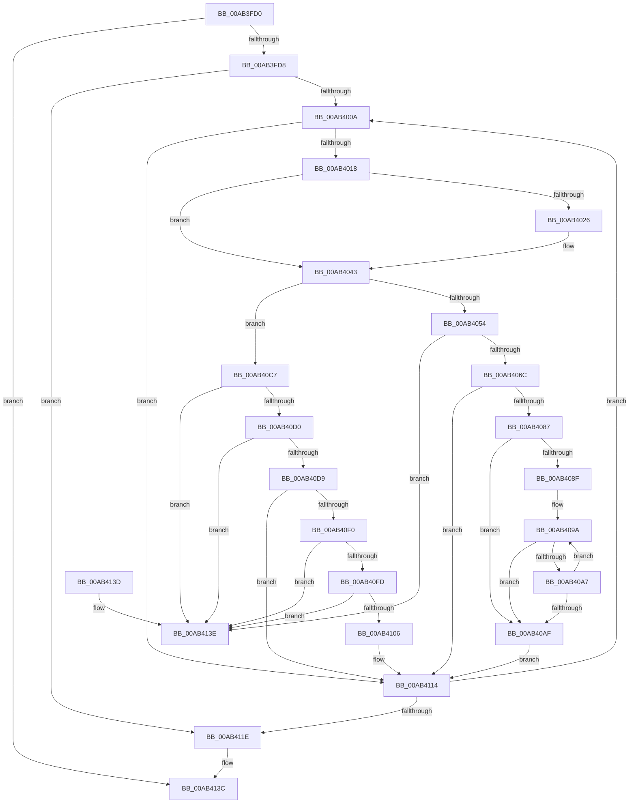

# IopAddRemoveReqDescs

- RVA: `0x00AB3FD0`–`0x00AB4145` (길이 `373` bytes)
- VA: `0x0000000140AB3FD0`
- 실행 섹션: `PAGE`
- PDB 이름 있음: `예`; PDB Function 태그: `아니요`
- unwind 정보 RVA: `0x000BCBB0`
- 디코드: `108`개 명령, `373/373` bytes 표시
- 미해석 바이트: `0` (있으면 어셈블리에 `.byte`로 보존)

> 이 문서는 커널 이미지의 기계어와 PDB 기호를 분석해 생성했습니다. 4번과 5번은 함수 원형과 자료형을 바이너리 사용 방식에서 추정한 C 해석이며 원본 소스 복구 결과는 아닙니다.

## 1. Dependencies

- 직접 호출 지점: **1**; 고유 호출 대상: **1**
- 직접 호출자로 확인된 함수: **4**
- RIP 상대 이미지 참조: **0**

### Outgoing calls
- `0x00AB403E` → [guard_dispatch_icall](../../text/6B/guard_dispatch_icall_function_006BAAD0.md) (function, `0x006BAAD0`)

### Direct callers
- [IopSelectNextConfiguration](../72/IopSelectNextConfiguration_function_0072B0D4.md) at `0x0072B11C`
- [IopSelectNextConfiguration](../72/IopSelectNextConfiguration_function_0072B0D4.md) at `0x0072B169`
- [PnpFindBestConfigurationWorker](../72/PnpFindBestConfigurationWorker_function_0072B688.md) at `0x0072B7A1`
- [PnpSelectFirstConfiguration](../72/PnpSelectFirstConfiguration_function_0072B824.md) at `0x0072B88F`
- [IopBootAllocation](../72/IopBootAllocation_function_0072E898.md) at `0x0072E8EA`

### Static image references
- 디코드된 RIP-relative 메모리 참조가 없습니다.

## 2. Other-region calls and transfers

- 다른 실행 섹션으로 향하는 call: **1**
  - `0x00AB403E` → [guard_dispatch_icall](../../text/6B/guard_dispatch_icall_function_006BAAD0.md) (`PAGE` → `.text`)
- 별도 외부 분기/꼬리 이동을 확인하지 못했습니다.

## 3. Assembly (complete function range)

```asm
00AB3FD0  85 D2                           test edx, edx
00AB3FD2  0F 84 64 01 00 00               je 0x140ab413c
00AB3FD8  48 8B C4                        mov rax, rsp
00AB3FDB  48 89 58 08                     mov qword ptr [rax + 8], rbx
00AB3FDF  48 89 68 10                     mov qword ptr [rax + 0x10], rbp
00AB3FE3  48 89 70 18                     mov qword ptr [rax + 0x18], rsi
00AB3FE7  48 89 78 20                     mov qword ptr [rax + 0x20], rdi
00AB3FEB  41 54                           push r12
00AB3FED  41 56                           push r14
00AB3FEF  41 57                           push r15
00AB3FF1  48 83 EC 20                     sub rsp, 0x20
00AB3FF5  33 F6                           xor esi, esi
00AB3FF7  45 8A E1                        mov r12b, r9b
00AB3FFA  4D 8B F0                        mov r14, r8
00AB3FFD  8B EA                           mov ebp, edx
00AB3FFF  4C 8B F9                        mov r15, rcx
00AB4002  85 D2                           test edx, edx
00AB4004  0F 84 14 01 00 00               je 0x140ab411e
00AB400A  49 8B 3C F7                     mov rdi, qword ptr [r15 + rsi*8]
00AB400E  80 7F 08 00                     cmp byte ptr [rdi + 8], 0
00AB4012  0F 84 FC 00 00 00               je 0x140ab4114
00AB4018  48 8B 9F 20 01 00 00            mov rbx, qword ptr [rdi + 0x120]
00AB401F  8A 43 68                        mov al, byte ptr [rbx + 0x68]
00AB4022  A8 01                           test al, 1
00AB4024  74 1D                           je 0x140ab4043
00AB4026  48 8B 4B 18                     mov rcx, qword ptr [rbx + 0x18]
00AB402A  24 FE                           and al, 0xfe
00AB402C  88 43 68                        mov byte ptr [rbx + 0x68], al
00AB402F  45 33 C0                        xor r8d, r8d
00AB4032  48 8B 41 20                     mov rax, qword ptr [rcx + 0x20]
00AB4036  48 8B 49 08                     mov rcx, qword ptr [rcx + 8]
00AB403A  41 8D 50 03                     lea edx, [r8 + 3]
00AB403E  E8 8D 6A C0 FF                  call 0x1406baad0
00AB4043  C6 43 69 01                     mov byte ptr [rbx + 0x69], 1
00AB4047  48 8B 47 20                     mov rax, qword ptr [rdi + 0x20]
00AB404B  48 83 C0 28                     add rax, 0x28
00AB404F  45 84 E4                        test r12b, r12b
00AB4052  74 73                           je 0x140ab40c7
00AB4054  48 8D 4B 28                     lea rcx, [rbx + 0x28]
00AB4058  48 89 40 08                     mov qword ptr [rax + 8], rax
00AB405C  48 89 00                        mov qword ptr [rax], rax
00AB405F  48 8B 51 08                     mov rdx, qword ptr [rcx + 8]
00AB4063  48 39 0A                        cmp qword ptr [rdx], rcx
00AB4066  0F 85 D2 00 00 00               jne 0x140ab413e
00AB406C  48 89 50 08                     mov qword ptr [rax + 8], rdx
00AB4070  48 89 08                        mov qword ptr [rax], rcx
00AB4073  48 89 02                        mov qword ptr [rdx], rax
00AB4076  48 8D 53 58                     lea rdx, [rbx + 0x58]
00AB407A  48 89 41 08                     mov qword ptr [rcx + 8], rax
00AB407E  48 39 12                        cmp qword ptr [rdx], rdx
00AB4081  0F 85 8D 00 00 00               jne 0x140ab4114
00AB4087  49 8B 0E                        mov rcx, qword ptr [r14]
00AB408A  49 3B CE                        cmp rcx, r14
00AB408D  74 20                           je 0x140ab40af
00AB408F  48 8B 43 20                     mov rax, qword ptr [rbx + 0x20]
00AB4093  44 8B 80 98 00 00 00            mov r8d, dword ptr [rax + 0x98]
00AB409A  48 8B 41 C8                     mov rax, qword ptr [rcx - 0x38]
00AB409E  44 39 80 98 00 00 00            cmp dword ptr [rax + 0x98], r8d
00AB40A5  73 08                           jae 0x140ab40af
00AB40A7  48 8B 09                        mov rcx, qword ptr [rcx]
00AB40AA  49 3B CE                        cmp rcx, r14
00AB40AD  75 EB                           jne 0x140ab409a
00AB40AF  48 89 0A                        mov qword ptr [rdx], rcx
00AB40B2  48 8B 41 08                     mov rax, qword ptr [rcx + 8]
00AB40B6  48 89 43 60                     mov qword ptr [rbx + 0x60], rax
00AB40BA  48 8B 41 08                     mov rax, qword ptr [rcx + 8]
00AB40BE  48 89 10                        mov qword ptr [rax], rdx
00AB40C1  48 89 51 08                     mov qword ptr [rcx + 8], rdx
00AB40C5  EB 4D                           jmp 0x140ab4114
00AB40C7  48 8B 08                        mov rcx, qword ptr [rax]
00AB40CA  48 39 41 08                     cmp qword ptr [rcx + 8], rax
00AB40CE  75 6E                           jne 0x140ab413e
00AB40D0  48 8B 50 08                     mov rdx, qword ptr [rax + 8]
00AB40D4  48 39 02                        cmp qword ptr [rdx], rax
00AB40D7  75 65                           jne 0x140ab413e
00AB40D9  48 89 0A                        mov qword ptr [rdx], rcx
00AB40DC  48 89 51 08                     mov qword ptr [rcx + 8], rdx
00AB40E0  48 89 40 08                     mov qword ptr [rax + 8], rax
00AB40E4  48 89 00                        mov qword ptr [rax], rax
00AB40E7  48 8D 43 28                     lea rax, [rbx + 0x28]
00AB40EB  48 39 00                        cmp qword ptr [rax], rax
00AB40EE  75 24                           jne 0x140ab4114
00AB40F0  48 8D 43 58                     lea rax, [rbx + 0x58]
00AB40F4  48 8B 10                        mov rdx, qword ptr [rax]
00AB40F7  48 39 42 08                     cmp qword ptr [rdx + 8], rax
00AB40FB  75 41                           jne 0x140ab413e
00AB40FD  48 8B 48 08                     mov rcx, qword ptr [rax + 8]
00AB4101  48 39 01                        cmp qword ptr [rcx], rax
00AB4104  75 38                           jne 0x140ab413e
00AB4106  48 89 11                        mov qword ptr [rcx], rdx
00AB4109  48 89 4A 08                     mov qword ptr [rdx + 8], rcx
00AB410D  48 89 40 08                     mov qword ptr [rax + 8], rax
00AB4111  48 89 00                        mov qword ptr [rax], rax
00AB4114  FF C6                           inc esi
00AB4116  3B F5                           cmp esi, ebp
00AB4118  0F 82 EC FE FF FF               jb 0x140ab400a
00AB411E  48 8B 5C 24 40                  mov rbx, qword ptr [rsp + 0x40]
00AB4123  48 8B 6C 24 48                  mov rbp, qword ptr [rsp + 0x48]
00AB4128  48 8B 74 24 50                  mov rsi, qword ptr [rsp + 0x50]
00AB412D  48 8B 7C 24 58                  mov rdi, qword ptr [rsp + 0x58]
00AB4132  48 83 C4 20                     add rsp, 0x20
00AB4136  41 5F                           pop r15
00AB4138  41 5E                           pop r14
00AB413A  41 5C                           pop r12
00AB413C  C3                              ret
00AB413D  CC                              int3
00AB413E  B9 03 00 00 00                  mov ecx, 3
00AB4143  CD 29                           int 0x29
```

## 4. C-style interpretation (structured pseudocode)

```c
__int64 __fastcall IopAddRemoveReqDescs(__int64 a1, int a2, __int64 a3, unsigned __int8 a4)
{
    __int64 result;
    __int64 v_rsi;
    __int64 v_rsp;
    unsigned __int64 v_stack_p10;
    unsigned __int64 v_stack_p18;
    unsigned __int64 v_stack_p20;
    unsigned __int64 v_stack_p8;

    if (a2 == 0) goto loc_00AB413C;
    *(unsigned __int64 *)(v_rsp + 8) = v_rbx;
    *(unsigned __int64 *)(v_rsp + 16) = v_rbp;
    *(unsigned __int64 *)(v_rsp + 24) = v_rsi;
    *(unsigned __int64 *)(v_rsp + 32) = v_rdi;
    v_rsp = (v_rsp) - (32);
    v_rsi = 0;
    if (a2 == 0) goto loc_00AB411E;
loc_00AB400A:
    if ((*(unsigned __int8 *)(*(unsigned __int64 *)(a1 + v_rsi * 8) + 8)) == 0) goto loc_00AB4114;
    result = *(unsigned __int8 *)(*(unsigned __int64 *)(*(unsigned __int64 *)(a1 + v_rsi * 8) + 288) + 104);
    if ((((unsigned __int8)(*(unsigned __int8 *)(*(unsigned __int64 *)(*(unsigned __int64 *)(a1 + v_rsi * 8) + 288) + 104))) & (1)) != 0) {
        a1 = *(unsigned __int64 *)(*(unsigned __int64 *)(*(unsigned __int64 *)(a1 + v_rsi * 8) + 288) + 24);
        result = (unsigned __int8)((*(unsigned __int8 *)(*(unsigned __int64 *)(*(unsigned __int64 *)(a1 + v_rsi * 8) + 288) + 104)) & (254));
        *(unsigned __int8 *)(*(unsigned __int64 *)(*(unsigned __int64 *)(a1 + v_rsi * 8) + 288) + 104) = (unsigned __int8)(result);
        a3 = 0;
        result = *(unsigned __int64 *)(a1 + 32);
        a1 = *(unsigned __int64 *)(a1 + 8);
        a2 = a3 + 3;
        result = guard_dispatch_icall(a1, a2, a3, a4);
    }
    *(unsigned __int8 *)(*(unsigned __int64 *)(*(unsigned __int64 *)(a1 + v_rsi * 8) + 288) + 105) = 1;
    result = (*(unsigned __int64 *)(*(unsigned __int64 *)(a1 + v_rsi * 8) + 32)) + (40);
    if (a4 == 0) goto loc_00AB40C7;
    *(unsigned __int64 *)(result + 8) = result;
    *(unsigned __int64 *)(result) = result;
    if ((*(unsigned __int64 *)(*(unsigned __int64 *)(*(unsigned __int64 *)(*(unsigned __int64 *)(a1 + v_rsi * 8) + 288) + 40 + 8))) != (*(unsigned __int64 *)(*(unsigned __int64 *)(a1 + v_rsi * 8) + 288) + 40)) goto loc_00AB413E;
    *(unsigned __int64 *)(result + 8) = *(unsigned __int64 *)(*(unsigned __int64 *)(*(unsigned __int64 *)(a1 + v_rsi * 8) + 288) + 40 + 8);
    *(unsigned __int64 *)(result) = *(unsigned __int64 *)(*(unsigned __int64 *)(a1 + v_rsi * 8) + 288) + 40;
    *(unsigned __int64 *)(*(unsigned __int64 *)(*(unsigned __int64 *)(*(unsigned __int64 *)(a1 + v_rsi * 8) + 288) + 40 + 8)) = result;
    *(unsigned __int64 *)(*(unsigned __int64 *)(*(unsigned __int64 *)(a1 + v_rsi * 8) + 288) + 40 + 8) = result;
    if ((*(unsigned __int64 *)(*(unsigned __int64 *)(*(unsigned __int64 *)(a1 + v_rsi * 8) + 288) + 88)) != (*(unsigned __int64 *)(*(unsigned __int64 *)(a1 + v_rsi * 8) + 288) + 88)) goto loc_00AB4114;
    if ((*(unsigned __int64 *)(a3)) == 0) goto loc_00AB40AF;
loc_00AB409A:
    if ((*(unsigned int *)(*(unsigned __int64 *)(*(unsigned __int64 *)(a3) - 56) + 152)) >= ((unsigned int)((unsigned int)(*(unsigned int *)(*(unsigned __int64 *)(*(unsigned __int64 *)(*(unsigned __int64 *)(a1 + v_rsi * 8) + 288) + 32) + 152))))) goto loc_00AB40AF;
    if ((*(unsigned __int64 *)(*(unsigned __int64 *)(a3))) != 0) goto loc_00AB409A;
loc_00AB40AF:
    *(unsigned __int64 *)(*(unsigned __int64 *)(*(unsigned __int64 *)(a1 + v_rsi * 8) + 288) + 88) = *(unsigned __int64 *)(*(unsigned __int64 *)(a3));
    *(unsigned __int64 *)(*(unsigned __int64 *)(*(unsigned __int64 *)(a1 + v_rsi * 8) + 288) + 96) = *(unsigned __int64 *)(*(unsigned __int64 *)(*(unsigned __int64 *)(a3)) + 8);
    *(unsigned __int64 *)(*(unsigned __int64 *)(*(unsigned __int64 *)(*(unsigned __int64 *)(a3)) + 8)) = *(unsigned __int64 *)(*(unsigned __int64 *)(a1 + v_rsi * 8) + 288) + 88;
    *(unsigned __int64 *)(*(unsigned __int64 *)(*(unsigned __int64 *)(a3)) + 8) = *(unsigned __int64 *)(*(unsigned __int64 *)(a1 + v_rsi * 8) + 288) + 88;
    goto loc_00AB4114;
loc_00AB40C7:
    if ((*(unsigned __int64 *)(*(unsigned __int64 *)(*(unsigned __int64 *)(*(unsigned __int64 *)(*(unsigned __int64 *)(a3)) + 8)) + 8)) != (*(unsigned __int64 *)(*(unsigned __int64 *)(*(unsigned __int64 *)(a3)) + 8))) goto loc_00AB413E;
    if ((*(unsigned __int64 *)(*(unsigned __int64 *)(*(unsigned __int64 *)(*(unsigned __int64 *)(*(unsigned __int64 *)(a3)) + 8) + 8))) != (*(unsigned __int64 *)(*(unsigned __int64 *)(*(unsigned __int64 *)(a3)) + 8))) goto loc_00AB413E;
    *(unsigned __int64 *)(*(unsigned __int64 *)(*(unsigned __int64 *)(*(unsigned __int64 *)(*(unsigned __int64 *)(a3)) + 8) + 8)) = *(unsigned __int64 *)(*(unsigned __int64 *)(*(unsigned __int64 *)(*(unsigned __int64 *)(a3)) + 8));
    *(unsigned __int64 *)(*(unsigned __int64 *)(*(unsigned __int64 *)(*(unsigned __int64 *)(*(unsigned __int64 *)(a3)) + 8)) + 8) = *(unsigned __int64 *)(*(unsigned __int64 *)(*(unsigned __int64 *)(*(unsigned __int64 *)(a3)) + 8) + 8);
    *(unsigned __int64 *)(*(unsigned __int64 *)(*(unsigned __int64 *)(*(unsigned __int64 *)(a3)) + 8) + 8) = *(unsigned __int64 *)(*(unsigned __int64 *)(*(unsigned __int64 *)(a3)) + 8);
    *(unsigned __int64 *)(*(unsigned __int64 *)(*(unsigned __int64 *)(*(unsigned __int64 *)(a3)) + 8)) = *(unsigned __int64 *)(*(unsigned __int64 *)(*(unsigned __int64 *)(a3)) + 8);
    if ((*(unsigned __int64 *)(*(unsigned __int64 *)(*(unsigned __int64 *)(a1 + v_rsi * 8) + 288) + 40)) != (*(unsigned __int64 *)(*(unsigned __int64 *)(a1 + v_rsi * 8) + 288) + 40)) goto loc_00AB4114;
    if ((*(unsigned __int64 *)(*(unsigned __int64 *)(*(unsigned __int64 *)(*(unsigned __int64 *)(a1 + v_rsi * 8) + 288) + 88) + 8)) != (*(unsigned __int64 *)(*(unsigned __int64 *)(a1 + v_rsi * 8) + 288) + 88)) goto loc_00AB413E;
    if ((*(unsigned __int64 *)(*(unsigned __int64 *)(*(unsigned __int64 *)(*(unsigned __int64 *)(a1 + v_rsi * 8) + 288) + 88 + 8))) != (*(unsigned __int64 *)(*(unsigned __int64 *)(a1 + v_rsi * 8) + 288) + 88)) goto loc_00AB413E;
    *(unsigned __int64 *)(*(unsigned __int64 *)(*(unsigned __int64 *)(*(unsigned __int64 *)(a1 + v_rsi * 8) + 288) + 88 + 8)) = *(unsigned __int64 *)(*(unsigned __int64 *)(*(unsigned __int64 *)(a1 + v_rsi * 8) + 288) + 88);
    *(unsigned __int64 *)(*(unsigned __int64 *)(*(unsigned __int64 *)(*(unsigned __int64 *)(a1 + v_rsi * 8) + 288) + 88) + 8) = *(unsigned __int64 *)(*(unsigned __int64 *)(*(unsigned __int64 *)(a1 + v_rsi * 8) + 288) + 88 + 8);
    *(unsigned __int64 *)(*(unsigned __int64 *)(*(unsigned __int64 *)(a1 + v_rsi * 8) + 288) + 88 + 8) = *(unsigned __int64 *)(*(unsigned __int64 *)(a1 + v_rsi * 8) + 288) + 88;
    *(unsigned __int64 *)(*(unsigned __int64 *)(*(unsigned __int64 *)(a1 + v_rsi * 8) + 288) + 88) = *(unsigned __int64 *)(*(unsigned __int64 *)(a1 + v_rsi * 8) + 288) + 88;
loc_00AB4114:
    v_rsi = (unsigned int)((v_rsi) + 1);
    if (((unsigned int)(v_rsi)) < ((unsigned int)((unsigned int)(a2)))) goto loc_00AB400A;
loc_00AB411E:
    v_rsp = (v_rsp) + (32);
loc_00AB413C:
    return *(unsigned __int64 *)(*(unsigned __int64 *)(a1 + v_rsi * 8) + 288) + 88;
loc_00AB413E:
    return *(unsigned __int64 *)(*(unsigned __int64 *)(a1 + v_rsi * 8) + 288) + 88;
}
```

## 5. (Beta) C Style

```c
int64_t IopAddRemoveReqDescs(void *Arg1, int32_t Arg2, void *Arg3, uint8_t Arg4)
{
    uint8_t *arg1 = (uint8_t *)Arg1;
    uint8_t *arg3 = (uint8_t *)Arg3;

    int64_t result;
    int64_t local_rsi;
    int64_t local_rsp;
    uint64_t v_stack_p10;
    uint64_t v_stack_p18;
    uint64_t v_stack_p20;
    uint64_t v_stack_p8;

    if (Arg2 == 0) goto loc_00AB413C;
    *(uint64_t *)(local_rsp + 0x8) = local_rbx;
    *(uint64_t *)(local_rsp + 0x10) = local_rbp;
    *(uint64_t *)(local_rsp + 0x18) = local_rsi;
    *(uint64_t *)(local_rsp + 0x20) = local_rdi;
    local_rsp = (local_rsp) - (32);
    local_rsi = 0;
    if (Arg2 == 0) goto loc_00AB411E;
loc_00AB400A:
    if ((*(uint8_t *)(*(uint64_t *)(arg1 + local_rsi * 8) + 0x8)) == 0) goto loc_00AB4114;
    result = *(uint8_t *)(*(uint64_t *)(*(uint64_t *)(arg1 + local_rsi * 8) + 0x120) + 0x68);
    if ((((uint8_t)(*(uint8_t *)(*(uint64_t *)(*(uint64_t *)(arg1 + local_rsi * 8) + 0x120) + 0x68))) & (1)) != 0) {
        Arg1 = *(uint64_t *)(*(uint64_t *)(*(uint64_t *)(arg1 + local_rsi * 8) + 0x120) + 0x18);
        result = (uint8_t)((*(uint8_t *)(*(uint64_t *)(*(uint64_t *)(arg1 + local_rsi * 8) + 0x120) + 0x68)) & (254));
        *(uint8_t *)(*(uint64_t *)(*(uint64_t *)(arg1 + local_rsi * 8) + 0x120) + 0x68) = (uint8_t)(result);
        Arg3 = 0;
        result = *(uint64_t *)(arg1 + 0x20);
        Arg1 = *(uint64_t *)(arg1 + 0x8);
        Arg2 = Arg3 + 3;
        result = guard_dispatch_icall(Arg1, Arg2, Arg3, Arg4);
    }
    *(uint8_t *)(*(uint64_t *)(*(uint64_t *)(arg1 + local_rsi * 8) + 0x120) + 0x69) = 1;
    result = (*(uint64_t *)(*(uint64_t *)(arg1 + local_rsi * 8) + 0x20)) + (40);
    if (Arg4 == 0) goto loc_00AB40C7;
    *(uint64_t *)(result + 0x8) = result;
    *(uint64_t *)(result) = result;
    if ((*(uint64_t *)(*(uint64_t *)(*(uint64_t *)(*(uint64_t *)(arg1 + local_rsi * 8) + 0x120) + 0x28 + 0x8))) != (*(uint64_t *)(*(uint64_t *)(arg1 + local_rsi * 8) + 0x120) + 40)) goto loc_00AB413E;
    *(uint64_t *)(result + 0x8) = *(uint64_t *)(*(uint64_t *)(*(uint64_t *)(arg1 + local_rsi * 8) + 0x120) + 0x28 + 0x8);
    *(uint64_t *)(result) = *(uint64_t *)(*(uint64_t *)(arg1 + local_rsi * 8) + 0x120) + 40;
    *(uint64_t *)(*(uint64_t *)(*(uint64_t *)(*(uint64_t *)(arg1 + local_rsi * 8) + 0x120) + 0x28 + 0x8)) = result;
    *(uint64_t *)(*(uint64_t *)(*(uint64_t *)(arg1 + local_rsi * 8) + 0x120) + 0x28 + 0x8) = result;
    if ((*(uint64_t *)(*(uint64_t *)(*(uint64_t *)(arg1 + local_rsi * 8) + 0x120) + 0x58)) != (*(uint64_t *)(*(uint64_t *)(arg1 + local_rsi * 8) + 0x120) + 88)) goto loc_00AB4114;
    if ((*(uint64_t *)(arg3)) == 0) goto loc_00AB40AF;
loc_00AB409A:
    if ((*(uint32_t *)(*(uint64_t *)(*(uint64_t *)(arg3) - 0x38) + 0x98)) >= ((uint32_t)((uint32_t)(*(uint32_t *)(*(uint64_t *)(*(uint64_t *)(*(uint64_t *)(arg1 + local_rsi * 8) + 0x120) + 0x20) + 0x98))))) goto loc_00AB40AF;
    if ((*(uint64_t *)(*(uint64_t *)(arg3))) != 0) goto loc_00AB409A;
loc_00AB40AF:
    *(uint64_t *)(*(uint64_t *)(*(uint64_t *)(arg1 + local_rsi * 8) + 0x120) + 0x58) = *(uint64_t *)(*(uint64_t *)(arg3));
    *(uint64_t *)(*(uint64_t *)(*(uint64_t *)(arg1 + local_rsi * 8) + 0x120) + 0x60) = *(uint64_t *)(*(uint64_t *)(*(uint64_t *)(arg3)) + 0x8);
    *(uint64_t *)(*(uint64_t *)(*(uint64_t *)(*(uint64_t *)(arg3)) + 0x8)) = *(uint64_t *)(*(uint64_t *)(arg1 + local_rsi * 8) + 0x120) + 88;
    *(uint64_t *)(*(uint64_t *)(*(uint64_t *)(arg3)) + 0x8) = *(uint64_t *)(*(uint64_t *)(arg1 + local_rsi * 8) + 0x120) + 88;
    goto loc_00AB4114;
loc_00AB40C7:
    if ((*(uint64_t *)(*(uint64_t *)(*(uint64_t *)(*(uint64_t *)(*(uint64_t *)(arg3)) + 0x8)) + 0x8)) != (*(uint64_t *)(*(uint64_t *)(*(uint64_t *)(arg3)) + 0x8))) goto loc_00AB413E;
    if ((*(uint64_t *)(*(uint64_t *)(*(uint64_t *)(*(uint64_t *)(*(uint64_t *)(arg3)) + 0x8) + 0x8))) != (*(uint64_t *)(*(uint64_t *)(*(uint64_t *)(arg3)) + 0x8))) goto loc_00AB413E;
    *(uint64_t *)(*(uint64_t *)(*(uint64_t *)(*(uint64_t *)(*(uint64_t *)(arg3)) + 0x8) + 0x8)) = *(uint64_t *)(*(uint64_t *)(*(uint64_t *)(*(uint64_t *)(arg3)) + 0x8));
    *(uint64_t *)(*(uint64_t *)(*(uint64_t *)(*(uint64_t *)(*(uint64_t *)(arg3)) + 0x8)) + 0x8) = *(uint64_t *)(*(uint64_t *)(*(uint64_t *)(*(uint64_t *)(arg3)) + 0x8) + 0x8);
    *(uint64_t *)(*(uint64_t *)(*(uint64_t *)(*(uint64_t *)(arg3)) + 0x8) + 0x8) = *(uint64_t *)(*(uint64_t *)(*(uint64_t *)(arg3)) + 0x8);
    *(uint64_t *)(*(uint64_t *)(*(uint64_t *)(*(uint64_t *)(arg3)) + 0x8)) = *(uint64_t *)(*(uint64_t *)(*(uint64_t *)(arg3)) + 0x8);
    if ((*(uint64_t *)(*(uint64_t *)(*(uint64_t *)(arg1 + local_rsi * 8) + 0x120) + 0x28)) != (*(uint64_t *)(*(uint64_t *)(arg1 + local_rsi * 8) + 0x120) + 40)) goto loc_00AB4114;
    if ((*(uint64_t *)(*(uint64_t *)(*(uint64_t *)(*(uint64_t *)(arg1 + local_rsi * 8) + 0x120) + 0x58) + 0x8)) != (*(uint64_t *)(*(uint64_t *)(arg1 + local_rsi * 8) + 0x120) + 88)) goto loc_00AB413E;
    if ((*(uint64_t *)(*(uint64_t *)(*(uint64_t *)(*(uint64_t *)(arg1 + local_rsi * 8) + 0x120) + 0x58 + 0x8))) != (*(uint64_t *)(*(uint64_t *)(arg1 + local_rsi * 8) + 0x120) + 88)) goto loc_00AB413E;
    *(uint64_t *)(*(uint64_t *)(*(uint64_t *)(*(uint64_t *)(arg1 + local_rsi * 8) + 0x120) + 0x58 + 0x8)) = *(uint64_t *)(*(uint64_t *)(*(uint64_t *)(arg1 + local_rsi * 8) + 0x120) + 0x58);
    *(uint64_t *)(*(uint64_t *)(*(uint64_t *)(*(uint64_t *)(arg1 + local_rsi * 8) + 0x120) + 0x58) + 0x8) = *(uint64_t *)(*(uint64_t *)(*(uint64_t *)(arg1 + local_rsi * 8) + 0x120) + 0x58 + 0x8);
    *(uint64_t *)(*(uint64_t *)(*(uint64_t *)(arg1 + local_rsi * 8) + 0x120) + 0x58 + 0x8) = *(uint64_t *)(*(uint64_t *)(arg1 + local_rsi * 8) + 0x120) + 88;
    *(uint64_t *)(*(uint64_t *)(*(uint64_t *)(arg1 + local_rsi * 8) + 0x120) + 0x58) = *(uint64_t *)(*(uint64_t *)(arg1 + local_rsi * 8) + 0x120) + 88;
loc_00AB4114:
    local_rsi = (uint32_t)((local_rsi) + 1);
    if (((uint32_t)(local_rsi)) < ((uint32_t)((uint32_t)(Arg2)))) goto loc_00AB400A;
loc_00AB411E:
    local_rsp = (local_rsp) + (32);
loc_00AB413C:
    return *(uint64_t *)(*(uint64_t *)(arg1 + local_rsi * 8) + 0x120) + 88;
loc_00AB413E:
    return *(uint64_t *)(*(uint64_t *)(arg1 + local_rsi * 8) + 0x120) + 88;
}
```

### 관측된 메모리 오프셋

구조체 형식이 확인되지 않은 접근은 인자 기준의 오프셋으로만 기록했습니다.

| 기준 인자 | 오프셋 표현 | 폭 (bit) | 접근 |
|---|---:|---:|---|
| `Arg1` | `+ 0x0 + rsi*8` | `64` | `R` |
| `Arg3` | `+ 0x0` | `64` | `R` |

## 6. Execution-region graph

[열기: 2D/3D 그래프와 함수 탐색 컨트롤 패널](../../../control-panel.html?section=page&rva=0x00AB3FD0&view=graph)

- 2D 그래프는 위에서 아래로 흐르고, 3D 그래프는 빈 공간을 드래그해 회전합니다. Shift+드래그는 이동, 휠은 확대·축소, 함수 노드 선택은 대상 보고서 이동입니다.

### Static fallback


