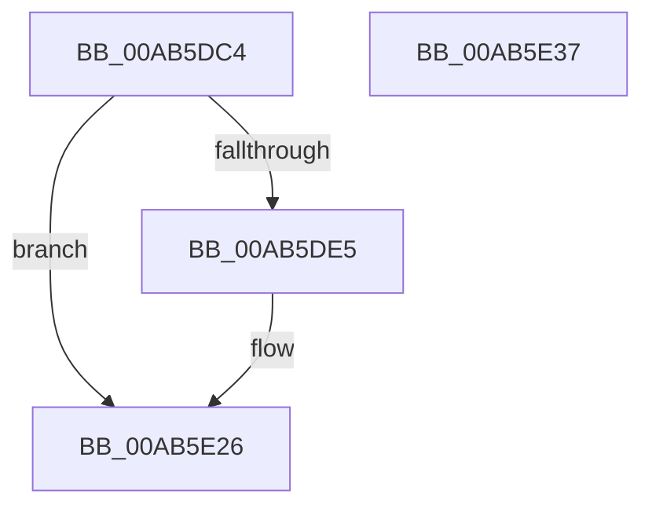

# IopCancelSynchronousIrpsForThread

- RVA: `0x00AB5DC4`–`0x00AB5E38` (길이 `116` bytes)
- VA: `0x0000000140AB5DC4`
- 실행 섹션: `PAGE`
- PDB 이름 있음: `예`; PDB Function 태그: `아니요`
- unwind 정보 RVA: `0x000BCD70`
- 디코드: `28`개 명령, `116/116` bytes 표시
- 미해석 바이트: `0` (있으면 어셈블리에 `.byte`로 보존)

> 이 문서는 커널 이미지의 기계어와 PDB 기호를 분석해 생성했습니다. 4번과 5번은 함수 원형과 자료형을 바이너리 사용 방식에서 추정한 C 해석이며 원본 소스 복구 결과는 아닙니다.

## 1. Dependencies

- 직접 호출 지점: **4**; 고유 호출 대상: **4**
- 직접 호출자로 확인된 함수: **1**
- RIP 상대 이미지 참조: **0**

### Outgoing calls
- `0x00AB5DDC` → [IopCancelApcRequired](../../text/45/IopCancelApcRequired_function_00456BB0.md) (function, `0x00456BB0`)
- `0x00AB5DF2` → [memset](../../text/6C/memset_function_006C6C40.md) (function, `0x006C6C40`)
- `0x00AB5E14` → [KeInitializeEvent](../../text/40/KeInitializeEvent_function_0040DD10.md) (function, `0x0040DD10`)
- `0x00AB5E21` → [IopCancelIrpsInThreadList](../8C/IopCancelIrpsInThreadList_function_008C9E18.md) (function, `0x008C9E18`)

### Direct callers
- [NtCancelSynchronousIoFile](NtCancelSynchronousIoFile_function_00AB5CE0.md) at `0x00AB5D76`

### Static image references
- 디코드된 RIP-relative 메모리 참조가 없습니다.

## 2. Other-region calls and transfers

- 다른 실행 섹션으로 향하는 call: **3**
  - `0x00AB5DDC` → [IopCancelApcRequired](../../text/45/IopCancelApcRequired_function_00456BB0.md) (`PAGE` → `.text`)
  - `0x00AB5DF2` → [memset](../../text/6C/memset_function_006C6C40.md) (`PAGE` → `.text`)
  - `0x00AB5E14` → [KeInitializeEvent](../../text/40/KeInitializeEvent_function_0040DD10.md) (`PAGE` → `.text`)
- 별도 외부 분기/꼬리 이동을 확인하지 못했습니다.

## 3. Assembly (complete function range)

```asm
00AB5DC4  48 89 5C 24 08                  mov qword ptr [rsp + 8], rbx
00AB5DC9  57                              push rdi
00AB5DCA  48 81 EC B0 00 00 00            sub rsp, 0xb0
00AB5DD1  48 8B DA                        mov rbx, rdx
00AB5DD4  4C 8B C2                        mov r8, rdx
00AB5DD7  33 D2                           xor edx, edx
00AB5DD9  48 8B F9                        mov rdi, rcx
00AB5DDC  E8 CF 0D 9A FF                  call 0x140456bb0
00AB5DE1  85 C0                           test eax, eax
00AB5DE3  74 41                           je 0x140ab5e26
00AB5DE5  33 D2                           xor edx, edx
00AB5DE7  48 8D 4C 24 20                  lea rcx, [rsp + 0x20]
00AB5DEC  41 B8 88 00 00 00               mov r8d, 0x88
00AB5DF2  E8 49 0E C1 FF                  call 0x1406c6c40
00AB5DF7  45 33 C0                        xor r8d, r8d
00AB5DFA  48 89 9C 24 80 00 00 00         mov qword ptr [rsp + 0x80], rbx
00AB5E02  33 D2                           xor edx, edx
00AB5E04  C6 84 24 A0 00 00 00 01         mov byte ptr [rsp + 0xa0], 1
00AB5E0C  48 8D 8C 24 88 00 00 00         lea rcx, [rsp + 0x88]
00AB5E14  E8 F7 7E 95 FF                  call 0x14040dd10
00AB5E19  48 8D 54 24 20                  lea rdx, [rsp + 0x20]
00AB5E1E  48 8B CF                        mov rcx, rdi
00AB5E21  E8 F2 3F E1 FF                  call 0x1408c9e18
00AB5E26  48 8B 9C 24 C0 00 00 00         mov rbx, qword ptr [rsp + 0xc0]
00AB5E2E  48 81 C4 B0 00 00 00            add rsp, 0xb0
00AB5E35  5F                              pop rdi
00AB5E36  C3                              ret
00AB5E37  CC                              int3
```

## 4. C-style interpretation (structured pseudocode)

```c
__int64 __fastcall IopCancelSynchronousIrpsForThread(__int64 a1, __int64 a2)
{
    __int64 result;
    __int64 v_rsp;
    unsigned __int8 v_stack_m18;
    unsigned __int64 v_stack_m30;
    unsigned __int64 v_stack_m38;
    unsigned __int64 v_stack_m98;
    unsigned __int64 v_stack_p8;

    v_stack_p8 = v_rbx;
    v_rsp = (v_rsp) - (176);
    a2 = 0;
    result = IopCancelApcRequired(a1, a2, a2, a4);
    if ((unsigned int)(result) != 0) {
        a2 = 0;
        a1 = v_stack_m98;
        a3 = 136;
        result = memset(a1, a2, a3, a4);
        a3 = 0;
        v_stack_m38 = 0;
        a2 = 0;
        v_stack_m18 = 1;
        a1 = v_stack_m30;
        result = KeInitializeEvent(a1, a2, a3, a4);
        a2 = v_stack_m98;
        a1 = a1;
        result = IopCancelIrpsInThreadList(a1, a2, a3, a4);
    }
    v_rsp = (v_rsp) + (176);
    return result;
}
```

## 5. (Beta) C Style

```c
int64_t IopCancelSynchronousIrpsForThread(int64_t Arg1, int64_t Arg2)
{
    int64_t result;
    int64_t local_rsp;
    uint8_t v_stack_m18;
    uint64_t v_stack_m30;
    uint64_t v_stack_m38;
    uint64_t v_stack_m98;
    uint64_t v_stack_p8;

    v_stack_p8 = local_rbx;
    local_rsp = (local_rsp) - (176);
    Arg2 = 0;
    result = IopCancelApcRequired(Arg1, Arg2, Arg2, a4);
    if ((uint32_t)(result) != 0) {
        Arg2 = 0;
        Arg1 = v_stack_m98;
        a3 = 136;
        result = memset(Arg1, Arg2, a3, a4);
        a3 = 0;
        v_stack_m38 = 0;
        Arg2 = 0;
        v_stack_m18 = 1;
        Arg1 = v_stack_m30;
        result = KeInitializeEvent(Arg1, Arg2, a3, a4);
        Arg2 = v_stack_m98;
        Arg1 = Arg1;
        result = IopCancelIrpsInThreadList(Arg1, Arg2, a3, a4);
    }
    local_rsp = (local_rsp) + (176);
    return result;
}
```

## 6. Execution-region graph

[열기: 2D/3D 그래프와 함수 탐색 컨트롤 패널](../../../control-panel.html?section=page&rva=0x00AB5DC4&view=graph)

- 2D 그래프는 위에서 아래로 흐르고, 3D 그래프는 빈 공간을 드래그해 회전합니다. Shift+드래그는 이동, 휠은 확대·축소, 함수 노드 선택은 대상 보고서 이동입니다.

### Static fallback


