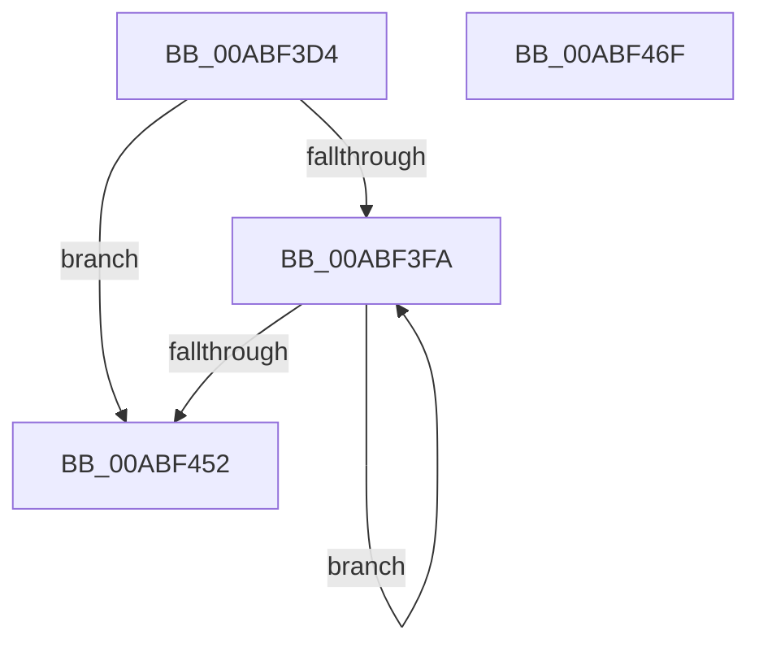

# IopCommitConfiguration

- RVA: `0x00ABF3D4`–`0x00ABF470` (길이 `156` bytes)
- VA: `0x0000000140ABF3D4`
- 실행 섹션: `PAGE`
- PDB 이름 있음: `예`; PDB Function 태그: `아니요`
- unwind 정보 RVA: `0x0005E6B4`
- 디코드: `46`개 명령, `156/156` bytes 표시
- 미해석 바이트: `0` (있으면 어셈블리에 `.byte`로 보존)

> 이 문서는 커널 이미지의 기계어와 PDB 기호를 분석해 생성했습니다. 4번과 5번은 함수 원형과 자료형을 바이너리 사용 방식에서 추정한 C 해석이며 원본 소스 복구 결과는 아닙니다.

## 1. Dependencies

- 직접 호출 지점: **1**; 고유 호출 대상: **1**
- 직접 호출자로 확인된 함수: **4**
- RIP 상대 이미지 참조: **0**

### Outgoing calls
- `0x00ABF416` → [guard_dispatch_icall](../../text/6B/guard_dispatch_icall_function_006BAAD0.md) (function, `0x006BAAD0`)

### Direct callers
- [PnpReallocateResources](../73/PnpReallocateResources_function_0073E924.md) at `0x0073EA1E`
- [PnpRestoreResourcesInternal](../73/PnpRestoreResourcesInternal_function_0073EB10.md) at `0x0073EBEC`
- [PnpRebalance](../73/PnpRebalance_function_0073F508.md) at `0x0073F7FB`
- [sub_00B38CDE](../B3/Unknown_function_00B38CDE.md) at `0x00B38E96`
- [sub_00B38CDE](../B3/Unknown_function_00B38CDE.md) at `0x00B38F25`

### Static image references
- 디코드된 RIP-relative 메모리 참조가 없습니다.

## 2. Other-region calls and transfers

- 다른 실행 섹션으로 향하는 call: **1**
  - `0x00ABF416` → [guard_dispatch_icall](../../text/6B/guard_dispatch_icall_function_006BAAD0.md) (`PAGE` → `.text`)
- 별도 외부 분기/꼬리 이동을 확인하지 못했습니다.

## 3. Assembly (complete function range)

```asm
00ABF3D4  48 8B C4                        mov rax, rsp
00ABF3D7  48 89 58 08                     mov qword ptr [rax + 8], rbx
00ABF3DB  48 89 68 10                     mov qword ptr [rax + 0x10], rbp
00ABF3DF  48 89 70 18                     mov qword ptr [rax + 0x18], rsi
00ABF3E3  48 89 78 20                     mov qword ptr [rax + 0x20], rdi
00ABF3E7  41 56                           push r14
00ABF3E9  48 83 EC 20                     sub rsp, 0x20
00ABF3ED  4C 8B 31                        mov r14, qword ptr [rcx]
00ABF3F0  33 ED                           xor ebp, ebp
00ABF3F2  48 8B F1                        mov rsi, rcx
00ABF3F5  4C 3B F1                        cmp r14, rcx
00ABF3F8  74 58                           je 0x140abf452
00ABF3FA  49 8B FE                        mov rdi, r14
00ABF3FD  45 33 C0                        xor r8d, r8d
00ABF400  49 8B DE                        mov rbx, r14
00ABF403  4D 8B 36                        mov r14, qword ptr [r14]
00ABF406  48 8B 4F C0                     mov rcx, qword ptr [rdi - 0x40]
00ABF40A  41 8D 50 02                     lea edx, [r8 + 2]
00ABF40E  48 8B 41 20                     mov rax, qword ptr [rcx + 0x20]
00ABF412  48 8B 49 08                     mov rcx, qword ptr [rcx + 8]
00ABF416  E8 B5 B6 BF FF                  call 0x1406baad0
00ABF41B  48 8D 4F F0                     lea rcx, [rdi - 0x10]
00ABF41F  85 C0                           test eax, eax
00ABF421  0F 48 E8                        cmovs ebp, eax
00ABF424  66 83 67 10 00                  and word ptr [rdi + 0x10], 0
00ABF429  48 89 5B 08                     mov qword ptr [rbx + 8], rbx
00ABF42D  48 89 1B                        mov qword ptr [rbx], rbx
00ABF430  48 89 49 08                     mov qword ptr [rcx + 8], rcx
00ABF434  48 89 09                        mov qword ptr [rcx], rcx
00ABF437  48 8D 4F D0                     lea rcx, [rdi - 0x30]
00ABF43B  48 89 49 08                     mov qword ptr [rcx + 8], rcx
00ABF43F  48 89 09                        mov qword ptr [rcx], rcx
00ABF442  48 8D 4F E0                     lea rcx, [rdi - 0x20]
00ABF446  48 89 49 08                     mov qword ptr [rcx + 8], rcx
00ABF44A  48 89 09                        mov qword ptr [rcx], rcx
00ABF44D  4C 3B F6                        cmp r14, rsi
00ABF450  75 A8                           jne 0x140abf3fa
00ABF452  48 8B 5C 24 30                  mov rbx, qword ptr [rsp + 0x30]
00ABF457  8B C5                           mov eax, ebp
00ABF459  48 8B 6C 24 38                  mov rbp, qword ptr [rsp + 0x38]
00ABF45E  48 8B 74 24 40                  mov rsi, qword ptr [rsp + 0x40]
00ABF463  48 8B 7C 24 48                  mov rdi, qword ptr [rsp + 0x48]
00ABF468  48 83 C4 20                     add rsp, 0x20
00ABF46C  41 5E                           pop r14
00ABF46E  C3                              ret
00ABF46F  CC                              int3
```

## 4. C-style interpretation (structured pseudocode)

```c
__int64 __fastcall IopCommitConfiguration(__int64 a1, __int64 a2, int a3)
{
    __int64 result;
    __int64 v_rbp;
    __int64 v_rsp;
    unsigned __int64 v_stack_p10;
    unsigned __int64 v_stack_p18;
    unsigned __int64 v_stack_p20;
    unsigned __int64 v_stack_p8;

    *(unsigned __int64 *)(v_rsp + 8) = v_rbx;
    *(unsigned __int64 *)(v_rsp + 16) = v_rbp;
    *(unsigned __int64 *)(v_rsp + 24) = v_rsi;
    *(unsigned __int64 *)(v_rsp + 32) = v_rdi;
    v_rsp = (v_rsp) - (32);
    v_rbp = 0;
    if ((*(unsigned __int64 *)(a1)) == a1) goto loc_00ABF452;
loc_00ABF3FA:
    a3 = 0;
    result = guard_dispatch_icall(*(unsigned __int64 *)(*(unsigned __int64 *)(*(unsigned __int64 *)(a1) - 64) + 8), a3 + 2, a3, a4);
    if (sign_flag) { v_rbp = (unsigned int)(result); }
    *(unsigned __int64 *)(*(unsigned __int64 *)(a1) + 8) = *(unsigned __int64 *)(a1);
    *(unsigned __int64 *)(*(unsigned __int64 *)(a1)) = *(unsigned __int64 *)(a1);
    *(unsigned __int64 *)(*(unsigned __int64 *)(a1) - 16 + 8) = *(unsigned __int64 *)(a1) - 16;
    *(unsigned __int64 *)(*(unsigned __int64 *)(a1) - 16) = *(unsigned __int64 *)(a1) - 16;
    *(unsigned __int64 *)(*(unsigned __int64 *)(a1) - 48 + 8) = *(unsigned __int64 *)(a1) - 48;
    *(unsigned __int64 *)(*(unsigned __int64 *)(a1) - 48) = *(unsigned __int64 *)(a1) - 48;
    *(unsigned __int64 *)(*(unsigned __int64 *)(a1) - 32 + 8) = *(unsigned __int64 *)(a1) - 32;
    *(unsigned __int64 *)(*(unsigned __int64 *)(a1) - 32) = *(unsigned __int64 *)(a1) - 32;
    if ((*(unsigned __int64 *)(*(unsigned __int64 *)(a1))) != a1) goto loc_00ABF3FA;
loc_00ABF452:
    v_rsp = (v_rsp) + (32);
    return (unsigned int)((unsigned int)(v_rbp));
}
```

## 5. (Beta) C Style

```c
int64_t IopCommitConfiguration(void *Arg1, int64_t Arg2, int32_t Arg3)
{
    uint8_t *arg1 = (uint8_t *)Arg1;

    int64_t result;
    int64_t local_rbp;
    int64_t local_rsp;
    uint64_t v_stack_p10;
    uint64_t v_stack_p18;
    uint64_t v_stack_p20;
    uint64_t v_stack_p8;

    *(uint64_t *)(local_rsp + 0x8) = local_rbx;
    *(uint64_t *)(local_rsp + 0x10) = local_rbp;
    *(uint64_t *)(local_rsp + 0x18) = local_rsi;
    *(uint64_t *)(local_rsp + 0x20) = local_rdi;
    local_rsp = (local_rsp) - (32);
    local_rbp = 0;
    if ((*(uint64_t *)(arg1)) == Arg1) goto loc_00ABF452;
loc_00ABF3FA:
    Arg3 = 0;
    result = guard_dispatch_icall(*(uint64_t *)(*(uint64_t *)(*(uint64_t *)(arg1) - 0x40) + 0x8), Arg3 + 2, Arg3, a4);
    if (sign_flag) { local_rbp = (uint32_t)(result); }
    *(uint64_t *)(*(uint64_t *)(arg1) + 0x8) = *(uint64_t *)(arg1);
    *(uint64_t *)(*(uint64_t *)(arg1)) = *(uint64_t *)(arg1);
    *(uint64_t *)(*(uint64_t *)(arg1) - 0x10 + 0x8) = *(uint64_t *)(arg1) - 16;
    *(uint64_t *)(*(uint64_t *)(arg1) - 0x10) = *(uint64_t *)(arg1) - 16;
    *(uint64_t *)(*(uint64_t *)(arg1) - 0x30 + 0x8) = *(uint64_t *)(arg1) - 48;
    *(uint64_t *)(*(uint64_t *)(arg1) - 0x30) = *(uint64_t *)(arg1) - 48;
    *(uint64_t *)(*(uint64_t *)(arg1) - 0x20 + 0x8) = *(uint64_t *)(arg1) - 32;
    *(uint64_t *)(*(uint64_t *)(arg1) - 0x20) = *(uint64_t *)(arg1) - 32;
    if ((*(uint64_t *)(*(uint64_t *)(arg1))) != Arg1) goto loc_00ABF3FA;
loc_00ABF452:
    local_rsp = (local_rsp) + (32);
    return (uint32_t)((uint32_t)(local_rbp));
}
```

### 관측된 메모리 오프셋

구조체 형식이 확인되지 않은 접근은 인자 기준의 오프셋으로만 기록했습니다.

| 기준 인자 | 오프셋 표현 | 폭 (bit) | 접근 |
|---|---:|---:|---|
| `Arg1` | `+ 0x0` | `64` | `R` |

## 6. Execution-region graph

[열기: 2D/3D 그래프와 함수 탐색 컨트롤 패널](../../../control-panel.html?section=page&rva=0x00ABF3D4&view=graph)

- 2D 그래프는 위에서 아래로 흐르고, 3D 그래프는 빈 공간을 드래그해 회전합니다. Shift+드래그는 이동, 휠은 확대·축소, 함수 노드 선택은 대상 보고서 이동입니다.

### Static fallback


