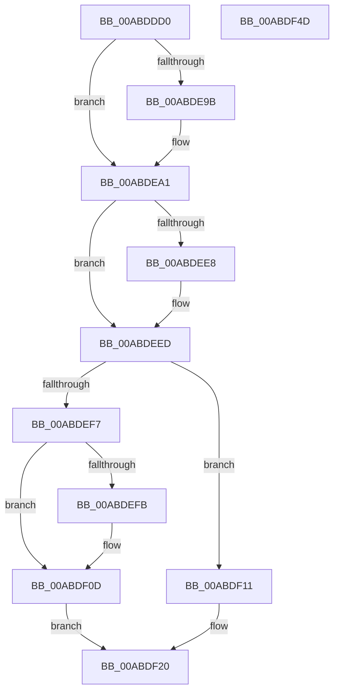

# IopFastQueryNetworkAttributes

- RVA: `0x00ABDDD0`–`0x00ABDF4E` (길이 `382` bytes)
- VA: `0x0000000140ABDDD0`
- 실행 섹션: `PAGE`
- PDB 이름 있음: `예`; PDB Function 태그: `아니요`
- unwind 정보 RVA: `0x0006F6F0`
- 디코드: `98`개 명령, `382/382` bytes 표시
- 미해석 바이트: `0` (있으면 어셈블리에 `.byte`로 보존)

> 이 문서는 커널 이미지의 기계어와 PDB 기호를 분석해 생성했습니다. 4번과 5번은 함수 원형과 자료형을 바이너리 사용 방식에서 추정한 C 해석이며 원본 소스 복구 결과는 아닙니다.

## 1. Dependencies

- 직접 호출 지점: **7**; 고유 호출 대상: **6**
- 직접 호출자로 확인된 함수: **1**
- RIP 상대 이미지 참조: **2**

### Outgoing calls
- `0x00ABDE2C` → [memset](../../text/6C/memset_function_006C6C40.md) (function, `0x006C6C40`)
- `0x00ABDE3E` → [memset](../../text/6C/memset_function_006C6C40.md) (function, `0x006C6C40`)
- `0x00ABDEA1` → [PsGetCurrentSilo](../../text/40/PsGetCurrentSilo_function_004094A0.md) (function, `0x004094A0`)
- `0x00ABDED8` → [ObOpenObjectByNameEx](../89/ObOpenObjectByNameEx_function_0089A8A0.md) (function, `0x0089A8A0`)
- `0x00ABDEE8` → [FsRtlpCleanupEcps](../8A/FsRtlpCleanupEcps_function_008A1220.md) (function, `0x008A1220`)
- `0x00ABDF03` → [ObCloseHandle](../8A/ObCloseHandle_function_008A1870.md) (function, `0x008A1870`)
- `0x00ABDF2D` → [_security_check_cookie](../../text/6A/_security_check_cookie_function_006AC640.md) (function, `0x006AC640`)

### Direct callers
- [IoFastQueryNetworkAttributes](IoFastQueryNetworkAttributes_function_00ABDD90.md) at `0x00ABDDBC`

### Static image references
- `0x00ABDDEF` → RVA `0x00E0A740` (`.data`; read)
- `0x00ABDEA6` → RVA `0x00FC6AE0` (`ALMOSTRO`; read)

## 2. Other-region calls and transfers

- 다른 실행 섹션으로 향하는 call: **4**
  - `0x00ABDE2C` → [memset](../../text/6C/memset_function_006C6C40.md) (`PAGE` → `.text`)
  - `0x00ABDE3E` → [memset](../../text/6C/memset_function_006C6C40.md) (`PAGE` → `.text`)
  - `0x00ABDEA1` → [PsGetCurrentSilo](../../text/40/PsGetCurrentSilo_function_004094A0.md) (`PAGE` → `.text`)
  - `0x00ABDF2D` → [_security_check_cookie](../../text/6A/_security_check_cookie_function_006AC640.md) (`PAGE` → `.text`)
- 별도 외부 분기/꼬리 이동을 확인하지 못했습니다.

## 3. Assembly (complete function range)

```asm
00ABDDD0  48 89 5C 24 10                  mov qword ptr [rsp + 0x10], rbx
00ABDDD5  55                              push rbp
00ABDDD6  56                              push rsi
00ABDDD7  57                              push rdi
00ABDDD8  41 54                           push r12
00ABDDDA  41 55                           push r13
00ABDDDC  41 56                           push r14
00ABDDDE  41 57                           push r15
00ABDDE0  48 8D AC 24 B0 FE FF FF         lea rbp, [rsp - 0x150]
00ABDDE8  48 81 EC 50 02 00 00            sub rsp, 0x250
00ABDDEF  48 8B 05 4A C9 34 00            mov rax, qword ptr [rip + 0x34c94a]
00ABDDF6  48 33 C4                        xor rax, rsp
00ABDDF9  48 89 85 40 01 00 00            mov qword ptr [rbp + 0x140], rax
00ABDE00  48 8B B5 B0 01 00 00            mov rsi, qword ptr [rbp + 0x1b0]
00ABDE07  45 8A F8                        mov r15b, r8b
00ABDE0A  48 8B 9D B8 01 00 00            mov rbx, qword ptr [rbp + 0x1b8]
00ABDE11  44 8B E2                        mov r12d, edx
00ABDE14  48 83 64 24 40 00               and qword ptr [rsp + 0x40], 0
00ABDE1A  4C 8B F1                        mov r14, rcx
00ABDE1D  33 D2                           xor edx, edx
00ABDE1F  48 8D 4D 30                     lea rcx, [rbp + 0x30]
00ABDE23  41 B8 10 01 00 00               mov r8d, 0x110
00ABDE29  41 8B F9                        mov edi, r9d
00ABDE2C  E8 0F 8E C0 FF                  call 0x1406c6c40
00ABDE31  33 D2                           xor edx, edx
00ABDE33  48 8D 4C 24 50                  lea rcx, [rsp + 0x50]
00ABDE38  41 B8 E0 00 00 00               mov r8d, 0xe0
00ABDE3E  E8 FD 8D C0 FF                  call 0x1406c6c40
00ABDE43  B8 07 00 00 00                  mov eax, 7
00ABDE48  C7 44 24 50 08 00 E0 00         mov dword ptr [rsp + 0x50], 0xe00008
00ABDE50  66 89 45 96                     mov word ptr [rbp - 0x6a], ax
00ABDE54  0F BA EF 15                     bts edi, 0x15
00ABDE58  89 7D 90                        mov dword ptr [rbp - 0x70], edi
00ABDE5B  0F 57 C0                        xorps xmm0, xmm0
00ABDE5E  48 89 5D B8                     mov qword ptr [rbp - 0x48], rbx
00ABDE62  4C 89 75 80                     mov qword ptr [rbp - 0x80], r14
00ABDE66  44 8D 68 FA                     lea r13d, [rax - 6]
00ABDE6A  44 89 6D A8                     mov dword ptr [rbp - 0x58], r13d
00ABDE6E  48 8D 45 30                     lea rax, [rbp + 0x30]
00ABDE72  48 89 45 E0                     mov qword ptr [rbp - 0x20], rax
00ABDE76  41 8D 45 27                     lea eax, [r13 + 0x27]
00ABDE7A  44 89 6D A4                     mov dword ptr [rbp - 0x5c], r13d
00ABDE7E  44 88 6D D9                     mov byte ptr [rbp - 0x27], r13b
00ABDE82  44 88 6D DB                     mov byte ptr [rbp - 0x25], r13b
00ABDE86  4C 89 6D 10                     mov qword ptr [rbp + 0x10], r13
00ABDE8A  0F 11 45 F0                     movups xmmword ptr [rbp - 0x10], xmm0
00ABDE8E  66 89 45 F0                     mov word ptr [rbp - 0x10], ax
00ABDE92  0F 11 45 00                     movups xmmword ptr [rbp], xmm0
00ABDE96  45 84 FF                        test r15b, r15b
00ABDE99  75 06                           jne 0x140abdea1
00ABDE9B  41 0F BA 6E 18 09               bts dword ptr [r14 + 0x18], 9
00ABDEA1  E8 FA B5 94 FF                  call 0x1404094a0
00ABDEA6  48 8B 15 33 8C 50 00            mov rdx, qword ptr [rip + 0x508c33]
00ABDEAD  48 8D 4C 24 40                  lea rcx, [rsp + 0x40]
00ABDEB2  48 89 4C 24 38                  mov qword ptr [rsp + 0x38], rcx
00ABDEB7  45 33 C9                        xor r9d, r9d
00ABDEBA  48 89 44 24 30                  mov qword ptr [rsp + 0x30], rax
00ABDEBF  45 8A C7                        mov r8b, r15b
00ABDEC2  48 89 45 10                     mov qword ptr [rbp + 0x10], rax
00ABDEC6  49 8B CE                        mov rcx, r14
00ABDEC9  48 8D 44 24 50                  lea rax, [rsp + 0x50]
00ABDECE  48 89 44 24 28                  mov qword ptr [rsp + 0x28], rax
00ABDED3  44 89 64 24 20                  mov dword ptr [rsp + 0x20], r12d
00ABDED8  E8 C3 C9 DD FF                  call 0x14089a8a0
00ABDEDD  48 8B 4D F8                     mov rcx, qword ptr [rbp - 8]
00ABDEE1  8B D8                           mov ebx, eax
00ABDEE3  48 85 C9                        test rcx, rcx
00ABDEE6  74 05                           je 0x140abdeed
00ABDEE8  E8 33 33 DE FF                  call 0x1408a1220
00ABDEED  81 7C 24 70 51 02 AA BE         cmp dword ptr [rsp + 0x70], 0xbeaa0251
00ABDEF5  74 1A                           je 0x140abdf11
00ABDEF7  85 DB                           test ebx, ebx
00ABDEF9  78 12                           js 0x140abdf0d
00ABDEFB  48 8B 4C 24 40                  mov rcx, qword ptr [rsp + 0x40]
00ABDF00  41 8A D7                        mov dl, r15b
00ABDF03  E8 68 39 DE FF                  call 0x1408a1870
00ABDF08  BB 24 00 00 C0                  mov ebx, 0xc0000024
00ABDF0D  89 1E                           mov dword ptr [rsi], ebx
00ABDF0F  EB 0F                           jmp 0x140abdf20
00ABDF11  8B 4C 24 60                     mov ecx, dword ptr [rsp + 0x60]
00ABDF15  89 0E                           mov dword ptr [rsi], ecx
00ABDF17  48 8B 4C 24 68                  mov rcx, qword ptr [rsp + 0x68]
00ABDF1C  48 89 4E 08                     mov qword ptr [rsi + 8], rcx
00ABDF20  41 8A C5                        mov al, r13b
00ABDF23  48 8B 8D 40 01 00 00            mov rcx, qword ptr [rbp + 0x140]
00ABDF2A  48 33 CC                        xor rcx, rsp
00ABDF2D  E8 0E E7 BE FF                  call 0x1406ac640
00ABDF32  48 8B 9C 24 98 02 00 00         mov rbx, qword ptr [rsp + 0x298]
00ABDF3A  48 81 C4 50 02 00 00            add rsp, 0x250
00ABDF41  41 5F                           pop r15
00ABDF43  41 5E                           pop r14
00ABDF45  41 5D                           pop r13
00ABDF47  41 5C                           pop r12
00ABDF49  5F                              pop rdi
00ABDF4A  5E                              pop rsi
00ABDF4B  5D                              pop rbp
00ABDF4C  C3                              ret
00ABDF4D  CC                              int3
```

## 4. C-style interpretation (structured pseudocode)

```c
__int64 __fastcall IopFastQueryNetworkAttributes(__int64 a1, int a2, unsigned __int8 a3, int a4, __int64 a5, __int64 a6)
{
    __int64 result;
    __int64 v_rbx;
    __int64 v_rsp;
    unsigned __int64 v_stack_m158;
    unsigned __int64 v_stack_m178;
    unsigned __int64 v_stack_m188;
    unsigned __int64 v_stack_m190;
    unsigned __int64 v_stack_m198;
    unsigned __int64 v_stack_m1A8;
    unsigned __int8 v_stack_m1AD;
    unsigned __int8 v_stack_m1AF;
    unsigned __int64 v_stack_m1D0;
    unsigned int v_stack_m1E0;
    unsigned int v_stack_m1E4;
    unsigned __int16 v_stack_m1F2;
    unsigned int v_stack_m1F8;
    unsigned __int64 v_stack_m208;
    unsigned int v_stack_m218;
    unsigned __int64 v_stack_m220;
    unsigned int v_stack_m228;
    unsigned __int64 v_stack_m238;
    unsigned __int64 v_stack_m248;
    unsigned __int64 v_stack_m250;
    unsigned __int64 v_stack_m258;
    unsigned __int64 v_stack_m260;
    unsigned int v_stack_m268;
    unsigned __int64 v_stack_m48;
    unsigned __int64 v_stack_p10;

    v_stack_p10 = v_rbx;
    v_rsp = (v_rsp) - (592);
    result = (*(unsigned __int64 *)(v_rip + 3459402)) ^ (v_rsp);
    v_stack_m48 = result;
    a2 = 0;
    result = memset(v_stack_m158, a2, 272, a4);
    a2 = 0;
    result = memset(v_stack_m238, a2, 224, a4);
    v_stack_m238 = 0xE00008ULL;
    v_stack_m1F2 = 7;
    v_stack_m1F8 = (unsigned int)((unsigned int)(a4));
    v_stack_m1D0 = a6;
    v_stack_m208 = a1;
    v_stack_m1E0 = (unsigned int)(7 - 6);
    v_stack_m1A8 = v_stack_m158;
    v_stack_m1E4 = (unsigned int)(7 - 6);
    v_stack_m1AF = (unsigned __int8)(7 - 6);
    v_stack_m1AD = (unsigned __int8)(7 - 6);
    v_stack_m178 = 7 - 6;
    v_stack_m198 = v_xmm0;
    v_stack_m198 = (unsigned __int16)(7 - 6 + 39);
    v_stack_m188 = v_xmm0;
    if (a3 == 0) {
    }
    result = PsGetCurrentSilo(v_stack_m238, a2, 224, a4);
    v_stack_m250 = v_stack_m248;
    a4 = 0;
    v_stack_m258 = result;
    v_stack_m178 = result;
    v_stack_m260 = v_stack_m238;
    v_stack_m268 = (unsigned int)((unsigned int)(a2));
    result = ObOpenObjectByNameEx(a1, *(unsigned __int64 *)(v_rip + 5278771), a3, a4);
    if (v_stack_m190 != 0) {
        result = FsRtlpCleanupEcps(v_stack_m190, *(unsigned __int64 *)(v_rip + 5278771), a3, a4);
    }
    if (v_stack_m218 == 0xBEAA0251ULL) goto loc_00ABDF11;
    v_rbx = (unsigned int)((unsigned int)(result));
    if (!(sign_flag)) {
        a1 = v_stack_m248;
        a2 = a3;
        result = ObCloseHandle(a1, a2, a3, a4);
        v_rbx = 0xC0000024ULL;
    }
    *(unsigned int *)(a5) = (unsigned int)(v_rbx);
    goto loc_00ABDF20;
loc_00ABDF11:
    *(unsigned int *)(a5) = (unsigned int)((unsigned int)(v_stack_m228));
    *(unsigned __int64 *)(a5 + 8) = v_stack_m220;
loc_00ABDF20:
    a1 = (v_stack_m48) ^ (v_rsp);
    result = _security_check_cookie(a1, a2, a3, a4);
    v_rsp = (v_rsp) + (592);
    return result;
}
```

## 5. (Beta) C Style

```c
int64_t IopFastQueryNetworkAttributes(void *Arg1, int32_t Arg2, uint8_t Arg3, int32_t Arg4, void *Arg5, int64_t Arg6)
{
    uint8_t *arg1 = (uint8_t *)Arg1;
    uint8_t *arg5 = (uint8_t *)Arg5;

    int64_t result;
    int64_t local_rbx;
    int64_t local_rsp;
    uint64_t v_stack_m158;
    uint64_t v_stack_m178;
    uint64_t v_stack_m188;
    uint64_t v_stack_m190;
    uint64_t v_stack_m198;
    uint64_t v_stack_m1A8;
    uint8_t v_stack_m1AD;
    uint8_t v_stack_m1AF;
    uint64_t v_stack_m1D0;
    uint32_t v_stack_m1E0;
    uint32_t v_stack_m1E4;
    uint16_t v_stack_m1F2;
    uint32_t v_stack_m1F8;
    uint64_t v_stack_m208;
    uint32_t v_stack_m218;
    uint64_t v_stack_m220;
    uint32_t v_stack_m228;
    uint64_t v_stack_m238;
    uint64_t v_stack_m248;
    uint64_t v_stack_m250;
    uint64_t v_stack_m258;
    uint64_t v_stack_m260;
    uint32_t v_stack_m268;
    uint64_t v_stack_m48;
    uint64_t v_stack_p10;

    v_stack_p10 = local_rbx;
    local_rsp = (local_rsp) - (592);
    result = (*(uint64_t *)(v_rip + 0x34C94A)) ^ (local_rsp);
    v_stack_m48 = result;
    Arg2 = 0;
    result = memset(v_stack_m158, Arg2, 272, Arg4);
    Arg2 = 0;
    result = memset(v_stack_m238, Arg2, 224, Arg4);
    v_stack_m238 = 0xE00008ULL;
    v_stack_m1F2 = 7;
    v_stack_m1F8 = (uint32_t)((uint32_t)(Arg4));
    v_stack_m1D0 = Arg6;
    v_stack_m208 = Arg1;
    v_stack_m1E0 = (uint32_t)(7 - 6);
    v_stack_m1A8 = v_stack_m158;
    v_stack_m1E4 = (uint32_t)(7 - 6);
    v_stack_m1AF = (uint8_t)(7 - 6);
    v_stack_m1AD = (uint8_t)(7 - 6);
    v_stack_m178 = 7 - 6;
    v_stack_m198 = v_xmm0;
    v_stack_m198 = (uint16_t)(7 - 6 + 39);
    v_stack_m188 = v_xmm0;
    if (Arg3 == 0) {
    }
    result = PsGetCurrentSilo(v_stack_m238, Arg2, 224, Arg4);
    v_stack_m250 = v_stack_m248;
    Arg4 = 0;
    v_stack_m258 = result;
    v_stack_m178 = result;
    v_stack_m260 = v_stack_m238;
    v_stack_m268 = (uint32_t)((uint32_t)(Arg2));
    result = ObOpenObjectByNameEx(Arg1, *(uint64_t *)(v_rip + 0x508C33), Arg3, Arg4);
    if (v_stack_m190 != 0) {
        result = FsRtlpCleanupEcps(v_stack_m190, *(uint64_t *)(v_rip + 0x508C33), Arg3, Arg4);
    }
    if (v_stack_m218 == 0xBEAA0251ULL) goto loc_00ABDF11;
    local_rbx = (uint32_t)((uint32_t)(result));
    if (!(sign_flag)) {
        Arg1 = v_stack_m248;
        Arg2 = Arg3;
        result = ObCloseHandle(Arg1, Arg2, Arg3, Arg4);
        local_rbx = 0xC0000024ULL;
    }
    *(uint32_t *)(arg5) = (uint32_t)(local_rbx);
    goto loc_00ABDF20;
loc_00ABDF11:
    *(uint32_t *)(arg5) = (uint32_t)((uint32_t)(v_stack_m228));
    *(uint64_t *)(arg5 + 0x8) = v_stack_m220;
loc_00ABDF20:
    Arg1 = (v_stack_m48) ^ (local_rsp);
    result = _security_check_cookie(Arg1, Arg2, Arg3, Arg4);
    local_rsp = (local_rsp) + (592);
    return result;
}
```

### 관측된 메모리 오프셋

구조체 형식이 확인되지 않은 접근은 인자 기준의 오프셋으로만 기록했습니다.

| 기준 인자 | 오프셋 표현 | 폭 (bit) | 접근 |
|---|---:|---:|---|
| `Arg1` | `+ 0x18` | `32` | `R/W` |
| `Arg5` | `+ 0x0` | `32` | `W` |
| `Arg5` | `+ 0x8` | `64` | `W` |

## 6. Execution-region graph

[열기: 2D/3D 그래프와 함수 탐색 컨트롤 패널](../../../control-panel.html?section=page&rva=0x00ABDDD0&view=graph)

- 2D 그래프는 위에서 아래로 흐르고, 3D 그래프는 빈 공간을 드래그해 회전합니다. Shift+드래그는 이동, 휠은 확대·축소, 함수 노드 선택은 대상 보고서 이동입니다.

### Static fallback


