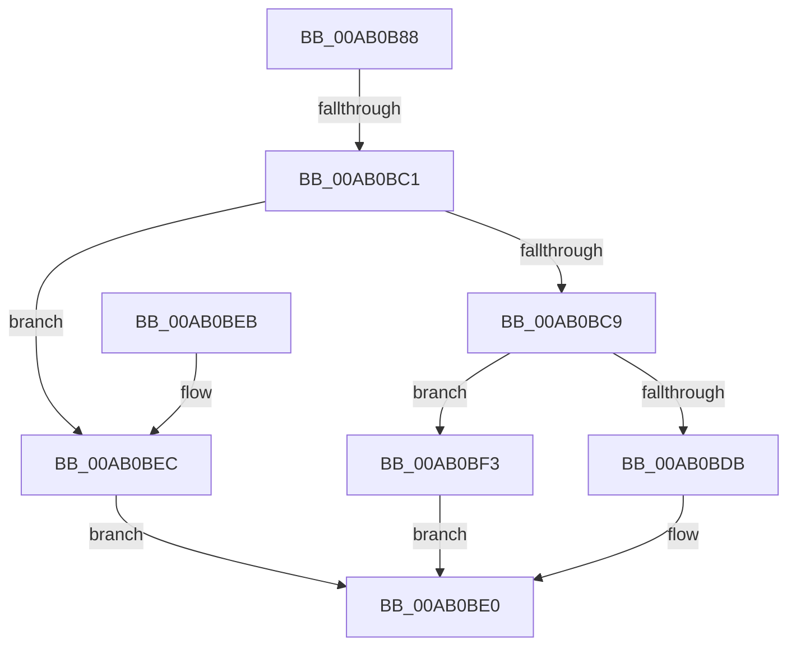

# IopIoRingGetBuffer

- RVA: `0x00AB0B88`–`0x00AB0C09` (길이 `129` bytes)
- VA: `0x0000000140AB0B88`
- 실행 섹션: `PAGE`
- PDB 이름 있음: `예`; PDB Function 태그: `예`
- unwind 정보 RVA: `0x000BC668`
- 디코드: `35`개 명령, `129/129` bytes 표시
- 미해석 바이트: `0` (있으면 어셈블리에 `.byte`로 보존)

> 이 문서는 커널 이미지의 기계어와 PDB 기호를 분석해 생성했습니다. 4번과 5번은 함수 원형과 자료형을 바이너리 사용 방식에서 추정한 C 해석이며 원본 소스 복구 결과는 아닙니다.

## 1. Dependencies

- 직접 호출 지점: **1**; 고유 호출 대상: **1**
- 직접 호출자로 확인된 함수: **2**
- RIP 상대 이미지 참조: **0**

### Outgoing calls
- `0x00AB0C02` → [IopMcGetBuffer](IopMcGetBuffer_function_00AB0118.md) (function, `0x00AB0118`)

### Direct callers
- [IopIoRingDispatchWrite](../72/IopIoRingDispatchWrite_function_00720248.md) at `0x007202C4`
- [sub_00B4A690](../B4/Unknown_function_00B4A690.md) at `0x00B4A6C0`

### Static image references
- 디코드된 RIP-relative 메모리 참조가 없습니다.

## 2. Other-region calls and transfers

- 다른 실행 섹션으로 향하는 call: **0**
- call이 아닌 외부 분기/꼬리 이동: **1**
  - `0x00AB0BBB` → [sub_00B4A930](../B4/Unknown_function_00B4A930.md) (`tail-transfer`)

## 3. Assembly (complete function range)

```asm
00AB0B88  48 89 5C 24 08                  mov qword ptr [rsp + 8], rbx
00AB0B8D  48 89 54 24 10                  mov qword ptr [rsp + 0x10], rdx
00AB0B92  57                              push rdi
00AB0B93  48 83 EC 40                     sub rsp, 0x40
00AB0B97  45 8B D1                        mov r10d, r9d
00AB0B9A  48 8B DA                        mov rbx, rdx
00AB0B9D  48 8B C1                        mov rax, rcx
00AB0BA0  33 D2                           xor edx, edx
00AB0BA2  48 8B BC 24 80 00 00 00         mov rdi, qword ptr [rsp + 0x80]
00AB0BAA  48 89 17                        mov qword ptr [rdi], rdx
00AB0BAD  4C 8B 8C 24 88 00 00 00         mov r9, qword ptr [rsp + 0x88]
00AB0BB5  49 89 11                        mov qword ptr [r9], rdx
00AB0BB8  45 84 C0                        test r8b, r8b
00AB0BBB  0F 84 6F 9D 09 00               je 0x140b4a930
00AB0BC1  3B 99 B0 00 00 00               cmp ebx, dword ptr [rcx + 0xb0]
00AB0BC7  73 23                           jae 0x140ab0bec
00AB0BC9  8B CB                           mov ecx, ebx
00AB0BCB  48 8B 80 B8 00 00 00            mov rax, qword ptr [rax + 0xb8]
00AB0BD2  48 8B 0C C8                     mov rcx, qword ptr [rax + rcx*8]
00AB0BD6  48 85 C9                        test rcx, rcx
00AB0BD9  75 18                           jne 0x140ab0bf3
00AB0BDB  B8 E8 00 00 C0                  mov eax, 0xc00000e8
00AB0BE0  48 8B 5C 24 50                  mov rbx, qword ptr [rsp + 0x50]
00AB0BE5  48 83 C4 40                     add rsp, 0x40
00AB0BE9  5F                              pop rdi
00AB0BEA  C3                              ret
00AB0BEB  CC                              int3
00AB0BEC  B8 D1 04 00 C0                  mov eax, 0xc00004d1
00AB0BF1  EB ED                           jmp 0x140ab0be0
00AB0BF3  8B 54 24 5C                     mov edx, dword ptr [rsp + 0x5c]
00AB0BF7  4C 89 4C 24 20                  mov qword ptr [rsp + 0x20], r9
00AB0BFC  4C 8B CF                        mov r9, rdi
00AB0BFF  45 8B C2                        mov r8d, r10d
00AB0C02  E8 11 F5 FF FF                  call 0x140ab0118
00AB0C07  EB D7                           jmp 0x140ab0be0
```

## 4. C-style interpretation (structured pseudocode)

```c
__int64 __fastcall IopIoRingGetBuffer(__int64 a1, __int64 a2, unsigned __int8 a3, int a4, __int64 a5, __int64 a6, __int64 a7, __int64 a8)
{
    __int64 result;
    __int64 v_rsp;
    unsigned __int64 v_stack_p10;
    unsigned __int64 v_stack_p20;
    unsigned int v_stack_p5C;
    unsigned __int64 v_stack_p8;

    v_stack_p8 = v_rbx;
    v_stack_p10 = a2;
    v_rsp = (v_rsp) - (64);
    a2 = 0;
    *(unsigned __int64 *)(a7) = 0;
    *(unsigned __int64 *)(a8) = 0;
    if (0 >= (*(unsigned int *)(a1 + 176))) goto loc_00AB0BEC;
    if (*(unsigned __int64 *)(*(unsigned __int64 *)(a1 + 184) + 0 * 8) != 0) goto loc_00AB0BF3;
loc_00AB0BE0:
    v_rsp = (v_rsp) + (64);
    return (unsigned int)(0xC00000E8ULL);
loc_00AB0BEC:
    goto loc_00AB0BE0;
loc_00AB0BF3:
    v_stack_p20 = a8;
    result = IopMcGetBuffer(*(unsigned __int64 *)(*(unsigned __int64 *)(a1 + 184) + 0 * 8), (unsigned int)(v_stack_p5C), (unsigned int)((unsigned int)((unsigned int)(a4))), a7);
    goto loc_00AB0BE0;
}
```

## 5. (Beta) C Style

```c
int64_t IopIoRingGetBuffer(void *Arg1, int64_t Arg2, uint8_t Arg3, int32_t Arg4, uint64_t Arg5, uint64_t Arg6, void *Arg7, void *Arg8)
{
    uint8_t *arg1 = (uint8_t *)Arg1;
    uint8_t *arg7 = (uint8_t *)Arg7;
    uint8_t *arg8 = (uint8_t *)Arg8;

    int64_t result;
    int64_t local_rsp;
    uint64_t v_stack_p10;
    uint64_t v_stack_p20;
    uint32_t v_stack_p5C;
    uint64_t v_stack_p8;

    v_stack_p8 = local_rbx;
    v_stack_p10 = Arg2;
    local_rsp = (local_rsp) - (64);
    Arg2 = 0;
    *(uint64_t *)(arg7) = 0;
    *(uint64_t *)(arg8) = 0;
    if (0 >= (*(uint32_t *)(arg1 + 0xB0))) goto loc_00AB0BEC;
    if (*(uint64_t *)(*(uint64_t *)(arg1 + 0xB8) + 0x0 * 8) != 0) goto loc_00AB0BF3;
loc_00AB0BE0:
    local_rsp = (local_rsp) + (64);
    return (uint32_t)(0xC00000E8ULL);
loc_00AB0BEC:
    goto loc_00AB0BE0;
loc_00AB0BF3:
    v_stack_p20 = Arg8;
    result = IopMcGetBuffer(*(uint64_t *)(*(uint64_t *)(arg1 + 0xB8) + 0x0 * 8), (uint32_t)(v_stack_p5C), (uint32_t)((uint32_t)((uint32_t)(Arg4))), Arg7);
    goto loc_00AB0BE0;
}
```

### 관측된 메모리 오프셋

구조체 형식이 확인되지 않은 접근은 인자 기준의 오프셋으로만 기록했습니다.

| 기준 인자 | 오프셋 표현 | 폭 (bit) | 접근 |
|---|---:|---:|---|
| `Arg1` | `+ 0xB0` | `32` | `R` |
| `Arg1` | `+ 0xB8` | `64` | `R` |
| `Arg7` | `+ 0x0` | `64` | `W` |
| `Arg8` | `+ 0x0` | `64` | `W` |

## 6. Execution-region graph

[열기: 2D/3D 그래프와 함수 탐색 컨트롤 패널](../../../control-panel.html?section=page&rva=0x00AB0B88&view=graph)

- 2D 그래프는 위에서 아래로 흐르고, 3D 그래프는 빈 공간을 드래그해 회전합니다. Shift+드래그는 이동, 휠은 확대·축소, 함수 노드 선택은 대상 보고서 이동입니다.

### Static fallback


