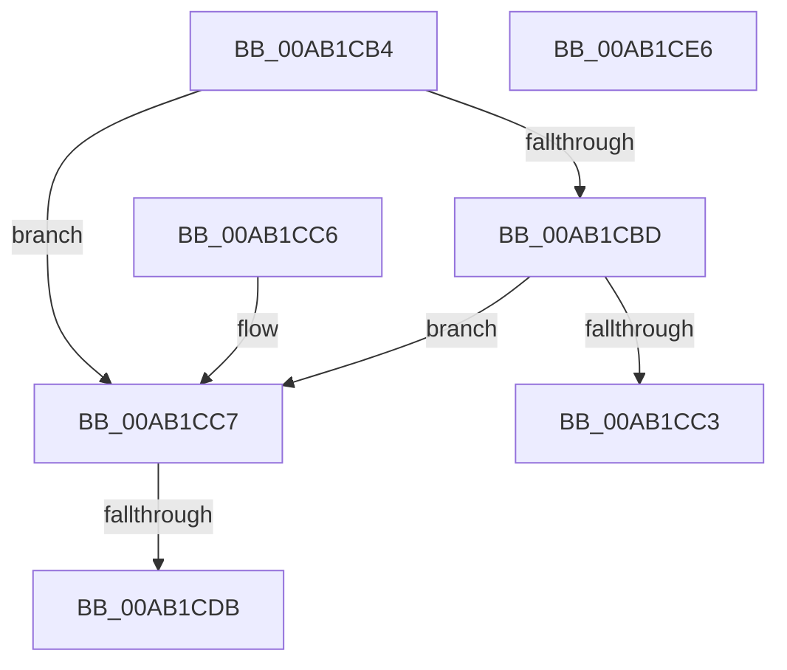

# IopIsRootEnumeratedDeviceObjectActive

- RVA: `0x00AB1CB4`–`0x00AB1CE7` (길이 `51` bytes)
- VA: `0x0000000140AB1CB4`
- 실행 섹션: `PAGE`
- PDB 이름 있음: `예`; PDB Function 태그: `예`
- unwind 정보 RVA: `0x000DB714`
- 디코드: `18`개 명령, `51/51` bytes 표시
- 미해석 바이트: `0` (있으면 어셈블리에 `.byte`로 보존)

> 이 문서는 커널 이미지의 기계어와 PDB 기호를 분석해 생성했습니다. 4번과 5번은 함수 원형과 자료형을 바이너리 사용 방식에서 추정한 C 해석이며 원본 소스 복구 결과는 아닙니다.

## 1. Dependencies

- 직접 호출 지점: **0**; 고유 호출 대상: **0**
- 직접 호출자로 확인된 함수: **2**
- RIP 상대 이미지 참조: **0**

### Outgoing calls
- 직접 디코드된 call 명령이 없습니다.

### Direct callers
- [IopInitializeDeviceInstanceKey](../A7/IopInitializeDeviceInstanceKey_function_00A7A6DC.md) at `0x00A7A7DD`
- [PiCMCreateDevice](../AC/PiCMCreateDevice_function_00ACB824.md) at `0x00ACBBAE`

### Static image references
- 디코드된 RIP-relative 메모리 참조가 없습니다.

## 2. Other-region calls and transfers

- 다른 실행 섹션으로 향하는 call: **0**
- call이 아닌 외부 분기/꼬리 이동: **1**
  - `0x00AB1CD5` → `0x00B4AA06` (`tail-transfer`)

## 3. Assembly (complete function range)

```asm
00AB1CB4  48 8B 41 40                     mov rax, qword ptr [rcx + 0x40]
00AB1CB8  48 85 C0                        test rax, rax
00AB1CBB  74 0A                           je 0x140ab1cc7
00AB1CBD  8B 00                           mov eax, dword ptr [rax]
00AB1CBF  A8 01                           test al, 1
00AB1CC1  74 04                           je 0x140ab1cc7
00AB1CC3  32 C0                           xor al, al
00AB1CC5  C3                              ret
00AB1CC6  CC                              int3
00AB1CC7  48 8B 81 38 01 00 00            mov rax, qword ptr [rcx + 0x138]
00AB1CCE  48 8B 40 28                     mov rax, qword ptr [rax + 0x28]
00AB1CD2  48 85 C0                        test rax, rax
00AB1CD5  0F 84 2B 8D 09 00               je 0x140b4aa06
00AB1CDB  8A 80 8E 01 00 00               mov al, byte ptr [rax + 0x18e]
00AB1CE1  34 FF                           xor al, 0xff
00AB1CE3  24 01                           and al, 1
00AB1CE5  C3                              ret
00AB1CE6  CC                              int3
```

## 4. C-style interpretation (structured pseudocode)

```c
__int64 __fastcall IopIsRootEnumeratedDeviceObjectActive(__int64 a1)
{
    __int64 result;

    if (*(unsigned __int64 *)(a1 + 64) == 0) goto loc_00AB1CC7;
    if ((((unsigned __int8)((unsigned int)(*(unsigned int *)(*(unsigned __int64 *)(a1 + 64))))) & (1)) == 0) goto loc_00AB1CC7;
    result = 0;
    return result;
loc_00AB1CC7:
    result = (unsigned __int8)((*(unsigned __int8 *)(*(unsigned __int64 *)(*(unsigned __int64 *)(a1 + 312) + 40) + 398)) ^ (255));
    result = (unsigned __int8)((result) & (1));
    return result;
}
```

## 5. (Beta) C Style

```c
int64_t IopIsRootEnumeratedDeviceObjectActive(void *Arg1)
{
    uint8_t *arg1 = (uint8_t *)Arg1;

    int64_t result;

    if (*(uint64_t *)(arg1 + 0x40) == 0) goto loc_00AB1CC7;
    if ((((uint8_t)((uint32_t)(*(uint32_t *)(*(uint64_t *)(arg1 + 0x40))))) & (1)) == 0) goto loc_00AB1CC7;
    result = 0;
    return result;
loc_00AB1CC7:
    result = (uint8_t)((*(uint8_t *)(*(uint64_t *)(*(uint64_t *)(arg1 + 0x138) + 0x28) + 0x18E)) ^ (255));
    result = (uint8_t)((result) & (1));
    return result;
}
```

### 관측된 메모리 오프셋

구조체 형식이 확인되지 않은 접근은 인자 기준의 오프셋으로만 기록했습니다.

| 기준 인자 | 오프셋 표현 | 폭 (bit) | 접근 |
|---|---:|---:|---|
| `Arg1` | `+ 0x40` | `64` | `R` |
| `Arg1` | `+ 0x138` | `64` | `R` |

## 6. Execution-region graph

[열기: 2D/3D 그래프와 함수 탐색 컨트롤 패널](../../../control-panel.html?section=page&rva=0x00AB1CB4&view=graph)

- 2D 그래프는 위에서 아래로 흐르고, 3D 그래프는 빈 공간을 드래그해 회전합니다. Shift+드래그는 이동, 휠은 확대·축소, 함수 노드 선택은 대상 보고서 이동입니다.

### Static fallback


