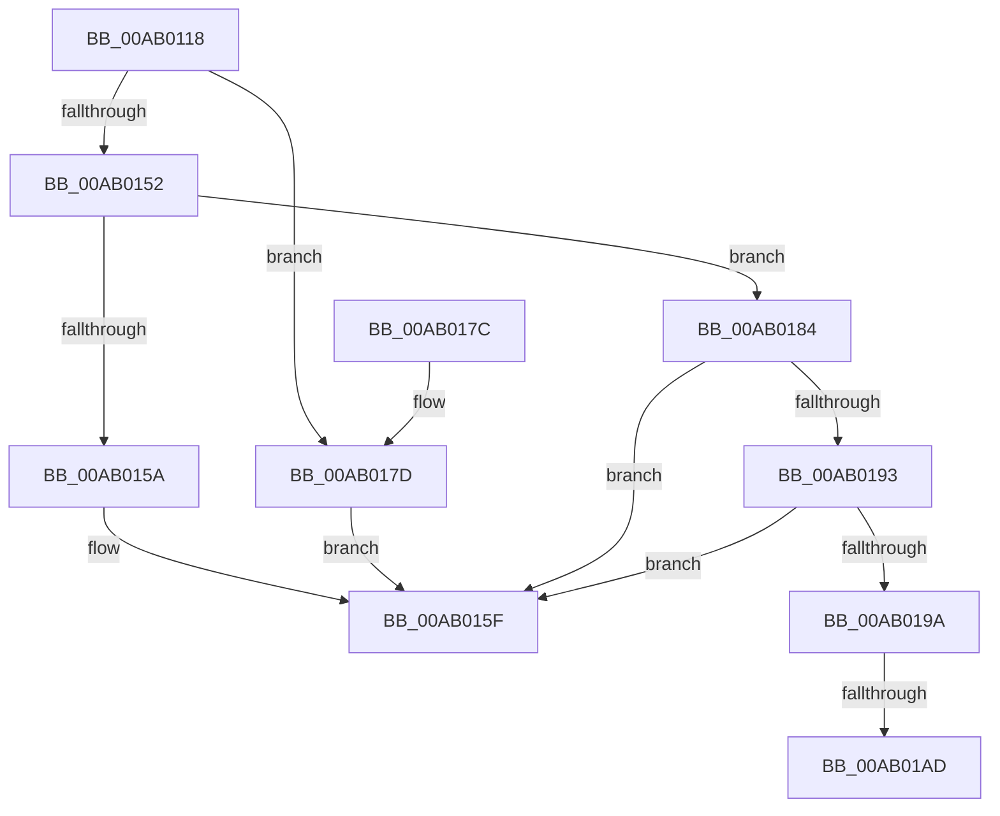

# IopMcGetBuffer

- RVA: `0x00AB0118`–`0x00AB01CB` (길이 `179` bytes)
- VA: `0x0000000140AB0118`
- 실행 섹션: `PAGE`
- PDB 이름 있음: `예`; PDB Function 태그: `예`
- unwind 정보 RVA: `0x000BC4BC`
- 디코드: `53`개 명령, `179/179` bytes 표시
- 미해석 바이트: `0` (있으면 어셈블리에 `.byte`로 보존)

> 이 문서는 커널 이미지의 기계어와 PDB 기호를 분석해 생성했습니다. 4번과 5번은 함수 원형과 자료형을 바이너리 사용 방식에서 추정한 C 해석이며 원본 소스 복구 결과는 아닙니다.

## 1. Dependencies

- 직접 호출 지점: **1**; 고유 호출 대상: **1**
- 직접 호출자로 확인된 함수: **1**
- RIP 상대 이미지 참조: **0**

### Outgoing calls
- `0x00AB01C5` → [KeBugCheckEx](../../text/4F/KeBugCheckEx_function_004FD660.md) (function, `0x004FD660`)

### Direct callers
- [IopIoRingGetBuffer](IopIoRingGetBuffer_function_00AB0B88.md) at `0x00AB0C02`

### Static image references
- 디코드된 RIP-relative 메모리 참조가 없습니다.

## 2. Other-region calls and transfers

- 다른 실행 섹션으로 향하는 call: **1**
  - `0x00AB01C5` → [KeBugCheckEx](../../text/4F/KeBugCheckEx_function_004FD660.md) (`PAGE` → `.text`)
- call이 아닌 외부 분기/꼬리 이동: **1**
  - `0x00AB01A7` → [sub_00B4A8D2](../B4/Unknown_function_00B4A8D2.md) (`tail-transfer`)

## 3. Assembly (complete function range)

```asm
00AB0118  48 8B C4                        mov rax, rsp
00AB011B  48 89 58 08                     mov qword ptr [rax + 8], rbx
00AB011F  48 89 68 10                     mov qword ptr [rax + 0x10], rbp
00AB0123  48 89 70 18                     mov qword ptr [rax + 0x18], rsi
00AB0127  48 89 78 20                     mov qword ptr [rax + 0x20], rdi
00AB012B  41 56                           push r14
00AB012D  48 83 EC 30                     sub rsp, 0x30
00AB0131  4C 8B 74 24 60                  mov r14, qword ptr [rsp + 0x60]
00AB0136  33 FF                           xor edi, edi
00AB0138  48 8B D9                        mov rbx, rcx
00AB013B  41 8B E8                        mov ebp, r8d
00AB013E  41 8B C8                        mov ecx, r8d
00AB0141  49 8B F1                        mov rsi, r9
00AB0144  48 03 CA                        add rcx, rdx
00AB0147  49 89 39                        mov qword ptr [r9], rdi
00AB014A  49 89 3E                        mov qword ptr [r14], rdi
00AB014D  48 3B D1                        cmp rdx, rcx
00AB0150  77 2B                           ja 0x140ab017d
00AB0152  8B 43 28                        mov eax, dword ptr [rbx + 0x28]
00AB0155  48 3B C8                        cmp rcx, rax
00AB0158  76 2A                           jbe 0x140ab0184
00AB015A  BF 06 02 00 C0                  mov edi, 0xc0000206
00AB015F  48 8B 5C 24 40                  mov rbx, qword ptr [rsp + 0x40]
00AB0164  8B C7                           mov eax, edi
00AB0166  48 8B 7C 24 58                  mov rdi, qword ptr [rsp + 0x58]
00AB016B  48 8B 6C 24 48                  mov rbp, qword ptr [rsp + 0x48]
00AB0170  48 8B 74 24 50                  mov rsi, qword ptr [rsp + 0x50]
00AB0175  48 83 C4 30                     add rsp, 0x30
00AB0179  41 5E                           pop r14
00AB017B  C3                              ret
00AB017C  CC                              int3
00AB017D  BF 0D 00 00 C0                  mov edi, 0xc000000d
00AB0182  EB DB                           jmp 0x140ab015f
00AB0184  48 8B 4B 20                     mov rcx, qword ptr [rbx + 0x20]
00AB0188  48 03 CA                        add rcx, rdx
00AB018B  49 89 09                        mov qword ptr [r9], rcx
00AB018E  45 85 C0                        test r8d, r8d
00AB0191  74 CC                           je 0x140ab015f
00AB0193  8B 43 0C                        mov eax, dword ptr [rbx + 0xc]
00AB0196  A8 05                           test al, 5
00AB0198  75 C5                           jne 0x140ab015f
00AB019A  B8 01 00 00 00                  mov eax, 1
00AB019F  F0 0F C1 43 30                  lock xadd dword ptr [rbx + 0x30], eax
00AB01A4  83 C0 01                        add eax, 1
00AB01A7  0F 8F 25 A7 09 00               jg 0x140b4a8d2
00AB01AD  4C 63 C8                        movsxd r9, eax
00AB01B0  4C 8B C3                        mov r8, rbx
00AB01B3  48 8B 03                        mov rax, qword ptr [rbx]
00AB01B6  BA 02 00 00 00                  mov edx, 2
00AB01BB  B9 F4 01 00 00                  mov ecx, 0x1f4
00AB01C0  48 89 44 24 20                  mov qword ptr [rsp + 0x20], rax
00AB01C5  E8 96 D4 A4 FF                  call 0x1404fd660
00AB01CA  CC                              int3
```

## 4. C-style interpretation (structured pseudocode)

```c
__int64 __fastcall IopMcGetBuffer(__int64 a1, __int64 a2, int a3, __int64 a4, __int64 a5)
{
    __int64 result;
    __int64 v_rdi;
    __int64 v_rsp;
    unsigned __int64 v_stack_p10;
    unsigned __int64 v_stack_p18;
    unsigned __int64 v_stack_p20;
    unsigned __int64 v_stack_p8;

    *(unsigned __int64 *)(v_rsp + 8) = v_rbx;
    *(unsigned __int64 *)(v_rsp + 16) = v_rbp;
    *(unsigned __int64 *)(v_rsp + 24) = v_rsi;
    *(unsigned __int64 *)(v_rsp + 32) = v_rdi;
    v_rsp = (v_rsp) - (48);
    v_rdi = 0;
    a1 = ((unsigned int)(a3)) + (a2);
    *(unsigned __int64 *)(a4) = 0;
    *(unsigned __int64 *)(a5) = 0;
    if (a2 > a1) goto loc_00AB017D;
    if (a1 <= ((unsigned int)(*(unsigned int *)(a1 + 40)))) goto loc_00AB0184;
loc_00AB015F:
    v_rsp = (v_rsp) + (48);
    return (unsigned int)((unsigned int)((unsigned int)(0xC0000206ULL)));
loc_00AB017D:
    goto loc_00AB015F;
loc_00AB0184:
    a1 = (*(unsigned __int64 *)(v_stack_p8 + 32)) + (a2);
    *(unsigned __int64 *)(a4) = a1;
    if (a3 == 0) goto loc_00AB015F;
    if ((((unsigned __int8)((unsigned int)(*(unsigned int *)(v_stack_p8 + 12)))) & (5)) != 0) goto loc_00AB015F;
    result = (unsigned int)((1) + (1));
    v_stack_p20 = *(unsigned __int64 *)(v_stack_p8);
    result = KeBugCheckEx(500, 2, v_stack_p8, (int)((unsigned int)(result)));
    return result;
}
```

## 5. (Beta) C Style

```c
int64_t IopMcGetBuffer(void *Arg1, int64_t Arg2, int32_t Arg3, void *Arg4, void *Arg5)
{
    uint8_t *arg1 = (uint8_t *)Arg1;
    uint8_t *arg4 = (uint8_t *)Arg4;
    uint8_t *arg5 = (uint8_t *)Arg5;

    int64_t result;
    int64_t local_rdi;
    int64_t local_rsp;
    uint64_t v_stack_p10;
    uint64_t v_stack_p18;
    uint64_t v_stack_p20;
    uint64_t v_stack_p8;

    *(uint64_t *)(local_rsp + 0x8) = local_rbx;
    *(uint64_t *)(local_rsp + 0x10) = local_rbp;
    *(uint64_t *)(local_rsp + 0x18) = local_rsi;
    *(uint64_t *)(local_rsp + 0x20) = local_rdi;
    local_rsp = (local_rsp) - (48);
    local_rdi = 0;
    Arg1 = ((uint32_t)(Arg3)) + (Arg2);
    *(uint64_t *)(arg4) = 0;
    *(uint64_t *)(arg5) = 0;
    if (Arg2 > Arg1) goto loc_00AB017D;
    if (Arg1 <= ((uint32_t)(*(uint32_t *)(arg1 + 0x28)))) goto loc_00AB0184;
loc_00AB015F:
    local_rsp = (local_rsp) + (48);
    return (uint32_t)((uint32_t)((uint32_t)(0xC0000206ULL)));
loc_00AB017D:
    goto loc_00AB015F;
loc_00AB0184:
    Arg1 = (*(uint64_t *)(v_stack_p8 + 0x20)) + (Arg2);
    *(void **)(arg4) = Arg1;
    if (Arg3 == 0) goto loc_00AB015F;
    if ((((uint8_t)((uint32_t)(*(uint32_t *)(v_stack_p8 + 0xC)))) & (5)) != 0) goto loc_00AB015F;
    result = (uint32_t)((1) + (1));
    v_stack_p20 = *(uint64_t *)(v_stack_p8);
    result = KeBugCheckEx(500, 2, v_stack_p8, (int32_t)((uint32_t)(result)));
    return result;
}
```

### 관측된 메모리 오프셋

구조체 형식이 확인되지 않은 접근은 인자 기준의 오프셋으로만 기록했습니다.

| 기준 인자 | 오프셋 표현 | 폭 (bit) | 접근 |
|---|---:|---:|---|
| `Arg1` | `+ 0x0` | `64` | `R` |
| `Arg1` | `+ 0xC` | `32` | `R` |
| `Arg1` | `+ 0x20` | `64` | `R` |
| `Arg1` | `+ 0x28` | `32` | `R` |
| `Arg1` | `+ 0x30` | `32` | `R/W` |
| `Arg4` | `+ 0x0` | `64` | `W` |
| `Arg5` | `+ 0x0` | `64` | `W` |

## 6. Execution-region graph

[열기: 2D/3D 그래프와 함수 탐색 컨트롤 패널](../../../control-panel.html?section=page&rva=0x00AB0118&view=graph)

- 2D 그래프는 위에서 아래로 흐르고, 3D 그래프는 빈 공간을 드래그해 회전합니다. Shift+드래그는 이동, 휠은 확대·축소, 함수 노드 선택은 대상 보고서 이동입니다.

### Static fallback


