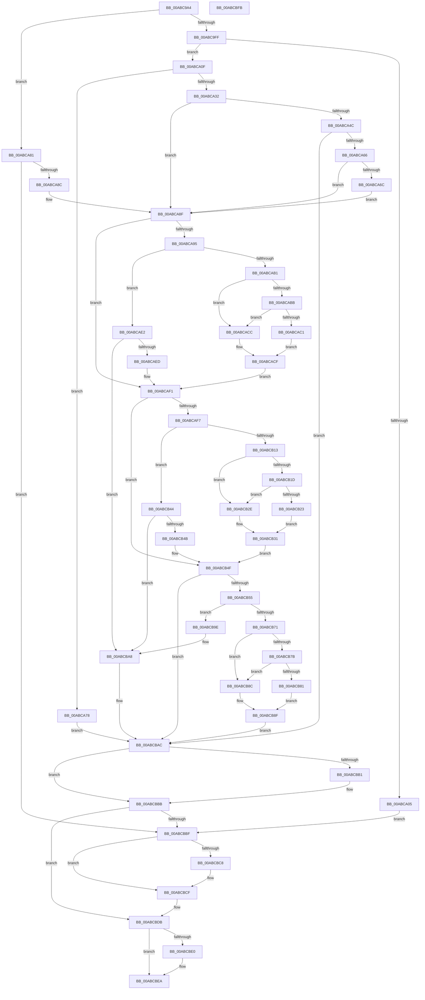

# IopQuerySecureDeviceClassState

- RVA: `0x00ABC9A4`–`0x00ABCBFC` (길이 `600` bytes)
- VA: `0x0000000140ABC9A4`
- 실행 섹션: `PAGE`
- PDB 이름 있음: `예`; PDB Function 태그: `아니요`
- unwind 정보 RVA: `0x000BD4F0`
- 디코드: `191`개 명령, `600/600` bytes 표시
- 미해석 바이트: `0` (있으면 어셈블리에 `.byte`로 보존)

> 이 문서는 커널 이미지의 기계어와 PDB 기호를 분석해 생성했습니다. 4번과 5번은 함수 원형과 자료형을 바이너리 사용 방식에서 추정한 C 해석이며 원본 소스 복구 결과는 아닙니다.

## 1. Dependencies

- 직접 호출 지점: **13**; 고유 호출 대상: **4**
- 직접 호출자로 확인된 함수: **1**
- RIP 상대 이미지 참조: **4**

### Outgoing calls
- `0x00ABC9EC` → [IopGetRegistryValue](../99/IopGetRegistryValue_function_009990EC.md) (function, `0x009990EC`)
- `0x00ABCA27` → [SeCaptureSecurityDescriptor](../92/SeCaptureSecurityDescriptor_function_00929F40.md) (function, `0x00929F40`)
- `0x00ABCA37` → [ExFreePoolWithTag](../../poolcode/B8/ExFreePoolWithTag_function_00B82870.md) (function, `0x00B82870`)
- `0x00ABCA57` → [IopGetSecurityDescriptorInformation](../9A/IopGetSecurityDescriptorInformation_function_009A2FA4.md) (function, `0x009A2FA4`)
- `0x00ABCAA6` → [IopGetRegistryValue](../99/IopGetRegistryValue_function_009990EC.md) (function, `0x009990EC`)
- `0x00ABCAD4` → [ExFreePoolWithTag](../../poolcode/B8/ExFreePoolWithTag_function_00B82870.md) (function, `0x00B82870`)
- `0x00ABCB08` → [IopGetRegistryValue](../99/IopGetRegistryValue_function_009990EC.md) (function, `0x009990EC`)
- `0x00ABCB36` → [ExFreePoolWithTag](../../poolcode/B8/ExFreePoolWithTag_function_00B82870.md) (function, `0x00B82870`)
- `0x00ABCB66` → [IopGetRegistryValue](../99/IopGetRegistryValue_function_009990EC.md) (function, `0x009990EC`)
- `0x00ABCB94` → [ExFreePoolWithTag](../../poolcode/B8/ExFreePoolWithTag_function_00B82870.md) (function, `0x00B82870`)
- `0x00ABCBB6` → [ExFreePoolWithTag](../../poolcode/B8/ExFreePoolWithTag_function_00B82870.md) (function, `0x00B82870`)
- `0x00ABCBCA` → [ExFreePoolWithTag](../../poolcode/B8/ExFreePoolWithTag_function_00B82870.md) (function, `0x00B82870`)
- `0x00ABCBE5` → [ExFreePoolWithTag](../../poolcode/B8/ExFreePoolWithTag_function_00B82870.md) (function, `0x00B82870`)

### Direct callers
- [sub_00B2D22A](../B2/Unknown_function_00B2D22A.md) at `0x00B2D299`
- [sub_00B2D22A](../B2/Unknown_function_00B2D22A.md) at `0x00B2D3E5`

### Static image references
- `0x00ABC9D4` → RVA `0x00AFCD60` (` ?? ::NNGAKEGL::`string'`; read)
- `0x00ABCA9C` → RVA `0x00AFCC60` (` ?? ::NNGAKEGL::`string'`; read)
- `0x00ABCAFE` → RVA `0x00AFCC80` (` ?? ::NNGAKEGL::`string'`; read)
- `0x00ABCB5C` → RVA `0x00AFCCB0` (` ?? ::NNGAKEGL::`string'`; read)

## 2. Other-region calls and transfers

- 다른 실행 섹션으로 향하는 call: **7**
  - `0x00ABCA37` → [ExFreePoolWithTag](../../poolcode/B8/ExFreePoolWithTag_function_00B82870.md) (`PAGE` → `POOLCODE`)
  - `0x00ABCAD4` → [ExFreePoolWithTag](../../poolcode/B8/ExFreePoolWithTag_function_00B82870.md) (`PAGE` → `POOLCODE`)
  - `0x00ABCB36` → [ExFreePoolWithTag](../../poolcode/B8/ExFreePoolWithTag_function_00B82870.md) (`PAGE` → `POOLCODE`)
  - `0x00ABCB94` → [ExFreePoolWithTag](../../poolcode/B8/ExFreePoolWithTag_function_00B82870.md) (`PAGE` → `POOLCODE`)
  - `0x00ABCBB6` → [ExFreePoolWithTag](../../poolcode/B8/ExFreePoolWithTag_function_00B82870.md) (`PAGE` → `POOLCODE`)
  - `0x00ABCBCA` → [ExFreePoolWithTag](../../poolcode/B8/ExFreePoolWithTag_function_00B82870.md) (`PAGE` → `POOLCODE`)
  - `0x00ABCBE5` → [ExFreePoolWithTag](../../poolcode/B8/ExFreePoolWithTag_function_00B82870.md) (`PAGE` → `POOLCODE`)
- 별도 외부 분기/꼬리 이동을 확인하지 못했습니다.

## 3. Assembly (complete function range)

```asm
00ABC9A4  40 55                           push rbp
00ABC9A6  53                              push rbx
00ABC9A7  56                              push rsi
00ABC9A8  57                              push rdi
00ABC9A9  41 54                           push r12
00ABC9AB  41 56                           push r14
00ABC9AD  41 57                           push r15
00ABC9AF  48 8B EC                        mov rbp, rsp
00ABC9B2  48 83 EC 40                     sub rsp, 0x40
00ABC9B6  45 33 E4                        xor r12d, r12d
00ABC9B9  4C 8D 4D 58                     lea r9, [rbp + 0x58]
00ABC9BD  0F 57 C0                        xorps xmm0, xmm0
00ABC9C0  44 88 65 48                     mov byte ptr [rbp + 0x48], r12b
00ABC9C4  0F 11 02                        movups xmmword ptr [rdx], xmm0
00ABC9C7  33 C0                           xor eax, eax
00ABC9C9  44 89 65 50                     mov dword ptr [rbp + 0x50], r12d
00ABC9CD  48 89 42 10                     mov qword ptr [rdx + 0x10], rax
00ABC9D1  48 8B F2                        mov rsi, rdx
00ABC9D4  48 8D 15 85 03 04 00            lea rdx, [rip + 0x40385]
00ABC9DB  4C 89 65 F0                     mov qword ptr [rbp - 0x10], r12
00ABC9DF  45 33 C0                        xor r8d, r8d
00ABC9E2  4C 89 65 58                     mov qword ptr [rbp + 0x58], r12
00ABC9E6  4C 8B F9                        mov r15, rcx
00ABC9E9  45 8B F4                        mov r14d, r12d
00ABC9EC  E8 FB C6 ED FF                  call 0x1409990ec
00ABC9F1  48 8B 5D 58                     mov rbx, qword ptr [rbp + 0x58]
00ABC9F5  8B F8                           mov edi, eax
00ABC9F7  85 C0                           test eax, eax
00ABC9F9  0F 88 82 00 00 00               js 0x140abca81
00ABC9FF  83 7B 04 03                     cmp dword ptr [rbx + 4], 3
00ABCA03  74 0A                           je 0x140abca0f
00ABCA05  BF 4C 01 00 C0                  mov edi, 0xc000014c
00ABCA0A  E9 B0 01 00 00                  jmp 0x140abcbbf
00ABCA0F  8B 4B 08                        mov ecx, dword ptr [rbx + 8]
00ABCA12  48 8D 45 F0                     lea rax, [rbp - 0x10]
00ABCA16  33 D2                           xor edx, edx
00ABCA18  48 89 44 24 20                  mov qword ptr [rsp + 0x20], rax
00ABCA1D  48 03 CB                        add rcx, rbx
00ABCA20  41 B1 01                        mov r9b, 1
00ABCA23  44 8D 42 01                     lea r8d, [rdx + 1]
00ABCA27  E8 14 D5 E6 FF                  call 0x140929f40
00ABCA2C  8B F8                           mov edi, eax
00ABCA2E  85 C0                           test eax, eax
00ABCA30  78 46                           js 0x140abca78
00ABCA32  33 D2                           xor edx, edx
00ABCA34  48 8B CB                        mov rcx, rbx
00ABCA37  E8 34 5E 0C 00                  call 0x140b82870
00ABCA3C  4C 8B 75 F0                     mov r14, qword ptr [rbp - 0x10]
00ABCA40  49 8B DC                        mov rbx, r12
00ABCA43  48 89 5D 58                     mov qword ptr [rbp + 0x58], rbx
00ABCA47  4D 85 F6                        test r14, r14
00ABCA4A  74 43                           je 0x140abca8f
00ABCA4C  4C 8D 45 50                     lea r8, [rbp + 0x50]
00ABCA50  49 8B CE                        mov rcx, r14
00ABCA53  48 8D 55 48                     lea rdx, [rbp + 0x48]
00ABCA57  E8 48 65 EE FF                  call 0x1409a2fa4
00ABCA5C  8B F8                           mov edi, eax
00ABCA5E  85 C0                           test eax, eax
00ABCA60  0F 88 46 01 00 00               js 0x140abcbac
00ABCA66  44 38 65 48                     cmp byte ptr [rbp + 0x48], r12b
00ABCA6A  75 23                           jne 0x140abca8f
00ABCA6C  83 0E 02                        or dword ptr [rsi], 2
00ABCA6F  4C 89 76 08                     mov qword ptr [rsi + 8], r14
00ABCA73  4D 8B F4                        mov r14, r12
00ABCA76  EB 17                           jmp 0x140abca8f
00ABCA78  4C 8B 75 F0                     mov r14, qword ptr [rbp - 0x10]
00ABCA7C  E9 2B 01 00 00                  jmp 0x140abcbac
00ABCA81  3D 34 00 00 C0                  cmp eax, 0xc0000034
00ABCA86  0F 85 33 01 00 00               jne 0x140abcbbf
00ABCA8C  41 8B FC                        mov edi, r12d
00ABCA8F  8B 06                           mov eax, dword ptr [rsi]
00ABCA91  A8 01                           test al, 1
00ABCA93  75 5C                           jne 0x140abcaf1
00ABCA95  4C 8D 4D 58                     lea r9, [rbp + 0x58]
00ABCA99  45 33 C0                        xor r8d, r8d
00ABCA9C  48 8D 15 BD 01 04 00            lea rdx, [rip + 0x401bd]
00ABCAA3  49 8B CF                        mov rcx, r15
00ABCAA6  E8 41 C6 ED FF                  call 0x1409990ec
00ABCAAB  8B F8                           mov edi, eax
00ABCAAD  85 C0                           test eax, eax
00ABCAAF  78 31                           js 0x140abcae2
00ABCAB1  48 8B 4D 58                     mov rcx, qword ptr [rbp + 0x58]
00ABCAB5  83 79 04 04                     cmp dword ptr [rcx + 4], 4
00ABCAB9  75 11                           jne 0x140abcacc
00ABCABB  83 79 0C 04                     cmp dword ptr [rcx + 0xc], 4
00ABCABF  75 0B                           jne 0x140abcacc
00ABCAC1  8B 41 08                        mov eax, dword ptr [rcx + 8]
00ABCAC4  83 0E 01                        or dword ptr [rsi], 1
00ABCAC7  8B 14 08                        mov edx, dword ptr [rax + rcx]
00ABCACA  EB 03                           jmp 0x140abcacf
00ABCACC  41 8B D4                        mov edx, r12d
00ABCACF  89 56 04                        mov dword ptr [rsi + 4], edx
00ABCAD2  33 D2                           xor edx, edx
00ABCAD4  E8 97 5D 0C 00                  call 0x140b82870
00ABCAD9  49 8B DC                        mov rbx, r12
00ABCADC  48 89 5D 58                     mov qword ptr [rbp + 0x58], rbx
00ABCAE0  EB 0F                           jmp 0x140abcaf1
00ABCAE2  3D 34 00 00 C0                  cmp eax, 0xc0000034
00ABCAE7  0F 85 BB 00 00 00               jne 0x140abcba8
00ABCAED  48 8B 5D 58                     mov rbx, qword ptr [rbp + 0x58]
00ABCAF1  8B 06                           mov eax, dword ptr [rsi]
00ABCAF3  A8 04                           test al, 4
00ABCAF5  75 58                           jne 0x140abcb4f
00ABCAF7  4C 8D 4D 58                     lea r9, [rbp + 0x58]
00ABCAFB  45 33 C0                        xor r8d, r8d
00ABCAFE  48 8D 15 7B 01 04 00            lea rdx, [rip + 0x4017b]
00ABCB05  49 8B CF                        mov rcx, r15
00ABCB08  E8 DF C5 ED FF                  call 0x1409990ec
00ABCB0D  8B F8                           mov edi, eax
00ABCB0F  85 C0                           test eax, eax
00ABCB11  78 31                           js 0x140abcb44
00ABCB13  48 8B 4D 58                     mov rcx, qword ptr [rbp + 0x58]
00ABCB17  83 79 04 04                     cmp dword ptr [rcx + 4], 4
00ABCB1B  75 11                           jne 0x140abcb2e
00ABCB1D  83 79 0C 04                     cmp dword ptr [rcx + 0xc], 4
00ABCB21  75 0B                           jne 0x140abcb2e
00ABCB23  8B 41 08                        mov eax, dword ptr [rcx + 8]
00ABCB26  83 0E 04                        or dword ptr [rsi], 4
00ABCB29  8B 14 08                        mov edx, dword ptr [rax + rcx]
00ABCB2C  EB 03                           jmp 0x140abcb31
00ABCB2E  41 8B D4                        mov edx, r12d
00ABCB31  89 56 10                        mov dword ptr [rsi + 0x10], edx
00ABCB34  33 D2                           xor edx, edx
00ABCB36  E8 35 5D 0C 00                  call 0x140b82870
00ABCB3B  49 8B DC                        mov rbx, r12
00ABCB3E  48 89 5D 58                     mov qword ptr [rbp + 0x58], rbx
00ABCB42  EB 0B                           jmp 0x140abcb4f
00ABCB44  3D 34 00 00 C0                  cmp eax, 0xc0000034
00ABCB49  75 5D                           jne 0x140abcba8
00ABCB4B  48 8B 5D 58                     mov rbx, qword ptr [rbp + 0x58]
00ABCB4F  8B 06                           mov eax, dword ptr [rsi]
00ABCB51  A8 08                           test al, 8
00ABCB53  75 57                           jne 0x140abcbac
00ABCB55  4C 8D 4D 58                     lea r9, [rbp + 0x58]
00ABCB59  45 33 C0                        xor r8d, r8d
00ABCB5C  48 8D 15 4D 01 04 00            lea rdx, [rip + 0x4014d]
00ABCB63  49 8B CF                        mov rcx, r15
00ABCB66  E8 81 C5 ED FF                  call 0x1409990ec
00ABCB6B  8B F8                           mov edi, eax
00ABCB6D  85 C0                           test eax, eax
00ABCB6F  78 2D                           js 0x140abcb9e
00ABCB71  48 8B 4D 58                     mov rcx, qword ptr [rbp + 0x58]
00ABCB75  83 79 04 04                     cmp dword ptr [rcx + 4], 4
00ABCB79  75 11                           jne 0x140abcb8c
00ABCB7B  83 79 0C 04                     cmp dword ptr [rcx + 0xc], 4
00ABCB7F  75 0B                           jne 0x140abcb8c
00ABCB81  8B 41 08                        mov eax, dword ptr [rcx + 8]
00ABCB84  83 0E 08                        or dword ptr [rsi], 8
00ABCB87  8B 14 08                        mov edx, dword ptr [rax + rcx]
00ABCB8A  EB 03                           jmp 0x140abcb8f
00ABCB8C  41 8B D4                        mov edx, r12d
00ABCB8F  89 56 14                        mov dword ptr [rsi + 0x14], edx
00ABCB92  33 D2                           xor edx, edx
00ABCB94  E8 D7 5C 0C 00                  call 0x140b82870
00ABCB99  49 8B DC                        mov rbx, r12
00ABCB9C  EB 0E                           jmp 0x140abcbac
00ABCB9E  81 FF 34 00 00 C0               cmp edi, 0xc0000034
00ABCBA4  41 0F 44 FC                     cmove edi, r12d
00ABCBA8  48 8B 5D 58                     mov rbx, qword ptr [rbp + 0x58]
00ABCBAC  4D 85 F6                        test r14, r14
00ABCBAF  74 0A                           je 0x140abcbbb
00ABCBB1  33 D2                           xor edx, edx
00ABCBB3  49 8B CE                        mov rcx, r14
00ABCBB6  E8 B5 5C 0C 00                  call 0x140b82870
00ABCBBB  85 FF                           test edi, edi
00ABCBBD  79 1C                           jns 0x140abcbdb
00ABCBBF  48 8B 4E 08                     mov rcx, qword ptr [rsi + 8]
00ABCBC3  48 85 C9                        test rcx, rcx
00ABCBC6  74 07                           je 0x140abcbcf
00ABCBC8  33 D2                           xor edx, edx
00ABCBCA  E8 A1 5C 0C 00                  call 0x140b82870
00ABCBCF  0F 57 C0                        xorps xmm0, xmm0
00ABCBD2  33 C0                           xor eax, eax
00ABCBD4  0F 11 06                        movups xmmword ptr [rsi], xmm0
00ABCBD7  48 89 46 10                     mov qword ptr [rsi + 0x10], rax
00ABCBDB  48 85 DB                        test rbx, rbx
00ABCBDE  74 0A                           je 0x140abcbea
00ABCBE0  33 D2                           xor edx, edx
00ABCBE2  48 8B CB                        mov rcx, rbx
00ABCBE5  E8 86 5C 0C 00                  call 0x140b82870
00ABCBEA  8B C7                           mov eax, edi
00ABCBEC  48 83 C4 40                     add rsp, 0x40
00ABCBF0  41 5F                           pop r15
00ABCBF2  41 5E                           pop r14
00ABCBF4  41 5C                           pop r12
00ABCBF6  5F                              pop rdi
00ABCBF7  5E                              pop rsi
00ABCBF8  5B                              pop rbx
00ABCBF9  5D                              pop rbp
00ABCBFA  C3                              ret
00ABCBFB  CC                              int3
```

## 4. C-style interpretation (structured pseudocode)

```c
__int64 __fastcall IopQuerySecureDeviceClassState(__int64 a1, __int64 a2, int a3)
{
    __int64 result;
    __int64 v_r12;
    __int64 v_rdi;
    __int64 v_rsp;
    unsigned __int64 v_stack_m48;
    unsigned __int64 v_stack_m58;
    unsigned __int8 v_stack_p10;
    unsigned int v_stack_p18;
    unsigned __int64 v_stack_p20;

    v_rsp = (v_rsp) - (64);
    v_r12 = 0;
    v_stack_p10 = 0;
    *(unsigned __int64 *)(a2) = v_xmm0;
    result = 0;
    v_stack_p18 = 0;
    *(unsigned __int64 *)(a2 + 16) = 0;
    v_stack_m48 = 0;
    a3 = 0;
    v_stack_p20 = 0;
    result = IopGetRegistryValue(a1, v_rip + 263045, a3, v_stack_p20);
    if (sign_flag) goto loc_00ABCA81;
    if ((*(unsigned int *)(v_stack_p20 + 4)) == 3) goto loc_00ABCA0F;
    goto loc_00ABCBBF;
loc_00ABCA0F:
    a2 = 0;
    v_stack_m58 = v_stack_m48;
    a1 = ((unsigned int)(*(unsigned int *)(v_stack_p20 + 8))) + (v_stack_p20);
    result = SeCaptureSecurityDescriptor(a1, a2, a2 + 1, 1);
    if (sign_flag) goto loc_00ABCA78;
    a2 = 0;
    result = ExFreePoolWithTag(v_stack_p20, a2, a2 + 1, 1);
    v_stack_p20 = 0;
    if (v_stack_m48 == 0) goto loc_00ABCA8F;
    result = IopGetSecurityDescriptorInformation(v_stack_m48, v_stack_p10, v_stack_p18, 1);
    if (sign_flag) goto loc_00ABCBAC;
    if (v_stack_p10 != 0) goto loc_00ABCA8F;
    *(unsigned __int64 *)(a2 + 8) = v_stack_m48;
    goto loc_00ABCA8F;
loc_00ABCA78:
    goto loc_00ABCBAC;
loc_00ABCA81:
    if (((unsigned int)(result)) != 0xC0000034ULL) goto loc_00ABCBBF;
loc_00ABCA8F:
    if ((((unsigned __int8)((unsigned int)(*(unsigned int *)(a2)))) & (1)) != 0) goto loc_00ABCAF1;
    a3 = 0;
    result = IopGetRegistryValue(a1, v_rip + 262589, a3, v_stack_p20);
    if (sign_flag) goto loc_00ABCAE2;
    if ((*(unsigned int *)(v_stack_p20 + 4)) != 4) goto loc_00ABCACC;
    if ((*(unsigned int *)(v_stack_p20 + 12)) != 4) goto loc_00ABCACC;
    goto loc_00ABCACF;
loc_00ABCACC:
loc_00ABCACF:
    *(unsigned int *)(a2 + 4) = 0;
    a2 = 0;
    result = ExFreePoolWithTag(v_stack_p20, a2, a3, v_stack_p20);
    v_stack_p20 = 0;
    goto loc_00ABCAF1;
loc_00ABCAE2:
    if (((unsigned int)(result)) != 0xC0000034ULL) goto loc_00ABCBA8;
loc_00ABCAF1:
    if ((((unsigned __int8)((unsigned int)(*(unsigned int *)(a2)))) & (4)) != 0) goto loc_00ABCB4F;
    a3 = 0;
    result = IopGetRegistryValue(a1, v_rip + 262523, a3, v_stack_p20);
    if (sign_flag) goto loc_00ABCB44;
    if ((*(unsigned int *)(v_stack_p20 + 4)) != 4) goto loc_00ABCB2E;
    if ((*(unsigned int *)(v_stack_p20 + 12)) != 4) goto loc_00ABCB2E;
    goto loc_00ABCB31;
loc_00ABCB2E:
loc_00ABCB31:
    *(unsigned int *)(a2 + 16) = 0;
    a2 = 0;
    result = ExFreePoolWithTag(v_stack_p20, a2, a3, v_stack_p20);
    v_stack_p20 = 0;
    goto loc_00ABCB4F;
loc_00ABCB44:
    if (((unsigned int)(result)) != 0xC0000034ULL) goto loc_00ABCBA8;
loc_00ABCB4F:
    if ((((unsigned __int8)((unsigned int)(*(unsigned int *)(a2)))) & (8)) != 0) goto loc_00ABCBAC;
    a3 = 0;
    result = IopGetRegistryValue(a1, v_rip + 262477, a3, v_stack_p20);
    if (sign_flag) goto loc_00ABCB9E;
    if ((*(unsigned int *)(v_stack_p20 + 4)) != 4) goto loc_00ABCB8C;
    if ((*(unsigned int *)(v_stack_p20 + 12)) != 4) goto loc_00ABCB8C;
    goto loc_00ABCB8F;
loc_00ABCB8C:
loc_00ABCB8F:
    *(unsigned int *)(a2 + 20) = 0;
    a2 = 0;
    result = ExFreePoolWithTag(v_stack_p20, a2, a3, v_stack_p20);
    goto loc_00ABCBAC;
loc_00ABCB9E:
    v_rdi = (unsigned int)((unsigned int)(result));
    if (((unsigned int)((unsigned int)((unsigned int)(result)))) == 0xC0000034ULL) { v_rdi = 0; }
loc_00ABCBA8:
loc_00ABCBAC:
    if (v_stack_m48 != 0) {
        a2 = 0;
        a1 = v_stack_m48;
        result = ExFreePoolWithTag(a1, a2, a3, v_stack_p20);
    }
    if (!sign_flag) goto loc_00ABCBDB;
loc_00ABCBBF:
    if (*(unsigned __int64 *)(a2 + 8) != 0) {
        a2 = 0;
        result = ExFreePoolWithTag(*(unsigned __int64 *)(a2 + 8), a2, a3, v_stack_p20);
    }
    result = 0;
    *(unsigned __int64 *)(a2) = v_xmm0;
    *(unsigned __int64 *)(a2 + 16) = 0;
loc_00ABCBDB:
    if (v_stack_p20 != 0) {
        a2 = 0;
        a1 = v_stack_p20;
        result = ExFreePoolWithTag(a1, a2, a3, v_stack_p20);
    }
    v_rsp = (v_rsp) + (64);
    return (unsigned int)((unsigned int)(v_rdi));
}
```

## 5. (Beta) C Style

```c
int64_t IopQuerySecureDeviceClassState(int64_t Arg1, void *Arg2, int32_t Arg3)
{
    uint8_t *arg2 = (uint8_t *)Arg2;

    int64_t result;
    int64_t local_r12;
    int64_t local_rdi;
    int64_t local_rsp;
    uint64_t v_stack_m48;
    uint64_t v_stack_m58;
    uint8_t v_stack_p10;
    uint32_t v_stack_p18;
    uint64_t v_stack_p20;

    local_rsp = (local_rsp) - (64);
    local_r12 = 0;
    v_stack_p10 = 0;
    *(uint64_t *)(arg2) = v_xmm0;
    result = 0;
    v_stack_p18 = 0;
    *(uint64_t *)(arg2 + 0x10) = 0;
    v_stack_m48 = 0;
    Arg3 = 0;
    v_stack_p20 = 0;
    result = IopGetRegistryValue(Arg1, v_rip + 263045, Arg3, v_stack_p20);
    if (sign_flag) goto loc_00ABCA81;
    if ((*(uint32_t *)(v_stack_p20 + 0x4)) == 3) goto loc_00ABCA0F;
    goto loc_00ABCBBF;
loc_00ABCA0F:
    Arg2 = 0;
    v_stack_m58 = v_stack_m48;
    Arg1 = ((uint32_t)(*(uint32_t *)(v_stack_p20 + 0x8))) + (v_stack_p20);
    result = SeCaptureSecurityDescriptor(Arg1, Arg2, Arg2 + 1, 1);
    if (sign_flag) goto loc_00ABCA78;
    Arg2 = 0;
    result = ExFreePoolWithTag(v_stack_p20, Arg2, Arg2 + 1, 1);
    v_stack_p20 = 0;
    if (v_stack_m48 == 0) goto loc_00ABCA8F;
    result = IopGetSecurityDescriptorInformation(v_stack_m48, v_stack_p10, v_stack_p18, 1);
    if (sign_flag) goto loc_00ABCBAC;
    if (v_stack_p10 != 0) goto loc_00ABCA8F;
    *(uint64_t *)(arg2 + 0x8) = v_stack_m48;
    goto loc_00ABCA8F;
loc_00ABCA78:
    goto loc_00ABCBAC;
loc_00ABCA81:
    if (((uint32_t)(result)) != 0xC0000034ULL) goto loc_00ABCBBF;
loc_00ABCA8F:
    if ((((uint8_t)((uint32_t)(*(uint32_t *)(arg2)))) & (1)) != 0) goto loc_00ABCAF1;
    Arg3 = 0;
    result = IopGetRegistryValue(Arg1, v_rip + 262589, Arg3, v_stack_p20);
    if (sign_flag) goto loc_00ABCAE2;
    if ((*(uint32_t *)(v_stack_p20 + 0x4)) != 4) goto loc_00ABCACC;
    if ((*(uint32_t *)(v_stack_p20 + 0xC)) != 4) goto loc_00ABCACC;
    goto loc_00ABCACF;
loc_00ABCACC:
loc_00ABCACF:
    *(uint32_t *)(arg2 + 0x4) = 0;
    Arg2 = 0;
    result = ExFreePoolWithTag(v_stack_p20, Arg2, Arg3, v_stack_p20);
    v_stack_p20 = 0;
    goto loc_00ABCAF1;
loc_00ABCAE2:
    if (((uint32_t)(result)) != 0xC0000034ULL) goto loc_00ABCBA8;
loc_00ABCAF1:
    if ((((uint8_t)((uint32_t)(*(uint32_t *)(arg2)))) & (4)) != 0) goto loc_00ABCB4F;
    Arg3 = 0;
    result = IopGetRegistryValue(Arg1, v_rip + 262523, Arg3, v_stack_p20);
    if (sign_flag) goto loc_00ABCB44;
    if ((*(uint32_t *)(v_stack_p20 + 0x4)) != 4) goto loc_00ABCB2E;
    if ((*(uint32_t *)(v_stack_p20 + 0xC)) != 4) goto loc_00ABCB2E;
    goto loc_00ABCB31;
loc_00ABCB2E:
loc_00ABCB31:
    *(uint32_t *)(arg2 + 0x10) = 0;
    Arg2 = 0;
    result = ExFreePoolWithTag(v_stack_p20, Arg2, Arg3, v_stack_p20);
    v_stack_p20 = 0;
    goto loc_00ABCB4F;
loc_00ABCB44:
    if (((uint32_t)(result)) != 0xC0000034ULL) goto loc_00ABCBA8;
loc_00ABCB4F:
    if ((((uint8_t)((uint32_t)(*(uint32_t *)(arg2)))) & (8)) != 0) goto loc_00ABCBAC;
    Arg3 = 0;
    result = IopGetRegistryValue(Arg1, v_rip + 262477, Arg3, v_stack_p20);
    if (sign_flag) goto loc_00ABCB9E;
    if ((*(uint32_t *)(v_stack_p20 + 0x4)) != 4) goto loc_00ABCB8C;
    if ((*(uint32_t *)(v_stack_p20 + 0xC)) != 4) goto loc_00ABCB8C;
    goto loc_00ABCB8F;
loc_00ABCB8C:
loc_00ABCB8F:
    *(uint32_t *)(arg2 + 0x14) = 0;
    Arg2 = 0;
    result = ExFreePoolWithTag(v_stack_p20, Arg2, Arg3, v_stack_p20);
    goto loc_00ABCBAC;
loc_00ABCB9E:
    local_rdi = (uint32_t)((uint32_t)(result));
    if (((uint32_t)((uint32_t)((uint32_t)(result)))) == 0xC0000034ULL) { local_rdi = 0; }
loc_00ABCBA8:
loc_00ABCBAC:
    if (v_stack_m48 != 0) {
        Arg2 = 0;
        Arg1 = v_stack_m48;
        result = ExFreePoolWithTag(Arg1, Arg2, Arg3, v_stack_p20);
    }
    if (!sign_flag) goto loc_00ABCBDB;
loc_00ABCBBF:
    if (*(uint64_t *)(arg2 + 0x8) != 0) {
        Arg2 = 0;
        result = ExFreePoolWithTag(*(uint64_t *)(arg2 + 0x8), Arg2, Arg3, v_stack_p20);
    }
    result = 0;
    *(uint64_t *)(arg2) = v_xmm0;
    *(uint64_t *)(arg2 + 0x10) = 0;
loc_00ABCBDB:
    if (v_stack_p20 != 0) {
        Arg2 = 0;
        Arg1 = v_stack_p20;
        result = ExFreePoolWithTag(Arg1, Arg2, Arg3, v_stack_p20);
    }
    local_rsp = (local_rsp) + (64);
    return (uint32_t)((uint32_t)(local_rdi));
}
```

### 관측된 메모리 오프셋

구조체 형식이 확인되지 않은 접근은 인자 기준의 오프셋으로만 기록했습니다.

| 기준 인자 | 오프셋 표현 | 폭 (bit) | 접근 |
|---|---:|---:|---|
| `Arg2` | `+ 0x0` | `32` | `R` |
| `Arg2` | `+ 0x0` | `32` | `R/W` |
| `Arg2` | `+ 0x0` | `128` | `R` |
| `Arg2` | `+ 0x4` | `32` | `W` |
| `Arg2` | `+ 0x8` | `64` | `R` |
| `Arg2` | `+ 0x8` | `64` | `W` |
| `Arg2` | `+ 0x10` | `32` | `W` |
| `Arg2` | `+ 0x10` | `64` | `W` |
| `Arg2` | `+ 0x14` | `32` | `W` |

## 6. Execution-region graph

[열기: 2D/3D 그래프와 함수 탐색 컨트롤 패널](../../../control-panel.html?section=page&rva=0x00ABC9A4&view=graph)

- 2D 그래프는 위에서 아래로 흐르고, 3D 그래프는 빈 공간을 드래그해 회전합니다. Shift+드래그는 이동, 휠은 확대·축소, 함수 노드 선택은 대상 보고서 이동입니다.

### Static fallback


