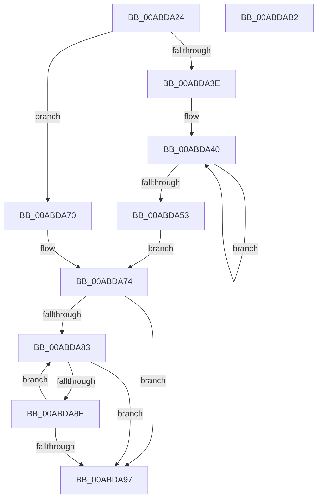

# IopRearrangeReqList

- RVA: `0x00ABDA24`–`0x00ABDAB3` (길이 `143` bytes)
- VA: `0x0000000140ABDA24`
- 실행 섹션: `PAGE`
- PDB 이름 있음: `예`; PDB Function 태그: `아니요`
- unwind 정보 RVA: `0x00060BC4`
- 디코드: `44`개 명령, `143/143` bytes 표시
- 미해석 바이트: `0` (있으면 어셈블리에 `.byte`로 보존)

> 이 문서는 커널 이미지의 기계어와 PDB 기호를 분석해 생성했습니다. 4번과 5번은 함수 원형과 자료형을 바이너리 사용 방식에서 추정한 C 해석이며 원본 소스 복구 결과는 아닙니다.

## 1. Dependencies

- 직접 호출 지점: **1**; 고유 호출 대상: **1**
- 직접 호출자로 확인된 함수: **2**
- RIP 상대 이미지 참조: **1**

### Outgoing calls
- `0x00ABDA69` → [qsort](../../text/50/qsort_function_005009F0.md) (function, `0x005009F0`)

### Direct callers
- [PnpRestoreResourcesInternal](../73/PnpRestoreResourcesInternal_function_0073EB10.md) at `0x0073EBA7`
- [sub_00B39020](../B3/Unknown_function_00B39020.md) at `0x00B39060`

### Static image references
- `0x00ABDA5C` → RVA `0x0072AD70` (`IopCompareReqAlternativePriority`; read)

## 2. Other-region calls and transfers

- 다른 실행 섹션으로 향하는 call: **1**
  - `0x00ABDA69` → [qsort](../../text/50/qsort_function_005009F0.md) (`PAGE` → `.text`)
- 별도 외부 분기/꼬리 이동을 확인하지 못했습니다.

## 3. Assembly (complete function range)

```asm
00ABDA24  48 89 5C 24 08                  mov qword ptr [rsp + 8], rbx
00ABDA29  48 89 74 24 10                  mov qword ptr [rsp + 0x10], rsi
00ABDA2E  57                              push rdi
00ABDA2F  48 83 EC 20                     sub rsp, 0x20
00ABDA33  33 FF                           xor edi, edi
00ABDA35  48 8B D9                        mov rbx, rcx
00ABDA38  83 79 20 01                     cmp dword ptr [rcx + 0x20], 1
00ABDA3C  76 32                           jbe 0x140abda70
00ABDA3E  8B D7                           mov edx, edi
00ABDA40  8B C2                           mov eax, edx
00ABDA42  48 8B 4C C3 28                  mov rcx, qword ptr [rbx + rax*8 + 0x28]
00ABDA47  89 51 04                        mov dword ptr [rcx + 4], edx
00ABDA4A  FF C2                           inc edx
00ABDA4C  8B 43 20                        mov eax, dword ptr [rbx + 0x20]
00ABDA4F  3B D0                           cmp edx, eax
00ABDA51  72 ED                           jb 0x140abda40
00ABDA53  48 8D 73 28                     lea rsi, [rbx + 0x28]
00ABDA57  8B D0                           mov edx, eax
00ABDA59  48 8B CE                        mov rcx, rsi
00ABDA5C  4C 8D 0D 0D D3 C6 FF            lea r9, [rip - 0x392cf3]
00ABDA63  41 B8 08 00 00 00               mov r8d, 8
00ABDA69  E8 82 2F A4 FF                  call 0x1405009f0
00ABDA6E  EB 04                           jmp 0x140abda74
00ABDA70  48 8D 71 28                     lea rsi, [rcx + 0x28]
00ABDA74  8B 43 20                        mov eax, dword ptr [rbx + 0x20]
00ABDA77  48 8B CE                        mov rcx, rsi
00ABDA7A  48 8D 14 C6                     lea rdx, [rsi + rax*8]
00ABDA7E  48 3B F2                        cmp rsi, rdx
00ABDA81  73 14                           jae 0x140abda97
00ABDA83  48 8B 01                        mov rax, qword ptr [rcx]
00ABDA86  81 38 FF 7F 00 00               cmp dword ptr [rax], 0x7fff
00ABDA8C  77 09                           ja 0x140abda97
00ABDA8E  48 83 C1 08                     add rcx, 8
00ABDA92  48 3B CA                        cmp rcx, rdx
00ABDA95  72 EC                           jb 0x140abda83
00ABDA97  48 3B CE                        cmp rcx, rsi
00ABDA9A  48 0F 45 F9                     cmovne rdi, rcx
00ABDA9E  48 89 7B 18                     mov qword ptr [rbx + 0x18], rdi
00ABDAA2  48 8B 5C 24 30                  mov rbx, qword ptr [rsp + 0x30]
00ABDAA7  48 8B 74 24 38                  mov rsi, qword ptr [rsp + 0x38]
00ABDAAC  48 83 C4 20                     add rsp, 0x20
00ABDAB0  5F                              pop rdi
00ABDAB1  C3                              ret
00ABDAB2  CC                              int3
```

## 4. C-style interpretation (structured pseudocode)

```c
__int64 __fastcall IopRearrangeReqList(__int64 a1)
{
    __int64 result;
    __int64 v_rdi;
    __int64 v_rsp;
    unsigned __int64 v_stack_p10;
    unsigned __int64 v_stack_p8;

    v_stack_p8 = v_rbx;
    v_stack_p10 = v_rsi;
    v_rsp = (v_rsp) - (32);
    v_rdi = 0;
    if ((*(unsigned int *)(a1 + 32)) <= 1) goto loc_00ABDA70;
loc_00ABDA40:
    *(unsigned int *)(*(unsigned __int64 *)(a1 + 0 * 8 + 40) + 4) = 0;
    a2 = (unsigned int)((0) + 1);
    if (((unsigned int)(a2)) < ((unsigned int)((unsigned int)(*(unsigned int *)(a1 + 32))))) goto loc_00ABDA40;
    result = qsort(a1 + 40, (unsigned int)((unsigned int)((unsigned int)(*(unsigned int *)(a1 + 32)))), 8, v_rip - 3747059);
    goto loc_00ABDA74;
loc_00ABDA70:
loc_00ABDA74:
    if ((a1 + 40 + 40) >= (a1 + 40 + 40 + (unsigned int)(*(unsigned int *)(a1 + 32)) * 8)) goto loc_00ABDA97;
loc_00ABDA83:
    if ((*(unsigned int *)(*(unsigned __int64 *)(a1 + 40 + 40))) > 0x7FFFULL) goto loc_00ABDA97;
    a1 = (a1 + 40 + 40) + (8);
    if (a1 < (a1 + 40 + 40 + (unsigned int)(*(unsigned int *)(a1 + 32)) * 8)) goto loc_00ABDA83;
loc_00ABDA97:
    if (a1 != (a1 + 40 + 40)) { v_rdi = a1; }
    *(unsigned __int64 *)(a1 + 24) = v_rdi;
    v_rsp = (v_rsp) + (32);
    return *(unsigned __int64 *)(a1 + 40 + 40);
}
```

## 5. (Beta) C Style

```c
int64_t IopRearrangeReqList(void *Arg1)
{
    uint8_t *arg1 = (uint8_t *)Arg1;

    int64_t result;
    int64_t local_rdi;
    int64_t local_rsp;
    uint64_t v_stack_p10;
    uint64_t v_stack_p8;

    v_stack_p8 = local_rbx;
    v_stack_p10 = local_rsi;
    local_rsp = (local_rsp) - (32);
    local_rdi = 0;
    if ((*(uint32_t *)(arg1 + 0x20)) <= 1) goto loc_00ABDA70;
loc_00ABDA40:
    *(uint32_t *)(*(uint64_t *)(arg1 + 0x0 * 8 + 0x28) + 0x4) = 0;
    a2 = (uint32_t)((0) + 1);
    if (((uint32_t)(a2)) < ((uint32_t)((uint32_t)(*(uint32_t *)(arg1 + 0x20))))) goto loc_00ABDA40;
    result = qsort(Arg1 + 40, (uint32_t)((uint32_t)((uint32_t)(*(uint32_t *)(arg1 + 0x20)))), 8, v_rip - 3747059);
    goto loc_00ABDA74;
loc_00ABDA70:
loc_00ABDA74:
    if ((Arg1 + 40 + 40) >= (Arg1 + 40 + 40 + (uint32_t)(*(uint32_t *)(arg1 + 0x20)) * 8)) goto loc_00ABDA97;
loc_00ABDA83:
    if ((*(uint32_t *)(*(uint64_t *)(arg1 + 0x28 + 0x28))) > 0x7FFFULL) goto loc_00ABDA97;
    Arg1 = (Arg1 + 40 + 40) + (8);
    if (Arg1 < (Arg1 + 40 + 40 + (uint32_t)(*(uint32_t *)(arg1 + 0x20)) * 8)) goto loc_00ABDA83;
loc_00ABDA97:
    if (Arg1 != (Arg1 + 40 + 40)) { local_rdi = Arg1; }
    *(uint64_t *)(arg1 + 0x18) = local_rdi;
    local_rsp = (local_rsp) + (32);
    return *(uint64_t *)(arg1 + 0x28 + 0x28);
}
```

### 관측된 메모리 오프셋

구조체 형식이 확인되지 않은 접근은 인자 기준의 오프셋으로만 기록했습니다.

| 기준 인자 | 오프셋 표현 | 폭 (bit) | 접근 |
|---|---:|---:|---|
| `Arg1` | `+ 0x0 + rax*8` | `64` | `R` |
| `Arg1` | `+ 0x18` | `64` | `W` |
| `Arg1` | `+ 0x20` | `32` | `R` |
| `Arg1` | `+ 0x28` | `64` | `R` |
| `Arg1` | `+ 0x28 + rax*8` | `64` | `R` |

## 6. Execution-region graph

[열기: 2D/3D 그래프와 함수 탐색 컨트롤 패널](../../../control-panel.html?section=page&rva=0x00ABDA24&view=graph)

- 2D 그래프는 위에서 아래로 흐르고, 3D 그래프는 빈 공간을 드래그해 회전합니다. Shift+드래그는 이동, 휠은 확대·축소, 함수 노드 선택은 대상 보고서 이동입니다.

### Static fallback


