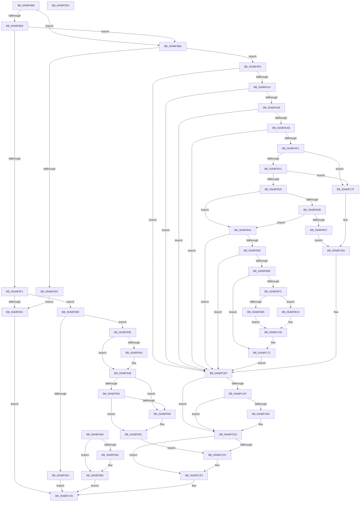

# IopUnloadDriver

- RVA: `0x00ABF868`–`0x00ABFD03` (길이 `1,179` bytes)
- VA: `0x0000000140ABF868`
- 실행 섹션: `PAGE`
- PDB 이름 있음: `예`; PDB Function 태그: `아니요`
- unwind 정보 RVA: `0x000BD7F8`
- 디코드: `268`개 명령, `1,179/1,179` bytes 표시
- 미해석 바이트: `0` (있으면 어셈블리에 `.byte`로 보존)

> 이 문서는 커널 이미지의 기계어와 PDB 기호를 분석해 생성했습니다. 4번과 5번은 함수 원형과 자료형을 바이너리 사용 방식에서 추정한 C 해석이며 원본 소스 복구 결과는 아닙니다.

## 1. Dependencies

- 직접 호출 지점: **36**; 고유 호출 대상: **31**
- 직접 호출자로 확인된 함수: **3**
- RIP 상대 이미지 참조: **9**

### Outgoing calls
- `0x00ABF8F8` → [SeSinglePrivilegeCheck](../87/SeSinglePrivilegeCheck_function_00871E20.md) (function, `0x00871E20`)
- `0x00ABF943` → [ExRaiseDatatypeMisalignment](../89/ExRaiseDatatypeMisalignment_function_00899FD0.md) (function, `0x00899FD0`)
- `0x00ABF967` → [ExAllocatePool2](../../poolcode/B8/ExAllocatePool2_function_00B820F0.md) (function, `0x00B820F0`)
- `0x00ABF982` → [memcpy](../../text/6C/memcpy_function_006C6840.md) (function, `0x006C6840`)
- `0x00ABF991` → [ZwUnloadDriver](../../text/6B/ZwUnloadDriver_function_006B0C10.md) (function, `0x006B0C10`)
- `0x00ABF9AE` → [ExFreePoolWithTag](../../poolcode/B8/ExFreePoolWithTag_function_00B82870.md) (function, `0x00B82870`)
- `0x00ABF9C4` → [PnpDiagnosticTraceObject](../../text/26/PnpDiagnosticTraceObject_function_0026E834.md) (function, `0x0026E834`)
- `0x00ABF9D3` → [PsIsCurrentThreadInServerSilo](../../text/43/PsIsCurrentThreadInServerSilo_function_004362E0.md) (function, `0x004362E0`)
- `0x00ABF9E6` → [DbgPrint](../../text/35/DbgPrint_function_00358CB0.md) (function, `0x00358CB0`)
- `0x00ABFA05` → [IopOpenRegistryKey](../A8/IopOpenRegistryKey_function_00A8F200.md) (function, `0x00A8F200`)
- `0x00ABFA1E` → [IopGetDriverNameFromKeyNode](../99/IopGetDriverNameFromKeyNode_function_00998808.md) (function, `0x00998808`)
- `0x00ABFA2C` → [ObCloseHandle](../8A/ObCloseHandle_function_008A1870.md) (function, `0x008A1870`)
- `0x00ABFA9C` → [ObOpenObjectByName](../89/ObOpenObjectByName_function_00899F50.md) (function, `0x00899F50`)
- `0x00ABFAD6` → [ObReferenceObjectByHandle](../86/ObReferenceObjectByHandle_function_00868DB0.md) (function, `0x00868DB0`)
- `0x00ABFAE4` → [ObCloseHandle](../8A/ObCloseHandle_function_008A1870.md) (function, `0x008A1870`)
- `0x00ABFAFD` → [RtlImageNtHeader](../../text/44/RtlImageNtHeader_function_00443B60.md) (function, `0x00443B60`)
- `0x00ABFB2E` → [PnpIsLegacyDriver](../99/PnpIsLegacyDriver_function_00996220.md) (function, `0x00996220`)
- `0x00ABFB37` → [ObfDereferenceObject](../../text/2F/ObfDereferenceObject_function_002F9350.md) (function, `0x002F9350`)
- `0x00ABFB4C` → [IopCheckUnloadDriver](../../text/4D/IopCheckUnloadDriver_function_004DC454.md) (function, `0x004DC454`)
- `0x00ABFB95` → [HalAdjustResourceList](../../text/48/HalAdjustResourceList_function_0048FDC0.md) (function, `0x0048FDC0`)
- `0x00ABFB9D` → [PsAttachSiloToCurrentThread](../../text/44/PsAttachSiloToCurrentThread_function_004428C0.md) (function, `0x004428C0`)
- `0x00ABFBB4` → [guard_dispatch_icall](../../text/6B/guard_dispatch_icall_function_006BAAD0.md) (function, `0x006BAAD0`)
- `0x00ABFBBC` → [PsDetachSiloFromCurrentThread](../../text/44/PsDetachSiloFromCurrentThread_function_00449AC0.md) (function, `0x00449AC0`)
- `0x00ABFBD4` → [memset](../../text/6C/memset_function_006C6C40.md) (function, `0x006C6C40`)
- `0x00ABFBE6` → [KeInitializeEvent](../../text/40/KeInitializeEvent_function_0040DD10.md) (function, `0x0040DD10`)
- `0x00ABFC2F` → [ExQueueWorkItem](../../text/2F/ExQueueWorkItem_function_002F9520.md) (function, `0x002F9520`)
- `0x00ABFC49` → [KeWaitForSingleObject](../../text/20/KeWaitForSingleObject_function_0020E6B0.md) (function, `0x0020E6B0`)
- `0x00ABFC52` → [EtwTiLogDriverObjectUnLoad](../AA/EtwTiLogDriverObjectUnLoad_function_00AA7C60.md) (function, `0x00AA7C60`)
- `0x00ABFC5D` → [IopCleanupNotifications](../../text/4B/IopCleanupNotifications_function_004B044C.md) (function, `0x004B044C`)
- `0x00ABFC65` → [ObMakeTemporaryObject](../A7/ObMakeTemporaryObject_function_00A7F860.md) (function, `0x00A7F860`)
- `0x00ABFC6D` → [ObfDereferenceObject](../../text/2F/ObfDereferenceObject_function_002F9350.md) (function, `0x002F9350`)
- `0x00ABFC75` → [ObfDereferenceObject](../../text/2F/ObfDereferenceObject_function_002F9350.md) (function, `0x002F9350`)
- `0x00ABFC82` → [ObfDereferenceObject](../../text/2F/ObfDereferenceObject_function_002F9350.md) (function, `0x002F9350`)
- `0x00ABFCA6` → [PnpDiagnosticTraceDriverFullInfo](../../text/26/PnpDiagnosticTraceDriverFullInfo_function_0026E29C.md) (function, `0x0026E29C`)
- `0x00ABFCCD` → [PnpDiagnosticTraceDeviceOperation](../../text/26/PnpDiagnosticTraceDeviceOperation_function_0026E1B8.md) (function, `0x0026E1B8`)
- `0x00ABFCDE` → [ExFreePoolWithTag](../../poolcode/B8/ExFreePoolWithTag_function_00B82870.md) (function, `0x00B82870`)

### Direct callers
- [PnpUnloadAttachedDriver](../AA/PnpUnloadAttachedDriver_function_00AA80E8.md) at `0x00AA818D`
- [NtUnloadDriver](NtUnloadDriver_function_00ABF850.md) at `0x00ABF856`
- [PipUnloadEarlyLaunchDrivers](../../init/C3/PipUnloadEarlyLaunchDrivers_function_00C326D8.md) at `0x00C3271A`

### Static image references
- `0x00ABF8C0` → RVA `0x00AFCAD0` (` ?? ::NNGAKEGL::`string'`; read)
- `0x00ABF8F1` → RVA `0x00FD9B20` (`PAGEDATA`; read)
- `0x00ABF9BD` → RVA `0x0001E7F0` (`.rdata`; read)
- `0x00ABF9DF` → RVA `0x00AFD160` (` ?? ::NNGAKEGL::`string'`; read)
- `0x00ABFA8D` → RVA `0x00FC6C78` (`ALMOSTRO`; read)
- `0x00ABFB85` → RVA `0x00FC6AB0` (`ALMOSTRO`; read)
- `0x00ABFBFB` → RVA `0x00996B80` (`IopLoadUnloadDriver`; read)
- `0x00ABFC9F` → RVA `0x00027050` (`.rdata`; read)
- `0x00ABFCC6` → RVA `0x000272E0` (`.rdata`; read)

## 2. Other-region calls and transfers

- 다른 실행 섹션으로 향하는 call: **25**
  - `0x00ABF967` → [ExAllocatePool2](../../poolcode/B8/ExAllocatePool2_function_00B820F0.md) (`PAGE` → `POOLCODE`)
  - `0x00ABF982` → [memcpy](../../text/6C/memcpy_function_006C6840.md) (`PAGE` → `.text`)
  - `0x00ABF991` → [ZwUnloadDriver](../../text/6B/ZwUnloadDriver_function_006B0C10.md) (`PAGE` → `.text`)
  - `0x00ABF9AE` → [ExFreePoolWithTag](../../poolcode/B8/ExFreePoolWithTag_function_00B82870.md) (`PAGE` → `POOLCODE`)
  - `0x00ABF9C4` → [PnpDiagnosticTraceObject](../../text/26/PnpDiagnosticTraceObject_function_0026E834.md) (`PAGE` → `.text`)
  - `0x00ABF9D3` → [PsIsCurrentThreadInServerSilo](../../text/43/PsIsCurrentThreadInServerSilo_function_004362E0.md) (`PAGE` → `.text`)
  - `0x00ABF9E6` → [DbgPrint](../../text/35/DbgPrint_function_00358CB0.md) (`PAGE` → `.text`)
  - `0x00ABFAFD` → [RtlImageNtHeader](../../text/44/RtlImageNtHeader_function_00443B60.md) (`PAGE` → `.text`)
  - `0x00ABFB37` → [ObfDereferenceObject](../../text/2F/ObfDereferenceObject_function_002F9350.md) (`PAGE` → `.text`)
  - `0x00ABFB4C` → [IopCheckUnloadDriver](../../text/4D/IopCheckUnloadDriver_function_004DC454.md) (`PAGE` → `.text`)
  - `0x00ABFB95` → [HalAdjustResourceList](../../text/48/HalAdjustResourceList_function_0048FDC0.md) (`PAGE` → `.text`)
  - `0x00ABFB9D` → [PsAttachSiloToCurrentThread](../../text/44/PsAttachSiloToCurrentThread_function_004428C0.md) (`PAGE` → `.text`)
  - `0x00ABFBB4` → [guard_dispatch_icall](../../text/6B/guard_dispatch_icall_function_006BAAD0.md) (`PAGE` → `.text`)
  - `0x00ABFBBC` → [PsDetachSiloFromCurrentThread](../../text/44/PsDetachSiloFromCurrentThread_function_00449AC0.md) (`PAGE` → `.text`)
  - `0x00ABFBD4` → [memset](../../text/6C/memset_function_006C6C40.md) (`PAGE` → `.text`)
  - `0x00ABFBE6` → [KeInitializeEvent](../../text/40/KeInitializeEvent_function_0040DD10.md) (`PAGE` → `.text`)
  - `0x00ABFC2F` → [ExQueueWorkItem](../../text/2F/ExQueueWorkItem_function_002F9520.md) (`PAGE` → `.text`)
  - `0x00ABFC49` → [KeWaitForSingleObject](../../text/20/KeWaitForSingleObject_function_0020E6B0.md) (`PAGE` → `.text`)
  - `0x00ABFC5D` → [IopCleanupNotifications](../../text/4B/IopCleanupNotifications_function_004B044C.md) (`PAGE` → `.text`)
  - `0x00ABFC6D` → [ObfDereferenceObject](../../text/2F/ObfDereferenceObject_function_002F9350.md) (`PAGE` → `.text`)
  - `0x00ABFC75` → [ObfDereferenceObject](../../text/2F/ObfDereferenceObject_function_002F9350.md) (`PAGE` → `.text`)
  - `0x00ABFC82` → [ObfDereferenceObject](../../text/2F/ObfDereferenceObject_function_002F9350.md) (`PAGE` → `.text`)
  - `0x00ABFCA6` → [PnpDiagnosticTraceDriverFullInfo](../../text/26/PnpDiagnosticTraceDriverFullInfo_function_0026E29C.md) (`PAGE` → `.text`)
  - `0x00ABFCCD` → [PnpDiagnosticTraceDeviceOperation](../../text/26/PnpDiagnosticTraceDeviceOperation_function_0026E1B8.md) (`PAGE` → `.text`)
  - `0x00ABFCDE` → [ExFreePoolWithTag](../../poolcode/B8/ExFreePoolWithTag_function_00B82870.md) (`PAGE` → `POOLCODE`)
- 별도 외부 분기/꼬리 이동을 확인하지 못했습니다.

## 3. Assembly (complete function range)

```asm
00ABF868  4C 8B DC                        mov r11, rsp
00ABF86B  49 89 5B 08                     mov qword ptr [r11 + 8], rbx
00ABF86F  49 89 73 10                     mov qword ptr [r11 + 0x10], rsi
00ABF873  57                              push rdi
00ABF874  41 54                           push r12
00ABF876  41 55                           push r13
00ABF878  41 56                           push r14
00ABF87A  41 57                           push r15
00ABF87C  48 81 EC E0 00 00 00            sub rsp, 0xe0
00ABF883  44 8A FA                        mov r15b, dl
00ABF886  48 8B F1                        mov rsi, rcx
00ABF889  0F 57 C0                        xorps xmm0, xmm0
00ABF88C  0F 11 44 24 60                  movups xmmword ptr [rsp + 0x60], xmm0
00ABF891  45 33 ED                        xor r13d, r13d
00ABF894  4C 89 6C 24 70                  mov qword ptr [rsp + 0x70], r13
00ABF899  45 89 6B 8C                     mov dword ptr [r11 - 0x74], r13d
00ABF89D  45 89 6B A4                     mov dword ptr [r11 - 0x5c], r13d
00ABF8A1  4C 89 6C 24 50                  mov qword ptr [rsp + 0x50], r13
00ABF8A6  44 89 6C 24 44                  mov dword ptr [rsp + 0x44], r13d
00ABF8AB  4C 89 6C 24 58                  mov qword ptr [rsp + 0x58], r13
00ABF8B0  45 88 6B 18                     mov byte ptr [r11 + 0x18], r13b
00ABF8B4  45 8B F5                        mov r14d, r13d
00ABF8B7  48 C7 44 24 78 00 00 02 00      mov qword ptr [rsp + 0x78], 0x20000
00ABF8C0  48 8D 05 09 D2 03 00            lea rax, [rip + 0x3d209]
00ABF8C7  49 89 83 78 FF FF FF            mov qword ptr [r11 - 0x88], rax
00ABF8CE  45 8A E5                        mov r12b, r13b
00ABF8D1  65 48 8B 04 25 88 01 00 00      mov rax, qword ptr gs:[0x188]
00ABF8DA  8A 90 32 02 00 00               mov dl, byte ptr [rax + 0x232]
00ABF8E0  84 D2                           test dl, dl
00ABF8E2  0F 84 D2 00 00 00               je 0x140abf9ba
00ABF8E8  45 84 FF                        test r15b, r15b
00ABF8EB  0F 85 C9 00 00 00               jne 0x140abf9ba
00ABF8F1  48 8B 0D 28 A2 51 00            mov rcx, qword ptr [rip + 0x51a228]
00ABF8F8  E8 23 25 DB FF                  call 0x140871e20
00ABF8FD  84 C0                           test al, al
00ABF8FF  75 0A                           jne 0x140abf90b
00ABF901  B8 61 00 00 C0                  mov eax, 0xc0000061
00ABF906  E9 DA 03 00 00                  jmp 0x140abfce5
00ABF90B  49 B8 00 00 FF FF FF 7F 00 00   movabs r8, 0x7fffffff0000
00ABF915  49 8B C0                        mov rax, r8
00ABF918  49 3B F0                        cmp rsi, r8
00ABF91B  48 0F 42 C6                     cmovb rax, rsi
00ABF91F  90                              nop
00ABF920  8B 10                           mov edx, dword ptr [rax]
00ABF922  89 54 24 60                     mov dword ptr [rsp + 0x60], edx
00ABF926  48 8B 48 08                     mov rcx, qword ptr [rax + 8]
00ABF92A  48 89 4C 24 68                  mov qword ptr [rsp + 0x68], rcx
00ABF92F  66 85 D2                        test dx, dx
00ABF932  75 0A                           jne 0x140abf93e
00ABF934  B8 0D 00 00 C0                  mov eax, 0xc000000d
00ABF939  E9 A7 03 00 00                  jmp 0x140abfce5
00ABF93E  F6 C1 01                        test cl, 1
00ABF941  74 05                           je 0x140abf948
00ABF943  E8 88 A6 DD FF                  call 0x140899fd0
00ABF948  0F B7 D2                        movzx edx, dx
00ABF94B  48 8D 04 0A                     lea rax, [rdx + rcx]
00ABF94F  49 3B C0                        cmp rax, r8
00ABF952  77 05                           ja 0x140abf959
00ABF954  48 3B C1                        cmp rax, rcx
00ABF957  73 03                           jae 0x140abf95c
00ABF959  41 8A 00                        mov al, byte ptr [r8]
00ABF95C  B9 21 01 00 00                  mov ecx, 0x121
00ABF961  41 B8 49 6F 4E 32               mov r8d, 0x324e6f49
00ABF967  E8 84 27 0C 00                  call 0x140b820f0
00ABF96C  48 8B F8                        mov rdi, rax
00ABF96F  48 89 44 24 70                  mov qword ptr [rsp + 0x70], rax
00ABF974  44 0F B7 44 24 60               movzx r8d, word ptr [rsp + 0x60]
00ABF97A  48 8B 54 24 68                  mov rdx, qword ptr [rsp + 0x68]
00ABF97F  48 8B C8                        mov rcx, rax
00ABF982  E8 B9 6E C0 FF                  call 0x1406c6840
00ABF987  48 89 7C 24 68                  mov qword ptr [rsp + 0x68], rdi
00ABF98C  48 8D 4C 24 60                  lea rcx, [rsp + 0x60]
00ABF991  E8 7A 12 BF FF                  call 0x1406b0c10
00ABF996  8B D8                           mov ebx, eax
00ABF998  48 8B CF                        mov rcx, rdi
00ABF99B  E9 3C 03 00 00                  jmp 0x140abfcdc
00ABF9A0  8B D8                           mov ebx, eax
00ABF9A2  48 8B 4C 24 70                  mov rcx, qword ptr [rsp + 0x70]
00ABF9A7  48 85 C9                        test rcx, rcx
00ABF9AA  74 07                           je 0x140abf9b3
00ABF9AC  33 D2                           xor edx, edx
00ABF9AE  E8 BD 2E 0C 00                  call 0x140b82870
00ABF9B3  8B C3                           mov eax, ebx
00ABF9B5  E9 2B 03 00 00                  jmp 0x140abfce5
00ABF9BA  48 8B D6                        mov rdx, rsi
00ABF9BD  48 8D 0D 2C EE 55 FF            lea rcx, [rip - 0xaa11d4]
00ABF9C4  E8 6B EE 7A FF                  call 0x14026e834
00ABF9C9  4C 89 6C 24 48                  mov qword ptr [rsp + 0x48], r13
00ABF9CE  44 89 6C 24 40                  mov dword ptr [rsp + 0x40], r13d
00ABF9D3  E8 08 69 97 FF                  call 0x1404362e0
00ABF9D8  84 C0                           test al, al
00ABF9DA  74 14                           je 0x140abf9f0
00ABF9DC  48 8B D6                        mov rdx, rsi
00ABF9DF  48 8D 0D 7A D7 03 00            lea rcx, [rip + 0x3d77a]
00ABF9E6  E8 C5 92 89 FF                  call 0x140358cb0
00ABF9EB  E9 11 FF FF FF                  jmp 0x140abf901
00ABF9F0  44 88 6C 24 20                  mov byte ptr [rsp + 0x20], r13b
00ABF9F5  41 B9 19 00 02 00               mov r9d, 0x20019
00ABF9FB  4C 8B C6                        mov r8, rsi
00ABF9FE  33 D2                           xor edx, edx
00ABFA00  48 8D 4C 24 50                  lea rcx, [rsp + 0x50]
00ABFA05  E8 F6 F7 FC FF                  call 0x140a8f200
00ABFA0A  8B D8                           mov ebx, eax
00ABFA0C  85 C0                           test eax, eax
00ABFA0E  0F 88 7B 02 00 00               js 0x140abfc8f
00ABFA14  48 8D 54 24 40                  lea rdx, [rsp + 0x40]
00ABFA19  48 8B 4C 24 50                  mov rcx, qword ptr [rsp + 0x50]
00ABFA1E  E8 E5 8D ED FF                  call 0x140998808
00ABFA23  8B D8                           mov ebx, eax
00ABFA25  33 D2                           xor edx, edx
00ABFA27  48 8B 4C 24 50                  mov rcx, qword ptr [rsp + 0x50]
00ABFA2C  E8 3F 1E DE FF                  call 0x1408a1870
00ABFA31  85 DB                           test ebx, ebx
00ABFA33  0F 88 56 02 00 00               js 0x140abfc8f
00ABFA39  C7 84 24 90 00 00 00 30 00 00 00  mov dword ptr [rsp + 0x90], 0x30
00ABFA44  4C 89 AC 24 98 00 00 00         mov qword ptr [rsp + 0x98], r13
00ABFA4C  C7 84 24 A8 00 00 00 40 02 00 00  mov dword ptr [rsp + 0xa8], 0x240
00ABFA57  48 8D 44 24 40                  lea rax, [rsp + 0x40]
00ABFA5C  48 89 84 24 A0 00 00 00         mov qword ptr [rsp + 0xa0], rax
00ABFA64  0F 57 C0                        xorps xmm0, xmm0
00ABFA67  F3 0F 7F 84 24 B0 00 00 00      movdqu xmmword ptr [rsp + 0xb0], xmm0
00ABFA70  48 8D 44 24 58                  lea rax, [rsp + 0x58]
00ABFA75  48 89 44 24 30                  mov qword ptr [rsp + 0x30], rax
00ABFA7A  4C 89 6C 24 28                  mov qword ptr [rsp + 0x28], r13
00ABFA7F  C7 44 24 20 01 00 00 00         mov dword ptr [rsp + 0x20], 1
00ABFA87  45 33 C9                        xor r9d, r9d
00ABFA8A  45 33 C0                        xor r8d, r8d
00ABFA8D  48 8B 15 E4 71 50 00            mov rdx, qword ptr [rip + 0x5071e4]
00ABFA94  48 8D 8C 24 90 00 00 00         lea rcx, [rsp + 0x90]
00ABFA9C  E8 AF A4 DD FF                  call 0x140899f50
00ABFAA1  8B D8                           mov ebx, eax
00ABFAA3  85 C0                           test eax, eax
00ABFAA5  0F 88 E4 01 00 00               js 0x140abfc8f
00ABFAAB  4C 8B 05 C6 71 50 00            mov r8, qword ptr [rip + 0x5071c6]
00ABFAB2  4C 89 AC 24 28 01 00 00         mov qword ptr [rsp + 0x128], r13
00ABFABA  4C 89 6C 24 28                  mov qword ptr [rsp + 0x28], r13
00ABFABF  48 8D 84 24 28 01 00 00         lea rax, [rsp + 0x128]
00ABFAC7  48 89 44 24 20                  mov qword ptr [rsp + 0x20], rax
00ABFACC  45 33 C9                        xor r9d, r9d
00ABFACF  33 D2                           xor edx, edx
00ABFAD1  48 8B 4C 24 58                  mov rcx, qword ptr [rsp + 0x58]
00ABFAD6  E8 D5 92 DA FF                  call 0x140868db0
00ABFADB  8B D8                           mov ebx, eax
00ABFADD  33 D2                           xor edx, edx
00ABFADF  48 8B 4C 24 58                  mov rcx, qword ptr [rsp + 0x58]
00ABFAE4  E8 87 1D DE FF                  call 0x1408a1870
00ABFAE9  85 DB                           test ebx, ebx
00ABFAEB  0F 88 9E 01 00 00               js 0x140abfc8f
00ABFAF1  48 8B BC 24 28 01 00 00         mov rdi, qword ptr [rsp + 0x128]
00ABFAF9  48 8B 4F 18                     mov rcx, qword ptr [rdi + 0x18]
00ABFAFD  E8 5E 40 98 FF                  call 0x140443b60
00ABFB02  44 0F B7 70 44                  movzx r14d, word ptr [rax + 0x44]
00ABFB07  41 C1 E6 10                     shl r14d, 0x10
00ABFB0B  0F B7 40 46                     movzx eax, word ptr [rax + 0x46]
00ABFB0F  44 0B F0                        or r14d, eax
00ABFB12  4C 39 6F 68                     cmp qword ptr [rdi + 0x68], r13
00ABFB16  0F 84 63 01 00 00               je 0x140abfc7f
00ABFB1C  4C 39 6F 28                     cmp qword ptr [rdi + 0x28], r13
00ABFB20  0F 84 59 01 00 00               je 0x140abfc7f
00ABFB26  45 84 FF                        test r15b, r15b
00ABFB29  75 16                           jne 0x140abfb41
00ABFB2B  48 8B CF                        mov rcx, rdi
00ABFB2E  E8 ED 66 ED FF                  call 0x140996220
00ABFB33  85 C0                           test eax, eax
00ABFB35  75 0A                           jne 0x140abfb41
00ABFB37  E8 14 98 83 FF                  call 0x1402f9350
00ABFB3C  E9 49 01 00 00                  jmp 0x140abfc8a
00ABFB41  48 8D 94 24 20 01 00 00         lea rdx, [rsp + 0x120]
00ABFB49  48 8B CF                        mov rcx, rdi
00ABFB4C  E8 03 C9 A1 FF                  call 0x1404dc454
00ABFB51  8B D8                           mov ebx, eax
00ABFB53  B9 00 00 00 80                  mov ecx, 0x80000000
00ABFB58  03 C1                           add eax, ecx
00ABFB5A  85 C1                           test ecx, eax
00ABFB5C  0F 85 2D 01 00 00               jne 0x140abfc8f
00ABFB62  81 FB 10 00 00 C0               cmp ebx, 0xc0000010
00ABFB68  0F 84 21 01 00 00               je 0x140abfc8f
00ABFB6E  44 38 AC 24 20 01 00 00         cmp byte ptr [rsp + 0x120], r13b
00ABFB76  0F 84 F6 00 00 00               je 0x140abfc72
00ABFB7C  65 48 8B 0C 25 88 01 00 00      mov rcx, qword ptr gs:[0x188]
00ABFB85  48 8B 05 24 6F 50 00            mov rax, qword ptr [rip + 0x506f24]
00ABFB8C  48 39 81 B8 00 00 00            cmp qword ptr [rcx + 0xb8], rax
00ABFB93  75 31                           jne 0x140abfbc6
00ABFB95  E8 26 02 9D FF                  call 0x14048fdc0
00ABFB9A  48 8B C8                        mov rcx, rax
00ABFB9D  E8 1E 2D 98 FF                  call 0x1404428c0
00ABFBA2  48 8B D8                        mov rbx, rax
00ABFBA5  48 8B 47 68                     mov rax, qword ptr [rdi + 0x68]
00ABFBA9  48 8B BC 24 28 01 00 00         mov rdi, qword ptr [rsp + 0x128]
00ABFBB1  48 8B CF                        mov rcx, rdi
00ABFBB4  E8 17 AF BF FF                  call 0x1406baad0
00ABFBB9  48 8B CB                        mov rcx, rbx
00ABFBBC  E8 FF 9E 98 FF                  call 0x140449ac0
00ABFBC1  E9 88 00 00 00                  jmp 0x140abfc4e
00ABFBC6  33 D2                           xor edx, edx
00ABFBC8  44 8D 42 50                     lea r8d, [rdx + 0x50]
00ABFBCC  48 8D 8C 24 90 00 00 00         lea rcx, [rsp + 0x90]
00ABFBD4  E8 67 70 C0 FF                  call 0x1406c6c40
00ABFBD9  45 33 C0                        xor r8d, r8d
00ABFBDC  33 D2                           xor edx, edx
00ABFBDE  48 8D 8C 24 B0 00 00 00         lea rcx, [rsp + 0xb0]
00ABFBE6  E8 25 E1 94 FF                  call 0x14040dd10
00ABFBEB  48 8B BC 24 28 01 00 00         mov rdi, qword ptr [rsp + 0x128]
00ABFBF3  48 89 BC 24 C8 00 00 00         mov qword ptr [rsp + 0xc8], rdi
00ABFBFB  48 8D 05 7E 6F ED FF            lea rax, [rip - 0x129082]
00ABFC02  48 89 84 24 A0 00 00 00         mov qword ptr [rsp + 0xa0], rax
00ABFC0A  48 8D 84 24 90 00 00 00         lea rax, [rsp + 0x90]
00ABFC12  48 89 84 24 A8 00 00 00         mov qword ptr [rsp + 0xa8], rax
00ABFC1A  4C 89 AC 24 90 00 00 00         mov qword ptr [rsp + 0x90], r13
00ABFC22  BA 01 00 00 00                  mov edx, 1
00ABFC27  48 8D 8C 24 90 00 00 00         lea rcx, [rsp + 0x90]
00ABFC2F  E8 EC 98 83 FF                  call 0x1402f9520
00ABFC34  4C 89 6C 24 20                  mov qword ptr [rsp + 0x20], r13
00ABFC39  45 33 C9                        xor r9d, r9d
00ABFC3C  45 33 C0                        xor r8d, r8d
00ABFC3F  33 D2                           xor edx, edx
00ABFC41  48 8D 8C 24 B0 00 00 00         lea rcx, [rsp + 0xb0]
00ABFC49  E8 62 EA 74 FF                  call 0x14020e6b0
00ABFC4E  48 8D 4F 38                     lea rcx, [rdi + 0x38]
00ABFC52  E8 09 80 FE FF                  call 0x140aa7c60
00ABFC57  48 8B D7                        mov rdx, rdi
00ABFC5A  48 8B CF                        mov rcx, rdi
00ABFC5D  E8 EA 07 9F FF                  call 0x1404b044c
00ABFC62  48 8B CF                        mov rcx, rdi
00ABFC65  E8 F6 FB FB FF                  call 0x140a7f860
00ABFC6A  48 8B CF                        mov rcx, rdi
00ABFC6D  E8 DE 96 83 FF                  call 0x1402f9350
00ABFC72  48 8B CF                        mov rcx, rdi
00ABFC75  E8 D6 96 83 FF                  call 0x1402f9350
00ABFC7A  41 8B DD                        mov ebx, r13d
00ABFC7D  EB 10                           jmp 0x140abfc8f
00ABFC7F  48 8B CF                        mov rcx, rdi
00ABFC82  E8 C9 96 83 FF                  call 0x1402f9350
00ABFC87  41 B4 01                        mov r12b, 1
00ABFC8A  BB 10 00 00 C0                  mov ebx, 0xc0000010
00ABFC8F  44 89 74 24 20                  mov dword ptr [rsp + 0x20], r14d
00ABFC94  4C 8D 4C 24 40                  lea r9, [rsp + 0x40]
00ABFC99  44 8B C3                        mov r8d, ebx
00ABFC9C  48 8B D6                        mov rdx, rsi
00ABFC9F  48 8D 0D AA 73 56 FF            lea rcx, [rip - 0xa98c56]
00ABFCA6  E8 F1 E5 7A FF                  call 0x14026e29c
00ABFCAB  85 DB                           test ebx, ebx
00ABFCAD  79 23                           jns 0x140abfcd2
00ABFCAF  45 84 E4                        test r12b, r12b
00ABFCB2  75 1E                           jne 0x140abfcd2
00ABFCB4  44 89 74 24 20                  mov dword ptr [rsp + 0x20], r14d
00ABFCB9  4C 8D 4C 24 40                  lea r9, [rsp + 0x40]
00ABFCBE  44 8B C3                        mov r8d, ebx
00ABFCC1  48 8D 54 24 78                  lea rdx, [rsp + 0x78]
00ABFCC6  48 8D 0D 13 76 56 FF            lea rcx, [rip - 0xa989ed]
00ABFCCD  E8 E6 E4 7A FF                  call 0x14026e1b8
00ABFCD2  48 8B 4C 24 48                  mov rcx, qword ptr [rsp + 0x48]
00ABFCD7  48 85 C9                        test rcx, rcx
00ABFCDA  74 07                           je 0x140abfce3
00ABFCDC  33 D2                           xor edx, edx
00ABFCDE  E8 8D 2B 0C 00                  call 0x140b82870
00ABFCE3  8B C3                           mov eax, ebx
00ABFCE5  4C 8D 9C 24 E0 00 00 00         lea r11, [rsp + 0xe0]
00ABFCED  49 8B 5B 30                     mov rbx, qword ptr [r11 + 0x30]
00ABFCF1  49 8B 73 38                     mov rsi, qword ptr [r11 + 0x38]
00ABFCF5  49 8B E3                        mov rsp, r11
00ABFCF8  41 5F                           pop r15
00ABFCFA  41 5E                           pop r14
00ABFCFC  41 5D                           pop r13
00ABFCFE  41 5C                           pop r12
00ABFD00  5F                              pop rdi
00ABFD01  C3                              ret
00ABFD02  CC                              int3
```

## 4. C-style interpretation (structured pseudocode)

```c
__int64 __fastcall IopUnloadDriver(__int64 a1, unsigned __int8 a2)
{
    __int64 result;
    __int64 v_r13;
    __int64 v_r14;
    __int64 v_rsp;
    unsigned __int64 v_stack_m28;
    unsigned __int64 v_stack_m40;
    unsigned __int64 v_stack_m58;
    unsigned int v_stack_m60;
    unsigned __int64 v_stack_m68;
    unsigned __int64 v_stack_m70;
    unsigned int v_stack_m78;
    unsigned __int64 v_stack_m90;
    unsigned __int64 v_stack_m98;
    unsigned __int64 v_stack_mA0;
    unsigned __int64 v_stack_mA8;
    unsigned __int64 v_stack_mB0;
    unsigned __int64 v_stack_mB8;
    unsigned __int64 v_stack_mC0;
    unsigned int v_stack_mC4;
    unsigned int v_stack_mC8;
    unsigned __int64 v_stack_mD8;
    unsigned __int64 v_stack_mE0;
    unsigned __int8 v_stack_mE8;
    unsigned __int64 v_stack_p18;
    unsigned __int64 v_stack_p20;

    *(unsigned __int64 *)(v_rsp + 8) = v_rbx;
    *(unsigned __int64 *)(v_rsp + 16) = v_rsi;
    v_rsp = (v_rsp) - (224);
    v_stack_mA8 = v_xmm0;
    v_r13 = 0;
    v_stack_m98 = 0;
    *(unsigned int *)(v_rsp - 116) = 0;
    *(unsigned int *)(v_rsp - 92) = 0;
    v_stack_mB8 = 0;
    v_stack_mC4 = 0;
    v_stack_mB0 = 0;
    *(unsigned __int8 *)(v_rsp + 24) = 0;
    v_stack_m90 = 0x20000ULL;
    *(unsigned __int64 *)(v_rsp - 136) = v_rip + 250377;
    if ((unsigned __int8)(*(unsigned __int8 *)(*(unsigned __int64 *)(gs_base + (0 + 392)) + 562)) == 0) goto loc_00ABF9BA;
    if (a2 != 0) goto loc_00ABF9BA;
    result = SeSinglePrivilegeCheck(*(unsigned __int64 *)(v_rip + 5349928), *(unsigned __int8 *)(*(unsigned __int64 *)(gs_base + (0 + 392)) + 562), a3, a4);
    if ((unsigned __int8)(result) != 0) goto loc_00ABF90B;
loc_00ABF901:
    goto loc_00ABFCE5;
loc_00ABF90B:
    if (a1 < a3) { a3 = a1; }
    v_stack_mA8 = (unsigned int)((unsigned int)(*(unsigned int *)(a3)));
    v_stack_mA0 = *(unsigned __int64 *)(a3 + 8);
    if ((unsigned __int16)((unsigned int)(*(unsigned int *)(a3))) != 0) goto loc_00ABF93E;
    goto loc_00ABFCE5;
loc_00ABF93E:
    result = (unsigned int)(0xC000000DULL);
    if ((((unsigned __int8)(*(unsigned __int64 *)(a3 + 8))) & (1)) != 0) {
        result = ExRaiseDatatypeMisalignment(*(unsigned __int64 *)(a3 + 8), (unsigned int)(*(unsigned int *)(a3)), a3, a4);
    }
    if (((unsigned __int16)((unsigned int)(*(unsigned int *)(a3))) + *(unsigned __int64 *)(a3 + 8) * 1) > a3) goto loc_00ABF959;
    result = (unsigned __int16)((unsigned int)(*(unsigned int *)(a3))) + *(unsigned __int64 *)(a3 + 8) * 1;
    if (((unsigned __int16)((unsigned int)(*(unsigned int *)(a3))) + *(unsigned __int64 *)(a3 + 8) * 1) < (*(unsigned __int64 *)(a3 + 8))) {
        result = *(unsigned __int8 *)(a3);
    }
    result = ExAllocatePool2(289, (unsigned __int16)((unsigned int)(*(unsigned int *)(a3))), (unsigned int)(0x324E6F49ULL), a4);
    v_stack_m98 = result;
    result = memcpy(result, v_stack_mA0, v_stack_mA8, a4);
    v_stack_mA0 = result;
    result = ZwUnloadDriver(v_stack_mA8, v_stack_mA0, v_stack_mA8, a4);
    goto loc_00ABFCDC;
loc_00ABF9BA:
    result = PnpDiagnosticTraceObject(v_rip - 11145684, a1, v_stack_mA8, a4);
    v_stack_mC0 = 0;
    v_stack_mC8 = 0;
    result = PsIsCurrentThreadInServerSilo(v_rip - 11145684, a1, v_stack_mA8, a4);
    if ((unsigned __int8)(result) == 0) goto loc_00ABF9F0;
    result = DbgPrint(v_rip + 251770, a1, v_stack_mA8, a4);
    goto loc_00ABF901;
loc_00ABF9F0:
    v_stack_mE8 = 0;
    a2 = 0;
    result = IopOpenRegistryKey(v_stack_mB8, a2, a1, (unsigned int)(0x20019ULL));
    if (sign_flag) goto loc_00ABFC8F;
    result = IopGetDriverNameFromKeyNode(v_stack_mB8, v_stack_mC8, a1, (unsigned int)(0x20019ULL));
    a2 = 0;
    result = ObCloseHandle(v_stack_mB8, a2, a1, (unsigned int)(0x20019ULL));
    if (sign_flag) goto loc_00ABFC8F;
    v_stack_m78 = 48;
    v_stack_m70 = 0;
    v_stack_m60 = 576;
    v_stack_m68 = v_stack_mC8;
    v_stack_m58 = v_xmm0;
    v_stack_mD8 = v_stack_mB0;
    v_stack_mE0 = 0;
    v_stack_mE8 = 1;
    a4 = 0;
    a3 = 0;
    result = ObOpenObjectByName(v_stack_m78, *(unsigned __int64 *)(v_rip + 5272036), a3, a4);
    if (sign_flag) goto loc_00ABFC8F;
    v_stack_p20 = 0;
    v_stack_mE0 = 0;
    v_stack_mE8 = v_stack_p20;
    a4 = 0;
    a2 = 0;
    result = ObReferenceObjectByHandle(v_stack_mB0, a2, *(unsigned __int64 *)(v_rip + 5272006), a4);
    a2 = 0;
    result = ObCloseHandle(v_stack_mB0, a2, *(unsigned __int64 *)(v_rip + 5272006), a4);
    if (sign_flag) goto loc_00ABFC8F;
    result = RtlImageNtHeader(*(unsigned __int64 *)(v_stack_p20 + 24), a2, *(unsigned __int64 *)(v_rip + 5272006), a4);
    v_r14 = (unsigned int)((*(unsigned __int16 *)(result + 68)) << (16));
    v_r14 = (unsigned int)((v_r14) | ((unsigned int)(*(unsigned __int16 *)(result + 70))));
    if ((*(unsigned __int64 *)(v_stack_p20 + 104)) == 0) goto loc_00ABFC7F;
    if ((*(unsigned __int64 *)(v_stack_p20 + 40)) == 0) goto loc_00ABFC7F;
    if (0 != 0) goto loc_00ABFB41;
    result = PnpIsLegacyDriver(v_stack_p20, a2, *(unsigned __int64 *)(v_rip + 5272006), a4);
    if ((unsigned int)(result) != 0) goto loc_00ABFB41;
    result = ObfDereferenceObject(v_stack_p20, a2, *(unsigned __int64 *)(v_rip + 5272006), a4);
    goto loc_00ABFC8A;
loc_00ABFB41:
    result = IopCheckUnloadDriver(v_stack_p20, v_stack_p18, *(unsigned __int64 *)(v_rip + 5272006), a4);
    result = (unsigned int)((result) + ((unsigned int)((unsigned int)(0x80000000ULL))));
    if ((((unsigned int)((unsigned int)(0x80000000ULL))) & ((unsigned int)(result))) != 0) goto loc_00ABFC8F;
    if (((unsigned int)((unsigned int)((unsigned int)(result)))) == 0xC0000010ULL) goto loc_00ABFC8F;
    if (v_stack_p18 == 0) goto loc_00ABFC72;
    if ((*(unsigned __int64 *)(*(unsigned __int64 *)(gs_base + (0 + 392)) + 184)) != (*(unsigned __int64 *)(v_rip + 5271332))) goto loc_00ABFBC6;
    result = HalAdjustResourceList(*(unsigned __int64 *)(gs_base + (0 + 392)), v_stack_p18, *(unsigned __int64 *)(v_rip + 5272006), a4);
    result = PsAttachSiloToCurrentThread(result, v_stack_p18, *(unsigned __int64 *)(v_rip + 5272006), a4);
    result = guard_dispatch_icall(v_stack_p20, v_stack_p18, *(unsigned __int64 *)(v_rip + 5272006), a4);
    result = PsDetachSiloFromCurrentThread(result, v_stack_p18, *(unsigned __int64 *)(v_rip + 5272006), a4);
    goto loc_00ABFC4E;
loc_00ABFBC6:
    a2 = 0;
    result = memset(v_stack_m78, a2, a2 + 80, a4);
    a3 = 0;
    a2 = 0;
    result = KeInitializeEvent(v_stack_m58, a2, a3, a4);
    v_stack_m40 = v_stack_p20;
    v_stack_m68 = v_rip - 1216642;
    v_stack_m60 = v_stack_m78;
    v_stack_m78 = 0;
    result = ExQueueWorkItem(v_stack_m78, 1, a3, a4);
    v_stack_mE8 = 0;
    a4 = 0;
    a3 = 0;
    a2 = 0;
    result = KeWaitForSingleObject(v_stack_m58, a2, a3, a4);
loc_00ABFC4E:
    result = EtwTiLogDriverObjectUnLoad(v_stack_p20 + 56, a2, a3, a4);
    result = IopCleanupNotifications(v_stack_p20, v_stack_p20, a3, a4);
    result = ObMakeTemporaryObject(v_stack_p20, v_stack_p20, a3, a4);
    result = ObfDereferenceObject(v_stack_p20, v_stack_p20, a3, a4);
loc_00ABFC72:
    result = ObfDereferenceObject(v_stack_p20, v_stack_p20, a3, a4);
    goto loc_00ABFC8F;
loc_00ABFC7F:
    result = ObfDereferenceObject(v_stack_p20, v_stack_p20, a3, a4);
loc_00ABFC8A:
loc_00ABFC8F:
    v_stack_mE8 = (unsigned int)(v_r14);
    result = PnpDiagnosticTraceDriverFullInfo(v_rip - 11111510, a1, (unsigned int)((unsigned int)((unsigned int)(0xC0000010ULL))), v_stack_mC8);
    if (!sign_flag) goto loc_00ABFCD2;
    if (1 == 0) {
        v_stack_mE8 = (unsigned int)(v_r14);
        a4 = v_stack_mC8;
        a3 = (unsigned int)((unsigned int)(0xC0000010ULL));
        a2 = v_stack_m90;
        a1 = v_rip - 11110893;
        result = PnpDiagnosticTraceDeviceOperation(a1, a2, a3, a4);
    }
    if (v_stack_mC0 != 0) {
        a2 = 0;
        result = ExFreePoolWithTag(v_stack_mC0, a2, a3, a4);
    }
loc_00ABFCE5:
    return (unsigned int)((unsigned int)((unsigned int)(0xC0000010ULL)));
}
```

## 5. (Beta) C Style

```c
int64_t IopUnloadDriver(int64_t Arg1, uint8_t Arg2)
{
    int64_t result;
    int64_t local_r13;
    int64_t local_r14;
    int64_t local_rsp;
    uint64_t v_stack_m28;
    uint64_t v_stack_m40;
    uint64_t v_stack_m58;
    uint32_t v_stack_m60;
    uint64_t v_stack_m68;
    uint64_t v_stack_m70;
    uint32_t v_stack_m78;
    uint64_t v_stack_m90;
    uint64_t v_stack_m98;
    uint64_t v_stack_mA0;
    uint64_t v_stack_mA8;
    uint64_t v_stack_mB0;
    uint64_t v_stack_mB8;
    uint64_t v_stack_mC0;
    uint32_t v_stack_mC4;
    uint32_t v_stack_mC8;
    uint64_t v_stack_mD8;
    uint64_t v_stack_mE0;
    uint8_t v_stack_mE8;
    uint64_t v_stack_p18;
    uint64_t v_stack_p20;

    *(uint64_t *)(local_rsp + 0x8) = local_rbx;
    *(uint64_t *)(local_rsp + 0x10) = local_rsi;
    local_rsp = (local_rsp) - (224);
    v_stack_mA8 = v_xmm0;
    local_r13 = 0;
    v_stack_m98 = 0;
    *(uint32_t *)(local_rsp - 0x74) = 0;
    *(uint32_t *)(local_rsp - 0x5C) = 0;
    v_stack_mB8 = 0;
    v_stack_mC4 = 0;
    v_stack_mB0 = 0;
    *(uint8_t *)(local_rsp + 0x18) = 0;
    v_stack_m90 = 0x20000ULL;
    *(uint64_t *)(local_rsp - 0x88) = v_rip + 250377;
    if ((uint8_t)(*(uint8_t *)(*(uint64_t *)(gs_base + (0 + 0x188)) + 0x232)) == 0) goto loc_00ABF9BA;
    if (Arg2 != 0) goto loc_00ABF9BA;
    result = SeSinglePrivilegeCheck(*(uint64_t *)(v_rip + 0x51A228), *(uint8_t *)(*(uint64_t *)(gs_base + (0 + 0x188)) + 0x232), a3, a4);
    if ((uint8_t)(result) != 0) goto loc_00ABF90B;
loc_00ABF901:
    goto loc_00ABFCE5;
loc_00ABF90B:
    if (Arg1 < a3) { a3 = Arg1; }
    v_stack_mA8 = (uint32_t)((uint32_t)(*(uint32_t *)(a3)));
    v_stack_mA0 = *(uint64_t *)(a3 + 0x8);
    if ((uint16_t)((uint32_t)(*(uint32_t *)(a3))) != 0) goto loc_00ABF93E;
    goto loc_00ABFCE5;
loc_00ABF93E:
    result = (uint32_t)(0xC000000DULL);
    if ((((uint8_t)(*(uint64_t *)(a3 + 0x8))) & (1)) != 0) {
        result = ExRaiseDatatypeMisalignment(*(uint64_t *)(a3 + 0x8), (uint32_t)(*(uint32_t *)(a3)), a3, a4);
    }
    if (((uint16_t)((uint32_t)(*(uint32_t *)(a3))) + *(uint64_t *)(a3 + 0x8) * 1) > a3) goto loc_00ABF959;
    result = (uint16_t)((uint32_t)(*(uint32_t *)(a3))) + *(uint64_t *)(a3 + 0x8) * 1;
    if (((uint16_t)((uint32_t)(*(uint32_t *)(a3))) + *(uint64_t *)(a3 + 0x8) * 1) < (*(uint64_t *)(a3 + 0x8))) {
        result = *(uint8_t *)(a3);
    }
    result = ExAllocatePool2(289, (uint16_t)((uint32_t)(*(uint32_t *)(a3))), (uint32_t)(0x324E6F49ULL), a4);
    v_stack_m98 = result;
    result = memcpy(result, v_stack_mA0, v_stack_mA8, a4);
    v_stack_mA0 = result;
    result = ZwUnloadDriver(v_stack_mA8, v_stack_mA0, v_stack_mA8, a4);
    goto loc_00ABFCDC;
loc_00ABF9BA:
    result = PnpDiagnosticTraceObject(v_rip - 11145684, Arg1, v_stack_mA8, a4);
    v_stack_mC0 = 0;
    v_stack_mC8 = 0;
    result = PsIsCurrentThreadInServerSilo(v_rip - 11145684, Arg1, v_stack_mA8, a4);
    if ((uint8_t)(result) == 0) goto loc_00ABF9F0;
    result = DbgPrint(v_rip + 251770, Arg1, v_stack_mA8, a4);
    goto loc_00ABF901;
loc_00ABF9F0:
    v_stack_mE8 = 0;
    Arg2 = 0;
    result = IopOpenRegistryKey(v_stack_mB8, Arg2, Arg1, (uint32_t)(0x20019ULL));
    if (sign_flag) goto loc_00ABFC8F;
    result = IopGetDriverNameFromKeyNode(v_stack_mB8, v_stack_mC8, Arg1, (uint32_t)(0x20019ULL));
    Arg2 = 0;
    result = ObCloseHandle(v_stack_mB8, Arg2, Arg1, (uint32_t)(0x20019ULL));
    if (sign_flag) goto loc_00ABFC8F;
    v_stack_m78 = 48;
    v_stack_m70 = 0;
    v_stack_m60 = 576;
    v_stack_m68 = v_stack_mC8;
    v_stack_m58 = v_xmm0;
    v_stack_mD8 = v_stack_mB0;
    v_stack_mE0 = 0;
    v_stack_mE8 = 1;
    a4 = 0;
    a3 = 0;
    result = ObOpenObjectByName(v_stack_m78, *(uint64_t *)(v_rip + 0x5071E4), a3, a4);
    if (sign_flag) goto loc_00ABFC8F;
    v_stack_p20 = 0;
    v_stack_mE0 = 0;
    v_stack_mE8 = v_stack_p20;
    a4 = 0;
    Arg2 = 0;
    result = ObReferenceObjectByHandle(v_stack_mB0, Arg2, *(uint64_t *)(v_rip + 0x5071C6), a4);
    Arg2 = 0;
    result = ObCloseHandle(v_stack_mB0, Arg2, *(uint64_t *)(v_rip + 0x5071C6), a4);
    if (sign_flag) goto loc_00ABFC8F;
    result = RtlImageNtHeader(*(uint64_t *)(v_stack_p20 + 0x18), Arg2, *(uint64_t *)(v_rip + 0x5071C6), a4);
    local_r14 = (uint32_t)((*(uint16_t *)(result + 0x44)) << (16));
    local_r14 = (uint32_t)((local_r14) | ((uint32_t)(*(uint16_t *)(result + 0x46))));
    if ((*(uint64_t *)(v_stack_p20 + 0x68)) == 0) goto loc_00ABFC7F;
    if ((*(uint64_t *)(v_stack_p20 + 0x28)) == 0) goto loc_00ABFC7F;
    if (0 != 0) goto loc_00ABFB41;
    result = PnpIsLegacyDriver(v_stack_p20, Arg2, *(uint64_t *)(v_rip + 0x5071C6), a4);
    if ((uint32_t)(result) != 0) goto loc_00ABFB41;
    result = ObfDereferenceObject(v_stack_p20, Arg2, *(uint64_t *)(v_rip + 0x5071C6), a4);
    goto loc_00ABFC8A;
loc_00ABFB41:
    result = IopCheckUnloadDriver(v_stack_p20, v_stack_p18, *(uint64_t *)(v_rip + 0x5071C6), a4);
    result = (uint32_t)((result) + ((uint32_t)((uint32_t)(0x80000000ULL))));
    if ((((uint32_t)((uint32_t)(0x80000000ULL))) & ((uint32_t)(result))) != 0) goto loc_00ABFC8F;
    if (((uint32_t)((uint32_t)((uint32_t)(result)))) == 0xC0000010ULL) goto loc_00ABFC8F;
    if (v_stack_p18 == 0) goto loc_00ABFC72;
    if ((*(uint64_t *)(*(uint64_t *)(gs_base + (0 + 0x188)) + 0xB8)) != (*(uint64_t *)(v_rip + 0x506F24))) goto loc_00ABFBC6;
    result = HalAdjustResourceList(*(uint64_t *)(gs_base + (0 + 0x188)), v_stack_p18, *(uint64_t *)(v_rip + 0x5071C6), a4);
    result = PsAttachSiloToCurrentThread(result, v_stack_p18, *(uint64_t *)(v_rip + 0x5071C6), a4);
    result = guard_dispatch_icall(v_stack_p20, v_stack_p18, *(uint64_t *)(v_rip + 0x5071C6), a4);
    result = PsDetachSiloFromCurrentThread(result, v_stack_p18, *(uint64_t *)(v_rip + 0x5071C6), a4);
    goto loc_00ABFC4E;
loc_00ABFBC6:
    Arg2 = 0;
    result = memset(v_stack_m78, Arg2, Arg2 + 80, a4);
    a3 = 0;
    Arg2 = 0;
    result = KeInitializeEvent(v_stack_m58, Arg2, a3, a4);
    v_stack_m40 = v_stack_p20;
    v_stack_m68 = v_rip - 1216642;
    v_stack_m60 = v_stack_m78;
    v_stack_m78 = 0;
    result = ExQueueWorkItem(v_stack_m78, 1, a3, a4);
    v_stack_mE8 = 0;
    a4 = 0;
    a3 = 0;
    Arg2 = 0;
    result = KeWaitForSingleObject(v_stack_m58, Arg2, a3, a4);
loc_00ABFC4E:
    result = EtwTiLogDriverObjectUnLoad(v_stack_p20 + 56, Arg2, a3, a4);
    result = IopCleanupNotifications(v_stack_p20, v_stack_p20, a3, a4);
    result = ObMakeTemporaryObject(v_stack_p20, v_stack_p20, a3, a4);
    result = ObfDereferenceObject(v_stack_p20, v_stack_p20, a3, a4);
loc_00ABFC72:
    result = ObfDereferenceObject(v_stack_p20, v_stack_p20, a3, a4);
    goto loc_00ABFC8F;
loc_00ABFC7F:
    result = ObfDereferenceObject(v_stack_p20, v_stack_p20, a3, a4);
loc_00ABFC8A:
loc_00ABFC8F:
    v_stack_mE8 = (uint32_t)(local_r14);
    result = PnpDiagnosticTraceDriverFullInfo(v_rip - 11111510, Arg1, (uint32_t)((uint32_t)((uint32_t)(0xC0000010ULL))), v_stack_mC8);
    if (!sign_flag) goto loc_00ABFCD2;
    if (1 == 0) {
        v_stack_mE8 = (uint32_t)(local_r14);
        a4 = v_stack_mC8;
        a3 = (uint32_t)((uint32_t)(0xC0000010ULL));
        Arg2 = v_stack_m90;
        Arg1 = v_rip - 11110893;
        result = PnpDiagnosticTraceDeviceOperation(Arg1, Arg2, a3, a4);
    }
    if (v_stack_mC0 != 0) {
        Arg2 = 0;
        result = ExFreePoolWithTag(v_stack_mC0, Arg2, a3, a4);
    }
loc_00ABFCE5:
    return (uint32_t)((uint32_t)((uint32_t)(0xC0000010ULL)));
}
```

## 6. Execution-region graph

[열기: 2D/3D 그래프와 함수 탐색 컨트롤 패널](../../../control-panel.html?section=page&rva=0x00ABF868&view=graph)

- 2D 그래프는 위에서 아래로 흐르고, 3D 그래프는 빈 공간을 드래그해 회전합니다. Shift+드래그는 이동, 휠은 확대·축소, 함수 노드 선택은 대상 보고서 이동입니다.

### Static fallback


