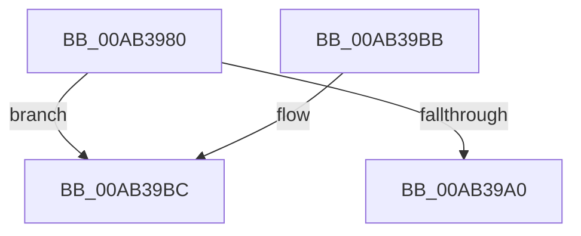

# KeResetKernelShadowStackRstorssp

- RVA: `0x00AB3980`–`0x00AB39C6` (길이 `70` bytes)
- VA: `0x0000000140AB3980`
- 실행 섹션: `PAGE`
- PDB 이름 있음: `예`; PDB Function 태그: `예`
- unwind 정보 RVA: `0x000DB714`
- 디코드: `19`개 명령, `70/70` bytes 표시
- 미해석 바이트: `0` (있으면 어셈블리에 `.byte`로 보존)

> 이 문서는 커널 이미지의 기계어와 PDB 기호를 분석해 생성했습니다. 4번과 5번은 함수 원형과 자료형을 바이너리 사용 방식에서 추정한 C 해석이며 원본 소스 복구 결과는 아닙니다.

## 1. Dependencies

- 직접 호출 지점: **0**; 고유 호출 대상: **0**
- 직접 호출자로 확인된 함수: **1**
- RIP 상대 이미지 참조: **0**

### Outgoing calls
- 직접 디코드된 call 명령이 없습니다.

### Direct callers
- [PspDeleteKernelStack](../../text/2A/PspDeleteKernelStack_function_002A1550.md) at `0x002A1602`

### Static image references
- 디코드된 RIP-relative 메모리 참조가 없습니다.

## 2. Other-region calls and transfers

- 다른 실행 섹션으로 향하는 call: **0**
- call이 아닌 외부 분기/꼬리 이동: **1**
  - `0x00AB39C1` → `0x00B4AA0A` (`tail-transfer`)

## 3. Assembly (complete function range)

```asm
00AB3980  48 8B 01                        mov rax, qword ptr [rcx]
00AB3983  F3 49 0F 1E C8                  rdsspq r8
00AB3988  49 83 E0 F8                     and r8, 0xfffffffffffffff8
00AB398C  F3 0F 01 28                     rstorssp dword ptr [rax]
00AB3990  F3 0F 01 EA                     saveprevssp
00AB3994  48 2B D0                        sub rdx, rax
00AB3997  48 C1 EA 03                     shr rdx, 3
00AB399B  48 85 D2                        test rdx, rdx
00AB399E  75 1C                           jne 0x140ab39bc
00AB39A0  F3 48 0F 1E C8                  rdsspq rax
00AB39A5  48 83 E0 F8                     and rax, 0xfffffffffffffff8
00AB39A9  48 83 E8 08                     sub rax, 8
00AB39AD  F3 41 0F 01 68 F8               rstorssp dword ptr [r8 - 8]
00AB39B3  48 89 01                        mov qword ptr [rcx], rax
00AB39B6  F3 0F 01 EA                     saveprevssp
00AB39BA  C3                              ret
00AB39BB  CC                              int3
00AB39BC  B8 FF 00 00 00                  mov eax, 0xff
00AB39C1  E9 44 70 09 00                  jmp 0x140b4aa0a
```

## 4. C-style interpretation (structured pseudocode)

```c
__int64 __fastcall KeResetKernelShadowStackRstorssp(__int64 a1, __int64 a2, __int64 a3)
{
    __int64 result;

    a3 = (a3) & (-8);
    a2 = (a2) - (*(unsigned __int64 *)(a1));
    a2 = (a2) >> (3);
    if (a2 != 0) goto loc_00AB39BC;
    result = (*(unsigned __int64 *)(a1)) & (-8);
    result = (result) - (8);
    *(unsigned __int64 *)(a1) = result;
    return result;
loc_00AB39BC:
}
```

## 5. (Beta) C Style

```c
int64_t KeResetKernelShadowStackRstorssp(void *Arg1, int64_t Arg2, int64_t Arg3)
{
    uint8_t *arg1 = (uint8_t *)Arg1;

    int64_t result;

    Arg3 = (Arg3) & (-8);
    Arg2 = (Arg2) - (*(uint64_t *)(arg1));
    Arg2 = (Arg2) >> (3);
    if (Arg2 != 0) goto loc_00AB39BC;
    result = (*(uint64_t *)(arg1)) & (-8);
    result = (result) - (8);
    *(uint64_t *)(arg1) = result;
    return result;
loc_00AB39BC:
}
```

### 관측된 메모리 오프셋

구조체 형식이 확인되지 않은 접근은 인자 기준의 오프셋으로만 기록했습니다.

| 기준 인자 | 오프셋 표현 | 폭 (bit) | 접근 |
|---|---:|---:|---|
| `Arg1` | `+ 0x0` | `64` | `R` |
| `Arg1` | `+ 0x0` | `64` | `W` |

## 6. Execution-region graph

[열기: 2D/3D 그래프와 함수 탐색 컨트롤 패널](../../../control-panel.html?section=page&rva=0x00AB3980&view=graph)

- 2D 그래프는 위에서 아래로 흐르고, 3D 그래프는 빈 공간을 드래그해 회전합니다. Shift+드래그는 이동, 휠은 확대·축소, 함수 노드 선택은 대상 보고서 이동입니다.

### Static fallback


