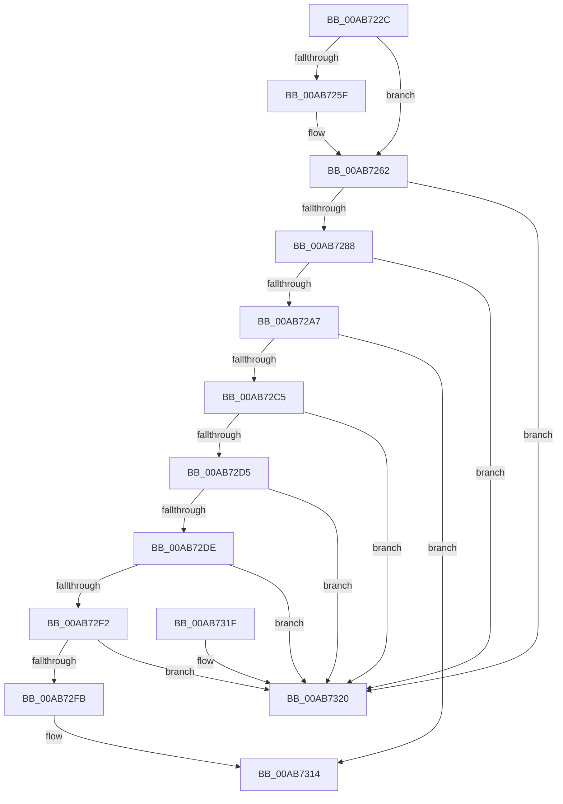

# KsepCacheInsert

- RVA: `0x00AB722C`–`0x00AB7327` (길이 `251` bytes)
- VA: `0x0000000140AB722C`
- 실행 섹션: `PAGE`
- PDB 이름 있음: `예`; PDB Function 태그: `아니요`
- unwind 정보 RVA: `0x0006CF28`
- 디코드: `78`개 명령, `251/251` bytes 표시
- 미해석 바이트: `0` (있으면 어셈블리에 `.byte`로 보존)

> 이 문서는 커널 이미지의 기계어와 PDB 기호를 분석해 생성했습니다. 4번과 5번은 함수 원형과 자료형을 바이너리 사용 방식에서 추정한 C 해석이며 원본 소스 복구 결과는 아닙니다.

## 1. Dependencies

- 직접 호출 지점: **2**; 고유 호출 대상: **1**
- 직접 호출자로 확인된 함수: **2**
- RIP 상대 이미지 참조: **0**

### Outgoing calls
- `0x00AB7243` → [guard_dispatch_icall](../../text/6B/guard_dispatch_icall_function_006BAAD0.md) (function, `0x006BAAD0`)
- `0x00AB730F` → [guard_dispatch_icall](../../text/6B/guard_dispatch_icall_function_006BAAD0.md) (function, `0x006BAAD0`)

### Direct callers
- [KsepDbCacheInsertDevice](../74/KsepDbCacheInsertDevice_function_00748C64.md) at `0x00748CCD`
- [KseAddHardwareId](../95/KseAddHardwareId_function_00959254.md) at `0x00959361`

### Static image references
- 디코드된 RIP-relative 메모리 참조가 없습니다.

## 2. Other-region calls and transfers

- 다른 실행 섹션으로 향하는 call: **2**
  - `0x00AB7243` → [guard_dispatch_icall](../../text/6B/guard_dispatch_icall_function_006BAAD0.md) (`PAGE` → `.text`)
  - `0x00AB730F` → [guard_dispatch_icall](../../text/6B/guard_dispatch_icall_function_006BAAD0.md) (`PAGE` → `.text`)
- 별도 외부 분기/꼬리 이동을 확인하지 못했습니다.

## 3. Assembly (complete function range)

```asm
00AB722C  48 89 5C 24 08                  mov qword ptr [rsp + 8], rbx
00AB7231  57                              push rdi
00AB7232  48 83 EC 20                     sub rsp, 0x20
00AB7236  48 8B 41 50                     mov rax, qword ptr [rcx + 0x50]
00AB723A  48 8B D9                        mov rbx, rcx
00AB723D  48 8B CA                        mov rcx, rdx
00AB7240  48 8B FA                        mov rdi, rdx
00AB7243  E8 88 38 C0 FF                  call 0x1406baad0
00AB7248  33 D2                           xor edx, edx
00AB724A  44 8B C8                        mov r9d, eax
00AB724D  F7 73 0C                        div dword ptr [rbx + 0xc]
00AB7250  8B CA                           mov ecx, edx
00AB7252  48 C1 E1 04                     shl rcx, 4
00AB7256  48 03 4B 10                     add rcx, qword ptr [rbx + 0x10]
00AB725A  48 39 09                        cmp qword ptr [rcx], rcx
00AB725D  74 03                           je 0x140ab7262
00AB725F  FF 43 38                        inc dword ptr [rbx + 0x38]
00AB7262  44 89 0F                        mov dword ptr [rdi], r9d
00AB7265  4C 8D 47 08                     lea r8, [rdi + 8]
00AB7269  33 D2                           xor edx, edx
00AB726B  41 8B C1                        mov eax, r9d
00AB726E  F7 73 0C                        div dword ptr [rbx + 0xc]
00AB7271  8B CA                           mov ecx, edx
00AB7273  48 C1 E1 04                     shl rcx, 4
00AB7277  48 03 4B 10                     add rcx, qword ptr [rbx + 0x10]
00AB727B  48 8B 01                        mov rax, qword ptr [rcx]
00AB727E  48 39 48 08                     cmp qword ptr [rax + 8], rcx
00AB7282  0F 85 98 00 00 00               jne 0x140ab7320
00AB7288  49 89 00                        mov qword ptr [r8], rax
00AB728B  49 89 48 08                     mov qword ptr [r8 + 8], rcx
00AB728F  4C 89 40 08                     mov qword ptr [rax + 8], r8
00AB7293  48 8D 47 18                     lea rax, [rdi + 0x18]
00AB7297  4C 89 01                        mov qword ptr [rcx], r8
00AB729A  48 8D 4B 20                     lea rcx, [rbx + 0x20]
00AB729E  48 8B 51 08                     mov rdx, qword ptr [rcx + 8]
00AB72A2  48 39 0A                        cmp qword ptr [rdx], rcx
00AB72A5  75 79                           jne 0x140ab7320
00AB72A7  48 89 08                        mov qword ptr [rax], rcx
00AB72AA  48 89 50 08                     mov qword ptr [rax + 8], rdx
00AB72AE  48 89 02                        mov qword ptr [rdx], rax
00AB72B1  48 89 41 08                     mov qword ptr [rcx + 8], rax
00AB72B5  FF 43 3C                        inc dword ptr [rbx + 0x3c]
00AB72B8  8B 43 08                        mov eax, dword ptr [rbx + 8]
00AB72BB  FF C0                           inc eax
00AB72BD  89 43 08                        mov dword ptr [rbx + 8], eax
00AB72C0  3B 43 18                        cmp eax, dword ptr [rbx + 0x18]
00AB72C3  76 4F                           jbe 0x140ab7314
00AB72C5  48 8B 01                        mov rax, qword ptr [rcx]
00AB72C8  48 8B 10                        mov rdx, qword ptr [rax]
00AB72CB  4C 8D 48 E8                     lea r9, [rax - 0x18]
00AB72CF  48 39 42 08                     cmp qword ptr [rdx + 8], rax
00AB72D3  75 4B                           jne 0x140ab7320
00AB72D5  48 8B 48 08                     mov rcx, qword ptr [rax + 8]
00AB72D9  48 39 01                        cmp qword ptr [rcx], rax
00AB72DC  75 42                           jne 0x140ab7320
00AB72DE  48 89 11                        mov qword ptr [rcx], rdx
00AB72E1  49 8D 41 08                     lea rax, [r9 + 8]
00AB72E5  48 89 4A 08                     mov qword ptr [rdx + 8], rcx
00AB72E9  4C 8B 00                        mov r8, qword ptr [rax]
00AB72EC  49 39 40 08                     cmp qword ptr [r8 + 8], rax
00AB72F0  75 2E                           jne 0x140ab7320
00AB72F2  48 8B 50 08                     mov rdx, qword ptr [rax + 8]
00AB72F6  48 39 02                        cmp qword ptr [rdx], rax
00AB72F9  75 25                           jne 0x140ab7320
00AB72FB  4C 89 02                        mov qword ptr [rdx], r8
00AB72FE  49 8B C9                        mov rcx, r9
00AB7301  49 89 50 08                     mov qword ptr [r8 + 8], rdx
00AB7305  FF 4B 08                        dec dword ptr [rbx + 8]
00AB7308  FF 43 40                        inc dword ptr [rbx + 0x40]
00AB730B  48 8B 43 58                     mov rax, qword ptr [rbx + 0x58]
00AB730F  E8 BC 37 C0 FF                  call 0x1406baad0
00AB7314  48 8B 5C 24 30                  mov rbx, qword ptr [rsp + 0x30]
00AB7319  48 83 C4 20                     add rsp, 0x20
00AB731D  5F                              pop rdi
00AB731E  C3                              ret
00AB731F  CC                              int3
00AB7320  B9 03 00 00 00                  mov ecx, 3
00AB7325  CD 29                           int 0x29
```

## 4. C-style interpretation (structured pseudocode)

```c
__int64 __fastcall KsepCacheInsert(__int64 a1, __int64 a2)
{
    __int64 result;
    __int64 v_rsp;
    unsigned __int64 v_stack_p8;

    v_stack_p8 = v_rbx;
    v_rsp = (v_rsp) - (32);
    result = guard_dispatch_icall(a2, a2, a3, a4);
    a2 = 0;
    a1 = (0) << (4);
    a1 = (a1) + (*(unsigned __int64 *)(a1 + 16));
    if ((*(unsigned __int64 *)(a1)) != a1) {
    }
    *(unsigned int *)(a2) = (unsigned int)((unsigned int)((unsigned int)(result)));
    a2 = 0;
    a1 = (0) << (4);
    a1 = (a1) + (*(unsigned __int64 *)(a1 + 16));
    if ((*(unsigned __int64 *)(*(unsigned __int64 *)(a1) + 8)) != a1) goto loc_00AB7320;
    *(unsigned __int64 *)(a2 + 8) = *(unsigned __int64 *)(a1);
    *(unsigned __int64 *)(a2 + 8 + 8) = a1;
    *(unsigned __int64 *)(*(unsigned __int64 *)(a1) + 8) = a2 + 8;
    *(unsigned __int64 *)(a1) = a2 + 8;
    if ((*(unsigned __int64 *)(*(unsigned __int64 *)(a1 + 32 + 8))) != (a1 + 32)) goto loc_00AB7320;
    *(unsigned __int64 *)(a2 + 24) = a1 + 32;
    *(unsigned __int64 *)(a2 + 24 + 8) = *(unsigned __int64 *)(a1 + 32 + 8);
    *(unsigned __int64 *)(*(unsigned __int64 *)(a1 + 32 + 8)) = a2 + 24;
    *(unsigned __int64 *)(a1 + 32 + 8) = a2 + 24;
    result = (unsigned int)(((unsigned int)(*(unsigned int *)(a1 + 8))) + 1);
    *(unsigned int *)(a1 + 8) = (unsigned int)(result);
    if (((unsigned int)(result)) <= (*(unsigned int *)(a1 + 24))) goto loc_00AB7314;
    if ((*(unsigned __int64 *)(*(unsigned __int64 *)(*(unsigned __int64 *)(a1 + 32)) + 8)) != (*(unsigned __int64 *)(a1 + 32))) goto loc_00AB7320;
    if ((*(unsigned __int64 *)(*(unsigned __int64 *)(*(unsigned __int64 *)(a1 + 32) + 8))) != (*(unsigned __int64 *)(a1 + 32))) goto loc_00AB7320;
    *(unsigned __int64 *)(*(unsigned __int64 *)(*(unsigned __int64 *)(a1 + 32) + 8)) = *(unsigned __int64 *)(*(unsigned __int64 *)(a1 + 32));
    *(unsigned __int64 *)(*(unsigned __int64 *)(*(unsigned __int64 *)(a1 + 32)) + 8) = *(unsigned __int64 *)(*(unsigned __int64 *)(a1 + 32) + 8);
    if ((*(unsigned __int64 *)(*(unsigned __int64 *)(*(unsigned __int64 *)(a1 + 32) - 24 + 8) + 8)) != (*(unsigned __int64 *)(a1 + 32) - 24 + 8)) goto loc_00AB7320;
    if ((*(unsigned __int64 *)(*(unsigned __int64 *)(*(unsigned __int64 *)(a1 + 32) - 24 + 8 + 8))) != (*(unsigned __int64 *)(a1 + 32) - 24 + 8)) goto loc_00AB7320;
    *(unsigned __int64 *)(*(unsigned __int64 *)(*(unsigned __int64 *)(a1 + 32) - 24 + 8 + 8)) = *(unsigned __int64 *)(*(unsigned __int64 *)(a1 + 32) - 24 + 8);
    *(unsigned __int64 *)(*(unsigned __int64 *)(*(unsigned __int64 *)(a1 + 32) - 24 + 8) + 8) = *(unsigned __int64 *)(*(unsigned __int64 *)(a1 + 32) - 24 + 8 + 8);
    result = guard_dispatch_icall(*(unsigned __int64 *)(a1 + 32) - 24, *(unsigned __int64 *)(*(unsigned __int64 *)(a1 + 32) - 24 + 8 + 8), *(unsigned __int64 *)(*(unsigned __int64 *)(a1 + 32) - 24 + 8), *(unsigned __int64 *)(a1 + 32) - 24);
loc_00AB7314:
    v_rsp = (v_rsp) + (32);
    return result;
loc_00AB7320:
    return result;
}
```

## 5. (Beta) C Style

```c
int64_t KsepCacheInsert(void *Arg1, void *Arg2)
{
    uint8_t *arg1 = (uint8_t *)Arg1;
    uint8_t *arg2 = (uint8_t *)Arg2;

    int64_t result;
    int64_t local_rsp;
    uint64_t v_stack_p8;

    v_stack_p8 = local_rbx;
    local_rsp = (local_rsp) - (32);
    result = guard_dispatch_icall(Arg2, Arg2, a3, a4);
    Arg2 = 0;
    Arg1 = (0) << (4);
    Arg1 = (Arg1) + (*(uint64_t *)(arg1 + 0x10));
    if ((*(uint64_t *)(arg1)) != Arg1) {
    }
    *(uint32_t *)(arg2) = (uint32_t)((uint32_t)((uint32_t)(result)));
    Arg2 = 0;
    Arg1 = (0) << (4);
    Arg1 = (Arg1) + (*(uint64_t *)(arg1 + 0x10));
    if ((*(uint64_t *)(*(uint64_t *)(arg1) + 0x8)) != Arg1) goto loc_00AB7320;
    *(uint64_t *)(arg2 + 0x8) = *(uint64_t *)(arg1);
    *(void **)(arg2 + 0x8 + 0x8) = Arg1;
    *(void **)(*(uint64_t *)(arg1) + 0x8) = Arg2 + 8;
    *(void **)(arg1) = Arg2 + 8;
    if ((*(uint64_t *)(*(uint64_t *)(arg1 + 0x20 + 0x8))) != (Arg1 + 32)) goto loc_00AB7320;
    *(void **)(arg2 + 0x18) = Arg1 + 32;
    *(uint64_t *)(arg2 + 0x18 + 0x8) = *(uint64_t *)(arg1 + 0x20 + 0x8);
    *(void **)(*(uint64_t *)(arg1 + 0x20 + 0x8)) = Arg2 + 24;
    *(void **)(arg1 + 0x20 + 0x8) = Arg2 + 24;
    result = (uint32_t)(((uint32_t)(*(uint32_t *)(arg1 + 0x8))) + 1);
    *(uint32_t *)(arg1 + 0x8) = (uint32_t)(result);
    if (((uint32_t)(result)) <= (*(uint32_t *)(arg1 + 0x18))) goto loc_00AB7314;
    if ((*(uint64_t *)(*(uint64_t *)(*(uint64_t *)(arg1 + 0x20)) + 0x8)) != (*(uint64_t *)(arg1 + 0x20))) goto loc_00AB7320;
    if ((*(uint64_t *)(*(uint64_t *)(*(uint64_t *)(arg1 + 0x20) + 0x8))) != (*(uint64_t *)(arg1 + 0x20))) goto loc_00AB7320;
    *(uint64_t *)(*(uint64_t *)(*(uint64_t *)(arg1 + 0x20) + 0x8)) = *(uint64_t *)(*(uint64_t *)(arg1 + 0x20));
    *(uint64_t *)(*(uint64_t *)(*(uint64_t *)(arg1 + 0x20)) + 0x8) = *(uint64_t *)(*(uint64_t *)(arg1 + 0x20) + 0x8);
    if ((*(uint64_t *)(*(uint64_t *)(*(uint64_t *)(arg1 + 0x20) - 0x18 + 0x8) + 0x8)) != (*(uint64_t *)(arg1 + 0x20) - 24 + 8)) goto loc_00AB7320;
    if ((*(uint64_t *)(*(uint64_t *)(*(uint64_t *)(arg1 + 0x20) - 0x18 + 0x8 + 0x8))) != (*(uint64_t *)(arg1 + 0x20) - 24 + 8)) goto loc_00AB7320;
    *(uint64_t *)(*(uint64_t *)(*(uint64_t *)(arg1 + 0x20) - 0x18 + 0x8 + 0x8)) = *(uint64_t *)(*(uint64_t *)(arg1 + 0x20) - 0x18 + 0x8);
    *(uint64_t *)(*(uint64_t *)(*(uint64_t *)(arg1 + 0x20) - 0x18 + 0x8) + 0x8) = *(uint64_t *)(*(uint64_t *)(arg1 + 0x20) - 0x18 + 0x8 + 0x8);
    result = guard_dispatch_icall(*(uint64_t *)(arg1 + 0x20) - 24, *(uint64_t *)(*(uint64_t *)(arg1 + 0x20) - 0x18 + 0x8 + 0x8), *(uint64_t *)(*(uint64_t *)(arg1 + 0x20) - 0x18 + 0x8), *(uint64_t *)(arg1 + 0x20) - 24);
loc_00AB7314:
    local_rsp = (local_rsp) + (32);
    return result;
loc_00AB7320:
    return result;
}
```

### 관측된 메모리 오프셋

구조체 형식이 확인되지 않은 접근은 인자 기준의 오프셋으로만 기록했습니다.

| 기준 인자 | 오프셋 표현 | 폭 (bit) | 접근 |
|---|---:|---:|---|
| `Arg1` | `+ 0x0` | `64` | `R` |
| `Arg1` | `+ 0x8` | `32` | `R` |
| `Arg1` | `+ 0x8` | `32` | `R/W` |
| `Arg1` | `+ 0x8` | `32` | `W` |
| `Arg1` | `+ 0x8` | `64` | `R` |
| `Arg1` | `+ 0x8` | `64` | `W` |
| `Arg1` | `+ 0xC` | `32` | `R` |
| `Arg1` | `+ 0x10` | `64` | `R` |
| `Arg1` | `+ 0x18` | `32` | `R` |
| `Arg1` | `+ 0x20` | `64` | `R` |
| `Arg1` | `+ 0x38` | `32` | `R/W` |
| `Arg1` | `+ 0x3C` | `32` | `R/W` |
| `Arg1` | `+ 0x40` | `32` | `R/W` |
| `Arg1` | `+ 0x50` | `64` | `R` |
| `Arg1` | `+ 0x58` | `64` | `R` |
| `Arg2` | `+ 0x0` | `32` | `W` |
| `Arg2` | `+ 0x0` | `64` | `W` |
| `Arg2` | `+ 0x8` | `64` | `R` |
| `Arg2` | `+ 0x8` | `64` | `W` |
| `Arg2` | `+ 0x18` | `64` | `R` |

## 6. Execution-region graph

[열기: 2D/3D 그래프와 함수 탐색 컨트롤 패널](../../../control-panel.html?section=page&rva=0x00AB722C&view=graph)

- 2D 그래프는 위에서 아래로 흐르고, 3D 그래프는 빈 공간을 드래그해 회전합니다. Shift+드래그는 이동, 휠은 확대·축소, 함수 노드 선택은 대상 보고서 이동입니다.

### Static fallback


