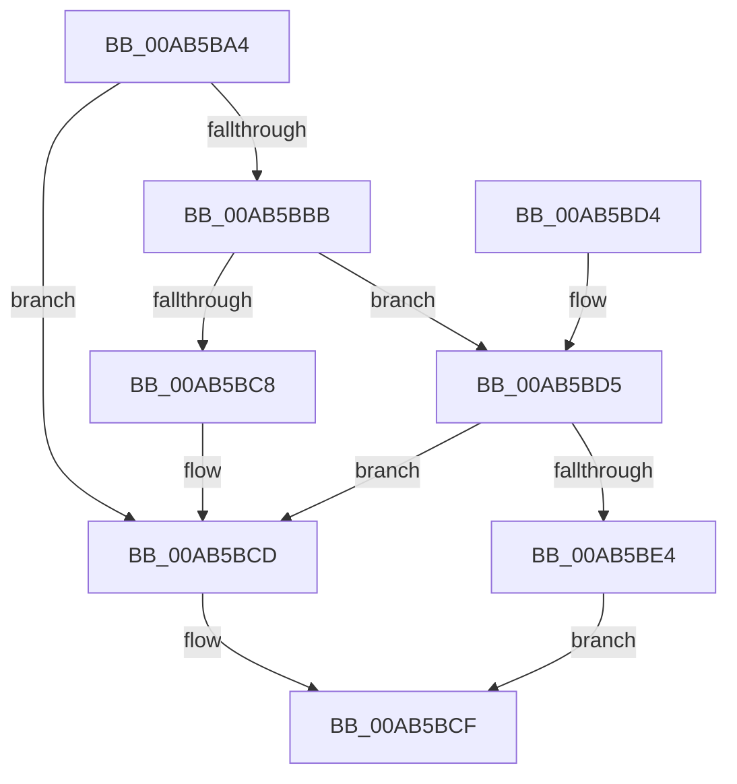

# MiChargeSystemImageCommitment

- RVA: `0x00AB5BA4`–`0x00AB5BEB` (길이 `71` bytes)
- VA: `0x0000000140AB5BA4`
- 실행 섹션: `PAGE`
- PDB 이름 있음: `예`; PDB Function 태그: `아니요`
- unwind 정보 RVA: `0x00068370`
- 디코드: `22`개 명령, `71/71` bytes 표시
- 미해석 바이트: `0` (있으면 어셈블리에 `.byte`로 보존)

> 이 문서는 커널 이미지의 기계어와 PDB 기호를 분석해 생성했습니다. 4번과 5번은 함수 원형과 자료형을 바이너리 사용 방식에서 추정한 C 해석이며 원본 소스 복구 결과는 아닙니다.

## 1. Dependencies

- 직접 호출 지점: **3**; 고유 호출 대상: **3**
- 직접 호출자로 확인된 함수: **1**
- RIP 상대 이미지 참조: **1**

### Outgoing calls
- `0x00AB5BAB` → [MiSectionControlArea](../../text/29/MiSectionControlArea_function_00294CB0.md) (function, `0x00294CB0`)
- `0x00AB5BC8` → [MiReleaseNonPagedResources](../../text/32/MiReleaseNonPagedResources_function_0032299C.md) (function, `0x0032299C`)
- `0x00AB5BDB` → [MiAcquireNonPagedResources](../../text/28/MiAcquireNonPagedResources_function_00286C60.md) (function, `0x00286C60`)

### Direct callers
- [MiMapSystemImage](../AA/MiMapSystemImage_function_00AA3558.md) at `0x00AA361F`

### Static image references
- `0x00AB5BBB` → RVA `0x00E38D00` (`.data`; read)

## 2. Other-region calls and transfers

- 다른 실행 섹션으로 향하는 call: **3**
  - `0x00AB5BAB` → [MiSectionControlArea](../../text/29/MiSectionControlArea_function_00294CB0.md) (`PAGE` → `.text`)
  - `0x00AB5BC8` → [MiReleaseNonPagedResources](../../text/32/MiReleaseNonPagedResources_function_0032299C.md) (`PAGE` → `.text`)
  - `0x00AB5BDB` → [MiAcquireNonPagedResources](../../text/28/MiAcquireNonPagedResources_function_00286C60.md) (`PAGE` → `.text`)
- 별도 외부 분기/꼬리 이동을 확인하지 못했습니다.

## 3. Assembly (complete function range)

```asm
00AB5BA4  48 83 EC 28                     sub rsp, 0x28
00AB5BA8  44 8B C2                        mov r8d, edx
00AB5BAB  E8 00 F1 7D FF                  call 0x140294cb0
00AB5BB0  48 8B 08                        mov rcx, qword ptr [rax]
00AB5BB3  8B 51 08                        mov edx, dword ptr [rcx + 8]
00AB5BB6  48 85 D2                        test rdx, rdx
00AB5BB9  74 12                           je 0x140ab5bcd
00AB5BBB  48 8D 0D 3E 31 38 00            lea rcx, [rip + 0x38313e]
00AB5BC2  41 83 F8 01                     cmp r8d, 1
00AB5BC6  74 0D                           je 0x140ab5bd5
00AB5BC8  E8 CF CD 86 FF                  call 0x14032299c
00AB5BCD  33 C0                           xor eax, eax
00AB5BCF  48 83 C4 28                     add rsp, 0x28
00AB5BD3  C3                              ret
00AB5BD4  CC                              int3
00AB5BD5  45 33 C9                        xor r9d, r9d
00AB5BD8  45 33 C0                        xor r8d, r8d
00AB5BDB  E8 80 10 7D FF                  call 0x140286c60
00AB5BE0  85 C0                           test eax, eax
00AB5BE2  79 E9                           jns 0x140ab5bcd
00AB5BE4  B8 9A 00 00 C0                  mov eax, 0xc000009a
00AB5BE9  EB E4                           jmp 0x140ab5bcf
```

## 4. C-style interpretation (structured pseudocode)

```c
__int64 __fastcall MiChargeSystemImageCommitment(__int64 a1, int a2, __int64 a3, int a4)
{
    __int64 result;
    __int64 v_rsp;

    v_rsp = (v_rsp) - (40);
    result = MiSectionControlArea(a1, a2, (unsigned int)(a2), a4);
    if ((unsigned int)(*(unsigned int *)(*(unsigned __int64 *)(result) + 8)) == 0) goto loc_00AB5BCD;
    if (((unsigned int)((unsigned int)(a2))) == 1) goto loc_00AB5BD5;
    result = MiReleaseNonPagedResources(v_rip + 3682622, (unsigned int)(*(unsigned int *)(*(unsigned __int64 *)(result) + 8)), (unsigned int)(a2), a4);
loc_00AB5BCD:
    result = 0;
loc_00AB5BCF:
    v_rsp = (v_rsp) + (40);
    return result;
loc_00AB5BD5:
    a4 = 0;
    a3 = 0;
    result = MiAcquireNonPagedResources(v_rip + 3682622, (unsigned int)(*(unsigned int *)(*(unsigned __int64 *)(result) + 8)), a3, a4);
    if (!sign_flag) goto loc_00AB5BCD;
    goto loc_00AB5BCF;
}
```

## 5. (Beta) C Style

```c
int64_t MiChargeSystemImageCommitment(int64_t Arg1, int32_t Arg2, int64_t Arg3, int32_t Arg4)
{
    int64_t result;
    int64_t local_rsp;

    local_rsp = (local_rsp) - (40);
    result = MiSectionControlArea(Arg1, Arg2, (uint32_t)(Arg2), Arg4);
    if ((uint32_t)(*(uint32_t *)(*(uint64_t *)(result) + 0x8)) == 0) goto loc_00AB5BCD;
    if (((uint32_t)((uint32_t)(Arg2))) == 1) goto loc_00AB5BD5;
    result = MiReleaseNonPagedResources(v_rip + 3682622, (uint32_t)(*(uint32_t *)(*(uint64_t *)(result) + 0x8)), (uint32_t)(Arg2), Arg4);
loc_00AB5BCD:
    result = 0;
loc_00AB5BCF:
    local_rsp = (local_rsp) + (40);
    return result;
loc_00AB5BD5:
    Arg4 = 0;
    Arg3 = 0;
    result = MiAcquireNonPagedResources(v_rip + 3682622, (uint32_t)(*(uint32_t *)(*(uint64_t *)(result) + 0x8)), Arg3, Arg4);
    if (!sign_flag) goto loc_00AB5BCD;
    goto loc_00AB5BCF;
}
```

## 6. Execution-region graph

[열기: 2D/3D 그래프와 함수 탐색 컨트롤 패널](../../../control-panel.html?section=page&rva=0x00AB5BA4&view=graph)

- 2D 그래프는 위에서 아래로 흐르고, 3D 그래프는 빈 공간을 드래그해 회전합니다. Shift+드래그는 이동, 휠은 확대·축소, 함수 노드 선택은 대상 보고서 이동입니다.

### Static fallback


