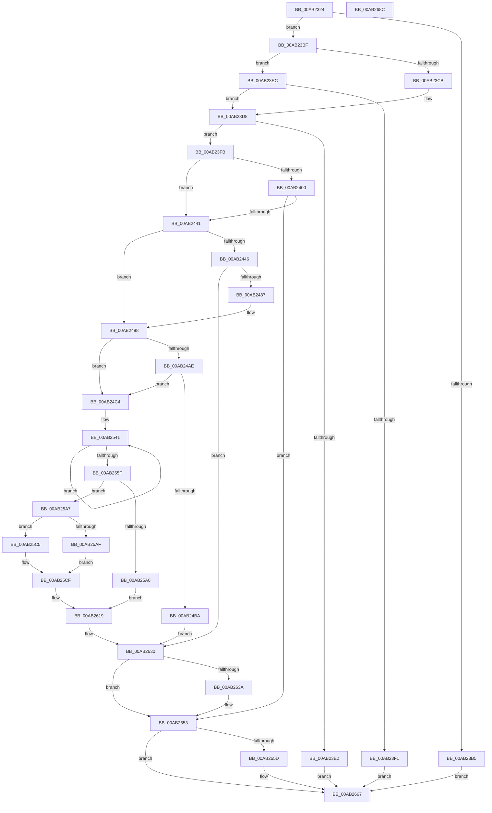

# MiCombineIdenticalPages

- RVA: `0x00AB2324`–`0x00AB268D` (길이 `873` bytes)
- VA: `0x0000000140AB2324`
- 실행 섹션: `PAGE`
- PDB 이름 있음: `예`; PDB Function 태그: `아니요`
- unwind 정보 RVA: `0x000BC948`
- 디코드: `205`개 명령, `873/873` bytes 표시
- 미해석 바이트: `0` (있으면 어셈블리에 `.byte`로 보존)

> 이 문서는 커널 이미지의 기계어와 PDB 기호를 분석해 생성했습니다. 4번과 5번은 함수 원형과 자료형을 바이너리 사용 방식에서 추정한 C 해석이며 원본 소스 복구 결과는 아닙니다.

## 1. Dependencies

- 직접 호출 지점: **16**; 고유 호출 대상: **13**
- 직접 호출자로 확인된 함수: **2**
- RIP 상대 이미지 참조: **8**

### Outgoing calls
- `0x00AB2381` → [memset](../../text/6C/memset_function_006C6C40.md) (function, `0x006C6C40`)
- `0x00AB2432` → [ObpReferenceObjectByHandleWithTag](../86/ObpReferenceObjectByHandleWithTag_function_00869650.md) (function, `0x00869650`)
- `0x00AB2478` → [ObpReferenceObjectByHandleWithTag](../86/ObpReferenceObjectByHandleWithTag_function_00869650.md) (function, `0x00869650`)
- `0x00AB2493` → [KiStackAttachProcess](../../text/21/KiStackAttachProcess_function_00216820.md) (function, `0x00216820`)
- `0x00AB24DC` → [MiCombiningInProgress](../../text/68/MiCombiningInProgress_function_0068BD6C.md) (function, `0x0068BD6C`)
- `0x00AB2582` → [MiInitializePageColorBase](../../text/32/MiInitializePageColorBase_function_00320410.md) (function, `0x00320410`)
- `0x00AB2597` → [MiCreateUltraThreadContext](../../text/28/MiCreateUltraThreadContext_function_00288200.md) (function, `0x00288200`)
- `0x00AB25BE` → [MiCombineWorkingSet](../../text/68/MiCombineWorkingSet_function_0068BB18.md) (function, `0x0068BB18`)
- `0x00AB25CA` → [MiCombineAllPhysicalMemory](../9F/MiCombineAllPhysicalMemory_function_009F6B6C.md) (function, `0x009F6B6C`)
- `0x00AB25D5` → [MiDeleteUltraThreadContext](../../text/32/MiDeleteUltraThreadContext_function_00322C90.md) (function, `0x00322C90`)
- `0x00AB2623` → [MiCombiningInProgress](../../text/68/MiCombiningInProgress_function_0068BD6C.md) (function, `0x0068BD6C`)
- `0x00AB262B` → [KiLeaveCriticalRegionUnsafe](../../text/25/KiLeaveCriticalRegionUnsafe_function_0025F010.md) (function, `0x0025F010`)
- `0x00AB2641` → [KiUnstackDetachProcess](../../text/21/KiUnstackDetachProcess_function_00217D30.md) (function, `0x00217D30`)
- `0x00AB264E` → [ObfDereferenceObjectWithTag](../../text/2F/ObfDereferenceObjectWithTag_function_002F78E0.md) (function, `0x002F78E0`)
- `0x00AB2662` → [ObfDereferenceObjectWithTag](../../text/2F/ObfDereferenceObjectWithTag_function_002F78E0.md) (function, `0x002F78E0`)
- `0x00AB2673` → [_security_check_cookie](../../text/6A/_security_check_cookie_function_006AC640.md) (function, `0x006AC640`)

### Direct callers
- [MmManagePartitionCombineMemory](../80/MmManagePartitionCombineMemory_function_0080DF94.md) at `0x0080DFDC`
- [NtSetSystemInformation](../AF/NtSetSystemInformation_function_00AF4A60.md) at `0x00AF5BEF`

### Static image references
- `0x00AB2340` → RVA `0x00E0A740` (`.data`; read)
- `0x00AB23D8` → RVA `0x00FC51F8` (`ALMOSTRO`; read)
- `0x00AB2400` → RVA `0x00FC6B80` (`ALMOSTRO`; read)
- `0x00AB2446` → RVA `0x00FC6A98` (`ALMOSTRO`; read)
- `0x00AB24AE` → RVA `0x00E38D00` (`.data`; read)
- `0x00AB24E1` → RVA `0x00E37468` (`.data`; read)
- `0x00AB24FD` → RVA `0x00E374A0` (`.data`; read)
- `0x00AB252F` → RVA `0x00E2FF1C` (`.data`; read)

## 2. Other-region calls and transfers

- 다른 실행 섹션으로 향하는 call: **13**
  - `0x00AB2381` → [memset](../../text/6C/memset_function_006C6C40.md) (`PAGE` → `.text`)
  - `0x00AB2493` → [KiStackAttachProcess](../../text/21/KiStackAttachProcess_function_00216820.md) (`PAGE` → `.text`)
  - `0x00AB24DC` → [MiCombiningInProgress](../../text/68/MiCombiningInProgress_function_0068BD6C.md) (`PAGE` → `.text`)
  - `0x00AB2582` → [MiInitializePageColorBase](../../text/32/MiInitializePageColorBase_function_00320410.md) (`PAGE` → `.text`)
  - `0x00AB2597` → [MiCreateUltraThreadContext](../../text/28/MiCreateUltraThreadContext_function_00288200.md) (`PAGE` → `.text`)
  - `0x00AB25BE` → [MiCombineWorkingSet](../../text/68/MiCombineWorkingSet_function_0068BB18.md) (`PAGE` → `.text`)
  - `0x00AB25D5` → [MiDeleteUltraThreadContext](../../text/32/MiDeleteUltraThreadContext_function_00322C90.md) (`PAGE` → `.text`)
  - `0x00AB2623` → [MiCombiningInProgress](../../text/68/MiCombiningInProgress_function_0068BD6C.md) (`PAGE` → `.text`)
  - `0x00AB262B` → [KiLeaveCriticalRegionUnsafe](../../text/25/KiLeaveCriticalRegionUnsafe_function_0025F010.md) (`PAGE` → `.text`)
  - `0x00AB2641` → [KiUnstackDetachProcess](../../text/21/KiUnstackDetachProcess_function_00217D30.md) (`PAGE` → `.text`)
  - `0x00AB264E` → [ObfDereferenceObjectWithTag](../../text/2F/ObfDereferenceObjectWithTag_function_002F78E0.md) (`PAGE` → `.text`)
  - `0x00AB2662` → [ObfDereferenceObjectWithTag](../../text/2F/ObfDereferenceObjectWithTag_function_002F78E0.md) (`PAGE` → `.text`)
  - `0x00AB2673` → [_security_check_cookie](../../text/6A/_security_check_cookie_function_006AC640.md) (`PAGE` → `.text`)
- 별도 외부 분기/꼬리 이동을 확인하지 못했습니다.

## 3. Assembly (complete function range)

```asm
00AB2324  40 55                           push rbp
00AB2326  53                              push rbx
00AB2327  56                              push rsi
00AB2328  57                              push rdi
00AB2329  41 54                           push r12
00AB232B  41 55                           push r13
00AB232D  41 56                           push r14
00AB232F  41 57                           push r15
00AB2331  48 8D AC 24 C8 FE FF FF         lea rbp, [rsp - 0x138]
00AB2339  48 81 EC 38 02 00 00            sub rsp, 0x238
00AB2340  48 8B 05 F9 83 35 00            mov rax, qword ptr [rip + 0x3583f9]
00AB2347  48 33 C4                        xor rax, rsp
00AB234A  48 89 85 20 01 00 00            mov qword ptr [rbp + 0x120], rax
00AB2351  4C 8B A5 A8 01 00 00            mov r12, qword ptr [rbp + 0x1a8]
00AB2358  0F 57 C0                        xorps xmm0, xmm0
00AB235B  45 8B F8                        mov r15d, r8d
00AB235E  48 8B DA                        mov rbx, rdx
00AB2361  4C 8B E9                        mov r13, rcx
00AB2364  33 D2                           xor edx, edx
00AB2366  41 B8 50 01 00 00               mov r8d, 0x150
00AB236C  48 8D 4D B0                     lea rcx, [rbp - 0x50]
00AB2370  0F 11 85 00 01 00 00            movups xmmword ptr [rbp + 0x100], xmm0
00AB2377  49 8B F9                        mov rdi, r9
00AB237A  0F 11 85 10 01 00 00            movups xmmword ptr [rbp + 0x110], xmm0
00AB2381  E8 BA 48 C1 FF                  call 0x1406c6c40
00AB2386  45 33 F6                        xor r14d, r14d
00AB2389  0F 57 C0                        xorps xmm0, xmm0
00AB238C  4D 89 34 24                     mov qword ptr [r12], r14
00AB2390  4C 89 74 24 48                  mov qword ptr [rsp + 0x48], r14
00AB2395  4C 89 74 24 40                  mov qword ptr [rsp + 0x40], r14
00AB239A  0F 11 44 24 78                  movups xmmword ptr [rsp + 0x78], xmm0
00AB239F  0F 11 45 88                     movups xmmword ptr [rbp - 0x78], xmm0
00AB23A3  0F 11 45 98                     movups xmmword ptr [rbp - 0x68], xmm0
00AB23A7  0F 11 44 24 68                  movups xmmword ptr [rsp + 0x68], xmm0
00AB23AC  41 F7 C7 FC FF FF FF            test r15d, 0xfffffffc
00AB23B3  74 0A                           je 0x140ab23bf
00AB23B5  BB F1 00 00 C0                  mov ebx, 0xc00000f1
00AB23BA  E9 A8 02 00 00                  jmp 0x140ab2667
00AB23BF  41 8B F7                        mov esi, r15d
00AB23C2  48 83 C9 FF                     or rcx, 0xffffffffffffffff
00AB23C6  83 E6 02                        and esi, 2
00AB23C9  74 21                           je 0x140ab23ec
00AB23CB  48 85 FF                        test rdi, rdi
00AB23CE  48 8B C1                        mov rax, rcx
00AB23D1  48 0F 45 C7                     cmovne rax, rdi
00AB23D5  48 8B F8                        mov rdi, rax
00AB23D8  8B 05 1A 2E 51 00               mov eax, dword ptr [rip + 0x512e1a]
00AB23DE  A8 01                           test al, 1
00AB23E0  74 19                           je 0x140ab23fb
00AB23E2  BB BB 00 00 C0                  mov ebx, 0xc00000bb
00AB23E7  E9 7B 02 00 00                  jmp 0x140ab2667
00AB23EC  48 85 FF                        test rdi, rdi
00AB23EF  74 E7                           je 0x140ab23d8
00AB23F1  BB 0D 00 00 C0                  mov ebx, 0xc000000d
00AB23F6  E9 6C 02 00 00                  jmp 0x140ab2667
00AB23FB  48 85 DB                        test rbx, rbx
00AB23FE  74 41                           je 0x140ab2441
00AB2400  4C 8B 05 79 47 51 00            mov r8, qword ptr [rip + 0x514779]
00AB2407  48 8D 44 24 48                  lea rax, [rsp + 0x48]
00AB240C  44 8A 8D A0 01 00 00            mov r9b, byte ptr [rbp + 0x1a0]
00AB2413  BA 01 00 00 00                  mov edx, 1
00AB2418  4C 89 74 24 38                  mov qword ptr [rsp + 0x38], r14
00AB241D  48 8B CB                        mov rcx, rbx
00AB2420  4C 89 74 24 30                  mov qword ptr [rsp + 0x30], r14
00AB2425  48 89 44 24 28                  mov qword ptr [rsp + 0x28], rax
00AB242A  C7 44 24 20 4D 6D 43 62         mov dword ptr [rsp + 0x20], 0x62436d4d
00AB2432  E8 19 72 DB FF                  call 0x140869650
00AB2437  8B D8                           mov ebx, eax
00AB2439  85 C0                           test eax, eax
00AB243B  0F 88 12 02 00 00               js 0x140ab2653
00AB2441  48 85 FF                        test rdi, rdi
00AB2444  74 52                           je 0x140ab2498
00AB2446  4C 8B 05 4B 46 51 00            mov r8, qword ptr [rip + 0x51464b]
00AB244D  48 8D 44 24 40                  lea rax, [rsp + 0x40]
00AB2452  44 8A 8D A0 01 00 00            mov r9b, byte ptr [rbp + 0x1a0]
00AB2459  BA 18 00 00 00                  mov edx, 0x18
00AB245E  4C 89 74 24 38                  mov qword ptr [rsp + 0x38], r14
00AB2463  48 8B CF                        mov rcx, rdi
00AB2466  4C 89 74 24 30                  mov qword ptr [rsp + 0x30], r14
00AB246B  48 89 44 24 28                  mov qword ptr [rsp + 0x28], rax
00AB2470  C7 44 24 20 4D 6D 43 62         mov dword ptr [rsp + 0x20], 0x62436d4d
00AB2478  E8 D3 71 DB FF                  call 0x140869650
00AB247D  8B D8                           mov ebx, eax
00AB247F  85 C0                           test eax, eax
00AB2481  0F 88 A9 01 00 00               js 0x140ab2630
00AB2487  48 8B 4C 24 40                  mov rcx, qword ptr [rsp + 0x40]
00AB248C  4C 8D 44 24 78                  lea r8, [rsp + 0x78]
00AB2491  33 D2                           xor edx, edx
00AB2493  E8 88 43 76 FF                  call 0x140216820
00AB2498  65 4C 8B 34 25 88 01 00 00      mov r14, qword ptr gs:[0x188]
00AB24A1  49 8D BD 58 42 00 00            lea rdi, [r13 + 0x4258]
00AB24A8  41 F6 C7 01                     test r15b, 1
00AB24AC  74 16                           je 0x140ab24c4
00AB24AE  48 8D 05 4B 68 38 00            lea rax, [rip + 0x38684b]
00AB24B5  4C 3B E8                        cmp r13, rax
00AB24B8  74 0A                           je 0x140ab24c4
00AB24BA  BB BB 00 00 C0                  mov ebx, 0xc00000bb
00AB24BF  E9 6C 01 00 00                  jmp 0x140ab2630
00AB24C4  48 83 C8 FF                     or rax, 0xffffffffffffffff
00AB24C8  48 8D 55 C0                     lea rdx, [rbp - 0x40]
00AB24CC  66 41 01 86 E4 01 00 00         add word ptr [r14 + 0x1e4], ax
00AB24D4  48 8B CF                        mov rcx, rdi
00AB24D7  90                              nop
00AB24D8  44 8D 40 02                     lea r8d, [rax + 2]
00AB24DC  E8 8B 98 BD FF                  call 0x14068bd6c
00AB24E1  48 8B 05 80 4F 38 00            mov rax, qword ptr [rip + 0x384f80]
00AB24E8  41 B8 02 00 00 00               mov r8d, 2
00AB24EE  83 64 24 50 00                  and dword ptr [rsp + 0x50], 0
00AB24F3  83 4C 24 54 FF                  or dword ptr [rsp + 0x54], 0xffffffff
00AB24F8  48 89 44 24 58                  mov qword ptr [rsp + 0x58], rax
00AB24FD  48 8B 05 9C 4F 38 00            mov rax, qword ptr [rip + 0x384f9c]
00AB2504  48 89 44 24 60                  mov qword ptr [rsp + 0x60], rax
00AB2509  48 8D 44 24 58                  lea rax, [rsp + 0x58]
00AB250E  48 89 45 28                     mov qword ptr [rbp + 0x28], rax
00AB2512  48 8D 44 24 50                  lea rax, [rsp + 0x50]
00AB2517  48 89 45 30                     mov qword ptr [rbp + 0x30], rax
00AB251B  48 8B 44 24 48                  mov rax, qword ptr [rsp + 0x48]
00AB2520  48 89 45 B8                     mov qword ptr [rbp - 0x48], rax
00AB2524  48 8D 85 00 01 00 00            lea rax, [rbp + 0x100]
00AB252B  48 89 45 18                     mov qword ptr [rbp + 0x18], rax
00AB252F  8B 05 E7 D9 37 00               mov eax, dword ptr [rip + 0x37d9e7]
00AB2535  44 89 45 38                     mov dword ptr [rbp + 0x38], r8d
00AB2539  48 89 7D B0                     mov qword ptr [rbp - 0x50], rdi
00AB253D  44 89 7D 3C                     mov dword ptr [rbp + 0x3c], r15d
00AB2541  8D 50 01                        lea edx, [rax + 1]
00AB2544  8B C8                           mov ecx, eax
00AB2546  41 3B D0                        cmp edx, r8d
00AB2549  41 0F 42 D0                     cmovb edx, r8d
00AB254D  89 95 D0 00 00 00               mov dword ptr [rbp + 0xd0], edx
00AB2553  F0 0F B1 15 C1 D9 37 00         lock cmpxchg dword ptr [rip + 0x37d9c1], edx
00AB255B  3B C1                           cmp eax, ecx
00AB255D  75 E2                           jne 0x140ab2541
00AB255F  65 48 8B 04 25 88 01 00 00      mov rax, qword ptr gs:[0x188]
00AB2568  4C 8D 4C 24 68                  lea r9, [rsp + 0x68]
00AB256D  45 33 C0                        xor r8d, r8d
00AB2570  48 8B 88 B8 00 00 00            mov rcx, qword ptr [rax + 0xb8]
00AB2577  48 81 C1 00 04 00 00            add rcx, 0x400
00AB257E  41 8D 50 03                     lea edx, [r8 + 3]
00AB2582  E8 89 DE 86 FF                  call 0x140320410
00AB2587  45 33 C9                        xor r9d, r9d
00AB258A  48 8D 54 24 68                  lea rdx, [rsp + 0x68]
00AB258F  48 8D 4D 50                     lea rcx, [rbp + 0x50]
00AB2593  45 8D 41 08                     lea r8d, [r9 + 8]
00AB2597  E8 64 5C 7D FF                  call 0x140288200
00AB259C  85 C0                           test eax, eax
00AB259E  75 07                           jne 0x140ab25a7
00AB25A0  BB 9A 00 00 C0                  mov ebx, 0xc000009a
00AB25A5  EB 72                           jmp 0x140ab2619
00AB25A7  48 8D 4D B0                     lea rcx, [rbp - 0x50]
00AB25AB  85 F6                           test esi, esi
00AB25AD  74 16                           je 0x140ab25c5
00AB25AF  48 8B 44 24 40                  mov rax, qword ptr [rsp + 0x40]
00AB25B4  48 05 00 04 00 00               add rax, 0x400
00AB25BA  48 89 45 20                     mov qword ptr [rbp + 0x20], rax
00AB25BE  E8 55 95 BD FF                  call 0x14068bb18
00AB25C3  EB 0A                           jmp 0x140ab25cf
00AB25C5  48 83 65 20 00                  and qword ptr [rbp + 0x20], 0
00AB25CA  E8 9D 45 F4 FF                  call 0x1409f6b6c
00AB25CF  48 8D 4D 50                     lea rcx, [rbp + 0x50]
00AB25D3  8B D8                           mov ebx, eax
00AB25D5  E8 B6 06 87 FF                  call 0x140322c90
00AB25DA  48 8B 85 00 01 00 00            mov rax, qword ptr [rbp + 0x100]
00AB25E1  49 89 04 24                     mov qword ptr [r12], rax
00AB25E5  F0 FF 87 80 01 00 00            lock inc dword ptr [rdi + 0x180]
00AB25EC  48 8B 85 08 01 00 00            mov rax, qword ptr [rbp + 0x108]
00AB25F3  F0 48 01 87 78 01 00 00         lock add qword ptr [rdi + 0x178], rax
00AB25FB  48 8B 85 10 01 00 00            mov rax, qword ptr [rbp + 0x110]
00AB2602  F0 48 01 87 68 01 00 00         lock add qword ptr [rdi + 0x168], rax
00AB260A  48 8B 85 18 01 00 00            mov rax, qword ptr [rbp + 0x118]
00AB2611  F0 48 01 87 70 01 00 00         lock add qword ptr [rdi + 0x170], rax
00AB2619  45 33 C0                        xor r8d, r8d
00AB261C  48 8D 55 C0                     lea rdx, [rbp - 0x40]
00AB2620  48 8B CF                        mov rcx, rdi
00AB2623  E8 44 97 BD FF                  call 0x14068bd6c
00AB2628  49 8B CE                        mov rcx, r14
00AB262B  E8 E0 C9 7A FF                  call 0x14025f010
00AB2630  48 8B 7C 24 40                  mov rdi, qword ptr [rsp + 0x40]
00AB2635  48 85 FF                        test rdi, rdi
00AB2638  74 19                           je 0x140ab2653
00AB263A  33 D2                           xor edx, edx
00AB263C  48 8D 4C 24 78                  lea rcx, [rsp + 0x78]
00AB2641  E8 EA 56 76 FF                  call 0x140217d30
00AB2646  BA 4D 6D 43 62                  mov edx, 0x62436d4d
00AB264B  48 8B CF                        mov rcx, rdi
00AB264E  E8 8D 52 84 FF                  call 0x1402f78e0
00AB2653  48 8B 4C 24 48                  mov rcx, qword ptr [rsp + 0x48]
00AB2658  48 85 C9                        test rcx, rcx
00AB265B  74 0A                           je 0x140ab2667
00AB265D  BA 4D 6D 43 62                  mov edx, 0x62436d4d
00AB2662  E8 79 52 84 FF                  call 0x1402f78e0
00AB2667  8B C3                           mov eax, ebx
00AB2669  48 8B 8D 20 01 00 00            mov rcx, qword ptr [rbp + 0x120]
00AB2670  48 33 CC                        xor rcx, rsp
00AB2673  E8 C8 9F BF FF                  call 0x1406ac640
00AB2678  48 81 C4 38 02 00 00            add rsp, 0x238
00AB267F  41 5F                           pop r15
00AB2681  41 5E                           pop r14
00AB2683  41 5D                           pop r13
00AB2685  41 5C                           pop r12
00AB2687  5F                              pop rdi
00AB2688  5E                              pop rsi
00AB2689  5B                              pop rbx
00AB268A  5D                              pop rbp
00AB268B  C3                              ret
00AB268C  CC                              int3
```

## 4. C-style interpretation (structured pseudocode)

```c
__int64 __fastcall MiCombineIdenticalPages(__int64 a1, __int64 a2, int a3, __int64 a4, unsigned __int8 a5, __int64 a6)
{
    __int64 result;
    __int64 v_r14;
    __int64 v_rsi;
    __int64 v_rsp;
    unsigned __int64 v_stack_m128;
    unsigned int v_stack_m13C;
    unsigned int v_stack_m140;
    unsigned __int64 v_stack_m148;
    unsigned __int64 v_stack_m150;
    unsigned __int64 v_stack_m158;
    unsigned __int64 v_stack_m160;
    unsigned __int64 v_stack_m178;
    unsigned __int64 v_stack_m1B8;
    unsigned __int64 v_stack_m1C0;
    unsigned __int64 v_stack_m1C8;
    unsigned __int64 v_stack_m1E0;
    unsigned __int64 v_stack_m1F0;
    unsigned __int64 v_stack_m200;
    unsigned __int64 v_stack_m210;
    unsigned __int64 v_stack_m218;
    unsigned __int64 v_stack_m220;
    unsigned int v_stack_m224;
    unsigned int v_stack_m228;
    unsigned __int64 v_stack_m230;
    unsigned __int64 v_stack_m238;
    unsigned __int64 v_stack_m240;
    unsigned __int64 v_stack_m248;
    unsigned __int64 v_stack_m250;
    unsigned int v_stack_m258;
    unsigned __int64 v_stack_m58;
    unsigned __int64 v_stack_m60;
    unsigned __int64 v_stack_m68;
    unsigned __int64 v_stack_m70;
    unsigned __int64 v_stack_m78;
    unsigned int v_stack_mA8;

    v_rsp = (v_rsp) - (568);
    result = (*(unsigned __int64 *)(v_rip + 3507193)) ^ (v_rsp);
    v_stack_m58 = result;
    a2 = 0;
    v_stack_m78 = v_xmm0;
    v_stack_m68 = v_xmm0;
    result = memset(v_stack_m1C8, a2, 336, a4);
    v_r14 = 0;
    *(unsigned __int64 *)(a6) = 0;
    v_stack_m230 = 0;
    v_stack_m238 = 0;
    v_stack_m200 = v_xmm0;
    v_stack_m1F0 = v_xmm0;
    v_stack_m1E0 = v_xmm0;
    v_stack_m210 = v_xmm0;
    if ((((unsigned int)((unsigned int)(a3))) & (0xFFFFFFFCULL)) == 0) goto loc_00AB23BF;
    goto loc_00AB2667;
loc_00AB23BF:
    a1 = (v_stack_m1C8) | (-1);
    v_rsi = (unsigned int)(((unsigned int)((unsigned int)((unsigned int)(a3)))) & (2));
    if (condition_is_equal) goto loc_00AB23EC;
    if (a4 != 0) { a1 = a4; }
loc_00AB23D8:
    if ((((unsigned __int8)((unsigned int)(*(unsigned int *)(v_rip + 5320218)))) & (1)) == 0) goto loc_00AB23FB;
    goto loc_00AB2667;
loc_00AB23EC:
    if (a1 == 0) goto loc_00AB23D8;
    goto loc_00AB2667;
loc_00AB23FB:
    if ((unsigned int)(0xC000000DULL) == 0) goto loc_00AB2441;
    v_stack_m240 = 0;
    v_stack_m248 = 0;
    v_stack_m250 = v_stack_m230;
    v_stack_m258 = 0x62436D4DULL;
    result = ObpReferenceObjectByHandleWithTag((unsigned int)(0xC000000DULL), 1, *(unsigned __int64 *)(v_rip + 5326713), a5);
    if (sign_flag) goto loc_00AB2653;
loc_00AB2441:
    if (a1 == 0) goto loc_00AB2498;
    v_stack_m240 = 0;
    v_stack_m248 = 0;
    v_stack_m250 = v_stack_m238;
    v_stack_m258 = 0x62436D4DULL;
    result = ObpReferenceObjectByHandleWithTag(a1, 24, *(unsigned __int64 *)(v_rip + 5326411), a5);
    if (sign_flag) goto loc_00AB2630;
    a2 = 0;
    result = KiStackAttachProcess(v_stack_m238, a2, v_stack_m200, a5);
loc_00AB2498:
    if ((((unsigned __int8)((unsigned int)(a3))) & (1)) == 0) goto loc_00AB24C4;
    if (a1 == (v_rip + 3696715)) goto loc_00AB24C4;
    goto loc_00AB2630;
loc_00AB24C4:
    result = (v_rip + 3696715) | (-1);
    result = MiCombiningInProgress(a1 + 16984, v_stack_m1B8, result + 2, a5);
    v_stack_m220 = *(unsigned __int64 *)(v_rip + 3690368);
    v_stack_m218 = *(unsigned __int64 *)(v_rip + 3690396);
    v_stack_m150 = v_stack_m220;
    v_stack_m148 = v_stack_m228;
    v_stack_m1C0 = v_stack_m230;
    v_stack_m160 = v_stack_m78;
    v_stack_m140 = 2;
    v_stack_m1C8 = a1 + 16984;
    v_stack_m13C = (unsigned int)((unsigned int)(a3));
loc_00AB2541:
    a2 = (unsigned int)(*(unsigned int *)(v_rip + 3660263)) + 1;
    if (((unsigned int)((unsigned int)(*(unsigned int *)(v_rip + 3660263)) + 1)) < 2) { a2 = 2; }
    v_stack_mA8 = (unsigned int)(a2);
    if (((unsigned int)((unsigned int)(*(unsigned int *)(v_rip + 3660263)))) != ((unsigned int)((unsigned int)((unsigned int)((unsigned int)(*(unsigned int *)(v_rip + 3660263))))))) goto loc_00AB2541;
    a3 = 0;
    a1 = (*(unsigned __int64 *)(*(unsigned __int64 *)(gs_base + (0 + 392)) + 184)) + (0x400ULL);
    result = MiInitializePageColorBase(a1, a3 + 3, a3, v_stack_m210);
    a4 = 0;
    result = MiCreateUltraThreadContext(v_stack_m128, v_stack_m210, a4 + 8, a4);
    if ((unsigned int)(result) != 0) goto loc_00AB25A7;
    goto loc_00AB2619;
loc_00AB25A7:
    if ((unsigned int)(v_rsi) == 0) goto loc_00AB25C5;
    result = (v_stack_m238) + (0x400ULL);
    v_stack_m158 = result;
    result = MiCombineWorkingSet(v_stack_m1C8, v_stack_m210, a4 + 8, a4);
    goto loc_00AB25CF;
loc_00AB25C5:
    result = MiCombineAllPhysicalMemory(v_stack_m1C8, v_stack_m210, a4 + 8, a4);
loc_00AB25CF:
    result = MiDeleteUltraThreadContext(v_stack_m128, v_stack_m210, a4 + 8, a4);
    *(unsigned __int64 *)(a6) = v_stack_m78;
loc_00AB2619:
    a3 = 0;
    result = MiCombiningInProgress(a1 + 16984, v_stack_m1B8, a3, a4);
    result = KiLeaveCriticalRegionUnsafe(*(unsigned __int64 *)(gs_base + (0 + 392)), v_stack_m1B8, a3, a4);
loc_00AB2630:
    if (v_stack_m238 != 0) {
        a2 = 0;
        a1 = v_stack_m200;
        result = KiUnstackDetachProcess(a1, a2, a3, a4);
        a2 = 0x62436D4DULL;
        a1 = v_stack_m238;
        result = ObfDereferenceObjectWithTag(a1, a2, a3, a4);
    }
    if (v_stack_m230 != 0) {
        a2 = 0x62436D4DULL;
        result = ObfDereferenceObjectWithTag(v_stack_m230, a2, a3, a4);
    }
    a1 = (v_stack_m58) ^ (v_rsp);
    result = _security_check_cookie(a1, a2, a3, a4);
    v_rsp = (v_rsp) + (568);
    return result;
}
```

## 5. (Beta) C Style

```c
int64_t MiCombineIdenticalPages(void *Arg1, int64_t Arg2, int32_t Arg3, int64_t Arg4, uint8_t Arg5, void *Arg6)
{
    uint8_t *arg1 = (uint8_t *)Arg1;
    uint8_t *arg6 = (uint8_t *)Arg6;

    int64_t result;
    int64_t local_r14;
    int64_t local_rsi;
    int64_t local_rsp;
    uint64_t v_stack_m128;
    uint32_t v_stack_m13C;
    uint32_t v_stack_m140;
    uint64_t v_stack_m148;
    uint64_t v_stack_m150;
    uint64_t v_stack_m158;
    uint64_t v_stack_m160;
    uint64_t v_stack_m178;
    uint64_t v_stack_m1B8;
    uint64_t v_stack_m1C0;
    uint64_t v_stack_m1C8;
    uint64_t v_stack_m1E0;
    uint64_t v_stack_m1F0;
    uint64_t v_stack_m200;
    uint64_t v_stack_m210;
    uint64_t v_stack_m218;
    uint64_t v_stack_m220;
    uint32_t v_stack_m224;
    uint32_t v_stack_m228;
    uint64_t v_stack_m230;
    uint64_t v_stack_m238;
    uint64_t v_stack_m240;
    uint64_t v_stack_m248;
    uint64_t v_stack_m250;
    uint32_t v_stack_m258;
    uint64_t v_stack_m58;
    uint64_t v_stack_m60;
    uint64_t v_stack_m68;
    uint64_t v_stack_m70;
    uint64_t v_stack_m78;
    uint32_t v_stack_mA8;

    local_rsp = (local_rsp) - (568);
    result = (*(uint64_t *)(v_rip + 0x3583F9)) ^ (local_rsp);
    v_stack_m58 = result;
    Arg2 = 0;
    v_stack_m78 = v_xmm0;
    v_stack_m68 = v_xmm0;
    result = memset(v_stack_m1C8, Arg2, 336, Arg4);
    local_r14 = 0;
    *(uint64_t *)(arg6) = 0;
    v_stack_m230 = 0;
    v_stack_m238 = 0;
    v_stack_m200 = v_xmm0;
    v_stack_m1F0 = v_xmm0;
    v_stack_m1E0 = v_xmm0;
    v_stack_m210 = v_xmm0;
    if ((((uint32_t)((uint32_t)(Arg3))) & (0xFFFFFFFCULL)) == 0) goto loc_00AB23BF;
    goto loc_00AB2667;
loc_00AB23BF:
    Arg1 = (v_stack_m1C8) | (-1);
    local_rsi = (uint32_t)(((uint32_t)((uint32_t)((uint32_t)(Arg3)))) & (2));
    if (condition_is_equal) goto loc_00AB23EC;
    if (Arg4 != 0) { Arg1 = Arg4; }
loc_00AB23D8:
    if ((((uint8_t)((uint32_t)(*(uint32_t *)(v_rip + 0x512E1A)))) & (1)) == 0) goto loc_00AB23FB;
    goto loc_00AB2667;
loc_00AB23EC:
    if (Arg1 == NULL) goto loc_00AB23D8;
    goto loc_00AB2667;
loc_00AB23FB:
    if ((uint32_t)(0xC000000DULL) == 0) goto loc_00AB2441;
    v_stack_m240 = 0;
    v_stack_m248 = 0;
    v_stack_m250 = v_stack_m230;
    v_stack_m258 = 0x62436D4DULL;
    result = ObpReferenceObjectByHandleWithTag((uint32_t)(0xC000000DULL), 1, *(uint64_t *)(v_rip + 0x514779), Arg5);
    if (sign_flag) goto loc_00AB2653;
loc_00AB2441:
    if (Arg1 == NULL) goto loc_00AB2498;
    v_stack_m240 = 0;
    v_stack_m248 = 0;
    v_stack_m250 = v_stack_m238;
    v_stack_m258 = 0x62436D4DULL;
    result = ObpReferenceObjectByHandleWithTag(Arg1, 24, *(uint64_t *)(v_rip + 0x51464B), Arg5);
    if (sign_flag) goto loc_00AB2630;
    Arg2 = 0;
    result = KiStackAttachProcess(v_stack_m238, Arg2, v_stack_m200, Arg5);
loc_00AB2498:
    if ((((uint8_t)((uint32_t)(Arg3))) & (1)) == 0) goto loc_00AB24C4;
    if (Arg1 == (v_rip + 3696715)) goto loc_00AB24C4;
    goto loc_00AB2630;
loc_00AB24C4:
    result = (v_rip + 3696715) | (-1);
    result = MiCombiningInProgress(Arg1 + 16984, v_stack_m1B8, result + 2, Arg5);
    v_stack_m220 = *(uint64_t *)(v_rip + 0x384F80);
    v_stack_m218 = *(uint64_t *)(v_rip + 0x384F9C);
    v_stack_m150 = v_stack_m220;
    v_stack_m148 = v_stack_m228;
    v_stack_m1C0 = v_stack_m230;
    v_stack_m160 = v_stack_m78;
    v_stack_m140 = 2;
    v_stack_m1C8 = Arg1 + 16984;
    v_stack_m13C = (uint32_t)((uint32_t)(Arg3));
loc_00AB2541:
    Arg2 = (uint32_t)(*(uint32_t *)(v_rip + 0x37D9E7)) + 1;
    if (((uint32_t)((uint32_t)(*(uint32_t *)(v_rip + 0x37D9E7)) + 1)) < 2) { Arg2 = 2; }
    v_stack_mA8 = (uint32_t)(Arg2);
    if (((uint32_t)((uint32_t)(*(uint32_t *)(v_rip + 0x37D9E7)))) != ((uint32_t)((uint32_t)((uint32_t)((uint32_t)(*(uint32_t *)(v_rip + 0x37D9E7))))))) goto loc_00AB2541;
    Arg3 = 0;
    Arg1 = (*(uint64_t *)(*(uint64_t *)(gs_base + (0 + 0x188)) + 0xB8)) + (0x400ULL);
    result = MiInitializePageColorBase(Arg1, Arg3 + 3, Arg3, v_stack_m210);
    Arg4 = 0;
    result = MiCreateUltraThreadContext(v_stack_m128, v_stack_m210, Arg4 + 8, Arg4);
    if ((uint32_t)(result) != 0) goto loc_00AB25A7;
    goto loc_00AB2619;
loc_00AB25A7:
    if ((uint32_t)(local_rsi) == 0) goto loc_00AB25C5;
    result = (v_stack_m238) + (0x400ULL);
    v_stack_m158 = result;
    result = MiCombineWorkingSet(v_stack_m1C8, v_stack_m210, Arg4 + 8, Arg4);
    goto loc_00AB25CF;
loc_00AB25C5:
    result = MiCombineAllPhysicalMemory(v_stack_m1C8, v_stack_m210, Arg4 + 8, Arg4);
loc_00AB25CF:
    result = MiDeleteUltraThreadContext(v_stack_m128, v_stack_m210, Arg4 + 8, Arg4);
    *(uint64_t *)(arg6) = v_stack_m78;
loc_00AB2619:
    Arg3 = 0;
    result = MiCombiningInProgress(Arg1 + 16984, v_stack_m1B8, Arg3, Arg4);
    result = KiLeaveCriticalRegionUnsafe(*(uint64_t *)(gs_base + (0 + 0x188)), v_stack_m1B8, Arg3, Arg4);
loc_00AB2630:
    if (v_stack_m238 != 0) {
        Arg2 = 0;
        Arg1 = v_stack_m200;
        result = KiUnstackDetachProcess(Arg1, Arg2, Arg3, Arg4);
        Arg2 = 0x62436D4DULL;
        Arg1 = v_stack_m238;
        result = ObfDereferenceObjectWithTag(Arg1, Arg2, Arg3, Arg4);
    }
    if (v_stack_m230 != 0) {
        Arg2 = 0x62436D4DULL;
        result = ObfDereferenceObjectWithTag(v_stack_m230, Arg2, Arg3, Arg4);
    }
    Arg1 = (v_stack_m58) ^ (local_rsp);
    result = _security_check_cookie(Arg1, Arg2, Arg3, Arg4);
    local_rsp = (local_rsp) + (568);
    return result;
}
```

### 관측된 메모리 오프셋

구조체 형식이 확인되지 않은 접근은 인자 기준의 오프셋으로만 기록했습니다.

| 기준 인자 | 오프셋 표현 | 폭 (bit) | 접근 |
|---|---:|---:|---|
| `Arg1` | `+ 0x168` | `64` | `R/W` |
| `Arg1` | `+ 0x170` | `64` | `R/W` |
| `Arg1` | `+ 0x178` | `64` | `R/W` |
| `Arg1` | `+ 0x180` | `32` | `R/W` |
| `Arg1` | `+ 0x4258` | `64` | `R` |
| `Arg6` | `+ 0x0` | `64` | `W` |

## 6. Execution-region graph

[열기: 2D/3D 그래프와 함수 탐색 컨트롤 패널](../../../control-panel.html?section=page&rva=0x00AB2324&view=graph)

- 2D 그래프는 위에서 아래로 흐르고, 3D 그래프는 빈 공간을 드래그해 회전합니다. Shift+드래그는 이동, 휠은 확대·축소, 함수 노드 선택은 대상 보고서 이동입니다.

### Static fallback


