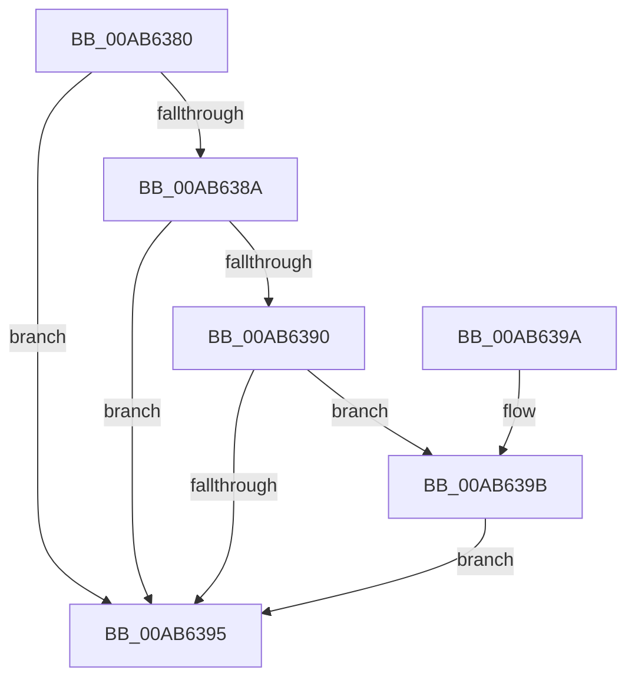

# MiFreeLoadedImportList

- RVA: `0x00AB6380`–`0x00AB63A4` (길이 `36` bytes)
- VA: `0x0000000140AB6380`
- 실행 섹션: `PAGE`
- PDB 이름 있음: `예`; PDB Function 태그: `아니요`
- unwind 정보 RVA: `0x0006EDE0`
- 디코드: `13`개 명령, `36/36` bytes 표시
- 미해석 바이트: `0` (있으면 어셈블리에 `.byte`로 보존)

> 이 문서는 커널 이미지의 기계어와 PDB 기호를 분석해 생성했습니다. 4번과 5번은 함수 원형과 자료형을 바이너리 사용 방식에서 추정한 C 해석이며 원본 소스 복구 결과는 아닙니다.

## 1. Dependencies

- 직접 호출 지점: **1**; 고유 호출 대상: **1**
- 직접 호출자로 확인된 함수: **4**
- RIP 상대 이미지 참조: **0**

### Outgoing calls
- `0x00AB639D` → [ExFreePoolWithTag](../../poolcode/B8/ExFreePoolWithTag_function_00B82870.md) (function, `0x00B82870`)

### Direct callers
- [MiApplyDriverHotPatch](../80/MiApplyDriverHotPatch_function_008018EC.md) at `0x00801D97`
- [MiApplyDriverHotPatch](../80/MiApplyDriverHotPatch_function_008018EC.md) at `0x00801E0A`
- [MiUnloadSystemImage](../AA/MiUnloadSystemImage_function_00AA2FD4.md) at `0x00AA31D6`
- [MiShutdownSystem](../../pagelk/B7/MiShutdownSystem_function_00B73934.md) at `0x00B73AC8`
- [MiUpdateBootDriverHotPatchImports](../../init/C6/MiUpdateBootDriverHotPatchImports_function_00C674C0.md) at `0x00C6751E`

### Static image references
- 디코드된 RIP-relative 메모리 참조가 없습니다.

## 2. Other-region calls and transfers

- 다른 실행 섹션으로 향하는 call: **1**
  - `0x00AB639D` → [ExFreePoolWithTag](../../poolcode/B8/ExFreePoolWithTag_function_00B82870.md) (`PAGE` → `POOLCODE`)
- 별도 외부 분기/꼬리 이동을 확인하지 못했습니다.

## 3. Assembly (complete function range)

```asm
00AB6380  48 83 EC 28                     sub rsp, 0x28
00AB6384  48 83 F9 01                     cmp rcx, 1
00AB6388  74 0B                           je 0x140ab6395
00AB638A  48 83 F9 FE                     cmp rcx, -2
00AB638E  74 05                           je 0x140ab6395
00AB6390  F6 C1 01                        test cl, 1
00AB6393  74 06                           je 0x140ab639b
00AB6395  48 83 C4 28                     add rsp, 0x28
00AB6399  C3                              ret
00AB639A  CC                              int3
00AB639B  33 D2                           xor edx, edx
00AB639D  E8 CE C4 0C 00                  call 0x140b82870
00AB63A2  EB F1                           jmp 0x140ab6395
```

## 4. C-style interpretation (structured pseudocode)

```c
__int64 __fastcall MiFreeLoadedImportList(__int64 a1, int a2)
{
    __int64 result;
    __int64 v_rsp;

    v_rsp = (v_rsp) - (40);
    if (a1 == 1) goto loc_00AB6395;
    if (a1 == -2) goto loc_00AB6395;
    if ((((unsigned __int8)(a1)) & (1)) == 0) goto loc_00AB639B;
loc_00AB6395:
    v_rsp = (v_rsp) + (40);
    return result;
loc_00AB639B:
    a2 = 0;
    result = ExFreePoolWithTag(a1, a2, a3, a4);
    goto loc_00AB6395;
}
```

## 5. (Beta) C Style

```c
int64_t MiFreeLoadedImportList(int64_t Arg1, int32_t Arg2)
{
    int64_t result;
    int64_t local_rsp;

    local_rsp = (local_rsp) - (40);
    if (Arg1 == 1) goto loc_00AB6395;
    if (Arg1 == -2) goto loc_00AB6395;
    if ((((uint8_t)(Arg1)) & (1)) == 0) goto loc_00AB639B;
loc_00AB6395:
    local_rsp = (local_rsp) + (40);
    return result;
loc_00AB639B:
    Arg2 = 0;
    result = ExFreePoolWithTag(Arg1, Arg2, a3, a4);
    goto loc_00AB6395;
}
```

## 6. Execution-region graph

[열기: 2D/3D 그래프와 함수 탐색 컨트롤 패널](../../../control-panel.html?section=page&rva=0x00AB6380&view=graph)

- 2D 그래프는 위에서 아래로 흐르고, 3D 그래프는 빈 공간을 드래그해 회전합니다. Shift+드래그는 이동, 휠은 확대·축소, 함수 노드 선택은 대상 보고서 이동입니다.

### Static fallback


