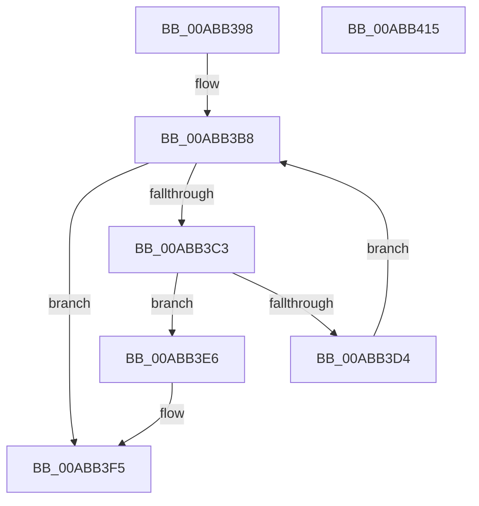

# MiGetReadyInPageBlock

- RVA: `0x00ABB398`–`0x00ABB416` (길이 `126` bytes)
- VA: `0x0000000140ABB398`
- 실행 섹션: `PAGE`
- PDB 이름 있음: `예`; PDB Function 태그: `아니요`
- unwind 정보 RVA: `0x00060BC4`
- 디코드: `37`개 명령, `126/126` bytes 표시
- 미해석 바이트: `0` (있으면 어셈블리에 `.byte`로 보존)

> 이 문서는 커널 이미지의 기계어와 PDB 기호를 분석해 생성했습니다. 4번과 5번은 함수 원형과 자료형을 바이너리 사용 방식에서 추정한 C 해석이며 원본 소스 복구 결과는 아닙니다.

## 1. Dependencies

- 직접 호출 지점: **5**; 고유 호출 대상: **5**
- 직접 호출자로 확인된 함수: **1**
- RIP 상대 이미지 참조: **1**

### Outgoing calls
- `0x00ABB3AC` → [MiLocateLockedVadEvent](../../text/2A/MiLocateLockedVadEvent_function_002A7A0C.md) (function, `0x002A7A0C`)
- `0x00ABB3C7` → [MiGetInPageSupportBlock](../../text/36/MiGetInPageSupportBlock_function_00362500.md) (function, `0x00362500`)
- `0x00ABB3DF` → [KeDelayExecutionThread](../../text/20/KeDelayExecutionThread_function_00209550.md) (function, `0x00209550`)
- `0x00ABB3E9` → [MiFreeInPageSupportBlock](../../text/2B/MiFreeInPageSupportBlock_function_002B5900.md) (function, `0x002B5900`)
- `0x00ABB3FD` → [MiInitializeInPageSupport](../../text/36/MiInitializeInPageSupport_function_00362728.md) (function, `0x00362728`)

### Direct callers
- [MiSwitchToTransition](../../text/4C/MiSwitchToTransition_function_004C0F5C.md) at `0x004C0FE8`

### Static image references
- `0x00ABB3D4` → RVA `0x00010780` (`.rdata`; read)

## 2. Other-region calls and transfers

- 다른 실행 섹션으로 향하는 call: **5**
  - `0x00ABB3AC` → [MiLocateLockedVadEvent](../../text/2A/MiLocateLockedVadEvent_function_002A7A0C.md) (`PAGE` → `.text`)
  - `0x00ABB3C7` → [MiGetInPageSupportBlock](../../text/36/MiGetInPageSupportBlock_function_00362500.md) (`PAGE` → `.text`)
  - `0x00ABB3DF` → [KeDelayExecutionThread](../../text/20/KeDelayExecutionThread_function_00209550.md) (`PAGE` → `.text`)
  - `0x00ABB3E9` → [MiFreeInPageSupportBlock](../../text/2B/MiFreeInPageSupportBlock_function_002B5900.md) (`PAGE` → `.text`)
  - `0x00ABB3FD` → [MiInitializeInPageSupport](../../text/36/MiInitializeInPageSupport_function_00362728.md) (`PAGE` → `.text`)
- 별도 외부 분기/꼬리 이동을 확인하지 못했습니다.

## 3. Assembly (complete function range)

```asm
00ABB398  48 89 5C 24 08                  mov qword ptr [rsp + 8], rbx
00ABB39D  48 89 74 24 10                  mov qword ptr [rsp + 0x10], rsi
00ABB3A2  57                              push rdi
00ABB3A3  48 83 EC 20                     sub rsp, 0x20
00ABB3A7  BA 08 00 00 00                  mov edx, 8
00ABB3AC  E8 5B C6 7E FF                  call 0x1402a7a0c
00ABB3B1  48 8B F0                        mov rsi, rax
00ABB3B4  48 8B 58 08                     mov rbx, qword ptr [rax + 8]
00ABB3B8  8B 8B B0 00 00 00               mov ecx, dword ptr [rbx + 0xb0]
00ABB3BE  83 F9 01                        cmp ecx, 1
00ABB3C1  74 32                           je 0x140abb3f5
00ABB3C3  33 D2                           xor edx, edx
00ABB3C5  33 C9                           xor ecx, ecx
00ABB3C7  E8 34 71 8A FF                  call 0x140362500
00ABB3CC  48 8B F8                        mov rdi, rax
00ABB3CF  48 85 C0                        test rax, rax
00ABB3D2  75 12                           jne 0x140abb3e6
00ABB3D4  4C 8D 05 A5 53 55 FF            lea r8, [rip - 0xaaac5b]
00ABB3DB  33 D2                           xor edx, edx
00ABB3DD  33 C9                           xor ecx, ecx
00ABB3DF  E8 6C E1 74 FF                  call 0x140209550
00ABB3E4  EB D2                           jmp 0x140abb3b8
00ABB3E6  48 8B CB                        mov rcx, rbx
00ABB3E9  E8 12 A5 7F FF                  call 0x1402b5900
00ABB3EE  48 89 7E 08                     mov qword ptr [rsi + 8], rdi
00ABB3F2  48 8B DF                        mov rbx, rdi
00ABB3F5  45 33 C0                        xor r8d, r8d
00ABB3F8  33 D2                           xor edx, edx
00ABB3FA  48 8B CB                        mov rcx, rbx
00ABB3FD  E8 26 73 8A FF                  call 0x140362728
00ABB402  48 8B 74 24 38                  mov rsi, qword ptr [rsp + 0x38]
00ABB407  48 8B C3                        mov rax, rbx
00ABB40A  48 8B 5C 24 30                  mov rbx, qword ptr [rsp + 0x30]
00ABB40F  48 83 C4 20                     add rsp, 0x20
00ABB413  5F                              pop rdi
00ABB414  C3                              ret
00ABB415  CC                              int3
```

## 4. C-style interpretation (structured pseudocode)

```c
__int64 __fastcall MiGetReadyInPageBlock(void)
{
    __int64 result;
    __int64 v_rsp;
    unsigned __int64 v_stack_p10;
    unsigned __int64 v_stack_p8;

    v_stack_p8 = v_rbx;
    v_stack_p10 = v_rsi;
    v_rsp = (v_rsp) - (32);
    result = MiLocateLockedVadEvent(a1, 8, a3, a4);
loc_00ABB3B8:
    if (((unsigned int)((unsigned int)(*(unsigned int *)(*(unsigned __int64 *)(result + 8) + 176)))) == 1) goto loc_00ABB3F5;
    a2 = 0;
    a1 = 0;
    result = MiGetInPageSupportBlock(a1, a2, a3, a4);
    if (result != 0) goto loc_00ABB3E6;
    a2 = 0;
    a1 = 0;
    result = KeDelayExecutionThread(a1, a2, v_rip - 11185243, a4);
    goto loc_00ABB3B8;
loc_00ABB3E6:
    result = MiFreeInPageSupportBlock(*(unsigned __int64 *)(result + 8), a2, v_rip - 11185243, a4);
    *(unsigned __int64 *)(result + 8) = result;
loc_00ABB3F5:
    a3 = 0;
    a2 = 0;
    result = MiInitializeInPageSupport(result, a2, a3, a4);
    v_rsp = (v_rsp) + (32);
    return result;
}
```

## 5. (Beta) C Style

```c
void MiGetReadyInPageBlock(void)
{
    int64_t result;
    int64_t local_rsp;
    uint64_t v_stack_p10;
    uint64_t v_stack_p8;

    v_stack_p8 = local_rbx;
    v_stack_p10 = local_rsi;
    local_rsp = (local_rsp) - (32);
    result = MiLocateLockedVadEvent(a1, 8, a3, a4);
loc_00ABB3B8:
    if (((uint32_t)((uint32_t)(*(uint32_t *)(*(uint64_t *)(result + 0x8) + 0xB0)))) == 1) goto loc_00ABB3F5;
    a2 = 0;
    a1 = 0;
    result = MiGetInPageSupportBlock(a1, a2, a3, a4);
    if (result != 0) goto loc_00ABB3E6;
    a2 = 0;
    a1 = 0;
    result = KeDelayExecutionThread(a1, a2, v_rip - 11185243, a4);
    goto loc_00ABB3B8;
loc_00ABB3E6:
    result = MiFreeInPageSupportBlock(*(uint64_t *)(result + 0x8), a2, v_rip - 11185243, a4);
    *(uint64_t *)(result + 0x8) = result;
loc_00ABB3F5:
    a3 = 0;
    a2 = 0;
    result = MiInitializeInPageSupport(result, a2, a3, a4);
    local_rsp = (local_rsp) + (32);
    return result;
}
```

## 6. Execution-region graph

[열기: 2D/3D 그래프와 함수 탐색 컨트롤 패널](../../../control-panel.html?section=page&rva=0x00ABB398&view=graph)

- 2D 그래프는 위에서 아래로 흐르고, 3D 그래프는 빈 공간을 드래그해 회전합니다. Shift+드래그는 이동, 휠은 확대·축소, 함수 노드 선택은 대상 보고서 이동입니다.

### Static fallback


