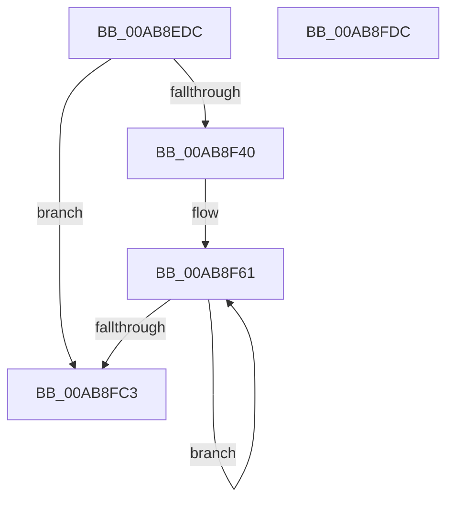

# MiInitializeImageSectionLocks

- RVA: `0x00AB8EDC`–`0x00AB8FDD` (길이 `257` bytes)
- VA: `0x0000000140AB8EDC`
- 실행 섹션: `PAGE`
- PDB 이름 있음: `예`; PDB Function 태그: `아니요`
- unwind 정보 RVA: `0x00060300`
- 디코드: `69`개 명령, `257/257` bytes 표시
- 미해석 바이트: `0` (있으면 어셈블리에 `.byte`로 보존)

> 이 문서는 커널 이미지의 기계어와 PDB 기호를 분석해 생성했습니다. 4번과 5번은 함수 원형과 자료형을 바이너리 사용 방식에서 추정한 C 해석이며 원본 소스 복구 결과는 아닙니다.

## 1. Dependencies

- 직접 호출 지점: **5**; 고유 호출 대상: **3**
- 직접 호출자로 확인된 함수: **1**
- RIP 상대 이미지 참조: **0**

### Outgoing calls
- `0x00AB8EF4` → [MiGetBaseLoaderPortion](../../text/4D/MiGetBaseLoaderPortion_function_004D9D34.md) (function, `0x004D9D34`)
- `0x00AB8F03` → [RtlImageNtHeader](../../text/44/RtlImageNtHeader_function_00443B60.md) (function, `0x00443B60`)
- `0x00AB8F43` → [MiGetPteAddress](../../text/43/MiGetPteAddress_function_0043E130.md) (function, `0x0043E130`)
- `0x00AB8F72` → [MiGetPteAddress](../../text/43/MiGetPteAddress_function_0043E130.md) (function, `0x0043E130`)
- `0x00AB8FA5` → [MiGetPteAddress](../../text/43/MiGetPteAddress_function_0043E130.md) (function, `0x0043E130`)

### Direct callers
- [MiConstructLoaderEntry](../AA/MiConstructLoaderEntry_function_00AAA264.md) at `0x00AAA595`

### Static image references
- 디코드된 RIP-relative 메모리 참조가 없습니다.

## 2. Other-region calls and transfers

- 다른 실행 섹션으로 향하는 call: **5**
  - `0x00AB8EF4` → [MiGetBaseLoaderPortion](../../text/4D/MiGetBaseLoaderPortion_function_004D9D34.md) (`PAGE` → `.text`)
  - `0x00AB8F03` → [RtlImageNtHeader](../../text/44/RtlImageNtHeader_function_00443B60.md) (`PAGE` → `.text`)
  - `0x00AB8F43` → [MiGetPteAddress](../../text/43/MiGetPteAddress_function_0043E130.md) (`PAGE` → `.text`)
  - `0x00AB8F72` → [MiGetPteAddress](../../text/43/MiGetPteAddress_function_0043E130.md) (`PAGE` → `.text`)
  - `0x00AB8FA5` → [MiGetPteAddress](../../text/43/MiGetPteAddress_function_0043E130.md) (`PAGE` → `.text`)
- 별도 외부 분기/꼬리 이동을 확인하지 못했습니다.

## 3. Assembly (complete function range)

```asm
00AB8EDC  48 89 5C 24 08                  mov qword ptr [rsp + 8], rbx
00AB8EE1  48 89 6C 24 10                  mov qword ptr [rsp + 0x10], rbp
00AB8EE6  48 89 74 24 18                  mov qword ptr [rsp + 0x18], rsi
00AB8EEB  57                              push rdi
00AB8EEC  41 56                           push r14
00AB8EEE  41 57                           push r15
00AB8EF0  48 83 EC 20                     sub rsp, 0x20
00AB8EF4  E8 3B 0E A2 FF                  call 0x1404d9d34
00AB8EF9  48 8B 79 30                     mov rdi, qword ptr [rcx + 0x30]
00AB8EFD  48 8B D8                        mov rbx, rax
00AB8F00  48 8B CF                        mov rcx, rdi
00AB8F03  E8 58 AC 98 FF                  call 0x140443b60
00AB8F08  4C 8B BB C8 00 00 00            mov r15, qword ptr [rbx + 0xc8]
00AB8F0F  0F B7 48 14                     movzx ecx, word ptr [rax + 0x14]
00AB8F13  4C 8D 40 18                     lea r8, [rax + 0x18]
00AB8F17  0F B7 50 06                     movzx edx, word ptr [rax + 6]
00AB8F1B  4C 03 C1                        add r8, rcx
00AB8F1E  4C 89 83 20 01 00 00            mov qword ptr [rbx + 0x120], r8
00AB8F25  44 8B 50 38                     mov r10d, dword ptr [rax + 0x38]
00AB8F29  B8 00 10 00 00                  mov eax, 0x1000
00AB8F2E  4C 3B D0                        cmp r10, rax
00AB8F31  44 0F 47 D0                     cmova r10d, eax
00AB8F35  33 C0                           xor eax, eax
00AB8F37  66 3B C2                        cmp ax, dx
00AB8F3A  0F 83 83 00 00 00               jae 0x140ab8fc3
00AB8F40  48 8B CF                        mov rcx, rdi
00AB8F43  E8 E8 51 98 FF                  call 0x14043e130
00AB8F48  45 8B DA                        mov r11d, r10d
00AB8F4B  4D 8D 70 08                     lea r14, [r8 + 8]
00AB8F4F  49 F7 DB                        neg r11
00AB8F52  48 C7 C3 F8 FF FF FF            mov rbx, 0xfffffffffffffff8
00AB8F59  48 2B D8                        sub rbx, rax
00AB8F5C  48 8B F0                        mov rsi, rax
00AB8F5F  8B EA                           mov ebp, edx
00AB8F61  45 8B 46 04                     mov r8d, dword ptr [r14 + 4]
00AB8F65  45 8B 4E 08                     mov r9d, dword ptr [r14 + 8]
00AB8F69  4C 03 C7                        add r8, rdi
00AB8F6C  41 8B 16                        mov edx, dword ptr [r14]
00AB8F6F  49 8B C8                        mov rcx, r8
00AB8F72  E8 B9 51 98 FF                  call 0x14043e130
00AB8F77  48 2B C6                        sub rax, rsi
00AB8F7A  48 C1 F8 03                     sar rax, 3
00AB8F7E  44 3B CA                        cmp r9d, edx
00AB8F81  41 89 07                        mov dword ptr [r15], eax
00AB8F84  44 0F 42 CA                     cmovb r9d, edx
00AB8F88  41 8B C9                        mov ecx, r9d
00AB8F8B  48 FF C9                        dec rcx
00AB8F8E  49 03 CA                        add rcx, r10
00AB8F91  49 03 C8                        add rcx, r8
00AB8F94  49 23 CB                        and rcx, r11
00AB8F97  48 81 C1 FF 0F 00 00            add rcx, 0xfff
00AB8F9E  48 81 E1 00 F0 FF FF            and rcx, 0xfffffffffffff000
00AB8FA5  E8 86 51 98 FF                  call 0x14043e130
00AB8FAA  48 03 C3                        add rax, rbx
00AB8FAD  4D 8D 7F 0C                     lea r15, [r15 + 0xc]
00AB8FB1  48 C1 F8 03                     sar rax, 3
00AB8FB5  4D 8D 76 28                     lea r14, [r14 + 0x28]
00AB8FB9  41 89 47 F8                     mov dword ptr [r15 - 8], eax
00AB8FBD  48 83 ED 01                     sub rbp, 1
00AB8FC1  75 9E                           jne 0x140ab8f61
00AB8FC3  48 8B 5C 24 40                  mov rbx, qword ptr [rsp + 0x40]
00AB8FC8  48 8B 6C 24 48                  mov rbp, qword ptr [rsp + 0x48]
00AB8FCD  48 8B 74 24 50                  mov rsi, qword ptr [rsp + 0x50]
00AB8FD2  48 83 C4 20                     add rsp, 0x20
00AB8FD6  41 5F                           pop r15
00AB8FD8  41 5E                           pop r14
00AB8FDA  5F                              pop rdi
00AB8FDB  C3                              ret
00AB8FDC  CC                              int3
```

## 4. C-style interpretation (structured pseudocode)

```c
__int64 __fastcall MiInitializeImageSectionLocks(__int64 a1)
{
    __int64 result;
    __int64 v_r10;
    __int64 v_r11;
    __int64 v_rbp;
    __int64 v_rbx;
    __int64 v_rsp;
    unsigned __int64 v_stack_p10;
    unsigned __int64 v_stack_p18;
    unsigned __int64 v_stack_p8;

    v_stack_p8 = v_rbx;
    v_stack_p10 = v_rbp;
    v_stack_p18 = v_rsi;
    v_rsp = (v_rsp) - (32);
    result = MiGetBaseLoaderPortion(a1, a2, a3, a4);
    result = RtlImageNtHeader(*(unsigned __int64 *)(a1 + 48), a2, a3, a4);
    a3 = (result + 24) + (*(unsigned __int16 *)(result + 20));
    *(unsigned __int64 *)(result + 288) = a3;
    v_r10 = (unsigned int)(*(unsigned int *)(result + 56));
    if (((unsigned int)(*(unsigned int *)(result + 56))) > ((unsigned int)(0x1000ULL))) { v_r10 = (unsigned int)((unsigned int)(0x1000ULL)); }
    result = 0;
    if (0 >= ((unsigned __int16)(*(unsigned __int16 *)(result + 6)))) goto loc_00AB8FC3;
    result = MiGetPteAddress(*(unsigned __int64 *)(a1 + 48), *(unsigned __int16 *)(result + 6), a3, a4);
    v_r11 = -((unsigned int)((unsigned int)(v_r10)));
    v_rbx = (-8) - (result);
loc_00AB8F61:
    a3 = ((unsigned int)(*(unsigned int *)(a3 + 8 + 4))) + (*(unsigned __int64 *)(a1 + 48));
    result = MiGetPteAddress(a3, (unsigned int)(*(unsigned int *)(a3 + 8)), a3, (unsigned int)(*(unsigned int *)(a3 + 8 + 8)));
    result = (result) - (result);
    result = (result) >> (3);
    *(unsigned int *)(*(unsigned __int64 *)(result + 200)) = (unsigned int)(result);
    a4 = (unsigned int)(*(unsigned int *)(a3 + 8 + 8));
    if (((unsigned int)((unsigned int)(*(unsigned int *)(a3 + 8 + 8)))) < ((unsigned int)((unsigned int)(*(unsigned int *)(a3 + 8))))) { a4 = (unsigned int)((unsigned int)(*(unsigned int *)(a3 + 8))); }
    a1 = ((unsigned int)((unsigned int)(a4))) - 1;
    a1 = (a1) + (v_r10);
    a1 = (a1) + (a3);
    a1 = (a1) & (v_r11);
    a1 = (a1) + (0xFFFULL);
    a1 = (a1) & (0xFFFFFFFFFFFFF000ULL);
    result = MiGetPteAddress(a1, (unsigned int)(*(unsigned int *)(a3 + 8)), a3, a4);
    result = (result) + (v_rbx);
    result = (result) >> (3);
    *(unsigned int *)(*(unsigned __int64 *)(result + 200) + 12 - 8) = (unsigned int)(result);
    v_rbp = ((unsigned int)((unsigned int)(*(unsigned __int16 *)(result + 6)))) - (1);
    if (condition_is_not_equal) goto loc_00AB8F61;
loc_00AB8FC3:
    v_rsp = (v_rsp) + (32);
    return result;
}
```

## 5. (Beta) C Style

```c
int64_t MiInitializeImageSectionLocks(int64_t Arg1)
{
    int64_t result;
    int64_t local_r10;
    int64_t local_r11;
    int64_t local_rbp;
    int64_t local_rbx;
    int64_t local_rsp;
    uint64_t v_stack_p10;
    uint64_t v_stack_p18;
    uint64_t v_stack_p8;

    v_stack_p8 = local_rbx;
    v_stack_p10 = local_rbp;
    v_stack_p18 = local_rsi;
    local_rsp = (local_rsp) - (32);
    result = MiGetBaseLoaderPortion(Arg1, a2, a3, a4);
    result = RtlImageNtHeader(*(uint64_t *)(Arg1 + 0x30), a2, a3, a4);
    a3 = (result + 24) + (*(uint16_t *)(result + 0x14));
    *(uint64_t *)(result + 0x120) = a3;
    local_r10 = (uint32_t)(*(uint32_t *)(result + 0x38));
    if (((uint32_t)(*(uint32_t *)(result + 0x38))) > ((uint32_t)(0x1000ULL))) { local_r10 = (uint32_t)((uint32_t)(0x1000ULL)); }
    result = 0;
    if (0 >= ((uint16_t)(*(uint16_t *)(result + 0x6)))) goto loc_00AB8FC3;
    result = MiGetPteAddress(*(uint64_t *)(Arg1 + 0x30), *(uint16_t *)(result + 0x6), a3, a4);
    local_r11 = -((uint32_t)((uint32_t)(local_r10)));
    local_rbx = (-8) - (result);
loc_00AB8F61:
    a3 = ((uint32_t)(*(uint32_t *)(a3 + 0x8 + 0x4))) + (*(uint64_t *)(Arg1 + 0x30));
    result = MiGetPteAddress(a3, (uint32_t)(*(uint32_t *)(a3 + 0x8)), a3, (uint32_t)(*(uint32_t *)(a3 + 0x8 + 0x8)));
    result = (result) - (result);
    result = (result) >> (3);
    *(uint32_t *)(*(uint64_t *)(result + 0xC8)) = (uint32_t)(result);
    a4 = (uint32_t)(*(uint32_t *)(a3 + 0x8 + 0x8));
    if (((uint32_t)((uint32_t)(*(uint32_t *)(a3 + 0x8 + 0x8)))) < ((uint32_t)((uint32_t)(*(uint32_t *)(a3 + 0x8))))) { a4 = (uint32_t)((uint32_t)(*(uint32_t *)(a3 + 0x8))); }
    Arg1 = ((uint32_t)((uint32_t)(a4))) - 1;
    Arg1 = (Arg1) + (local_r10);
    Arg1 = (Arg1) + (a3);
    Arg1 = (Arg1) & (local_r11);
    Arg1 = (Arg1) + (0xFFFULL);
    Arg1 = (Arg1) & (0xFFFFFFFFFFFFF000ULL);
    result = MiGetPteAddress(Arg1, (uint32_t)(*(uint32_t *)(a3 + 0x8)), a3, a4);
    result = (result) + (local_rbx);
    result = (result) >> (3);
    *(uint32_t *)(*(uint64_t *)(result + 0xC8) + 0xC - 0x8) = (uint32_t)(result);
    local_rbp = ((uint32_t)((uint32_t)(*(uint16_t *)(result + 0x6)))) - (1);
    if (condition_is_not_equal) goto loc_00AB8F61;
loc_00AB8FC3:
    local_rsp = (local_rsp) + (32);
    return result;
}
```

## 6. Execution-region graph

[열기: 2D/3D 그래프와 함수 탐색 컨트롤 패널](../../../control-panel.html?section=page&rva=0x00AB8EDC&view=graph)

- 2D 그래프는 위에서 아래로 흐르고, 3D 그래프는 빈 공간을 드래그해 회전합니다. Shift+드래그는 이동, 휠은 확대·축소, 함수 노드 선택은 대상 보고서 이동입니다.

### Static fallback


