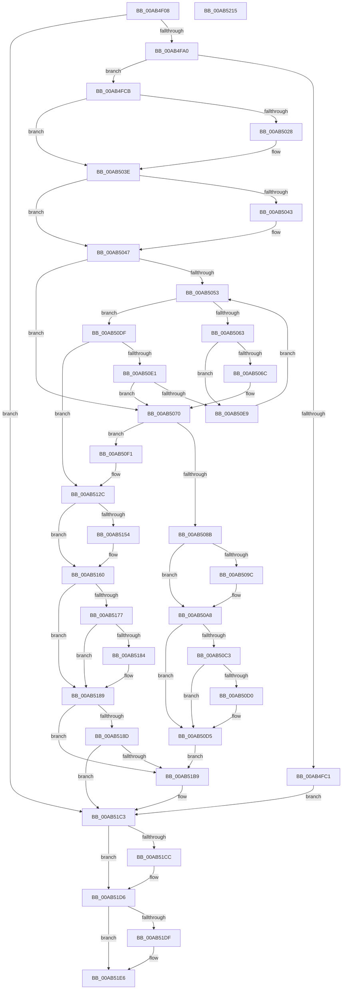

# MiLoadHotPatchForUserSid

- RVA: `0x00AB4F08`–`0x00AB5216` (길이 `782` bytes)
- VA: `0x0000000140AB4F08`
- 실행 섹션: `PAGE`
- PDB 이름 있음: `예`; PDB Function 태그: `아니요`
- unwind 정보 RVA: `0x0008A050`
- 디코드: `208`개 명령, `782/782` bytes 표시
- 미해석 바이트: `0` (있으면 어셈블리에 `.byte`로 보존)

> 이 문서는 커널 이미지의 기계어와 PDB 기호를 분석해 생성했습니다. 4번과 5번은 함수 원형과 자료형을 바이너리 사용 방식에서 추정한 C 해석이며 원본 소스 복구 결과는 아닙니다.

## 1. Dependencies

- 직접 호출 지점: **22**; 고유 호출 대상: **19**
- 직접 호출자로 확인된 함수: **1**
- RIP 상대 이미지 참조: **4**

### Outgoing calls
- `0x00AB4F91` → [MiOpenHotPatchFile](MiOpenHotPatchFile_function_00AB5684.md) (function, `0x00AB5684`)
- `0x00AB4FB4` → [MiAllocateHotPatchRecord](../80/MiAllocateHotPatchRecord_function_008017F0.md) (function, `0x008017F0`)
- `0x00AB4FD7` → [RtlLengthSid](../../text/45/RtlLengthSid_function_0045D270.md) (function, `0x0045D270`)
- `0x00AB4FE9` → [RtlHashBytes2](../../text/43/RtlHashBytes2_function_004397C0.md) (function, `0x004397C0`)
- `0x00AB5014` → [KeAbPreAcquire](../../text/21/KeAbPreAcquire_function_00210230.md) (function, `0x00210230`)
- `0x00AB5039` → [ExfAcquirePushLockExclusiveEx](../../text/20/ExfAcquirePushLockExclusiveEx_function_0020FC90.md) (function, `0x0020FC90`)
- `0x00AB505A` → [MiCompareUserSidHotPatchNodes](../80/MiCompareUserSidHotPatchNodes_function_00803144.md) (function, `0x00803144`)
- `0x00AB507E` → [MiAllocatePool](../../text/35/MiAllocatePool_function_0035B540.md) (function, `0x0035B540`)
- `0x00AB50A3` → [ExfTryToWakePushLock](../../text/26/ExfTryToWakePushLock_function_00265DD0.md) (function, `0x00265DD0`)
- `0x00AB50AF` → [KeAbPostRelease](../../text/2E/KeAbPostRelease_function_002E1600.md) (function, `0x002E1600`)
- `0x00AB50D0` → [KiCheckForKernelApcDelivery](../../text/2E/KiCheckForKernelApcDelivery_function_002E2C80.md) (function, `0x002E2C80`)
- `0x00AB5108` → [RtlCopySid](../9A/RtlCopySid_function_009A9A50.md) (function, `0x009A9A50`)
- `0x00AB511D` → [RtlAvlInsertNodeEx](../../text/26/RtlAvlInsertNodeEx_function_00265790.md) (function, `0x00265790`)
- `0x00AB513C` → [MiInsertHotPatchRecord](../80/MiInsertHotPatchRecord_function_008041D4.md) (function, `0x008041D4`)
- `0x00AB515B` → [ExfTryToWakePushLock](../../text/26/ExfTryToWakePushLock_function_00265DD0.md) (function, `0x00265DD0`)
- `0x00AB5167` → [KeAbPostRelease](../../text/2E/KeAbPostRelease_function_002E1600.md) (function, `0x002E1600`)
- `0x00AB5184` → [KiCheckForKernelApcDelivery](../../text/2E/KiCheckForKernelApcDelivery_function_002E2C80.md) (function, `0x002E2C80`)
- `0x00AB51A5` → [MiHotPatchAllProcesses](../80/MiHotPatchAllProcesses_function_00803AC4.md) (function, `0x00803AC4`)
- `0x00AB51BE` → [ExFreePoolWithTag](../../poolcode/B8/ExFreePoolWithTag_function_00B82870.md) (function, `0x00B82870`)
- `0x00AB51D1` → [ObfDereferenceObjectWithTag](../../text/2F/ObfDereferenceObjectWithTag_function_002F78E0.md) (function, `0x002F78E0`)
- `0x00AB51E1` → [ObCloseHandle](../8A/ObCloseHandle_function_008A1870.md) (function, `0x008A1870`)
- `0x00AB51EF` → [_security_check_cookie](../../text/6A/_security_check_cookie_function_006AC640.md) (function, `0x006AC640`)

### Direct callers
- [NtManageHotPatch](../AF/NtManageHotPatch_function_00AF8660.md) at `0x00AF8AF9`

### Static image references
- `0x00AB4F2B` → RVA `0x00E0A740` (`.data`; read)
- `0x00AB4FF2` → RVA `0x00E37590` (`.data`; read)
- `0x00AB5019` → RVA `0x00E37590` (`.data`; read/write)
- `0x00AB5047` → RVA `0x00E37570` (`.data`; read)

## 2. Other-region calls and transfers

- 다른 실행 섹션으로 향하는 call: **15**
  - `0x00AB4FD7` → [RtlLengthSid](../../text/45/RtlLengthSid_function_0045D270.md) (`PAGE` → `.text`)
  - `0x00AB4FE9` → [RtlHashBytes2](../../text/43/RtlHashBytes2_function_004397C0.md) (`PAGE` → `.text`)
  - `0x00AB5014` → [KeAbPreAcquire](../../text/21/KeAbPreAcquire_function_00210230.md) (`PAGE` → `.text`)
  - `0x00AB5039` → [ExfAcquirePushLockExclusiveEx](../../text/20/ExfAcquirePushLockExclusiveEx_function_0020FC90.md) (`PAGE` → `.text`)
  - `0x00AB507E` → [MiAllocatePool](../../text/35/MiAllocatePool_function_0035B540.md) (`PAGE` → `.text`)
  - `0x00AB50A3` → [ExfTryToWakePushLock](../../text/26/ExfTryToWakePushLock_function_00265DD0.md) (`PAGE` → `.text`)
  - `0x00AB50AF` → [KeAbPostRelease](../../text/2E/KeAbPostRelease_function_002E1600.md) (`PAGE` → `.text`)
  - `0x00AB50D0` → [KiCheckForKernelApcDelivery](../../text/2E/KiCheckForKernelApcDelivery_function_002E2C80.md) (`PAGE` → `.text`)
  - `0x00AB511D` → [RtlAvlInsertNodeEx](../../text/26/RtlAvlInsertNodeEx_function_00265790.md) (`PAGE` → `.text`)
  - `0x00AB515B` → [ExfTryToWakePushLock](../../text/26/ExfTryToWakePushLock_function_00265DD0.md) (`PAGE` → `.text`)
  - `0x00AB5167` → [KeAbPostRelease](../../text/2E/KeAbPostRelease_function_002E1600.md) (`PAGE` → `.text`)
  - `0x00AB5184` → [KiCheckForKernelApcDelivery](../../text/2E/KiCheckForKernelApcDelivery_function_002E2C80.md) (`PAGE` → `.text`)
  - `0x00AB51BE` → [ExFreePoolWithTag](../../poolcode/B8/ExFreePoolWithTag_function_00B82870.md) (`PAGE` → `POOLCODE`)
  - `0x00AB51D1` → [ObfDereferenceObjectWithTag](../../text/2F/ObfDereferenceObjectWithTag_function_002F78E0.md) (`PAGE` → `.text`)
  - `0x00AB51EF` → [_security_check_cookie](../../text/6A/_security_check_cookie_function_006AC640.md) (`PAGE` → `.text`)
- 별도 외부 분기/꼬리 이동을 확인하지 못했습니다.

## 3. Assembly (complete function range)

```asm
00AB4F08  48 8B C4                        mov rax, rsp
00AB4F0B  48 89 58 08                     mov qword ptr [rax + 8], rbx
00AB4F0F  48 89 70 10                     mov qword ptr [rax + 0x10], rsi
00AB4F13  48 89 78 18                     mov qword ptr [rax + 0x18], rdi
00AB4F17  55                              push rbp
00AB4F18  41 54                           push r12
00AB4F1A  41 55                           push r13
00AB4F1C  41 56                           push r14
00AB4F1E  41 57                           push r15
00AB4F20  48 8D 68 A1                     lea rbp, [rax - 0x5f]
00AB4F24  48 81 EC A0 00 00 00            sub rsp, 0xa0
00AB4F2B  48 8B 05 0E 58 35 00            mov rax, qword ptr [rip + 0x35580e]
00AB4F32  48 33 C4                        xor rax, rsp
00AB4F35  48 89 45 2F                     mov qword ptr [rbp + 0x2f], rax
00AB4F39  33 C0                           xor eax, eax
00AB4F3B  4C 89 45 17                     mov qword ptr [rbp + 0x17], r8
00AB4F3F  45 33 E4                        xor r12d, r12d
00AB4F42  48 89 45 07                     mov qword ptr [rbp + 7], rax
00AB4F46  89 45 0F                        mov dword ptr [rbp + 0xf], eax
00AB4F49  4C 8D 4D EF                     lea r9, [rbp - 0x11]
00AB4F4D  48 8D 45 D7                     lea rax, [rbp - 0x29]
00AB4F51  44 89 65 D7                     mov dword ptr [rbp - 0x29], r12d
00AB4F55  48 89 44 24 38                  mov qword ptr [rsp + 0x38], rax
00AB4F5A  4D 8B F8                        mov r15, r8
00AB4F5D  48 8D 45 F7                     lea rax, [rbp - 9]
00AB4F61  4C 89 65 EF                     mov qword ptr [rbp - 0x11], r12
00AB4F65  48 89 44 24 30                  mov qword ptr [rsp + 0x30], rax
00AB4F6A  4C 8B EA                        mov r13, rdx
00AB4F6D  48 8D 45 E7                     lea rax, [rbp - 0x19]
00AB4F71  4C 89 64 24 28                  mov qword ptr [rsp + 0x28], r12
00AB4F76  0F 57 C0                        xorps xmm0, xmm0
00AB4F79  48 89 44 24 20                  mov qword ptr [rsp + 0x20], rax
00AB4F7E  45 33 C0                        xor r8d, r8d
00AB4F81  4C 89 65 E7                     mov qword ptr [rbp - 0x19], r12
00AB4F85  41 8D 54 24 01                  lea edx, [r12 + 1]
00AB4F8A  48 8B D9                        mov rbx, rcx
00AB4F8D  0F 11 45 F7                     movups xmmword ptr [rbp - 9], xmm0
00AB4F91  E8 EE 06 00 00                  call 0x140ab5684
00AB4F96  8B F8                           mov edi, eax
00AB4F98  85 C0                           test eax, eax
00AB4F9A  0F 88 23 02 00 00               js 0x140ab51c3
00AB4FA0  8B 45 D7                        mov eax, dword ptr [rbp - 0x29]
00AB4FA3  4C 8B CB                        mov r9, rbx
00AB4FA6  44 8B 45 0F                     mov r8d, dword ptr [rbp + 0xf]
00AB4FAA  8B 55 FB                        mov edx, dword ptr [rbp - 5]
00AB4FAD  8B 4D F7                        mov ecx, dword ptr [rbp - 9]
00AB4FB0  89 44 24 20                     mov dword ptr [rsp + 0x20], eax
00AB4FB4  E8 37 C8 D4 FF                  call 0x1408017f0
00AB4FB9  4C 8B F0                        mov r14, rax
00AB4FBC  48 85 C0                        test rax, rax
00AB4FBF  75 0A                           jne 0x140ab4fcb
00AB4FC1  BF 9A 00 00 C0                  mov edi, 0xc000009a
00AB4FC6  E9 F8 01 00 00                  jmp 0x140ab51c3
00AB4FCB  65 48 8B 34 25 88 01 00 00      mov rsi, qword ptr gs:[0x188]
00AB4FD4  49 8B CD                        mov rcx, r13
00AB4FD7  E8 94 82 9A FF                  call 0x14045d270
00AB4FDC  8B D8                           mov ebx, eax
00AB4FDE  45 33 C0                        xor r8d, r8d
00AB4FE1  8B D0                           mov edx, eax
00AB4FE3  49 8B CD                        mov rcx, r13
00AB4FE6  89 5D DB                        mov dword ptr [rbp - 0x25], ebx
00AB4FE9  E8 D2 47 98 FF                  call 0x1404397c0
00AB4FEE  48 89 45 1F                     mov qword ptr [rbp + 0x1f], rax
00AB4FF2  48 8D 0D 97 25 38 00            lea rcx, [rip + 0x382597]
00AB4FF9  8D 43 28                        lea eax, [rbx + 0x28]
00AB4FFC  4C 89 6D 27                     mov qword ptr [rbp + 0x27], r13
00AB5000  48 83 CB FF                     or rbx, 0xffffffffffffffff
00AB5004  89 45 DF                        mov dword ptr [rbp - 0x21], eax
00AB5007  66 01 9E E6 01 00 00            add word ptr [rsi + 0x1e6], bx
00AB500E  45 33 C0                        xor r8d, r8d
00AB5011  33 D2                           xor edx, edx
00AB5013  90                              nop
00AB5014  E8 17 B2 75 FF                  call 0x140210230
00AB5019  F0 48 0F BA 2D 6D 25 38 00 00   lock bts qword ptr [rip + 0x38256d], 0
00AB5023  48 8B F8                        mov rdi, rax
00AB5026  73 16                           jae 0x140ab503e
00AB5028  4C 8D 05 61 25 38 00            lea r8, [rip + 0x382561]
00AB502F  48 8B D0                        mov rdx, rax
00AB5032  48 8D 0D 57 25 38 00            lea rcx, [rip + 0x382557]
00AB5039  E8 52 AC 75 FF                  call 0x14020fc90
00AB503E  48 85 FF                        test rdi, rdi
00AB5041  74 04                           je 0x140ab5047
00AB5043  C6 47 0A 01                     mov byte ptr [rdi + 0xa], 1
00AB5047  48 8B 3D 22 25 38 00            mov rdi, qword ptr [rip + 0x382522]
00AB504E  48 85 FF                        test rdi, rdi
00AB5051  74 1D                           je 0x140ab5070
00AB5053  48 8B D7                        mov rdx, rdi
00AB5056  48 8D 4D 1F                     lea rcx, [rbp + 0x1f]
00AB505A  E8 E5 E0 D4 FF                  call 0x140803144
00AB505F  85 C0                           test eax, eax
00AB5061  7E 7C                           jle 0x140ab50df
00AB5063  48 8B 47 08                     mov rax, qword ptr [rdi + 8]
00AB5067  48 85 C0                        test rax, rax
00AB506A  75 7D                           jne 0x140ab50e9
00AB506C  44 8D 60 01                     lea r12d, [rax + 1]
00AB5070  8B 55 DF                        mov edx, dword ptr [rbp - 0x21]
00AB5073  B9 00 01 00 00                  mov ecx, 0x100
00AB5078  41 B8 4D 6D 48 73               mov r8d, 0x73486d4d
00AB507E  E8 BD 64 8A FF                  call 0x14035b540
00AB5083  4C 8B F8                        mov r15, rax
00AB5086  48 85 C0                        test rax, rax
00AB5089  75 66                           jne 0x140ab50f1
00AB508B  F0 48 0F C1 1D FC 24 38 00      lock xadd qword ptr [rip + 0x3824fc], rbx
00AB5094  80 E3 06                        and bl, 6
00AB5097  80 FB 02                        cmp bl, 2
00AB509A  75 0C                           jne 0x140ab50a8
00AB509C  48 8D 0D ED 24 38 00            lea rcx, [rip + 0x3824ed]
00AB50A3  E8 28 0D 7B FF                  call 0x140265dd0
00AB50A8  48 8D 0D E1 24 38 00            lea rcx, [rip + 0x3824e1]
00AB50AF  E8 4C C5 82 FF                  call 0x1402e1600
00AB50B4  B9 01 00 00 00                  mov ecx, 1
00AB50B9  90                              nop
00AB50BA  66 01 8E E6 01 00 00            add word ptr [rsi + 0x1e6], cx
00AB50C1  75 12                           jne 0x140ab50d5
00AB50C3  48 8D 86 98 00 00 00            lea rax, [rsi + 0x98]
00AB50CA  90                              nop
00AB50CB  48 39 00                        cmp qword ptr [rax], rax
00AB50CE  74 05                           je 0x140ab50d5
00AB50D0  E8 AB DB 82 FF                  call 0x1402e2c80
00AB50D5  BF 9A 00 00 C0                  mov edi, 0xc000009a
00AB50DA  E9 DA 00 00 00                  jmp 0x140ab51b9
00AB50DF  79 4B                           jns 0x140ab512c
00AB50E1  48 8B 07                        mov rax, qword ptr [rdi]
00AB50E4  48 85 C0                        test rax, rax
00AB50E7  74 87                           je 0x140ab5070
00AB50E9  48 8B F8                        mov rdi, rax
00AB50EC  E9 62 FF FF FF                  jmp 0x140ab5053
00AB50F1  48 83 60 18 00                  and qword ptr [rax + 0x18], 0
00AB50F6  49 8D 57 28                     lea rdx, [r15 + 0x28]
00AB50FA  48 8B 45 1F                     mov rax, qword ptr [rbp + 0x1f]
00AB50FE  4D 8B C5                        mov r8, r13
00AB5101  8B 4D DB                        mov ecx, dword ptr [rbp - 0x25]
00AB5104  49 89 47 20                     mov qword ptr [r15 + 0x20], rax
00AB5108  E8 43 49 EF FF                  call 0x1409a9a50
00AB510D  4D 8B CF                        mov r9, r15
00AB5110  48 8D 0D 59 24 38 00            lea rcx, [rip + 0x382459]
00AB5117  45 8A C4                        mov r8b, r12b
00AB511A  48 8B D7                        mov rdx, rdi
00AB511D  E8 6E 06 7B FF                  call 0x140265790
00AB5122  49 8B FF                        mov rdi, r15
00AB5125  45 33 E4                        xor r12d, r12d
00AB5128  4C 8B 7D 17                     mov r15, qword ptr [rbp + 0x17]
00AB512C  41 BD 01 00 00 00               mov r13d, 1
00AB5132  48 8D 4F 18                     lea rcx, [rdi + 0x18]
00AB5136  45 8B C5                        mov r8d, r13d
00AB5139  49 8B D6                        mov rdx, r14
00AB513C  E8 93 F0 D4 FF                  call 0x1408041d4
00AB5141  8B F8                           mov edi, eax
00AB5143  F0 48 0F C1 1D 44 24 38 00      lock xadd qword ptr [rip + 0x382444], rbx
00AB514C  80 E3 06                        and bl, 6
00AB514F  80 FB 02                        cmp bl, 2
00AB5152  75 0C                           jne 0x140ab5160
00AB5154  48 8D 0D 35 24 38 00            lea rcx, [rip + 0x382435]
00AB515B  E8 70 0C 7B FF                  call 0x140265dd0
00AB5160  48 8D 0D 29 24 38 00            lea rcx, [rip + 0x382429]
00AB5167  E8 94 C4 82 FF                  call 0x1402e1600
00AB516C  90                              nop
00AB516D  66 44 01 AE E6 01 00 00         add word ptr [rsi + 0x1e6], r13w
00AB5175  75 12                           jne 0x140ab5189
00AB5177  48 8D 86 98 00 00 00            lea rax, [rsi + 0x98]
00AB517E  90                              nop
00AB517F  48 39 00                        cmp qword ptr [rax], rax
00AB5182  74 05                           je 0x140ab5189
00AB5184  E8 F7 DA 82 FF                  call 0x1402e2c80
00AB5189  85 FF                           test edi, edi
00AB518B  78 2C                           js 0x140ab51b9
00AB518D  8B 5D F7                        mov ebx, dword ptr [rbp - 9]
00AB5190  81 FF FF 00 00 00               cmp edi, 0xff
00AB5196  8B 7D FB                        mov edi, dword ptr [rbp - 5]
00AB5199  8B CB                           mov ecx, ebx
00AB519B  44 8B 45 D7                     mov r8d, dword ptr [rbp - 0x29]
00AB519F  8B D7                           mov edx, edi
00AB51A1  4D 0F 45 F4                     cmovne r14, r12
00AB51A5  E8 1A E9 D4 FF                  call 0x140803ac4
00AB51AA  41 89 1F                        mov dword ptr [r15], ebx
00AB51AD  41 89 7F 04                     mov dword ptr [r15 + 4], edi
00AB51B1  41 8B FC                        mov edi, r12d
00AB51B4  4D 85 F6                        test r14, r14
00AB51B7  74 0A                           je 0x140ab51c3
00AB51B9  33 D2                           xor edx, edx
00AB51BB  49 8B CE                        mov rcx, r14
00AB51BE  E8 AD D6 0C 00                  call 0x140b82870
00AB51C3  48 8B 4D E7                     mov rcx, qword ptr [rbp - 0x19]
00AB51C7  48 85 C9                        test rcx, rcx
00AB51CA  74 0A                           je 0x140ab51d6
00AB51CC  BA 4D 6D 48 70                  mov edx, 0x70486d4d
00AB51D1  E8 0A 27 84 FF                  call 0x1402f78e0
00AB51D6  48 8B 4D EF                     mov rcx, qword ptr [rbp - 0x11]
00AB51DA  48 85 C9                        test rcx, rcx
00AB51DD  74 07                           je 0x140ab51e6
00AB51DF  33 D2                           xor edx, edx
00AB51E1  E8 8A C6 DE FF                  call 0x1408a1870
00AB51E6  8B C7                           mov eax, edi
00AB51E8  48 8B 4D 2F                     mov rcx, qword ptr [rbp + 0x2f]
00AB51EC  48 33 CC                        xor rcx, rsp
00AB51EF  E8 4C 74 BF FF                  call 0x1406ac640
00AB51F4  4C 8D 9C 24 A0 00 00 00         lea r11, [rsp + 0xa0]
00AB51FC  49 8B 5B 30                     mov rbx, qword ptr [r11 + 0x30]
00AB5200  49 8B 73 38                     mov rsi, qword ptr [r11 + 0x38]
00AB5204  49 8B 7B 40                     mov rdi, qword ptr [r11 + 0x40]
00AB5208  49 8B E3                        mov rsp, r11
00AB520B  41 5F                           pop r15
00AB520D  41 5E                           pop r14
00AB520F  41 5D                           pop r13
00AB5211  41 5C                           pop r12
00AB5213  5D                              pop rbp
00AB5214  C3                              ret
00AB5215  CC                              int3
```

## 4. C-style interpretation (structured pseudocode)

```c
__int64 __fastcall MiLoadHotPatchForUserSid(__int64 a1, __int64 a2, __int64 a3)
{
    __int64 result;
    __int64 v_r12;
    __int64 v_r14;
    __int64 v_rbx;
    __int64 v_rsp;
    unsigned __int64 v_stack_m28;
    unsigned __int64 v_stack_m90;
    unsigned __int64 v_stack_m98;
    unsigned __int64 v_stack_mA0;
    unsigned __int64 v_stack_mA8;

    *(unsigned __int64 *)(v_rsp + 8) = v_rbx;
    *(unsigned __int64 *)(v_rsp + 16) = v_rsi;
    *(unsigned __int64 *)(v_rsp + 24) = v_rdi;
    v_rsp = (v_rsp) - (160);
    result = (*(unsigned __int64 *)(v_rip + 3495950)) ^ (v_rsp);
    *(unsigned __int64 *)(v_rsp - 95 + 47) = result;
    result = 0;
    *(unsigned __int64 *)(v_rsp - 95 + 23) = a3;
    v_r12 = 0;
    *(unsigned __int64 *)(v_rsp - 95 + 7) = 0;
    *(unsigned int *)(v_rsp - 95 + 15) = 0;
    *(unsigned int *)(v_rsp - 95 - 41) = 0;
    v_stack_m90 = v_rsp - 95 - 41;
    *(unsigned __int64 *)(v_rsp - 95 - 17) = 0;
    v_stack_m98 = v_rsp - 95 - 9;
    v_stack_mA0 = 0;
    v_stack_mA8 = v_rsp - 95 - 25;
    a3 = 0;
    *(unsigned __int64 *)(v_rsp - 95 - 25) = 0;
    *(unsigned __int64 *)(v_rsp - 95 - 9) = v_xmm0;
    result = MiOpenHotPatchFile(a1, v_r12 + 1, a3, v_rsp - 95 - 17);
    if (sign_flag) goto loc_00AB51C3;
    v_stack_mA8 = (unsigned int)((unsigned int)(*(unsigned int *)(v_rsp - 95 - 41)));
    result = MiAllocateHotPatchRecord((unsigned int)(*(unsigned int *)(v_rsp - 95 - 9)), (unsigned int)(*(unsigned int *)(v_rsp - 95 - 5)), (unsigned int)(*(unsigned int *)(v_rsp - 95 + 15)), a1);
    if (result != 0) goto loc_00AB4FCB;
    goto loc_00AB51C3;
loc_00AB4FCB:
    result = RtlLengthSid(a2, (unsigned int)(*(unsigned int *)(v_rsp - 95 - 5)), (unsigned int)(*(unsigned int *)(v_rsp - 95 + 15)), a1);
    a3 = 0;
    *(unsigned int *)(v_rsp - 95 - 37) = (unsigned int)((unsigned int)((unsigned int)(result)));
    result = RtlHashBytes2(a2, (unsigned int)((unsigned int)(result)), a3, a1);
    *(unsigned __int64 *)(v_rsp - 95 + 31) = result;
    *(unsigned __int64 *)(v_rsp - 95 + 39) = a2;
    v_rbx = ((unsigned int)((unsigned int)(result))) | (-1);
    *(unsigned int *)(v_rsp - 95 - 33) = (unsigned int)((unsigned int)((unsigned int)(result)) + 40);
    a3 = 0;
    a2 = 0;
    result = KeAbPreAcquire(v_rip + 3679639, a2, a3, a1);
    if (!(condition_is_above_or_equal)) {
        a3 = v_rip + 3679585;
        a2 = result;
        a1 = v_rip + 3679575;
        result = ExfAcquirePushLockExclusiveEx(a1, a2, a3, a1);
    }
    if (result != 0) {
        *(unsigned __int8 *)(result + 10) = 1;
    }
    if (*(unsigned __int64 *)(v_rip + 3679522) == 0) goto loc_00AB5070;
loc_00AB5053:
    result = MiCompareUserSidHotPatchNodes(v_rsp - 95 + 31, *(unsigned __int64 *)(v_rip + 3679522), a3, a1);
    if (condition_is_less_or_equal) goto loc_00AB50DF;
    if (*(unsigned __int64 *)(*(unsigned __int64 *)(v_rip + 3679522) + 8) != 0) goto loc_00AB50E9;
loc_00AB5070:
    result = MiAllocatePool(256, (unsigned int)(*(unsigned int *)(v_rsp - 95 - 33)), (unsigned int)(0x73486D4DULL), a1);
    if (result != 0) goto loc_00AB50F1;
    v_rbx = (unsigned __int8)((v_rbx) & (6));
    if (((unsigned __int8)(v_rbx)) == 2) {
        a1 = v_rip + 3679469;
        result = ExfTryToWakePushLock(a1, (unsigned int)(*(unsigned int *)(v_rsp - 95 - 33)), (unsigned int)(0x73486D4DULL), a1);
    }
    result = KeAbPostRelease(v_rip + 3679457, (unsigned int)(*(unsigned int *)(v_rsp - 95 - 33)), (unsigned int)(0x73486D4DULL), a1);
    if (((unsigned __int8)(v_rbx)) != 2) goto loc_00AB50D5;
    result = *(unsigned __int64 *)(gs_base + (0 + 392)) + 152;
    if ((*(unsigned __int64 *)(*(unsigned __int64 *)(gs_base + (0 + 392)) + 152)) != (*(unsigned __int64 *)(gs_base + (0 + 392)) + 152)) {
        result = KiCheckForKernelApcDelivery(1, (unsigned int)(*(unsigned int *)(v_rsp - 95 - 33)), (unsigned int)(0x73486D4DULL), a1);
    }
    goto loc_00AB51B9;
loc_00AB50DF:
    if (!sign_flag) goto loc_00AB512C;
    if (*(unsigned __int64 *)((unsigned int)(0xC000009AULL)) == 0) goto loc_00AB5070;
loc_00AB50E9:
    goto loc_00AB5053;
loc_00AB50F1:
    *(unsigned __int64 *)(result + 32) = *(unsigned __int64 *)(v_rsp - 95 + 31);
    result = RtlCopySid((unsigned int)(*(unsigned int *)(v_rsp - 95 - 37)), result + 40, a2, a1);
    result = RtlAvlInsertNodeEx(v_rip + 3679321, *(unsigned __int64 *)((unsigned int)(0xC000009AULL)), (unsigned __int8)(*(unsigned __int64 *)(*(unsigned __int64 *)(v_rip + 3679522) + 8) + 1), result);
    v_r12 = 0;
loc_00AB512C:
    result = MiInsertHotPatchRecord(result + 24, result, 1, result);
    v_rbx = (unsigned __int8)((v_rbx) & (6));
    if (((unsigned __int8)(v_rbx)) == 2) {
        a1 = v_rip + 3679285;
        result = ExfTryToWakePushLock(a1, result, 1, result);
    }
    result = KeAbPostRelease(v_rip + 3679273, result, 1, result);
    if (((unsigned __int8)(v_rbx)) != 2) goto loc_00AB5189;
    result = *(unsigned __int64 *)(gs_base + (0 + 392)) + 152;
    if ((*(unsigned __int64 *)(*(unsigned __int64 *)(gs_base + (0 + 392)) + 152)) != (*(unsigned __int64 *)(gs_base + (0 + 392)) + 152)) {
        result = KiCheckForKernelApcDelivery(v_rip + 3679273, result, 1, result);
    }
    if (sign_flag) goto loc_00AB51B9;
    v_r14 = result;
    if (((unsigned int)((unsigned int)((unsigned int)(result)))) != 255) { v_r14 = 0; }
    result = MiHotPatchAllProcesses((unsigned int)((unsigned int)((unsigned int)(*(unsigned int *)(v_rsp - 95 - 9)))), (unsigned int)((unsigned int)((unsigned int)(*(unsigned int *)(v_rsp - 95 - 5)))), (unsigned int)(*(unsigned int *)(v_rsp - 95 - 41)), result);
    *(unsigned int *)(*(unsigned __int64 *)(v_rsp - 95 + 23)) = (unsigned int)((unsigned int)(*(unsigned int *)(v_rsp - 95 - 9)));
    *(unsigned int *)(*(unsigned __int64 *)(v_rsp - 95 + 23) + 4) = (unsigned int)((unsigned int)(*(unsigned int *)(v_rsp - 95 - 5)));
    if (v_r14 != 0) {
        a2 = 0;
        a1 = v_r14;
        result = ExFreePoolWithTag(a1, a2, (unsigned int)(*(unsigned int *)(v_rsp - 95 - 41)), result);
    }
    if (*(unsigned __int64 *)(v_rsp - 95 - 25) != 0) {
        a2 = 0x70486D4DULL;
        result = ObfDereferenceObjectWithTag(*(unsigned __int64 *)(v_rsp - 95 - 25), a2, (unsigned int)(*(unsigned int *)(v_rsp - 95 - 41)), result);
    }
    if (*(unsigned __int64 *)(v_rsp - 95 - 17) != 0) {
        a2 = 0;
        result = ObCloseHandle(*(unsigned __int64 *)(v_rsp - 95 - 17), a2, (unsigned int)(*(unsigned int *)(v_rsp - 95 - 41)), result);
    }
    a1 = (*(unsigned __int64 *)(v_rsp - 95 + 47)) ^ (v_rsp);
    result = _security_check_cookie(a1, a2, (unsigned int)(*(unsigned int *)(v_rsp - 95 - 41)), result);
    return result;
}
```

## 5. (Beta) C Style

```c
int64_t MiLoadHotPatchForUserSid(int64_t Arg1, int64_t Arg2, int64_t Arg3)
{
    int64_t result;
    int64_t local_r12;
    int64_t local_r14;
    int64_t local_rbx;
    int64_t local_rsp;
    uint64_t v_stack_m28;
    uint64_t v_stack_m90;
    uint64_t v_stack_m98;
    uint64_t v_stack_mA0;
    uint64_t v_stack_mA8;

    *(uint64_t *)(local_rsp + 0x8) = local_rbx;
    *(uint64_t *)(local_rsp + 0x10) = local_rsi;
    *(uint64_t *)(local_rsp + 0x18) = local_rdi;
    local_rsp = (local_rsp) - (160);
    result = (*(uint64_t *)(v_rip + 0x35580E)) ^ (local_rsp);
    *(uint64_t *)(local_rsp - 0x5F + 0x2F) = result;
    result = 0;
    *(uint64_t *)(local_rsp - 0x5F + 0x17) = Arg3;
    local_r12 = 0;
    *(uint64_t *)(local_rsp - 0x5F + 0x7) = 0;
    *(uint32_t *)(local_rsp - 0x5F + 0xF) = 0;
    *(uint32_t *)(local_rsp - 0x5F - 0x29) = 0;
    v_stack_m90 = local_rsp - 95 - 41;
    *(uint64_t *)(local_rsp - 0x5F - 0x11) = 0;
    v_stack_m98 = local_rsp - 95 - 9;
    v_stack_mA0 = 0;
    v_stack_mA8 = local_rsp - 95 - 25;
    Arg3 = 0;
    *(uint64_t *)(local_rsp - 0x5F - 0x19) = 0;
    *(uint64_t *)(local_rsp - 0x5F - 0x9) = v_xmm0;
    result = MiOpenHotPatchFile(Arg1, local_r12 + 1, Arg3, local_rsp - 95 - 17);
    if (sign_flag) goto loc_00AB51C3;
    v_stack_mA8 = (uint32_t)((uint32_t)(*(uint32_t *)(local_rsp - 0x5F - 0x29)));
    result = MiAllocateHotPatchRecord((uint32_t)(*(uint32_t *)(local_rsp - 0x5F - 0x9)), (uint32_t)(*(uint32_t *)(local_rsp - 0x5F - 0x5)), (uint32_t)(*(uint32_t *)(local_rsp - 0x5F + 0xF)), Arg1);
    if (result != 0) goto loc_00AB4FCB;
    goto loc_00AB51C3;
loc_00AB4FCB:
    result = RtlLengthSid(Arg2, (uint32_t)(*(uint32_t *)(local_rsp - 0x5F - 0x5)), (uint32_t)(*(uint32_t *)(local_rsp - 0x5F + 0xF)), Arg1);
    Arg3 = 0;
    *(uint32_t *)(local_rsp - 0x5F - 0x25) = (uint32_t)((uint32_t)((uint32_t)(result)));
    result = RtlHashBytes2(Arg2, (uint32_t)((uint32_t)(result)), Arg3, Arg1);
    *(uint64_t *)(local_rsp - 0x5F + 0x1F) = result;
    *(uint64_t *)(local_rsp - 0x5F + 0x27) = Arg2;
    local_rbx = ((uint32_t)((uint32_t)(result))) | (-1);
    *(uint32_t *)(local_rsp - 0x5F - 0x21) = (uint32_t)((uint32_t)((uint32_t)(result)) + 40);
    Arg3 = 0;
    Arg2 = 0;
    result = KeAbPreAcquire(v_rip + 3679639, Arg2, Arg3, Arg1);
    if (!(condition_is_above_or_equal)) {
        Arg3 = v_rip + 3679585;
        Arg2 = result;
        Arg1 = v_rip + 3679575;
        result = ExfAcquirePushLockExclusiveEx(Arg1, Arg2, Arg3, Arg1);
    }
    if (result != 0) {
        *(uint8_t *)(result + 0xA) = 1;
    }
    if (*(uint64_t *)(v_rip + 0x382522) == 0) goto loc_00AB5070;
loc_00AB5053:
    result = MiCompareUserSidHotPatchNodes(local_rsp - 95 + 31, *(uint64_t *)(v_rip + 0x382522), Arg3, Arg1);
    if (condition_is_less_or_equal) goto loc_00AB50DF;
    if (*(uint64_t *)(*(uint64_t *)(v_rip + 0x382522) + 0x8) != 0) goto loc_00AB50E9;
loc_00AB5070:
    result = MiAllocatePool(256, (uint32_t)(*(uint32_t *)(local_rsp - 0x5F - 0x21)), (uint32_t)(0x73486D4DULL), Arg1);
    if (result != 0) goto loc_00AB50F1;
    local_rbx = (uint8_t)((local_rbx) & (6));
    if (((uint8_t)(local_rbx)) == 2) {
        Arg1 = v_rip + 3679469;
        result = ExfTryToWakePushLock(Arg1, (uint32_t)(*(uint32_t *)(local_rsp - 0x5F - 0x21)), (uint32_t)(0x73486D4DULL), Arg1);
    }
    result = KeAbPostRelease(v_rip + 3679457, (uint32_t)(*(uint32_t *)(local_rsp - 0x5F - 0x21)), (uint32_t)(0x73486D4DULL), Arg1);
    if (((uint8_t)(local_rbx)) != 2) goto loc_00AB50D5;
    result = *(uint64_t *)(gs_base + (0 + 0x188)) + 152;
    if ((*(uint64_t *)(*(uint64_t *)(gs_base + (0 + 0x188)) + 0x98)) != (*(uint64_t *)(gs_base + (0 + 0x188)) + 152)) {
        result = KiCheckForKernelApcDelivery(1, (uint32_t)(*(uint32_t *)(local_rsp - 0x5F - 0x21)), (uint32_t)(0x73486D4DULL), Arg1);
    }
    goto loc_00AB51B9;
loc_00AB50DF:
    if (!sign_flag) goto loc_00AB512C;
    if (*(uint64_t *)((uint32_t)(0xC000009AULL)) == 0) goto loc_00AB5070;
loc_00AB50E9:
    goto loc_00AB5053;
loc_00AB50F1:
    *(uint64_t *)(result + 0x20) = *(uint64_t *)(local_rsp - 0x5F + 0x1F);
    result = RtlCopySid((uint32_t)(*(uint32_t *)(local_rsp - 0x5F - 0x25)), result + 40, Arg2, Arg1);
    result = RtlAvlInsertNodeEx(v_rip + 3679321, *(uint64_t *)((uint32_t)(0xC000009AULL)), (uint8_t)(*(uint64_t *)(*(uint64_t *)(v_rip + 0x382522) + 0x8) + 1), result);
    local_r12 = 0;
loc_00AB512C:
    result = MiInsertHotPatchRecord(result + 24, result, 1, result);
    local_rbx = (uint8_t)((local_rbx) & (6));
    if (((uint8_t)(local_rbx)) == 2) {
        Arg1 = v_rip + 3679285;
        result = ExfTryToWakePushLock(Arg1, result, 1, result);
    }
    result = KeAbPostRelease(v_rip + 3679273, result, 1, result);
    if (((uint8_t)(local_rbx)) != 2) goto loc_00AB5189;
    result = *(uint64_t *)(gs_base + (0 + 0x188)) + 152;
    if ((*(uint64_t *)(*(uint64_t *)(gs_base + (0 + 0x188)) + 0x98)) != (*(uint64_t *)(gs_base + (0 + 0x188)) + 152)) {
        result = KiCheckForKernelApcDelivery(v_rip + 3679273, result, 1, result);
    }
    if (sign_flag) goto loc_00AB51B9;
    local_r14 = result;
    if (((uint32_t)((uint32_t)((uint32_t)(result)))) != 255) { local_r14 = 0; }
    result = MiHotPatchAllProcesses((uint32_t)((uint32_t)((uint32_t)(*(uint32_t *)(local_rsp - 0x5F - 0x9)))), (uint32_t)((uint32_t)((uint32_t)(*(uint32_t *)(local_rsp - 0x5F - 0x5)))), (uint32_t)(*(uint32_t *)(local_rsp - 0x5F - 0x29)), result);
    *(uint32_t *)(*(uint64_t *)(local_rsp - 0x5F + 0x17)) = (uint32_t)((uint32_t)(*(uint32_t *)(local_rsp - 0x5F - 0x9)));
    *(uint32_t *)(*(uint64_t *)(local_rsp - 0x5F + 0x17) + 0x4) = (uint32_t)((uint32_t)(*(uint32_t *)(local_rsp - 0x5F - 0x5)));
    if (local_r14 != 0) {
        Arg2 = 0;
        Arg1 = local_r14;
        result = ExFreePoolWithTag(Arg1, Arg2, (uint32_t)(*(uint32_t *)(local_rsp - 0x5F - 0x29)), result);
    }
    if (*(uint64_t *)(local_rsp - 0x5F - 0x19) != 0) {
        Arg2 = 0x70486D4DULL;
        result = ObfDereferenceObjectWithTag(*(uint64_t *)(local_rsp - 0x5F - 0x19), Arg2, (uint32_t)(*(uint32_t *)(local_rsp - 0x5F - 0x29)), result);
    }
    if (*(uint64_t *)(local_rsp - 0x5F - 0x11) != 0) {
        Arg2 = 0;
        result = ObCloseHandle(*(uint64_t *)(local_rsp - 0x5F - 0x11), Arg2, (uint32_t)(*(uint32_t *)(local_rsp - 0x5F - 0x29)), result);
    }
    Arg1 = (*(uint64_t *)(local_rsp - 0x5F + 0x2F)) ^ (local_rsp);
    result = _security_check_cookie(Arg1, Arg2, (uint32_t)(*(uint32_t *)(local_rsp - 0x5F - 0x29)), result);
    return result;
}
```

## 6. Execution-region graph

[열기: 2D/3D 그래프와 함수 탐색 컨트롤 패널](../../../control-panel.html?section=page&rva=0x00AB4F08&view=graph)

- 2D 그래프는 위에서 아래로 흐르고, 3D 그래프는 빈 공간을 드래그해 회전합니다. Shift+드래그는 이동, 휠은 확대·축소, 함수 노드 선택은 대상 보고서 이동입니다.

### Static fallback


