# MiLoadHotPatch

- RVA: `0x00AB521C`–`0x00AB567B` (길이 `1,119` bytes)
- VA: `0x0000000140AB521C`
- 실행 섹션: `PAGE`
- PDB 이름 있음: `예`; PDB Function 태그: `아니요`
- unwind 정보 RVA: `0x000BCC9C`
- 디코드: `305`개 명령, `1,119/1,119` bytes 표시
- 미해석 바이트: `0` (있으면 어셈블리에 `.byte`로 보존)

> 이 문서는 커널 이미지의 기계어와 PDB 기호를 분석해 생성했습니다. 4번과 5번은 함수 원형과 자료형을 바이너리 사용 방식에서 추정한 C 해석이며 원본 소스 복구 결과는 아닙니다.

## 1. Dependencies

- 직접 호출 지점: **26**; 고유 호출 대상: **20**
- 직접 호출자로 확인된 함수: **3**
- RIP 상대 이미지 참조: **4**

### Outgoing calls
- `0x00AB52D9` → [MiOpenHotPatchFile](MiOpenHotPatchFile_function_00AB5684.md) (function, `0x00AB5684`)
- `0x00AB533F` → [MiAllocateHotPatchRecord](../80/MiAllocateHotPatchRecord_function_008017F0.md) (function, `0x008017F0`)
- `0x00AB5357` → [MmAcquireLoadLock](../../text/4D/MmAcquireLoadLock_function_004DC2A0.md) (function, `0x004DC2A0`)
- `0x00AB536D` → [MiInsertHotPatchRecord](../80/MiInsertHotPatchRecord_function_008041D4.md) (function, `0x008041D4`)
- `0x00AB539C` → [VslRegisterSecurePatch](../../text/58/VslRegisterSecurePatch_function_0058F0BC.md) (function, `0x0058F0BC`)
- `0x00AB53D9` → [VslDetermineHotPatchType](../71/VslDetermineHotPatchType_function_0071899C.md) (function, `0x0071899C`)
- `0x00AB5420` → [ObpReferenceObjectByHandleWithTag](../86/ObpReferenceObjectByHandleWithTag_function_00869650.md) (function, `0x00869650`)
- `0x00AB543D` → [MiSectionControlArea](../../text/29/MiSectionControlArea_function_00294CB0.md) (function, `0x00294CB0`)
- `0x00AB544D` → [MiPromoteControlAreaToStrongCode](../80/MiPromoteControlAreaToStrongCode_function_0080720C.md) (function, `0x0080720C`)
- `0x00AB5473` → [MiAllocateSecureImageActivePatch](../80/MiAllocateSecureImageActivePatch_function_00801890.md) (function, `0x00801890`)
- `0x00AB54A4` → [VslApplyHotPatch](../../text/58/VslApplyHotPatch_function_0058DEC0.md) (function, `0x0058DEC0`)
- `0x00AB54B4` → [MmAcquireLoadLock](../../text/4D/MmAcquireLoadLock_function_004DC2A0.md) (function, `0x004DC2A0`)
- `0x00AB54DB` → [MiLogHotPatchOperationStatus](../80/MiLogHotPatchOperationStatus_function_00804E84.md) (function, `0x00804E84`)
- `0x00AB5517` → [MiInsertSecureImageActivePatch](../80/MiInsertSecureImageActivePatch_function_0080448C.md) (function, `0x0080448C`)
- `0x00AB552D` → [ObfDereferenceObjectWithTag](../../text/2F/ObfDereferenceObjectWithTag_function_002F78E0.md) (function, `0x002F78E0`)
- `0x00AB5556` → [MiApplyHotPatchToDriver](../80/MiApplyHotPatchToDriver_function_00801E64.md) (function, `0x00801E64`)
- `0x00AB5588` → [MmReleaseLoadLock](../../text/4D/MmReleaseLoadLock_function_004D36D0.md) (function, `0x004D36D0`)
- `0x00AB55A7` → [MiHotPatchAllProcesses](../80/MiHotPatchAllProcesses_function_00803AC4.md) (function, `0x00803AC4`)
- `0x00AB55D8` → [MiLogHotPatchOperationStatus](../80/MiLogHotPatchOperationStatus_function_00804E84.md) (function, `0x00804E84`)
- `0x00AB55E9` → [MmReleaseLoadLock](../../text/4D/MmReleaseLoadLock_function_004D36D0.md) (function, `0x004D36D0`)
- `0x00AB55FC` → [ExFreePoolWithTag](../../poolcode/B8/ExFreePoolWithTag_function_00B82870.md) (function, `0x00B82870`)
- `0x00AB560E` → [ObfDereferenceObjectWithTag](../../text/2F/ObfDereferenceObjectWithTag_function_002F78E0.md) (function, `0x002F78E0`)
- `0x00AB5624` → [ObfDereferenceObjectWithTag](../../text/2F/ObfDereferenceObjectWithTag_function_002F78E0.md) (function, `0x002F78E0`)
- `0x00AB5637` → [ObCloseHandle](../8A/ObCloseHandle_function_008A1870.md) (function, `0x008A1870`)
- `0x00AB5646` → [ExFreePoolWithTag](../../poolcode/B8/ExFreePoolWithTag_function_00B82870.md) (function, `0x00B82870`)
- `0x00AB5654` → [_security_check_cookie](../../text/6A/_security_check_cookie_function_006AC640.md) (function, `0x006AC640`)

### Direct callers
- [MiApplyRequiredDriverHotPatches](../70/MiApplyRequiredDriverHotPatches_function_007053D4.md) at `0x0070546C`
- [NtManageHotPatch](../AF/NtManageHotPatch_function_00AF8660.md) at `0x00AF8B1D`
- [MmRegisterHotPatches](../../init/C6/MmRegisterHotPatches_function_00C678DC.md) at `0x00C67AE9`
- [MmRegisterHotPatches](../../init/C6/MmRegisterHotPatches_function_00C678DC.md) at `0x00C67BE3`

### Static image references
- `0x00AB523F` → RVA `0x00E0A740` (`.data`; read)
- `0x00AB5366` → RVA `0x00E37578` (`.data`; read)
- `0x00AB5387` → RVA `0x00FC6A88` (`ALMOSTRO`; read)
- `0x00AB5404` → RVA `0x00FC6AE0` (`ALMOSTRO`; read)

## 2. Other-region calls and transfers

- 다른 실행 섹션으로 향하는 call: **13**
  - `0x00AB5357` → [MmAcquireLoadLock](../../text/4D/MmAcquireLoadLock_function_004DC2A0.md) (`PAGE` → `.text`)
  - `0x00AB539C` → [VslRegisterSecurePatch](../../text/58/VslRegisterSecurePatch_function_0058F0BC.md) (`PAGE` → `.text`)
  - `0x00AB543D` → [MiSectionControlArea](../../text/29/MiSectionControlArea_function_00294CB0.md) (`PAGE` → `.text`)
  - `0x00AB54A4` → [VslApplyHotPatch](../../text/58/VslApplyHotPatch_function_0058DEC0.md) (`PAGE` → `.text`)
  - `0x00AB54B4` → [MmAcquireLoadLock](../../text/4D/MmAcquireLoadLock_function_004DC2A0.md) (`PAGE` → `.text`)
  - `0x00AB552D` → [ObfDereferenceObjectWithTag](../../text/2F/ObfDereferenceObjectWithTag_function_002F78E0.md) (`PAGE` → `.text`)
  - `0x00AB5588` → [MmReleaseLoadLock](../../text/4D/MmReleaseLoadLock_function_004D36D0.md) (`PAGE` → `.text`)
  - `0x00AB55E9` → [MmReleaseLoadLock](../../text/4D/MmReleaseLoadLock_function_004D36D0.md) (`PAGE` → `.text`)
  - `0x00AB55FC` → [ExFreePoolWithTag](../../poolcode/B8/ExFreePoolWithTag_function_00B82870.md) (`PAGE` → `POOLCODE`)
  - `0x00AB560E` → [ObfDereferenceObjectWithTag](../../text/2F/ObfDereferenceObjectWithTag_function_002F78E0.md) (`PAGE` → `.text`)
  - `0x00AB5624` → [ObfDereferenceObjectWithTag](../../text/2F/ObfDereferenceObjectWithTag_function_002F78E0.md) (`PAGE` → `.text`)
  - `0x00AB5646` → [ExFreePoolWithTag](../../poolcode/B8/ExFreePoolWithTag_function_00B82870.md) (`PAGE` → `POOLCODE`)
  - `0x00AB5654` → [_security_check_cookie](../../text/6A/_security_check_cookie_function_006AC640.md) (`PAGE` → `.text`)
- 별도 외부 분기/꼬리 이동을 확인하지 못했습니다.

## 3. Assembly (complete function range)

```asm
00AB521C  48 8B C4                        mov rax, rsp
00AB521F  48 89 58 08                     mov qword ptr [rax + 8], rbx
00AB5223  48 89 70 10                     mov qword ptr [rax + 0x10], rsi
00AB5227  48 89 78 18                     mov qword ptr [rax + 0x18], rdi
00AB522B  55                              push rbp
00AB522C  41 54                           push r12
00AB522E  41 55                           push r13
00AB5230  41 56                           push r14
00AB5232  41 57                           push r15
00AB5234  48 8D 68 A1                     lea rbp, [rax - 0x5f]
00AB5238  48 81 EC F0 00 00 00            sub rsp, 0xf0
00AB523F  48 8B 05 FA 54 35 00            mov rax, qword ptr [rip + 0x3554fa]
00AB5246  48 33 C4                        xor rax, rsp
00AB5249  48 89 45 27                     mov qword ptr [rbp + 0x27], rax
00AB524D  45 33 FF                        xor r15d, r15d
00AB5250  48 89 4D A7                     mov qword ptr [rbp - 0x59], rcx
00AB5254  48 8B C1                        mov rax, rcx
00AB5257  89 55 87                        mov dword ptr [rbp - 0x79], edx
00AB525A  33 C9                           xor ecx, ecx
00AB525C  4C 89 4D 9F                     mov qword ptr [rbp - 0x61], r9
00AB5260  48 89 4D FF                     mov qword ptr [rbp - 1], rcx
00AB5264  4C 8D 4D B7                     lea r9, [rbp - 0x49]
00AB5268  48 89 4D 17                     mov qword ptr [rbp + 0x17], rcx
00AB526C  0F 57 C0                        xorps xmm0, xmm0
00AB526F  89 4D 1F                        mov dword ptr [rbp + 0x1f], ecx
00AB5272  8B DA                           mov ebx, edx
00AB5274  8D 51 01                        lea edx, [rcx + 1]
00AB5277  48 89 4D E7                     mov qword ptr [rbp - 0x19], rcx
00AB527B  89 4D EF                        mov dword ptr [rbp - 0x11], ecx
00AB527E  4D 8B F0                        mov r14, r8
00AB5281  48 8D 4D 97                     lea rcx, [rbp - 0x69]
00AB5285  4C 89 45 BF                     mov qword ptr [rbp - 0x41], r8
00AB5289  48 89 4C 24 38                  mov qword ptr [rsp + 0x38], rcx
00AB528E  45 33 C0                        xor r8d, r8d
00AB5291  48 8D 4D D7                     lea rcx, [rbp - 0x29]
00AB5295  44 89 7D 8B                     mov dword ptr [rbp - 0x75], r15d
00AB5299  48 89 4C 24 30                  mov qword ptr [rsp + 0x30], rcx
00AB529E  45 8B EF                        mov r13d, r15d
00AB52A1  48 8D 4D 8F                     lea rcx, [rbp - 0x71]
00AB52A5  4C 89 7C 24 28                  mov qword ptr [rsp + 0x28], r15
00AB52AA  48 89 4C 24 20                  mov qword ptr [rsp + 0x20], rcx
00AB52AF  48 8B C8                        mov rcx, rax
00AB52B2  4C 89 7D F7                     mov qword ptr [rbp - 9], r15
00AB52B6  0F 11 45 07                     movups xmmword ptr [rbp + 7], xmm0
00AB52BA  44 89 7D 97                     mov dword ptr [rbp - 0x69], r15d
00AB52BE  4C 89 7D AF                     mov qword ptr [rbp - 0x51], r15
00AB52C2  4C 89 7D C7                     mov qword ptr [rbp - 0x39], r15
00AB52C6  4C 89 7D 8F                     mov qword ptr [rbp - 0x71], r15
00AB52CA  4C 89 7D CF                     mov qword ptr [rbp - 0x31], r15
00AB52CE  4C 89 7D B7                     mov qword ptr [rbp - 0x49], r15
00AB52D2  0F 11 45 D7                     movups xmmword ptr [rbp - 0x29], xmm0
00AB52D6  89 55 9B                        mov dword ptr [rbp - 0x65], edx
00AB52D9  E8 A6 03 00 00                  call 0x140ab5684
00AB52DE  44 8B 7D DB                     mov r15d, dword ptr [rbp - 0x25]
00AB52E2  8B F8                           mov edi, eax
00AB52E4  44 8B 65 D7                     mov r12d, dword ptr [rbp - 0x29]
00AB52E8  85 C0                           test eax, eax
00AB52EA  0F 88 C7 02 00 00               js 0x140ab55b7
00AB52F0  F6 C3 08                        test bl, 8
00AB52F3  74 1E                           je 0x140ab5313
00AB52F5  45 39 26                        cmp dword ptr [r14], r12d
00AB52F8  75 0B                           jne 0x140ab5305
00AB52FA  48 8B 45 9F                     mov rax, qword ptr [rbp - 0x61]
00AB52FE  8B 10                           mov edx, dword ptr [rax]
00AB5300  41 3B D7                        cmp edx, r15d
00AB5303  74 1B                           je 0x140ab5320
00AB5305  BF 34 04 00 C0                  mov edi, 0xc0000434
00AB530A  48 8B 75 8F                     mov rsi, qword ptr [rbp - 0x71]
00AB530E  E9 B0 02 00 00                  jmp 0x140ab55c3
00AB5313  48 8B 45 9F                     mov rax, qword ptr [rbp - 0x61]
00AB5317  41 8B D7                        mov edx, r15d
00AB531A  45 89 26                        mov dword ptr [r14], r12d
00AB531D  44 89 38                        mov dword ptr [rax], r15d
00AB5320  8B 7D 87                        mov edi, dword ptr [rbp - 0x79]
00AB5323  8B 5D 97                        mov ebx, dword ptr [rbp - 0x69]
00AB5326  40 F6 C7 01                     test dil, 1
00AB532A  0F 84 84 01 00 00               je 0x140ab54b4
00AB5330  4C 8B 4D A7                     mov r9, qword ptr [rbp - 0x59]
00AB5334  44 8B 45 EF                     mov r8d, dword ptr [rbp - 0x11]
00AB5338  41 8B 0E                        mov ecx, dword ptr [r14]
00AB533B  89 5C 24 20                     mov dword ptr [rsp + 0x20], ebx
00AB533F  E8 AC C4 D4 FF                  call 0x1408017f0
00AB5344  48 89 45 C7                     mov qword ptr [rbp - 0x39], rax
00AB5348  48 8B F0                        mov rsi, rax
00AB534B  48 85 C0                        test rax, rax
00AB534E  75 07                           jne 0x140ab5357
00AB5350  BF 9A 00 00 C0                  mov edi, 0xc000009a
00AB5355  EB B3                           jmp 0x140ab530a
00AB5357  E8 44 6F A2 FF                  call 0x1404dc2a0
00AB535C  45 33 C0                        xor r8d, r8d
00AB535F  48 89 45 AF                     mov qword ptr [rbp - 0x51], rax
00AB5363  48 8B D6                        mov rdx, rsi
00AB5366  48 8D 0D 0B 22 38 00            lea rcx, [rip + 0x38220b]
00AB536D  E8 62 EE D4 FF                  call 0x1408041d4
00AB5372  8B F8                           mov edi, eax
00AB5374  85 C0                           test eax, eax
00AB5376  0F 88 3B 02 00 00               js 0x140ab55b7
00AB537C  3D FF 00 00 00                  cmp eax, 0xff
00AB5381  74 26                           je 0x140ab53a9
00AB5383  4C 21 6D C7                     and qword ptr [rbp - 0x39], r13
00AB5387  48 F7 05 F6 16 51 00 00 40 00 00  test qword ptr [rip + 0x5116f6], 0x4000
00AB5392  74 15                           je 0x140ab53a9
00AB5394  48 8B 55 A7                     mov rdx, qword ptr [rbp - 0x59]
00AB5398  48 8D 4D D7                     lea rcx, [rbp - 0x29]
00AB539C  E8 1B 9D AD FF                  call 0x14058f0bc
00AB53A1  44 8B 7D DB                     mov r15d, dword ptr [rbp - 0x25]
00AB53A5  44 8B 65 D7                     mov r12d, dword ptr [rbp - 0x29]
00AB53A9  8B 7D 87                        mov edi, dword ptr [rbp - 0x79]
00AB53AC  48 F7 05 D1 16 51 00 00 40 00 00  test qword ptr [rip + 0x5116d1], 0x4000
00AB53B7  41 BE 37 00 00 40               mov r14d, 0x40000037
00AB53BD  0F 84 BD 01 00 00               je 0x140ab5580
00AB53C3  40 F6 C7 04                     test dil, 4
00AB53C7  75 1F                           jne 0x140ab53e8
00AB53C9  48 8B 45 9F                     mov rax, qword ptr [rbp - 0x61]
00AB53CD  4C 8D 45 8B                     lea r8, [rbp - 0x75]
00AB53D1  48 8B 4D BF                     mov rcx, qword ptr [rbp - 0x41]
00AB53D5  8B 10                           mov edx, dword ptr [rax]
00AB53D7  8B 09                           mov ecx, dword ptr [rcx]
00AB53D9  E8 BE 35 C6 FF                  call 0x14071899c
00AB53DE  8B F8                           mov edi, eax
00AB53E0  85 C0                           test eax, eax
00AB53E2  0F 88 CF 01 00 00               js 0x140ab55b7
00AB53E8  8B 45 8B                        mov eax, dword ptr [rbp - 0x75]
00AB53EB  48 8B 75 8F                     mov rsi, qword ptr [rbp - 0x71]
00AB53EF  A8 01                           test al, 1
00AB53F1  74 6C                           je 0x140ab545f
00AB53F3  4C 21 6C 24 38                  and qword ptr [rsp + 0x38], r13
00AB53F8  48 8D 45 CF                     lea rax, [rbp - 0x31]
00AB53FC  4C 21 6C 24 30                  and qword ptr [rsp + 0x30], r13
00AB5401  45 33 C9                        xor r9d, r9d
00AB5404  4C 8B 05 D5 16 51 00            mov r8, qword ptr [rip + 0x5116d5]
00AB540B  48 8B 4D B7                     mov rcx, qword ptr [rbp - 0x49]
00AB540F  48 89 44 24 28                  mov qword ptr [rsp + 0x28], rax
00AB5414  41 8D 51 01                     lea edx, [r9 + 1]
00AB5418  C7 44 24 20 4D 6D 48 70         mov dword ptr [rsp + 0x20], 0x70486d4d
00AB5420  E8 2B 42 DB FF                  call 0x140869650
00AB5425  8B F8                           mov edi, eax
00AB5427  85 C0                           test eax, eax
00AB5429  0F 88 8C 01 00 00               js 0x140ab55bb
00AB542F  44 8B 45 8B                     mov r8d, dword ptr [rbp - 0x75]
00AB5433  48 8B CE                        mov rcx, rsi
00AB5436  41 D1 E8                        shr r8d, 1
00AB5439  41 83 E0 01                     and r8d, 1
00AB543D  E8 6E F8 7D FF                  call 0x140294cb0
00AB5442  48 8B 55 CF                     mov rdx, qword ptr [rbp - 0x31]
00AB5446  4C 8D 4D F7                     lea r9, [rbp - 9]
00AB544A  48 8B C8                        mov rcx, rax
00AB544D  E8 BA 1D D5 FF                  call 0x14080720c
00AB5452  8B F8                           mov edi, eax
00AB5454  85 C0                           test eax, eax
00AB5456  0F 88 5F 01 00 00               js 0x140ab55bb
00AB545C  8B 45 8B                        mov eax, dword ptr [rbp - 0x75]
00AB545F  33 FF                           xor edi, edi
00AB5461  89 7D 9B                        mov dword ptr [rbp - 0x65], edi
00AB5464  A8 02                           test al, 2
00AB5466  0F 84 B6 00 00 00               je 0x140ab5522
00AB546C  4C 8B 75 A7                     mov r14, qword ptr [rbp - 0x59]
00AB5470  49 8B CE                        mov rcx, r14
00AB5473  E8 18 C4 D4 FF                  call 0x140801890
00AB5478  4C 8B E8                        mov r13, rax
00AB547B  48 85 C0                        test rax, rax
00AB547E  74 42                           je 0x140ab54c2
00AB5480  48 8B 4D F7                     mov rcx, qword ptr [rbp - 9]
00AB5484  48 8D 45 07                     lea rax, [rbp + 7]
00AB5488  48 89 44 24 38                  mov qword ptr [rsp + 0x38], rax
00AB548D  45 33 C9                        xor r9d, r9d
00AB5490  89 7C 24 30                     mov dword ptr [rsp + 0x30], edi
00AB5494  45 33 C0                        xor r8d, r8d
00AB5497  48 89 7C 24 28                  mov qword ptr [rsp + 0x28], rdi
00AB549C  48 8B D6                        mov rdx, rsi
00AB549F  48 89 7C 24 20                  mov qword ptr [rsp + 0x20], rdi
00AB54A4  E8 17 8A AD FF                  call 0x14058dec0
00AB54A9  8B F8                           mov edi, eax
00AB54AB  8B 45 1F                        mov eax, dword ptr [rbp + 0x1f]
00AB54AE  48 89 45 FF                     mov qword ptr [rbp - 1], rax
00AB54B2  EB 13                           jmp 0x140ab54c7
00AB54B4  E8 E7 6D A2 FF                  call 0x1404dc2a0
00AB54B9  48 89 45 AF                     mov qword ptr [rbp - 0x51], rax
00AB54BD  E9 EA FE FF FF                  jmp 0x140ab53ac
00AB54C2  BF 9A 00 00 C0                  mov edi, 0xc000009a
00AB54C7  44 8B CF                        mov r9d, edi
00AB54CA  C7 44 24 20 02 00 00 00         mov dword ptr [rsp + 0x20], 2
00AB54D2  4D 8B C6                        mov r8, r14
00AB54D5  41 8B D7                        mov edx, r15d
00AB54D8  41 8B CC                        mov ecx, r12d
00AB54DB  E8 A4 F9 D4 FF                  call 0x140804e84
00AB54E0  85 FF                           test edi, edi
00AB54E2  0F 88 F5 00 00 00               js 0x140ab55dd
00AB54E8  81 FF FF 00 00 00               cmp edi, 0xff
00AB54EE  74 2F                           je 0x140ab551f
00AB54F0  8B 45 07                        mov eax, dword ptr [rbp + 7]
00AB54F3  49 8B CD                        mov rcx, r13
00AB54F6  41 89 45 18                     mov dword ptr [r13 + 0x18], eax
00AB54FA  8B 45 0B                        mov eax, dword ptr [rbp + 0xb]
00AB54FD  41 89 45 1C                     mov dword ptr [r13 + 0x1c], eax
00AB5501  8B 45 13                        mov eax, dword ptr [rbp + 0x13]
00AB5504  41 89 45 20                     mov dword ptr [r13 + 0x20], eax
00AB5508  8B 45 17                        mov eax, dword ptr [rbp + 0x17]
00AB550B  41 89 45 24                     mov dword ptr [r13 + 0x24], eax
00AB550F  48 8B 45 FF                     mov rax, qword ptr [rbp - 1]
00AB5513  41 89 45 28                     mov dword ptr [r13 + 0x28], eax
00AB5517  E8 70 EF D4 FF                  call 0x14080448c
00AB551C  45 33 ED                        xor r13d, r13d
00AB551F  44 8B F7                        mov r14d, edi
00AB5522  BA 4D 6D 48 70                  mov edx, 0x70486d4d
00AB5527  48 8B CE                        mov rcx, rsi
00AB552A  41 8B FE                        mov edi, r14d
00AB552D  E8 AE 23 84 FF                  call 0x1402f78e0
00AB5532  33 F6                           xor esi, esi
00AB5534  F6 45 87 02                     test byte ptr [rbp - 0x79], 2
00AB5538  75 4A                           jne 0x140ab5584
00AB553A  48 8B 45 B7                     mov rax, qword ptr [rbp - 0x49]
00AB553E  44 8B CB                        mov r9d, ebx
00AB5541  4C 8B 45 A7                     mov r8, qword ptr [rbp - 0x59]
00AB5545  48 89 44 24 20                  mov qword ptr [rsp + 0x20], rax
00AB554A  48 8B 45 9F                     mov rax, qword ptr [rbp - 0x61]
00AB554E  8B 10                           mov edx, dword ptr [rax]
00AB5550  48 8B 45 BF                     mov rax, qword ptr [rbp - 0x41]
00AB5554  8B 08                           mov ecx, dword ptr [rax]
00AB5556  E8 09 C9 D4 FF                  call 0x140801e64
00AB555B  44 8B F0                        mov r14d, eax
00AB555E  3D 35 01 00 C0                  cmp eax, 0xc0000135
00AB5563  75 08                           jne 0x140ab556d
00AB5565  41 BE 37 00 00 40               mov r14d, 0x40000037
00AB556B  EB 04                           jmp 0x140ab5571
00AB556D  85 C0                           test eax, eax
00AB556F  78 13                           js 0x140ab5584
00AB5571  81 FF 37 00 00 40               cmp edi, 0x40000037
00AB5577  41 0F 44 FE                     cmove edi, r14d
00AB557B  44 8B F7                        mov r14d, edi
00AB557E  EB 04                           jmp 0x140ab5584
00AB5580  48 8B 75 8F                     mov rsi, qword ptr [rbp - 0x71]
00AB5584  48 8B 4D AF                     mov rcx, qword ptr [rbp - 0x51]
00AB5588  E8 43 E1 A1 FF                  call 0x1404d36d0
00AB558D  48 83 65 AF 00                  and qword ptr [rbp - 0x51], 0
00AB5592  F6 45 87 06                     test byte ptr [rbp - 0x79], 6
00AB5596  75 14                           jne 0x140ab55ac
00AB5598  48 8B 45 9F                     mov rax, qword ptr [rbp - 0x61]
00AB559C  44 8B C3                        mov r8d, ebx
00AB559F  8B 10                           mov edx, dword ptr [rax]
00AB55A1  48 8B 45 BF                     mov rax, qword ptr [rbp - 0x41]
00AB55A5  8B 08                           mov ecx, dword ptr [rax]
00AB55A7  E8 18 E5 D4 FF                  call 0x140803ac4
00AB55AC  41 8B FE                        mov edi, r14d
00AB55AF  83 7D 9B 00                     cmp dword ptr [rbp - 0x65], 0
00AB55B3  75 06                           jne 0x140ab55bb
00AB55B5  EB 37                           jmp 0x140ab55ee
00AB55B7  48 8B 75 8F                     mov rsi, qword ptr [rbp - 0x71]
00AB55BB  81 FF 37 00 00 40               cmp edi, 0x40000037
00AB55C1  74 1A                           je 0x140ab55dd
00AB55C3  4C 8B 45 A7                     mov r8, qword ptr [rbp - 0x59]
00AB55C7  44 8B CF                        mov r9d, edi
00AB55CA  41 8B D7                        mov edx, r15d
00AB55CD  C7 44 24 20 01 00 00 00         mov dword ptr [rsp + 0x20], 1
00AB55D5  41 8B CC                        mov ecx, r12d
00AB55D8  E8 A7 F8 D4 FF                  call 0x140804e84
00AB55DD  48 8B 45 AF                     mov rax, qword ptr [rbp - 0x51]
00AB55E1  48 85 C0                        test rax, rax
00AB55E4  74 08                           je 0x140ab55ee
00AB55E6  48 8B C8                        mov rcx, rax
00AB55E9  E8 E2 E0 A1 FF                  call 0x1404d36d0
00AB55EE  48 8B 45 C7                     mov rax, qword ptr [rbp - 0x39]
00AB55F2  48 85 C0                        test rax, rax
00AB55F5  74 0A                           je 0x140ab5601
00AB55F7  33 D2                           xor edx, edx
00AB55F9  48 8B C8                        mov rcx, rax
00AB55FC  E8 6F D2 0C 00                  call 0x140b82870
00AB5601  48 85 F6                        test rsi, rsi
00AB5604  74 0D                           je 0x140ab5613
00AB5606  BA 4D 6D 53 63                  mov edx, 0x63536d4d
00AB560B  48 8B CE                        mov rcx, rsi
00AB560E  E8 CD 22 84 FF                  call 0x1402f78e0
00AB5613  48 8B 45 CF                     mov rax, qword ptr [rbp - 0x31]
00AB5617  48 85 C0                        test rax, rax
00AB561A  74 0D                           je 0x140ab5629
00AB561C  BA 4D 6D 48 70                  mov edx, 0x70486d4d
00AB5621  48 8B C8                        mov rcx, rax
00AB5624  E8 B7 22 84 FF                  call 0x1402f78e0
00AB5629  48 8B 45 B7                     mov rax, qword ptr [rbp - 0x49]
00AB562D  48 85 C0                        test rax, rax
00AB5630  74 0A                           je 0x140ab563c
00AB5632  33 D2                           xor edx, edx
00AB5634  48 8B C8                        mov rcx, rax
00AB5637  E8 34 C2 DE FF                  call 0x1408a1870
00AB563C  4D 85 ED                        test r13, r13
00AB563F  74 0A                           je 0x140ab564b
00AB5641  33 D2                           xor edx, edx
00AB5643  49 8B CD                        mov rcx, r13
00AB5646  E8 25 D2 0C 00                  call 0x140b82870
00AB564B  8B C7                           mov eax, edi
00AB564D  48 8B 4D 27                     mov rcx, qword ptr [rbp + 0x27]
00AB5651  48 33 CC                        xor rcx, rsp
00AB5654  E8 E7 6F BF FF                  call 0x1406ac640
00AB5659  4C 8D 9C 24 F0 00 00 00         lea r11, [rsp + 0xf0]
00AB5661  49 8B 5B 30                     mov rbx, qword ptr [r11 + 0x30]
00AB5665  49 8B 73 38                     mov rsi, qword ptr [r11 + 0x38]
00AB5669  49 8B 7B 40                     mov rdi, qword ptr [r11 + 0x40]
00AB566D  49 8B E3                        mov rsp, r11
00AB5670  41 5F                           pop r15
00AB5672  41 5E                           pop r14
00AB5674  41 5D                           pop r13
00AB5676  41 5C                           pop r12
00AB5678  5D                              pop rbp
00AB5679  C3                              ret
00AB567A  CC                              int3
```

## 4. C-style interpretation (structured pseudocode)

```c
__int64 __fastcall MiLoadHotPatch(__int64 a1, int a2, __int64 a3, __int64 a4)
{
    __int64 result;
    __int64 v_r12;
    __int64 v_r13;
    __int64 v_r15;
    __int64 v_rdi;
    __int64 v_rsi;
    __int64 v_rsp;
    unsigned __int64 v_stack_m28;
    unsigned __int64 v_stack_mE0;
    unsigned __int64 v_stack_mE8;
    unsigned __int64 v_stack_mF0;
    unsigned __int64 v_stack_mF8;

    *(unsigned __int64 *)(v_rsp + 8) = v_rbx;
    *(unsigned __int64 *)(v_rsp + 16) = v_rsi;
    *(unsigned __int64 *)(v_rsp + 24) = v_rdi;
    v_rsp = (v_rsp) - (240);
    result = (*(unsigned __int64 *)(v_rip + 3495162)) ^ (v_rsp);
    *(unsigned __int64 *)(v_rsp - 95 + 39) = result;
    v_r15 = 0;
    *(unsigned __int64 *)(v_rsp - 95 - 89) = a1;
    *(unsigned int *)(v_rsp - 95 - 121) = a2;
    a1 = 0;
    *(unsigned __int64 *)(v_rsp - 95 - 97) = a4;
    *(unsigned __int64 *)(v_rsp - 95 - 1) = 0;
    *(unsigned __int64 *)(v_rsp - 95 + 23) = 0;
    *(unsigned int *)(v_rsp - 95 + 31) = 0;
    *(unsigned __int64 *)(v_rsp - 95 - 25) = 0;
    *(unsigned int *)(v_rsp - 95 - 17) = 0;
    *(unsigned __int64 *)(v_rsp - 95 - 65) = a3;
    v_stack_mE0 = v_rsp - 95 - 105;
    a3 = 0;
    *(unsigned int *)(v_rsp - 95 - 117) = 0;
    v_stack_mE8 = v_rsp - 95 - 41;
    v_stack_mF0 = 0;
    v_stack_mF8 = v_rsp - 95 - 113;
    *(unsigned __int64 *)(v_rsp - 95 - 9) = 0;
    *(unsigned __int64 *)(v_rsp - 95 + 7) = v_xmm0;
    *(unsigned int *)(v_rsp - 95 - 105) = 0;
    *(unsigned __int64 *)(v_rsp - 95 - 81) = 0;
    *(unsigned __int64 *)(v_rsp - 95 - 57) = 0;
    *(unsigned __int64 *)(v_rsp - 95 - 113) = 0;
    *(unsigned __int64 *)(v_rsp - 95 - 49) = 0;
    *(unsigned __int64 *)(v_rsp - 95 - 73) = 0;
    *(unsigned __int64 *)(v_rsp - 95 - 41) = v_xmm0;
    *(unsigned int *)(v_rsp - 95 - 101) = (unsigned int)(a1 + 1);
    result = MiOpenHotPatchFile(0, a1 + 1, a3, v_rsp - 95 - 73);
    if (sign_flag) goto loc_00AB55B7;
    if ((((unsigned __int8)((unsigned int)(a2))) & (8)) == 0) goto loc_00AB5313;
    if ((*(unsigned int *)(a3)) != ((unsigned int)((unsigned int)(*(unsigned int *)(v_rsp - 95 - 41))))) goto loc_00AB5305;
    if (((unsigned int)((unsigned int)(*(unsigned int *)(*(unsigned __int64 *)(v_rsp - 95 - 97))))) == ((unsigned int)((unsigned int)(*(unsigned int *)(v_rsp - 95 - 37))))) goto loc_00AB5320;
loc_00AB5305:
loc_00AB530A:
    goto loc_00AB55C3;
loc_00AB5313:
    *(unsigned int *)(a3) = (unsigned int)((unsigned int)(*(unsigned int *)(v_rsp - 95 - 41)));
    *(unsigned int *)(*(unsigned __int64 *)(v_rsp - 95 - 97)) = (unsigned int)((unsigned int)(*(unsigned int *)(v_rsp - 95 - 37)));
loc_00AB5320:
    if ((((unsigned __int8)((unsigned int)(*(unsigned int *)(v_rsp - 95 - 121)))) & (1)) == 0) goto loc_00AB54B4;
    v_stack_mF8 = (unsigned int)((unsigned int)(*(unsigned int *)(v_rsp - 95 - 105)));
    result = MiAllocateHotPatchRecord((unsigned int)(*(unsigned int *)(a3)), (unsigned int)((unsigned int)((unsigned int)(*(unsigned int *)(v_rsp - 95 - 37)))), (unsigned int)(*(unsigned int *)(v_rsp - 95 - 17)), *(unsigned __int64 *)(v_rsp - 95 - 89));
    *(unsigned __int64 *)(v_rsp - 95 - 57) = result;
    if (result != 0) goto loc_00AB5357;
    goto loc_00AB530A;
loc_00AB5357:
    result = MmAcquireLoadLock((unsigned int)(*(unsigned int *)(a3)), (unsigned int)((unsigned int)((unsigned int)(*(unsigned int *)(v_rsp - 95 - 37)))), (unsigned int)(*(unsigned int *)(v_rsp - 95 - 17)), *(unsigned __int64 *)(v_rsp - 95 - 89));
    a3 = 0;
    *(unsigned __int64 *)(v_rsp - 95 - 81) = result;
    result = MiInsertHotPatchRecord(v_rip + 3678731, result, a3, *(unsigned __int64 *)(v_rsp - 95 - 89));
    if (sign_flag) goto loc_00AB55B7;
    if (((unsigned int)(result)) == 255) goto loc_00AB53A9;
    v_r12 = (unsigned int)(*(unsigned int *)(v_rsp - 95 - 41));
    v_r15 = (unsigned int)(*(unsigned int *)(v_rsp - 95 - 37));
    if (((*(unsigned __int64 *)(v_rip + 5314294)) & (0x4000ULL)) != 0) {
        a2 = *(unsigned __int64 *)(v_rsp - 95 - 89);
        a1 = v_rsp - 95 - 41;
        result = VslRegisterSecurePatch(a1, a2, a3, *(unsigned __int64 *)(v_rsp - 95 - 89));
        v_r15 = *(unsigned int *)(v_rsp - 95 - 37);
        v_r12 = *(unsigned int *)(v_rsp - 95 - 41);
    }
loc_00AB53AC:
    if (((*(unsigned __int64 *)(v_rip + 5314257)) & (0x4000ULL)) == 0) goto loc_00AB5580;
    if ((((unsigned __int8)((unsigned int)(*(unsigned int *)(v_rsp - 95 - 121)))) & (4)) != 0) goto loc_00AB53E8;
    result = VslDetermineHotPatchType((unsigned int)(*(unsigned int *)(*(unsigned __int64 *)(v_rsp - 95 - 65))), (unsigned int)(*(unsigned int *)(*(unsigned __int64 *)(v_rsp - 95 - 97))), v_rsp - 95 - 117, *(unsigned __int64 *)(v_rsp - 95 - 89));
    if (sign_flag) goto loc_00AB55B7;
loc_00AB53E8:
    if ((((unsigned __int8)((unsigned int)(*(unsigned int *)(v_rsp - 95 - 117)))) & (1)) == 0) goto loc_00AB545F;
    a4 = 0;
    v_stack_mF0 = v_rsp - 95 - 49;
    v_stack_mF8 = 0x70486D4DULL;
    result = ObpReferenceObjectByHandleWithTag(*(unsigned __int64 *)(v_rsp - 95 - 73), a4 + 1, *(unsigned __int64 *)(v_rip + 5314261), a4);
    if (sign_flag) goto loc_00AB55BB;
    a3 = (unsigned int)(((unsigned int)(*(unsigned int *)(v_rsp - 95 - 117))) >> (1));
    a3 = (unsigned int)((a3) & (1));
    result = MiSectionControlArea(*(unsigned __int64 *)(v_rsp - 95 - 113), a4 + 1, a3, a4);
    result = MiPromoteControlAreaToStrongCode(result, *(unsigned __int64 *)(v_rsp - 95 - 49), a3, v_rsp - 95 - 9);
    if (sign_flag) goto loc_00AB55BB;
loc_00AB545F:
    v_rdi = 0;
    *(unsigned int *)(v_rsp - 95 - 101) = 0;
    if ((((unsigned __int8)((unsigned int)(*(unsigned int *)(v_rsp - 95 - 117)))) & (2)) == 0) goto loc_00AB5522;
    result = MiAllocateSecureImageActivePatch(*(unsigned __int64 *)(v_rsp - 95 - 89), *(unsigned __int64 *)(v_rsp - 95 - 49), a3, v_rsp - 95 - 9);
    if (result == 0) goto loc_00AB54C2;
    v_stack_mE0 = v_rsp - 95 + 7;
    a4 = 0;
    v_stack_mE8 = 0;
    a3 = 0;
    v_stack_mF0 = 0;
    v_stack_mF8 = 0;
    result = VslApplyHotPatch(*(unsigned __int64 *)(v_rsp - 95 - 9), *(unsigned __int64 *)(v_rsp - 95 - 113), a3, a4);
    *(unsigned __int64 *)(v_rsp - 95 - 1) = (unsigned int)(*(unsigned int *)(v_rsp - 95 + 31));
    goto loc_00AB54C7;
loc_00AB54B4:
    result = MmAcquireLoadLock(*(unsigned __int64 *)(v_rsp - 95 - 9), *(unsigned __int64 *)(v_rsp - 95 - 113), a3, a4);
    *(unsigned __int64 *)(v_rsp - 95 - 81) = result;
    goto loc_00AB53AC;
loc_00AB54C2:
loc_00AB54C7:
    v_stack_mF8 = 2;
    result = MiLogHotPatchOperationStatus((unsigned int)((unsigned int)(v_r12)), (unsigned int)((unsigned int)(v_r15)), *(unsigned __int64 *)(v_rsp - 95 - 89), (unsigned int)((unsigned int)((unsigned int)(0xC000009AULL))));
    if (sign_flag) goto loc_00AB55DD;
    v_r13 = result;
    if (((unsigned int)((unsigned int)(0xC000009AULL))) != 255) {
        result = *(unsigned int *)(v_rsp - 95 + 7);
        a1 = result;
        *(unsigned int *)(result + 24) = (unsigned int)(result);
        result = *(unsigned int *)(v_rsp - 95 + 11);
        *(unsigned int *)(result + 28) = (unsigned int)(result);
        result = *(unsigned int *)(v_rsp - 95 + 19);
        *(unsigned int *)(result + 32) = (unsigned int)(result);
        result = *(unsigned int *)(v_rsp - 95 + 23);
        *(unsigned int *)(result + 36) = (unsigned int)(result);
        result = *(unsigned __int64 *)(v_rsp - 95 - 1);
        *(unsigned int *)(result + 40) = (unsigned int)(result);
        result = MiInsertSecureImageActivePatch(a1, (unsigned int)((unsigned int)(v_r15)), *(unsigned __int64 *)(v_rsp - 95 - 89), (unsigned int)((unsigned int)((unsigned int)(0xC000009AULL))));
        v_r13 = 0;
    }
loc_00AB5522:
    result = ObfDereferenceObjectWithTag(*(unsigned __int64 *)(v_rsp - 95 - 113), (unsigned int)(0x70486D4DULL), *(unsigned __int64 *)(v_rsp - 95 - 89), (unsigned int)((unsigned int)((unsigned int)(0xC000009AULL))));
    v_rsi = 0;
    if (((*(unsigned __int8 *)(v_rsp - 95 - 121)) & (2)) != 0) goto loc_00AB5584;
    v_stack_mF8 = *(unsigned __int64 *)(v_rsp - 95 - 73);
    result = MiApplyHotPatchToDriver((unsigned int)(*(unsigned int *)(*(unsigned __int64 *)(v_rsp - 95 - 65))), (unsigned int)(*(unsigned int *)(*(unsigned __int64 *)(v_rsp - 95 - 97))), *(unsigned __int64 *)(v_rsp - 95 - 89), (unsigned int)((unsigned int)((unsigned int)(*(unsigned int *)(v_rsp - 95 - 105)))));
    if (((unsigned int)(result)) != 0xC0000135ULL) goto loc_00AB556D;
    goto loc_00AB5571;
loc_00AB556D:
    if (sign_flag) goto loc_00AB5584;
loc_00AB5571:
    v_rdi = (unsigned int)((unsigned int)((unsigned int)((unsigned int)((unsigned int)(0xC000009AULL)))));
    if (((unsigned int)((unsigned int)((unsigned int)((unsigned int)((unsigned int)((unsigned int)(0xC000009AULL))))))) == 0x40000037ULL) { v_rdi = (unsigned int)((unsigned int)(0x40000037ULL)); }
    goto loc_00AB5584;
loc_00AB5580:
loc_00AB5584:
    result = MmReleaseLoadLock(*(unsigned __int64 *)(v_rsp - 95 - 81), (unsigned int)(*(unsigned int *)(*(unsigned __int64 *)(v_rsp - 95 - 97))), *(unsigned __int64 *)(v_rsp - 95 - 89), (unsigned int)((unsigned int)((unsigned int)(*(unsigned int *)(v_rsp - 95 - 105)))));
    if (((*(unsigned __int8 *)(v_rsp - 95 - 121)) & (6)) == 0) {
        result = *(unsigned __int64 *)(v_rsp - 95 - 97);
        a3 = (unsigned int)((unsigned int)(*(unsigned int *)(v_rsp - 95 - 105)));
        a2 = *(unsigned int *)(result);
        result = *(unsigned __int64 *)(v_rsp - 95 - 65);
        a1 = *(unsigned int *)(result);
        result = MiHotPatchAllProcesses(a1, a2, a3, (unsigned int)((unsigned int)((unsigned int)(*(unsigned int *)(v_rsp - 95 - 105)))));
    }
    if ((*(unsigned int *)(v_rsp - 95 - 101)) != 0) goto loc_00AB55BB;
    goto loc_00AB55EE;
loc_00AB55B7:
loc_00AB55BB:
    if (((unsigned int)((unsigned int)((unsigned int)((unsigned int)((unsigned int)(v_rdi)))))) != 0x40000037ULL) {
        a3 = *(unsigned __int64 *)(v_rsp - 95 - 89);
        a4 = (unsigned int)((unsigned int)((unsigned int)((unsigned int)((unsigned int)(v_rdi)))));
        a2 = (unsigned int)(v_r15);
        v_stack_mF8 = 1;
        a1 = (unsigned int)(v_r12);
        result = MiLogHotPatchOperationStatus(a1, a2, a3, a4);
    }
    result = *(unsigned __int64 *)(v_rsp - 95 - 81);
    if (*(unsigned __int64 *)(v_rsp - 95 - 81) != 0) {
        a1 = *(unsigned __int64 *)(v_rsp - 95 - 81);
        result = MmReleaseLoadLock(a1, a2, a3, a4);
    }
    result = *(unsigned __int64 *)(v_rsp - 95 - 57);
    if (*(unsigned __int64 *)(v_rsp - 95 - 57) != 0) {
        a2 = 0;
        a1 = *(unsigned __int64 *)(v_rsp - 95 - 57);
        result = ExFreePoolWithTag(a1, a2, a3, a4);
    }
    if (*(unsigned __int64 *)(v_rsp - 95 - 113) != 0) {
        a2 = 0x63536D4DULL;
        a1 = *(unsigned __int64 *)(v_rsp - 95 - 113);
        result = ObfDereferenceObjectWithTag(a1, a2, a3, a4);
    }
    result = *(unsigned __int64 *)(v_rsp - 95 - 49);
    if (*(unsigned __int64 *)(v_rsp - 95 - 49) != 0) {
        a2 = 0x70486D4DULL;
        a1 = *(unsigned __int64 *)(v_rsp - 95 - 49);
        result = ObfDereferenceObjectWithTag(a1, a2, a3, a4);
    }
    result = *(unsigned __int64 *)(v_rsp - 95 - 73);
    if (*(unsigned __int64 *)(v_rsp - 95 - 73) != 0) {
        a2 = 0;
        a1 = *(unsigned __int64 *)(v_rsp - 95 - 73);
        result = ObCloseHandle(a1, a2, a3, a4);
    }
    if (0 != 0) {
        a2 = 0;
        a1 = 0;
        result = ExFreePoolWithTag(a1, a2, a3, a4);
    }
    a1 = (*(unsigned __int64 *)(v_rsp - 95 + 39)) ^ (v_rsp);
    result = _security_check_cookie(a1, a2, a3, a4);
    return result;
}
```

## 5. (Beta) C Style

```c
int64_t MiLoadHotPatch(int64_t Arg1, int32_t Arg2, void *Arg3, int64_t Arg4)
{
    uint8_t *arg3 = (uint8_t *)Arg3;

    int64_t result;
    int64_t local_r12;
    int64_t local_r13;
    int64_t local_r15;
    int64_t local_rdi;
    int64_t local_rsi;
    int64_t local_rsp;
    uint64_t v_stack_m28;
    uint64_t v_stack_mE0;
    uint64_t v_stack_mE8;
    uint64_t v_stack_mF0;
    uint64_t v_stack_mF8;

    *(uint64_t *)(local_rsp + 0x8) = local_rbx;
    *(uint64_t *)(local_rsp + 0x10) = local_rsi;
    *(uint64_t *)(local_rsp + 0x18) = local_rdi;
    local_rsp = (local_rsp) - (240);
    result = (*(uint64_t *)(v_rip + 0x3554FA)) ^ (local_rsp);
    *(uint64_t *)(local_rsp - 0x5F + 0x27) = result;
    local_r15 = 0;
    *(uint64_t *)(local_rsp - 0x5F - 0x59) = Arg1;
    *(uint32_t *)(local_rsp - 0x5F - 0x79) = Arg2;
    Arg1 = 0;
    *(uint64_t *)(local_rsp - 0x5F - 0x61) = Arg4;
    *(uint64_t *)(local_rsp - 0x5F - 0x1) = 0;
    *(uint64_t *)(local_rsp - 0x5F + 0x17) = 0;
    *(uint32_t *)(local_rsp - 0x5F + 0x1F) = 0;
    *(uint64_t *)(local_rsp - 0x5F - 0x19) = 0;
    *(uint32_t *)(local_rsp - 0x5F - 0x11) = 0;
    *(void **)(local_rsp - 0x5F - 0x41) = Arg3;
    v_stack_mE0 = local_rsp - 95 - 105;
    Arg3 = 0;
    *(uint32_t *)(local_rsp - 0x5F - 0x75) = 0;
    v_stack_mE8 = local_rsp - 95 - 41;
    v_stack_mF0 = 0;
    v_stack_mF8 = local_rsp - 95 - 113;
    *(uint64_t *)(local_rsp - 0x5F - 0x9) = 0;
    *(uint64_t *)(local_rsp - 0x5F + 0x7) = v_xmm0;
    *(uint32_t *)(local_rsp - 0x5F - 0x69) = 0;
    *(uint64_t *)(local_rsp - 0x5F - 0x51) = 0;
    *(uint64_t *)(local_rsp - 0x5F - 0x39) = 0;
    *(uint64_t *)(local_rsp - 0x5F - 0x71) = 0;
    *(uint64_t *)(local_rsp - 0x5F - 0x31) = 0;
    *(uint64_t *)(local_rsp - 0x5F - 0x49) = 0;
    *(uint64_t *)(local_rsp - 0x5F - 0x29) = v_xmm0;
    *(uint32_t *)(local_rsp - 0x5F - 0x65) = (uint32_t)(Arg1 + 1);
    result = MiOpenHotPatchFile(0, Arg1 + 1, Arg3, local_rsp - 95 - 73);
    if (sign_flag) goto loc_00AB55B7;
    if ((((uint8_t)((uint32_t)(Arg2))) & (8)) == 0) goto loc_00AB5313;
    if ((*(uint32_t *)(arg3)) != ((uint32_t)((uint32_t)(*(uint32_t *)(local_rsp - 0x5F - 0x29))))) goto loc_00AB5305;
    if (((uint32_t)((uint32_t)(*(uint32_t *)(*(uint64_t *)(local_rsp - 0x5F - 0x61))))) == ((uint32_t)((uint32_t)(*(uint32_t *)(local_rsp - 0x5F - 0x25))))) goto loc_00AB5320;
loc_00AB5305:
loc_00AB530A:
    goto loc_00AB55C3;
loc_00AB5313:
    *(uint32_t *)(arg3) = (uint32_t)((uint32_t)(*(uint32_t *)(local_rsp - 0x5F - 0x29)));
    *(uint32_t *)(*(uint64_t *)(local_rsp - 0x5F - 0x61)) = (uint32_t)((uint32_t)(*(uint32_t *)(local_rsp - 0x5F - 0x25)));
loc_00AB5320:
    if ((((uint8_t)((uint32_t)(*(uint32_t *)(local_rsp - 0x5F - 0x79)))) & (1)) == 0) goto loc_00AB54B4;
    v_stack_mF8 = (uint32_t)((uint32_t)(*(uint32_t *)(local_rsp - 0x5F - 0x69)));
    result = MiAllocateHotPatchRecord((uint32_t)(*(uint32_t *)(arg3)), (uint32_t)((uint32_t)((uint32_t)(*(uint32_t *)(local_rsp - 0x5F - 0x25)))), (uint32_t)(*(uint32_t *)(local_rsp - 0x5F - 0x11)), *(uint64_t *)(local_rsp - 0x5F - 0x59));
    *(uint64_t *)(local_rsp - 0x5F - 0x39) = result;
    if (result != 0) goto loc_00AB5357;
    goto loc_00AB530A;
loc_00AB5357:
    result = MmAcquireLoadLock((uint32_t)(*(uint32_t *)(arg3)), (uint32_t)((uint32_t)((uint32_t)(*(uint32_t *)(local_rsp - 0x5F - 0x25)))), (uint32_t)(*(uint32_t *)(local_rsp - 0x5F - 0x11)), *(uint64_t *)(local_rsp - 0x5F - 0x59));
    Arg3 = 0;
    *(uint64_t *)(local_rsp - 0x5F - 0x51) = result;
    result = MiInsertHotPatchRecord(v_rip + 3678731, result, Arg3, *(uint64_t *)(local_rsp - 0x5F - 0x59));
    if (sign_flag) goto loc_00AB55B7;
    if (((uint32_t)(result)) == 255) goto loc_00AB53A9;
    local_r12 = (uint32_t)(*(uint32_t *)(local_rsp - 0x5F - 0x29));
    local_r15 = (uint32_t)(*(uint32_t *)(local_rsp - 0x5F - 0x25));
    if (((*(uint64_t *)(v_rip + 0x5116F6)) & (0x4000ULL)) != 0) {
        Arg2 = *(uint64_t *)(local_rsp - 0x5F - 0x59);
        Arg1 = local_rsp - 95 - 41;
        result = VslRegisterSecurePatch(Arg1, Arg2, Arg3, *(uint64_t *)(local_rsp - 0x5F - 0x59));
        local_r15 = *(uint32_t *)(local_rsp - 0x5F - 0x25);
        local_r12 = *(uint32_t *)(local_rsp - 0x5F - 0x29);
    }
loc_00AB53AC:
    if (((*(uint64_t *)(v_rip + 0x5116D1)) & (0x4000ULL)) == 0) goto loc_00AB5580;
    if ((((uint8_t)((uint32_t)(*(uint32_t *)(local_rsp - 0x5F - 0x79)))) & (4)) != 0) goto loc_00AB53E8;
    result = VslDetermineHotPatchType((uint32_t)(*(uint32_t *)(*(uint64_t *)(local_rsp - 0x5F - 0x41))), (uint32_t)(*(uint32_t *)(*(uint64_t *)(local_rsp - 0x5F - 0x61))), local_rsp - 95 - 117, *(uint64_t *)(local_rsp - 0x5F - 0x59));
    if (sign_flag) goto loc_00AB55B7;
loc_00AB53E8:
    if ((((uint8_t)((uint32_t)(*(uint32_t *)(local_rsp - 0x5F - 0x75)))) & (1)) == 0) goto loc_00AB545F;
    Arg4 = 0;
    v_stack_mF0 = local_rsp - 95 - 49;
    v_stack_mF8 = 0x70486D4DULL;
    result = ObpReferenceObjectByHandleWithTag(*(uint64_t *)(local_rsp - 0x5F - 0x49), Arg4 + 1, *(uint64_t *)(v_rip + 0x5116D5), Arg4);
    if (sign_flag) goto loc_00AB55BB;
    Arg3 = (uint32_t)(((uint32_t)(*(uint32_t *)(local_rsp - 0x5F - 0x75))) >> (1));
    Arg3 = (uint32_t)((Arg3) & (1));
    result = MiSectionControlArea(*(uint64_t *)(local_rsp - 0x5F - 0x71), Arg4 + 1, Arg3, Arg4);
    result = MiPromoteControlAreaToStrongCode(result, *(uint64_t *)(local_rsp - 0x5F - 0x31), Arg3, local_rsp - 95 - 9);
    if (sign_flag) goto loc_00AB55BB;
loc_00AB545F:
    local_rdi = 0;
    *(uint32_t *)(local_rsp - 0x5F - 0x65) = 0;
    if ((((uint8_t)((uint32_t)(*(uint32_t *)(local_rsp - 0x5F - 0x75)))) & (2)) == 0) goto loc_00AB5522;
    result = MiAllocateSecureImageActivePatch(*(uint64_t *)(local_rsp - 0x5F - 0x59), *(uint64_t *)(local_rsp - 0x5F - 0x31), Arg3, local_rsp - 95 - 9);
    if (result == 0) goto loc_00AB54C2;
    v_stack_mE0 = local_rsp - 95 + 7;
    Arg4 = 0;
    v_stack_mE8 = 0;
    Arg3 = 0;
    v_stack_mF0 = 0;
    v_stack_mF8 = 0;
    result = VslApplyHotPatch(*(uint64_t *)(local_rsp - 0x5F - 0x9), *(uint64_t *)(local_rsp - 0x5F - 0x71), Arg3, Arg4);
    *(uint64_t *)(local_rsp - 0x5F - 0x1) = (uint32_t)(*(uint32_t *)(local_rsp - 0x5F + 0x1F));
    goto loc_00AB54C7;
loc_00AB54B4:
    result = MmAcquireLoadLock(*(uint64_t *)(local_rsp - 0x5F - 0x9), *(uint64_t *)(local_rsp - 0x5F - 0x71), Arg3, Arg4);
    *(uint64_t *)(local_rsp - 0x5F - 0x51) = result;
    goto loc_00AB53AC;
loc_00AB54C2:
loc_00AB54C7:
    v_stack_mF8 = 2;
    result = MiLogHotPatchOperationStatus((uint32_t)((uint32_t)(local_r12)), (uint32_t)((uint32_t)(local_r15)), *(uint64_t *)(local_rsp - 0x5F - 0x59), (uint32_t)((uint32_t)((uint32_t)(0xC000009AULL))));
    if (sign_flag) goto loc_00AB55DD;
    local_r13 = result;
    if (((uint32_t)((uint32_t)(0xC000009AULL))) != 255) {
        result = *(uint32_t *)(local_rsp - 0x5F + 0x7);
        Arg1 = result;
        *(uint32_t *)(result + 0x18) = (uint32_t)(result);
        result = *(uint32_t *)(local_rsp - 0x5F + 0xB);
        *(uint32_t *)(result + 0x1C) = (uint32_t)(result);
        result = *(uint32_t *)(local_rsp - 0x5F + 0x13);
        *(uint32_t *)(result + 0x20) = (uint32_t)(result);
        result = *(uint32_t *)(local_rsp - 0x5F + 0x17);
        *(uint32_t *)(result + 0x24) = (uint32_t)(result);
        result = *(uint64_t *)(local_rsp - 0x5F - 0x1);
        *(uint32_t *)(result + 0x28) = (uint32_t)(result);
        result = MiInsertSecureImageActivePatch(Arg1, (uint32_t)((uint32_t)(local_r15)), *(uint64_t *)(local_rsp - 0x5F - 0x59), (uint32_t)((uint32_t)((uint32_t)(0xC000009AULL))));
        local_r13 = 0;
    }
loc_00AB5522:
    result = ObfDereferenceObjectWithTag(*(uint64_t *)(local_rsp - 0x5F - 0x71), (uint32_t)(0x70486D4DULL), *(uint64_t *)(local_rsp - 0x5F - 0x59), (uint32_t)((uint32_t)((uint32_t)(0xC000009AULL))));
    local_rsi = 0;
    if (((*(uint8_t *)(local_rsp - 0x5F - 0x79)) & (2)) != 0) goto loc_00AB5584;
    v_stack_mF8 = *(uint64_t *)(local_rsp - 0x5F - 0x49);
    result = MiApplyHotPatchToDriver((uint32_t)(*(uint32_t *)(*(uint64_t *)(local_rsp - 0x5F - 0x41))), (uint32_t)(*(uint32_t *)(*(uint64_t *)(local_rsp - 0x5F - 0x61))), *(uint64_t *)(local_rsp - 0x5F - 0x59), (uint32_t)((uint32_t)((uint32_t)(*(uint32_t *)(local_rsp - 0x5F - 0x69)))));
    if (((uint32_t)(result)) != 0xC0000135ULL) goto loc_00AB556D;
    goto loc_00AB5571;
loc_00AB556D:
    if (sign_flag) goto loc_00AB5584;
loc_00AB5571:
    local_rdi = (uint32_t)((uint32_t)((uint32_t)((uint32_t)((uint32_t)(0xC000009AULL)))));
    if (((uint32_t)((uint32_t)((uint32_t)((uint32_t)((uint32_t)((uint32_t)(0xC000009AULL))))))) == 0x40000037ULL) { local_rdi = (uint32_t)((uint32_t)(0x40000037ULL)); }
    goto loc_00AB5584;
loc_00AB5580:
loc_00AB5584:
    result = MmReleaseLoadLock(*(uint64_t *)(local_rsp - 0x5F - 0x51), (uint32_t)(*(uint32_t *)(*(uint64_t *)(local_rsp - 0x5F - 0x61))), *(uint64_t *)(local_rsp - 0x5F - 0x59), (uint32_t)((uint32_t)((uint32_t)(*(uint32_t *)(local_rsp - 0x5F - 0x69)))));
    if (((*(uint8_t *)(local_rsp - 0x5F - 0x79)) & (6)) == 0) {
        result = *(uint64_t *)(local_rsp - 0x5F - 0x61);
        Arg3 = (uint32_t)((uint32_t)(*(uint32_t *)(local_rsp - 0x5F - 0x69)));
        Arg2 = *(uint32_t *)(result);
        result = *(uint64_t *)(local_rsp - 0x5F - 0x41);
        Arg1 = *(uint32_t *)(result);
        result = MiHotPatchAllProcesses(Arg1, Arg2, Arg3, (uint32_t)((uint32_t)((uint32_t)(*(uint32_t *)(local_rsp - 0x5F - 0x69)))));
    }
    if ((*(uint32_t *)(local_rsp - 0x5F - 0x65)) != 0) goto loc_00AB55BB;
    goto loc_00AB55EE;
loc_00AB55B7:
loc_00AB55BB:
    if (((uint32_t)((uint32_t)((uint32_t)((uint32_t)((uint32_t)(local_rdi)))))) != 0x40000037ULL) {
        Arg3 = *(uint64_t *)(local_rsp - 0x5F - 0x59);
        Arg4 = (uint32_t)((uint32_t)((uint32_t)((uint32_t)((uint32_t)(local_rdi)))));
        Arg2 = (uint32_t)(local_r15);
        v_stack_mF8 = 1;
        Arg1 = (uint32_t)(local_r12);
        result = MiLogHotPatchOperationStatus(Arg1, Arg2, Arg3, Arg4);
    }
    result = *(uint64_t *)(local_rsp - 0x5F - 0x51);
    if (*(uint64_t *)(local_rsp - 0x5F - 0x51) != 0) {
        Arg1 = *(uint64_t *)(local_rsp - 0x5F - 0x51);
        result = MmReleaseLoadLock(Arg1, Arg2, Arg3, Arg4);
    }
    result = *(uint64_t *)(local_rsp - 0x5F - 0x39);
    if (*(uint64_t *)(local_rsp - 0x5F - 0x39) != 0) {
        Arg2 = 0;
        Arg1 = *(uint64_t *)(local_rsp - 0x5F - 0x39);
        result = ExFreePoolWithTag(Arg1, Arg2, Arg3, Arg4);
    }
    if (*(uint64_t *)(local_rsp - 0x5F - 0x71) != 0) {
        Arg2 = 0x63536D4DULL;
        Arg1 = *(uint64_t *)(local_rsp - 0x5F - 0x71);
        result = ObfDereferenceObjectWithTag(Arg1, Arg2, Arg3, Arg4);
    }
    result = *(uint64_t *)(local_rsp - 0x5F - 0x31);
    if (*(uint64_t *)(local_rsp - 0x5F - 0x31) != 0) {
        Arg2 = 0x70486D4DULL;
        Arg1 = *(uint64_t *)(local_rsp - 0x5F - 0x31);
        result = ObfDereferenceObjectWithTag(Arg1, Arg2, Arg3, Arg4);
    }
    result = *(uint64_t *)(local_rsp - 0x5F - 0x49);
    if (*(uint64_t *)(local_rsp - 0x5F - 0x49) != 0) {
        Arg2 = 0;
        Arg1 = *(uint64_t *)(local_rsp - 0x5F - 0x49);
        result = ObCloseHandle(Arg1, Arg2, Arg3, Arg4);
    }
    if (0 != 0) {
        Arg2 = 0;
        Arg1 = 0;
        result = ExFreePoolWithTag(Arg1, Arg2, Arg3, Arg4);
    }
    Arg1 = (*(uint64_t *)(local_rsp - 0x5F + 0x27)) ^ (local_rsp);
    result = _security_check_cookie(Arg1, Arg2, Arg3, Arg4);
    return result;
}
```

### 관측된 메모리 오프셋

구조체 형식이 확인되지 않은 접근은 인자 기준의 오프셋으로만 기록했습니다.

| 기준 인자 | 오프셋 표현 | 폭 (bit) | 접근 |
|---|---:|---:|---|
| `Arg3` | `+ 0x0` | `32` | `R` |
| `Arg3` | `+ 0x0` | `32` | `W` |

## 6. Execution-region graph

[열기: 2D/3D 그래프와 함수 탐색 컨트롤 패널](../../../control-panel.html?section=page&rva=0x00AB521C&view=graph)

- 2D 그래프는 위에서 아래로 흐르고, 3D 그래프는 빈 공간을 드래그해 회전합니다. Shift+드래그는 이동, 휠은 확대·축소, 함수 노드 선택은 대상 보고서 이동입니다.

### Static fallback

```mermaid
flowchart TD
  bb_00AB521C[BB_00AB521C]
  bb_00AB52F0[BB_00AB52F0]
  bb_00AB52F5[BB_00AB52F5]
  bb_00AB52FA[BB_00AB52FA]
  bb_00AB5305[BB_00AB5305]
  bb_00AB530A[BB_00AB530A]
  bb_00AB5313[BB_00AB5313]
  bb_00AB5320[BB_00AB5320]
  bb_00AB5330[BB_00AB5330]
  bb_00AB5350[BB_00AB5350]
  bb_00AB5357[BB_00AB5357]
  bb_00AB537C[BB_00AB537C]
  bb_00AB5383[BB_00AB5383]
  bb_00AB5394[BB_00AB5394]
  bb_00AB53A9[BB_00AB53A9]
  bb_00AB53AC[BB_00AB53AC]
  bb_00AB53C3[BB_00AB53C3]
  bb_00AB53C9[BB_00AB53C9]
  bb_00AB53E8[BB_00AB53E8]
  bb_00AB53F3[BB_00AB53F3]
  bb_00AB542F[BB_00AB542F]
  bb_00AB545C[BB_00AB545C]
  bb_00AB545F[BB_00AB545F]
  bb_00AB546C[BB_00AB546C]
  bb_00AB5480[BB_00AB5480]
  bb_00AB54B4[BB_00AB54B4]
  bb_00AB54C2[BB_00AB54C2]
  bb_00AB54C7[BB_00AB54C7]
  bb_00AB54E8[BB_00AB54E8]
  bb_00AB54F0[BB_00AB54F0]
  bb_00AB551F[BB_00AB551F]
  bb_00AB5522[BB_00AB5522]
  bb_00AB553A[BB_00AB553A]
  bb_00AB5565[BB_00AB5565]
  bb_00AB556D[BB_00AB556D]
  bb_00AB5571[BB_00AB5571]
  bb_00AB5580[BB_00AB5580]
  bb_00AB5584[BB_00AB5584]
  bb_00AB5598[BB_00AB5598]
  bb_00AB55AC[BB_00AB55AC]
  bb_00AB55B5[BB_00AB55B5]
  bb_00AB55B7[BB_00AB55B7]
  bb_00AB55BB[BB_00AB55BB]
  bb_00AB55C3[BB_00AB55C3]
  bb_00AB55DD[BB_00AB55DD]
  bb_00AB55E6[BB_00AB55E6]
  bb_00AB55EE[BB_00AB55EE]
  bb_00AB55F7[BB_00AB55F7]
  bb_00AB5601[BB_00AB5601]
  bb_00AB5606[BB_00AB5606]
  bb_00AB5613[BB_00AB5613]
  bb_00AB561C[BB_00AB561C]
  bb_00AB5629[BB_00AB5629]
  bb_00AB5632[BB_00AB5632]
  bb_00AB563C[BB_00AB563C]
  bb_00AB5641[BB_00AB5641]
  bb_00AB564B[BB_00AB564B]
  bb_00AB567A[BB_00AB567A]
  bb_00AB521C -->|branch| bb_00AB55B7
  bb_00AB521C -->|fallthrough| bb_00AB52F0
  bb_00AB52F0 -->|branch| bb_00AB5313
  bb_00AB52F0 -->|fallthrough| bb_00AB52F5
  bb_00AB52F5 -->|branch| bb_00AB5305
  bb_00AB52F5 -->|fallthrough| bb_00AB52FA
  bb_00AB52FA -->|branch| bb_00AB5320
  bb_00AB52FA -->|fallthrough| bb_00AB5305
  bb_00AB5305 -->|flow| bb_00AB530A
  bb_00AB530A -->|branch| bb_00AB55C3
  bb_00AB5313 -->|flow| bb_00AB5320
  bb_00AB5320 -->|branch| bb_00AB54B4
  bb_00AB5320 -->|fallthrough| bb_00AB5330
  bb_00AB5330 -->|branch| bb_00AB5357
  bb_00AB5330 -->|fallthrough| bb_00AB5350
  bb_00AB5350 -->|branch| bb_00AB530A
  bb_00AB5357 -->|branch| bb_00AB55B7
  bb_00AB5357 -->|fallthrough| bb_00AB537C
  bb_00AB537C -->|branch| bb_00AB53A9
  bb_00AB537C -->|fallthrough| bb_00AB5383
  bb_00AB5383 -->|branch| bb_00AB53A9
  bb_00AB5383 -->|fallthrough| bb_00AB5394
  bb_00AB5394 -->|flow| bb_00AB53A9
  bb_00AB53A9 -->|flow| bb_00AB53AC
  bb_00AB53AC -->|branch| bb_00AB5580
  bb_00AB53AC -->|fallthrough| bb_00AB53C3
  bb_00AB53C3 -->|branch| bb_00AB53E8
  bb_00AB53C3 -->|fallthrough| bb_00AB53C9
  bb_00AB53C9 -->|branch| bb_00AB55B7
  bb_00AB53C9 -->|fallthrough| bb_00AB53E8
  bb_00AB53E8 -->|branch| bb_00AB545F
  bb_00AB53E8 -->|fallthrough| bb_00AB53F3
  bb_00AB53F3 -->|branch| bb_00AB55BB
  bb_00AB53F3 -->|fallthrough| bb_00AB542F
  bb_00AB542F -->|branch| bb_00AB55BB
  bb_00AB542F -->|fallthrough| bb_00AB545C
  bb_00AB545C -->|flow| bb_00AB545F
  bb_00AB545F -->|branch| bb_00AB5522
  bb_00AB545F -->|fallthrough| bb_00AB546C
  bb_00AB546C -->|branch| bb_00AB54C2
  bb_00AB546C -->|fallthrough| bb_00AB5480
  bb_00AB5480 -->|branch| bb_00AB54C7
  bb_00AB54B4 -->|branch| bb_00AB53AC
  bb_00AB54C2 -->|flow| bb_00AB54C7
  bb_00AB54C7 -->|branch| bb_00AB55DD
  bb_00AB54C7 -->|fallthrough| bb_00AB54E8
  bb_00AB54E8 -->|branch| bb_00AB551F
  bb_00AB54E8 -->|fallthrough| bb_00AB54F0
  bb_00AB54F0 -->|flow| bb_00AB551F
  bb_00AB551F -->|flow| bb_00AB5522
  bb_00AB5522 -->|branch| bb_00AB5584
  bb_00AB5522 -->|fallthrough| bb_00AB553A
  bb_00AB553A -->|branch| bb_00AB556D
  bb_00AB553A -->|fallthrough| bb_00AB5565
  bb_00AB5565 -->|branch| bb_00AB5571
  bb_00AB556D -->|branch| bb_00AB5584
  bb_00AB556D -->|fallthrough| bb_00AB5571
  bb_00AB5571 -->|branch| bb_00AB5584
  bb_00AB5580 -->|flow| bb_00AB5584
  bb_00AB5584 -->|branch| bb_00AB55AC
  bb_00AB5584 -->|fallthrough| bb_00AB5598
  bb_00AB5598 -->|flow| bb_00AB55AC
  bb_00AB55AC -->|branch| bb_00AB55BB
  bb_00AB55AC -->|fallthrough| bb_00AB55B5
  bb_00AB55B5 -->|branch| bb_00AB55EE
  bb_00AB55B7 -->|flow| bb_00AB55BB
  bb_00AB55BB -->|branch| bb_00AB55DD
  bb_00AB55BB -->|fallthrough| bb_00AB55C3
  bb_00AB55C3 -->|flow| bb_00AB55DD
  bb_00AB55DD -->|branch| bb_00AB55EE
  bb_00AB55DD -->|fallthrough| bb_00AB55E6
  bb_00AB55E6 -->|flow| bb_00AB55EE
  bb_00AB55EE -->|branch| bb_00AB5601
  bb_00AB55EE -->|fallthrough| bb_00AB55F7
  bb_00AB55F7 -->|flow| bb_00AB5601
  bb_00AB5601 -->|branch| bb_00AB5613
  bb_00AB5601 -->|fallthrough| bb_00AB5606
  bb_00AB5606 -->|flow| bb_00AB5613
  bb_00AB5613 -->|branch| bb_00AB5629
  bb_00AB5613 -->|fallthrough| bb_00AB561C
  bb_00AB561C -->|flow| bb_00AB5629
  bb_00AB5629 -->|branch| bb_00AB563C
  bb_00AB5629 -->|fallthrough| bb_00AB5632
  bb_00AB5632 -->|flow| bb_00AB563C
  bb_00AB563C -->|branch| bb_00AB564B
  bb_00AB563C -->|fallthrough| bb_00AB5641
  bb_00AB5641 -->|flow| bb_00AB564B
```


