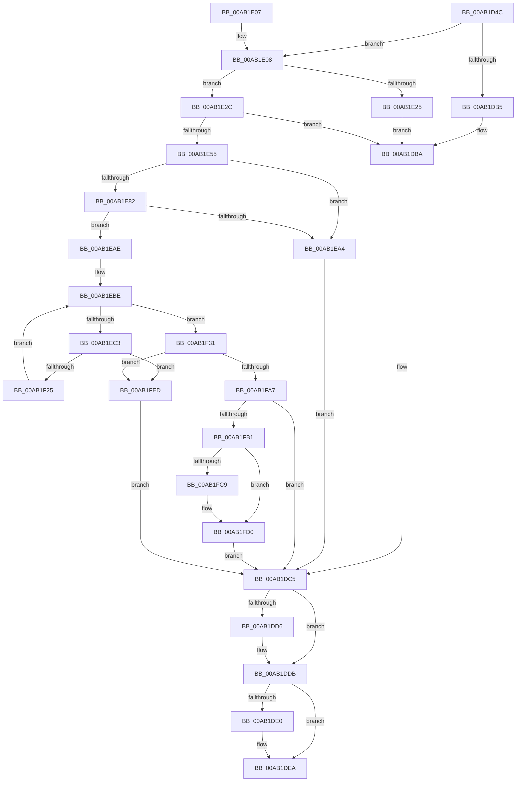

# MiLoadSectionIntoVsmEnclave

- RVA: `0x00AB1D4C`–`0x00AB2004` (길이 `696` bytes)
- VA: `0x0000000140AB1D4C`
- 실행 섹션: `PAGE`
- PDB 이름 있음: `예`; PDB Function 태그: `아니요`
- unwind 정보 RVA: `0x000BC8DC`
- 디코드: `186`개 명령, `696/696` bytes 표시
- 미해석 바이트: `0` (있으면 어셈블리에 `.byte`로 보존)

> 이 문서는 커널 이미지의 기계어와 PDB 기호를 분석해 생성했습니다. 4번과 5번은 함수 원형과 자료형을 바이너리 사용 방식에서 추정한 C 해석이며 원본 소스 복구 결과는 아닙니다.

## 1. Dependencies

- 직접 호출 지점: **14**; 고유 호출 대상: **13**
- 직접 호출자로 확인된 함수: **1**
- RIP 상대 이미지 참조: **1**

### Outgoing calls
- `0x00AB1DA3` → [MiUnlockVad](../../text/2A/MiUnlockVad_function_002A59C8.md) (function, `0x002A59C8`)
- `0x00AB1DC0` → [MiLockVad](../../text/29/MiLockVad_function_00295810.md) (function, `0x00295810`)
- `0x00AB1DC8` → [MiUnlockAndDereferenceVad](../../text/31/MiUnlockAndDereferenceVad_function_00316E60.md) (function, `0x00316E60`)
- `0x00AB1DD6` → [MiUnmapImageForEnclaveUse](MiUnmapImageForEnclaveUse_function_00AB90C4.md) (function, `0x00AB90C4`)
- `0x00AB1DE5` → [ExFreePoolWithTag](../../poolcode/B8/ExFreePoolWithTag_function_00B82870.md) (function, `0x00B82870`)
- `0x00AB1E18` → [MiAllocatePool](../../text/35/MiAllocatePool_function_0035B540.md) (function, `0x0035B540`)
- `0x00AB1E46` → [MiMapImageForEnclaveUse](MiMapImageForEnclaveUse_function_00AB213C.md) (function, `0x00AB213C`)
- `0x00AB1E6F` → [MiLockVad](../../text/29/MiLockVad_function_00295810.md) (function, `0x00295810`)
- `0x00AB1E77` → [MiVadDeleted](../../text/43/MiVadDeleted_function_00431350.md) (function, `0x00431350`)
- `0x00AB1E9A` → [MiCountCommittedPages](../../text/2C/MiCountCommittedPages_function_002C7950.md) (function, `0x002C7950`)
- `0x00AB1F16` → [MiCommitExistingVad](../../text/32/MiCommitExistingVad_function_0032A860.md) (function, `0x0032A860`)
- `0x00AB1F4D` → [MiPrefetchControlArea](../93/MiPrefetchControlArea_function_0093E830.md) (function, `0x0093E830`)
- `0x00AB1F99` → [VslLoadEnclaveModule](VslLoadEnclaveModule_function_00AB200C.md) (function, `0x00AB200C`)
- `0x00AB1FFA` → [MiDecommitRegion](../88/MiDecommitRegion_function_008807A0.md) (function, `0x008807A0`)

### Direct callers
- [NtLoadEnclaveData](../AF/NtLoadEnclaveData_function_00AF8DF0.md) at `0x00AF9176`

### Static image references
- `0x00AB1F3C` → RVA `0x00010880` (`.rdata`; read)

## 2. Other-region calls and transfers

- 다른 실행 섹션으로 향하는 call: **9**
  - `0x00AB1DA3` → [MiUnlockVad](../../text/2A/MiUnlockVad_function_002A59C8.md) (`PAGE` → `.text`)
  - `0x00AB1DC0` → [MiLockVad](../../text/29/MiLockVad_function_00295810.md) (`PAGE` → `.text`)
  - `0x00AB1DC8` → [MiUnlockAndDereferenceVad](../../text/31/MiUnlockAndDereferenceVad_function_00316E60.md) (`PAGE` → `.text`)
  - `0x00AB1DE5` → [ExFreePoolWithTag](../../poolcode/B8/ExFreePoolWithTag_function_00B82870.md) (`PAGE` → `POOLCODE`)
  - `0x00AB1E18` → [MiAllocatePool](../../text/35/MiAllocatePool_function_0035B540.md) (`PAGE` → `.text`)
  - `0x00AB1E6F` → [MiLockVad](../../text/29/MiLockVad_function_00295810.md) (`PAGE` → `.text`)
  - `0x00AB1E77` → [MiVadDeleted](../../text/43/MiVadDeleted_function_00431350.md) (`PAGE` → `.text`)
  - `0x00AB1E9A` → [MiCountCommittedPages](../../text/2C/MiCountCommittedPages_function_002C7950.md) (`PAGE` → `.text`)
  - `0x00AB1F16` → [MiCommitExistingVad](../../text/32/MiCommitExistingVad_function_0032A860.md) (`PAGE` → `.text`)
- 별도 외부 분기/꼬리 이동을 확인하지 못했습니다.

## 3. Assembly (complete function range)

```asm
00AB1D4C  48 89 5C 24 18                  mov qword ptr [rsp + 0x18], rbx
00AB1D51  48 89 4C 24 08                  mov qword ptr [rsp + 8], rcx
00AB1D56  55                              push rbp
00AB1D57  56                              push rsi
00AB1D58  57                              push rdi
00AB1D59  41 54                           push r12
00AB1D5B  41 55                           push r13
00AB1D5D  41 56                           push r14
00AB1D5F  41 57                           push r15
00AB1D61  48 8B EC                        mov rbp, rsp
00AB1D64  48 81 EC 80 00 00 00            sub rsp, 0x80
00AB1D6B  48 8B 45 78                     mov rax, qword ptr [rbp + 0x78]
00AB1D6F  45 33 E4                        xor r12d, r12d
00AB1D72  66 44 89 65 E0                  mov word ptr [rbp - 0x20], r12w
00AB1D77  49 8B F9                        mov rdi, r9
00AB1D7A  44 89 65 E4                     mov dword ptr [rbp - 0x1c], r12d
00AB1D7E  45 8A F8                        mov r15b, r8b
00AB1D81  48 8B F2                        mov rsi, rdx
00AB1D84  4C 89 65 F0                     mov qword ptr [rbp - 0x10], r12
00AB1D88  4C 89 20                        mov qword ptr [rax], r12
00AB1D8B  65 4C 8B 34 25 88 01 00 00      mov r14, qword ptr gs:[0x188]
00AB1D94  48 8B 42 48                     mov rax, qword ptr [rdx + 0x48]
00AB1D98  49 8B CE                        mov rcx, r14
00AB1D9B  44 88 65 48                     mov byte ptr [rbp + 0x48], r12b
00AB1D9F  48 89 45 F8                     mov qword ptr [rbp - 8], rax
00AB1DA3  E8 20 3C 7F FF                  call 0x1402a59c8
00AB1DA8  83 7D 68 10                     cmp dword ptr [rbp + 0x68], 0x10
00AB1DAC  41 8B DC                        mov ebx, r12d
00AB1DAF  4C 89 65 E8                     mov qword ptr [rbp - 0x18], r12
00AB1DB3  73 53                           jae 0x140ab1e08
00AB1DB5  BF 04 00 00 C0                  mov edi, 0xc0000004
00AB1DBA  48 8B D6                        mov rdx, rsi
00AB1DBD  49 8B CE                        mov rcx, r14
00AB1DC0  E8 4B 3A 7E FF                  call 0x140295810
00AB1DC5  48 8B CE                        mov rcx, rsi
00AB1DC8  E8 93 50 86 FF                  call 0x140316e60
00AB1DCD  48 8B 4D E8                     mov rcx, qword ptr [rbp - 0x18]
00AB1DD1  48 85 C9                        test rcx, rcx
00AB1DD4  74 05                           je 0x140ab1ddb
00AB1DD6  E8 E9 72 00 00                  call 0x140ab90c4
00AB1DDB  48 85 DB                        test rbx, rbx
00AB1DDE  74 0A                           je 0x140ab1dea
00AB1DE0  33 D2                           xor edx, edx
00AB1DE2  48 8B CB                        mov rcx, rbx
00AB1DE5  E8 86 0A 0D 00                  call 0x140b82870
00AB1DEA  48 8B 9C 24 D0 00 00 00         mov rbx, qword ptr [rsp + 0xd0]
00AB1DF2  8B C7                           mov eax, edi
00AB1DF4  48 81 C4 80 00 00 00            add rsp, 0x80
00AB1DFB  41 5F                           pop r15
00AB1DFD  41 5E                           pop r14
00AB1DFF  41 5D                           pop r13
00AB1E01  41 5C                           pop r12
00AB1E03  5F                              pop rdi
00AB1E04  5E                              pop rsi
00AB1E05  5D                              pop rbp
00AB1E06  C3                              ret
00AB1E07  CC                              int3
00AB1E08  BA 30 00 00 00                  mov edx, 0x30
00AB1E0D  B9 00 01 00 00                  mov ecx, 0x100
00AB1E12  41 B8 4D 6D 45 4D               mov r8d, 0x4d456d4d
00AB1E18  E8 23 97 8A FF                  call 0x14035b540
00AB1E1D  48 8B D8                        mov rbx, rax
00AB1E20  48 85 C0                        test rax, rax
00AB1E23  75 07                           jne 0x140ab1e2c
00AB1E25  BF 9A 00 00 C0                  mov edi, 0xc000009a
00AB1E2A  EB 8E                           jmp 0x140ab1dba
00AB1E2C  48 8B 4D 70                     mov rcx, qword ptr [rbp + 0x70]
00AB1E30  48 8D 45 F0                     lea rax, [rbp - 0x10]
00AB1E34  4C 8D 4D E8                     lea r9, [rbp - 0x18]
00AB1E38  48 89 44 24 20                  mov qword ptr [rsp + 0x20], rax
00AB1E3D  45 8A C7                        mov r8b, r15b
00AB1E40  48 8B D7                        mov rdx, rdi
00AB1E43  48 8B 09                        mov rcx, qword ptr [rcx]
00AB1E46  E8 F1 02 00 00                  call 0x140ab213c
00AB1E4B  8B F8                           mov edi, eax
00AB1E4D  85 C0                           test eax, eax
00AB1E4F  0F 88 65 FF FF FF               js 0x140ab1dba
00AB1E55  4C 8B 65 F0                     mov r12, qword ptr [rbp - 0x10]
00AB1E59  48 8B D6                        mov rdx, rsi
00AB1E5C  4C 8B 7D 60                     mov r15, qword ptr [rbp + 0x60]
00AB1E60  49 8B CE                        mov rcx, r14
00AB1E63  49 8B 04 24                     mov rax, qword ptr [r12]
00AB1E67  44 8B 68 08                     mov r13d, dword ptr [rax + 8]
00AB1E6B  49 C1 E5 0C                     shl r13, 0xc
00AB1E6F  E8 9C 39 7E FF                  call 0x140295810
00AB1E74  48 8B CE                        mov rcx, rsi
00AB1E77  E8 D4 F4 97 FF                  call 0x140431350
00AB1E7C  33 FF                           xor edi, edi
00AB1E7E  85 C0                           test eax, eax
00AB1E80  75 22                           jne 0x140ab1ea4
00AB1E82  4C 8B 4D 40                     mov r9, qword ptr [rbp + 0x40]
00AB1E86  49 8D 57 FF                     lea rdx, [r15 - 1]
00AB1E8A  49 81 C1 00 04 00 00            add r9, 0x400
00AB1E91  49 03 D5                        add rdx, r13
00AB1E94  4C 8B C6                        mov r8, rsi
00AB1E97  49 8B CF                        mov rcx, r15
00AB1E9A  E8 B1 5A 81 FF                  call 0x1402c7950
00AB1E9F  48 85 C0                        test rax, rax
00AB1EA2  74 0A                           je 0x140ab1eae
00AB1EA4  BF 18 00 00 C0                  mov edi, 0xc0000018
00AB1EA9  E9 17 FF FF FF                  jmp 0x140ab1dc5
00AB1EAE  4D 8D B4 24 80 00 00 00         lea r14, [r12 + 0x80]
00AB1EB6  49 8B 46 08                     mov rax, qword ptr [r14 + 8]
00AB1EBA  48 89 45 F0                     mov qword ptr [rbp - 0x10], rax
00AB1EBE  4D 85 F6                        test r14, r14
00AB1EC1  74 6E                           je 0x140ab1f31
00AB1EC3  49 8B 56 08                     mov rdx, qword ptr [r14 + 8]
00AB1EC7  41 B9 04 00 00 00               mov r9d, 4
00AB1ECD  45 8B 46 2C                     mov r8d, dword ptr [r14 + 0x2c]
00AB1ED1  48 8B CE                        mov rcx, rsi
00AB1ED4  48 C1 E2 09                     shl rdx, 9
00AB1ED8  48 C1 E0 09                     shl rax, 9
00AB1EDC  48 2B D0                        sub rdx, rax
00AB1EDF  49 C1 E0 0C                     shl r8, 0xc
00AB1EE3  48 8D 45 E0                     lea rax, [rbp - 0x20]
00AB1EE7  48 81 E2 00 F0 FF FF            and rdx, 0xfffffffffffff000
00AB1EEE  48 89 44 24 50                  mov qword ptr [rsp + 0x50], rax
00AB1EF3  49 03 D7                        add rdx, r15
00AB1EF6  48 8D 45 E4                     lea rax, [rbp - 0x1c]
00AB1EFA  48 89 44 24 48                  mov qword ptr [rsp + 0x48], rax
00AB1EFF  48 89 7C 24 40                  mov qword ptr [rsp + 0x40], rdi
00AB1F04  40 88 7C 24 38                  mov byte ptr [rsp + 0x38], dil
00AB1F09  89 7C 24 30                     mov dword ptr [rsp + 0x30], edi
00AB1F0D  48 89 7C 24 28                  mov qword ptr [rsp + 0x28], rdi
00AB1F12  89 7C 24 20                     mov dword ptr [rsp + 0x20], edi
00AB1F16  E8 45 89 87 FF                  call 0x14032a860
00AB1F1B  8B F8                           mov edi, eax
00AB1F1D  85 C0                           test eax, eax
00AB1F1F  0F 88 C8 00 00 00               js 0x140ab1fed
00AB1F25  4D 8B 76 10                     mov r14, qword ptr [r14 + 0x10]
00AB1F29  33 FF                           xor edi, edi
00AB1F2B  48 8B 45 F0                     mov rax, qword ptr [rbp - 0x10]
00AB1F2F  EB 8D                           jmp 0x140ab1ebe
00AB1F31  83 4C 24 28 FF                  or dword ptr [rsp + 0x28], 0xffffffff
00AB1F36  41 B9 01 00 00 00               mov r9d, 1
00AB1F3C  48 8B 15 3D E9 55 FF            mov rdx, qword ptr [rip - 0xaa16c3]
00AB1F43  45 33 C0                        xor r8d, r8d
00AB1F46  49 8B CC                        mov rcx, r12
00AB1F49  89 7C 24 20                     mov dword ptr [rsp + 0x20], edi
00AB1F4D  E8 DE C8 E8 FF                  call 0x14093e830
00AB1F52  4D 8B 44 24 60                  mov r8, qword ptr [r12 + 0x60]
00AB1F57  48 8D 43 28                     lea rax, [rbx + 0x28]
00AB1F5B  48 8B 4D F8                     mov rcx, qword ptr [rbp - 8]
00AB1F5F  48 8D 53 24                     lea rdx, [rbx + 0x24]
00AB1F63  4C 8B 4D E8                     mov r9, qword ptr [rbp - 0x18]
00AB1F67  49 83 E0 F8                     and r8, 0xfffffffffffffff8
00AB1F6B  48 89 44 24 40                  mov qword ptr [rsp + 0x40], rax
00AB1F70  48 8D 45 48                     lea rax, [rbp + 0x48]
00AB1F74  48 89 54 24 38                  mov qword ptr [rsp + 0x38], rdx
00AB1F79  49 8B D7                        mov rdx, r15
00AB1F7C  48 8B 49 18                     mov rcx, qword ptr [rcx + 0x18]
00AB1F80  4D 8B 40 40                     mov r8, qword ptr [r8 + 0x40]
00AB1F84  48 89 44 24 30                  mov qword ptr [rsp + 0x30], rax
00AB1F89  8B 45 68                        mov eax, dword ptr [rbp + 0x68]
00AB1F8C  89 44 24 28                     mov dword ptr [rsp + 0x28], eax
00AB1F90  48 8B 45 70                     mov rax, qword ptr [rbp + 0x70]
00AB1F94  48 89 44 24 20                  mov qword ptr [rsp + 0x20], rax
00AB1F99  E8 6E 00 00 00                  call 0x140ab200c
00AB1F9E  45 33 E4                        xor r12d, r12d
00AB1FA1  8B F8                           mov edi, eax
00AB1FA3  85 C0                           test eax, eax
00AB1FA5  78 46                           js 0x140ab1fed
00AB1FA7  44 38 65 48                     cmp byte ptr [rbp + 0x48], r12b
00AB1FAB  0F 84 14 FE FF FF               je 0x140ab1dc5
00AB1FB1  48 8D 46 50                     lea rax, [rsi + 0x50]
00AB1FB5  C7 43 20 02 00 00 00            mov dword ptr [rbx + 0x20], 2
00AB1FBC  4C 89 7B 10                     mov qword ptr [rbx + 0x10], r15
00AB1FC0  48 8B 48 08                     mov rcx, qword ptr [rax + 8]
00AB1FC4  48 39 01                        cmp qword ptr [rcx], rax
00AB1FC7  74 07                           je 0x140ab1fd0
00AB1FC9  41 8D 4C 24 03                  lea ecx, [r12 + 3]
00AB1FCE  CD 29                           int 0x29
00AB1FD0  48 89 03                        mov qword ptr [rbx], rax
00AB1FD3  48 89 4B 08                     mov qword ptr [rbx + 8], rcx
00AB1FD7  48 89 19                        mov qword ptr [rcx], rbx
00AB1FDA  48 89 58 08                     mov qword ptr [rax + 8], rbx
00AB1FDE  48 8B 45 78                     mov rax, qword ptr [rbp + 0x78]
00AB1FE2  48 89 18                        mov qword ptr [rax], rbx
00AB1FE5  49 8B DC                        mov rbx, r12
00AB1FE8  E9 D8 FD FF FF                  jmp 0x140ab1dc5
00AB1FED  4D 8D 47 FF                     lea r8, [r15 - 1]
00AB1FF1  49 8B D7                        mov rdx, r15
00AB1FF4  4D 03 C5                        add r8, r13
00AB1FF7  48 8B CE                        mov rcx, rsi
00AB1FFA  E8 A1 E7 DC FF                  call 0x1408807a0
00AB1FFF  E9 C1 FD FF FF                  jmp 0x140ab1dc5
```

## 4. C-style interpretation (structured pseudocode)

```c
__int64 __fastcall MiLoadSectionIntoVsmEnclave(__int64 a1, __int64 a2, unsigned __int8 a3, __int64 a4, __int64 a5, unsigned int a6, __int64 a7, __int64 a8)
{
    __int64 result;
    __int64 v_r12;
    __int64 v_r13;
    __int64 v_rdi;
    __int64 v_rsp;
    unsigned __int64 v_stack_m40;
    unsigned __int64 v_stack_m48;
    unsigned __int64 v_stack_m50;
    unsigned int v_stack_m54;
    unsigned __int16 v_stack_m58;
    unsigned __int8 v_stack_p10;
    unsigned __int64 v_stack_p18;
    unsigned __int64 v_stack_p20;
    unsigned __int64 v_stack_p28;
    unsigned int v_stack_p30;
    unsigned __int8 v_stack_p38;
    unsigned __int64 v_stack_p40;
    unsigned __int64 v_stack_p48;
    unsigned __int64 v_stack_p50;
    unsigned __int64 v_stack_p8;

    v_stack_p18 = v_rbx;
    v_stack_p8 = a1;
    v_rsp = (v_rsp) - (128);
    v_r12 = 0;
    v_stack_m58 = 0;
    v_stack_m54 = 0;
    v_stack_m48 = 0;
    *(unsigned __int64 *)(a8) = 0;
    v_stack_p10 = 0;
    v_stack_m40 = *(unsigned __int64 *)(a2 + 72);
    result = MiUnlockVad(*(unsigned __int64 *)(gs_base + (0 + 392)), a2, a3, a4);
    v_stack_m50 = 0;
    if (a6 >= 16) goto loc_00AB1E08;
loc_00AB1DBA:
    result = MiLockVad(*(unsigned __int64 *)(gs_base + (0 + 392)), a2, a3, a4);
loc_00AB1DC5:
    result = MiUnlockAndDereferenceVad(a2, a2, a3, a4);
    if (v_stack_m50 != 0) {
        result = MiUnmapImageForEnclaveUse(v_stack_m50, a2, a3, a4);
    }
    if (0 != 0) {
        a2 = 0;
        a1 = 0;
        result = ExFreePoolWithTag(a1, a2, a3, a4);
    }
    v_rsp = (v_rsp) + (128);
    return (unsigned int)((unsigned int)((unsigned int)(0xC0000004ULL)));
loc_00AB1E08:
    result = MiAllocatePool(256, 48, (unsigned int)(0x4D456D4DULL), a4);
    if (result != 0) goto loc_00AB1E2C;
    goto loc_00AB1DBA;
loc_00AB1E2C:
    v_stack_p20 = v_stack_m48;
    result = MiMapImageForEnclaveUse(*(unsigned __int64 *)(a7), (unsigned int)(0xC000009AULL), a3, v_stack_m50);
    if (sign_flag) goto loc_00AB1DBA;
    v_r13 = ((unsigned int)(*(unsigned int *)(*(unsigned __int64 *)(v_stack_m48) + 8))) << (12);
    result = MiLockVad(*(unsigned __int64 *)(gs_base + (0 + 392)), 0, a3, v_stack_m50);
    result = MiVadDeleted(0, 0, a3, v_stack_m50);
    v_rdi = 0;
    if ((unsigned int)(result) != 0) goto loc_00AB1EA4;
    a4 = (v_stack_p8) + (0x400ULL);
    a2 = (a5 - 1) + (v_r13);
    result = MiCountCommittedPages(a5, a2, a2, a4);
    if (result == 0) goto loc_00AB1EAE;
loc_00AB1EA4:
    goto loc_00AB1DC5;
loc_00AB1EAE:
    v_stack_m48 = *(unsigned __int64 *)(v_stack_m48 + 128 + 8);
loc_00AB1EBE:
    if (v_stack_m48 + 128 == 0) goto loc_00AB1F31;
    a2 = (*(unsigned __int64 *)(v_stack_m48 + 128 + 8)) << (9);
    result = (*(unsigned __int64 *)(v_stack_m48 + 128 + 8)) << (9);
    a2 = (a2) - (result);
    a3 = ((unsigned int)(*(unsigned int *)(v_stack_m48 + 128 + 44))) << (12);
    a2 = (a2) & (0xFFFFFFFFFFFFF000ULL);
    v_stack_p50 = v_stack_m58;
    a2 = (a2) + (a5);
    v_stack_p48 = v_stack_m54;
    v_stack_p40 = (unsigned int)(0xC0000018ULL);
    v_stack_p38 = (unsigned __int8)((unsigned int)(0xC0000018ULL));
    v_stack_p30 = (unsigned int)((unsigned int)(0xC0000018ULL));
    v_stack_p28 = (unsigned int)(0xC0000018ULL);
    v_stack_p20 = (unsigned int)((unsigned int)(0xC0000018ULL));
    result = MiCommitExistingVad(a2, a2, a3, 4);
    if (sign_flag) goto loc_00AB1FED;
    v_rdi = 0;
    goto loc_00AB1EBE;
loc_00AB1F31:
    a3 = 0;
    v_stack_p20 = 0;
    result = MiPrefetchControlArea(v_stack_m48, *(unsigned __int64 *)(v_rip - 11146947), a3, 1);
    a3 = (*(unsigned __int64 *)(v_stack_m48 + 96)) & (-8);
    v_stack_p40 = result + 40;
    v_stack_p38 = result + 36;
    v_stack_p30 = v_stack_p10;
    v_stack_p28 = (unsigned int)((unsigned int)(a6));
    v_stack_p20 = a7;
    result = VslLoadEnclaveModule(*(unsigned __int64 *)(v_stack_m40 + 24), a5, *(unsigned __int64 *)(a3 + 64), v_stack_m50);
    v_r12 = 0;
    if (sign_flag) goto loc_00AB1FED;
    if (v_stack_p10 == 0) goto loc_00AB1DC5;
    *(unsigned int *)(result + 32) = 2;
    *(unsigned __int64 *)(result + 16) = a5;
    if ((*(unsigned __int64 *)(*(unsigned __int64 *)(a2 + 80 + 8))) != (a2 + 80)) {
        a1 = v_r12 + 3;
    }
    *(unsigned __int64 *)(result) = a2 + 80;
    *(unsigned __int64 *)(result + 8) = a1;
    *(unsigned __int64 *)(a1) = result;
    *(unsigned __int64 *)(a2 + 80 + 8) = result;
    *(unsigned __int64 *)(a8) = result;
    goto loc_00AB1DC5;
loc_00AB1FED:
    a3 = (a5 - 1) + (v_r13);
    result = MiDecommitRegion(a2, a5, a3, v_stack_m50);
    goto loc_00AB1DC5;
}
```

## 5. (Beta) C Style

```c
int64_t MiLoadSectionIntoVsmEnclave(int64_t Arg1, void *Arg2, uint8_t Arg3, int64_t Arg4, void *Arg5, uint32_t Arg6, void *Arg7, void *Arg8)
{
    uint8_t *arg2 = (uint8_t *)Arg2;
    uint8_t *arg5 = (uint8_t *)Arg5;
    uint8_t *arg7 = (uint8_t *)Arg7;
    uint8_t *arg8 = (uint8_t *)Arg8;

    int64_t result;
    int64_t local_r12;
    int64_t local_r13;
    int64_t local_rdi;
    int64_t local_rsp;
    uint64_t v_stack_m40;
    uint64_t v_stack_m48;
    uint64_t v_stack_m50;
    uint32_t v_stack_m54;
    uint16_t v_stack_m58;
    uint8_t v_stack_p10;
    uint64_t v_stack_p18;
    uint64_t v_stack_p20;
    uint64_t v_stack_p28;
    uint32_t v_stack_p30;
    uint8_t v_stack_p38;
    uint64_t v_stack_p40;
    uint64_t v_stack_p48;
    uint64_t v_stack_p50;
    uint64_t v_stack_p8;

    v_stack_p18 = local_rbx;
    v_stack_p8 = Arg1;
    local_rsp = (local_rsp) - (128);
    local_r12 = 0;
    v_stack_m58 = 0;
    v_stack_m54 = 0;
    v_stack_m48 = 0;
    *(uint64_t *)(arg8) = 0;
    v_stack_p10 = 0;
    v_stack_m40 = *(uint64_t *)(arg2 + 0x48);
    result = MiUnlockVad(*(uint64_t *)(gs_base + (0 + 0x188)), Arg2, Arg3, Arg4);
    v_stack_m50 = 0;
    if (Arg6 >= 16) goto loc_00AB1E08;
loc_00AB1DBA:
    result = MiLockVad(*(uint64_t *)(gs_base + (0 + 0x188)), Arg2, Arg3, Arg4);
loc_00AB1DC5:
    result = MiUnlockAndDereferenceVad(Arg2, Arg2, Arg3, Arg4);
    if (v_stack_m50 != 0) {
        result = MiUnmapImageForEnclaveUse(v_stack_m50, Arg2, Arg3, Arg4);
    }
    if (0 != 0) {
        Arg2 = 0;
        Arg1 = 0;
        result = ExFreePoolWithTag(Arg1, Arg2, Arg3, Arg4);
    }
    local_rsp = (local_rsp) + (128);
    return (uint32_t)((uint32_t)((uint32_t)(0xC0000004ULL)));
loc_00AB1E08:
    result = MiAllocatePool(256, 48, (uint32_t)(0x4D456D4DULL), Arg4);
    if (result != 0) goto loc_00AB1E2C;
    goto loc_00AB1DBA;
loc_00AB1E2C:
    v_stack_p20 = v_stack_m48;
    result = MiMapImageForEnclaveUse(*(uint64_t *)(arg7), (uint32_t)(0xC000009AULL), Arg3, v_stack_m50);
    if (sign_flag) goto loc_00AB1DBA;
    local_r13 = ((uint32_t)(*(uint32_t *)(*(uint64_t *)(v_stack_m48) + 0x8))) << (12);
    result = MiLockVad(*(uint64_t *)(gs_base + (0 + 0x188)), 0, Arg3, v_stack_m50);
    result = MiVadDeleted(0, 0, Arg3, v_stack_m50);
    local_rdi = 0;
    if ((uint32_t)(result) != 0) goto loc_00AB1EA4;
    Arg4 = (v_stack_p8) + (0x400ULL);
    Arg2 = (Arg5 - 1) + (local_r13);
    result = MiCountCommittedPages(Arg5, Arg2, Arg2, Arg4);
    if (result == 0) goto loc_00AB1EAE;
loc_00AB1EA4:
    goto loc_00AB1DC5;
loc_00AB1EAE:
    v_stack_m48 = *(uint64_t *)(v_stack_m48 + 0x80 + 0x8);
loc_00AB1EBE:
    if (v_stack_m48 + 128 == 0) goto loc_00AB1F31;
    Arg2 = (*(uint64_t *)(v_stack_m48 + 0x80 + 0x8)) << (9);
    result = (*(uint64_t *)(v_stack_m48 + 0x80 + 0x8)) << (9);
    Arg2 = (Arg2) - (result);
    Arg3 = ((uint32_t)(*(uint32_t *)(v_stack_m48 + 0x80 + 0x2C))) << (12);
    Arg2 = (Arg2) & (0xFFFFFFFFFFFFF000ULL);
    v_stack_p50 = v_stack_m58;
    Arg2 = (Arg2) + (Arg5);
    v_stack_p48 = v_stack_m54;
    v_stack_p40 = (uint32_t)(0xC0000018ULL);
    v_stack_p38 = (uint8_t)((uint32_t)(0xC0000018ULL));
    v_stack_p30 = (uint32_t)((uint32_t)(0xC0000018ULL));
    v_stack_p28 = (uint32_t)(0xC0000018ULL);
    v_stack_p20 = (uint32_t)((uint32_t)(0xC0000018ULL));
    result = MiCommitExistingVad(Arg2, Arg2, Arg3, 4);
    if (sign_flag) goto loc_00AB1FED;
    local_rdi = 0;
    goto loc_00AB1EBE;
loc_00AB1F31:
    Arg3 = 0;
    v_stack_p20 = 0;
    result = MiPrefetchControlArea(v_stack_m48, *(uint64_t *)(v_rip - 0xAA16C3), Arg3, 1);
    Arg3 = (*(uint64_t *)(v_stack_m48 + 0x60)) & (-8);
    v_stack_p40 = result + 40;
    v_stack_p38 = result + 36;
    v_stack_p30 = v_stack_p10;
    v_stack_p28 = (uint32_t)((uint32_t)(Arg6));
    v_stack_p20 = Arg7;
    result = VslLoadEnclaveModule(*(uint64_t *)(v_stack_m40 + 0x18), Arg5, *(uint64_t *)(Arg3 + 0x40), v_stack_m50);
    local_r12 = 0;
    if (sign_flag) goto loc_00AB1FED;
    if (v_stack_p10 == 0) goto loc_00AB1DC5;
    *(uint32_t *)(result + 0x20) = 2;
    *(void **)(result + 0x10) = Arg5;
    if ((*(uint64_t *)(*(uint64_t *)(arg2 + 0x50 + 0x8))) != (Arg2 + 80)) {
        Arg1 = local_r12 + 3;
    }
    *(void **)(result) = Arg2 + 80;
    *(uint64_t *)(result + 0x8) = Arg1;
    *(uint64_t *)(Arg1) = result;
    *(uint64_t *)(arg2 + 0x50 + 0x8) = result;
    *(uint64_t *)(arg8) = result;
    goto loc_00AB1DC5;
loc_00AB1FED:
    Arg3 = (Arg5 - 1) + (local_r13);
    result = MiDecommitRegion(Arg2, Arg5, Arg3, v_stack_m50);
    goto loc_00AB1DC5;
}
```

### 관측된 메모리 오프셋

구조체 형식이 확인되지 않은 접근은 인자 기준의 오프셋으로만 기록했습니다.

| 기준 인자 | 오프셋 표현 | 폭 (bit) | 접근 |
|---|---:|---:|---|
| `Arg2` | `+ 0x8` | `64` | `R` |
| `Arg2` | `+ 0x8` | `64` | `W` |
| `Arg2` | `+ 0x48` | `64` | `R` |
| `Arg2` | `+ 0x50` | `64` | `R` |
| `Arg5` | `- 0x1` | `64` | `R` |
| `Arg7` | `+ 0x0` | `64` | `R` |
| `Arg8` | `+ 0x0` | `64` | `W` |

## 6. Execution-region graph

[열기: 2D/3D 그래프와 함수 탐색 컨트롤 패널](../../../control-panel.html?section=page&rva=0x00AB1D4C&view=graph)

- 2D 그래프는 위에서 아래로 흐르고, 3D 그래프는 빈 공간을 드래그해 회전합니다. Shift+드래그는 이동, 휠은 확대·축소, 함수 노드 선택은 대상 보고서 이동입니다.

### Static fallback


