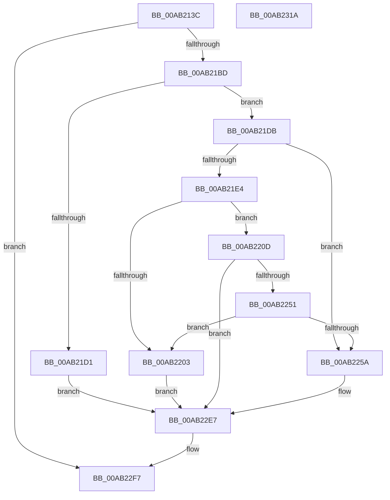

# MiMapImageForEnclaveUse

- RVA: `0x00AB213C`–`0x00AB231B` (길이 `479` bytes)
- VA: `0x0000000140AB213C`
- 실행 섹션: `PAGE`
- PDB 이름 있음: `예`; PDB Function 태그: `아니요`
- unwind 정보 RVA: `0x000BC924`
- 디코드: `113`개 명령, `479/479` bytes 표시
- 미해석 바이트: `0` (있으면 어셈블리에 `.byte`로 보존)

> 이 문서는 커널 이미지의 기계어와 PDB 기호를 분석해 생성했습니다. 4번과 5번은 함수 원형과 자료형을 바이너리 사용 방식에서 추정한 C 해석이며 원본 소스 복구 결과는 아닙니다.

## 1. Dependencies

- 직접 호출 지점: **10**; 고유 호출 대상: **10**
- 직접 호출자로 확인된 함수: **2**
- RIP 상대 이미지 참조: **3**

### Outgoing calls
- `0x00AB21B0` → [ObpReferenceObjectByHandleWithTag](../86/ObpReferenceObjectByHandleWithTag_function_00869650.md) (function, `0x00869650`)
- `0x00AB21C1` → [MiSectionControlArea](../../text/29/MiSectionControlArea_function_00294CB0.md) (function, `0x00294CB0`)
- `0x00AB2210` → [MiReferenceControlAreaFile](../../text/43/MiReferenceControlAreaFile_function_00431554.md) (function, `0x00431554`)
- `0x00AB2237` → [MiValidateSectionCreate](../94/MiValidateSectionCreate_function_00940190.md) (function, `0x00940190`)
- `0x00AB2244` → [MiDereferenceControlAreaFile](../../text/43/MiDereferenceControlAreaFile_function_004345E0.md) (function, `0x004345E0`)
- `0x00AB2267` → [KiStackAttachProcess](../../text/21/KiStackAttachProcess_function_00216820.md) (function, `0x00216820`)
- `0x00AB22D2` → [MmMapViewOfSectionEx](../../text/48/MmMapViewOfSectionEx_function_0048E244.md) (function, `0x0048E244`)
- `0x00AB22DF` → [KiUnstackDetachProcess](../../text/21/KiUnstackDetachProcess_function_00217D30.md) (function, `0x00217D30`)
- `0x00AB22F0` → [ObfDereferenceObjectWithTag](../../text/2F/ObfDereferenceObjectWithTag_function_002F78E0.md) (function, `0x002F78E0`)
- `0x00AB22FE` → [_security_check_cookie](../../text/6A/_security_check_cookie_function_006AC640.md) (function, `0x006AC640`)

### Direct callers
- [MiInitializeVsmEnclave](../80/MiInitializeVsmEnclave_function_00808AE0.md) at `0x00808B8E`
- [MiLoadSectionIntoVsmEnclave](MiLoadSectionIntoVsmEnclave_function_00AB1D4C.md) at `0x00AB1E46`

### Static image references
- `0x00AB2154` → RVA `0x00E0A740` (`.data`; read)
- `0x00AB2184` → RVA `0x00FC6BD8` (`ALMOSTRO`; read)
- `0x00AB225A` → RVA `0x00FC6CB8` (`ALMOSTRO`; read)

## 2. Other-region calls and transfers

- 다른 실행 섹션으로 향하는 call: **8**
  - `0x00AB21C1` → [MiSectionControlArea](../../text/29/MiSectionControlArea_function_00294CB0.md) (`PAGE` → `.text`)
  - `0x00AB2210` → [MiReferenceControlAreaFile](../../text/43/MiReferenceControlAreaFile_function_00431554.md) (`PAGE` → `.text`)
  - `0x00AB2244` → [MiDereferenceControlAreaFile](../../text/43/MiDereferenceControlAreaFile_function_004345E0.md) (`PAGE` → `.text`)
  - `0x00AB2267` → [KiStackAttachProcess](../../text/21/KiStackAttachProcess_function_00216820.md) (`PAGE` → `.text`)
  - `0x00AB22D2` → [MmMapViewOfSectionEx](../../text/48/MmMapViewOfSectionEx_function_0048E244.md) (`PAGE` → `.text`)
  - `0x00AB22DF` → [KiUnstackDetachProcess](../../text/21/KiUnstackDetachProcess_function_00217D30.md) (`PAGE` → `.text`)
  - `0x00AB22F0` → [ObfDereferenceObjectWithTag](../../text/2F/ObfDereferenceObjectWithTag_function_002F78E0.md) (`PAGE` → `.text`)
  - `0x00AB22FE` → [_security_check_cookie](../../text/6A/_security_check_cookie_function_006AC640.md) (`PAGE` → `.text`)
- 별도 외부 분기/꼬리 이동을 확인하지 못했습니다.

## 3. Assembly (complete function range)

```asm
00AB213C  48 89 5C 24 18                  mov qword ptr [rsp + 0x18], rbx
00AB2141  55                              push rbp
00AB2142  56                              push rsi
00AB2143  57                              push rdi
00AB2144  41 56                           push r14
00AB2146  41 57                           push r15
00AB2148  48 8D 6C 24 D1                  lea rbp, [rsp - 0x2f]
00AB214D  48 81 EC D0 00 00 00            sub rsp, 0xd0
00AB2154  48 8B 05 E5 85 35 00            mov rax, qword ptr [rip + 0x3585e5]
00AB215B  48 33 C4                        xor rax, rsp
00AB215E  48 89 45 27                     mov qword ptr [rbp + 0x27], rax
00AB2162  48 83 64 24 38 00               and qword ptr [rsp + 0x38], 0
00AB2168  48 8D 45 CF                     lea rax, [rbp - 0x31]
00AB216C  48 83 64 24 30 00               and qword ptr [rsp + 0x30], 0
00AB2172  0F 57 C0                        xorps xmm0, xmm0
00AB2175  4C 8B 7D 7F                     mov r15, qword ptr [rbp + 0x7f]
00AB2179  4D 8B F1                        mov r14, r9
00AB217C  48 83 65 CF 00                  and qword ptr [rbp - 0x31], 0
00AB2181  45 8A C8                        mov r9b, r8b
00AB2184  4C 8B 05 4D 4A 51 00            mov r8, qword ptr [rip + 0x514a4d]
00AB218B  48 8B FA                        mov rdi, rdx
00AB218E  48 89 44 24 28                  mov qword ptr [rsp + 0x28], rax
00AB2193  BA 04 00 00 00                  mov edx, 4
00AB2198  C7 44 24 20 4D 6D 56 6D         mov dword ptr [rsp + 0x20], 0x6d566d4d
00AB21A0  0F 11 45 F7                     movups xmmword ptr [rbp - 9], xmm0
00AB21A4  0F 11 45 07                     movups xmmword ptr [rbp + 7], xmm0
00AB21A8  0F 11 45 17                     movups xmmword ptr [rbp + 0x17], xmm0
00AB21AC  0F 11 45 E7                     movups xmmword ptr [rbp - 0x19], xmm0
00AB21B0  E8 9B 74 DB FF                  call 0x140869650
00AB21B5  85 C0                           test eax, eax
00AB21B7  0F 88 3A 01 00 00               js 0x140ab22f7
00AB21BD  48 8B 4D CF                     mov rcx, qword ptr [rbp - 0x31]
00AB21C1  E8 EA 2A 7E FF                  call 0x140294cb0
00AB21C6  8B 49 38                        mov ecx, dword ptr [rcx + 0x38]
00AB21C9  48 8B F0                        mov rsi, rax
00AB21CC  F6 C1 20                        test cl, 0x20
00AB21CF  75 0A                           jne 0x140ab21db
00AB21D1  BF 49 00 00 C0                  mov edi, 0xc0000049
00AB21D6  E9 0C 01 00 00                  jmp 0x140ab22e7
00AB21DB  F7 40 5C 00 00 0C 00            test dword ptr [rax + 0x5c], 0xc0000
00AB21E2  75 76                           jne 0x140ab225a
00AB21E4  48 8B 40 60                     mov rax, qword ptr [rax + 0x60]
00AB21E8  48 B9 F8 FF FF FF FF FF FF 7F   movabs rcx, 0x7ffffffffffffff8
00AB21F2  48 83 E0 F8                     and rax, 0xfffffffffffffff8
00AB21F6  48 8B 40 28                     mov rax, qword ptr [rax + 0x28]
00AB21FA  48 83 E0 F8                     and rax, 0xfffffffffffffff8
00AB21FE  48 3B C1                        cmp rax, rcx
00AB2201  76 0A                           jbe 0x140ab220d
00AB2203  BF 28 04 00 C0                  mov edi, 0xc0000428
00AB2208  E9 DA 00 00 00                  jmp 0x140ab22e7
00AB220D  48 8B CE                        mov rcx, rsi
00AB2210  E8 3F F3 97 FF                  call 0x140431554
00AB2215  C6 44 24 30 00                  mov byte ptr [rsp + 0x30], 0
00AB221A  4C 8B CF                        mov r9, rdi
00AB221D  C6 44 24 28 04                  mov byte ptr [rsp + 0x28], 4
00AB2222  41 83 C8 FF                     or r8d, 0xffffffff
00AB2226  48 8B D6                        mov rdx, rsi
00AB2229  C7 44 24 20 00 00 00 40         mov dword ptr [rsp + 0x20], 0x40000000
00AB2231  48 8B C8                        mov rcx, rax
00AB2234  48 8B D8                        mov rbx, rax
00AB2237  E8 54 DF E8 FF                  call 0x140940190
00AB223C  48 8B D3                        mov rdx, rbx
00AB223F  48 8B CE                        mov rcx, rsi
00AB2242  8B F8                           mov edi, eax
00AB2244  E8 97 23 98 FF                  call 0x1404345e0
00AB2249  85 FF                           test edi, edi
00AB224B  0F 88 96 00 00 00               js 0x140ab22e7
00AB2251  F7 46 5C 00 00 0C 00            test dword ptr [rsi + 0x5c], 0xc0000
00AB2258  74 A9                           je 0x140ab2203
00AB225A  48 8B 0D 57 4A 51 00            mov rcx, qword ptr [rip + 0x514a57]
00AB2261  4C 8D 45 F7                     lea r8, [rbp - 9]
00AB2265  33 D2                           xor edx, edx
00AB2267  E8 B4 45 76 FF                  call 0x140216820
00AB226C  48 8B 15 45 4A 51 00            mov rdx, qword ptr [rip + 0x514a45]
00AB2273  48 8D 45 E7                     lea rax, [rbp - 0x19]
00AB2277  48 8B 4D CF                     mov rcx, qword ptr [rbp - 0x31]
00AB227B  4C 8D 4D DF                     lea r9, [rbp - 0x21]
00AB227F  48 83 65 DF 00                  and qword ptr [rbp - 0x21], 0
00AB2284  4D 8B C6                        mov r8, r14
00AB2287  48 83 65 D7 00                  and qword ptr [rbp - 0x29], 0
00AB228C  C7 44 24 60 00 00 00 02         mov dword ptr [rsp + 0x60], 0x2000000
00AB2294  48 83 64 24 50 00               and qword ptr [rsp + 0x50], 0
00AB229A  83 64 24 48 00                  and dword ptr [rsp + 0x48], 0
00AB229F  C7 44 24 40 01 00 00 00         mov dword ptr [rsp + 0x40], 1
00AB22A7  48 89 44 24 38                  mov qword ptr [rsp + 0x38], rax
00AB22AC  48 8D 45 D7                     lea rax, [rbp - 0x29]
00AB22B0  C7 44 24 30 02 00 00 00         mov dword ptr [rsp + 0x30], 2
00AB22B8  83 64 24 28 00                  and dword ptr [rsp + 0x28], 0
00AB22BD  48 89 44 24 20                  mov qword ptr [rsp + 0x20], rax
00AB22C2  48 C7 45 E7 05 00 00 00         mov qword ptr [rbp - 0x19], 5
00AB22CA  48 C7 45 EF 00 02 00 00         mov qword ptr [rbp - 0x11], 0x200
00AB22D2  E8 6D BF 9D FF                  call 0x14048e244
00AB22D7  33 D2                           xor edx, edx
00AB22D9  48 8D 4D F7                     lea rcx, [rbp - 9]
00AB22DD  8B F8                           mov edi, eax
00AB22DF  E8 4C 5A 76 FF                  call 0x140217d30
00AB22E4  49 89 37                        mov qword ptr [r15], rsi
00AB22E7  48 8B 4D CF                     mov rcx, qword ptr [rbp - 0x31]
00AB22EB  BA 4D 6D 56 6D                  mov edx, 0x6d566d4d
00AB22F0  E8 EB 55 84 FF                  call 0x1402f78e0
00AB22F5  8B C7                           mov eax, edi
00AB22F7  48 8B 4D 27                     mov rcx, qword ptr [rbp + 0x27]
00AB22FB  48 33 CC                        xor rcx, rsp
00AB22FE  E8 3D A3 BF FF                  call 0x1406ac640
00AB2303  48 8B 9C 24 10 01 00 00         mov rbx, qword ptr [rsp + 0x110]
00AB230B  48 81 C4 D0 00 00 00            add rsp, 0xd0
00AB2312  41 5F                           pop r15
00AB2314  41 5E                           pop r14
00AB2316  5F                              pop rdi
00AB2317  5E                              pop rsi
00AB2318  5D                              pop rbp
00AB2319  C3                              ret
00AB231A  CC                              int3
```

## 4. C-style interpretation (structured pseudocode)

```c
__int64 __fastcall MiMapImageForEnclaveUse(__int64 a1, __int64 a2, unsigned __int8 a3, __int64 a4, __int64 a5)
{
    __int64 result;
    __int64 v_rsp;
    unsigned __int64 v_stack_m30;
    unsigned __int64 v_stack_m40;
    unsigned __int64 v_stack_m50;
    unsigned __int64 v_stack_m57;
    unsigned __int64 v_stack_m60;
    unsigned __int64 v_stack_m68;
    unsigned __int64 v_stack_m70;
    unsigned __int64 v_stack_m78;
    unsigned __int64 v_stack_m80;
    unsigned __int64 v_stack_m88;
    unsigned int v_stack_m98;
    unsigned __int64 v_stack_mA8;
    unsigned int v_stack_mB0;
    unsigned int v_stack_mB8;
    unsigned __int64 v_stack_mC0;
    unsigned __int64 v_stack_mC8;
    unsigned __int64 v_stack_mD0;
    unsigned int v_stack_mD8;
    unsigned __int64 v_stack_p18;

    v_stack_p18 = v_rbx;
    v_rsp = (v_rsp) - (208);
    result = (*(unsigned __int64 *)(v_rip + 3507685)) ^ (v_rsp);
    v_stack_m30 = result;
    v_stack_mD0 = v_stack_m88;
    v_stack_mD8 = 0x6D566D4DULL;
    v_stack_m60 = v_xmm0;
    v_stack_m50 = v_xmm0;
    v_stack_m40 = v_xmm0;
    v_stack_m70 = v_xmm0;
    result = ObpReferenceObjectByHandleWithTag(a1, 4, *(unsigned __int64 *)(v_rip + 5327437), a3);
    if (sign_flag) goto loc_00AB22F7;
    result = MiSectionControlArea(v_stack_m88, 4, *(unsigned __int64 *)(v_rip + 5327437), a3);
    if ((((unsigned __int8)((unsigned int)(*(unsigned int *)(v_stack_m88 + 56)))) & (32)) != 0) goto loc_00AB21DB;
    goto loc_00AB22E7;
loc_00AB21DB:
    if (((*(unsigned int *)(result + 92)) & (0xC0000ULL)) != 0) goto loc_00AB225A;
    result = (*(unsigned __int64 *)(result + 96)) & (-8);
    result = (*(unsigned __int64 *)(result + 40)) & (-8);
    if (result <= ((unsigned int)(*(unsigned int *)(v_stack_m88 + 56)))) goto loc_00AB220D;
loc_00AB2203:
    goto loc_00AB22E7;
loc_00AB220D:
    result = MiReferenceControlAreaFile(result, 4, *(unsigned __int64 *)(v_rip + 5327437), a3);
    v_stack_mC8 = 0;
    v_stack_mD0 = 4;
    a3 = (unsigned int)((*(unsigned __int64 *)(v_rip + 5327437)) | (0xFFFFFFFFULL));
    v_stack_mD8 = 0x40000000ULL;
    result = MiValidateSectionCreate(result, result, a3, (unsigned int)(0xC0000428ULL));
    result = MiDereferenceControlAreaFile(result, result, a3, (unsigned int)(0xC0000428ULL));
    if (sign_flag) goto loc_00AB22E7;
    if (((*(unsigned int *)(result + 92)) & (0xC0000ULL)) == 0) goto loc_00AB2203;
loc_00AB225A:
    a2 = 0;
    result = KiStackAttachProcess(*(unsigned __int64 *)(v_rip + 5327447), a2, v_stack_m60, (unsigned int)(0xC0000428ULL));
    v_stack_m98 = 0x2000000ULL;
    v_stack_mB8 = 1;
    v_stack_mC0 = v_stack_m70;
    v_stack_mC8 = 2;
    v_stack_mD8 = v_stack_m80;
    v_stack_m70 = 5;
    v_stack_m68 = 512;
    result = MmMapViewOfSectionEx(v_stack_m88, *(unsigned __int64 *)(v_rip + 5327429), a4, v_stack_m78);
    a2 = 0;
    result = KiUnstackDetachProcess(v_stack_m60, a2, a4, v_stack_m78);
    *(unsigned __int64 *)(a5) = result;
loc_00AB22E7:
    result = ObfDereferenceObjectWithTag(v_stack_m88, (unsigned int)(0x6D566D4DULL), a4, v_stack_m78);
loc_00AB22F7:
    a1 = (v_stack_m30) ^ (v_rsp);
    result = _security_check_cookie(a1, (unsigned int)(0x6D566D4DULL), a4, v_stack_m78);
    v_rsp = (v_rsp) + (208);
    return result;
}
```

## 5. (Beta) C Style

```c
int64_t MiMapImageForEnclaveUse(int64_t Arg1, int64_t Arg2, uint8_t Arg3, int64_t Arg4, void *Arg5)
{
    uint8_t *arg5 = (uint8_t *)Arg5;

    int64_t result;
    int64_t local_rsp;
    uint64_t v_stack_m30;
    uint64_t v_stack_m40;
    uint64_t v_stack_m50;
    uint64_t v_stack_m57;
    uint64_t v_stack_m60;
    uint64_t v_stack_m68;
    uint64_t v_stack_m70;
    uint64_t v_stack_m78;
    uint64_t v_stack_m80;
    uint64_t v_stack_m88;
    uint32_t v_stack_m98;
    uint64_t v_stack_mA8;
    uint32_t v_stack_mB0;
    uint32_t v_stack_mB8;
    uint64_t v_stack_mC0;
    uint64_t v_stack_mC8;
    uint64_t v_stack_mD0;
    uint32_t v_stack_mD8;
    uint64_t v_stack_p18;

    v_stack_p18 = local_rbx;
    local_rsp = (local_rsp) - (208);
    result = (*(uint64_t *)(v_rip + 0x3585E5)) ^ (local_rsp);
    v_stack_m30 = result;
    v_stack_mD0 = v_stack_m88;
    v_stack_mD8 = 0x6D566D4DULL;
    v_stack_m60 = v_xmm0;
    v_stack_m50 = v_xmm0;
    v_stack_m40 = v_xmm0;
    v_stack_m70 = v_xmm0;
    result = ObpReferenceObjectByHandleWithTag(Arg1, 4, *(uint64_t *)(v_rip + 0x514A4D), Arg3);
    if (sign_flag) goto loc_00AB22F7;
    result = MiSectionControlArea(v_stack_m88, 4, *(uint64_t *)(v_rip + 0x514A4D), Arg3);
    if ((((uint8_t)((uint32_t)(*(uint32_t *)(v_stack_m88 + 0x38)))) & (32)) != 0) goto loc_00AB21DB;
    goto loc_00AB22E7;
loc_00AB21DB:
    if (((*(uint32_t *)(result + 0x5C)) & (0xC0000ULL)) != 0) goto loc_00AB225A;
    result = (*(uint64_t *)(result + 0x60)) & (-8);
    result = (*(uint64_t *)(result + 0x28)) & (-8);
    if (result <= ((uint32_t)(*(uint32_t *)(v_stack_m88 + 0x38)))) goto loc_00AB220D;
loc_00AB2203:
    goto loc_00AB22E7;
loc_00AB220D:
    result = MiReferenceControlAreaFile(result, 4, *(uint64_t *)(v_rip + 0x514A4D), Arg3);
    v_stack_mC8 = 0;
    v_stack_mD0 = 4;
    Arg3 = (uint32_t)((*(uint64_t *)(v_rip + 0x514A4D)) | (0xFFFFFFFFULL));
    v_stack_mD8 = 0x40000000ULL;
    result = MiValidateSectionCreate(result, result, Arg3, (uint32_t)(0xC0000428ULL));
    result = MiDereferenceControlAreaFile(result, result, Arg3, (uint32_t)(0xC0000428ULL));
    if (sign_flag) goto loc_00AB22E7;
    if (((*(uint32_t *)(result + 0x5C)) & (0xC0000ULL)) == 0) goto loc_00AB2203;
loc_00AB225A:
    Arg2 = 0;
    result = KiStackAttachProcess(*(uint64_t *)(v_rip + 0x514A57), Arg2, v_stack_m60, (uint32_t)(0xC0000428ULL));
    v_stack_m98 = 0x2000000ULL;
    v_stack_mB8 = 1;
    v_stack_mC0 = v_stack_m70;
    v_stack_mC8 = 2;
    v_stack_mD8 = v_stack_m80;
    v_stack_m70 = 5;
    v_stack_m68 = 512;
    result = MmMapViewOfSectionEx(v_stack_m88, *(uint64_t *)(v_rip + 0x514A45), Arg4, v_stack_m78);
    Arg2 = 0;
    result = KiUnstackDetachProcess(v_stack_m60, Arg2, Arg4, v_stack_m78);
    *(uint64_t *)(arg5) = result;
loc_00AB22E7:
    result = ObfDereferenceObjectWithTag(v_stack_m88, (uint32_t)(0x6D566D4DULL), Arg4, v_stack_m78);
loc_00AB22F7:
    Arg1 = (v_stack_m30) ^ (local_rsp);
    result = _security_check_cookie(Arg1, (uint32_t)(0x6D566D4DULL), Arg4, v_stack_m78);
    local_rsp = (local_rsp) + (208);
    return result;
}
```

### 관측된 메모리 오프셋

구조체 형식이 확인되지 않은 접근은 인자 기준의 오프셋으로만 기록했습니다.

| 기준 인자 | 오프셋 표현 | 폭 (bit) | 접근 |
|---|---:|---:|---|
| `Arg5` | `+ 0x0` | `64` | `W` |

## 6. Execution-region graph

[열기: 2D/3D 그래프와 함수 탐색 컨트롤 패널](../../../control-panel.html?section=page&rva=0x00AB213C&view=graph)

- 2D 그래프는 위에서 아래로 흐르고, 3D 그래프는 빈 공간을 드래그해 회전합니다. Shift+드래그는 이동, 휠은 확대·축소, 함수 노드 선택은 대상 보고서 이동입니다.

### Static fallback


