# MiOpenHotPatchFile

- RVA: `0x00AB5684`–`0x00AB5B9B` (길이 `1,303` bytes)
- VA: `0x0000000140AB5684`
- 실행 섹션: `PAGE`
- PDB 이름 있음: `예`; PDB Function 태그: `아니요`
- unwind 정보 RVA: `0x000BCCC8`
- 디코드: `266`개 명령, `1,303/1,303` bytes 표시
- 미해석 바이트: `0` (있으면 어셈블리에 `.byte`로 보존)

> 이 문서는 커널 이미지의 기계어와 PDB 기호를 분석해 생성했습니다. 4번과 5번은 함수 원형과 자료형을 바이너리 사용 방식에서 추정한 C 해석이며 원본 소스 복구 결과는 아닙니다.

## 1. Dependencies

- 직접 호출 지점: **15**; 고유 호출 대상: **15**
- 직접 호출자로 확인된 함수: **4**
- RIP 상대 이미지 참조: **1**

### Outgoing calls
- `0x00AB572C` → [memset](../../text/6C/memset_function_006C6C40.md) (function, `0x006C6C40`)
- `0x00AB5783` → [HalAdjustResourceList](../../text/48/HalAdjustResourceList_function_0048FDC0.md) (function, `0x0048FDC0`)
- `0x00AB57AC` → [FsRtlpPrepareExtraCreateParametersForCreate](../8A/FsRtlpPrepareExtraCreateParametersForCreate_function_008AC120.md) (function, `0x008AC120`)
- `0x00AB5854` → [IopCreateFile](../8A/IopCreateFile_function_008AB298.md) (function, `0x008AB298`)
- `0x00AB58CD` → [PsGetProcessSessionIdEx](../../text/22/PsGetProcessSessionIdEx_function_0022F8F0.md) (function, `0x0022F8F0`)
- `0x00AB5919` → [MiCreateSystemSection](../../text/45/MiCreateSystemSection_function_00453158.md) (function, `0x00453158`)
- `0x00AB5930` → [MiSectionControlArea](../../text/29/MiSectionControlArea_function_00294CB0.md) (function, `0x00294CB0`)
- `0x00AB5942` → [MiMapImageInSystemSpace](../94/MiMapImageInSystemSpace_function_00941DD8.md) (function, `0x00941DD8`)
- `0x00AB5972` → [RtlImageNtHeaderEx](../../text/41/RtlImageNtHeaderEx_function_0041EAA0.md) (function, `0x0041EAA0`)
- `0x00AB5A10` → [RtlFindHotPatchInformation](../84/RtlFindHotPatchInformation_function_00840F24.md) (function, `0x00840F24`)
- `0x00AB5A38` → [RtlFindHotPatchBase](../84/RtlFindHotPatchBase_function_00840E84.md) (function, `0x00840E84`)
- `0x00AB5B36` → [MiUnmapImageInSystemSpace](../94/MiUnmapImageInSystemSpace_function_0094206C.md) (function, `0x0094206C`)
- `0x00AB5B4D` → [ObfDereferenceObjectWithTag](../../text/2F/ObfDereferenceObjectWithTag_function_002F78E0.md) (function, `0x002F78E0`)
- `0x00AB5B61` → [ObCloseHandle](../8A/ObCloseHandle_function_008A1870.md) (function, `0x008A1870`)
- `0x00AB5B73` → [_security_check_cookie](../../text/6A/_security_check_cookie_function_006AC640.md) (function, `0x006AC640`)

### Direct callers
- [MiApplyImageHotPatchRequest](../80/MiApplyImageHotPatchRequest_function_008025AC.md) at `0x0080295F`
- [MiCreatePatchSectionRequest](../80/MiCreatePatchSectionRequest_function_008031E0.md) at `0x00803367`
- [MiLoadHotPatchForUserSid](MiLoadHotPatchForUserSid_function_00AB4F08.md) at `0x00AB4F91`
- [MiLoadHotPatch](MiLoadHotPatch_function_00AB521C.md) at `0x00AB52D9`

### Static image references
- `0x00AB56A4` → RVA `0x00E0A740` (`.data`; read)

## 2. Other-region calls and transfers

- 다른 실행 섹션으로 향하는 call: **8**
  - `0x00AB572C` → [memset](../../text/6C/memset_function_006C6C40.md) (`PAGE` → `.text`)
  - `0x00AB5783` → [HalAdjustResourceList](../../text/48/HalAdjustResourceList_function_0048FDC0.md) (`PAGE` → `.text`)
  - `0x00AB58CD` → [PsGetProcessSessionIdEx](../../text/22/PsGetProcessSessionIdEx_function_0022F8F0.md) (`PAGE` → `.text`)
  - `0x00AB5919` → [MiCreateSystemSection](../../text/45/MiCreateSystemSection_function_00453158.md) (`PAGE` → `.text`)
  - `0x00AB5930` → [MiSectionControlArea](../../text/29/MiSectionControlArea_function_00294CB0.md) (`PAGE` → `.text`)
  - `0x00AB5972` → [RtlImageNtHeaderEx](../../text/41/RtlImageNtHeaderEx_function_0041EAA0.md) (`PAGE` → `.text`)
  - `0x00AB5B4D` → [ObfDereferenceObjectWithTag](../../text/2F/ObfDereferenceObjectWithTag_function_002F78E0.md) (`PAGE` → `.text`)
  - `0x00AB5B73` → [_security_check_cookie](../../text/6A/_security_check_cookie_function_006AC640.md) (`PAGE` → `.text`)
- 별도 외부 분기/꼬리 이동을 확인하지 못했습니다.

## 3. Assembly (complete function range)

```asm
00AB5684  4C 8B DC                        mov r11, rsp
00AB5687  49 89 5B 10                     mov qword ptr [r11 + 0x10], rbx
00AB568B  49 89 73 18                     mov qword ptr [r11 + 0x18], rsi
00AB568F  57                              push rdi
00AB5690  41 54                           push r12
00AB5692  41 55                           push r13
00AB5694  41 56                           push r14
00AB5696  41 57                           push r15
00AB5698  48 81 EC A0 01 00 00            sub rsp, 0x1a0
00AB569F  41 0F 29 73 C8                  movaps xmmword ptr [r11 - 0x38], xmm6
00AB56A4  48 8B 05 95 50 35 00            mov rax, qword ptr [rip + 0x355095]
00AB56AB  48 33 C4                        xor rax, rsp
00AB56AE  48 89 84 24 80 01 00 00         mov qword ptr [rsp + 0x180], rax
00AB56B6  4C 89 8C 24 E0 00 00 00         mov qword ptr [rsp + 0xe0], r9
00AB56BE  44 88 84 24 80 00 00 00         mov byte ptr [rsp + 0x80], r8b
00AB56C6  44 8B EA                        mov r13d, edx
00AB56C9  48 8B D9                        mov rbx, rcx
00AB56CC  48 8B 84 24 F0 01 00 00         mov rax, qword ptr [rsp + 0x1f0]
00AB56D4  48 89 84 24 E8 00 00 00         mov qword ptr [rsp + 0xe8], rax
00AB56DC  4C 8B A4 24 F8 01 00 00         mov r12, qword ptr [rsp + 0x1f8]
00AB56E4  4C 8B BC 24 00 02 00 00         mov r15, qword ptr [rsp + 0x200]
00AB56EC  48 8B 84 24 08 02 00 00         mov rax, qword ptr [rsp + 0x208]
00AB56F4  48 89 84 24 D8 00 00 00         mov qword ptr [rsp + 0xd8], rax
00AB56FC  33 FF                           xor edi, edi
00AB56FE  49 C7 83 E0 FE FF FF 30 00 00 00  mov qword ptr [r11 - 0x120], 0x30
00AB5709  49 C7 83 F8 FE FF FF 40 02 00 00  mov qword ptr [r11 - 0x108], 0x240
00AB5714  0F 57 C0                        xorps xmm0, xmm0
00AB5717  0F 11 84 24 18 01 00 00         movups xmmword ptr [rsp + 0x118], xmm0
00AB571F  33 D2                           xor edx, edx
00AB5721  44 8D 47 50                     lea r8d, [rdi + 0x50]
00AB5725  49 8D 8B 68 FF FF FF            lea rcx, [r11 - 0x98]
00AB572C  E8 0F 15 C1 FF                  call 0x1406c6c40
00AB5731  48 89 BC 24 A0 00 00 00         mov qword ptr [rsp + 0xa0], rdi
00AB5739  48 89 BC 24 88 00 00 00         mov qword ptr [rsp + 0x88], rdi
00AB5741  48 89 BC 24 90 00 00 00         mov qword ptr [rsp + 0x90], rdi
00AB5749  48 89 BC 24 B0 00 00 00         mov qword ptr [rsp + 0xb0], rdi
00AB5751  48 89 9C 24 B8 00 00 00         mov qword ptr [rsp + 0xb8], rbx
00AB5759  0F 57 C0                        xorps xmm0, xmm0
00AB575C  F3 0F 7F 84 24 C8 00 00 00      movdqu xmmword ptr [rsp + 0xc8], xmm0
00AB5765  0F 57 F6                        xorps xmm6, xmm6
00AB5768  0F 11 B4 24 F0 00 00 00         movups xmmword ptr [rsp + 0xf0], xmm6
00AB5770  0F 11 B4 24 00 01 00 00         movups xmmword ptr [rsp + 0x100], xmm6
00AB5778  8D 77 28                        lea esi, [rdi + 0x28]
00AB577B  66 89 B4 24 F0 00 00 00         mov word ptr [rsp + 0xf0], si
00AB5783  E8 38 A6 9D FF                  call 0x14048fdc0
00AB5788  48 89 84 24 10 01 00 00         mov qword ptr [rsp + 0x110], rax
00AB5790  44 8B F7                        mov r14d, edi
00AB5793  66 48 0F 7E F0                  movq rax, xmm6
00AB5798  48 85 C0                        test rax, rax
00AB579B  41 0F 95 C6                     setne r14b
00AB579F  48 8B 8C 24 F8 00 00 00         mov rcx, qword ptr [rsp + 0xf8]
00AB57A7  48 85 C9                        test rcx, rcx
00AB57AA  74 13                           je 0x140ab57bf
00AB57AC  E8 6F 69 DF FF                  call 0x1408ac120
00AB57B1  8B D8                           mov ebx, eax
00AB57B3  85 C0                           test eax, eax
00AB57B5  79 08                           jns 0x140ab57bf
00AB57B7  8D 77 01                        lea esi, [rdi + 1]
00AB57BA  E9 9C 00 00 00                  jmp 0x140ab585b
00AB57BF  48 39 BC 24 08 01 00 00         cmp qword ptr [rsp + 0x108], rdi
00AB57C7  74 04                           je 0x140ab57cd
00AB57C9  41 83 CE 04                     or r14d, 4
00AB57CD  66 39 B4 24 F0 00 00 00         cmp word ptr [rsp + 0xf0], si
00AB57D5  BE 01 00 00 00                  mov esi, 1
00AB57DA  72 0E                           jb 0x140ab57ea
00AB57DC  48 39 B4 24 10 01 00 00         cmp qword ptr [rsp + 0x110], rsi
00AB57E4  74 04                           je 0x140ab57ea
00AB57E6  41 83 CE 40                     or r14d, 0x40
00AB57EA  48 8D 84 24 F0 00 00 00         lea rax, [rsp + 0xf0]
00AB57F2  48 89 44 24 78                  mov qword ptr [rsp + 0x78], rax
00AB57F7  44 89 74 24 70                  mov dword ptr [rsp + 0x70], r14d
00AB57FC  C7 44 24 68 00 01 00 00         mov dword ptr [rsp + 0x68], 0x100
00AB5804  48 89 7C 24 60                  mov qword ptr [rsp + 0x60], rdi
00AB5809  89 7C 24 58                     mov dword ptr [rsp + 0x58], edi
00AB580D  89 7C 24 50                     mov dword ptr [rsp + 0x50], edi
00AB5811  48 89 7C 24 48                  mov qword ptr [rsp + 0x48], rdi
00AB5816  C7 44 24 40 60 00 00 00         mov dword ptr [rsp + 0x40], 0x60
00AB581E  89 74 24 38                     mov dword ptr [rsp + 0x38], esi
00AB5822  C7 44 24 30 05 00 00 00         mov dword ptr [rsp + 0x30], 5
00AB582A  C7 44 24 28 80 00 00 00         mov dword ptr [rsp + 0x28], 0x80
00AB5832  48 89 7C 24 20                  mov qword ptr [rsp + 0x20], rdi
00AB5837  4C 8D 8C 24 18 01 00 00         lea r9, [rsp + 0x118]
00AB583F  4C 8D 84 24 A8 00 00 00         lea r8, [rsp + 0xa8]
00AB5847  BA 20 00 00 00                  mov edx, 0x20
00AB584C  48 8D 8C 24 90 00 00 00         lea rcx, [rsp + 0x90]
00AB5854  E8 3F 5A DF FF                  call 0x1408ab298
00AB5859  8B D8                           mov ebx, eax
00AB585B  85 DB                           test ebx, ebx
00AB585D  0F 88 C1 02 00 00               js 0x140ab5b24
00AB5863  C7 84 24 A8 00 00 00 30 00 00 00  mov dword ptr [rsp + 0xa8], 0x30
00AB586E  48 89 BC 24 B0 00 00 00         mov qword ptr [rsp + 0xb0], rdi
00AB5876  C7 84 24 C0 00 00 00 40 02 00 00  mov dword ptr [rsp + 0xc0], 0x240
00AB5881  48 89 BC 24 B8 00 00 00         mov qword ptr [rsp + 0xb8], rdi
00AB5889  0F 57 C0                        xorps xmm0, xmm0
00AB588C  F3 0F 7F 84 24 C8 00 00 00      movdqu xmmword ptr [rsp + 0xc8], xmm0
00AB5895  45 85 ED                        test r13d, r13d
00AB5898  74 18                           je 0x140ab58b2
00AB589A  BB 02 00 00 00                  mov ebx, 2
00AB589F  41 BE 00 00 00 11               mov r14d, 0x11000000
00AB58A5  8B C7                           mov eax, edi
00AB58A7  41 BD FF FF FF FF               mov r13d, 0xffffffff
00AB58AD  41 8B CD                        mov ecx, r13d
00AB58B0  EB 2A                           jmp 0x140ab58dc
00AB58B2  BB 10 00 00 00                  mov ebx, 0x10
00AB58B7  41 BE 00 00 00 01               mov r14d, 0x1000000
00AB58BD  65 48 8B 04 25 88 01 00 00      mov rax, qword ptr gs:[0x188]
00AB58C6  48 8B 88 B8 00 00 00            mov rcx, qword ptr [rax + 0xb8]
00AB58CD  E8 1E A0 77 FF                  call 0x14022f8f0
00AB58D2  8B C8                           mov ecx, eax
00AB58D4  41 BD FF FF FF FF               mov r13d, 0xffffffff
00AB58DA  8B C6                           mov eax, esi
00AB58DC  8A 94 24 80 00 00 00            mov dl, byte ptr [rsp + 0x80]
00AB58E3  88 54 24 60                     mov byte ptr [rsp + 0x60], dl
00AB58E7  89 44 24 58                     mov dword ptr [rsp + 0x58], eax
00AB58EB  89 4C 24 50                     mov dword ptr [rsp + 0x50], ecx
00AB58EF  48 8B 84 24 90 00 00 00         mov rax, qword ptr [rsp + 0x90]
00AB58F7  48 89 44 24 38                  mov qword ptr [rsp + 0x38], rax
00AB58FC  89 7C 24 30                     mov dword ptr [rsp + 0x30], edi
00AB5900  44 89 74 24 28                  mov dword ptr [rsp + 0x28], r14d
00AB5905  89 5C 24 20                     mov dword ptr [rsp + 0x20], ebx
00AB5909  4C 8D 84 24 A8 00 00 00         lea r8, [rsp + 0xa8]
00AB5911  48 8D 8C 24 88 00 00 00         lea rcx, [rsp + 0x88]
00AB5919  E8 3A D8 99 FF                  call 0x140453158
00AB591E  8B D8                           mov ebx, eax
00AB5920  85 C0                           test eax, eax
00AB5922  0F 88 FC 01 00 00               js 0x140ab5b24
00AB5928  48 8B 8C 24 88 00 00 00         mov rcx, qword ptr [rsp + 0x88]
00AB5930  E8 7B F3 7D FF                  call 0x140294cb0
00AB5935  4C 8D 84 24 30 01 00 00         lea r8, [rsp + 0x130]
00AB593D  8B D6                           mov edx, esi
00AB593F  48 8B C8                        mov rcx, rax
00AB5942  E8 91 C4 E8 FF                  call 0x140941dd8
00AB5947  8B D8                           mov ebx, eax
00AB5949  85 C0                           test eax, eax
00AB594B  0F 88 D3 01 00 00               js 0x140ab5b24
00AB5951  44 8B B4 24 40 01 00 00         mov r14d, dword ptr [rsp + 0x140]
00AB5959  49 C1 E6 0C                     shl r14, 0xc
00AB595D  4C 8D 8C 24 A0 00 00 00         lea r9, [rsp + 0xa0]
00AB5965  4D 8B C6                        mov r8, r14
00AB5968  48 8B 94 24 30 01 00 00         mov rdx, qword ptr [rsp + 0x130]
00AB5970  33 C9                           xor ecx, ecx
00AB5972  E8 29 91 96 FF                  call 0x14041eaa0
00AB5977  8B D8                           mov ebx, eax
00AB5979  89 84 24 84 00 00 00            mov dword ptr [rsp + 0x84], eax
00AB5980  85 C0                           test eax, eax
00AB5982  0F 88 9C 01 00 00               js 0x140ab5b24
00AB5988  48 8B 9C 24 A0 00 00 00         mov rbx, qword ptr [rsp + 0xa0]
00AB5990  48 8D 53 18                     lea rdx, [rbx + 0x18]
00AB5994  48 3B D3                        cmp rdx, rbx
00AB5997  0F 82 6E 01 00 00               jb 0x140ab5b0b
00AB599D  48 8B 8C 24 30 01 00 00         mov rcx, qword ptr [rsp + 0x130]
00AB59A5  49 03 CE                        add rcx, r14
00AB59A8  48 3B D1                        cmp rdx, rcx
00AB59AB  0F 87 5A 01 00 00               ja 0x140ab5b0b
00AB59B1  4D 3B F5                        cmp r14, r13
00AB59B4  72 11                           jb 0x140ab59c7
00AB59B6  BB 04 09 00 C0                  mov ebx, 0xc0000904
00AB59BB  89 9C 24 84 00 00 00            mov dword ptr [rsp + 0x84], ebx
00AB59C2  E9 5D 01 00 00                  jmp 0x140ab5b24
00AB59C7  0F B7 43 04                     movzx eax, word ptr [rbx + 4]
00AB59CB  B9 64 86 00 00                  mov ecx, 0x8664
00AB59D0  66 3B C1                        cmp ax, cx
00AB59D3  74 16                           je 0x140ab59eb
00AB59D5  B9 4C 01 00 00                  mov ecx, 0x14c
00AB59DA  66 3B C1                        cmp ax, cx
00AB59DD  74 0C                           je 0x140ab59eb
00AB59DF  B9 64 AA 00 00                  mov ecx, 0xaa64
00AB59E4  66 3B C1                        cmp ax, cx
00AB59E7  74 02                           je 0x140ab59eb
00AB59E9  8B F7                           mov esi, edi
00AB59EB  85 F6                           test esi, esi
00AB59ED  75 11                           jne 0x140ab5a00
00AB59EF  BB 7B 00 00 C0                  mov ebx, 0xc000007b
00AB59F4  89 9C 24 84 00 00 00            mov dword ptr [rsp + 0x84], ebx
00AB59FB  E9 24 01 00 00                  jmp 0x140ab5b24
00AB5A00  48 8B 94 24 D8 00 00 00         mov rdx, qword ptr [rsp + 0xd8]
00AB5A08  48 8B 8C 24 30 01 00 00         mov rcx, qword ptr [rsp + 0x130]
00AB5A10  E8 0F B5 D8 FF                  call 0x140840f24
00AB5A15  4C 8B D0                        mov r10, rax
00AB5A18  48 85 C0                        test rax, rax
00AB5A1B  75 11                           jne 0x140ab5a2e
00AB5A1D  BB 7B 00 00 C0                  mov ebx, 0xc000007b
00AB5A22  89 9C 24 84 00 00 00            mov dword ptr [rsp + 0x84], ebx
00AB5A29  E9 F6 00 00 00                  jmp 0x140ab5b24
00AB5A2E  4D 85 FF                        test r15, r15
00AB5A31  74 47                           je 0x140ab5a7a
00AB5A33  33 D2                           xor edx, edx
00AB5A35  49 8B CA                        mov rcx, r10
00AB5A38  E8 47 B4 D8 FF                  call 0x140840e84
00AB5A3D  4C 8B D8                        mov r11, rax
00AB5A40  48 85 C0                        test rax, rax
00AB5A43  75 11                           jne 0x140ab5a56
00AB5A45  BB 7B 00 00 C0                  mov ebx, 0xc000007b
00AB5A4A  89 9C 24 84 00 00 00            mov dword ptr [rsp + 0x84], ebx
00AB5A51  E9 CE 00 00 00                  jmp 0x140ab5b24
00AB5A56  8B 40 0C                        mov eax, dword ptr [rax + 0xc]
00AB5A59  41 89 07                        mov dword ptr [r15], eax
00AB5A5C  41 8B 43 08                     mov eax, dword ptr [r11 + 8]
00AB5A60  41 89 47 04                     mov dword ptr [r15 + 4], eax
00AB5A64  8B 43 58                        mov eax, dword ptr [rbx + 0x58]
00AB5A67  41 89 47 0C                     mov dword ptr [r15 + 0xc], eax
00AB5A6B  8B 43 08                        mov eax, dword ptr [rbx + 8]
00AB5A6E  41 89 47 10                     mov dword ptr [r15 + 0x10], eax
00AB5A72  41 8B 42 08                     mov eax, dword ptr [r10 + 8]
00AB5A76  41 89 47 18                     mov dword ptr [r15 + 0x18], eax
00AB5A7A  48 8B 84 24 90 00 00 00         mov rax, qword ptr [rsp + 0x90]
00AB5A82  48 8B 8C 24 E0 00 00 00         mov rcx, qword ptr [rsp + 0xe0]
00AB5A8A  48 89 01                        mov qword ptr [rcx], rax
00AB5A8D  48 89 BC 24 90 00 00 00         mov qword ptr [rsp + 0x90], rdi
00AB5A95  48 8B 8C 24 E8 00 00 00         mov rcx, qword ptr [rsp + 0xe8]
00AB5A9D  48 85 C9                        test rcx, rcx
00AB5AA0  74 13                           je 0x140ab5ab5
00AB5AA2  48 8B 84 24 88 00 00 00         mov rax, qword ptr [rsp + 0x88]
00AB5AAA  48 89 01                        mov qword ptr [rcx], rax
00AB5AAD  48 89 BC 24 88 00 00 00         mov qword ptr [rsp + 0x88], rdi
00AB5AB5  4D 85 E4                        test r12, r12
00AB5AB8  74 4D                           je 0x140ab5b07
00AB5ABA  0F 28 84 24 30 01 00 00         movaps xmm0, xmmword ptr [rsp + 0x130]
00AB5AC2  41 0F 11 04 24                  movups xmmword ptr [r12], xmm0
00AB5AC7  0F 28 8C 24 40 01 00 00         movaps xmm1, xmmword ptr [rsp + 0x140]
00AB5ACF  41 0F 11 4C 24 10               movups xmmword ptr [r12 + 0x10], xmm1
00AB5AD5  0F 28 84 24 50 01 00 00         movaps xmm0, xmmword ptr [rsp + 0x150]
00AB5ADD  41 0F 11 44 24 20               movups xmmword ptr [r12 + 0x20], xmm0
00AB5AE3  0F 28 8C 24 60 01 00 00         movaps xmm1, xmmword ptr [rsp + 0x160]
00AB5AEB  41 0F 11 4C 24 30               movups xmmword ptr [r12 + 0x30], xmm1
00AB5AF1  0F 28 84 24 70 01 00 00         movaps xmm0, xmmword ptr [rsp + 0x170]
00AB5AF9  41 0F 11 44 24 40               movups xmmword ptr [r12 + 0x40], xmm0
00AB5AFF  48 89 BC 24 30 01 00 00         mov qword ptr [rsp + 0x130], rdi
00AB5B07  8B DF                           mov ebx, edi
00AB5B09  EB 19                           jmp 0x140ab5b24
00AB5B0B  BB 7B 00 00 C0                  mov ebx, 0xc000007b
00AB5B10  89 9C 24 84 00 00 00            mov dword ptr [rsp + 0x84], ebx
00AB5B17  EB 0B                           jmp 0x140ab5b24
00AB5B19  8B D8                           mov ebx, eax
00AB5B1B  89 84 24 84 00 00 00            mov dword ptr [rsp + 0x84], eax
00AB5B22  33 FF                           xor edi, edi
00AB5B24  48 39 BC 24 30 01 00 00         cmp qword ptr [rsp + 0x130], rdi
00AB5B2C  74 0D                           je 0x140ab5b3b
00AB5B2E  48 8D 8C 24 30 01 00 00         lea rcx, [rsp + 0x130]
00AB5B36  E8 31 C5 E8 FF                  call 0x14094206c
00AB5B3B  48 8B 8C 24 88 00 00 00         mov rcx, qword ptr [rsp + 0x88]
00AB5B43  48 85 C9                        test rcx, rcx
00AB5B46  74 0A                           je 0x140ab5b52
00AB5B48  BA 4D 6D 48 70                  mov edx, 0x70486d4d
00AB5B4D  E8 8E 1D 84 FF                  call 0x1402f78e0
00AB5B52  48 8B 8C 24 90 00 00 00         mov rcx, qword ptr [rsp + 0x90]
00AB5B5A  48 85 C9                        test rcx, rcx
00AB5B5D  74 07                           je 0x140ab5b66
00AB5B5F  33 D2                           xor edx, edx
00AB5B61  E8 0A BD DE FF                  call 0x1408a1870
00AB5B66  8B C3                           mov eax, ebx
00AB5B68  48 8B 8C 24 80 01 00 00         mov rcx, qword ptr [rsp + 0x180]
00AB5B70  48 33 CC                        xor rcx, rsp
00AB5B73  E8 C8 6A BF FF                  call 0x1406ac640
00AB5B78  4C 8D 9C 24 A0 01 00 00         lea r11, [rsp + 0x1a0]
00AB5B80  49 8B 5B 38                     mov rbx, qword ptr [r11 + 0x38]
00AB5B84  49 8B 73 40                     mov rsi, qword ptr [r11 + 0x40]
00AB5B88  41 0F 28 73 F0                  movaps xmm6, xmmword ptr [r11 - 0x10]
00AB5B8D  49 8B E3                        mov rsp, r11
00AB5B90  41 5F                           pop r15
00AB5B92  41 5E                           pop r14
00AB5B94  41 5D                           pop r13
00AB5B96  41 5C                           pop r12
00AB5B98  5F                              pop rdi
00AB5B99  C3                              ret
00AB5B9A  CC                              int3
```

## 4. C-style interpretation (structured pseudocode)

```c
__int64 __fastcall MiOpenHotPatchFile(__int64 a1, int a2, unsigned __int8 a3, __int64 a4, __int64 a5, __int64 a6, __int64 a7, __int64 a8)
{
    __int64 result;
    __int64 v_r14;
    __int64 v_rdi;
    __int64 v_rsi;
    __int64 v_rsp;
    unsigned __int64 v_stack_m100;
    unsigned int v_stack_m108;
    unsigned __int64 v_stack_m110;
    unsigned __int64 v_stack_m118;
    unsigned __int64 v_stack_m120;
    unsigned __int64 v_stack_m128;
    unsigned __int64 v_stack_m138;
    unsigned __int64 v_stack_m140;
    unsigned int v_stack_m144;
    unsigned __int8 v_stack_m148;
    unsigned __int64 v_stack_m150;
    unsigned int v_stack_m158;
    unsigned int v_stack_m160;
    unsigned __int64 v_stack_m168;
    unsigned int v_stack_m170;
    unsigned int v_stack_m178;
    unsigned __int64 v_stack_m180;
    unsigned int v_stack_m188;
    unsigned int v_stack_m190;
    unsigned int v_stack_m198;
    unsigned int v_stack_m1A0;
    unsigned __int64 v_stack_m1A8;
    unsigned __int64 v_stack_m28;
    unsigned __int64 v_stack_m48;
    unsigned __int64 v_stack_m58;
    unsigned __int64 v_stack_m68;
    unsigned __int64 v_stack_m78;
    unsigned int v_stack_m88;
    unsigned __int64 v_stack_m98;
    unsigned __int64 v_stack_mB0;
    unsigned __int64 v_stack_mB8;
    unsigned __int64 v_stack_mC0;
    unsigned __int64 v_stack_mC8;
    unsigned __int64 v_stack_mD0;
    unsigned __int64 v_stack_mD8;
    unsigned __int64 v_stack_mE0;
    unsigned __int64 v_stack_mE8;
    unsigned __int64 v_stack_mF0;

    *(unsigned __int64 *)(v_rsp + 16) = v_rbx;
    *(unsigned __int64 *)(v_rsp + 24) = v_rsi;
    v_rsp = (v_rsp) - (416);
    *(unsigned __int64 *)(v_rsp - 56) = v_xmm6;
    result = (*(unsigned __int64 *)(v_rip + 3494037)) ^ (v_rsp);
    v_stack_m48 = result;
    v_stack_mE8 = a4;
    v_stack_m148 = a3;
    v_stack_mE0 = a5;
    v_stack_mF0 = a8;
    v_rdi = 0;
    *(unsigned __int64 *)(v_rsp - 288) = 48;
    *(unsigned __int64 *)(v_rsp - 264) = 576;
    v_stack_mB0 = v_xmm0;
    a2 = 0;
    result = memset(v_rsp - 152, a2, v_rdi + 80, a4);
    v_stack_m128 = 0;
    v_stack_m140 = 0;
    v_stack_m138 = 0;
    v_stack_m118 = 0;
    v_stack_m110 = a1;
    v_stack_m100 = v_xmm0;
    v_stack_mD8 = v_xmm6;
    v_stack_mC8 = v_xmm6;
    v_stack_mD8 = (unsigned __int16)(v_rdi + 40);
    result = HalAdjustResourceList(v_rsp - 152, a2, v_rdi + 80, a4);
    v_stack_mB8 = result;
    v_r14 = (result != 0) ? 1 : 0;
    if (v_stack_mD0 == 0) goto loc_00AB57BF;
    result = FsRtlpPrepareExtraCreateParametersForCreate(v_stack_mD0, a2, v_rdi + 80, a4);
    if (!sign_flag) goto loc_00AB57BF;
    goto loc_00AB585B;
loc_00AB57BF:
    if (v_stack_mC0 != 0) {
        v_r14 = (unsigned int)((v_r14) | (4));
    }
    if (v_stack_mD8 < ((unsigned __int16)(v_rdi + 1))) goto loc_00AB57EA;
    if (v_stack_mB8 != 1) {
        v_r14 = (unsigned int)((v_r14) | (64));
    }
    v_stack_m150 = v_stack_mD8;
    v_stack_m158 = (unsigned int)(v_r14);
    v_stack_m160 = 256;
    v_stack_m168 = 0;
    v_stack_m170 = 0;
    v_stack_m178 = 0;
    v_stack_m180 = 0;
    v_stack_m188 = 96;
    v_stack_m190 = 1;
    v_stack_m198 = 5;
    v_stack_m1A0 = 128;
    v_stack_m1A8 = 0;
    result = IopCreateFile(v_stack_m138, 32, v_stack_m120, v_stack_mB0);
loc_00AB585B:
    if (sign_flag) goto loc_00AB5B24;
    v_stack_m120 = 48;
    v_stack_m118 = 0;
    v_stack_m108 = 576;
    v_stack_m110 = 0;
    v_stack_m100 = v_xmm0;
    if ((unsigned int)((unsigned int)(a2)) == 0) goto loc_00AB58B2;
    goto loc_00AB58DC;
loc_00AB58B2:
    result = PsGetProcessSessionIdEx(*(unsigned __int64 *)(*(unsigned __int64 *)(gs_base + (0 + 392)) + 184), 32, v_stack_m120, v_stack_mB0);
loc_00AB58DC:
    v_stack_m168 = (unsigned __int8)(v_stack_m148);
    v_stack_m170 = 1;
    v_stack_m178 = (unsigned int)((unsigned int)((unsigned int)(result)));
    v_stack_m190 = v_stack_m138;
    v_stack_m198 = 0;
    v_stack_m1A0 = (unsigned int)((unsigned int)(0x1000000ULL));
    v_stack_m1A8 = 16;
    result = MiCreateSystemSection(v_stack_m140, v_stack_m148, v_stack_m120, v_stack_mB0);
    if (sign_flag) goto loc_00AB5B24;
    result = MiSectionControlArea(v_stack_m140, v_stack_m148, v_stack_m120, v_stack_mB0);
    result = MiMapImageInSystemSpace(result, 1, v_stack_m98, v_stack_mB0);
    if (sign_flag) goto loc_00AB5B24;
    v_r14 = ((unsigned int)(v_stack_m88)) << (12);
    a1 = 0;
    result = RtlImageNtHeaderEx(a1, v_stack_m98, v_r14, v_stack_m128);
    v_stack_m144 = (unsigned int)(result);
    if (sign_flag) goto loc_00AB5B24;
    if ((v_stack_m128 + 24) < v_stack_m128) goto loc_00AB5B0B;
    a1 = (v_stack_m98) + (v_r14);
    if ((v_stack_m128 + 24) > a1) goto loc_00AB5B0B;
    if (v_r14 < ((unsigned int)(0xFFFFFFFFULL))) goto loc_00AB59C7;
    v_stack_m144 = (unsigned int)((unsigned int)(0xC0000904ULL));
    goto loc_00AB5B24;
loc_00AB59C7:
    if (((unsigned __int16)(*(unsigned __int16 *)((unsigned int)(0xC0000904ULL) + 4))) == ((unsigned __int16)((unsigned int)(0x8664ULL)))) goto loc_00AB59EB;
    if (((unsigned __int16)(*(unsigned __int16 *)((unsigned int)(0xC0000904ULL) + 4))) == 332) goto loc_00AB59EB;
    v_rsi = 1;
    if (((unsigned __int16)(*(unsigned __int16 *)((unsigned int)(0xC0000904ULL) + 4))) != ((unsigned __int16)((unsigned int)(0xAA64ULL)))) {
        v_rsi = 0;
    }
    if ((unsigned int)(v_rsi) != 0) goto loc_00AB5A00;
    v_stack_m144 = (unsigned int)((unsigned int)(0xC000007BULL));
    goto loc_00AB5B24;
loc_00AB5A00:
    result = RtlFindHotPatchInformation(v_stack_m98, v_stack_mF0, v_r14, v_stack_m128);
    if (result != 0) goto loc_00AB5A2E;
    v_stack_m144 = (unsigned int)((unsigned int)(0xC000007BULL));
    goto loc_00AB5B24;
loc_00AB5A2E:
    if (a7 == 0) goto loc_00AB5A7A;
    a2 = 0;
    result = RtlFindHotPatchBase(result, a2, v_r14, v_stack_m128);
    if (result != 0) goto loc_00AB5A56;
    v_stack_m144 = (unsigned int)((unsigned int)(0xC000007BULL));
    goto loc_00AB5B24;
loc_00AB5A56:
    *(unsigned int *)(a7) = (unsigned int)((unsigned int)(*(unsigned int *)(result + 12)));
    *(unsigned int *)(a7 + 4) = (unsigned int)((unsigned int)(*(unsigned int *)(result + 8)));
    *(unsigned int *)(a7 + 12) = (unsigned int)((unsigned int)(*(unsigned int *)((unsigned int)(0xC000007BULL) + 88)));
    *(unsigned int *)(a7 + 16) = (unsigned int)((unsigned int)(*(unsigned int *)((unsigned int)(0xC000007BULL) + 8)));
    *(unsigned int *)(a7 + 24) = (unsigned int)((unsigned int)(*(unsigned int *)(result + 8)));
loc_00AB5A7A:
    *(unsigned __int64 *)(v_stack_mE8) = v_stack_m138;
    v_stack_m138 = 0;
    result = v_stack_m138;
    if (v_stack_mE0 != 0) {
        result = v_stack_m140;
        *(unsigned __int64 *)(v_stack_mE0) = result;
        v_stack_m140 = 0;
    }
    if (a6 != 0) {
        *(unsigned __int64 *)(a6) = v_xmm0;
        *(unsigned __int64 *)(a6 + 16) = v_xmm1;
        *(unsigned __int64 *)(a6 + 32) = v_xmm0;
        *(unsigned __int64 *)(a6 + 48) = v_xmm1;
        *(unsigned __int64 *)(a6 + 64) = v_xmm0;
        v_stack_m98 = 0;
    }
    goto loc_00AB5B24;
loc_00AB5B0B:
    v_stack_m144 = (unsigned int)((unsigned int)(0xC000007BULL));
    goto loc_00AB5B24;
loc_00AB5B24:
    if (v_stack_m98 != 0) {
        a1 = v_stack_m98;
        result = MiUnmapImageInSystemSpace(a1, a2, v_r14, v_stack_m128);
    }
    if (v_stack_m140 != 0) {
        a2 = 0x70486D4DULL;
        result = ObfDereferenceObjectWithTag(v_stack_m140, a2, v_r14, v_stack_m128);
    }
    if (v_stack_m138 != 0) {
        a2 = 0;
        result = ObCloseHandle(v_stack_m138, a2, v_r14, v_stack_m128);
    }
    a1 = (v_stack_m48) ^ (v_rsp);
    result = _security_check_cookie(a1, a2, v_r14, v_stack_m128);
    return result;
}
```

## 5. (Beta) C Style

```c
int64_t MiOpenHotPatchFile(int64_t Arg1, int32_t Arg2, uint8_t Arg3, int64_t Arg4, int64_t Arg5, int64_t Arg6, int64_t Arg7, int64_t Arg8)
{
    int64_t result;
    int64_t local_r14;
    int64_t local_rdi;
    int64_t local_rsi;
    int64_t local_rsp;
    uint64_t v_stack_m100;
    uint32_t v_stack_m108;
    uint64_t v_stack_m110;
    uint64_t v_stack_m118;
    uint64_t v_stack_m120;
    uint64_t v_stack_m128;
    uint64_t v_stack_m138;
    uint64_t v_stack_m140;
    uint32_t v_stack_m144;
    uint8_t v_stack_m148;
    uint64_t v_stack_m150;
    uint32_t v_stack_m158;
    uint32_t v_stack_m160;
    uint64_t v_stack_m168;
    uint32_t v_stack_m170;
    uint32_t v_stack_m178;
    uint64_t v_stack_m180;
    uint32_t v_stack_m188;
    uint32_t v_stack_m190;
    uint32_t v_stack_m198;
    uint32_t v_stack_m1A0;
    uint64_t v_stack_m1A8;
    uint64_t v_stack_m28;
    uint64_t v_stack_m48;
    uint64_t v_stack_m58;
    uint64_t v_stack_m68;
    uint64_t v_stack_m78;
    uint32_t v_stack_m88;
    uint64_t v_stack_m98;
    uint64_t v_stack_mB0;
    uint64_t v_stack_mB8;
    uint64_t v_stack_mC0;
    uint64_t v_stack_mC8;
    uint64_t v_stack_mD0;
    uint64_t v_stack_mD8;
    uint64_t v_stack_mE0;
    uint64_t v_stack_mE8;
    uint64_t v_stack_mF0;

    *(uint64_t *)(local_rsp + 0x10) = local_rbx;
    *(uint64_t *)(local_rsp + 0x18) = local_rsi;
    local_rsp = (local_rsp) - (416);
    *(uint64_t *)(local_rsp - 0x38) = v_xmm6;
    result = (*(uint64_t *)(v_rip + 0x355095)) ^ (local_rsp);
    v_stack_m48 = result;
    v_stack_mE8 = Arg4;
    v_stack_m148 = Arg3;
    v_stack_mE0 = Arg5;
    v_stack_mF0 = Arg8;
    local_rdi = 0;
    *(uint64_t *)(local_rsp - 0x120) = 48;
    *(uint64_t *)(local_rsp - 0x108) = 576;
    v_stack_mB0 = v_xmm0;
    Arg2 = 0;
    result = memset(local_rsp - 152, Arg2, local_rdi + 80, Arg4);
    v_stack_m128 = 0;
    v_stack_m140 = 0;
    v_stack_m138 = 0;
    v_stack_m118 = 0;
    v_stack_m110 = Arg1;
    v_stack_m100 = v_xmm0;
    v_stack_mD8 = v_xmm6;
    v_stack_mC8 = v_xmm6;
    v_stack_mD8 = (uint16_t)(local_rdi + 40);
    result = HalAdjustResourceList(local_rsp - 152, Arg2, local_rdi + 80, Arg4);
    v_stack_mB8 = result;
    local_r14 = (result != 0) ? 1 : 0;
    if (v_stack_mD0 == 0) goto loc_00AB57BF;
    result = FsRtlpPrepareExtraCreateParametersForCreate(v_stack_mD0, Arg2, local_rdi + 80, Arg4);
    if (!sign_flag) goto loc_00AB57BF;
    goto loc_00AB585B;
loc_00AB57BF:
    if (v_stack_mC0 != 0) {
        local_r14 = (uint32_t)((local_r14) | (4));
    }
    if (v_stack_mD8 < ((uint16_t)(local_rdi + 1))) goto loc_00AB57EA;
    if (v_stack_mB8 != 1) {
        local_r14 = (uint32_t)((local_r14) | (64));
    }
    v_stack_m150 = v_stack_mD8;
    v_stack_m158 = (uint32_t)(local_r14);
    v_stack_m160 = 256;
    v_stack_m168 = 0;
    v_stack_m170 = 0;
    v_stack_m178 = 0;
    v_stack_m180 = 0;
    v_stack_m188 = 96;
    v_stack_m190 = 1;
    v_stack_m198 = 5;
    v_stack_m1A0 = 128;
    v_stack_m1A8 = 0;
    result = IopCreateFile(v_stack_m138, 32, v_stack_m120, v_stack_mB0);
loc_00AB585B:
    if (sign_flag) goto loc_00AB5B24;
    v_stack_m120 = 48;
    v_stack_m118 = 0;
    v_stack_m108 = 576;
    v_stack_m110 = 0;
    v_stack_m100 = v_xmm0;
    if ((uint32_t)((uint32_t)(Arg2)) == 0) goto loc_00AB58B2;
    goto loc_00AB58DC;
loc_00AB58B2:
    result = PsGetProcessSessionIdEx(*(uint64_t *)(*(uint64_t *)(gs_base + (0 + 0x188)) + 0xB8), 32, v_stack_m120, v_stack_mB0);
loc_00AB58DC:
    v_stack_m168 = (uint8_t)(v_stack_m148);
    v_stack_m170 = 1;
    v_stack_m178 = (uint32_t)((uint32_t)((uint32_t)(result)));
    v_stack_m190 = v_stack_m138;
    v_stack_m198 = 0;
    v_stack_m1A0 = (uint32_t)((uint32_t)(0x1000000ULL));
    v_stack_m1A8 = 16;
    result = MiCreateSystemSection(v_stack_m140, v_stack_m148, v_stack_m120, v_stack_mB0);
    if (sign_flag) goto loc_00AB5B24;
    result = MiSectionControlArea(v_stack_m140, v_stack_m148, v_stack_m120, v_stack_mB0);
    result = MiMapImageInSystemSpace(result, 1, v_stack_m98, v_stack_mB0);
    if (sign_flag) goto loc_00AB5B24;
    local_r14 = ((uint32_t)(v_stack_m88)) << (12);
    Arg1 = 0;
    result = RtlImageNtHeaderEx(Arg1, v_stack_m98, local_r14, v_stack_m128);
    v_stack_m144 = (uint32_t)(result);
    if (sign_flag) goto loc_00AB5B24;
    if ((v_stack_m128 + 24) < v_stack_m128) goto loc_00AB5B0B;
    Arg1 = (v_stack_m98) + (local_r14);
    if ((v_stack_m128 + 24) > Arg1) goto loc_00AB5B0B;
    if (local_r14 < ((uint32_t)(0xFFFFFFFFULL))) goto loc_00AB59C7;
    v_stack_m144 = (uint32_t)((uint32_t)(0xC0000904ULL));
    goto loc_00AB5B24;
loc_00AB59C7:
    if (((uint16_t)(*(uint16_t *)((uint32_t)(0xC0000904ULL) + 0x4))) == ((uint16_t)((uint32_t)(0x8664ULL)))) goto loc_00AB59EB;
    if (((uint16_t)(*(uint16_t *)((uint32_t)(0xC0000904ULL) + 0x4))) == 332) goto loc_00AB59EB;
    local_rsi = 1;
    if (((uint16_t)(*(uint16_t *)((uint32_t)(0xC0000904ULL) + 0x4))) != ((uint16_t)((uint32_t)(0xAA64ULL)))) {
        local_rsi = 0;
    }
    if ((uint32_t)(local_rsi) != 0) goto loc_00AB5A00;
    v_stack_m144 = (uint32_t)((uint32_t)(0xC000007BULL));
    goto loc_00AB5B24;
loc_00AB5A00:
    result = RtlFindHotPatchInformation(v_stack_m98, v_stack_mF0, local_r14, v_stack_m128);
    if (result != 0) goto loc_00AB5A2E;
    v_stack_m144 = (uint32_t)((uint32_t)(0xC000007BULL));
    goto loc_00AB5B24;
loc_00AB5A2E:
    if (Arg7 == 0) goto loc_00AB5A7A;
    Arg2 = 0;
    result = RtlFindHotPatchBase(result, Arg2, local_r14, v_stack_m128);
    if (result != 0) goto loc_00AB5A56;
    v_stack_m144 = (uint32_t)((uint32_t)(0xC000007BULL));
    goto loc_00AB5B24;
loc_00AB5A56:
    *(uint32_t *)(Arg7) = (uint32_t)((uint32_t)(*(uint32_t *)(result + 0xC)));
    *(uint32_t *)(Arg7 + 0x4) = (uint32_t)((uint32_t)(*(uint32_t *)(result + 0x8)));
    *(uint32_t *)(Arg7 + 0xC) = (uint32_t)((uint32_t)(*(uint32_t *)((uint32_t)(0xC000007BULL) + 0x58)));
    *(uint32_t *)(Arg7 + 0x10) = (uint32_t)((uint32_t)(*(uint32_t *)((uint32_t)(0xC000007BULL) + 0x8)));
    *(uint32_t *)(Arg7 + 0x18) = (uint32_t)((uint32_t)(*(uint32_t *)(result + 0x8)));
loc_00AB5A7A:
    *(uint64_t *)(v_stack_mE8) = v_stack_m138;
    v_stack_m138 = 0;
    result = v_stack_m138;
    if (v_stack_mE0 != 0) {
        result = v_stack_m140;
        *(uint64_t *)(v_stack_mE0) = result;
        v_stack_m140 = 0;
    }
    if (Arg6 != 0) {
        *(uint64_t *)(Arg6) = v_xmm0;
        *(uint64_t *)(Arg6 + 0x10) = v_xmm1;
        *(uint64_t *)(Arg6 + 0x20) = v_xmm0;
        *(uint64_t *)(Arg6 + 0x30) = v_xmm1;
        *(uint64_t *)(Arg6 + 0x40) = v_xmm0;
        v_stack_m98 = 0;
    }
    goto loc_00AB5B24;
loc_00AB5B0B:
    v_stack_m144 = (uint32_t)((uint32_t)(0xC000007BULL));
    goto loc_00AB5B24;
loc_00AB5B24:
    if (v_stack_m98 != 0) {
        Arg1 = v_stack_m98;
        result = MiUnmapImageInSystemSpace(Arg1, Arg2, local_r14, v_stack_m128);
    }
    if (v_stack_m140 != 0) {
        Arg2 = 0x70486D4DULL;
        result = ObfDereferenceObjectWithTag(v_stack_m140, Arg2, local_r14, v_stack_m128);
    }
    if (v_stack_m138 != 0) {
        Arg2 = 0;
        result = ObCloseHandle(v_stack_m138, Arg2, local_r14, v_stack_m128);
    }
    Arg1 = (v_stack_m48) ^ (local_rsp);
    result = _security_check_cookie(Arg1, Arg2, local_r14, v_stack_m128);
    return result;
}
```

## 6. Execution-region graph

[열기: 2D/3D 그래프와 함수 탐색 컨트롤 패널](../../../control-panel.html?section=page&rva=0x00AB5684&view=graph)

- 2D 그래프는 위에서 아래로 흐르고, 3D 그래프는 빈 공간을 드래그해 회전합니다. Shift+드래그는 이동, 휠은 확대·축소, 함수 노드 선택은 대상 보고서 이동입니다.

### Static fallback

```mermaid
flowchart TD
  bb_00AB5684[BB_00AB5684]
  bb_00AB57AC[BB_00AB57AC]
  bb_00AB57B7[BB_00AB57B7]
  bb_00AB57BF[BB_00AB57BF]
  bb_00AB57C9[BB_00AB57C9]
  bb_00AB57CD[BB_00AB57CD]
  bb_00AB57DC[BB_00AB57DC]
  bb_00AB57E6[BB_00AB57E6]
  bb_00AB57EA[BB_00AB57EA]
  bb_00AB585B[BB_00AB585B]
  bb_00AB5863[BB_00AB5863]
  bb_00AB589A[BB_00AB589A]
  bb_00AB58B2[BB_00AB58B2]
  bb_00AB58DC[BB_00AB58DC]
  bb_00AB5928[BB_00AB5928]
  bb_00AB5951[BB_00AB5951]
  bb_00AB5988[BB_00AB5988]
  bb_00AB599D[BB_00AB599D]
  bb_00AB59B1[BB_00AB59B1]
  bb_00AB59B6[BB_00AB59B6]
  bb_00AB59C7[BB_00AB59C7]
  bb_00AB59D5[BB_00AB59D5]
  bb_00AB59DF[BB_00AB59DF]
  bb_00AB59E9[BB_00AB59E9]
  bb_00AB59EB[BB_00AB59EB]
  bb_00AB59EF[BB_00AB59EF]
  bb_00AB5A00[BB_00AB5A00]
  bb_00AB5A1D[BB_00AB5A1D]
  bb_00AB5A2E[BB_00AB5A2E]
  bb_00AB5A33[BB_00AB5A33]
  bb_00AB5A45[BB_00AB5A45]
  bb_00AB5A56[BB_00AB5A56]
  bb_00AB5A7A[BB_00AB5A7A]
  bb_00AB5AA2[BB_00AB5AA2]
  bb_00AB5AB5[BB_00AB5AB5]
  bb_00AB5ABA[BB_00AB5ABA]
  bb_00AB5B07[BB_00AB5B07]
  bb_00AB5B0B[BB_00AB5B0B]
  bb_00AB5B19[BB_00AB5B19]
  bb_00AB5B24[BB_00AB5B24]
  bb_00AB5B2E[BB_00AB5B2E]
  bb_00AB5B3B[BB_00AB5B3B]
  bb_00AB5B48[BB_00AB5B48]
  bb_00AB5B52[BB_00AB5B52]
  bb_00AB5B5F[BB_00AB5B5F]
  bb_00AB5B66[BB_00AB5B66]
  bb_00AB5B9A[BB_00AB5B9A]
  bb_00AB5684 -->|branch| bb_00AB57BF
  bb_00AB5684 -->|fallthrough| bb_00AB57AC
  bb_00AB57AC -->|branch| bb_00AB57BF
  bb_00AB57AC -->|fallthrough| bb_00AB57B7
  bb_00AB57B7 -->|branch| bb_00AB585B
  bb_00AB57BF -->|branch| bb_00AB57CD
  bb_00AB57BF -->|fallthrough| bb_00AB57C9
  bb_00AB57C9 -->|flow| bb_00AB57CD
  bb_00AB57CD -->|branch| bb_00AB57EA
  bb_00AB57CD -->|fallthrough| bb_00AB57DC
  bb_00AB57DC -->|branch| bb_00AB57EA
  bb_00AB57DC -->|fallthrough| bb_00AB57E6
  bb_00AB57E6 -->|flow| bb_00AB57EA
  bb_00AB57EA -->|flow| bb_00AB585B
  bb_00AB585B -->|branch| bb_00AB5B24
  bb_00AB585B -->|fallthrough| bb_00AB5863
  bb_00AB5863 -->|branch| bb_00AB58B2
  bb_00AB5863 -->|fallthrough| bb_00AB589A
  bb_00AB589A -->|branch| bb_00AB58DC
  bb_00AB58B2 -->|flow| bb_00AB58DC
  bb_00AB58DC -->|branch| bb_00AB5B24
  bb_00AB58DC -->|fallthrough| bb_00AB5928
  bb_00AB5928 -->|branch| bb_00AB5B24
  bb_00AB5928 -->|fallthrough| bb_00AB5951
  bb_00AB5951 -->|branch| bb_00AB5B24
  bb_00AB5951 -->|fallthrough| bb_00AB5988
  bb_00AB5988 -->|branch| bb_00AB5B0B
  bb_00AB5988 -->|fallthrough| bb_00AB599D
  bb_00AB599D -->|branch| bb_00AB5B0B
  bb_00AB599D -->|fallthrough| bb_00AB59B1
  bb_00AB59B1 -->|branch| bb_00AB59C7
  bb_00AB59B1 -->|fallthrough| bb_00AB59B6
  bb_00AB59B6 -->|branch| bb_00AB5B24
  bb_00AB59C7 -->|branch| bb_00AB59EB
  bb_00AB59C7 -->|fallthrough| bb_00AB59D5
  bb_00AB59D5 -->|branch| bb_00AB59EB
  bb_00AB59D5 -->|fallthrough| bb_00AB59DF
  bb_00AB59DF -->|branch| bb_00AB59EB
  bb_00AB59DF -->|fallthrough| bb_00AB59E9
  bb_00AB59E9 -->|flow| bb_00AB59EB
  bb_00AB59EB -->|branch| bb_00AB5A00
  bb_00AB59EB -->|fallthrough| bb_00AB59EF
  bb_00AB59EF -->|branch| bb_00AB5B24
  bb_00AB5A00 -->|branch| bb_00AB5A2E
  bb_00AB5A00 -->|fallthrough| bb_00AB5A1D
  bb_00AB5A1D -->|branch| bb_00AB5B24
  bb_00AB5A2E -->|branch| bb_00AB5A7A
  bb_00AB5A2E -->|fallthrough| bb_00AB5A33
  bb_00AB5A33 -->|branch| bb_00AB5A56
  bb_00AB5A33 -->|fallthrough| bb_00AB5A45
  bb_00AB5A45 -->|branch| bb_00AB5B24
  bb_00AB5A56 -->|flow| bb_00AB5A7A
  bb_00AB5A7A -->|branch| bb_00AB5AB5
  bb_00AB5A7A -->|fallthrough| bb_00AB5AA2
  bb_00AB5AA2 -->|flow| bb_00AB5AB5
  bb_00AB5AB5 -->|branch| bb_00AB5B07
  bb_00AB5AB5 -->|fallthrough| bb_00AB5ABA
  bb_00AB5ABA -->|flow| bb_00AB5B07
  bb_00AB5B07 -->|branch| bb_00AB5B24
  bb_00AB5B0B -->|branch| bb_00AB5B24
  bb_00AB5B19 -->|flow| bb_00AB5B24
  bb_00AB5B24 -->|branch| bb_00AB5B3B
  bb_00AB5B24 -->|fallthrough| bb_00AB5B2E
  bb_00AB5B2E -->|flow| bb_00AB5B3B
  bb_00AB5B3B -->|branch| bb_00AB5B52
  bb_00AB5B3B -->|fallthrough| bb_00AB5B48
  bb_00AB5B48 -->|flow| bb_00AB5B52
  bb_00AB5B52 -->|branch| bb_00AB5B66
  bb_00AB5B52 -->|fallthrough| bb_00AB5B5F
  bb_00AB5B5F -->|flow| bb_00AB5B66
```


