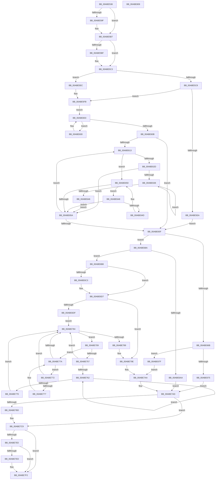

# MiQueryLoadedPatches

- RVA: `0x00ABE538`–`0x00ABE80A` (길이 `722` bytes)
- VA: `0x0000000140ABE538`
- 실행 섹션: `PAGE`
- PDB 이름 있음: `예`; PDB Function 태그: `아니요`
- unwind 정보 RVA: `0x000BD6A0`
- 디코드: `209`개 명령, `722/722` bytes 표시
- 미해석 바이트: `0` (있으면 어셈블리에 `.byte`로 보존)

> 이 문서는 커널 이미지의 기계어와 PDB 기호를 분석해 생성했습니다. 4번과 5번은 함수 원형과 자료형을 바이너리 사용 방식에서 추정한 C 해석이며 원본 소스 복구 결과는 아닙니다.

## 1. Dependencies

- 직접 호출 지점: **9**; 고유 호출 대상: **9**
- 직접 호출자로 확인된 함수: **1**
- RIP 상대 이미지 참조: **2**

### Outgoing calls
- `0x00ABE587` → [KeAbPreAcquire](../../text/21/KeAbPreAcquire_function_00210230.md) (function, `0x00210230`)
- `0x00ABE5B2` → [ExfAcquirePushLockSharedEx](../../text/21/ExfAcquirePushLockSharedEx_function_0021044C.md) (function, `0x0021044C`)
- `0x00ABE5CB` → [MiFindUserSidHotPatchContext](../80/MiFindUserSidHotPatchContext_function_0080360C.md) (function, `0x0080360C`)
- `0x00ABE69A` → [MiAllocatePool](../../text/35/MiAllocatePool_function_0035B540.md) (function, `0x0035B540`)
- `0x00ABE6CF` → [RtlCopySid](../9A/RtlCopySid_function_009A9A50.md) (function, `0x009A9A50`)
- `0x00ABE72D` → [RtlCopyUnicodeString](../../text/3F/RtlCopyUnicodeString_function_003FEF30.md) (function, `0x003FEF30`)
- `0x00ABE7C4` → [ExfReleasePushLockShared](../../text/26/ExfReleasePushLockShared_function_00263440.md) (function, `0x00263440`)
- `0x00ABE7D0` → [KeAbPostRelease](../../text/2E/KeAbPostRelease_function_002E1600.md) (function, `0x002E1600`)
- `0x00ABE7ED` → [KiCheckForKernelApcDelivery](../../text/2E/KiCheckForKernelApcDelivery_function_002E2C80.md) (function, `0x002E2C80`)

### Direct callers
- [NtManageHotPatch](../AF/NtManageHotPatch_function_00AF8660.md) at `0x00AF89F2`

### Static image references
- `0x00ABE56E` → RVA `0x00E37590` (`.data`; read)
- `0x00ABE5EC` → RVA `0x00E37578` (`.data`; read)

## 2. Other-region calls and transfers

- 다른 실행 섹션으로 향하는 call: **7**
  - `0x00ABE587` → [KeAbPreAcquire](../../text/21/KeAbPreAcquire_function_00210230.md) (`PAGE` → `.text`)
  - `0x00ABE5B2` → [ExfAcquirePushLockSharedEx](../../text/21/ExfAcquirePushLockSharedEx_function_0021044C.md) (`PAGE` → `.text`)
  - `0x00ABE69A` → [MiAllocatePool](../../text/35/MiAllocatePool_function_0035B540.md) (`PAGE` → `.text`)
  - `0x00ABE72D` → [RtlCopyUnicodeString](../../text/3F/RtlCopyUnicodeString_function_003FEF30.md) (`PAGE` → `.text`)
  - `0x00ABE7C4` → [ExfReleasePushLockShared](../../text/26/ExfReleasePushLockShared_function_00263440.md) (`PAGE` → `.text`)
  - `0x00ABE7D0` → [KeAbPostRelease](../../text/2E/KeAbPostRelease_function_002E1600.md) (`PAGE` → `.text`)
  - `0x00ABE7ED` → [KiCheckForKernelApcDelivery](../../text/2E/KiCheckForKernelApcDelivery_function_002E2C80.md) (`PAGE` → `.text`)
- 별도 외부 분기/꼬리 이동을 확인하지 못했습니다.

## 3. Assembly (complete function range)

```asm
00ABE538  48 8B C4                        mov rax, rsp
00ABE53B  48 89 58 08                     mov qword ptr [rax + 8], rbx
00ABE53F  4C 89 48 20                     mov qword ptr [rax + 0x20], r9
00ABE543  4C 89 40 18                     mov qword ptr [rax + 0x18], r8
00ABE547  48 89 50 10                     mov qword ptr [rax + 0x10], rdx
00ABE54B  55                              push rbp
00ABE54C  56                              push rsi
00ABE54D  57                              push rdi
00ABE54E  41 54                           push r12
00ABE550  41 55                           push r13
00ABE552  41 56                           push r14
00ABE554  41 57                           push r15
00ABE556  48 83 EC 30                     sub rsp, 0x30
00ABE55A  65 4C 8B 2C 25 88 01 00 00      mov r13, qword ptr gs:[0x188]
00ABE563  4D 8B F0                        mov r14, r8
00ABE566  4C 8B FA                        mov r15, rdx
00ABE569  48 8B E9                        mov rbp, rcx
00ABE56C  33 DB                           xor ebx, ebx
00ABE56E  48 8D 0D 1B 90 37 00            lea rcx, [rip + 0x37901b]
00ABE575  45 33 C0                        xor r8d, r8d
00ABE578  33 D2                           xor edx, edx
00ABE57A  44 8D 63 01                     lea r12d, [rbx + 1]
00ABE57E  66 45 29 A5 E6 01 00 00         sub word ptr [r13 + 0x1e6], r12w
00ABE586  90                              nop
00ABE587  E8 A4 1C 75 FF                  call 0x140210230
00ABE58C  48 8B F8                        mov rdi, rax
00ABE58F  8D 4B 11                        lea ecx, [rbx + 0x11]
00ABE592  33 C0                           xor eax, eax
00ABE594  F0 48 0F B1 0D F3 8F 37 00      lock cmpxchg qword ptr [rip + 0x378ff3], rcx
00ABE59D  74 18                           je 0x140abe5b7
00ABE59F  4C 8D 0D EA 8F 37 00            lea r9, [rip + 0x378fea]
00ABE5A6  4C 8B C7                        mov r8, rdi
00ABE5A9  33 D2                           xor edx, edx
00ABE5AB  48 8D 0D DE 8F 37 00            lea rcx, [rip + 0x378fde]
00ABE5B2  E8 95 1E 75 FF                  call 0x14021044c
00ABE5B7  45 33 C9                        xor r9d, r9d
00ABE5BA  48 85 FF                        test rdi, rdi
00ABE5BD  74 04                           je 0x140abe5c3
00ABE5BF  44 88 67 0A                     mov byte ptr [rdi + 0xa], r12b
00ABE5C3  48 85 ED                        test rbp, rbp
00ABE5C6  74 24                           je 0x140abe5ec
00ABE5C8  48 8B CD                        mov rcx, rbp
00ABE5CB  E8 3C 50 D4 FF                  call 0x14080360c
00ABE5D0  BA 60 00 00 00                  mov edx, 0x60
00ABE5D5  48 8D 48 18                     lea rcx, [rax + 0x18]
00ABE5D9  48 F7 D8                        neg rax
00ABE5DC  48 1B C0                        sbb rax, rax
00ABE5DF  45 33 C9                        xor r9d, r9d
00ABE5E2  41 8B F1                        mov esi, r9d
00ABE5E5  48 23 C1                        and rax, rcx
00ABE5E8  75 11                           jne 0x140abe5fb
00ABE5EA  EB 73                           jmp 0x140abe65f
00ABE5EC  48 8D 05 85 8F 37 00            lea rax, [rip + 0x378f85]
00ABE5F3  BA 60 00 00 00                  mov edx, 0x60
00ABE5F8  41 8B F1                        mov esi, r9d
00ABE5FB  49 8B D9                        mov rbx, r9
00ABE5FE  EB 03                           jmp 0x140abe603
00ABE600  48 8B D8                        mov rbx, rax
00ABE603  48 8B 00                        mov rax, qword ptr [rax]
00ABE606  48 85 C0                        test rax, rax
00ABE609  75 F5                           jne 0x140abe600
00ABE60B  48 8B CB                        mov rcx, rbx
00ABE60E  48 85 DB                        test rbx, rbx
00ABE611  74 4C                           je 0x140abe65f
00ABE613  0F B7 41 28                     movzx eax, word ptr [rcx + 0x28]
00ABE617  41 03 F4                        add esi, r12d
00ABE61A  48 83 C0 18                     add rax, 0x18
00ABE61E  4C 8B C1                        mov r8, rcx
00ABE621  48 03 D0                        add rdx, rax
00ABE624  48 8B 41 08                     mov rax, qword ptr [rcx + 8]
00ABE628  48 85 C0                        test rax, rax
00ABE62B  74 23                           je 0x140abe650
00ABE62D  4C 8B 00                        mov r8, qword ptr [rax]
00ABE630  48 8B C8                        mov rcx, rax
00ABE633  4D 85 C0                        test r8, r8
00ABE636  74 22                           je 0x140abe65a
00ABE638  49 8B 00                        mov rax, qword ptr [r8]
00ABE63B  49 8B C8                        mov rcx, r8
00ABE63E  4C 8B C0                        mov r8, rax
00ABE641  48 85 C0                        test rax, rax
00ABE644  75 F2                           jne 0x140abe638
00ABE646  EB 12                           jmp 0x140abe65a
00ABE648  4C 39 01                        cmp qword ptr [rcx], r8
00ABE64B  74 0D                           je 0x140abe65a
00ABE64D  4C 8B C1                        mov r8, rcx
00ABE650  48 8B 49 10                     mov rcx, qword ptr [rcx + 0x10]
00ABE654  48 83 E1 FC                     and rcx, 0xfffffffffffffffc
00ABE658  75 EE                           jne 0x140abe648
00ABE65A  48 85 C9                        test rcx, rcx
00ABE65D  75 B4                           jne 0x140abe613
00ABE65F  8B 84 24 90 00 00 00            mov eax, dword ptr [rsp + 0x90]
00ABE666  48 3B C2                        cmp rax, rdx
00ABE669  73 1F                           jae 0x140abe68a
00ABE66B  B8 FF FF FF FF                  mov eax, 0xffffffff
00ABE670  48 3B D0                        cmp rdx, rax
00ABE673  76 0A                           jbe 0x140abe67f
00ABE675  BB 95 00 00 C0                  mov ebx, 0xc0000095
00ABE67A  E9 2E 01 00 00                  jmp 0x140abe7ad
00ABE67F  4D 89 0F                        mov qword ptr [r15], r9
00ABE682  41 89 16                        mov dword ptr [r14], edx
00ABE685  E9 20 01 00 00                  jmp 0x140abe7aa
00ABE68A  44 8B E2                        mov r12d, edx
00ABE68D  B9 00 01 00 00                  mov ecx, 0x100
00ABE692  8B D2                           mov edx, edx
00ABE694  41 B8 4D 6D 48 71               mov r8d, 0x71486d4d
00ABE69A  E8 A1 CE 89 FF                  call 0x14035b540
00ABE69F  45 33 C9                        xor r9d, r9d
00ABE6A2  48 8B F8                        mov rdi, rax
00ABE6A5  48 85 C0                        test rax, rax
00ABE6A8  75 0E                           jne 0x140abe6b8
00ABE6AA  BB 9A 00 00 C0                  mov ebx, 0xc000009a
00ABE6AF  44 8D 60 01                     lea r12d, [rax + 1]
00ABE6B3  E9 F5 00 00 00                  jmp 0x140abe7ad
00ABE6B8  C7 00 02 00 00 00               mov dword ptr [rax], 2
00ABE6BE  48 85 ED                        test rbp, rbp
00ABE6C1  74 14                           je 0x140abe6d7
00ABE6C3  48 8D 50 04                     lea rdx, [rax + 4]
00ABE6C7  4C 8B C5                        mov r8, rbp
00ABE6CA  B9 44 00 00 00                  mov ecx, 0x44
00ABE6CF  E8 7C B3 EE FF                  call 0x1409a9a50
00ABE6D4  45 33 C9                        xor r9d, r9d
00ABE6D7  85 F6                           test esi, esi
00ABE6D9  0F 84 BF 00 00 00               je 0x140abe79e
00ABE6DF  8B C6                           mov eax, esi
00ABE6E1  4C 8D 7F 60                     lea r15, [rdi + 0x60]
00ABE6E5  48 8B F7                        mov rsi, rdi
00ABE6E8  4C 89 7F 50                     mov qword ptr [rdi + 0x50], r15
00ABE6EC  4C 8D 70 06                     lea r14, [rax + 6]
00ABE6F0  49 C1 E6 04                     shl r14, 4
00ABE6F4  4C 03 F7                        add r14, rdi
00ABE6F7  48 2B B4 24 88 00 00 00         sub rsi, qword ptr [rsp + 0x88]
00ABE6FF  4C 89 77 58                     mov qword ptr [rdi + 0x58], r14
00ABE703  49 8D 2C C6                     lea rbp, [r14 + rax*8]
00ABE707  EB 7B                           jmp 0x140abe784
00ABE709  8B 43 18                        mov eax, dword ptr [rbx + 0x18]
00ABE70C  48 8D 53 28                     lea rdx, [rbx + 0x28]
00ABE710  41 89 06                        mov dword ptr [r14], eax
00ABE713  49 8B CF                        mov rcx, r15
00ABE716  8B 43 1C                        mov eax, dword ptr [rbx + 0x1c]
00ABE719  41 89 46 04                     mov dword ptr [r14 + 4], eax
00ABE71D  0F B7 02                        movzx eax, word ptr [rdx]
00ABE720  66 41 89 07                     mov word ptr [r15], ax
00ABE724  66 41 89 47 02                  mov word ptr [r15 + 2], ax
00ABE729  49 89 6F 08                     mov qword ptr [r15 + 8], rbp
00ABE72D  E8 FE 07 94 FF                  call 0x1403fef30
00ABE732  49 29 77 08                     sub qword ptr [r15 + 8], rsi
00ABE736  4D 8D 76 08                     lea r14, [r14 + 8]
00ABE73A  FF 47 48                        inc dword ptr [rdi + 0x48]
00ABE73D  45 33 C9                        xor r9d, r9d
00ABE740  41 0F B7 07                     movzx eax, word ptr [r15]
00ABE744  48 8B CB                        mov rcx, rbx
00ABE747  48 03 E8                        add rbp, rax
00ABE74A  49 83 C7 10                     add r15, 0x10
00ABE74E  48 8B 43 08                     mov rax, qword ptr [rbx + 8]
00ABE752  48 85 C0                        test rax, rax
00ABE755  74 23                           je 0x140abe77a
00ABE757  48 8B 08                        mov rcx, qword ptr [rax]
00ABE75A  48 8B D8                        mov rbx, rax
00ABE75D  48 85 C9                        test rcx, rcx
00ABE760  74 22                           je 0x140abe784
00ABE762  48 8B 01                        mov rax, qword ptr [rcx]
00ABE765  48 8B D9                        mov rbx, rcx
00ABE768  48 8B C8                        mov rcx, rax
00ABE76B  48 85 C0                        test rax, rax
00ABE76E  75 F2                           jne 0x140abe762
00ABE770  EB 12                           jmp 0x140abe784
00ABE772  48 39 0B                        cmp qword ptr [rbx], rcx
00ABE775  74 0D                           je 0x140abe784
00ABE777  48 8B CB                        mov rcx, rbx
00ABE77A  48 8B 5B 10                     mov rbx, qword ptr [rbx + 0x10]
00ABE77E  48 83 E3 FC                     and rbx, 0xfffffffffffffffc
00ABE782  75 EE                           jne 0x140abe772
00ABE784  48 85 DB                        test rbx, rbx
00ABE787  75 80                           jne 0x140abe709
00ABE789  48 29 77 58                     sub qword ptr [rdi + 0x58], rsi
00ABE78D  48 29 77 50                     sub qword ptr [rdi + 0x50], rsi
00ABE791  4C 8B B4 24 80 00 00 00         mov r14, qword ptr [rsp + 0x80]
00ABE799  4C 8B 7C 24 78                  mov r15, qword ptr [rsp + 0x78]
00ABE79E  49 89 3F                        mov qword ptr [r15], rdi
00ABE7A1  45 89 26                        mov dword ptr [r14], r12d
00ABE7A4  41 BC 01 00 00 00               mov r12d, 1
00ABE7AA  41 8B D9                        mov ebx, r9d
00ABE7AD  B8 11 00 00 00                  mov eax, 0x11
00ABE7B2  F0 4C 0F B1 0D D5 8D 37 00      lock cmpxchg qword ptr [rip + 0x378dd5], r9
00ABE7BB  74 0C                           je 0x140abe7c9
00ABE7BD  48 8D 0D CC 8D 37 00            lea rcx, [rip + 0x378dcc]
00ABE7C4  E8 77 4C 7A FF                  call 0x140263440
00ABE7C9  48 8D 0D C0 8D 37 00            lea rcx, [rip + 0x378dc0]
00ABE7D0  E8 2B 2E 82 FF                  call 0x1402e1600
00ABE7D5  90                              nop
00ABE7D6  66 45 01 A5 E6 01 00 00         add word ptr [r13 + 0x1e6], r12w
00ABE7DE  75 12                           jne 0x140abe7f2
00ABE7E0  49 8D 8D 98 00 00 00            lea rcx, [r13 + 0x98]
00ABE7E7  90                              nop
00ABE7E8  48 39 09                        cmp qword ptr [rcx], rcx
00ABE7EB  74 05                           je 0x140abe7f2
00ABE7ED  E8 8E 44 82 FF                  call 0x1402e2c80
00ABE7F2  8B C3                           mov eax, ebx
00ABE7F4  48 8B 5C 24 70                  mov rbx, qword ptr [rsp + 0x70]
00ABE7F9  48 83 C4 30                     add rsp, 0x30
00ABE7FD  41 5F                           pop r15
00ABE7FF  41 5E                           pop r14
00ABE801  41 5D                           pop r13
00ABE803  41 5C                           pop r12
00ABE805  5F                              pop rdi
00ABE806  5E                              pop rsi
00ABE807  5D                              pop rbp
00ABE808  C3                              ret
00ABE809  CC                              int3
```

## 4. C-style interpretation (structured pseudocode)

```c
__int64 __fastcall MiQueryLoadedPatches(__int64 a1, __int64 a2, __int64 a3, __int64 a4, unsigned int a5)
{
    __int64 result;
    __int64 v_r14;
    __int64 v_r15;
    __int64 v_rbp;
    __int64 v_rbx;
    __int64 v_rsi;
    __int64 v_rsp;
    unsigned __int64 v_stack_p10;
    unsigned __int64 v_stack_p18;
    unsigned __int64 v_stack_p20;
    unsigned __int64 v_stack_p8;

    *(unsigned __int64 *)(v_rsp + 8) = v_rbx;
    *(unsigned __int64 *)(v_rsp + 32) = a4;
    *(unsigned __int64 *)(v_rsp + 24) = a3;
    *(unsigned __int64 *)(v_rsp + 16) = a2;
    v_rsp = (v_rsp) - (48);
    v_rbx = 0;
    a3 = 0;
    a2 = 0;
    result = KeAbPreAcquire(v_rip + 3641371, a2, a3, a4);
    result = 0;
    if (!(condition_is_equal)) {
        a4 = v_rip + 3641322;
        a3 = 0;
        a2 = 0;
        a1 = v_rip + 3641310;
        result = ExfAcquirePushLockSharedEx(a1, a2, a3, a4);
    }
    a4 = 0;
    if (result != 0) {
        *(unsigned __int8 *)(result + 10) = (unsigned __int8)(v_rbx + 1);
    }
    if (a1 == 0) goto loc_00ABE5EC;
    result = MiFindUserSidHotPatchContext(a1, a2, a3, a4);
    result = -(result);
    a4 = 0;
    result = (result) & (result + 24);
    if (condition_is_not_equal) goto loc_00ABE5FB;
    goto loc_00ABE65F;
loc_00ABE5EC:
loc_00ABE5FB:
    goto loc_00ABE603;
loc_00ABE600:
loc_00ABE603:
    if (*(unsigned __int64 *)(v_rip + 3641221) != 0) goto loc_00ABE600;
    if (v_rip + 3641221 == 0) goto loc_00ABE65F;
loc_00ABE613:
    v_rsi = (unsigned int)((0) + ((unsigned int)(v_rbx + 1)));
    result = (*(unsigned __int16 *)(v_rip + 3641221 + 40)) + (24);
    a2 = (96) + (result);
    if (*(unsigned __int64 *)(v_rip + 3641221 + 8) == 0) goto loc_00ABE650;
    if (*(unsigned __int64 *)(*(unsigned __int64 *)(v_rip + 3641221 + 8)) == 0) goto loc_00ABE65A;
loc_00ABE638:
    if (*(unsigned __int64 *)(*(unsigned __int64 *)(*(unsigned __int64 *)(v_rip + 3641221 + 8))) != 0) goto loc_00ABE638;
    goto loc_00ABE65A;
loc_00ABE648:
    if ((*(unsigned __int64 *)(*(unsigned __int64 *)(*(unsigned __int64 *)(v_rip + 3641221 + 8)))) == (*(unsigned __int64 *)(*(unsigned __int64 *)(*(unsigned __int64 *)(v_rip + 3641221 + 8))))) goto loc_00ABE65A;
loc_00ABE650:
    a1 = (*(unsigned __int64 *)(*(unsigned __int64 *)(*(unsigned __int64 *)(v_rip + 3641221 + 8)) + 16)) & (-4);
    if (condition_is_not_equal) goto loc_00ABE648;
loc_00ABE65A:
    if (a1 != 0) goto loc_00ABE613;
loc_00ABE65F:
    if (((unsigned int)(a5)) >= a2) goto loc_00ABE68A;
    if (a2 <= ((unsigned int)(0xFFFFFFFFULL))) goto loc_00ABE67F;
    goto loc_00ABE7AD;
loc_00ABE67F:
    *(unsigned __int64 *)(a2) = 0;
    *(unsigned int *)(a3) = (unsigned int)(a2);
    goto loc_00ABE7AA;
loc_00ABE68A:
    result = MiAllocatePool(256, (unsigned int)((unsigned int)(a2)), (unsigned int)(0x71486D4DULL), a4);
    a4 = 0;
    if (result != 0) goto loc_00ABE6B8;
    goto loc_00ABE7AD;
loc_00ABE6B8:
    *(unsigned int *)(result) = 2;
    if (a1 != 0) {
        a2 = result + 4;
        a3 = a1;
        a1 = 68;
        result = RtlCopySid(a1, a2, a3, a4);
        a4 = 0;
    }
    if ((unsigned int)(v_rsi) == 0) goto loc_00ABE79E;
    *(unsigned __int64 *)(result + 80) = result + 96;
    v_r14 = ((unsigned int)((unsigned int)(v_rsi)) + 6) << (4);
    v_r14 = (v_r14) + (result);
    v_rsi = (result) - (v_stack_p20);
    *(unsigned __int64 *)(result + 88) = v_r14;
    goto loc_00ABE784;
loc_00ABE709:
    *(unsigned int *)(v_r14) = (unsigned int)((unsigned int)(*(unsigned int *)((unsigned int)(0xC000009AULL) + 24)));
    *(unsigned int *)(v_r14 + 4) = (unsigned int)((unsigned int)(*(unsigned int *)((unsigned int)(0xC000009AULL) + 28)));
    *(unsigned __int16 *)(result + 96) = (unsigned __int16)(*(unsigned __int16 *)((unsigned int)(0xC000009AULL) + 40));
    *(unsigned __int16 *)(result + 96 + 2) = (unsigned __int16)(*(unsigned __int16 *)((unsigned int)(0xC000009AULL) + 40));
    *(unsigned __int64 *)(result + 96 + 8) = v_r14 + (unsigned int)((unsigned int)(v_rsi)) * 8;
    result = RtlCopyUnicodeString(result + 96, (unsigned int)(0xC000009AULL) + 40, a3, a4);
    a4 = 0;
    v_rbp = (v_r14 + (unsigned int)((unsigned int)(v_rsi)) * 8) + (*(unsigned __int16 *)(result + 96));
    v_r15 = (result + 96) + (16);
    if (*(unsigned __int64 *)((unsigned int)(0xC000009AULL) + 8) == 0) goto loc_00ABE77A;
    if (*(unsigned __int64 *)(*(unsigned __int64 *)((unsigned int)(0xC000009AULL) + 8)) == 0) goto loc_00ABE784;
loc_00ABE762:
    if (*(unsigned __int64 *)(*(unsigned __int64 *)(*(unsigned __int64 *)((unsigned int)(0xC000009AULL) + 8))) != 0) goto loc_00ABE762;
    goto loc_00ABE784;
loc_00ABE772:
    if ((*(unsigned __int64 *)(*(unsigned __int64 *)(*(unsigned __int64 *)((unsigned int)(0xC000009AULL) + 8)))) == (*(unsigned __int64 *)(*(unsigned __int64 *)(*(unsigned __int64 *)((unsigned int)(0xC000009AULL) + 8))))) goto loc_00ABE784;
loc_00ABE77A:
    v_rbx = (*(unsigned __int64 *)(*(unsigned __int64 *)(*(unsigned __int64 *)((unsigned int)(0xC000009AULL) + 8)) + 16)) & (-4);
    if (condition_is_not_equal) goto loc_00ABE772;
loc_00ABE784:
    if (v_rbx != 0) goto loc_00ABE709;
loc_00ABE79E:
    *(unsigned __int64 *)(v_stack_p10) = result;
    *(unsigned int *)(v_stack_p18) = (unsigned int)(result + 1);
loc_00ABE7AA:
loc_00ABE7AD:
    result = 17;
    if (v_rbx != 0) {
        a1 = v_rip + 3640780;
        result = ExfReleasePushLockShared(a1, (unsigned int)(0xC000009AULL) + 40, a3, a4);
    }
    result = KeAbPostRelease(v_rip + 3640768, (unsigned int)(0xC000009AULL) + 40, a3, a4);
    if (v_rbx != 0) goto loc_00ABE7F2;
    if ((*(unsigned __int64 *)(*(unsigned __int64 *)(gs_base + (0 + 392)) + 152)) != (*(unsigned __int64 *)(gs_base + (0 + 392)) + 152)) {
        result = KiCheckForKernelApcDelivery(*(unsigned __int64 *)(gs_base + (0 + 392)) + 152, (unsigned int)(0xC000009AULL) + 40, a3, a4);
    }
    v_rsp = (v_rsp) + (48);
    return 0;
}
```

## 5. (Beta) C Style

```c
int64_t MiQueryLoadedPatches(int64_t Arg1, void *Arg2, void *Arg3, int64_t Arg4, uint32_t Arg5)
{
    uint8_t *arg2 = (uint8_t *)Arg2;
    uint8_t *arg3 = (uint8_t *)Arg3;

    int64_t result;
    int64_t local_r14;
    int64_t local_r15;
    int64_t local_rbp;
    int64_t local_rbx;
    int64_t local_rsi;
    int64_t local_rsp;
    uint64_t v_stack_p10;
    uint64_t v_stack_p18;
    uint64_t v_stack_p20;
    uint64_t v_stack_p8;

    *(uint64_t *)(local_rsp + 0x8) = local_rbx;
    *(uint64_t *)(local_rsp + 0x20) = Arg4;
    *(void **)(local_rsp + 0x18) = Arg3;
    *(void **)(local_rsp + 0x10) = Arg2;
    local_rsp = (local_rsp) - (48);
    local_rbx = 0;
    Arg3 = 0;
    Arg2 = 0;
    result = KeAbPreAcquire(v_rip + 3641371, Arg2, Arg3, Arg4);
    result = 0;
    if (!(condition_is_equal)) {
        Arg4 = v_rip + 3641322;
        Arg3 = 0;
        Arg2 = 0;
        Arg1 = v_rip + 3641310;
        result = ExfAcquirePushLockSharedEx(Arg1, Arg2, Arg3, Arg4);
    }
    Arg4 = 0;
    if (result != 0) {
        *(uint8_t *)(result + 0xA) = (uint8_t)(local_rbx + 1);
    }
    if (Arg1 == 0) goto loc_00ABE5EC;
    result = MiFindUserSidHotPatchContext(Arg1, Arg2, Arg3, Arg4);
    result = -(result);
    Arg4 = 0;
    result = (result) & (result + 24);
    if (condition_is_not_equal) goto loc_00ABE5FB;
    goto loc_00ABE65F;
loc_00ABE5EC:
loc_00ABE5FB:
    goto loc_00ABE603;
loc_00ABE600:
loc_00ABE603:
    if (*(uint64_t *)(v_rip + 0x378F85) != 0) goto loc_00ABE600;
    if (v_rip + 3641221 == 0) goto loc_00ABE65F;
loc_00ABE613:
    local_rsi = (uint32_t)((0) + ((uint32_t)(local_rbx + 1)));
    result = (*(uint16_t *)(v_rip + 0x378F85 + 0x28)) + (24);
    Arg2 = (96) + (result);
    if (*(uint64_t *)(v_rip + 0x378F85 + 0x8) == 0) goto loc_00ABE650;
    if (*(uint64_t *)(*(uint64_t *)(v_rip + 0x378F85 + 0x8)) == 0) goto loc_00ABE65A;
loc_00ABE638:
    if (*(uint64_t *)(*(uint64_t *)(*(uint64_t *)(v_rip + 0x378F85 + 0x8))) != 0) goto loc_00ABE638;
    goto loc_00ABE65A;
loc_00ABE648:
    if ((*(uint64_t *)(*(uint64_t *)(*(uint64_t *)(v_rip + 0x378F85 + 0x8)))) == (*(uint64_t *)(*(uint64_t *)(*(uint64_t *)(v_rip + 0x378F85 + 0x8))))) goto loc_00ABE65A;
loc_00ABE650:
    Arg1 = (*(uint64_t *)(*(uint64_t *)(*(uint64_t *)(v_rip + 0x378F85 + 0x8)) + 0x10)) & (-4);
    if (condition_is_not_equal) goto loc_00ABE648;
loc_00ABE65A:
    if (Arg1 != 0) goto loc_00ABE613;
loc_00ABE65F:
    if (((uint32_t)(Arg5)) >= Arg2) goto loc_00ABE68A;
    if (Arg2 <= ((uint32_t)(0xFFFFFFFFULL))) goto loc_00ABE67F;
    goto loc_00ABE7AD;
loc_00ABE67F:
    *(uint64_t *)(arg2) = 0;
    *(uint32_t *)(arg3) = (uint32_t)(Arg2);
    goto loc_00ABE7AA;
loc_00ABE68A:
    result = MiAllocatePool(256, (uint32_t)((uint32_t)(Arg2)), (uint32_t)(0x71486D4DULL), Arg4);
    Arg4 = 0;
    if (result != 0) goto loc_00ABE6B8;
    goto loc_00ABE7AD;
loc_00ABE6B8:
    *(uint32_t *)(result) = 2;
    if (Arg1 != 0) {
        Arg2 = result + 4;
        Arg3 = Arg1;
        Arg1 = 68;
        result = RtlCopySid(Arg1, Arg2, Arg3, Arg4);
        Arg4 = 0;
    }
    if ((uint32_t)(local_rsi) == 0) goto loc_00ABE79E;
    *(uint64_t *)(result + 0x50) = result + 96;
    local_r14 = ((uint32_t)((uint32_t)(local_rsi)) + 6) << (4);
    local_r14 = (local_r14) + (result);
    local_rsi = (result) - (v_stack_p20);
    *(uint64_t *)(result + 0x58) = local_r14;
    goto loc_00ABE784;
loc_00ABE709:
    *(uint32_t *)(local_r14) = (uint32_t)((uint32_t)(*(uint32_t *)((uint32_t)(0xC000009AULL) + 0x18)));
    *(uint32_t *)(local_r14 + 0x4) = (uint32_t)((uint32_t)(*(uint32_t *)((uint32_t)(0xC000009AULL) + 0x1C)));
    *(uint16_t *)(result + 0x60) = (uint16_t)(*(uint16_t *)((uint32_t)(0xC000009AULL) + 0x28));
    *(uint16_t *)(result + 0x60 + 0x2) = (uint16_t)(*(uint16_t *)((uint32_t)(0xC000009AULL) + 0x28));
    *(uint64_t *)(result + 0x60 + 0x8) = local_r14 + (uint32_t)((uint32_t)(local_rsi)) * 8;
    result = RtlCopyUnicodeString(result + 96, (uint32_t)(0xC000009AULL) + 40, Arg3, Arg4);
    Arg4 = 0;
    local_rbp = (local_r14 + (uint32_t)((uint32_t)(local_rsi)) * 8) + (*(uint16_t *)(result + 0x60));
    local_r15 = (result + 96) + (16);
    if (*(uint64_t *)((uint32_t)(0xC000009AULL) + 0x8) == 0) goto loc_00ABE77A;
    if (*(uint64_t *)(*(uint64_t *)((uint32_t)(0xC000009AULL) + 0x8)) == 0) goto loc_00ABE784;
loc_00ABE762:
    if (*(uint64_t *)(*(uint64_t *)(*(uint64_t *)((uint32_t)(0xC000009AULL) + 0x8))) != 0) goto loc_00ABE762;
    goto loc_00ABE784;
loc_00ABE772:
    if ((*(uint64_t *)(*(uint64_t *)(*(uint64_t *)((uint32_t)(0xC000009AULL) + 0x8)))) == (*(uint64_t *)(*(uint64_t *)(*(uint64_t *)((uint32_t)(0xC000009AULL) + 0x8))))) goto loc_00ABE784;
loc_00ABE77A:
    local_rbx = (*(uint64_t *)(*(uint64_t *)(*(uint64_t *)((uint32_t)(0xC000009AULL) + 0x8)) + 0x10)) & (-4);
    if (condition_is_not_equal) goto loc_00ABE772;
loc_00ABE784:
    if (local_rbx != 0) goto loc_00ABE709;
loc_00ABE79E:
    *(uint64_t *)(v_stack_p10) = result;
    *(uint32_t *)(v_stack_p18) = (uint32_t)(result + 1);
loc_00ABE7AA:
loc_00ABE7AD:
    result = 17;
    if (local_rbx != 0) {
        Arg1 = v_rip + 3640780;
        result = ExfReleasePushLockShared(Arg1, (uint32_t)(0xC000009AULL) + 40, Arg3, Arg4);
    }
    result = KeAbPostRelease(v_rip + 3640768, (uint32_t)(0xC000009AULL) + 40, Arg3, Arg4);
    if (local_rbx != 0) goto loc_00ABE7F2;
    if ((*(uint64_t *)(*(uint64_t *)(gs_base + (0 + 0x188)) + 0x98)) != (*(uint64_t *)(gs_base + (0 + 0x188)) + 152)) {
        result = KiCheckForKernelApcDelivery(*(uint64_t *)(gs_base + (0 + 0x188)) + 152, (uint32_t)(0xC000009AULL) + 40, Arg3, Arg4);
    }
    local_rsp = (local_rsp) + (48);
    return 0;
}
```

### 관측된 메모리 오프셋

구조체 형식이 확인되지 않은 접근은 인자 기준의 오프셋으로만 기록했습니다.

| 기준 인자 | 오프셋 표현 | 폭 (bit) | 접근 |
|---|---:|---:|---|
| `Arg2` | `+ 0x0` | `64` | `W` |
| `Arg3` | `+ 0x0` | `32` | `W` |

## 6. Execution-region graph

[열기: 2D/3D 그래프와 함수 탐색 컨트롤 패널](../../../control-panel.html?section=page&rva=0x00ABE538&view=graph)

- 2D 그래프는 위에서 아래로 흐르고, 3D 그래프는 빈 공간을 드래그해 회전합니다. Shift+드래그는 이동, 휠은 확대·축소, 함수 노드 선택은 대상 보고서 이동입니다.

### Static fallback


