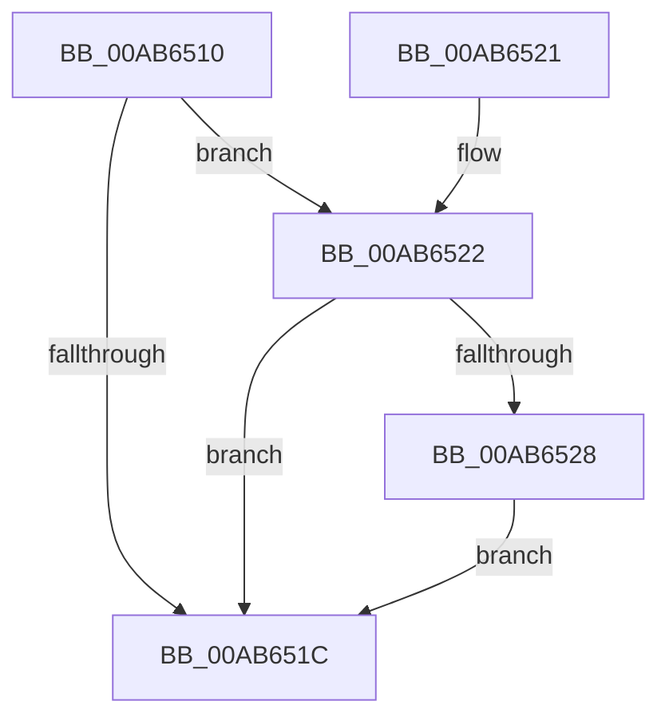

# MiTracingEnabledCallback

- RVA: `0x00AB6510`–`0x00AB652F` (길이 `31` bytes)
- VA: `0x0000000140AB6510`
- 실행 섹션: `PAGE`
- PDB 이름 있음: `예`; PDB Function 태그: `아니요`
- unwind 정보 RVA: `0x00082A88`
- 디코드: `11`개 명령, `31/31` bytes 표시
- 미해석 바이트: `0` (있으면 어셈블리에 `.byte`로 보존)

> 이 문서는 커널 이미지의 기계어와 PDB 기호를 분석해 생성했습니다. 4번과 5번은 함수 원형과 자료형을 바이너리 사용 방식에서 추정한 C 해석이며 원본 소스 복구 결과는 아닙니다.

## 1. Dependencies

- 직접 호출 지점: **1**; 고유 호출 대상: **1**
- 직접 호출자로 확인된 함수: **0**
- RIP 상대 이미지 참조: **0**

### Outgoing calls
- `0x00AB6528` → [MiLogHotPatchRundown](../80/MiLogHotPatchRundown_function_008057A4.md) (function, `0x008057A4`)

### Direct callers
- 이 함수 시작 RVA로 연결되는 직접 call은 확인되지 않았습니다. 간접 호출은 완전히 역산할 수 없습니다.

### Static image references
- 디코드된 RIP-relative 메모리 참조가 없습니다.

## 2. Other-region calls and transfers

- 다른 실행 섹션으로 향하는 call: **0**
- 별도 외부 분기/꼬리 이동을 확인하지 못했습니다.

## 3. Assembly (complete function range)

```asm
00AB6510  48 83 EC 28                     sub rsp, 0x28
00AB6514  8D 42 FF                        lea eax, [rdx - 1]
00AB6517  83 F8 01                        cmp eax, 1
00AB651A  76 06                           jbe 0x140ab6522
00AB651C  48 83 C4 28                     add rsp, 0x28
00AB6520  C3                              ret
00AB6521  CC                              int3
00AB6522  41 F6 C1 20                     test r9b, 0x20
00AB6526  74 F4                           je 0x140ab651c
00AB6528  E8 77 F2 D4 FF                  call 0x1408057a4
00AB652D  EB ED                           jmp 0x140ab651c
```

## 4. C-style interpretation (structured pseudocode)

```c
__int64 __fastcall MiTracingEnabledCallback(__int64 a1, __int64 a2, __int64 a3, unsigned __int8 a4)
{
    __int64 result;
    __int64 v_rsp;

    v_rsp = (v_rsp) - (40);
    if (((unsigned int)(a2 - 1)) <= 1) goto loc_00AB6522;
loc_00AB651C:
    v_rsp = (v_rsp) + (40);
    return a2 - 1;
loc_00AB6522:
    if (((a4) & (32)) == 0) goto loc_00AB651C;
    result = MiLogHotPatchRundown(a1, a2, a3, a4);
    goto loc_00AB651C;
}
```

## 5. (Beta) C Style

```c
void *MiTracingEnabledCallback(int64_t Arg1, void *Arg2, int64_t Arg3, uint8_t Arg4)
{
    uint8_t *arg2 = (uint8_t *)Arg2;

    int64_t result;
    int64_t local_rsp;

    local_rsp = (local_rsp) - (40);
    if (((uint32_t)(Arg2 - 1)) <= 1) goto loc_00AB6522;
loc_00AB651C:
    local_rsp = (local_rsp) + (40);
    return Arg2 - 1;
loc_00AB6522:
    if (((Arg4) & (32)) == 0) goto loc_00AB651C;
    result = MiLogHotPatchRundown(Arg1, Arg2, Arg3, Arg4);
    goto loc_00AB651C;
}
```

### 관측된 메모리 오프셋

구조체 형식이 확인되지 않은 접근은 인자 기준의 오프셋으로만 기록했습니다.

| 기준 인자 | 오프셋 표현 | 폭 (bit) | 접근 |
|---|---:|---:|---|
| `Arg2` | `- 0x1` | `32` | `R` |

## 6. Execution-region graph

[열기: 2D/3D 그래프와 함수 탐색 컨트롤 패널](../../../control-panel.html?section=page&rva=0x00AB6510&view=graph)

- 2D 그래프는 위에서 아래로 흐르고, 3D 그래프는 빈 공간을 드래그해 회전합니다. Shift+드래그는 이동, 휠은 확대·축소, 함수 노드 선택은 대상 보고서 이동입니다.

### Static fallback


