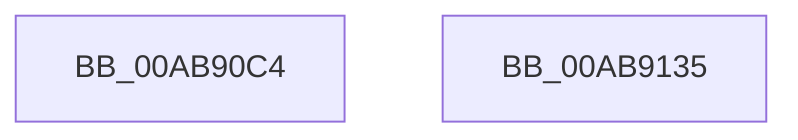

# MiUnmapImageForEnclaveUse

- RVA: `0x00AB90C4`–`0x00AB9136` (길이 `114` bytes)
- VA: `0x0000000140AB90C4`
- 실행 섹션: `PAGE`
- PDB 이름 있음: `예`; PDB Function 태그: `아니요`
- unwind 정보 RVA: `0x0005F638`
- 디코드: `29`개 명령, `114/114` bytes 표시
- 미해석 바이트: `0` (있으면 어셈블리에 `.byte`로 보존)

> 이 문서는 커널 이미지의 기계어와 PDB 기호를 분석해 생성했습니다. 4번과 5번은 함수 원형과 자료형을 바이너리 사용 방식에서 추정한 C 해석이며 원본 소스 복구 결과는 아닙니다.

## 1. Dependencies

- 직접 호출 지점: **4**; 고유 호출 대상: **4**
- 직접 호출자로 확인된 함수: **2**
- RIP 상대 이미지 참조: **2**

### Outgoing calls
- `0x00AB90FC` → [KiStackAttachProcess](../../text/21/KiStackAttachProcess_function_00216820.md) (function, `0x00216820`)
- `0x00AB9111` → [MiUnmapViewOfSection](../88/MiUnmapViewOfSection_function_0088A4C4.md) (function, `0x0088A4C4`)
- `0x00AB911D` → [KiUnstackDetachProcess](../../text/21/KiUnstackDetachProcess_function_00217D30.md) (function, `0x00217D30`)
- `0x00AB912A` → [_security_check_cookie](../../text/6A/_security_check_cookie_function_006AC640.md) (function, `0x006AC640`)

### Direct callers
- [MiInitializeVsmEnclave](../80/MiInitializeVsmEnclave_function_00808AE0.md) at `0x00808BDF`
- [MiLoadSectionIntoVsmEnclave](MiLoadSectionIntoVsmEnclave_function_00AB1D4C.md) at `0x00AB1DD6`

### Static image references
- `0x00AB90CA` → RVA `0x00E0A740` (`.data`; read)
- `0x00AB90E6` → RVA `0x00FC6CB8` (`ALMOSTRO`; read)

## 2. Other-region calls and transfers

- 다른 실행 섹션으로 향하는 call: **3**
  - `0x00AB90FC` → [KiStackAttachProcess](../../text/21/KiStackAttachProcess_function_00216820.md) (`PAGE` → `.text`)
  - `0x00AB911D` → [KiUnstackDetachProcess](../../text/21/KiUnstackDetachProcess_function_00217D30.md) (`PAGE` → `.text`)
  - `0x00AB912A` → [_security_check_cookie](../../text/6A/_security_check_cookie_function_006AC640.md) (`PAGE` → `.text`)
- 별도 외부 분기/꼬리 이동을 확인하지 못했습니다.

## 3. Assembly (complete function range)

```asm
00AB90C4  40 53                           push rbx
00AB90C6  48 83 EC 60                     sub rsp, 0x60
00AB90CA  48 8B 05 6F 16 35 00            mov rax, qword ptr [rip + 0x35166f]
00AB90D1  48 33 C4                        xor rax, rsp
00AB90D4  48 89 44 24 50                  mov qword ptr [rsp + 0x50], rax
00AB90D9  0F 57 C0                        xorps xmm0, xmm0
00AB90DC  4C 8D 44 24 20                  lea r8, [rsp + 0x20]
00AB90E1  48 8B D9                        mov rbx, rcx
00AB90E4  33 D2                           xor edx, edx
00AB90E6  48 8B 0D CB DB 50 00            mov rcx, qword ptr [rip + 0x50dbcb]
00AB90ED  0F 11 44 24 20                  movups xmmword ptr [rsp + 0x20], xmm0
00AB90F2  0F 11 44 24 30                  movups xmmword ptr [rsp + 0x30], xmm0
00AB90F7  0F 11 44 24 40                  movups xmmword ptr [rsp + 0x40], xmm0
00AB90FC  E8 1F D7 75 FF                  call 0x140216820
00AB9101  48 8B 0D B0 DB 50 00            mov rcx, qword ptr [rip + 0x50dbb0]
00AB9108  45 33 C9                        xor r9d, r9d
00AB910B  45 33 C0                        xor r8d, r8d
00AB910E  48 8B D3                        mov rdx, rbx
00AB9111  E8 AE 13 DD FF                  call 0x14088a4c4
00AB9116  33 D2                           xor edx, edx
00AB9118  48 8D 4C 24 20                  lea rcx, [rsp + 0x20]
00AB911D  E8 0E EC 75 FF                  call 0x140217d30
00AB9122  48 8B 4C 24 50                  mov rcx, qword ptr [rsp + 0x50]
00AB9127  48 33 CC                        xor rcx, rsp
00AB912A  E8 11 35 BF FF                  call 0x1406ac640
00AB912F  48 83 C4 60                     add rsp, 0x60
00AB9133  5B                              pop rbx
00AB9134  C3                              ret
00AB9135  CC                              int3
```

## 4. C-style interpretation (structured pseudocode)

```c
__int64 __fastcall MiUnmapImageForEnclaveUse(__int64 a1, int a2, __int64 a3, int a4)
{
    __int64 result;
    __int64 v_rsp;
    unsigned __int64 v_stack_m18;
    unsigned __int64 v_stack_m28;
    unsigned __int64 v_stack_m38;
    unsigned __int64 v_stack_m48;

    v_rsp = (v_rsp) - (96);
    result = (*(unsigned __int64 *)(v_rip + 3479151)) ^ (v_rsp);
    v_stack_m18 = result;
    a2 = 0;
    v_stack_m48 = v_xmm0;
    v_stack_m38 = v_xmm0;
    v_stack_m28 = v_xmm0;
    result = KiStackAttachProcess(*(unsigned __int64 *)(v_rip + 5299147), a2, v_stack_m48, a4);
    a4 = 0;
    a3 = 0;
    result = MiUnmapViewOfSection(*(unsigned __int64 *)(v_rip + 5299120), a1, a3, a4);
    a2 = 0;
    result = KiUnstackDetachProcess(v_stack_m48, a2, a3, a4);
    a1 = (v_stack_m18) ^ (v_rsp);
    result = _security_check_cookie(a1, a2, a3, a4);
    v_rsp = (v_rsp) + (96);
    return result;
}
```

## 5. (Beta) C Style

```c
int64_t MiUnmapImageForEnclaveUse(int64_t Arg1, int32_t Arg2, int64_t Arg3, int32_t Arg4)
{
    int64_t result;
    int64_t local_rsp;
    uint64_t v_stack_m18;
    uint64_t v_stack_m28;
    uint64_t v_stack_m38;
    uint64_t v_stack_m48;

    local_rsp = (local_rsp) - (96);
    result = (*(uint64_t *)(v_rip + 0x35166F)) ^ (local_rsp);
    v_stack_m18 = result;
    Arg2 = 0;
    v_stack_m48 = v_xmm0;
    v_stack_m38 = v_xmm0;
    v_stack_m28 = v_xmm0;
    result = KiStackAttachProcess(*(uint64_t *)(v_rip + 0x50DBCB), Arg2, v_stack_m48, Arg4);
    Arg4 = 0;
    Arg3 = 0;
    result = MiUnmapViewOfSection(*(uint64_t *)(v_rip + 0x50DBB0), Arg1, Arg3, Arg4);
    Arg2 = 0;
    result = KiUnstackDetachProcess(v_stack_m48, Arg2, Arg3, Arg4);
    Arg1 = (v_stack_m18) ^ (local_rsp);
    result = _security_check_cookie(Arg1, Arg2, Arg3, Arg4);
    local_rsp = (local_rsp) + (96);
    return result;
}
```

## 6. Execution-region graph

[열기: 2D/3D 그래프와 함수 탐색 컨트롤 패널](../../../control-panel.html?section=page&rva=0x00AB90C4&view=graph)

- 2D 그래프는 위에서 아래로 흐르고, 3D 그래프는 빈 공간을 드래그해 회전합니다. Shift+드래그는 이동, 휠은 확대·축소, 함수 노드 선택은 대상 보고서 이동입니다.

### Static fallback


