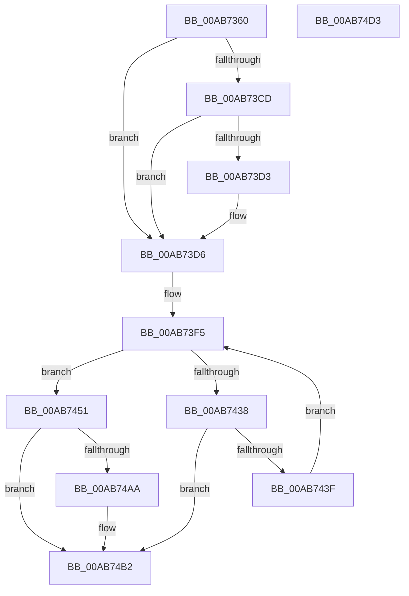

# MmCreateSpecialImageSection

- RVA: `0x00AB7360`–`0x00AB74D4` (길이 `372` bytes)
- VA: `0x0000000140AB7360`
- 실행 섹션: `PAGE`
- PDB 이름 있음: `예`; PDB Function 태그: `아니요`
- unwind 정보 RVA: `0x000BCF9C`
- 디코드: `99`개 명령, `372/372` bytes 표시
- 미해석 바이트: `0` (있으면 어셈블리에 `.byte`로 보존)

> 이 문서는 커널 이미지의 기계어와 PDB 기호를 분석해 생성했습니다. 4번과 5번은 함수 원형과 자료형을 바이너리 사용 방식에서 추정한 C 해석이며 원본 소스 복구 결과는 아닙니다.

## 1. Dependencies

- 직접 호출 지점: **9**; 고유 호출 대상: **9**
- 직접 호출자로 확인된 함수: **2**
- RIP 상대 이미지 참조: **1**

### Outgoing calls
- `0x00AB73C4` → [Feature_TrustedLaunchHosts__private_IsEnabledDeviceUsageNoInline](../../text/4F/Feature_TrustedLaunchHosts__private_IsEnabledDeviceUsageNoInline_function_004F4150.md) (function, `0x004F4150`)
- `0x00AB73E6` → [PsGetProcessSessionIdEx](../../text/22/PsGetProcessSessionIdEx_function_0022F8F0.md) (function, `0x0022F8F0`)
- `0x00AB742F` → [MiCreateSection](../98/MiCreateSection_function_00983EC0.md) (function, `0x00983EC0`)
- `0x00AB744A` → [KeDelayExecutionThread](../../text/20/KeDelayExecutionThread_function_00209550.md) (function, `0x00209550`)
- `0x00AB7456` → [MiSectionControlArea](../../text/29/MiSectionControlArea_function_00294CB0.md) (function, `0x00294CB0`)
- `0x00AB7461` → [MiReferenceControlAreaFile](../../text/43/MiReferenceControlAreaFile_function_00431554.md) (function, `0x00431554`)
- `0x00AB746C` → [CcZeroEndOfLastPage](../../text/45/CcZeroEndOfLastPage_function_00453584.md) (function, `0x00453584`)
- `0x00AB7477` → [MiDereferenceControlAreaFile](../../text/43/MiDereferenceControlAreaFile_function_004345E0.md) (function, `0x004345E0`)
- `0x00AB74A1` → [ObInsertObjectEx](../8B/ObInsertObjectEx_function_008B97A0.md) (function, `0x008B97A0`)

### Direct callers
- [PspLocateSystemDll](../77/PspLocateSystemDll_function_0077F0D0.md) at `0x0077F1BF`
- [NtCreateUserProcess](../AE/NtCreateUserProcess_function_00AEA680.md) at `0x00AEAF12`
- [NtCreateUserProcess](../AE/NtCreateUserProcess_function_00AEA680.md) at `0x00AEB045`

### Static image references
- `0x00AB743F` → RVA `0x00014A38` (`.rdata`; read)

## 2. Other-region calls and transfers

- 다른 실행 섹션으로 향하는 call: **7**
  - `0x00AB73C4` → [Feature_TrustedLaunchHosts__private_IsEnabledDeviceUsageNoInline](../../text/4F/Feature_TrustedLaunchHosts__private_IsEnabledDeviceUsageNoInline_function_004F4150.md) (`PAGE` → `.text`)
  - `0x00AB73E6` → [PsGetProcessSessionIdEx](../../text/22/PsGetProcessSessionIdEx_function_0022F8F0.md) (`PAGE` → `.text`)
  - `0x00AB744A` → [KeDelayExecutionThread](../../text/20/KeDelayExecutionThread_function_00209550.md) (`PAGE` → `.text`)
  - `0x00AB7456` → [MiSectionControlArea](../../text/29/MiSectionControlArea_function_00294CB0.md) (`PAGE` → `.text`)
  - `0x00AB7461` → [MiReferenceControlAreaFile](../../text/43/MiReferenceControlAreaFile_function_00431554.md) (`PAGE` → `.text`)
  - `0x00AB746C` → [CcZeroEndOfLastPage](../../text/45/CcZeroEndOfLastPage_function_00453584.md) (`PAGE` → `.text`)
  - `0x00AB7477` → [MiDereferenceControlAreaFile](../../text/43/MiDereferenceControlAreaFile_function_004345E0.md) (`PAGE` → `.text`)
- 별도 외부 분기/꼬리 이동을 확인하지 못했습니다.

## 3. Assembly (complete function range)

```asm
00AB7360  48 8B C4                        mov rax, rsp
00AB7363  48 89 58 08                     mov qword ptr [rax + 8], rbx
00AB7367  48 89 68 10                     mov qword ptr [rax + 0x10], rbp
00AB736B  48 89 70 18                     mov qword ptr [rax + 0x18], rsi
00AB736F  57                              push rdi
00AB7370  41 54                           push r12
00AB7372  41 55                           push r13
00AB7374  41 56                           push r14
00AB7376  41 57                           push r15
00AB7378  48 81 EC 80 00 00 00            sub rsp, 0x80
00AB737F  48 83 60 D0 00                  and qword ptr [rax - 0x30], 0
00AB7384  45 8A F9                        mov r15b, r9b
00AB7387  48 83 60 C8 00                  and qword ptr [rax - 0x38], 0
00AB738C  4D 8B E0                        mov r12, r8
00AB738F  8B BC 24 D8 00 00 00            mov edi, dword ptr [rsp + 0xd8]
00AB7396  4C 8B EA                        mov r13, rdx
00AB7399  44 8B D7                        mov r10d, edi
00AB739C  4C 8B F1                        mov r14, rcx
00AB739F  41 83 E2 01                     and r10d, 1
00AB73A3  41 8B C2                        mov eax, r10d
00AB73A6  41 8B DA                        mov ebx, r10d
00AB73A9  F7 D8                           neg eax
00AB73AB  1B ED                           sbb ebp, ebp
00AB73AD  83 CB 08                        or ebx, 8
00AB73B0  81 E5 00 00 C0 FE               and ebp, 0xfec00000
00AB73B6  81 C5 00 00 40 02               add ebp, 0x2400000
00AB73BC  40 F6 C7 04                     test dil, 4
00AB73C0  41 0F 44 DA                     cmove ebx, r10d
00AB73C4  E8 87 CD A3 FF                  call 0x1404f4150
00AB73C9  85 C0                           test eax, eax
00AB73CB  74 09                           je 0x140ab73d6
00AB73CD  40 F6 C7 08                     test dil, 8
00AB73D1  74 03                           je 0x140ab73d6
00AB73D3  83 CB 20                        or ebx, 0x20
00AB73D6  65 48 8B 0C 25 88 01 00 00      mov rcx, qword ptr gs:[0x188]
00AB73DF  48 8B 89 B8 00 00 00            mov rcx, qword ptr [rcx + 0xb8]
00AB73E6  E8 05 85 77 FF                  call 0x14022f8f0
00AB73EB  48 8B B4 24 D0 00 00 00         mov rsi, qword ptr [rsp + 0xd0]
00AB73F3  8B F8                           mov edi, eax
00AB73F5  33 C0                           xor eax, eax
00AB73F7  48 8D 4C 24 70                  lea rcx, [rsp + 0x70]
00AB73FC  48 89 44 24 60                  mov qword ptr [rsp + 0x60], rax
00AB7401  45 33 C0                        xor r8d, r8d
00AB7404  89 7C 24 58                     mov dword ptr [rsp + 0x58], edi
00AB7408  49 8B D5                        mov rdx, r13
00AB740B  88 44 24 50                     mov byte ptr [rsp + 0x50], al
00AB740F  48 89 44 24 48                  mov qword ptr [rsp + 0x48], rax
00AB7414  44 8D 48 10                     lea r9d, [rax + 0x10]
00AB7418  48 89 74 24 40                  mov qword ptr [rsp + 0x40], rsi
00AB741D  44 88 7C 24 38                  mov byte ptr [rsp + 0x38], r15b
00AB7422  4C 89 64 24 30                  mov qword ptr [rsp + 0x30], r12
00AB7427  89 5C 24 28                     mov dword ptr [rsp + 0x28], ebx
00AB742B  89 6C 24 20                     mov dword ptr [rsp + 0x20], ebp
00AB742F  E8 8C CA EC FF                  call 0x140983ec0
00AB7434  85 C0                           test eax, eax
00AB7436  79 19                           jns 0x140ab7451
00AB7438  3D 54 00 00 C0                  cmp eax, 0xc0000054
00AB743D  75 73                           jne 0x140ab74b2
00AB743F  4C 8D 05 F2 D5 55 FF            lea r8, [rip - 0xaa2a0e]
00AB7446  33 D2                           xor edx, edx
00AB7448  33 C9                           xor ecx, ecx
00AB744A  E8 01 21 75 FF                  call 0x140209550
00AB744F  EB A4                           jmp 0x140ab73f5
00AB7451  48 8B 4C 24 70                  mov rcx, qword ptr [rsp + 0x70]
00AB7456  E8 55 D8 7D FF                  call 0x140294cb0
00AB745B  48 8B C8                        mov rcx, rax
00AB745E  48 8B F8                        mov rdi, rax
00AB7461  E8 EE A0 97 FF                  call 0x140431554
00AB7466  48 8B C8                        mov rcx, rax
00AB7469  48 8B D8                        mov rbx, rax
00AB746C  E8 13 C1 99 FF                  call 0x140453584
00AB7471  48 8B D3                        mov rdx, rbx
00AB7474  48 8B CF                        mov rcx, rdi
00AB7477  E8 64 D1 97 FF                  call 0x1404345e0
00AB747C  48 8B 4C 24 70                  mov rcx, qword ptr [rsp + 0x70]
00AB7481  48 8D 44 24 78                  lea rax, [rsp + 0x78]
00AB7486  48 89 44 24 30                  mov qword ptr [rsp + 0x30], rax
00AB748B  45 33 C9                        xor r9d, r9d
00AB748E  48 83 64 24 28 00               and qword ptr [rsp + 0x28], 0
00AB7494  33 D2                           xor edx, edx
00AB7496  83 64 24 20 00                  and dword ptr [rsp + 0x20], 0
00AB749B  41 B8 1F 00 0F 00               mov r8d, 0xf001f
00AB74A1  E8 FA 22 E0 FF                  call 0x1408b97a0
00AB74A6  85 C0                           test eax, eax
00AB74A8  78 08                           js 0x140ab74b2
00AB74AA  48 8B 4C 24 78                  mov rcx, qword ptr [rsp + 0x78]
00AB74AF  49 89 0E                        mov qword ptr [r14], rcx
00AB74B2  4C 8D 9C 24 80 00 00 00         lea r11, [rsp + 0x80]
00AB74BA  49 8B 5B 30                     mov rbx, qword ptr [r11 + 0x30]
00AB74BE  49 8B 6B 38                     mov rbp, qword ptr [r11 + 0x38]
00AB74C2  49 8B 73 40                     mov rsi, qword ptr [r11 + 0x40]
00AB74C6  49 8B E3                        mov rsp, r11
00AB74C9  41 5F                           pop r15
00AB74CB  41 5E                           pop r14
00AB74CD  41 5D                           pop r13
00AB74CF  41 5C                           pop r12
00AB74D1  5F                              pop rdi
00AB74D2  C3                              ret
00AB74D3  CC                              int3
```

## 4. C-style interpretation (structured pseudocode)

```c
__int64 __fastcall MmCreateSpecialImageSection(__int64 a1, __int64 a2, __int64 a3, unsigned __int8 a4, __int64 a5, unsigned int a6)
{
    __int64 result;
    __int64 v_r10;
    __int64 v_rbp;
    __int64 v_rbx;
    __int64 v_rsp;
    unsigned __int64 v_stack_m28;
    unsigned __int64 v_stack_m30;
    unsigned __int64 v_stack_m38;
    unsigned __int64 v_stack_m48;
    unsigned int v_stack_m50;
    unsigned __int8 v_stack_m58;
    unsigned __int64 v_stack_m60;
    unsigned __int64 v_stack_m68;
    unsigned __int8 v_stack_m70;
    unsigned __int64 v_stack_m78;
    unsigned int v_stack_m80;
    unsigned int v_stack_m88;

    *(unsigned __int64 *)(v_rsp + 8) = v_rbx;
    *(unsigned __int64 *)(v_rsp + 16) = v_rbp;
    *(unsigned __int64 *)(v_rsp + 24) = v_rsi;
    v_rsp = (v_rsp) - (128);
    v_r10 = (unsigned int)(((unsigned int)((unsigned int)((unsigned int)(a6)))) & (1));
    result = (unsigned int)(-((unsigned int)((unsigned int)(v_r10))));
    v_rbx = (unsigned int)(((unsigned int)((unsigned int)(v_r10))) | (8));
    v_rbp = (unsigned int)((v_rbp) & (0xFEC00000ULL));
    v_rbp = (unsigned int)((v_rbp) + (0x2400000ULL));
    if ((((unsigned __int8)((unsigned int)(a6))) & (4)) == 0) { v_rbx = (unsigned int)(v_r10); }
    result = Feature_TrustedLaunchHosts__private_IsEnabledDeviceUsageNoInline(a1, a2, a3, a4);
    if ((unsigned int)(result) == 0) goto loc_00AB73D6;
    if ((((unsigned __int8)((unsigned int)(a6))) & (8)) != 0) {
        v_rbx = (unsigned int)((v_rbx) | (32));
    }
    result = PsGetProcessSessionIdEx(*(unsigned __int64 *)(*(unsigned __int64 *)(gs_base + (0 + 392)) + 184), a2, a3, a4);
loc_00AB73F5:
    result = 0;
    v_stack_m48 = 0;
    a3 = 0;
    v_stack_m50 = (unsigned int)((unsigned int)((unsigned int)(result)));
    v_stack_m58 = 0;
    v_stack_m60 = 0;
    v_stack_m68 = a5;
    v_stack_m70 = a4;
    v_stack_m78 = 0;
    v_stack_m80 = (unsigned int)(v_rbx);
    v_stack_m88 = (unsigned int)(v_rbp);
    result = MiCreateSection(v_stack_m38, a2, a3, result + 16);
    if (!sign_flag) goto loc_00AB7451;
    if (((unsigned int)(result)) != 0xC0000054ULL) goto loc_00AB74B2;
    a2 = 0;
    a1 = 0;
    result = KeDelayExecutionThread(a1, a2, v_rip - 11151886, result + 16);
    goto loc_00AB73F5;
loc_00AB7451:
    result = MiSectionControlArea(v_stack_m38, a2, v_rip - 11151886, result + 16);
    result = MiReferenceControlAreaFile(result, a2, v_rip - 11151886, result + 16);
    result = CcZeroEndOfLastPage(result, a2, v_rip - 11151886, result + 16);
    result = MiDereferenceControlAreaFile(result, result, v_rip - 11151886, result + 16);
    v_stack_m78 = v_stack_m30;
    a4 = 0;
    a2 = 0;
    result = ObInsertObjectEx(v_stack_m38, a2, (unsigned int)(0xF001FULL), a4);
    if (!(sign_flag)) {
        a1 = v_stack_m30;
        *(unsigned __int64 *)(a1) = a1;
    }
    return result;
}
```

## 5. (Beta) C Style

```c
int64_t MmCreateSpecialImageSection(void *Arg1, int64_t Arg2, int64_t Arg3, uint8_t Arg4, int64_t Arg5, uint32_t Arg6)
{
    uint8_t *arg1 = (uint8_t *)Arg1;

    int64_t result;
    int64_t local_r10;
    int64_t local_rbp;
    int64_t local_rbx;
    int64_t local_rsp;
    uint64_t v_stack_m28;
    uint64_t v_stack_m30;
    uint64_t v_stack_m38;
    uint64_t v_stack_m48;
    uint32_t v_stack_m50;
    uint8_t v_stack_m58;
    uint64_t v_stack_m60;
    uint64_t v_stack_m68;
    uint8_t v_stack_m70;
    uint64_t v_stack_m78;
    uint32_t v_stack_m80;
    uint32_t v_stack_m88;

    *(uint64_t *)(local_rsp + 0x8) = local_rbx;
    *(uint64_t *)(local_rsp + 0x10) = local_rbp;
    *(uint64_t *)(local_rsp + 0x18) = local_rsi;
    local_rsp = (local_rsp) - (128);
    local_r10 = (uint32_t)(((uint32_t)((uint32_t)((uint32_t)(Arg6)))) & (1));
    result = (uint32_t)(-((uint32_t)((uint32_t)(local_r10))));
    local_rbx = (uint32_t)(((uint32_t)((uint32_t)(local_r10))) | (8));
    local_rbp = (uint32_t)((local_rbp) & (0xFEC00000ULL));
    local_rbp = (uint32_t)((local_rbp) + (0x2400000ULL));
    if ((((uint8_t)((uint32_t)(Arg6))) & (4)) == 0) { local_rbx = (uint32_t)(local_r10); }
    result = Feature_TrustedLaunchHosts__private_IsEnabledDeviceUsageNoInline(Arg1, Arg2, Arg3, Arg4);
    if ((uint32_t)(result) == 0) goto loc_00AB73D6;
    if ((((uint8_t)((uint32_t)(Arg6))) & (8)) != 0) {
        local_rbx = (uint32_t)((local_rbx) | (32));
    }
    result = PsGetProcessSessionIdEx(*(uint64_t *)(*(uint64_t *)(gs_base + (0 + 0x188)) + 0xB8), Arg2, Arg3, Arg4);
loc_00AB73F5:
    result = 0;
    v_stack_m48 = 0;
    Arg3 = 0;
    v_stack_m50 = (uint32_t)((uint32_t)((uint32_t)(result)));
    v_stack_m58 = 0;
    v_stack_m60 = 0;
    v_stack_m68 = Arg5;
    v_stack_m70 = Arg4;
    v_stack_m78 = 0;
    v_stack_m80 = (uint32_t)(local_rbx);
    v_stack_m88 = (uint32_t)(local_rbp);
    result = MiCreateSection(v_stack_m38, Arg2, Arg3, result + 16);
    if (!sign_flag) goto loc_00AB7451;
    if (((uint32_t)(result)) != 0xC0000054ULL) goto loc_00AB74B2;
    Arg2 = 0;
    Arg1 = 0;
    result = KeDelayExecutionThread(Arg1, Arg2, v_rip - 11151886, result + 16);
    goto loc_00AB73F5;
loc_00AB7451:
    result = MiSectionControlArea(v_stack_m38, Arg2, v_rip - 11151886, result + 16);
    result = MiReferenceControlAreaFile(result, Arg2, v_rip - 11151886, result + 16);
    result = CcZeroEndOfLastPage(result, Arg2, v_rip - 11151886, result + 16);
    result = MiDereferenceControlAreaFile(result, result, v_rip - 11151886, result + 16);
    v_stack_m78 = v_stack_m30;
    Arg4 = 0;
    Arg2 = 0;
    result = ObInsertObjectEx(v_stack_m38, Arg2, (uint32_t)(0xF001FULL), Arg4);
    if (!(sign_flag)) {
        Arg1 = v_stack_m30;
        *(void **)(arg1) = Arg1;
    }
    return result;
}
```

### 관측된 메모리 오프셋

구조체 형식이 확인되지 않은 접근은 인자 기준의 오프셋으로만 기록했습니다.

| 기준 인자 | 오프셋 표현 | 폭 (bit) | 접근 |
|---|---:|---:|---|
| `Arg1` | `+ 0x0` | `64` | `W` |

## 6. Execution-region graph

[열기: 2D/3D 그래프와 함수 탐색 컨트롤 패널](../../../control-panel.html?section=page&rva=0x00AB7360&view=graph)

- 2D 그래프는 위에서 아래로 흐르고, 3D 그래프는 빈 공간을 드래그해 회전합니다. Shift+드래그는 이동, 휠은 확대·축소, 함수 노드 선택은 대상 보고서 이동입니다.

### Static fallback


