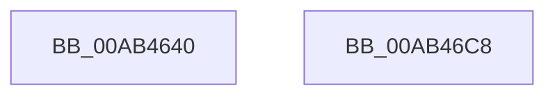

# MmFreeNonCachedMemory

- RVA: `0x00AB4640`–`0x00AB46C9` (길이 `137` bytes)
- VA: `0x0000000140AB4640`
- 실행 섹션: `PAGE`
- PDB 이름 있음: `예`; PDB Function 태그: `아니요`
- unwind 정보 RVA: `0x0005CF00`
- 디코드: `33`개 명령, `137/137` bytes 표시
- 미해석 바이트: `0` (있으면 어셈블리에 `.byte`로 보존)

> 이 문서는 커널 이미지의 기계어와 PDB 기호를 분석해 생성했습니다. 4번과 5번은 함수 원형과 자료형을 바이너리 사용 방식에서 추정한 C 해석이며 원본 소스 복구 결과는 아닙니다.

## 1. Dependencies

- 직접 호출 지점: **5**; 고유 호출 대상: **5**
- 직접 호출자로 확인된 함수: **1**
- RIP 상대 이미지 참조: **1**

### Outgoing calls
- `0x00AB4649` → [MiGetPteAddress](../../text/43/MiGetPteAddress_function_0043E130.md) (function, `0x0043E130`)
- `0x00AB4683` → [MiMakeDemandZeroPte](../../text/33/MiMakeDemandZeroPte_function_00337A00.md) (function, `0x00337A00`)
- `0x00AB46AB` → [MiReleasePtes](../../text/24/MiReleasePtes_function_00247240.md) (function, `0x00247240`)
- `0x00AB46B3` → [MmFreePagesFromMdl](../../text/3F/MmFreePagesFromMdl_function_003F82E0.md) (function, `0x003F82E0`)
- `0x00AB46BD` → [ExFreePoolWithTag](../../poolcode/B8/ExFreePoolWithTag_function_00B82870.md) (function, `0x00B82870`)

### Direct callers
- [DifMmFreeNonCachedMemoryWrapper](../../text/63/DifMmFreeNonCachedMemoryWrapper_function_006354C0.md) at `0x00635597`

### Static image references
- `0x00AB468C` → RVA `0x00E35E80` (`.data`; read)

## 2. Other-region calls and transfers

- 다른 실행 섹션으로 향하는 call: **5**
  - `0x00AB4649` → [MiGetPteAddress](../../text/43/MiGetPteAddress_function_0043E130.md) (`PAGE` → `.text`)
  - `0x00AB4683` → [MiMakeDemandZeroPte](../../text/33/MiMakeDemandZeroPte_function_00337A00.md) (`PAGE` → `.text`)
  - `0x00AB46AB` → [MiReleasePtes](../../text/24/MiReleasePtes_function_00247240.md) (`PAGE` → `.text`)
  - `0x00AB46B3` → [MmFreePagesFromMdl](../../text/3F/MmFreePagesFromMdl_function_003F82E0.md) (`PAGE` → `.text`)
  - `0x00AB46BD` → [ExFreePoolWithTag](../../poolcode/B8/ExFreePoolWithTag_function_00B82870.md) (`PAGE` → `POOLCODE`)
- 별도 외부 분기/꼬리 이동을 확인하지 못했습니다.

## 3. Assembly (complete function range)

```asm
00AB4640  40 53                           push rbx
00AB4642  48 83 EC 20                     sub rsp, 0x20
00AB4646  4C 8B CA                        mov r9, rdx
00AB4649  E8 E2 9A 98 FF                  call 0x14043e130
00AB464E  48 8B D0                        mov rdx, rax
00AB4651  48 8B 08                        mov rcx, qword ptr [rax]
00AB4654  48 B8 FF FF FF FF FF 00 00 00   movabs rax, 0xffffffffff
00AB465E  48 C1 E9 0C                     shr rcx, 0xc
00AB4662  48 23 C8                        and rcx, rax
00AB4665  4C 8D 04 49                     lea r8, [rcx + rcx*2]
00AB4669  49 C1 E0 04                     shl r8, 4
00AB466D  48 B8 00 00 00 00 00 DE FF FF   movabs rax, 0xffffde0000000000
00AB4677  4C 03 C0                        add r8, rax
00AB467A  B9 04 00 00 00                  mov ecx, 4
00AB467F  49 8B 58 10                     mov rbx, qword ptr [r8 + 0x10]
00AB4683  E8 78 33 88 FF                  call 0x140337a00
00AB4688  49 89 40 10                     mov qword ptr [r8 + 0x10], rax
00AB468C  48 8D 0D ED 17 38 00            lea rcx, [rip + 0x3817ed]
00AB4693  49 F7 C1 FF 0F 00 00            test r9, 0xfff
00AB469A  41 B8 00 00 00 00               mov r8d, 0
00AB46A0  41 0F 95 C0                     setne r8b
00AB46A4  49 C1 E9 0C                     shr r9, 0xc
00AB46A8  45 03 C1                        add r8d, r9d
00AB46AB  E8 90 2B 79 FF                  call 0x140247240
00AB46B0  48 8B CB                        mov rcx, rbx
00AB46B3  E8 28 3C 94 FF                  call 0x1403f82e0
00AB46B8  33 D2                           xor edx, edx
00AB46BA  48 8B CB                        mov rcx, rbx
00AB46BD  E8 AE E1 0C 00                  call 0x140b82870
00AB46C2  48 83 C4 20                     add rsp, 0x20
00AB46C6  5B                              pop rbx
00AB46C7  C3                              ret
00AB46C8  CC                              int3
```

## 4. C-style interpretation (structured pseudocode)

```c
__int64 __fastcall MmFreeNonCachedMemory(__int64 a1, __int64 a2)
{
    __int64 result;
    __int64 v_rsp;

    v_rsp = (v_rsp) - (32);
    result = MiGetPteAddress(a1, a2, a3, a2);
    a1 = (*(unsigned __int64 *)(result)) >> (12);
    a1 = (a1) & (result);
    a3 = (a1 + a1 * 2) << (4);
    a3 = (a3) + (result);
    result = MiMakeDemandZeroPte(4, result, a3, a2);
    *(unsigned __int64 *)(a3 + 16) = result;
    a3 = (((a2) & (0xFFFULL)) != 0) ? 1 : 0;
    a4 = (a2) >> (12);
    a3 = (unsigned int)((a3) + ((unsigned int)(a4)));
    result = MiReleasePtes(v_rip + 3676141, result, a3, a4);
    result = MmFreePagesFromMdl(*(unsigned __int64 *)(a3 + 16), result, a3, a4);
    a2 = 0;
    result = ExFreePoolWithTag(*(unsigned __int64 *)(a3 + 16), a2, a3, a4);
    v_rsp = (v_rsp) + (32);
    return result;
}
```

## 5. (Beta) C Style

```c
int64_t MmFreeNonCachedMemory(int64_t Arg1, int64_t Arg2)
{
    int64_t result;
    int64_t local_rsp;

    local_rsp = (local_rsp) - (32);
    result = MiGetPteAddress(Arg1, Arg2, a3, Arg2);
    Arg1 = (*(uint64_t *)(result)) >> (12);
    Arg1 = (Arg1) & (result);
    a3 = (Arg1 + Arg1 * 2) << (4);
    a3 = (a3) + (result);
    result = MiMakeDemandZeroPte(4, result, a3, Arg2);
    *(uint64_t *)(a3 + 0x10) = result;
    a3 = (((Arg2) & (0xFFFULL)) != 0) ? 1 : 0;
    a4 = (Arg2) >> (12);
    a3 = (uint32_t)((a3) + ((uint32_t)(a4)));
    result = MiReleasePtes(v_rip + 3676141, result, a3, a4);
    result = MmFreePagesFromMdl(*(uint64_t *)(a3 + 0x10), result, a3, a4);
    Arg2 = 0;
    result = ExFreePoolWithTag(*(uint64_t *)(a3 + 0x10), Arg2, a3, a4);
    local_rsp = (local_rsp) + (32);
    return result;
}
```

## 6. Execution-region graph

[열기: 2D/3D 그래프와 함수 탐색 컨트롤 패널](../../../control-panel.html?section=page&rva=0x00AB4640&view=graph)

- 2D 그래프는 위에서 아래로 흐르고, 3D 그래프는 빈 공간을 드래그해 회전합니다. Shift+드래그는 이동, 휠은 확대·축소, 함수 노드 선택은 대상 보고서 이동입니다.

### Static fallback


