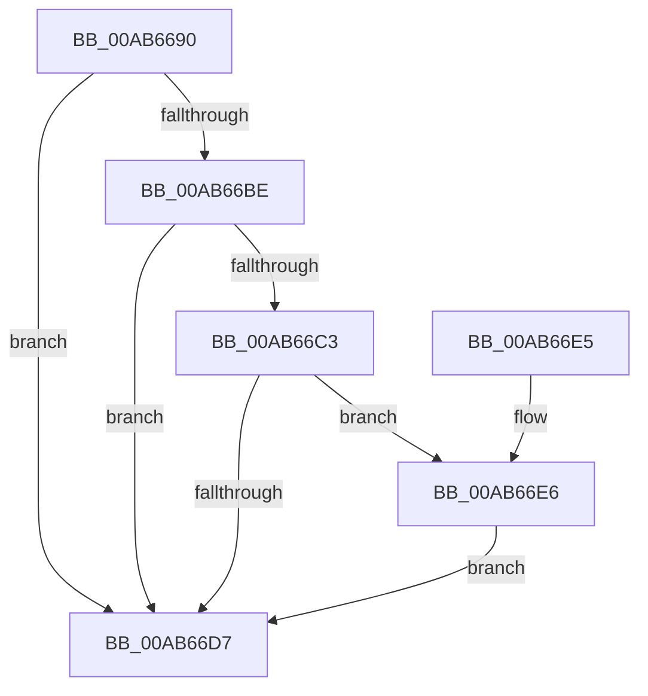

# MmMapProtectedKernelPage

- RVA: `0x00AB6690`–`0x00AB66F9` (길이 `105` bytes)
- VA: `0x0000000140AB6690`
- 실행 섹션: `PAGE`
- PDB 이름 있음: `예`; PDB Function 태그: `아니요`
- unwind 정보 RVA: `0x00065624`
- 디코드: `28`개 명령, `105/105` bytes 표시
- 미해석 바이트: `0` (있으면 어셈블리에 `.byte`로 보존)

> 이 문서는 커널 이미지의 기계어와 PDB 기호를 분석해 생성했습니다. 4번과 5번은 함수 원형과 자료형을 바이너리 사용 방식에서 추정한 C 해석이며 원본 소스 복구 결과는 아닙니다.

## 1. Dependencies

- 직접 호출 지점: **4**; 고유 호출 대상: **3**
- 직접 호출자로 확인된 함수: **1**
- RIP 상대 이미지 참조: **1**

### Outgoing calls
- `0x00AB669A` → [MiGetPteAddress](../../text/43/MiGetPteAddress_function_0043E130.md) (function, `0x0043E130`)
- `0x00AB66AB` → [MiMakeValidPte](../../text/2C/MiMakeValidPte_function_002C5590.md) (function, `0x002C5590`)
- `0x00AB66CD` → [MiGetPteAddress](../../text/43/MiGetPteAddress_function_0043E130.md) (function, `0x0043E130`)
- `0x00AB66F2` → [MiCheckLinearProtectedPteAccessedBit](../../text/29/MiCheckLinearProtectedPteAccessedBit_function_00292D80.md) (function, `0x00292D80`)

### Direct callers
- [sub_006F88AE](../../text/6F/Unknown_function_006F88AE.md) at `0x006F8D3E`

### Static image references
- `0x00AB66B0` → RVA `0x00FC6A88` (`ALMOSTRO`; read)

## 2. Other-region calls and transfers

- 다른 실행 섹션으로 향하는 call: **4**
  - `0x00AB669A` → [MiGetPteAddress](../../text/43/MiGetPteAddress_function_0043E130.md) (`PAGE` → `.text`)
  - `0x00AB66AB` → [MiMakeValidPte](../../text/2C/MiMakeValidPte_function_002C5590.md) (`PAGE` → `.text`)
  - `0x00AB66CD` → [MiGetPteAddress](../../text/43/MiGetPteAddress_function_0043E130.md) (`PAGE` → `.text`)
  - `0x00AB66F2` → [MiCheckLinearProtectedPteAccessedBit](../../text/29/MiCheckLinearProtectedPteAccessedBit_function_00292D80.md) (`PAGE` → `.text`)
- 별도 외부 분기/꼬리 이동을 확인하지 못했습니다.

## 3. Assembly (complete function range)

```asm
00AB6690  48 89 5C 24 08                  mov qword ptr [rsp + 8], rbx
00AB6695  57                              push rdi
00AB6696  48 83 EC 20                     sub rsp, 0x20
00AB669A  E8 91 7A 98 FF                  call 0x14043e130
00AB669F  48 8B C8                        mov rcx, rax
00AB66A2  41 B8 01 00 00 20               mov r8d, 0x20000001
00AB66A8  48 8B F8                        mov rdi, rax
00AB66AB  E8 E0 EE 80 FF                  call 0x1402c5590
00AB66B0  48 0F BA 25 CF 03 51 00 24      bt qword ptr [rip + 0x5103cf], 0x24
00AB66B9  48 8B D8                        mov rbx, rax
00AB66BC  73 19                           jae 0x140ab66d7
00AB66BE  F6 C3 20                        test bl, 0x20
00AB66C1  75 14                           jne 0x140ab66d7
00AB66C3  48 B9 00 00 00 00 00 80 FF FF   movabs rcx, 0xffff800000000000
00AB66CD  E8 5E 7A 98 FF                  call 0x14043e130
00AB66D2  48 3B F8                        cmp rdi, rax
00AB66D5  73 0F                           jae 0x140ab66e6
00AB66D7  48 89 1F                        mov qword ptr [rdi], rbx
00AB66DA  48 8B 5C 24 30                  mov rbx, qword ptr [rsp + 0x30]
00AB66DF  48 83 C4 20                     add rsp, 0x20
00AB66E3  5F                              pop rdi
00AB66E4  C3                              ret
00AB66E5  CC                              int3
00AB66E6  41 B8 80 00 00 00               mov r8d, 0x80
00AB66EC  48 8B D3                        mov rdx, rbx
00AB66EF  48 8B CF                        mov rcx, rdi
00AB66F2  E8 89 C6 7D FF                  call 0x140292d80
00AB66F7  EB DE                           jmp 0x140ab66d7
```

## 4. C-style interpretation (structured pseudocode)

```c
__int64 __fastcall MmMapProtectedKernelPage(void)
{
    __int64 result;
    __int64 v_rsp;
    unsigned __int64 v_stack_p8;

    v_stack_p8 = v_rbx;
    v_rsp = (v_rsp) - (32);
    result = MiGetPteAddress(a1, a2, a3, a4);
    result = MiMakeValidPte(result, a2, (unsigned int)(0x20000001ULL), a4);
    if (condition_is_above_or_equal) goto loc_00AB66D7;
    if ((((unsigned __int8)(result)) & (32)) != 0) goto loc_00AB66D7;
    result = MiGetPteAddress(result, a2, (unsigned int)(0x20000001ULL), a4);
    if (result >= result) goto loc_00AB66E6;
loc_00AB66D7:
    *(unsigned __int64 *)(result) = result;
    v_rsp = (v_rsp) + (32);
    return result;
loc_00AB66E6:
    result = MiCheckLinearProtectedPteAccessedBit(result, v_stack_p8, 128, a4);
    goto loc_00AB66D7;
}
```

## 5. (Beta) C Style

```c
void MmMapProtectedKernelPage(void)
{
    int64_t result;
    int64_t local_rsp;
    uint64_t v_stack_p8;

    v_stack_p8 = local_rbx;
    local_rsp = (local_rsp) - (32);
    result = MiGetPteAddress(a1, a2, a3, a4);
    result = MiMakeValidPte(result, a2, (uint32_t)(0x20000001ULL), a4);
    if (condition_is_above_or_equal) goto loc_00AB66D7;
    if ((((uint8_t)(result)) & (32)) != 0) goto loc_00AB66D7;
    result = MiGetPteAddress(result, a2, (uint32_t)(0x20000001ULL), a4);
    if (result >= result) goto loc_00AB66E6;
loc_00AB66D7:
    *(uint64_t *)(result) = result;
    local_rsp = (local_rsp) + (32);
    return result;
loc_00AB66E6:
    result = MiCheckLinearProtectedPteAccessedBit(result, v_stack_p8, 128, a4);
    goto loc_00AB66D7;
}
```

## 6. Execution-region graph

[열기: 2D/3D 그래프와 함수 탐색 컨트롤 패널](../../../control-panel.html?section=page&rva=0x00AB6690&view=graph)

- 2D 그래프는 위에서 아래로 흐르고, 3D 그래프는 빈 공간을 드래그해 회전합니다. Shift+드래그는 이동, 휠은 확대·축소, 함수 노드 선택은 대상 보고서 이동입니다.

### Static fallback


