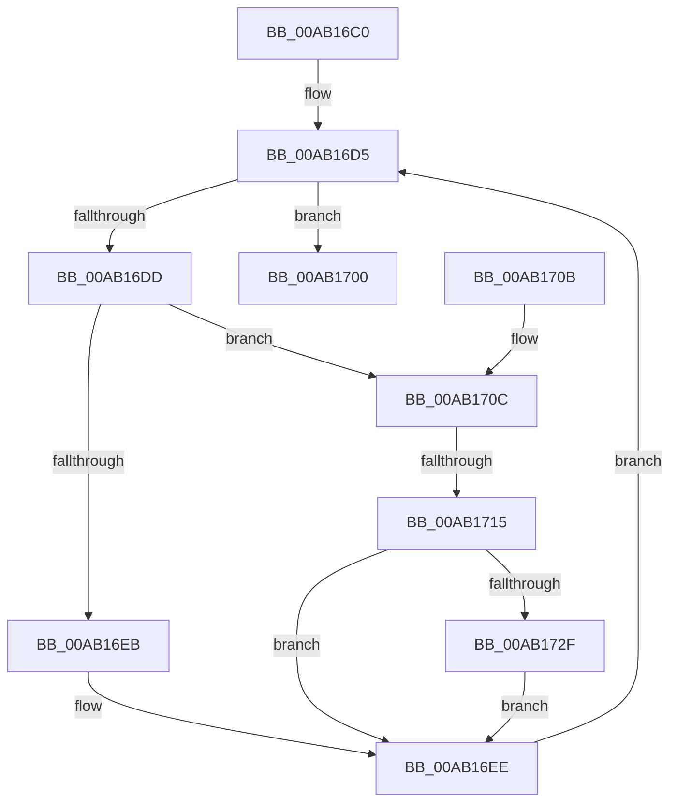

# MmSetMinimumAgeRate

- RVA: `0x00AB16C0`–`0x00AB1736` (길이 `118` bytes)
- VA: `0x0000000140AB16C0`
- 실행 섹션: `PAGE`
- PDB 이름 있음: `예`; PDB Function 태그: `예`
- unwind 정보 RVA: `0x000ACE78`
- 디코드: `37`개 명령, `118/118` bytes 표시
- 미해석 바이트: `0` (있으면 어셈블리에 `.byte`로 보존)

> 이 문서는 커널 이미지의 기계어와 PDB 기호를 분석해 생성했습니다. 4번과 5번은 함수 원형과 자료형을 바이너리 사용 방식에서 추정한 C 해석이며 원본 소스 복구 결과는 아닙니다.

## 1. Dependencies

- 직접 호출 지점: **2**; 고유 호출 대상: **1**
- 직접 호출자로 확인된 함수: **1**
- RIP 상대 이미지 참조: **0**

### Outgoing calls
- `0x00AB16CE` → [PsGetNextPartition](../../text/3B/PsGetNextPartition_function_003B9D5C.md) (function, `0x003B9D5C`)
- `0x00AB16F9` → [PsGetNextPartition](../../text/3B/PsGetNextPartition_function_003B9D5C.md) (function, `0x003B9D5C`)

### Direct callers
- [PfSetSuperfetchInformation](../AD/PfSetSuperfetchInformation_function_00ADE6E8.md) at `0x00ADED6F`

### Static image references
- 디코드된 RIP-relative 메모리 참조가 없습니다.

## 2. Other-region calls and transfers

- 다른 실행 섹션으로 향하는 call: **2**
  - `0x00AB16CE` → [PsGetNextPartition](../../text/3B/PsGetNextPartition_function_003B9D5C.md) (`PAGE` → `.text`)
  - `0x00AB16F9` → [PsGetNextPartition](../../text/3B/PsGetNextPartition_function_003B9D5C.md) (`PAGE` → `.text`)
- call이 아닌 외부 분기/꼬리 이동: **1**
  - `0x00AB170F` → [sub_00B4A994](../B4/Unknown_function_00B4A994.md) (`tail-transfer`)

## 3. Assembly (complete function range)

```asm
00AB16C0  48 89 5C 24 08                  mov qword ptr [rsp + 8], rbx
00AB16C5  57                              push rdi
00AB16C6  48 83 EC 20                     sub rsp, 0x20
00AB16CA  8B D9                           mov ebx, ecx
00AB16CC  33 C9                           xor ecx, ecx
00AB16CE  E8 89 86 90 FF                  call 0x1403b9d5c
00AB16D3  33 FF                           xor edi, edi
00AB16D5  4C 8B C0                        mov r8, rax
00AB16D8  48 85 C0                        test rax, rax
00AB16DB  74 23                           je 0x140ab1700
00AB16DD  48 8B 10                        mov rdx, qword ptr [rax]
00AB16E0  4C 8B 8A C0 44 00 00            mov r9, qword ptr [rdx + 0x44c0]
00AB16E7  85 DB                           test ebx, ebx
00AB16E9  75 21                           jne 0x140ab170c
00AB16EB  0F B7 C7                        movzx eax, di
00AB16EE  49 8B C8                        mov rcx, r8
00AB16F1  66 41 89 81 14 01 00 00         mov word ptr [r9 + 0x114], ax
00AB16F9  E8 5E 86 90 FF                  call 0x1403b9d5c
00AB16FE  EB D5                           jmp 0x140ab16d5
00AB1700  48 8B 5C 24 30                  mov rbx, qword ptr [rsp + 0x30]
00AB1705  48 83 C4 20                     add rsp, 0x20
00AB1709  5F                              pop rdi
00AB170A  C3                              ret
00AB170B  CC                              int3
00AB170C  83 FB 0C                        cmp ebx, 0xc
00AB170F  0F 82 7F 92 09 00               jb 0x140b4a994
00AB1715  B8 AB AA AA AA                  mov eax, 0xaaaaaaab
00AB171A  F7 E3                           mul ebx
00AB171C  B8 E8 03 00 00                  mov eax, 0x3e8
00AB1721  8B CA                           mov ecx, edx
00AB1723  33 D2                           xor edx, edx
00AB1725  C1 E9 02                        shr ecx, 2
00AB1728  F7 F1                           div ecx
00AB172A  83 F8 01                        cmp eax, 1
00AB172D  77 BF                           ja 0x140ab16ee
00AB172F  B8 01 00 00 00                  mov eax, 1
00AB1734  EB B8                           jmp 0x140ab16ee
```

## 4. C-style interpretation (structured pseudocode)

```c
__int64 __fastcall MmSetMinimumAgeRate(int a1)
{
    __int64 result;
    __int64 v_rdi;
    __int64 v_rsp;
    unsigned __int64 v_stack_p8;

    v_stack_p8 = v_rbx;
    v_rsp = (v_rsp) - (32);
    a1 = 0;
    result = PsGetNextPartition(a1, a2, a3, a4);
    v_rdi = 0;
loc_00AB16D5:
    if (result == 0) goto loc_00AB1700;
    if ((unsigned int)((unsigned int)(a1)) != 0) goto loc_00AB170C;
loc_00AB16EE:
    *(unsigned __int16 *)(*(unsigned __int64 *)(*(unsigned __int64 *)(result) + 17600) + 276) = 0;
    result = PsGetNextPartition(result, *(unsigned __int64 *)(result), result, *(unsigned __int64 *)(*(unsigned __int64 *)(result) + 17600));
    goto loc_00AB16D5;
loc_00AB1700:
    v_rsp = (v_rsp) + (32);
    return result;
loc_00AB170C:
    a2 = 0;
    a1 = (unsigned int)(((unsigned int)((unsigned int)(*(unsigned __int64 *)(result)))) >> (2));
    if (1000 > 1) goto loc_00AB16EE;
    goto loc_00AB16EE;
}
```

## 5. (Beta) C Style

```c
int64_t MmSetMinimumAgeRate(int32_t Arg1)
{
    int64_t result;
    int64_t local_rdi;
    int64_t local_rsp;
    uint64_t v_stack_p8;

    v_stack_p8 = local_rbx;
    local_rsp = (local_rsp) - (32);
    Arg1 = 0;
    result = PsGetNextPartition(Arg1, a2, a3, a4);
    local_rdi = 0;
loc_00AB16D5:
    if (result == 0) goto loc_00AB1700;
    if ((uint32_t)((uint32_t)(Arg1)) != 0) goto loc_00AB170C;
loc_00AB16EE:
    *(uint16_t *)(*(uint64_t *)(*(uint64_t *)(result) + 0x44C0) + 0x114) = 0;
    result = PsGetNextPartition(result, *(uint64_t *)(result), result, *(uint64_t *)(*(uint64_t *)(result) + 0x44C0));
    goto loc_00AB16D5;
loc_00AB1700:
    local_rsp = (local_rsp) + (32);
    return result;
loc_00AB170C:
    a2 = 0;
    Arg1 = (uint32_t)(((uint32_t)((uint32_t)(*(uint64_t *)(result)))) >> (2));
    if (1000 > 1) goto loc_00AB16EE;
    goto loc_00AB16EE;
}
```

## 6. Execution-region graph

[열기: 2D/3D 그래프와 함수 탐색 컨트롤 패널](../../../control-panel.html?section=page&rva=0x00AB16C0&view=graph)

- 2D 그래프는 위에서 아래로 흐르고, 3D 그래프는 빈 공간을 드래그해 회전합니다. Shift+드래그는 이동, 휠은 확대·축소, 함수 노드 선택은 대상 보고서 이동입니다.

### Static fallback


