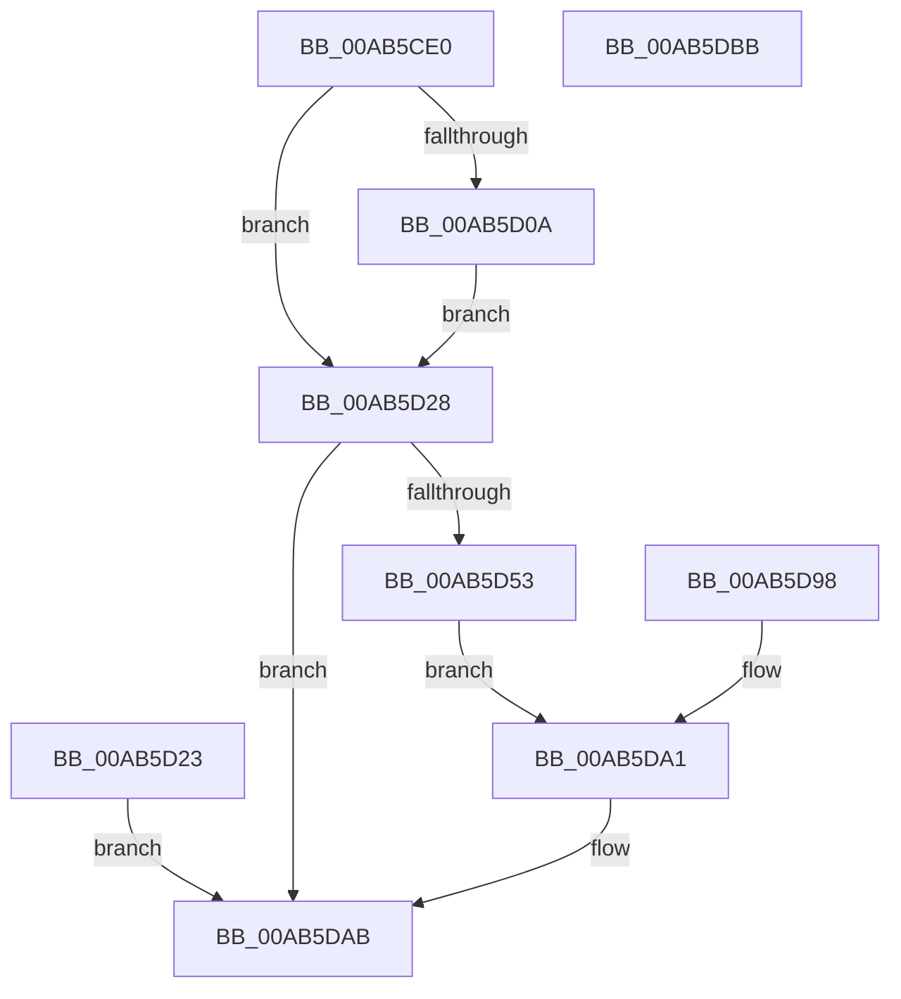

# NtCancelSynchronousIoFile

- RVA: `0x00AB5CE0`–`0x00AB5DBC` (길이 `220` bytes)
- VA: `0x0000000140AB5CE0`
- 실행 섹션: `PAGE`
- PDB 이름 있음: `예`; PDB Function 태그: `아니요`
- unwind 정보 RVA: `0x000BCD34`
- 디코드: `53`개 명령, `220/220` bytes 표시
- 미해석 바이트: `0` (있으면 어셈블리에 `.byte`로 보존)

> 이 문서는 커널 이미지의 기계어와 PDB 기호를 분석해 생성했습니다. 4번과 5번은 함수 원형과 자료형을 바이너리 사용 방식에서 추정한 C 해석이며 원본 소스 복구 결과는 아닙니다.

## 1. Dependencies

- 직접 호출 지점: **3**; 고유 호출 대상: **3**
- 직접 호출자로 확인된 함수: **0**
- RIP 상대 이미지 참조: **1**

### Outgoing calls
- `0x00AB5D4A` → [ObReferenceObjectByHandle](../86/ObReferenceObjectByHandle_function_00868DB0.md) (function, `0x00868DB0`)
- `0x00AB5D76` → [IopCancelSynchronousIrpsForThread](IopCancelSynchronousIrpsForThread_function_00AB5DC4.md) (function, `0x00AB5DC4`)
- `0x00AB5DA4` → [ObfDereferenceObject](../../text/2F/ObfDereferenceObject_function_002F9350.md) (function, `0x002F9350`)

### Direct callers
- 이 함수 시작 RVA로 연결되는 직접 call은 확인되지 않았습니다. 간접 호출은 완전히 역산할 수 없습니다.

### Static image references
- `0x00AB5D28` → RVA `0x00FC6AC8` (`ALMOSTRO`; read)

## 2. Other-region calls and transfers

- 다른 실행 섹션으로 향하는 call: **1**
  - `0x00AB5DA4` → [ObfDereferenceObject](../../text/2F/ObfDereferenceObject_function_002F9350.md) (`PAGE` → `.text`)
- 별도 외부 분기/꼬리 이동을 확인하지 못했습니다.

## 3. Assembly (complete function range)

```asm
00AB5CE0  48 89 5C 24 08                  mov qword ptr [rsp + 8], rbx
00AB5CE5  48 89 74 24 10                  mov qword ptr [rsp + 0x10], rsi
00AB5CEA  57                              push rdi
00AB5CEB  48 83 EC 40                     sub rsp, 0x40
00AB5CEF  49 8B F0                        mov rsi, r8
00AB5CF2  48 8B DA                        mov rbx, rdx
00AB5CF5  65 48 8B 04 25 88 01 00 00      mov rax, qword ptr gs:[0x188]
00AB5CFE  44 8A 88 32 02 00 00            mov r9b, byte ptr [rax + 0x232]
00AB5D05  45 84 C9                        test r9b, r9b
00AB5D08  74 1E                           je 0x140ab5d28
00AB5D0A  49 B8 00 00 FF FF FF 7F 00 00   movabs r8, 0x7fffffff0000
00AB5D14  49 3B F0                        cmp rsi, r8
00AB5D17  4C 0F 42 C6                     cmovb r8, rsi
00AB5D1B  41 8B 00                        mov eax, dword ptr [r8]
00AB5D1E  41 89 00                        mov dword ptr [r8], eax
00AB5D21  EB 05                           jmp 0x140ab5d28
00AB5D23  E9 83 00 00 00                  jmp 0x140ab5dab
00AB5D28  4C 8B 05 99 0D 51 00            mov r8, qword ptr [rip + 0x510d99]
00AB5D2F  48 83 64 24 30 00               and qword ptr [rsp + 0x30], 0
00AB5D35  48 83 64 24 28 00               and qword ptr [rsp + 0x28], 0
00AB5D3B  48 8D 44 24 30                  lea rax, [rsp + 0x30]
00AB5D40  48 89 44 24 20                  mov qword ptr [rsp + 0x20], rax
00AB5D45  BA 01 00 00 00                  mov edx, 1
00AB5D4A  E8 61 30 DB FF                  call 0x140868db0
00AB5D4F  85 C0                           test eax, eax
00AB5D51  78 58                           js 0x140ab5dab
00AB5D53  65 48 8B 04 25 88 01 00 00      mov rax, qword ptr gs:[0x188]
00AB5D5C  48 FF 80 90 03 00 00            inc qword ptr [rax + 0x390]
00AB5D63  65 FF 04 25 E4 2E 00 00         inc dword ptr gs:[0x2ee4]
00AB5D6B  48 8B D3                        mov rdx, rbx
00AB5D6E  48 8B 7C 24 30                  mov rdi, qword ptr [rsp + 0x30]
00AB5D73  48 8B CF                        mov rcx, rdi
00AB5D76  E8 49 00 00 00                  call 0x140ab5dc4
00AB5D7B  90                              nop
00AB5D7C  F7 D8                           neg eax
00AB5D7E  1B DB                           sbb ebx, ebx
00AB5D80  F7 D3                           not ebx
00AB5D82  81 E3 25 02 00 C0               and ebx, 0xc0000225
00AB5D88  89 5C 24 68                     mov dword ptr [rsp + 0x68], ebx
00AB5D8C  89 1E                           mov dword ptr [rsi], ebx
00AB5D8E  48 C7 46 08 00 00 00 00         mov qword ptr [rsi + 8], 0
00AB5D96  EB 09                           jmp 0x140ab5da1
00AB5D98  48 8B 7C 24 30                  mov rdi, qword ptr [rsp + 0x30]
00AB5D9D  8B 5C 24 68                     mov ebx, dword ptr [rsp + 0x68]
00AB5DA1  48 8B CF                        mov rcx, rdi
00AB5DA4  E8 A7 35 84 FF                  call 0x1402f9350
00AB5DA9  8B C3                           mov eax, ebx
00AB5DAB  48 8B 5C 24 50                  mov rbx, qword ptr [rsp + 0x50]
00AB5DB0  48 8B 74 24 58                  mov rsi, qword ptr [rsp + 0x58]
00AB5DB5  48 83 C4 40                     add rsp, 0x40
00AB5DB9  5F                              pop rdi
00AB5DBA  C3                              ret
00AB5DBB  CC                              int3
```

## 4. C-style interpretation (structured pseudocode)

```c
__int64 __fastcall NtCancelSynchronousIoFile(__int64 a1, __int64 a2, __int64 a3)
{
    __int64 result;
    __int64 v_rbx;
    __int64 v_rsp;
    unsigned __int64 v_stack_m18;
    unsigned __int64 v_stack_m20;
    unsigned __int64 v_stack_m28;
    unsigned __int64 v_stack_p10;
    unsigned int v_stack_p20;
    unsigned __int64 v_stack_p8;

    v_stack_p8 = v_rbx;
    v_stack_p10 = v_rsi;
    v_rsp = (v_rsp) - (64);
    if ((unsigned __int8)(*(unsigned __int8 *)(*(unsigned __int64 *)(gs_base + (0 + 392)) + 562)) == 0) goto loc_00AB5D28;
    if (a3 < a3) { a3 = a3; }
    *(unsigned int *)(a3) = (unsigned int)((unsigned int)(*(unsigned int *)(a3)));
    goto loc_00AB5D28;
loc_00AB5D28:
    v_stack_m28 = v_stack_m18;
    result = ObReferenceObjectByHandle(a1, 1, *(unsigned __int64 *)(v_rip + 5311897), *(unsigned __int8 *)(*(unsigned __int64 *)(gs_base + (0 + 392)) + 562));
    if (sign_flag) goto loc_00AB5DAB;
    result = IopCancelSynchronousIrpsForThread(v_stack_m18, a2, *(unsigned __int64 *)(v_rip + 5311897), *(unsigned __int8 *)(*(unsigned __int64 *)(gs_base + (0 + 392)) + 562));
    result = (unsigned int)(-(result));
    v_rbx = (unsigned int)(~(a2));
    v_rbx = (unsigned int)((v_rbx) & (0xC0000225ULL));
    v_stack_p20 = (unsigned int)(v_rbx);
    *(unsigned int *)(a3) = (unsigned int)(v_rbx);
    *(unsigned __int64 *)(a3 + 8) = 0;
    goto loc_00AB5DA1;
loc_00AB5DA1:
    result = ObfDereferenceObject(v_stack_m18, a2, *(unsigned __int64 *)(v_rip + 5311897), *(unsigned __int8 *)(*(unsigned __int64 *)(gs_base + (0 + 392)) + 562));
loc_00AB5DAB:
    v_rsp = (v_rsp) + (64);
    return (unsigned int)((unsigned int)(v_rbx));
}
```

## 5. (Beta) C Style

```c
int64_t NtCancelSynchronousIoFile(int64_t Arg1, int64_t Arg2, int64_t Arg3)
{
    int64_t result;
    int64_t local_rbx;
    int64_t local_rsp;
    uint64_t v_stack_m18;
    uint64_t v_stack_m20;
    uint64_t v_stack_m28;
    uint64_t v_stack_p10;
    uint32_t v_stack_p20;
    uint64_t v_stack_p8;

    v_stack_p8 = local_rbx;
    v_stack_p10 = local_rsi;
    local_rsp = (local_rsp) - (64);
    if ((uint8_t)(*(uint8_t *)(*(uint64_t *)(gs_base + (0 + 0x188)) + 0x232)) == 0) goto loc_00AB5D28;
    if (Arg3 < Arg3) { Arg3 = Arg3; }
    *(uint32_t *)(Arg3) = (uint32_t)((uint32_t)(*(uint32_t *)(Arg3)));
    goto loc_00AB5D28;
loc_00AB5D28:
    v_stack_m28 = v_stack_m18;
    result = ObReferenceObjectByHandle(Arg1, 1, *(uint64_t *)(v_rip + 0x510D99), *(uint8_t *)(*(uint64_t *)(gs_base + (0 + 0x188)) + 0x232));
    if (sign_flag) goto loc_00AB5DAB;
    result = IopCancelSynchronousIrpsForThread(v_stack_m18, Arg2, *(uint64_t *)(v_rip + 0x510D99), *(uint8_t *)(*(uint64_t *)(gs_base + (0 + 0x188)) + 0x232));
    result = (uint32_t)(-(result));
    local_rbx = (uint32_t)(~(Arg2));
    local_rbx = (uint32_t)((local_rbx) & (0xC0000225ULL));
    v_stack_p20 = (uint32_t)(local_rbx);
    *(uint32_t *)(Arg3) = (uint32_t)(local_rbx);
    *(uint64_t *)(Arg3 + 0x8) = 0;
    goto loc_00AB5DA1;
loc_00AB5DA1:
    result = ObfDereferenceObject(v_stack_m18, Arg2, *(uint64_t *)(v_rip + 0x510D99), *(uint8_t *)(*(uint64_t *)(gs_base + (0 + 0x188)) + 0x232));
loc_00AB5DAB:
    local_rsp = (local_rsp) + (64);
    return (uint32_t)((uint32_t)(local_rbx));
}
```

## 6. Execution-region graph

[열기: 2D/3D 그래프와 함수 탐색 컨트롤 패널](../../../control-panel.html?section=page&rva=0x00AB5CE0&view=graph)

- 2D 그래프는 위에서 아래로 흐르고, 3D 그래프는 빈 공간을 드래그해 회전합니다. Shift+드래그는 이동, 휠은 확대·축소, 함수 노드 선택은 대상 보고서 이동입니다.

### Static fallback


