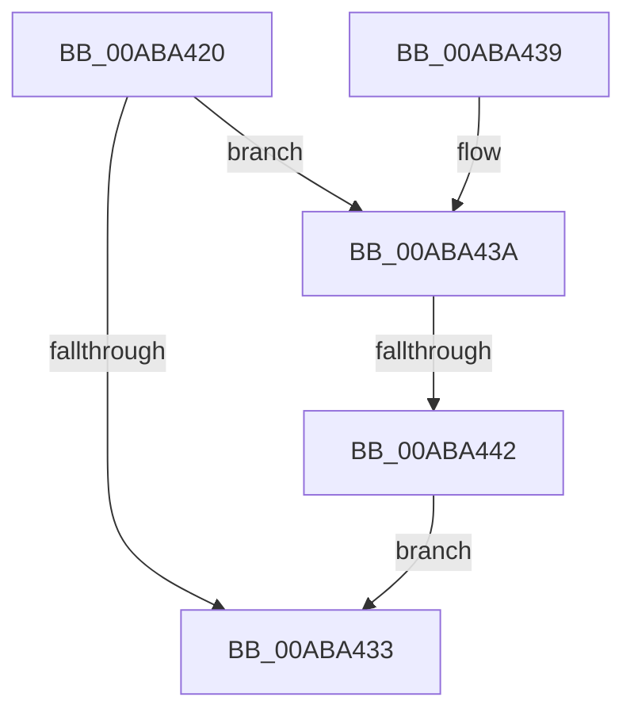

# PdcPoPpmResetProfile

- RVA: `0x00ABA420`–`0x00ABA464` (길이 `68` bytes)
- VA: `0x0000000140ABA420`
- 실행 섹션: `PAGE`
- PDB 이름 있음: `예`; PDB Function 태그: `예`
- unwind 정보 RVA: `0x000691A8`
- 디코드: `19`개 명령, `68/68` bytes 표시
- 미해석 바이트: `0` (있으면 어셈블리에 `.byte`로 보존)

> 이 문서는 커널 이미지의 기계어와 PDB 기호를 분석해 생성했습니다. 4번과 5번은 함수 원형과 자료형을 바이너리 사용 방식에서 추정한 C 해석이며 원본 소스 복구 결과는 아닙니다.

## 1. Dependencies

- 직접 호출 지점: **3**; 고유 호출 대상: **3**
- 직접 호출자로 확인된 함수: **0**
- RIP 상대 이미지 참조: **2**

### Outgoing calls
- `0x00ABA449` → [PpmAcquireLock](../../text/2D/PpmAcquireLock_function_002D9AA4.md) (function, `0x002D9AA4`)
- `0x00ABA451` → [PpmEnableProfile](../77/PpmEnableProfile_function_00770938.md) (function, `0x00770938`)
- `0x00ABA45D` → [PpmReleaseLock](../../text/2D/PpmReleaseLock_function_002DA428.md) (function, `0x002DA428`)

### Direct callers
- 이 함수 시작 RVA로 연결되는 직접 call은 확인되지 않았습니다. 간접 호출은 완전히 역산할 수 없습니다.

### Static image references
- `0x00ABA426` → RVA `0x00F077A8` (`.data`; read)
- `0x00ABA442` → RVA `0x00F0CC00` (`.data`; read)

## 2. Other-region calls and transfers

- 다른 실행 섹션으로 향하는 call: **2**
  - `0x00ABA449` → [PpmAcquireLock](../../text/2D/PpmAcquireLock_function_002D9AA4.md) (`PAGE` → `.text`)
  - `0x00ABA45D` → [PpmReleaseLock](../../text/2D/PpmReleaseLock_function_002DA428.md) (`PAGE` → `.text`)
- call이 아닌 외부 분기/꼬리 이동: **1**
  - `0x00ABA43C` → [sub_00B4AAA2](../B4/Unknown_function_00B4AAA2.md) (`tail-transfer`)

## 3. Assembly (complete function range)

```asm
00ABA420  40 53                           push rbx
00ABA422  48 83 EC 20                     sub rsp, 0x20
00ABA426  8B 05 7C D3 44 00               mov eax, dword ptr [rip + 0x44d37c]
00ABA42C  48 8B D9                        mov rbx, rcx
00ABA42F  A8 02                           test al, 2
00ABA431  74 07                           je 0x140aba43a
00ABA433  48 83 C4 20                     add rsp, 0x20
00ABA437  5B                              pop rbx
00ABA438  C3                              ret
00ABA439  CC                              int3
00ABA43A  84 D2                           test dl, dl
00ABA43C  0F 84 60 06 09 00               je 0x140b4aaa2
00ABA442  48 8D 0D B7 27 45 00            lea rcx, [rip + 0x4527b7]
00ABA449  E8 56 F6 81 FF                  call 0x1402d9aa4
00ABA44E  48 8B CB                        mov rcx, rbx
00ABA451  E8 E2 64 CB FF                  call 0x140770938
00ABA456  48 8D 0D A3 27 45 00            lea rcx, [rip + 0x4527a3]
00ABA45D  E8 C6 FF 81 FF                  call 0x1402da428
00ABA462  EB CF                           jmp 0x140aba433
```

## 4. C-style interpretation (structured pseudocode)

```c
__int64 __fastcall PdcPoPpmResetProfile(__int64 a1, unsigned __int8 a2)
{
    __int64 result;
    __int64 v_rsp;

    v_rsp = (v_rsp) - (32);
    if ((((unsigned __int8)((unsigned int)(*(unsigned int *)(v_rip + 4510588)))) & (2)) == 0) goto loc_00ABA43A;
loc_00ABA433:
    v_rsp = (v_rsp) + (32);
    return (unsigned int)(*(unsigned int *)(v_rip + 4510588));
loc_00ABA43A:
    result = PpmAcquireLock(v_rip + 4532151, a2, a3, a4);
    result = PpmEnableProfile(a1, a2, a3, a4);
    result = PpmReleaseLock(v_rip + 4532131, a2, a3, a4);
    goto loc_00ABA433;
}
```

## 5. (Beta) C Style

```c
int64_t PdcPoPpmResetProfile(int64_t Arg1, uint8_t Arg2)
{
    int64_t result;
    int64_t local_rsp;

    local_rsp = (local_rsp) - (32);
    if ((((uint8_t)((uint32_t)(*(uint32_t *)(v_rip + 0x44D37C)))) & (2)) == 0) goto loc_00ABA43A;
loc_00ABA433:
    local_rsp = (local_rsp) + (32);
    return (uint32_t)(*(uint32_t *)(v_rip + 0x44D37C));
loc_00ABA43A:
    result = PpmAcquireLock(v_rip + 4532151, Arg2, a3, a4);
    result = PpmEnableProfile(Arg1, Arg2, a3, a4);
    result = PpmReleaseLock(v_rip + 4532131, Arg2, a3, a4);
    goto loc_00ABA433;
}
```

## 6. Execution-region graph

[열기: 2D/3D 그래프와 함수 탐색 컨트롤 패널](../../../control-panel.html?section=page&rva=0x00ABA420&view=graph)

- 2D 그래프는 위에서 아래로 흐르고, 3D 그래프는 빈 공간을 드래그해 회전합니다. Shift+드래그는 이동, 휠은 확대·축소, 함수 노드 선택은 대상 보고서 이동입니다.

### Static fallback


