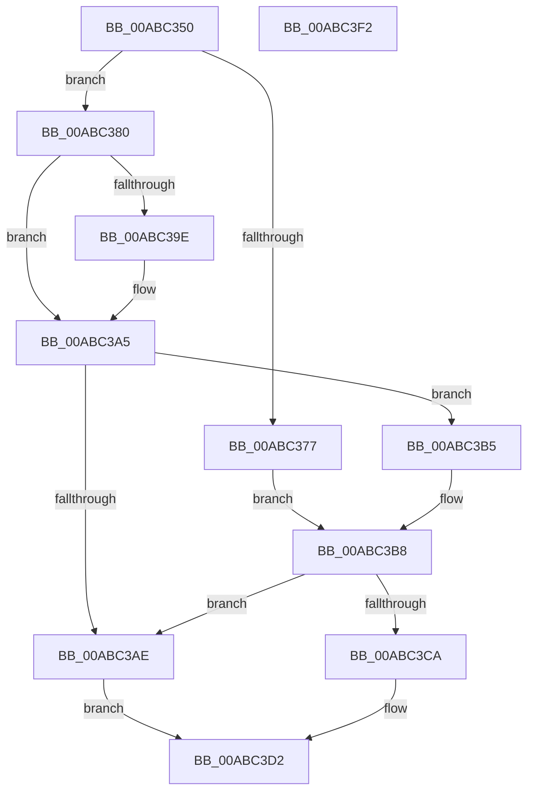

# PfpPrefetchSharedConflictNotifyStart

- RVA: `0x00ABC350`–`0x00ABC3F3` (길이 `163` bytes)
- VA: `0x0000000140ABC350`
- 실행 섹션: `PAGE`
- PDB 이름 있음: `예`; PDB Function 태그: `아니요`
- unwind 정보 RVA: `0x00060BC4`
- 디코드: `47`개 명령, `163/163` bytes 표시
- 미해석 바이트: `0` (있으면 어셈블리에 `.byte`로 보존)

> 이 문서는 커널 이미지의 기계어와 PDB 기호를 분석해 생성했습니다. 4번과 5번은 함수 원형과 자료형을 바이너리 사용 방식에서 추정한 C 해석이며 원본 소스 복구 결과는 아닙니다.

## 1. Dependencies

- 직접 호출 지점: **2**; 고유 호출 대상: **2**
- 직접 호출자로 확인된 함수: **0**
- RIP 상대 이미지 참조: **3**

### Outgoing calls
- `0x00ABC3BD` → [KeAbPreAcquire](../../text/21/KeAbPreAcquire_function_00210230.md) (function, `0x00210230`)
- `0x00ABC3CD` → [KeAbPreWait](../../text/20/KeAbPreWait_function_0020E560.md) (function, `0x0020E560`)

### Direct callers
- 이 함수 시작 RVA로 연결되는 직접 call은 확인되지 않았습니다. 간접 호출은 완전히 역산할 수 없습니다.

### Static image references
- `0x00ABC36C` → RVA `0x00E6721C` (`.data`; read/write)
- `0x00ABC377` → RVA `0x00E66EB0` (`.data`; read)
- `0x00ABC3D2` → RVA `0x00AC1210` (`PfpPrefetchSharedConflictNotifyEnd`; read)

## 2. Other-region calls and transfers

- 다른 실행 섹션으로 향하는 call: **2**
  - `0x00ABC3BD` → [KeAbPreAcquire](../../text/21/KeAbPreAcquire_function_00210230.md) (`PAGE` → `.text`)
  - `0x00ABC3CD` → [KeAbPreWait](../../text/20/KeAbPreWait_function_0020E560.md) (`PAGE` → `.text`)
- 별도 외부 분기/꼬리 이동을 확인하지 못했습니다.

## 3. Assembly (complete function range)

```asm
00ABC350  48 89 5C 24 08                  mov qword ptr [rsp + 8], rbx
00ABC355  48 89 74 24 10                  mov qword ptr [rsp + 0x10], rsi
00ABC35A  57                              push rdi
00ABC35B  48 83 EC 20                     sub rsp, 0x20
00ABC35F  33 DB                           xor ebx, ebx
00ABC361  4C 8B C9                        mov r9, rcx
00ABC364  49 8B F0                        mov rsi, r8
00ABC367  8B FB                           mov edi, ebx
00ABC369  8D 4B 01                        lea ecx, [rbx + 1]
00ABC36C  01 0D AA AE 3A 00               add dword ptr [rip + 0x3aaeaa], ecx
00ABC372  4D 85 C9                        test r9, r9
00ABC375  75 09                           jne 0x140abc380
00ABC377  48 8D 0D 32 AB 3A 00            lea rcx, [rip + 0x3aab32]
00ABC37E  EB 38                           jmp 0x140abc3b8
00ABC380  41 89 49 48                     mov dword ptr [r9 + 0x48], ecx
00ABC384  F0 41 01 49 70                  lock add dword ptr [r9 + 0x70], ecx
00ABC389  41 89 59 3C                     mov dword ptr [r9 + 0x3c], ebx
00ABC38D  48 8B C1                        mov rax, rcx
00ABC390  F0 49 0F C1 41 78               lock xadd qword ptr [r9 + 0x78], rax
00ABC396  48 03 C1                        add rax, rcx
00ABC399  48 3B C1                        cmp rax, rcx
00ABC39C  7F 07                           jg 0x140abc3a5
00ABC39E  B9 0E 00 00 00                  mov ecx, 0xe
00ABC3A3  CD 29                           int 0x29
00ABC3A5  49 39 99 80 00 00 00            cmp qword ptr [r9 + 0x80], rbx
00ABC3AC  75 07                           jne 0x140abc3b5
00ABC3AE  BB 9A 00 00 C0                  mov ebx, 0xc000009a
00ABC3B3  EB 1D                           jmp 0x140abc3d2
00ABC3B5  49 8B C9                        mov rcx, r9
00ABC3B8  45 33 C0                        xor r8d, r8d
00ABC3BB  33 D2                           xor edx, edx
00ABC3BD  E8 6E 3E 75 FF                  call 0x140210230
00ABC3C2  48 8B F8                        mov rdi, rax
00ABC3C5  48 85 C0                        test rax, rax
00ABC3C8  74 E4                           je 0x140abc3ae
00ABC3CA  48 8B C8                        mov rcx, rax
00ABC3CD  E8 8E 21 75 FF                  call 0x14020e560
00ABC3D2  48 8D 05 37 4E 00 00            lea rax, [rip + 0x4e37]
00ABC3D9  48 89 7E 08                     mov qword ptr [rsi + 8], rdi
00ABC3DD  48 89 06                        mov qword ptr [rsi], rax
00ABC3E0  8B C3                           mov eax, ebx
00ABC3E2  48 8B 5C 24 30                  mov rbx, qword ptr [rsp + 0x30]
00ABC3E7  48 8B 74 24 38                  mov rsi, qword ptr [rsp + 0x38]
00ABC3EC  48 83 C4 20                     add rsp, 0x20
00ABC3F0  5F                              pop rdi
00ABC3F1  C3                              ret
00ABC3F2  CC                              int3
```

## 4. C-style interpretation (structured pseudocode)

```c
__int64 __fastcall PfpPrefetchSharedConflictNotifyStart(__int64 a1, int a2, __int64 a3)
{
    __int64 result;
    __int64 v_rbx;
    __int64 v_rsp;
    unsigned __int64 v_stack_p10;
    unsigned __int64 v_stack_p8;

    v_stack_p8 = v_rbx;
    v_stack_p10 = v_rsi;
    v_rsp = (v_rsp) - (32);
    v_rbx = 0;
    if (a1 != 0) goto loc_00ABC380;
    goto loc_00ABC3B8;
loc_00ABC380:
    *(unsigned int *)(a1 + 72) = (unsigned int)(v_rip + 3844914);
    *(unsigned int *)(a1 + 60) = 0;
    result = (v_rip + 3844914) + (v_rip + 3844914);
    if (result <= (v_rip + 3844914)) {
        a1 = 14;
    }
    if ((*(unsigned __int64 *)(a1 + 128)) != 0) goto loc_00ABC3B5;
loc_00ABC3AE:
    goto loc_00ABC3D2;
loc_00ABC3B5:
loc_00ABC3B8:
    a3 = 0;
    a2 = 0;
    result = KeAbPreAcquire(a1, a2, a3, a1);
    if (result == 0) goto loc_00ABC3AE;
    result = KeAbPreWait(result, a2, a3, a1);
loc_00ABC3D2:
    *(unsigned __int64 *)(a3 + 8) = result;
    *(unsigned __int64 *)(a3) = v_rip + 20023;
    v_rsp = (v_rsp) + (32);
    return (unsigned int)((unsigned int)((unsigned int)(0xC000009AULL)));
}
```

## 5. (Beta) C Style

```c
int64_t PfpPrefetchSharedConflictNotifyStart(int64_t Arg1, int32_t Arg2, void *Arg3)
{
    uint8_t *arg3 = (uint8_t *)Arg3;

    int64_t result;
    int64_t local_rbx;
    int64_t local_rsp;
    uint64_t v_stack_p10;
    uint64_t v_stack_p8;

    v_stack_p8 = local_rbx;
    v_stack_p10 = local_rsi;
    local_rsp = (local_rsp) - (32);
    local_rbx = 0;
    if (Arg1 != 0) goto loc_00ABC380;
    goto loc_00ABC3B8;
loc_00ABC380:
    *(uint32_t *)(Arg1 + 0x48) = (uint32_t)(v_rip + 3844914);
    *(uint32_t *)(Arg1 + 0x3C) = 0;
    result = (v_rip + 3844914) + (v_rip + 3844914);
    if (result <= (v_rip + 3844914)) {
        Arg1 = 14;
    }
    if ((*(uint64_t *)(Arg1 + 0x80)) != 0) goto loc_00ABC3B5;
loc_00ABC3AE:
    goto loc_00ABC3D2;
loc_00ABC3B5:
loc_00ABC3B8:
    Arg3 = 0;
    Arg2 = 0;
    result = KeAbPreAcquire(Arg1, Arg2, Arg3, Arg1);
    if (result == 0) goto loc_00ABC3AE;
    result = KeAbPreWait(result, Arg2, Arg3, Arg1);
loc_00ABC3D2:
    *(uint64_t *)(arg3 + 0x8) = result;
    *(uint64_t *)(arg3) = v_rip + 20023;
    local_rsp = (local_rsp) + (32);
    return (uint32_t)((uint32_t)((uint32_t)(0xC000009AULL)));
}
```

### 관측된 메모리 오프셋

구조체 형식이 확인되지 않은 접근은 인자 기준의 오프셋으로만 기록했습니다.

| 기준 인자 | 오프셋 표현 | 폭 (bit) | 접근 |
|---|---:|---:|---|
| `Arg3` | `+ 0x0` | `64` | `W` |
| `Arg3` | `+ 0x8` | `64` | `W` |

## 6. Execution-region graph

[열기: 2D/3D 그래프와 함수 탐색 컨트롤 패널](../../../control-panel.html?section=page&rva=0x00ABC350&view=graph)

- 2D 그래프는 위에서 아래로 흐르고, 3D 그래프는 빈 공간을 드래그해 회전합니다. Shift+드래그는 이동, 휠은 확대·축소, 함수 노드 선택은 대상 보고서 이동입니다.

### Static fallback


