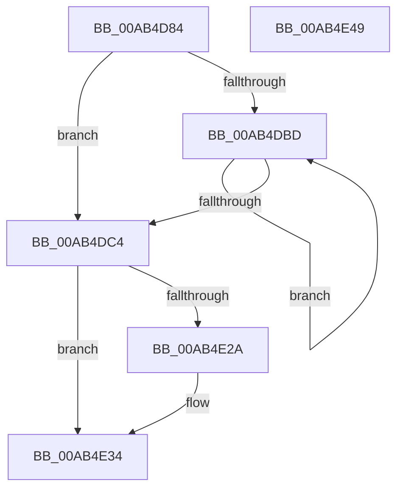

# PfpRpCHashEmpty

- RVA: `0x00AB4D84`–`0x00AB4E4A` (길이 `198` bytes)
- VA: `0x0000000140AB4D84`
- 실행 섹션: `PAGE`
- PDB 이름 있음: `예`; PDB Function 태그: `아니요`
- unwind 정보 RVA: `0x0007D3C0`
- 디코드: `53`개 명령, `198/198` bytes 표시
- 미해석 바이트: `0` (있으면 어셈블리에 `.byte`로 보존)

> 이 문서는 커널 이미지의 기계어와 PDB 기호를 분석해 생성했습니다. 4번과 5번은 함수 원형과 자료형을 바이너리 사용 방식에서 추정한 C 해석이며 원본 소스 복구 결과는 아닙니다.

## 1. Dependencies

- 직접 호출 지점: **5**; 고유 호출 대상: **3**
- 직접 호출자로 확인된 함수: **1**
- RIP 상대 이미지 참조: **0**

### Outgoing calls
- `0x00AB4DEE` → [FsRtlAcquirePushLockExclusive](../../text/4A/FsRtlAcquirePushLockExclusive_function_004A05F4.md) (function, `0x004A05F4`)
- `0x00AB4DF9` → [FsRtlAcquirePushLockExclusive](../../text/4A/FsRtlAcquirePushLockExclusive_function_004A05F4.md) (function, `0x004A05F4`)
- `0x00AB4E14` → [PfLockExclusiveRelease](../../text/49/PfLockExclusiveRelease_function_00491D88.md) (function, `0x00491D88`)
- `0x00AB4E20` → [PfLockExclusiveRelease](../../text/49/PfLockExclusiveRelease_function_00491D88.md) (function, `0x00491D88`)
- `0x00AB4E2F` → [ExFreePoolWithTag](../../poolcode/B8/ExFreePoolWithTag_function_00B82870.md) (function, `0x00B82870`)

### Direct callers
- [PfpRpControlRequestReset](PfpRpControlRequestReset_function_00AB4D2C.md) at `0x00AB4D3D`
- [PfpRpControlRequestReset](PfpRpControlRequestReset_function_00AB4D2C.md) at `0x00AB4D69`

### Static image references
- 디코드된 RIP-relative 메모리 참조가 없습니다.

## 2. Other-region calls and transfers

- 다른 실행 섹션으로 향하는 call: **5**
  - `0x00AB4DEE` → [FsRtlAcquirePushLockExclusive](../../text/4A/FsRtlAcquirePushLockExclusive_function_004A05F4.md) (`PAGE` → `.text`)
  - `0x00AB4DF9` → [FsRtlAcquirePushLockExclusive](../../text/4A/FsRtlAcquirePushLockExclusive_function_004A05F4.md) (`PAGE` → `.text`)
  - `0x00AB4E14` → [PfLockExclusiveRelease](../../text/49/PfLockExclusiveRelease_function_00491D88.md) (`PAGE` → `.text`)
  - `0x00AB4E20` → [PfLockExclusiveRelease](../../text/49/PfLockExclusiveRelease_function_00491D88.md) (`PAGE` → `.text`)
  - `0x00AB4E2F` → [ExFreePoolWithTag](../../poolcode/B8/ExFreePoolWithTag_function_00B82870.md) (`PAGE` → `POOLCODE`)
- 별도 외부 분기/꼬리 이동을 확인하지 못했습니다.

## 3. Assembly (complete function range)

```asm
00AB4D84  48 8B C4                        mov rax, rsp
00AB4D87  48 89 58 08                     mov qword ptr [rax + 8], rbx
00AB4D8B  48 89 68 10                     mov qword ptr [rax + 0x10], rbp
00AB4D8F  48 89 70 18                     mov qword ptr [rax + 0x18], rsi
00AB4D93  57                              push rdi
00AB4D94  48 83 EC 40                     sub rsp, 0x40
00AB4D98  83 60 EC 00                     and dword ptr [rax - 0x14], 0
00AB4D9C  48 8B D9                        mov rbx, rcx
00AB4D9F  8B 4A 08                        mov ecx, dword ptr [rdx + 8]
00AB4DA2  41 B9 01 00 00 00               mov r9d, 1
00AB4DA8  41 D3 E1                        shl r9d, cl
00AB4DAB  41 83 CA FF                     or r10d, 0xffffffff
00AB4DAF  49 8B E8                        mov rbp, r8
00AB4DB2  48 8B FA                        mov rdi, rdx
00AB4DB5  41 8B C1                        mov eax, r9d
00AB4DB8  45 85 C9                        test r9d, r9d
00AB4DBB  74 07                           je 0x140ab4dc4
00AB4DBD  41 FF C2                        inc r10d
00AB4DC0  D1 E8                           shr eax, 1
00AB4DC2  75 F9                           jne 0x140ab4dbd
00AB4DC4  83 64 24 30 00                  and dword ptr [rsp + 0x30], 0
00AB4DC9  41 8D 41 FF                     lea eax, [r9 - 1]
00AB4DCD  41 85 C1                        test r9d, eax
00AB4DD0  48 8D 8B 80 00 00 00            lea rcx, [rbx + 0x80]
00AB4DD7  41 8D 42 01                     lea eax, [r10 + 1]
00AB4DDB  41 0F 44 C2                     cmove eax, r10d
00AB4DDF  83 64 24 2C 00                  and dword ptr [rsp + 0x2c], 0
00AB4DE4  48 83 64 24 20 00               and qword ptr [rsp + 0x20], 0
00AB4DEA  89 44 24 28                     mov dword ptr [rsp + 0x28], eax
00AB4DEE  E8 01 B8 9E FF                  call 0x1404a05f4
00AB4DF3  48 8B 37                        mov rsi, qword ptr [rdi]
00AB4DF6  48 8B CD                        mov rcx, rbp
00AB4DF9  E8 F6 B7 9E FF                  call 0x1404a05f4
00AB4DFE  0F 10 44 24 20                  movups xmm0, xmmword ptr [rsp + 0x20]
00AB4E03  48 8B CD                        mov rcx, rbp
00AB4E06  F2 0F 10 4C 24 30               movsd xmm1, qword ptr [rsp + 0x30]
00AB4E0C  0F 11 07                        movups xmmword ptr [rdi], xmm0
00AB4E0F  F2 0F 11 4F 10                  movsd qword ptr [rdi + 0x10], xmm1
00AB4E14  E8 6F CF 9D FF                  call 0x140491d88
00AB4E19  48 8D 8B 80 00 00 00            lea rcx, [rbx + 0x80]
00AB4E20  E8 63 CF 9D FF                  call 0x140491d88
00AB4E25  48 85 F6                        test rsi, rsi
00AB4E28  74 0A                           je 0x140ab4e34
00AB4E2A  33 D2                           xor edx, edx
00AB4E2C  48 8B CE                        mov rcx, rsi
00AB4E2F  E8 3C DA 0C 00                  call 0x140b82870
00AB4E34  48 8B 5C 24 50                  mov rbx, qword ptr [rsp + 0x50]
00AB4E39  48 8B 6C 24 58                  mov rbp, qword ptr [rsp + 0x58]
00AB4E3E  48 8B 74 24 60                  mov rsi, qword ptr [rsp + 0x60]
00AB4E43  48 83 C4 40                     add rsp, 0x40
00AB4E47  5F                              pop rdi
00AB4E48  C3                              ret
00AB4E49  CC                              int3
```

## 4. C-style interpretation (structured pseudocode)

```c
__int64 __fastcall PfpRpCHashEmpty(__int64 a1, __int64 a2, __int64 a3)
{
    __int64 result;
    __int64 v_r10;
    __int64 v_rsp;
    unsigned int v_stack_m18;
    unsigned int v_stack_m1C;
    unsigned int v_stack_m20;
    unsigned __int64 v_stack_m28;
    unsigned __int64 v_stack_p10;
    unsigned __int64 v_stack_p18;
    unsigned __int64 v_stack_p8;

    *(unsigned __int64 *)(v_rsp + 8) = v_rbx;
    *(unsigned __int64 *)(v_rsp + 16) = v_rbp;
    *(unsigned __int64 *)(v_rsp + 24) = v_rsi;
    v_rsp = (v_rsp) - (64);
    a4 = (unsigned int)((1) << ((unsigned __int8)((unsigned int)(*(unsigned int *)(a2 + 8)))));
    v_r10 = (unsigned int)((v_r10) | (0xFFFFFFFFULL));
    if ((unsigned int)(a4) == 0) goto loc_00AB4DC4;
loc_00AB4DBD:
    v_r10 = (unsigned int)((v_r10) + 1);
    result = (unsigned int)(((unsigned int)((unsigned int)(a4))) >> (1));
    if (condition_is_not_equal) goto loc_00AB4DBD;
loc_00AB4DC4:
    result = v_r10 + 1;
    if ((((unsigned int)(a4)) & ((unsigned int)(a4 - 1))) == 0) { result = (unsigned int)(v_r10); }
    v_stack_m20 = (unsigned int)(result);
    result = FsRtlAcquirePushLockExclusive(a1 + 128, a2, a3, a4);
    result = FsRtlAcquirePushLockExclusive(a3, a2, a3, a4);
    *(unsigned __int64 *)(a2) = v_xmm0;
    *(unsigned __int64 *)(a2 + 16) = v_xmm1;
    result = PfLockExclusiveRelease(a3, a2, a3, a4);
    result = PfLockExclusiveRelease(a1 + 128, a2, a3, a4);
    if (*(unsigned __int64 *)(a2) != 0) {
        a2 = 0;
        a1 = *(unsigned __int64 *)(a2);
        result = ExFreePoolWithTag(a1, a2, a3, a4);
    }
    v_rsp = (v_rsp) + (64);
    return result;
}
```

## 5. (Beta) C Style

```c
int64_t PfpRpCHashEmpty(void *Arg1, void *Arg2, int64_t Arg3)
{
    uint8_t *arg1 = (uint8_t *)Arg1;
    uint8_t *arg2 = (uint8_t *)Arg2;

    int64_t result;
    int64_t local_r10;
    int64_t local_rsp;
    uint32_t v_stack_m18;
    uint32_t v_stack_m1C;
    uint32_t v_stack_m20;
    uint64_t v_stack_m28;
    uint64_t v_stack_p10;
    uint64_t v_stack_p18;
    uint64_t v_stack_p8;

    *(uint64_t *)(local_rsp + 0x8) = local_rbx;
    *(uint64_t *)(local_rsp + 0x10) = local_rbp;
    *(uint64_t *)(local_rsp + 0x18) = local_rsi;
    local_rsp = (local_rsp) - (64);
    a4 = (uint32_t)((1) << ((uint8_t)((uint32_t)(*(uint32_t *)(arg2 + 0x8)))));
    local_r10 = (uint32_t)((local_r10) | (0xFFFFFFFFULL));
    if ((uint32_t)(a4) == 0) goto loc_00AB4DC4;
loc_00AB4DBD:
    local_r10 = (uint32_t)((local_r10) + 1);
    result = (uint32_t)(((uint32_t)((uint32_t)(a4))) >> (1));
    if (condition_is_not_equal) goto loc_00AB4DBD;
loc_00AB4DC4:
    result = local_r10 + 1;
    if ((((uint32_t)(a4)) & ((uint32_t)(a4 - 1))) == 0) { result = (uint32_t)(local_r10); }
    v_stack_m20 = (uint32_t)(result);
    result = FsRtlAcquirePushLockExclusive(Arg1 + 128, Arg2, Arg3, a4);
    result = FsRtlAcquirePushLockExclusive(Arg3, Arg2, Arg3, a4);
    *(uint64_t *)(arg2) = v_xmm0;
    *(uint64_t *)(arg2 + 0x10) = v_xmm1;
    result = PfLockExclusiveRelease(Arg3, Arg2, Arg3, a4);
    result = PfLockExclusiveRelease(Arg1 + 128, Arg2, Arg3, a4);
    if (*(uint64_t *)(arg2) != 0) {
        Arg2 = 0;
        Arg1 = *(uint64_t *)(arg2);
        result = ExFreePoolWithTag(Arg1, Arg2, Arg3, a4);
    }
    local_rsp = (local_rsp) + (64);
    return result;
}
```

### 관측된 메모리 오프셋

구조체 형식이 확인되지 않은 접근은 인자 기준의 오프셋으로만 기록했습니다.

| 기준 인자 | 오프셋 표현 | 폭 (bit) | 접근 |
|---|---:|---:|---|
| `Arg1` | `+ 0x80` | `64` | `R` |
| `Arg2` | `+ 0x0` | `64` | `R` |
| `Arg2` | `+ 0x0` | `128` | `R` |
| `Arg2` | `+ 0x8` | `32` | `R` |
| `Arg2` | `+ 0x10` | `64` | `W` |

## 6. Execution-region graph

[열기: 2D/3D 그래프와 함수 탐색 컨트롤 패널](../../../control-panel.html?section=page&rva=0x00AB4D84&view=graph)

- 2D 그래프는 위에서 아래로 흐르고, 3D 그래프는 빈 공간을 드래그해 회전합니다. Shift+드래그는 이동, 휠은 확대·축소, 함수 노드 선택은 대상 보고서 이동입니다.

### Static fallback


