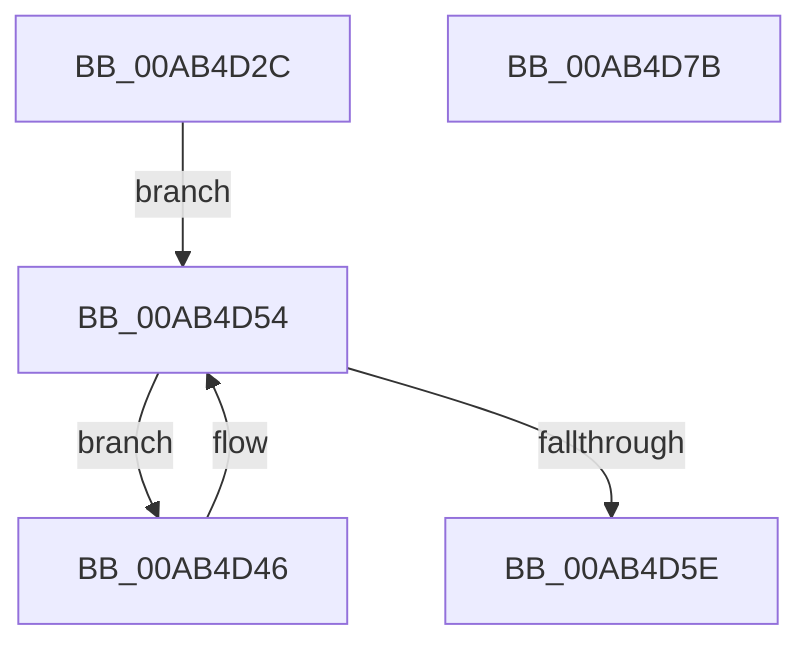

# PfpRpControlRequestReset

- RVA: `0x00AB4D2C`–`0x00AB4D7C` (길이 `80` bytes)
- VA: `0x0000000140AB4D2C`
- 실행 섹션: `PAGE`
- PDB 이름 있음: `예`; PDB Function 태그: `아니요`
- unwind 정보 RVA: `0x0005CF00`
- 디코드: `23`개 명령, `80/80` bytes 표시
- 미해석 바이트: `0` (있으면 어셈블리에 `.byte`로 보존)

> 이 문서는 커널 이미지의 기계어와 PDB 기호를 분석해 생성했습니다. 4번과 5번은 함수 원형과 자료형을 바이너리 사용 방식에서 추정한 C 해석이며 원본 소스 복구 결과는 아닙니다.

## 1. Dependencies

- 직접 호출 지점: **3**; 고유 호출 대상: **2**
- 직접 호출자로 확인된 함수: **2**
- RIP 상대 이미지 참조: **0**

### Outgoing calls
- `0x00AB4D3D` → [PfpRpCHashEmpty](PfpRpCHashEmpty_function_00AB4D84.md) (function, `0x00AB4D84`)
- `0x00AB4D54` → [PsGetNextProcess](../91/PsGetNextProcess_function_0091C900.md) (function, `0x0091C900`)
- `0x00AB4D69` → [PfpRpCHashEmpty](PfpRpCHashEmpty_function_00AB4D84.md) (function, `0x00AB4D84`)

### Direct callers
- [PfpRpShutdown](../75/PfpRpShutdown_function_00751C70.md) at `0x00751E21`
- [sub_00B428AA](../B4/Unknown_function_00B428AA.md) at `0x00B428AD`

### Static image references
- 디코드된 RIP-relative 메모리 참조가 없습니다.

## 2. Other-region calls and transfers

- 다른 실행 섹션으로 향하는 call: **0**
- 별도 외부 분기/꼬리 이동을 확인하지 못했습니다.

## 3. Assembly (complete function range)

```asm
00AB4D2C  40 53                           push rbx
00AB4D2E  48 83 EC 20                     sub rsp, 0x20
00AB4D32  4C 8D 41 78                     lea r8, [rcx + 0x78]
00AB4D36  48 8B D9                        mov rbx, rcx
00AB4D39  48 8D 51 60                     lea rdx, [rcx + 0x60]
00AB4D3D  E8 42 00 00 00                  call 0x140ab4d84
00AB4D42  33 C9                           xor ecx, ecx
00AB4D44  EB 0E                           jmp 0x140ab4d54
00AB4D46  F0 81 A0 F4 01 00 00 FF BF FF FF  lock and dword ptr [rax + 0x1f4], 0xffffbfff
00AB4D51  48 8B C8                        mov rcx, rax
00AB4D54  E8 A7 7B E6 FF                  call 0x14091c900
00AB4D59  48 85 C0                        test rax, rax
00AB4D5C  75 E8                           jne 0x140ab4d46
00AB4D5E  4C 8D 43 58                     lea r8, [rbx + 0x58]
00AB4D62  48 8B CB                        mov rcx, rbx
00AB4D65  48 8D 53 38                     lea rdx, [rbx + 0x38]
00AB4D69  E8 16 00 00 00                  call 0x140ab4d84
00AB4D6E  48 83 63 50 00                  and qword ptr [rbx + 0x50], 0
00AB4D73  33 C0                           xor eax, eax
00AB4D75  48 83 C4 20                     add rsp, 0x20
00AB4D79  5B                              pop rbx
00AB4D7A  C3                              ret
00AB4D7B  CC                              int3
```

## 4. C-style interpretation (structured pseudocode)

```c
__int64 __fastcall PfpRpControlRequestReset(__int64 a1)
{
    __int64 result;
    __int64 v_rsp;

    v_rsp = (v_rsp) - (32);
    result = PfpRpCHashEmpty(a1, a1 + 96, a1 + 120, a4);
    a1 = 0;
    goto loc_00AB4D54;
loc_00AB4D46:
loc_00AB4D54:
    result = PsGetNextProcess(result, a1 + 96, a1 + 120, a4);
    if (result != 0) goto loc_00AB4D46;
    result = PfpRpCHashEmpty(0, a1 + 56, a1 + 88, a4);
    result = 0;
    v_rsp = (v_rsp) + (32);
    return result;
}
```

## 5. (Beta) C Style

```c
int64_t PfpRpControlRequestReset(void *Arg1)
{
    uint8_t *arg1 = (uint8_t *)Arg1;

    int64_t result;
    int64_t local_rsp;

    local_rsp = (local_rsp) - (32);
    result = PfpRpCHashEmpty(Arg1, Arg1 + 96, Arg1 + 120, a4);
    Arg1 = 0;
    goto loc_00AB4D54;
loc_00AB4D46:
loc_00AB4D54:
    result = PsGetNextProcess(result, Arg1 + 96, Arg1 + 120, a4);
    if (result != 0) goto loc_00AB4D46;
    result = PfpRpCHashEmpty(0, Arg1 + 56, Arg1 + 88, a4);
    result = 0;
    local_rsp = (local_rsp) + (32);
    return result;
}
```

### 관측된 메모리 오프셋

구조체 형식이 확인되지 않은 접근은 인자 기준의 오프셋으로만 기록했습니다.

| 기준 인자 | 오프셋 표현 | 폭 (bit) | 접근 |
|---|---:|---:|---|
| `Arg1` | `+ 0x38` | `64` | `R` |
| `Arg1` | `+ 0x50` | `64` | `R/W` |
| `Arg1` | `+ 0x58` | `64` | `R` |
| `Arg1` | `+ 0x60` | `64` | `R` |
| `Arg1` | `+ 0x78` | `64` | `R` |

## 6. Execution-region graph

[열기: 2D/3D 그래프와 함수 탐색 컨트롤 패널](../../../control-panel.html?section=page&rva=0x00AB4D2C&view=graph)

- 2D 그래프는 위에서 아래로 흐르고, 3D 그래프는 빈 공간을 드래그해 회전합니다. Shift+드래그는 이동, 휠은 확대·축소, 함수 노드 선택은 대상 보고서 이동입니다.

### Static fallback


