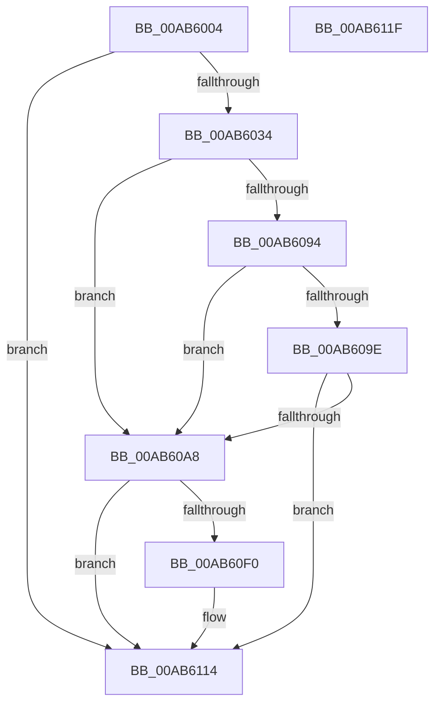

# PiDcContainerRequiresConfiguration

- RVA: `0x00AB6004`–`0x00AB6120` (길이 `284` bytes)
- VA: `0x0000000140AB6004`
- 실행 섹션: `PAGE`
- PDB 이름 있음: `예`; PDB Function 태그: `아니요`
- unwind 정보 RVA: `0x000BCDE4`
- 디코드: `68`개 명령, `284/284` bytes 표시
- 미해석 바이트: `0` (있으면 어셈블리에 `.byte`로 보존)

> 이 문서는 커널 이미지의 기계어와 PDB 기호를 분석해 생성했습니다. 4번과 5번은 함수 원형과 자료형을 바이너리 사용 방식에서 추정한 C 해석이며 원본 소스 복구 결과는 아닙니다.

## 1. Dependencies

- 직접 호출 지점: **4**; 고유 호출 대상: **4**
- 직접 호출자로 확인된 함수: **5**
- RIP 상대 이미지 참조: **5**

### Outgoing calls
- `0x00AB6027` → [wcscmp](../../text/50/wcscmp_function_00501AF0.md) (function, `0x00501AF0`)
- `0x00AB6089` → [PnpGetObjectProperty](../8E/PnpGetObjectProperty_function_008E2180.md) (function, `0x008E2180`)
- `0x00AB60E5` → [PnpSetObjectProperty](../8F/PnpSetObjectProperty_function_008F66E8.md) (function, `0x008F66E8`)
- `0x00AB610F` → [ZwUpdateWnfStateData](../../text/6B/ZwUpdateWnfStateData_function_006B0D10.md) (function, `0x006B0D10`)

### Direct callers
- [PiDcHandleSystemFirmwareUpdate](../73/PiDcHandleSystemFirmwareUpdate_function_00730B20.md) at `0x00730B2B`
- [PiDcUpdateDeviceContainerMembership](../8F/PiDcUpdateDeviceContainerMembership_function_008FD0A8.md) at `0x008FD231`
- [PiDcHandleInterfaceEvent](../A5/PiDcHandleInterfaceEvent_function_00A50588.md) at `0x00A50669`
- [sub_00B266CA](../B2/Unknown_function_00B266CA.md) at `0x00B268BD`
- [sub_00B266CA](../B2/Unknown_function_00B266CA.md) at `0x00B26921`
- [sub_00B3C61C](../B3/Unknown_function_00B3C61C.md) at `0x00B3C620`

### Static image references
- `0x00AB601D` → RVA `0x00AFDCF0` (` ?? ::NNGAKEGL::`string'`; read)
- `0x00AB6040` → RVA `0x00E66398` (`.data`; read)
- `0x00AB6047` → RVA `0x000116F8` (`.rdata`; read)
- `0x00AB60AD` → RVA `0x00028144` (`.rdata`; read)
- `0x00AB60F5` → RVA `0x00020B20` (`.rdata`; read)

## 2. Other-region calls and transfers

- 다른 실행 섹션으로 향하는 call: **2**
  - `0x00AB6027` → [wcscmp](../../text/50/wcscmp_function_00501AF0.md) (`PAGE` → `.text`)
  - `0x00AB610F` → [ZwUpdateWnfStateData](../../text/6B/ZwUpdateWnfStateData_function_006B0D10.md) (`PAGE` → `.text`)
- 별도 외부 분기/꼬리 이동을 확인하지 못했습니다.

## 3. Assembly (complete function range)

```asm
00AB6004  48 8B C4                        mov rax, rsp
00AB6007  53                              push rbx
00AB6008  57                              push rdi
00AB6009  41 57                           push r15
00AB600B  48 83 EC 60                     sub rsp, 0x60
00AB600F  33 DB                           xor ebx, ebx
00AB6011  48 8B F9                        mov rdi, rcx
00AB6014  21 58 10                        and dword ptr [rax + 0x10], ebx
00AB6017  48 8B D1                        mov rdx, rcx
00AB601A  21 58 18                        and dword ptr [rax + 0x18], ebx
00AB601D  48 8D 0D CC 7C 04 00            lea rcx, [rip + 0x47ccc]
00AB6024  21 58 20                        and dword ptr [rax + 0x20], ebx
00AB6027  E8 C4 BA A4 FF                  call 0x140501af0
00AB602C  85 C0                           test eax, eax
00AB602E  0F 84 E0 00 00 00               je 0x140ab6114
00AB6034  21 5C 24 50                     and dword ptr [rsp + 0x50], ebx
00AB6038  48 8D 84 24 98 00 00 00         lea rax, [rsp + 0x98]
00AB6040  48 8B 0D 51 03 3B 00            mov rcx, qword ptr [rip + 0x3b0351]
00AB6047  4C 8D 3D AA B6 55 FF            lea r15, [rip - 0xaa4956]
00AB604E  48 89 44 24 48                  mov qword ptr [rsp + 0x48], rax
00AB6053  44 8D 43 05                     lea r8d, [rbx + 5]
00AB6057  C7 44 24 40 04 00 00 00         mov dword ptr [rsp + 0x40], 4
00AB605F  48 8D 84 24 90 00 00 00         lea rax, [rsp + 0x90]
00AB6067  48 89 44 24 38                  mov qword ptr [rsp + 0x38], rax
00AB606C  45 33 C9                        xor r9d, r9d
00AB606F  48 8D 84 24 88 00 00 00         lea rax, [rsp + 0x88]
00AB6077  48 8B D7                        mov rdx, rdi
00AB607A  48 89 44 24 30                  mov qword ptr [rsp + 0x30], rax
00AB607F  4C 89 7C 24 28                  mov qword ptr [rsp + 0x28], r15
00AB6084  48 21 5C 24 20                  and qword ptr [rsp + 0x20], rbx
00AB6089  E8 F2 C0 E2 FF                  call 0x1408e2180
00AB608E  8B D8                           mov ebx, eax
00AB6090  85 C0                           test eax, eax
00AB6092  78 14                           js 0x140ab60a8
00AB6094  83 BC 24 88 00 00 00 07         cmp dword ptr [rsp + 0x88], 7
00AB609C  75 0A                           jne 0x140ab60a8
00AB609E  83 BC 24 90 00 00 00 FF         cmp dword ptr [rsp + 0x90], -1
00AB60A6  74 6C                           je 0x140ab6114
00AB60A8  83 64 24 48 00                  and dword ptr [rsp + 0x48], 0
00AB60AD  48 8D 05 90 20 57 FF            lea rax, [rip - 0xa8df70]
00AB60B4  48 8B 0D DD 02 3B 00            mov rcx, qword ptr [rip + 0x3b02dd]
00AB60BB  45 33 C9                        xor r9d, r9d
00AB60BE  C7 44 24 40 04 00 00 00         mov dword ptr [rsp + 0x40], 4
00AB60C6  48 8B D7                        mov rdx, rdi
00AB60C9  48 89 44 24 38                  mov qword ptr [rsp + 0x38], rax
00AB60CE  C7 44 24 30 07 00 00 00         mov dword ptr [rsp + 0x30], 7
00AB60D6  45 8D 41 05                     lea r8d, [r9 + 5]
00AB60DA  4C 89 7C 24 28                  mov qword ptr [rsp + 0x28], r15
00AB60DF  48 83 64 24 20 00               and qword ptr [rsp + 0x20], 0
00AB60E5  E8 FE 05 E4 FF                  call 0x1408f66e8
00AB60EA  8B D8                           mov ebx, eax
00AB60EC  85 C0                           test eax, eax
00AB60EE  78 24                           js 0x140ab6114
00AB60F0  83 64 24 30 00                  and dword ptr [rsp + 0x30], 0
00AB60F5  48 8D 0D 24 AA 56 FF            lea rcx, [rip - 0xa955dc]
00AB60FC  83 64 24 28 00                  and dword ptr [rsp + 0x28], 0
00AB6101  45 33 C9                        xor r9d, r9d
00AB6104  48 83 64 24 20 00               and qword ptr [rsp + 0x20], 0
00AB610A  45 33 C0                        xor r8d, r8d
00AB610D  33 D2                           xor edx, edx
00AB610F  E8 FC AB BF FF                  call 0x1406b0d10
00AB6114  8B C3                           mov eax, ebx
00AB6116  48 83 C4 60                     add rsp, 0x60
00AB611A  41 5F                           pop r15
00AB611C  5F                              pop rdi
00AB611D  5B                              pop rbx
00AB611E  C3                              ret
00AB611F  CC                              int3
```

## 4. C-style interpretation (structured pseudocode)

```c
__int64 __fastcall PiDcContainerRequiresConfiguration(__int64 a1, __int64 a2, __int64 a3, int a4)
{
    __int64 result;
    __int64 v_rbx;
    __int64 v_rsp;
    unsigned int v_stack_m28;
    unsigned __int64 v_stack_m30;
    unsigned int v_stack_m38;
    unsigned __int64 v_stack_m40;
    unsigned __int64 v_stack_m48;
    unsigned __int64 v_stack_m50;
    unsigned __int64 v_stack_m58;
    unsigned __int64 v_stack_p10;
    unsigned __int64 v_stack_p18;
    unsigned __int64 v_stack_p20;

    v_rsp = (v_rsp) - (96);
    v_rbx = 0;
    result = wcscmp(v_rip + 294092, a1, a3, a4);
    if ((unsigned int)(result) == 0) goto loc_00AB6114;
    v_stack_m30 = v_stack_p20;
    v_stack_m38 = 4;
    v_stack_m40 = v_stack_p18;
    a4 = 0;
    v_stack_m48 = v_stack_p10;
    v_stack_m50 = v_rip - 11159894;
    result = PnpGetObjectProperty(*(unsigned __int64 *)(v_rip + 3867473), a1, v_rbx + 5, a4);
    if (sign_flag) goto loc_00AB60A8;
    if (v_stack_p10 != 7) goto loc_00AB60A8;
    if (v_stack_p18 == -1) goto loc_00AB6114;
loc_00AB60A8:
    a4 = 0;
    v_stack_m38 = 4;
    v_stack_m40 = v_rip - 11067248;
    v_stack_m48 = 7;
    v_stack_m50 = v_rip - 11159894;
    result = PnpSetObjectProperty(*(unsigned __int64 *)(v_rip + 3867357), a1, a4 + 5, a4);
    if (!(sign_flag)) {
        a1 = v_rip - 11097564;
        a4 = 0;
        a3 = 0;
        a2 = 0;
        result = ZwUpdateWnfStateData(a1, a2, a3, a4);
    }
    v_rsp = (v_rsp) + (96);
    return (unsigned int)((unsigned int)((unsigned int)((unsigned int)(result))));
}
```

## 5. (Beta) C Style

```c
int64_t PiDcContainerRequiresConfiguration(int64_t Arg1, int64_t Arg2, int64_t Arg3, int32_t Arg4)
{
    int64_t result;
    int64_t local_rbx;
    int64_t local_rsp;
    uint32_t v_stack_m28;
    uint64_t v_stack_m30;
    uint32_t v_stack_m38;
    uint64_t v_stack_m40;
    uint64_t v_stack_m48;
    uint64_t v_stack_m50;
    uint64_t v_stack_m58;
    uint64_t v_stack_p10;
    uint64_t v_stack_p18;
    uint64_t v_stack_p20;

    local_rsp = (local_rsp) - (96);
    local_rbx = 0;
    result = wcscmp(v_rip + 294092, Arg1, Arg3, Arg4);
    if ((uint32_t)(result) == 0) goto loc_00AB6114;
    v_stack_m30 = v_stack_p20;
    v_stack_m38 = 4;
    v_stack_m40 = v_stack_p18;
    Arg4 = 0;
    v_stack_m48 = v_stack_p10;
    v_stack_m50 = v_rip - 11159894;
    result = PnpGetObjectProperty(*(uint64_t *)(v_rip + 0x3B0351), Arg1, local_rbx + 5, Arg4);
    if (sign_flag) goto loc_00AB60A8;
    if (v_stack_p10 != 7) goto loc_00AB60A8;
    if (v_stack_p18 == -1) goto loc_00AB6114;
loc_00AB60A8:
    Arg4 = 0;
    v_stack_m38 = 4;
    v_stack_m40 = v_rip - 11067248;
    v_stack_m48 = 7;
    v_stack_m50 = v_rip - 11159894;
    result = PnpSetObjectProperty(*(uint64_t *)(v_rip + 0x3B02DD), Arg1, Arg4 + 5, Arg4);
    if (!(sign_flag)) {
        Arg1 = v_rip - 11097564;
        Arg4 = 0;
        Arg3 = 0;
        Arg2 = 0;
        result = ZwUpdateWnfStateData(Arg1, Arg2, Arg3, Arg4);
    }
    local_rsp = (local_rsp) + (96);
    return (uint32_t)((uint32_t)((uint32_t)((uint32_t)(result))));
}
```

## 6. Execution-region graph

[열기: 2D/3D 그래프와 함수 탐색 컨트롤 패널](../../../control-panel.html?section=page&rva=0x00AB6004&view=graph)

- 2D 그래프는 위에서 아래로 흐르고, 3D 그래프는 빈 공간을 드래그해 회전합니다. Shift+드래그는 이동, 휠은 확대·축소, 함수 노드 선택은 대상 보고서 이동입니다.

### Static fallback


