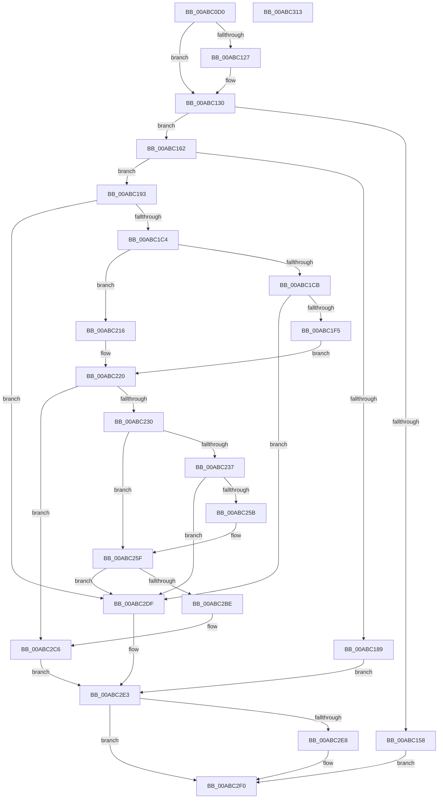

# PiDevCfgBuildDriverConfigurationId

- RVA: `0x00ABC0D0`–`0x00ABC314` (길이 `580` bytes)
- VA: `0x0000000140ABC0D0`
- 실행 섹션: `PAGE`
- PDB 이름 있음: `예`; PDB Function 태그: `아니요`
- unwind 정보 RVA: `0x000BD490`
- 디코드: `149`개 명령, `580/580` bytes 표시
- 미해석 바이트: `0` (있으면 어셈블리에 `.byte`로 보존)

> 이 문서는 커널 이미지의 기계어와 PDB 기호를 분석해 생성했습니다. 4번과 5번은 함수 원형과 자료형을 바이너리 사용 방식에서 추정한 C 해석이며 원본 소스 복구 결과는 아닙니다.

## 1. Dependencies

- 직접 호출 지점: **9**; 고유 호출 대상: **7**
- 직접 호출자로 확인된 함수: **1**
- RIP 상대 이미지 참조: **4**

### Outgoing calls
- `0x00ABC13A` → [PnpIsNullGuid](../8D/PnpIsNullGuid_function_008DD9E0.md) (function, `0x008DD9E0`)
- `0x00ABC17B` → [ExAllocatePool2](../../poolcode/B8/ExAllocatePool2_function_00B820F0.md) (function, `0x00B820F0`)
- `0x00ABC1B5` → [RtlUnicodeStringPrintfEx](../../text/4A/RtlUnicodeStringPrintfEx_function_004A8FD0.md) (function, `0x004A8FD0`)
- `0x00ABC1E6` → [RtlUnicodeStringPrintfEx](../../text/4A/RtlUnicodeStringPrintfEx_function_004A8FD0.md) (function, `0x004A8FD0`)
- `0x00ABC223` → [PnpIsNullGuid](../8D/PnpIsNullGuid_function_008DD9E0.md) (function, `0x008DD9E0`)
- `0x00ABC24C` → [RtlUnicodeStringCopyStringEx](../../text/5A/RtlUnicodeStringCopyStringEx_function_005A4FC0.md) (function, `0x005A4FC0`)
- `0x00ABC267` → [RtlTimeToTimeFields](../../text/42/RtlTimeToTimeFields_function_0042E0F0.md) (function, `0x0042E0F0`)
- `0x00ABC2B3` → [RtlUnicodeStringPrintf](../../text/48/RtlUnicodeStringPrintf_function_0048B984.md) (function, `0x0048B984`)
- `0x00ABC2EB` → [ExFreePool](../../poolcode/B8/ExFreePool_function_00B82850.md) (function, `0x00B82850`)

### Direct callers
- [PiDevCfgQueryDriverConfiguration](../97/PiDevCfgQueryDriverConfiguration_function_0097584C.md) at `0x009758C0`

### Static image references
- `0x00ABC198` → RVA `0x00AFF000` (` ?? ::NNGAKEGL::`string'`; read)
- `0x00ABC1D2` → RVA `0x00AFEF10` (` ?? ::NNGAKEGL::`string'`; read)
- `0x00ABC241` → RVA `0x00AFEAF0` (` ?? ::NNGAKEGL::`string'`; read)
- `0x00ABC28B` → RVA `0x00AFEF20` (` ?? ::NNGAKEGL::`string'`; read)

## 2. Other-region calls and transfers

- 다른 실행 섹션으로 향하는 call: **7**
  - `0x00ABC17B` → [ExAllocatePool2](../../poolcode/B8/ExAllocatePool2_function_00B820F0.md) (`PAGE` → `POOLCODE`)
  - `0x00ABC1B5` → [RtlUnicodeStringPrintfEx](../../text/4A/RtlUnicodeStringPrintfEx_function_004A8FD0.md) (`PAGE` → `.text`)
  - `0x00ABC1E6` → [RtlUnicodeStringPrintfEx](../../text/4A/RtlUnicodeStringPrintfEx_function_004A8FD0.md) (`PAGE` → `.text`)
  - `0x00ABC24C` → [RtlUnicodeStringCopyStringEx](../../text/5A/RtlUnicodeStringCopyStringEx_function_005A4FC0.md) (`PAGE` → `.text`)
  - `0x00ABC267` → [RtlTimeToTimeFields](../../text/42/RtlTimeToTimeFields_function_0042E0F0.md) (`PAGE` → `.text`)
  - `0x00ABC2B3` → [RtlUnicodeStringPrintf](../../text/48/RtlUnicodeStringPrintf_function_0048B984.md) (`PAGE` → `.text`)
  - `0x00ABC2EB` → [ExFreePool](../../poolcode/B8/ExFreePool_function_00B82850.md) (`PAGE` → `POOLCODE`)
- 별도 외부 분기/꼬리 이동을 확인하지 못했습니다.

## 3. Assembly (complete function range)

```asm
00ABC0D0  48 8B C4                        mov rax, rsp
00ABC0D3  48 89 58 08                     mov qword ptr [rax + 8], rbx
00ABC0D7  48 89 70 10                     mov qword ptr [rax + 0x10], rsi
00ABC0DB  48 89 78 18                     mov qword ptr [rax + 0x18], rdi
00ABC0DF  4C 89 60 20                     mov qword ptr [rax + 0x20], r12
00ABC0E3  55                              push rbp
00ABC0E4  41 56                           push r14
00ABC0E6  41 57                           push r15
00ABC0E8  48 8B EC                        mov rbp, rsp
00ABC0EB  48 81 EC 80 00 00 00            sub rsp, 0x80
00ABC0F2  33 C0                           xor eax, eax
00ABC0F4  4C 8D 79 28                     lea r15, [rcx + 0x28]
00ABC0F8  41 0F B7 1F                     movzx ebx, word ptr [r15]
00ABC0FC  48 8D 79 48                     lea rdi, [rcx + 0x48]
00ABC100  44 0F B7 07                     movzx r8d, word ptr [rdi]
00ABC104  83 C3 04                        add ebx, 4
00ABC107  41 03 D8                        add ebx, r8d
00ABC10A  89 45 D4                        mov dword ptr [rbp - 0x2c], eax
00ABC10D  0F 57 C0                        xorps xmm0, xmm0
00ABC110  0F 57 C9                        xorps xmm1, xmm1
00ABC113  4C 8B E2                        mov r12, rdx
00ABC116  48 8B F1                        mov rsi, rcx
00ABC119  0F 11 45 E0                     movups xmmword ptr [rbp - 0x20], xmm0
00ABC11D  0F 11 4D F0                     movups xmmword ptr [rbp - 0x10], xmm1
00ABC121  48 39 41 60                     cmp qword ptr [rcx + 0x60], rax
00ABC125  74 09                           je 0x140abc130
00ABC127  0F B7 41 58                     movzx eax, word ptr [rcx + 0x58]
00ABC12B  83 C0 02                        add eax, 2
00ABC12E  03 D8                           add ebx, eax
00ABC130  4C 8D B1 BC 00 00 00            lea r14, [rcx + 0xbc]
00ABC137  49 8B CE                        mov rcx, r14
00ABC13A  E8 A1 18 E2 FF                  call 0x1408dd9e0
00ABC13F  84 C0                           test al, al
00ABC141  8D 53 48                        lea edx, [rbx + 0x48]
00ABC144  B9 02 00 00 00                  mov ecx, 2
00ABC149  0F 45 D3                        cmovne edx, ebx
00ABC14C  48 8D 04 11                     lea rax, [rcx + rdx]
00ABC150  48 3D FE FF 00 00               cmp rax, 0xfffe
00ABC156  76 0A                           jbe 0x140abc162
00ABC158  BF 06 01 00 C0                  mov edi, 0xc0000106
00ABC15D  E9 8E 01 00 00                  jmp 0x140abc2f0
00ABC162  66 89 55 D0                     mov word ptr [rbp - 0x30], dx
00ABC166  41 B8 53 74 72 67               mov r8d, 0x67727453
00ABC16C  66 03 D1                        add dx, cx
00ABC16F  B9 00 01 00 00                  mov ecx, 0x100
00ABC174  0F B7 D2                        movzx edx, dx
00ABC177  66 89 55 D2                     mov word ptr [rbp - 0x2e], dx
00ABC17B  E8 70 5F 0C 00                  call 0x140b820f0
00ABC180  48 89 45 D8                     mov qword ptr [rbp - 0x28], rax
00ABC184  48 85 C0                        test rax, rax
00ABC187  75 0A                           jne 0x140abc193
00ABC189  BF 9A 00 00 C0                  mov edi, 0xc000009a
00ABC18E  E9 50 01 00 00                  jmp 0x140abc2e3
00ABC193  48 89 7C 24 28                  mov qword ptr [rsp + 0x28], rdi
00ABC198  4C 8D 0D 61 2E 04 00            lea r9, [rip + 0x42e61]
00ABC19F  4C 89 7C 24 20                  mov qword ptr [rsp + 0x20], r15
00ABC1A4  48 8D 55 E0                     lea rdx, [rbp - 0x20]
00ABC1A8  41 BF 00 08 00 00               mov r15d, 0x800
00ABC1AE  48 8D 4D D0                     lea rcx, [rbp - 0x30]
00ABC1B2  45 8B C7                        mov r8d, r15d
00ABC1B5  E8 16 CE 9E FF                  call 0x1404a8fd0
00ABC1BA  8B F8                           mov edi, eax
00ABC1BC  85 C0                           test eax, eax
00ABC1BE  0F 88 1B 01 00 00               js 0x140abc2df
00ABC1C4  48 83 7E 60 00                  cmp qword ptr [rsi + 0x60], 0
00ABC1C9  74 4B                           je 0x140abc216
00ABC1CB  48 8D 5E 58                     lea rbx, [rsi + 0x58]
00ABC1CF  45 8B C7                        mov r8d, r15d
00ABC1D2  4C 8D 0D 37 2D 04 00            lea r9, [rip + 0x42d37]
00ABC1D9  48 89 5C 24 20                  mov qword ptr [rsp + 0x20], rbx
00ABC1DE  48 8D 55 E0                     lea rdx, [rbp - 0x20]
00ABC1E2  48 8D 4D E0                     lea rcx, [rbp - 0x20]
00ABC1E6  E8 E5 CD 9E FF                  call 0x1404a8fd0
00ABC1EB  8B F8                           mov edi, eax
00ABC1ED  85 C0                           test eax, eax
00ABC1EF  0F 88 EA 00 00 00               js 0x140abc2df
00ABC1F5  0F B7 03                        movzx eax, word ptr [rbx]
00ABC1F8  4C 8D B6 BC 00 00 00            lea r14, [rsi + 0xbc]
00ABC1FF  0F B7 5D D0                     movzx ebx, word ptr [rbp - 0x30]
00ABC203  41 BF 02 00 00 00               mov r15d, 2
00ABC209  66 41 03 C7                     add ax, r15w
00ABC20D  66 03 D8                        add bx, ax
00ABC210  66 89 5D D0                     mov word ptr [rbp - 0x30], bx
00ABC214  EB 0A                           jmp 0x140abc220
00ABC216  0F B7 5D D0                     movzx ebx, word ptr [rbp - 0x30]
00ABC21A  41 BF 02 00 00 00               mov r15d, 2
00ABC220  49 8B CE                        mov rcx, r14
00ABC223  E8 B8 17 E2 FF                  call 0x1408dd9e0
00ABC228  84 C0                           test al, al
00ABC22A  0F 85 96 00 00 00               jne 0x140abc2c6
00ABC230  48 83 7E 60 00                  cmp qword ptr [rsi + 0x60], 0
00ABC235  75 28                           jne 0x140abc25f
00ABC237  41 B9 00 08 00 00               mov r9d, 0x800
00ABC23D  4C 8D 45 E0                     lea r8, [rbp - 0x20]
00ABC241  48 8D 15 A8 28 04 00            lea rdx, [rip + 0x428a8]
00ABC248  48 8D 4D E0                     lea rcx, [rbp - 0x20]
00ABC24C  E8 6F 8D AE FF                  call 0x1405a4fc0
00ABC251  8B F8                           mov edi, eax
00ABC253  85 C0                           test eax, eax
00ABC255  0F 88 84 00 00 00               js 0x140abc2df
00ABC25B  66 41 03 DF                     add bx, r15w
00ABC25F  48 8D 4E 70                     lea rcx, [rsi + 0x70]
00ABC263  48 8D 55 F0                     lea rdx, [rbp - 0x10]
00ABC267  E8 84 1E 97 FF                  call 0x14042e0f0
00ABC26C  0F B7 56 78                     movzx edx, word ptr [rsi + 0x78]
00ABC270  8B 46 7C                        mov eax, dword ptr [rsi + 0x7c]
00ABC273  44 0F B7 56 7A                  movzx r10d, word ptr [rsi + 0x7a]
00ABC278  44 0F B7 5E 7C                  movzx r11d, word ptr [rsi + 0x7c]
00ABC27D  44 0F BF 4D F4                  movsx r9d, word ptr [rbp - 0xc]
00ABC282  44 0F BF 45 F2                  movsx r8d, word ptr [rbp - 0xe]
00ABC287  89 54 24 40                     mov dword ptr [rsp + 0x40], edx
00ABC28B  48 8D 15 8E 2C 04 00            lea rdx, [rip + 0x42c8e]
00ABC292  44 89 54 24 38                  mov dword ptr [rsp + 0x38], r10d
00ABC297  48 C1 E8 10                     shr rax, 0x10
00ABC29B  0F B7 C8                        movzx ecx, ax
00ABC29E  0F BF 45 F0                     movsx eax, word ptr [rbp - 0x10]
00ABC2A2  44 89 5C 24 30                  mov dword ptr [rsp + 0x30], r11d
00ABC2A7  89 4C 24 28                     mov dword ptr [rsp + 0x28], ecx
00ABC2AB  48 8D 4D E0                     lea rcx, [rbp - 0x20]
00ABC2AF  89 44 24 20                     mov dword ptr [rsp + 0x20], eax
00ABC2B3  E8 CC F6 9C FF                  call 0x14048b984
00ABC2B8  8B F8                           mov edi, eax
00ABC2BA  85 C0                           test eax, eax
00ABC2BC  78 21                           js 0x140abc2df
00ABC2BE  66 03 5D E0                     add bx, word ptr [rbp - 0x20]
00ABC2C2  66 89 5D D0                     mov word ptr [rbp - 0x30], bx
00ABC2C6  0F 10 45 D0                     movups xmm0, xmmword ptr [rbp - 0x30]
00ABC2CA  0F 57 C9                        xorps xmm1, xmm1
00ABC2CD  66 0F 73 D9 08                  psrldq xmm1, 8
00ABC2D2  F3 41 0F 7F 04 24               movdqu xmmword ptr [r12], xmm0
00ABC2D8  66 48 0F 7E C8                  movq rax, xmm1
00ABC2DD  EB 04                           jmp 0x140abc2e3
00ABC2DF  48 8B 45 D8                     mov rax, qword ptr [rbp - 0x28]
00ABC2E3  48 85 C0                        test rax, rax
00ABC2E6  74 08                           je 0x140abc2f0
00ABC2E8  48 8B C8                        mov rcx, rax
00ABC2EB  E8 60 65 0C 00                  call 0x140b82850
00ABC2F0  4C 8D 9C 24 80 00 00 00         lea r11, [rsp + 0x80]
00ABC2F8  8B C7                           mov eax, edi
00ABC2FA  49 8B 5B 20                     mov rbx, qword ptr [r11 + 0x20]
00ABC2FE  49 8B 73 28                     mov rsi, qword ptr [r11 + 0x28]
00ABC302  49 8B 7B 30                     mov rdi, qword ptr [r11 + 0x30]
00ABC306  4D 8B 63 38                     mov r12, qword ptr [r11 + 0x38]
00ABC30A  49 8B E3                        mov rsp, r11
00ABC30D  41 5F                           pop r15
00ABC30F  41 5E                           pop r14
00ABC311  5D                              pop rbp
00ABC312  C3                              ret
00ABC313  CC                              int3
```

## 4. C-style interpretation (structured pseudocode)

```c
__int64 __fastcall PiDevCfgBuildDriverConfigurationId(__int64 a1, __int64 a2)
{
    __int64 result;
    __int64 v_rbx;
    __int64 v_rsp;
    unsigned __int64 v_stack_m18;
    unsigned __int16 v_stack_m24;
    unsigned __int16 v_stack_m26;
    unsigned __int64 v_stack_m28;
    unsigned __int64 v_stack_m38;
    unsigned __int64 v_stack_m40;
    unsigned int v_stack_m44;
    unsigned __int16 v_stack_m46;
    unsigned __int16 v_stack_m48;
    unsigned int v_stack_m58;
    unsigned int v_stack_m60;
    unsigned int v_stack_m68;
    unsigned __int64 v_stack_m70;
    unsigned __int64 v_stack_m78;

    *(unsigned __int64 *)(v_rsp + 8) = v_rbx;
    *(unsigned __int64 *)(v_rsp + 16) = v_rsi;
    *(unsigned __int64 *)(v_rsp + 24) = v_rdi;
    *(unsigned __int64 *)(v_rsp + 32) = v_r12;
    v_rsp = (v_rsp) - (128);
    result = 0;
    v_rbx = (unsigned int)((*(unsigned __int16 *)(a1 + 40)) + (4));
    v_rbx = (unsigned int)((v_rbx) + ((unsigned int)(*(unsigned __int16 *)(a1 + 72))));
    v_stack_m44 = 0;
    v_stack_m38 = v_xmm0;
    v_stack_m28 = v_xmm1;
    if ((*(unsigned __int64 *)(a1 + 96)) != 0) {
        result = *(unsigned __int16 *)(a1 + 88);
        result = (unsigned int)((result) + (2));
        v_rbx = (unsigned int)((v_rbx) + ((unsigned int)(result)));
    }
    result = PnpIsNullGuid(a1 + 188, a2, *(unsigned __int16 *)(a1 + 72), a4);
    a2 = v_rbx + 72;
    if ((unsigned __int8)(result) != 0) { a2 = (unsigned int)(v_rbx); }
    if ((2 + a2 * 1) <= 0xFFFEULL) goto loc_00ABC162;
    goto loc_00ABC2F0;
loc_00ABC162:
    v_stack_m48 = (unsigned __int16)(a2);
    a2 = (unsigned __int16)((a2) + (2));
    v_stack_m46 = (unsigned __int16)((unsigned __int16)(a2));
    result = ExAllocatePool2(256, (unsigned __int16)(a2), (unsigned int)(0x67727453ULL), a4);
    v_stack_m40 = result;
    if (result != 0) goto loc_00ABC193;
    goto loc_00ABC2E3;
loc_00ABC193:
    v_stack_m70 = (unsigned int)(0xC000009AULL);
    v_stack_m78 = a1 + 40;
    result = RtlUnicodeStringPrintfEx(v_stack_m48, v_stack_m38, (unsigned int)((unsigned int)((unsigned int)(0x800ULL))), v_rip + 274017);
    if (sign_flag) goto loc_00ABC2DF;
    if ((*(unsigned __int64 *)(a1 + 96)) == 0) goto loc_00ABC216;
    v_stack_m78 = a1 + 88;
    result = RtlUnicodeStringPrintfEx(v_stack_m38, v_stack_m38, (unsigned int)((unsigned int)((unsigned int)(0x800ULL))), v_rip + 273719);
    if (sign_flag) goto loc_00ABC2DF;
    result = (unsigned __int16)((*(unsigned __int16 *)(a1 + 88)) + (2));
    v_rbx = (unsigned __int16)((v_stack_m48) + ((unsigned __int16)(result)));
    v_stack_m48 = (unsigned __int16)(v_rbx);
    goto loc_00ABC220;
loc_00ABC216:
loc_00ABC220:
    result = PnpIsNullGuid(a1 + 188, v_stack_m38, (unsigned int)((unsigned int)((unsigned int)(0x800ULL))), v_rip + 273719);
    if ((unsigned __int8)(result) != 0) goto loc_00ABC2C6;
    if ((*(unsigned __int64 *)(a1 + 96)) != 0) goto loc_00ABC25F;
    result = RtlUnicodeStringCopyStringEx(v_stack_m38, v_rip + 272552, v_stack_m38, (unsigned int)(0x800ULL));
    if (sign_flag) goto loc_00ABC2DF;
    v_rbx = (unsigned __int16)((v_stack_m48) + (2));
loc_00ABC25F:
    result = RtlTimeToTimeFields(a1 + 112, v_stack_m28, v_stack_m38, (unsigned int)(0x800ULL));
    v_stack_m58 = (unsigned int)(*(unsigned __int16 *)(a1 + 120));
    v_stack_m60 = (unsigned int)(*(unsigned __int16 *)(a1 + 122));
    result = ((unsigned int)(*(unsigned int *)(a1 + 124))) >> (16);
    v_stack_m68 = (unsigned int)(*(unsigned __int16 *)(a1 + 124));
    v_stack_m70 = (unsigned int)((unsigned __int16)(result));
    v_stack_m78 = (unsigned int)((__int16)(v_stack_m28));
    result = RtlUnicodeStringPrintf(v_stack_m38, v_rip + 273550, (__int16)(v_stack_m26), (__int16)(v_stack_m24));
    if (sign_flag) goto loc_00ABC2DF;
    v_rbx = (unsigned __int16)((v_rbx) + (v_stack_m38));
    v_stack_m48 = (unsigned __int16)(v_rbx);
loc_00ABC2C6:
    *(unsigned __int64 *)(a2) = v_xmm0;
    goto loc_00ABC2E3;
loc_00ABC2DF:
loc_00ABC2E3:
    result = v_stack_m40;
    if (v_stack_m40 != 0) {
        a1 = v_stack_m40;
        result = ExFreePool(a1, v_rip + 273550, (__int16)(v_stack_m26), (__int16)(v_stack_m24));
    }
    return (unsigned int)((unsigned int)((unsigned int)((unsigned int)(result))));
}
```

## 5. (Beta) C Style

```c
int64_t PiDevCfgBuildDriverConfigurationId(void *Arg1, void *Arg2)
{
    uint8_t *arg1 = (uint8_t *)Arg1;
    uint8_t *arg2 = (uint8_t *)Arg2;

    int64_t result;
    int64_t local_rbx;
    int64_t local_rsp;
    uint64_t v_stack_m18;
    uint16_t v_stack_m24;
    uint16_t v_stack_m26;
    uint64_t v_stack_m28;
    uint64_t v_stack_m38;
    uint64_t v_stack_m40;
    uint32_t v_stack_m44;
    uint16_t v_stack_m46;
    uint16_t v_stack_m48;
    uint32_t v_stack_m58;
    uint32_t v_stack_m60;
    uint32_t v_stack_m68;
    uint64_t v_stack_m70;
    uint64_t v_stack_m78;

    *(uint64_t *)(local_rsp + 0x8) = local_rbx;
    *(uint64_t *)(local_rsp + 0x10) = local_rsi;
    *(uint64_t *)(local_rsp + 0x18) = local_rdi;
    *(uint64_t *)(local_rsp + 0x20) = local_r12;
    local_rsp = (local_rsp) - (128);
    result = 0;
    local_rbx = (uint32_t)((*(uint16_t *)(arg1 + 0x28)) + (4));
    local_rbx = (uint32_t)((local_rbx) + ((uint32_t)(*(uint16_t *)(arg1 + 0x48))));
    v_stack_m44 = 0;
    v_stack_m38 = v_xmm0;
    v_stack_m28 = v_xmm1;
    if ((*(uint64_t *)(arg1 + 0x60)) != 0) {
        result = *(uint16_t *)(arg1 + 0x58);
        result = (uint32_t)((result) + (2));
        local_rbx = (uint32_t)((local_rbx) + ((uint32_t)(result)));
    }
    result = PnpIsNullGuid(Arg1 + 188, Arg2, *(uint16_t *)(arg1 + 0x48), a4);
    Arg2 = local_rbx + 72;
    if ((uint8_t)(result) != 0) { Arg2 = (uint32_t)(local_rbx); }
    if ((2 + Arg2 * 1) <= 0xFFFEULL) goto loc_00ABC162;
    goto loc_00ABC2F0;
loc_00ABC162:
    v_stack_m48 = (uint16_t)(Arg2);
    Arg2 = (uint16_t)((Arg2) + (2));
    v_stack_m46 = (uint16_t)((uint16_t)(Arg2));
    result = ExAllocatePool2(256, (uint16_t)(Arg2), (uint32_t)(0x67727453ULL), a4);
    v_stack_m40 = result;
    if (result != 0) goto loc_00ABC193;
    goto loc_00ABC2E3;
loc_00ABC193:
    v_stack_m70 = (uint32_t)(0xC000009AULL);
    v_stack_m78 = Arg1 + 40;
    result = RtlUnicodeStringPrintfEx(v_stack_m48, v_stack_m38, (uint32_t)((uint32_t)((uint32_t)(0x800ULL))), v_rip + 274017);
    if (sign_flag) goto loc_00ABC2DF;
    if ((*(uint64_t *)(arg1 + 0x60)) == 0) goto loc_00ABC216;
    v_stack_m78 = Arg1 + 88;
    result = RtlUnicodeStringPrintfEx(v_stack_m38, v_stack_m38, (uint32_t)((uint32_t)((uint32_t)(0x800ULL))), v_rip + 273719);
    if (sign_flag) goto loc_00ABC2DF;
    result = (uint16_t)((*(uint16_t *)(arg1 + 0x58)) + (2));
    local_rbx = (uint16_t)((v_stack_m48) + ((uint16_t)(result)));
    v_stack_m48 = (uint16_t)(local_rbx);
    goto loc_00ABC220;
loc_00ABC216:
loc_00ABC220:
    result = PnpIsNullGuid(Arg1 + 188, v_stack_m38, (uint32_t)((uint32_t)((uint32_t)(0x800ULL))), v_rip + 273719);
    if ((uint8_t)(result) != 0) goto loc_00ABC2C6;
    if ((*(uint64_t *)(arg1 + 0x60)) != 0) goto loc_00ABC25F;
    result = RtlUnicodeStringCopyStringEx(v_stack_m38, v_rip + 272552, v_stack_m38, (uint32_t)(0x800ULL));
    if (sign_flag) goto loc_00ABC2DF;
    local_rbx = (uint16_t)((v_stack_m48) + (2));
loc_00ABC25F:
    result = RtlTimeToTimeFields(Arg1 + 112, v_stack_m28, v_stack_m38, (uint32_t)(0x800ULL));
    v_stack_m58 = (uint32_t)(*(uint16_t *)(arg1 + 0x78));
    v_stack_m60 = (uint32_t)(*(uint16_t *)(arg1 + 0x7A));
    result = ((uint32_t)(*(uint32_t *)(arg1 + 0x7C))) >> (16);
    v_stack_m68 = (uint32_t)(*(uint16_t *)(arg1 + 0x7C));
    v_stack_m70 = (uint32_t)((uint16_t)(result));
    v_stack_m78 = (uint32_t)((int16_t)(v_stack_m28));
    result = RtlUnicodeStringPrintf(v_stack_m38, v_rip + 273550, (int16_t)(v_stack_m26), (int16_t)(v_stack_m24));
    if (sign_flag) goto loc_00ABC2DF;
    local_rbx = (uint16_t)((local_rbx) + (v_stack_m38));
    v_stack_m48 = (uint16_t)(local_rbx);
loc_00ABC2C6:
    *(uint64_t *)(arg2) = v_xmm0;
    goto loc_00ABC2E3;
loc_00ABC2DF:
loc_00ABC2E3:
    result = v_stack_m40;
    if (v_stack_m40 != 0) {
        Arg1 = v_stack_m40;
        result = ExFreePool(Arg1, v_rip + 273550, (int16_t)(v_stack_m26), (int16_t)(v_stack_m24));
    }
    return (uint32_t)((uint32_t)((uint32_t)((uint32_t)(result))));
}
```

### 관측된 메모리 오프셋

구조체 형식이 확인되지 않은 접근은 인자 기준의 오프셋으로만 기록했습니다.

| 기준 인자 | 오프셋 표현 | 폭 (bit) | 접근 |
|---|---:|---:|---|
| `Arg1` | `+ 0x0` | `16` | `R` |
| `Arg1` | `+ 0x28` | `64` | `R` |
| `Arg1` | `+ 0x48` | `64` | `R` |
| `Arg1` | `+ 0x58` | `16` | `R` |
| `Arg1` | `+ 0x58` | `64` | `R` |
| `Arg1` | `+ 0x60` | `64` | `R` |
| `Arg1` | `+ 0x70` | `64` | `R` |
| `Arg1` | `+ 0x78` | `16` | `R` |
| `Arg1` | `+ 0x7A` | `16` | `R` |
| `Arg1` | `+ 0x7C` | `16` | `R` |
| `Arg1` | `+ 0x7C` | `32` | `R` |
| `Arg1` | `+ 0xBC` | `64` | `R` |
| `Arg2` | `+ 0x0` | `128` | `W` |

## 6. Execution-region graph

[열기: 2D/3D 그래프와 함수 탐색 컨트롤 패널](../../../control-panel.html?section=page&rva=0x00ABC0D0&view=graph)

- 2D 그래프는 위에서 아래로 흐르고, 3D 그래프는 빈 공간을 드래그해 회전합니다. Shift+드래그는 이동, 휠은 확대·축소, 함수 노드 선택은 대상 보고서 이동입니다.

### Static fallback


