# PiDevCfgLogDeviceStarted

- RVA: `0x00ABEC8C`–`0x00ABF0D7` (길이 `1,099` bytes)
- VA: `0x0000000140ABEC8C`
- 실행 섹션: `PAGE`
- PDB 이름 있음: `예`; PDB Function 태그: `아니요`
- unwind 정보 RVA: `0x000B4400`
- 디코드: `266`개 명령, `1,099/1,099` bytes 표시
- 미해석 바이트: `0` (있으면 어셈블리에 `.byte`로 보존)

> 이 문서는 커널 이미지의 기계어와 PDB 기호를 분석해 생성했습니다. 4번과 5번은 함수 원형과 자료형을 바이너리 사용 방식에서 추정한 C 해석이며 원본 소스 복구 결과는 아닙니다.

## 1. Dependencies

- 직접 호출 지점: **23**; 고유 호출 대상: **8**
- 직접 호출자로 확인된 함수: **1**
- RIP 상대 이미지 참조: **12**

### Outgoing calls
- `0x00ABED03` → [memset](../../text/6C/memset_function_006C6C40.md) (function, `0x006C6C40`)
- `0x00ABEDB6` → [PiDevCfgQueryObjectProperties](../97/PiDevCfgQueryObjectProperties_function_0097776C.md) (function, `0x0097776C`)
- `0x00ABEDDA` → [RtlInitUnicodeString](../../text/42/RtlInitUnicodeString_function_0042A780.md) (function, `0x0042A780`)
- `0x00ABEDEA` → [RtlInitUnicodeString](../../text/42/RtlInitUnicodeString_function_0042A780.md) (function, `0x0042A780`)
- `0x00ABEDFB` → [RtlInitUnicodeString](../../text/42/RtlInitUnicodeString_function_0042A780.md) (function, `0x0042A780`)
- `0x00ABEE0C` → [RtlInitUnicodeString](../../text/42/RtlInitUnicodeString_function_0042A780.md) (function, `0x0042A780`)
- `0x00ABEEE2` → [PipIsDevNodeDNStarted](../../text/47/PipIsDevNodeDNStarted_function_00470870.md) (function, `0x00470870`)
- `0x00ABEF01` → [PipIsDevNodeDNStarted](../../text/47/PipIsDevNodeDNStarted_function_00470870.md) (function, `0x00470870`)
- `0x00ABEF2E` → [PnpGetLogString](../../text/4C/PnpGetLogString_function_004C26F4.md) (function, `0x004C26F4`)
- `0x00ABEF3B` → [PnpGetLogString](../../text/4C/PnpGetLogString_function_004C26F4.md) (function, `0x004C26F4`)
- `0x00ABEF47` → [PnpGetLogString](../../text/4C/PnpGetLogString_function_004C26F4.md) (function, `0x004C26F4`)
- `0x00ABEFAA` → [PnpGetLogString](../../text/4C/PnpGetLogString_function_004C26F4.md) (function, `0x004C26F4`)
- `0x00ABEFB7` → [PnpGetLogString](../../text/4C/PnpGetLogString_function_004C26F4.md) (function, `0x004C26F4`)
- `0x00ABEFC3` → [PnpGetLogString](../../text/4C/PnpGetLogString_function_004C26F4.md) (function, `0x004C26F4`)
- `0x00ABF008` → [PnpGetLogString](../../text/4C/PnpGetLogString_function_004C26F4.md) (function, `0x004C26F4`)
- `0x00ABF015` → [PnpGetLogString](../../text/4C/PnpGetLogString_function_004C26F4.md) (function, `0x004C26F4`)
- `0x00ABF021` → [PnpGetLogString](../../text/4C/PnpGetLogString_function_004C26F4.md) (function, `0x004C26F4`)
- `0x00ABF05D` → [McTemplateK0zzjzzzdd_EtwWriteTransfer](../../text/42/McTemplateK0zzjzzzdd_EtwWriteTransfer_function_004233E8.md) (function, `0x004233E8`)
- `0x00ABF06B` → [ExFreePool](../../poolcode/B8/ExFreePool_function_00B82850.md) (function, `0x00B82850`)
- `0x00ABF080` → [ExFreePool](../../poolcode/B8/ExFreePool_function_00B82850.md) (function, `0x00B82850`)
- `0x00ABF096` → [ExFreePool](../../poolcode/B8/ExFreePool_function_00B82850.md) (function, `0x00B82850`)
- `0x00ABF0AD` → [ExFreePool](../../poolcode/B8/ExFreePool_function_00B82850.md) (function, `0x00B82850`)
- `0x00ABF0BC` → [_security_check_cookie](../../text/6A/_security_check_cookie_function_006AC640.md) (function, `0x006AC640`)

### Direct callers
- [PpDevCfgTraceDeviceStart](../8F/PpDevCfgTraceDeviceStart_function_008F9908.md) at `0x008F9962`

### Static image references
- `0x00ABECA6` → RVA `0x00E0A740` (`.data`; read)
- `0x00ABECB7` → RVA `0x00EF012A` (`.data`; read)
- `0x00ABED19` → RVA `0x00011688` (`.rdata`; read)
- `0x00ABED3B` → RVA `0x00012FA0` (`.rdata`; read)
- `0x00ABED57` → RVA `0x0001E550` (`.rdata`; read)
- `0x00ABED6A` → RVA `0x00014068` (`.rdata`; read)
- `0x00ABED7E` → RVA `0x000140E0` (`.rdata`; read)
- `0x00ABEF1B` → RVA `0x00B53AB8` (` ?? ::LBKOJDO::`string'`; read)
- `0x00ABEF65` → RVA `0x00027290` (`.rdata`; read)
- `0x00ABEFDF` → RVA `0x00027220` (`.rdata`; read)
- `0x00ABEFE8` → RVA `0x00EF012A` (`.data`; reference)
- `0x00ABF03F` → RVA `0x000271E0` (`.rdata`; read)

## 2. Other-region calls and transfers

- 다른 실행 섹션으로 향하는 call: **22**
  - `0x00ABED03` → [memset](../../text/6C/memset_function_006C6C40.md) (`PAGE` → `.text`)
  - `0x00ABEDDA` → [RtlInitUnicodeString](../../text/42/RtlInitUnicodeString_function_0042A780.md) (`PAGE` → `.text`)
  - `0x00ABEDEA` → [RtlInitUnicodeString](../../text/42/RtlInitUnicodeString_function_0042A780.md) (`PAGE` → `.text`)
  - `0x00ABEDFB` → [RtlInitUnicodeString](../../text/42/RtlInitUnicodeString_function_0042A780.md) (`PAGE` → `.text`)
  - `0x00ABEE0C` → [RtlInitUnicodeString](../../text/42/RtlInitUnicodeString_function_0042A780.md) (`PAGE` → `.text`)
  - `0x00ABEEE2` → [PipIsDevNodeDNStarted](../../text/47/PipIsDevNodeDNStarted_function_00470870.md) (`PAGE` → `.text`)
  - `0x00ABEF01` → [PipIsDevNodeDNStarted](../../text/47/PipIsDevNodeDNStarted_function_00470870.md) (`PAGE` → `.text`)
  - `0x00ABEF2E` → [PnpGetLogString](../../text/4C/PnpGetLogString_function_004C26F4.md) (`PAGE` → `.text`)
  - `0x00ABEF3B` → [PnpGetLogString](../../text/4C/PnpGetLogString_function_004C26F4.md) (`PAGE` → `.text`)
  - `0x00ABEF47` → [PnpGetLogString](../../text/4C/PnpGetLogString_function_004C26F4.md) (`PAGE` → `.text`)
  - `0x00ABEFAA` → [PnpGetLogString](../../text/4C/PnpGetLogString_function_004C26F4.md) (`PAGE` → `.text`)
  - `0x00ABEFB7` → [PnpGetLogString](../../text/4C/PnpGetLogString_function_004C26F4.md) (`PAGE` → `.text`)
  - `0x00ABEFC3` → [PnpGetLogString](../../text/4C/PnpGetLogString_function_004C26F4.md) (`PAGE` → `.text`)
  - `0x00ABF008` → [PnpGetLogString](../../text/4C/PnpGetLogString_function_004C26F4.md) (`PAGE` → `.text`)
  - `0x00ABF015` → [PnpGetLogString](../../text/4C/PnpGetLogString_function_004C26F4.md) (`PAGE` → `.text`)
  - `0x00ABF021` → [PnpGetLogString](../../text/4C/PnpGetLogString_function_004C26F4.md) (`PAGE` → `.text`)
  - `0x00ABF05D` → [McTemplateK0zzjzzzdd_EtwWriteTransfer](../../text/42/McTemplateK0zzjzzzdd_EtwWriteTransfer_function_004233E8.md) (`PAGE` → `.text`)
  - `0x00ABF06B` → [ExFreePool](../../poolcode/B8/ExFreePool_function_00B82850.md) (`PAGE` → `POOLCODE`)
  - `0x00ABF080` → [ExFreePool](../../poolcode/B8/ExFreePool_function_00B82850.md) (`PAGE` → `POOLCODE`)
  - `0x00ABF096` → [ExFreePool](../../poolcode/B8/ExFreePool_function_00B82850.md) (`PAGE` → `POOLCODE`)
  - `0x00ABF0AD` → [ExFreePool](../../poolcode/B8/ExFreePool_function_00B82850.md) (`PAGE` → `POOLCODE`)
  - `0x00ABF0BC` → [_security_check_cookie](../../text/6A/_security_check_cookie_function_006AC640.md) (`PAGE` → `.text`)
- 별도 외부 분기/꼬리 이동을 확인하지 못했습니다.

## 3. Assembly (complete function range)

```asm
00ABEC8C  48 89 5C 24 10                  mov qword ptr [rsp + 0x10], rbx
00ABEC91  48 89 7C 24 18                  mov qword ptr [rsp + 0x18], rdi
00ABEC96  55                              push rbp
00ABEC97  48 8D AC 24 70 FF FF FF         lea rbp, [rsp - 0x90]
00ABEC9F  48 81 EC 90 01 00 00            sub rsp, 0x190
00ABECA6  48 8B 05 93 BA 34 00            mov rax, qword ptr [rip + 0x34ba93]
00ABECAD  48 33 C4                        xor rax, rsp
00ABECB0  48 89 85 80 00 00 00            mov qword ptr [rbp + 0x80], rax
00ABECB7  8A 05 6D 14 43 00               mov al, byte ptr [rip + 0x43146d]
00ABECBD  33 FF                           xor edi, edi
00ABECBF  24 30                           and al, 0x30
00ABECC1  48 89 7D 80                     mov qword ptr [rbp - 0x80], rdi
00ABECC5  48 89 7D 88                     mov qword ptr [rbp - 0x78], rdi
00ABECC9  0F 57 C0                        xorps xmm0, xmm0
00ABECCC  48 89 7D 90                     mov qword ptr [rbp - 0x70], rdi
00ABECD0  48 8B D9                        mov rbx, rcx
00ABECD3  48 89 7D 98                     mov qword ptr [rbp - 0x68], rdi
00ABECD7  48 89 7C 24 60                  mov qword ptr [rsp + 0x60], rdi
00ABECDC  48 89 7C 24 68                  mov qword ptr [rsp + 0x68], rdi
00ABECE1  48 89 7C 24 70                  mov qword ptr [rsp + 0x70], rdi
00ABECE6  48 89 7C 24 78                  mov qword ptr [rsp + 0x78], rdi
00ABECEB  0F 11 45 A0                     movups xmmword ptr [rbp - 0x60], xmm0
00ABECEF  3C 30                           cmp al, 0x30
00ABECF1  0F 85 BB 03 00 00               jne 0x140abf0b2
00ABECF7  33 D2                           xor edx, edx
00ABECF9  48 8D 4D B0                     lea rcx, [rbp - 0x50]
00ABECFD  41 B8 C8 00 00 00               mov r8d, 0xc8
00ABED03  E8 38 7F C0 FF                  call 0x1406c6c40
00ABED08  8D 57 06                        lea edx, [rdi + 6]
00ABED0B  C7 44 24 28 05 00 00 00         mov dword ptr [rsp + 0x28], 5
00ABED13  8D 4F 12                        lea ecx, [rdi + 0x12]
00ABED16  89 55 F4                        mov dword ptr [rbp - 0xc], edx
00ABED19  48 8D 05 68 29 55 FF            lea rax, [rip - 0xaad698]
00ABED20  89 4D E0                        mov dword ptr [rbp - 0x20], ecx
00ABED23  48 89 45 B0                     mov qword ptr [rbp - 0x50], rax
00ABED27  44 8D 47 01                     lea r8d, [rdi + 1]
00ABED2B  48 8D 45 A0                     lea rax, [rbp - 0x60]
00ABED2F  89 4D 08                        mov dword ptr [rbp + 8], ecx
00ABED32  48 89 45 C0                     mov qword ptr [rbp - 0x40], rax
00ABED36  B9 12 20 00 00                  mov ecx, 0x2012
00ABED3B  48 8D 05 5E 42 55 FF            lea rax, [rip - 0xaabda2]
00ABED42  89 55 1C                        mov dword ptr [rbp + 0x1c], edx
00ABED45  48 89 45 D8                     mov qword ptr [rbp - 0x28], rax
00ABED49  45 33 C9                        xor r9d, r9d
00ABED4C  48 8D 45 80                     lea rax, [rbp - 0x80]
00ABED50  89 55 44                        mov dword ptr [rbp + 0x44], edx
00ABED53  48 89 45 E8                     mov qword ptr [rbp - 0x18], rax
00ABED57  48 8D 05 F2 F7 55 FF            lea rax, [rip - 0xaa080e]
00ABED5E  48 89 45 00                     mov qword ptr [rbp], rax
00ABED62  48 8D 45 90                     lea rax, [rbp - 0x70]
00ABED66  48 89 45 10                     mov qword ptr [rbp + 0x10], rax
00ABED6A  48 8D 05 F7 52 55 FF            lea rax, [rip - 0xaaad09]
00ABED71  48 89 45 28                     mov qword ptr [rbp + 0x28], rax
00ABED75  48 8D 44 24 60                  lea rax, [rsp + 0x60]
00ABED7A  48 89 45 38                     mov qword ptr [rbp + 0x38], rax
00ABED7E  48 8D 05 5B 53 55 FF            lea rax, [rip - 0xaaaca5]
00ABED85  48 89 45 50                     mov qword ptr [rbp + 0x50], rax
00ABED89  48 8D 44 24 70                  lea rax, [rsp + 0x70]
00ABED8E  48 89 45 60                     mov qword ptr [rbp + 0x60], rax
00ABED92  48 8D 45 B0                     lea rax, [rbp - 0x50]
00ABED96  89 55 6C                        mov dword ptr [rbp + 0x6c], edx
00ABED99  48 8B 53 30                     mov rdx, qword ptr [rbx + 0x30]
00ABED9D  48 89 44 24 20                  mov qword ptr [rsp + 0x20], rax
00ABEDA2  C7 45 B8 0D 00 00 00            mov dword ptr [rbp - 0x48], 0xd
00ABEDA9  C7 45 C8 10 00 00 00            mov dword ptr [rbp - 0x38], 0x10
00ABEDB0  89 4D 30                        mov dword ptr [rbp + 0x30], ecx
00ABEDB3  89 4D 58                        mov dword ptr [rbp + 0x58], ecx
00ABEDB6  E8 B1 89 EB FF                  call 0x14097776c
00ABEDBB  85 C0                           test eax, eax
00ABEDBD  0F 88 9F 02 00 00               js 0x140abf062
00ABEDC3  39 7D D0                        cmp dword ptr [rbp - 0x30], edi
00ABEDC6  7D 07                           jge 0x140abedcf
00ABEDC8  0F 57 C0                        xorps xmm0, xmm0
00ABEDCB  0F 11 45 A0                     movups xmmword ptr [rbp - 0x60], xmm0
00ABEDCF  39 7D F8                        cmp dword ptr [rbp - 8], edi
00ABEDD2  7D 0B                           jge 0x140abeddf
00ABEDD4  33 D2                           xor edx, edx
00ABEDD6  48 8D 4D 80                     lea rcx, [rbp - 0x80]
00ABEDDA  E8 A1 B9 96 FF                  call 0x14042a780
00ABEDDF  39 7D 20                        cmp dword ptr [rbp + 0x20], edi
00ABEDE2  7D 0B                           jge 0x140abedef
00ABEDE4  33 D2                           xor edx, edx
00ABEDE6  48 8D 4D 90                     lea rcx, [rbp - 0x70]
00ABEDEA  E8 91 B9 96 FF                  call 0x14042a780
00ABEDEF  39 7D 48                        cmp dword ptr [rbp + 0x48], edi
00ABEDF2  7D 0C                           jge 0x140abee00
00ABEDF4  33 D2                           xor edx, edx
00ABEDF6  48 8D 4C 24 60                  lea rcx, [rsp + 0x60]
00ABEDFB  E8 80 B9 96 FF                  call 0x14042a780
00ABEE00  39 7D 70                        cmp dword ptr [rbp + 0x70], edi
00ABEE03  7D 0C                           jge 0x140abee11
00ABEE05  33 D2                           xor edx, edx
00ABEE07  48 8D 4C 24 70                  lea rcx, [rsp + 0x70]
00ABEE0C  E8 6F B9 96 FF                  call 0x14042a780
00ABEE11  41 B9 20 00 00 00               mov r9d, 0x20
00ABEE17  41 BA FE FF 00 00               mov r10d, 0xfffe
00ABEE1D  48 39 7C 24 68                  cmp qword ptr [rsp + 0x68], rdi
00ABEE22  74 4E                           je 0x140abee72
00ABEE24  0F B7 4C 24 60                  movzx ecx, word ptr [rsp + 0x60]
00ABEE29  83 F9 04                        cmp ecx, 4
00ABEE2C  76 44                           jbe 0x140abee72
00ABEE2E  8B C1                           mov eax, ecx
00ABEE30  44 8B C7                        mov r8d, edi
00ABEE33  48 D1 E8                        shr rax, 1
00ABEE36  48 83 F8 02                     cmp rax, 2
00ABEE3A  74 2D                           je 0x140abee69
00ABEE3C  48 8B D7                        mov rdx, rdi
00ABEE3F  48 8B 44 24 68                  mov rax, qword ptr [rsp + 0x68]
00ABEE44  66 39 3C 50                     cmp word ptr [rax + rdx*2], di
00ABEE48  75 0A                           jne 0x140abee54
00ABEE4A  66 44 89 0C 50                  mov word ptr [rax + rdx*2], r9w
00ABEE4F  0F B7 4C 24 60                  movzx ecx, word ptr [rsp + 0x60]
00ABEE54  41 FF C0                        inc r8d
00ABEE57  0F B7 C1                        movzx eax, cx
00ABEE5A  48 D1 E8                        shr rax, 1
00ABEE5D  48 83 E8 02                     sub rax, 2
00ABEE61  41 8B D0                        mov edx, r8d
00ABEE64  48 3B D0                        cmp rdx, rax
00ABEE67  72 D6                           jb 0x140abee3f
00ABEE69  66 41 03 CA                     add cx, r10w
00ABEE6D  66 89 4C 24 60                  mov word ptr [rsp + 0x60], cx
00ABEE72  48 39 7C 24 78                  cmp qword ptr [rsp + 0x78], rdi
00ABEE77  74 4E                           je 0x140abeec7
00ABEE79  0F B7 4C 24 70                  movzx ecx, word ptr [rsp + 0x70]
00ABEE7E  83 F9 04                        cmp ecx, 4
00ABEE81  76 44                           jbe 0x140abeec7
00ABEE83  8B C1                           mov eax, ecx
00ABEE85  44 8B C7                        mov r8d, edi
00ABEE88  48 D1 E8                        shr rax, 1
00ABEE8B  48 83 F8 02                     cmp rax, 2
00ABEE8F  74 2D                           je 0x140abeebe
00ABEE91  48 8B D7                        mov rdx, rdi
00ABEE94  48 8B 44 24 78                  mov rax, qword ptr [rsp + 0x78]
00ABEE99  66 39 3C 50                     cmp word ptr [rax + rdx*2], di
00ABEE9D  75 0A                           jne 0x140abeea9
00ABEE9F  66 44 89 0C 50                  mov word ptr [rax + rdx*2], r9w
00ABEEA4  0F B7 4C 24 70                  movzx ecx, word ptr [rsp + 0x70]
00ABEEA9  41 FF C0                        inc r8d
00ABEEAC  0F B7 C1                        movzx eax, cx
00ABEEAF  48 D1 E8                        shr rax, 1
00ABEEB2  48 83 E8 02                     sub rax, 2
00ABEEB6  41 8B D0                        mov edx, r8d
00ABEEB9  48 3B D0                        cmp rdx, rax
00ABEEBC  72 D6                           jb 0x140abee94
00ABEEBE  66 41 03 CA                     add cx, r10w
00ABEEC2  66 89 4C 24 70                  mov word ptr [rsp + 0x70], cx
00ABEEC7  41 B8 00 60 00 00               mov r8d, 0x6000
00ABEECD  44 85 83 8C 01 00 00            test dword ptr [rbx + 0x18c], r8d
00ABEED4  74 09                           je 0x140abeedf
00ABEED6  44 8B 93 98 01 00 00            mov r10d, dword ptr [rbx + 0x198]
00ABEEDD  EB 16                           jmp 0x140abeef5
00ABEEDF  48 8B CB                        mov rcx, rbx
00ABEEE2  E8 89 19 9B FF                  call 0x140470870
00ABEEE7  85 C0                           test eax, eax
00ABEEE9  44 8B D7                        mov r10d, edi
00ABEEEC  B9 E5 00 00 C0                  mov ecx, 0xc00000e5
00ABEEF1  44 0F 44 D1                     cmove r10d, ecx
00ABEEF5  44 85 83 8C 01 00 00            test dword ptr [rbx + 0x18c], r8d
00ABEEFC  75 73                           jne 0x140abef71
00ABEEFE  48 8B CB                        mov rcx, rbx
00ABEF01  E8 6A 19 9B FF                  call 0x140470870
00ABEF06  85 C0                           test eax, eax
00ABEF08  74 67                           je 0x140abef71
00ABEF0A  F6 05 19 12 43 00 10            test byte ptr [rip + 0x431219], 0x10
00ABEF11  0F 84 4B 01 00 00               je 0x140abf062
00ABEF17  48 8B 45 88                     mov rax, qword ptr [rbp - 0x78]
00ABEF1B  4C 8D 0D 96 4B 09 00            lea r9, [rip + 0x94b96]
00ABEF22  48 85 C0                        test rax, rax
00ABEF25  48 8D 4C 24 70                  lea rcx, [rsp + 0x70]
00ABEF2A  4C 0F 45 C8                     cmovne r9, rax
00ABEF2E  E8 C1 37 A0 FF                  call 0x1404c26f4
00ABEF33  48 8D 4C 24 60                  lea rcx, [rsp + 0x60]
00ABEF38  4C 8B C0                        mov r8, rax
00ABEF3B  E8 B4 37 A0 FF                  call 0x1404c26f4
00ABEF40  48 8D 4D 90                     lea rcx, [rbp - 0x70]
00ABEF44  48 8B D0                        mov rdx, rax
00ABEF47  E8 A8 37 A0 FF                  call 0x1404c26f4
00ABEF4C  8B 8B 94 01 00 00               mov ecx, dword ptr [rbx + 0x194]
00ABEF52  44 89 54 24 50                  mov dword ptr [rsp + 0x50], r10d
00ABEF57  89 4C 24 48                     mov dword ptr [rsp + 0x48], ecx
00ABEF5B  4C 89 44 24 40                  mov qword ptr [rsp + 0x40], r8
00ABEF60  48 89 54 24 38                  mov qword ptr [rsp + 0x38], rdx
00ABEF65  48 8D 15 24 83 56 FF            lea rdx, [rip - 0xa97cdc]
00ABEF6C  E9 D5 00 00 00                  jmp 0x140abf046
00ABEF71  F7 83 8C 01 00 00 00 20 00 00   test dword ptr [rbx + 0x18c], 0x2000
00ABEF7B  74 6B                           je 0x140abefe8
00ABEF7D  83 BB 94 01 00 00 0E            cmp dword ptr [rbx + 0x194], 0xe
00ABEF84  75 62                           jne 0x140abefe8
00ABEF86  F6 05 9D 11 43 00 40            test byte ptr [rip + 0x43119d], 0x40
00ABEF8D  0F 84 CF 00 00 00               je 0x140abf062
00ABEF93  48 8B 45 88                     mov rax, qword ptr [rbp - 0x78]
00ABEF97  4C 8D 0D 1A 4B 09 00            lea r9, [rip + 0x94b1a]
00ABEF9E  48 85 C0                        test rax, rax
00ABEFA1  48 8D 4C 24 70                  lea rcx, [rsp + 0x70]
00ABEFA6  4C 0F 45 C8                     cmovne r9, rax
00ABEFAA  E8 45 37 A0 FF                  call 0x1404c26f4
00ABEFAF  48 8D 4C 24 60                  lea rcx, [rsp + 0x60]
00ABEFB4  4C 8B C0                        mov r8, rax
00ABEFB7  E8 38 37 A0 FF                  call 0x1404c26f4
00ABEFBC  48 8D 4D 90                     lea rcx, [rbp - 0x70]
00ABEFC0  48 8B D0                        mov rdx, rax
00ABEFC3  E8 2C 37 A0 FF                  call 0x1404c26f4
00ABEFC8  44 89 54 24 50                  mov dword ptr [rsp + 0x50], r10d
00ABEFCD  C7 44 24 48 0E 00 00 00         mov dword ptr [rsp + 0x48], 0xe
00ABEFD5  4C 89 44 24 40                  mov qword ptr [rsp + 0x40], r8
00ABEFDA  48 89 54 24 38                  mov qword ptr [rsp + 0x38], rdx
00ABEFDF  48 8D 15 3A 82 56 FF            lea rdx, [rip - 0xa97dc6]
00ABEFE6  EB 5E                           jmp 0x140abf046
00ABEFE8  44 84 0D 3B 11 43 00            test byte ptr [rip + 0x43113b], r9b
00ABEFEF  74 71                           je 0x140abf062
00ABEFF1  48 8B 45 88                     mov rax, qword ptr [rbp - 0x78]
00ABEFF5  4C 8D 0D BC 4A 09 00            lea r9, [rip + 0x94abc]
00ABEFFC  48 85 C0                        test rax, rax
00ABEFFF  48 8D 4C 24 70                  lea rcx, [rsp + 0x70]
00ABF004  4C 0F 45 C8                     cmovne r9, rax
00ABF008  E8 E7 36 A0 FF                  call 0x1404c26f4
00ABF00D  48 8D 4C 24 60                  lea rcx, [rsp + 0x60]
00ABF012  4C 8B C0                        mov r8, rax
00ABF015  E8 DA 36 A0 FF                  call 0x1404c26f4
00ABF01A  48 8D 4D 90                     lea rcx, [rbp - 0x70]
00ABF01E  48 8B D0                        mov rdx, rax
00ABF021  E8 CE 36 A0 FF                  call 0x1404c26f4
00ABF026  8B 8B 94 01 00 00               mov ecx, dword ptr [rbx + 0x194]
00ABF02C  44 89 54 24 50                  mov dword ptr [rsp + 0x50], r10d
00ABF031  89 4C 24 48                     mov dword ptr [rsp + 0x48], ecx
00ABF035  4C 89 44 24 40                  mov qword ptr [rsp + 0x40], r8
00ABF03A  48 89 54 24 38                  mov qword ptr [rsp + 0x38], rdx
00ABF03F  48 8D 15 9A 81 56 FF            lea rdx, [rip - 0xa97e66]
00ABF046  48 89 44 24 30                  mov qword ptr [rsp + 0x30], rax
00ABF04B  48 8D 45 A0                     lea rax, [rbp - 0x60]
00ABF04F  48 89 44 24 28                  mov qword ptr [rsp + 0x28], rax
00ABF054  4C 89 4C 24 20                  mov qword ptr [rsp + 0x20], r9
00ABF059  4C 8B 4B 30                     mov r9, qword ptr [rbx + 0x30]
00ABF05D  E8 86 43 96 FF                  call 0x1404233e8
00ABF062  48 8B 4D 88                     mov rcx, qword ptr [rbp - 0x78]
00ABF066  48 85 C9                        test rcx, rcx
00ABF069  74 0C                           je 0x140abf077
00ABF06B  E8 E0 37 0C 00                  call 0x140b82850
00ABF070  0F 57 C0                        xorps xmm0, xmm0
00ABF073  0F 11 45 80                     movups xmmword ptr [rbp - 0x80], xmm0
00ABF077  48 8B 4D 98                     mov rcx, qword ptr [rbp - 0x68]
00ABF07B  48 85 C9                        test rcx, rcx
00ABF07E  74 0C                           je 0x140abf08c
00ABF080  E8 CB 37 0C 00                  call 0x140b82850
00ABF085  0F 57 C0                        xorps xmm0, xmm0
00ABF088  0F 11 45 90                     movups xmmword ptr [rbp - 0x70], xmm0
00ABF08C  48 8B 4C 24 68                  mov rcx, qword ptr [rsp + 0x68]
00ABF091  48 85 C9                        test rcx, rcx
00ABF094  74 0D                           je 0x140abf0a3
00ABF096  E8 B5 37 0C 00                  call 0x140b82850
00ABF09B  0F 57 C0                        xorps xmm0, xmm0
00ABF09E  0F 11 44 24 60                  movups xmmword ptr [rsp + 0x60], xmm0
00ABF0A3  48 8B 4C 24 78                  mov rcx, qword ptr [rsp + 0x78]
00ABF0A8  48 85 C9                        test rcx, rcx
00ABF0AB  74 05                           je 0x140abf0b2
00ABF0AD  E8 9E 37 0C 00                  call 0x140b82850
00ABF0B2  48 8B 8D 80 00 00 00            mov rcx, qword ptr [rbp + 0x80]
00ABF0B9  48 33 CC                        xor rcx, rsp
00ABF0BC  E8 7F D5 BE FF                  call 0x1406ac640
00ABF0C1  4C 8D 9C 24 90 01 00 00         lea r11, [rsp + 0x190]
00ABF0C9  49 8B 5B 18                     mov rbx, qword ptr [r11 + 0x18]
00ABF0CD  49 8B 7B 20                     mov rdi, qword ptr [r11 + 0x20]
00ABF0D1  49 8B E3                        mov rsp, r11
00ABF0D4  5D                              pop rbp
00ABF0D5  C3                              ret
00ABF0D6  CC                              int3
```

## 4. C-style interpretation (structured pseudocode)

```c
__int64 __fastcall PiDevCfgLogDeviceStarted(__int64 a1, int a2, __int64 a3, int a4)
{
    __int64 result;
    __int64 v_r10;
    __int64 v_rdi;
    __int64 v_rsp;
    unsigned __int64 v_stack_m100;
    unsigned __int64 v_stack_m108;
    unsigned __int64 v_stack_m110;
    unsigned __int64 v_stack_m118;
    unsigned __int64 v_stack_m120;
    unsigned __int64 v_stack_m128;
    unsigned __int64 v_stack_m130;
    unsigned __int64 v_stack_m138;
    unsigned int v_stack_m148;
    unsigned int v_stack_m150;
    unsigned __int64 v_stack_m158;
    unsigned __int64 v_stack_m160;
    unsigned __int64 v_stack_m168;
    unsigned int v_stack_m170;
    unsigned __int64 v_stack_m178;
    unsigned __int64 v_stack_m18;
    unsigned int v_stack_m28;
    unsigned int v_stack_m2C;
    unsigned __int64 v_stack_m38;
    unsigned int v_stack_m40;
    unsigned __int64 v_stack_m48;
    unsigned int v_stack_m50;
    unsigned int v_stack_m54;
    unsigned __int64 v_stack_m60;
    unsigned int v_stack_m68;
    unsigned __int64 v_stack_m70;
    unsigned int v_stack_m78;
    unsigned int v_stack_m7C;
    unsigned __int64 v_stack_m8;
    unsigned __int64 v_stack_m88;
    unsigned int v_stack_m90;
    unsigned __int64 v_stack_m98;
    unsigned int v_stack_mA0;
    unsigned int v_stack_mA4;
    unsigned __int64 v_stack_mB0;
    unsigned int v_stack_mB8;
    unsigned __int64 v_stack_mC0;
    unsigned int v_stack_mC8;
    unsigned int v_stack_mD0;
    unsigned __int64 v_stack_mD8;
    unsigned int v_stack_mE0;
    unsigned __int64 v_stack_mE8;
    unsigned __int64 v_stack_mF8;
    unsigned __int64 v_stack_p10;
    unsigned __int64 v_stack_p18;

    v_stack_p10 = v_rbx;
    v_stack_p18 = v_rdi;
    v_rsp = (v_rsp) - (400);
    result = (*(unsigned __int64 *)(v_rip + 3455635)) ^ (v_rsp);
    v_stack_m18 = result;
    v_rdi = 0;
    result = (unsigned __int8)((*(unsigned __int8 *)(v_rip + 4396141)) & (48));
    v_stack_m118 = 0;
    v_stack_m110 = 0;
    v_stack_m108 = 0;
    v_stack_m100 = 0;
    v_stack_m138 = 0;
    v_stack_m130 = 0;
    v_stack_m128 = 0;
    v_stack_m120 = 0;
    v_stack_mF8 = v_xmm0;
    if (((unsigned __int8)(result)) != 48) goto loc_00ABF0B2;
    a2 = 0;
    result = memset(v_stack_mE8, a2, 200, a4);
    v_stack_m170 = 5;
    v_stack_mA4 = (unsigned int)(v_rdi + 6);
    v_stack_mB8 = (unsigned int)(v_rdi + 18);
    v_stack_mE8 = v_rip - 11196056;
    v_stack_m90 = (unsigned int)(v_rdi + 18);
    v_stack_mD8 = v_stack_mF8;
    v_stack_m7C = (unsigned int)(v_rdi + 6);
    v_stack_mC0 = v_rip - 11189666;
    a4 = 0;
    v_stack_m54 = (unsigned int)(v_rdi + 6);
    v_stack_mB0 = v_stack_m118;
    v_stack_m98 = v_rip - 11143182;
    v_stack_m88 = v_stack_m108;
    v_stack_m70 = v_rip - 11185417;
    v_stack_m60 = v_stack_m138;
    v_stack_m48 = v_rip - 11185317;
    v_stack_m38 = v_stack_m128;
    v_stack_m2C = (unsigned int)(v_rdi + 6);
    v_stack_m178 = v_stack_mE8;
    v_stack_mE0 = 13;
    v_stack_mD0 = 16;
    v_stack_m68 = (unsigned int)((unsigned int)(0x2012ULL));
    v_stack_m40 = (unsigned int)((unsigned int)(0x2012ULL));
    result = PiDevCfgQueryObjectProperties((unsigned int)(0x2012ULL), *(unsigned __int64 *)(a1 + 48), v_rdi + 1, a4);
    if (sign_flag) goto loc_00ABF062;
    if (v_stack_mC8 < 0) {
        v_stack_mF8 = v_xmm0;
    }
    if (v_stack_mA0 < 0) {
        a2 = 0;
        a1 = v_stack_m118;
        result = RtlInitUnicodeString(a1, a2, v_rdi + 1, a4);
    }
    if (v_stack_m78 < 0) {
        a2 = 0;
        a1 = v_stack_m108;
        result = RtlInitUnicodeString(a1, a2, v_rdi + 1, a4);
    }
    if (v_stack_m50 < 0) {
        a2 = 0;
        a1 = v_stack_m138;
        result = RtlInitUnicodeString(a1, a2, v_rdi + 1, a4);
    }
    if (v_stack_m28 < 0) {
        a2 = 0;
        a1 = v_stack_m128;
        result = RtlInitUnicodeString(a1, a2, v_rdi + 1, a4);
    }
    if (v_stack_m130 == 0) goto loc_00ABEE72;
    if (((unsigned int)(v_stack_m138)) <= 4) goto loc_00ABEE72;
    result = ((unsigned int)((unsigned int)(v_stack_m138))) >> (1);
    if (result == 2) goto loc_00ABEE69;
loc_00ABEE3F:
    if ((*(unsigned __int16 *)(v_stack_m130 + 0 * 2)) == 0) {
        *(unsigned __int16 *)(v_stack_m130 + 0 * 2) = 32;
        a1 = v_stack_m138;
    }
    a3 = (unsigned int)((0) + 1);
    result = ((unsigned __int16)(a1)) >> (1);
    result = (result) - (2);
    if (((unsigned int)((unsigned int)(a3))) < result) goto loc_00ABEE3F;
loc_00ABEE69:
    a1 = (unsigned __int16)((a1) + ((unsigned __int16)((unsigned int)(0xFFFEULL))));
    v_stack_m138 = (unsigned __int16)(a1);
loc_00ABEE72:
    if (v_stack_m120 == 0) goto loc_00ABEEC7;
    if (((unsigned int)(v_stack_m128)) <= 4) goto loc_00ABEEC7;
    result = ((unsigned int)((unsigned int)(v_stack_m128))) >> (1);
    if (result == 2) goto loc_00ABEEBE;
loc_00ABEE94:
    if ((*(unsigned __int16 *)(v_stack_m120 + 0 * 2)) == 0) {
        *(unsigned __int16 *)(v_stack_m120 + 0 * 2) = 32;
        a1 = v_stack_m128;
    }
    a3 = (unsigned int)((0) + 1);
    result = ((unsigned __int16)(a1)) >> (1);
    result = (result) - (2);
    if (((unsigned int)((unsigned int)(a3))) < result) goto loc_00ABEE94;
loc_00ABEEBE:
    a1 = (unsigned __int16)((a1) + ((unsigned __int16)((unsigned int)(0xFFFEULL))));
    v_stack_m128 = (unsigned __int16)(a1);
loc_00ABEEC7:
    if (((*(unsigned int *)(a1 + 396)) & ((unsigned int)((unsigned int)(0x6000ULL)))) == 0) goto loc_00ABEEDF;
    goto loc_00ABEEF5;
loc_00ABEEDF:
    result = PipIsDevNodeDNStarted(a1, (unsigned int)((unsigned int)(a3)), (unsigned int)(0x6000ULL), 32);
    v_r10 = 0;
    if ((unsigned int)(result) == 0) { v_r10 = (unsigned int)((unsigned int)(0xC00000E5ULL)); }
loc_00ABEEF5:
    if (((*(unsigned int *)(a1 + 396)) & ((unsigned int)((unsigned int)(0x6000ULL)))) != 0) goto loc_00ABEF71;
    result = PipIsDevNodeDNStarted(a1, (unsigned int)((unsigned int)(a3)), (unsigned int)(0x6000ULL), 32);
    if ((unsigned int)(result) == 0) goto loc_00ABEF71;
    if (((*(unsigned __int8 *)(v_rip + 4395545)) & (16)) == 0) goto loc_00ABF062;
    a4 = v_rip + 609174;
    if (v_stack_m110 != 0) { a4 = v_stack_m110; }
    result = PnpGetLogString(v_stack_m128, (unsigned int)((unsigned int)(a3)), (unsigned int)(0x6000ULL), a4);
    result = PnpGetLogString(v_stack_m138, (unsigned int)((unsigned int)(a3)), result, a4);
    result = PnpGetLogString(v_stack_m108, result, result, a4);
    v_stack_m148 = (unsigned int)(v_r10);
    v_stack_m150 = (unsigned int)((unsigned int)(*(unsigned int *)(a1 + 404)));
    v_stack_m158 = result;
    v_stack_m160 = result;
    goto loc_00ABF046;
loc_00ABEF71:
    if (((*(unsigned int *)(a1 + 396)) & (0x2000ULL)) == 0) goto loc_00ABEFE8;
    if ((*(unsigned int *)(a1 + 404)) != 14) goto loc_00ABEFE8;
    if (((*(unsigned __int8 *)(v_rip + 4395421)) & (64)) == 0) goto loc_00ABF062;
    a4 = v_rip + 609050;
    if (v_stack_m110 != 0) { a4 = v_stack_m110; }
    result = PnpGetLogString(v_stack_m128, v_rip - 11107548, result, a4);
    result = PnpGetLogString(v_stack_m138, v_rip - 11107548, result, a4);
    result = PnpGetLogString(v_stack_m108, result, result, a4);
    v_stack_m148 = (unsigned int)(v_r10);
    v_stack_m150 = 14;
    v_stack_m158 = result;
    v_stack_m160 = result;
    goto loc_00ABF046;
loc_00ABEFE8:
    if (((*(unsigned __int8 *)(v_rip + 4395323)) & ((unsigned __int8)(a4))) == 0) goto loc_00ABF062;
    a4 = v_rip + 608956;
    if (v_stack_m110 != 0) { a4 = v_stack_m110; }
    result = PnpGetLogString(v_stack_m128, v_rip - 11107782, result, a4);
    result = PnpGetLogString(v_stack_m138, v_rip - 11107782, result, a4);
    result = PnpGetLogString(v_stack_m108, result, result, a4);
    v_stack_m148 = (unsigned int)(v_r10);
    v_stack_m150 = (unsigned int)((unsigned int)(*(unsigned int *)(a1 + 404)));
    v_stack_m158 = result;
    v_stack_m160 = result;
loc_00ABF046:
    v_stack_m168 = result;
    v_stack_m170 = v_stack_mF8;
    v_stack_m178 = a4;
    result = McTemplateK0zzjzzzdd_EtwWriteTransfer((unsigned int)(*(unsigned int *)(a1 + 404)), v_rip - 11107942, result, *(unsigned __int64 *)(a1 + 48));
loc_00ABF062:
    if (v_stack_m110 != 0) {
        result = ExFreePool(v_stack_m110, v_rip - 11107942, result, *(unsigned __int64 *)(a1 + 48));
        v_stack_m118 = v_xmm0;
    }
    if (v_stack_m100 != 0) {
        result = ExFreePool(v_stack_m100, v_rip - 11107942, result, *(unsigned __int64 *)(a1 + 48));
        v_stack_m108 = v_xmm0;
    }
    if (v_stack_m130 != 0) {
        result = ExFreePool(v_stack_m130, v_rip - 11107942, result, *(unsigned __int64 *)(a1 + 48));
        v_stack_m138 = v_xmm0;
    }
    if (v_stack_m120 != 0) {
        result = ExFreePool(v_stack_m120, v_rip - 11107942, result, *(unsigned __int64 *)(a1 + 48));
    }
    a1 = (v_stack_m18) ^ (v_rsp);
    result = _security_check_cookie(a1, v_rip - 11107942, result, *(unsigned __int64 *)(a1 + 48));
    return result;
}
```

## 5. (Beta) C Style

```c
int64_t PiDevCfgLogDeviceStarted(void *Arg1, int32_t Arg2, int64_t Arg3, int32_t Arg4)
{
    uint8_t *arg1 = (uint8_t *)Arg1;

    int64_t result;
    int64_t local_r10;
    int64_t local_rdi;
    int64_t local_rsp;
    uint64_t v_stack_m100;
    uint64_t v_stack_m108;
    uint64_t v_stack_m110;
    uint64_t v_stack_m118;
    uint64_t v_stack_m120;
    uint64_t v_stack_m128;
    uint64_t v_stack_m130;
    uint64_t v_stack_m138;
    uint32_t v_stack_m148;
    uint32_t v_stack_m150;
    uint64_t v_stack_m158;
    uint64_t v_stack_m160;
    uint64_t v_stack_m168;
    uint32_t v_stack_m170;
    uint64_t v_stack_m178;
    uint64_t v_stack_m18;
    uint32_t v_stack_m28;
    uint32_t v_stack_m2C;
    uint64_t v_stack_m38;
    uint32_t v_stack_m40;
    uint64_t v_stack_m48;
    uint32_t v_stack_m50;
    uint32_t v_stack_m54;
    uint64_t v_stack_m60;
    uint32_t v_stack_m68;
    uint64_t v_stack_m70;
    uint32_t v_stack_m78;
    uint32_t v_stack_m7C;
    uint64_t v_stack_m8;
    uint64_t v_stack_m88;
    uint32_t v_stack_m90;
    uint64_t v_stack_m98;
    uint32_t v_stack_mA0;
    uint32_t v_stack_mA4;
    uint64_t v_stack_mB0;
    uint32_t v_stack_mB8;
    uint64_t v_stack_mC0;
    uint32_t v_stack_mC8;
    uint32_t v_stack_mD0;
    uint64_t v_stack_mD8;
    uint32_t v_stack_mE0;
    uint64_t v_stack_mE8;
    uint64_t v_stack_mF8;
    uint64_t v_stack_p10;
    uint64_t v_stack_p18;

    v_stack_p10 = local_rbx;
    v_stack_p18 = local_rdi;
    local_rsp = (local_rsp) - (400);
    result = (*(uint64_t *)(v_rip + 0x34BA93)) ^ (local_rsp);
    v_stack_m18 = result;
    local_rdi = 0;
    result = (uint8_t)((*(uint8_t *)(v_rip + 0x43146D)) & (48));
    v_stack_m118 = 0;
    v_stack_m110 = 0;
    v_stack_m108 = 0;
    v_stack_m100 = 0;
    v_stack_m138 = 0;
    v_stack_m130 = 0;
    v_stack_m128 = 0;
    v_stack_m120 = 0;
    v_stack_mF8 = v_xmm0;
    if (((uint8_t)(result)) != 48) goto loc_00ABF0B2;
    Arg2 = 0;
    result = memset(v_stack_mE8, Arg2, 200, Arg4);
    v_stack_m170 = 5;
    v_stack_mA4 = (uint32_t)(local_rdi + 6);
    v_stack_mB8 = (uint32_t)(local_rdi + 18);
    v_stack_mE8 = v_rip - 11196056;
    v_stack_m90 = (uint32_t)(local_rdi + 18);
    v_stack_mD8 = v_stack_mF8;
    v_stack_m7C = (uint32_t)(local_rdi + 6);
    v_stack_mC0 = v_rip - 11189666;
    Arg4 = 0;
    v_stack_m54 = (uint32_t)(local_rdi + 6);
    v_stack_mB0 = v_stack_m118;
    v_stack_m98 = v_rip - 11143182;
    v_stack_m88 = v_stack_m108;
    v_stack_m70 = v_rip - 11185417;
    v_stack_m60 = v_stack_m138;
    v_stack_m48 = v_rip - 11185317;
    v_stack_m38 = v_stack_m128;
    v_stack_m2C = (uint32_t)(local_rdi + 6);
    v_stack_m178 = v_stack_mE8;
    v_stack_mE0 = 13;
    v_stack_mD0 = 16;
    v_stack_m68 = (uint32_t)((uint32_t)(0x2012ULL));
    v_stack_m40 = (uint32_t)((uint32_t)(0x2012ULL));
    result = PiDevCfgQueryObjectProperties((uint32_t)(0x2012ULL), *(uint64_t *)(arg1 + 0x30), local_rdi + 1, Arg4);
    if (sign_flag) goto loc_00ABF062;
    if (v_stack_mC8 < 0) {
        v_stack_mF8 = v_xmm0;
    }
    if (v_stack_mA0 < 0) {
        Arg2 = 0;
        Arg1 = v_stack_m118;
        result = RtlInitUnicodeString(Arg1, Arg2, local_rdi + 1, Arg4);
    }
    if (v_stack_m78 < 0) {
        Arg2 = 0;
        Arg1 = v_stack_m108;
        result = RtlInitUnicodeString(Arg1, Arg2, local_rdi + 1, Arg4);
    }
    if (v_stack_m50 < 0) {
        Arg2 = 0;
        Arg1 = v_stack_m138;
        result = RtlInitUnicodeString(Arg1, Arg2, local_rdi + 1, Arg4);
    }
    if (v_stack_m28 < 0) {
        Arg2 = 0;
        Arg1 = v_stack_m128;
        result = RtlInitUnicodeString(Arg1, Arg2, local_rdi + 1, Arg4);
    }
    if (v_stack_m130 == 0) goto loc_00ABEE72;
    if (((uint32_t)(v_stack_m138)) <= 4) goto loc_00ABEE72;
    result = ((uint32_t)((uint32_t)(v_stack_m138))) >> (1);
    if (result == 2) goto loc_00ABEE69;
loc_00ABEE3F:
    if ((*(uint16_t *)(v_stack_m130 + 0x0 * 2)) == 0) {
        *(uint16_t *)(v_stack_m130 + 0x0 * 2) = 32;
        Arg1 = v_stack_m138;
    }
    Arg3 = (uint32_t)((0) + 1);
    result = ((uint16_t)(Arg1)) >> (1);
    result = (result) - (2);
    if (((uint32_t)((uint32_t)(Arg3))) < result) goto loc_00ABEE3F;
loc_00ABEE69:
    Arg1 = (uint16_t)((Arg1) + ((uint16_t)((uint32_t)(0xFFFEULL))));
    v_stack_m138 = (uint16_t)(Arg1);
loc_00ABEE72:
    if (v_stack_m120 == 0) goto loc_00ABEEC7;
    if (((uint32_t)(v_stack_m128)) <= 4) goto loc_00ABEEC7;
    result = ((uint32_t)((uint32_t)(v_stack_m128))) >> (1);
    if (result == 2) goto loc_00ABEEBE;
loc_00ABEE94:
    if ((*(uint16_t *)(v_stack_m120 + 0x0 * 2)) == 0) {
        *(uint16_t *)(v_stack_m120 + 0x0 * 2) = 32;
        Arg1 = v_stack_m128;
    }
    Arg3 = (uint32_t)((0) + 1);
    result = ((uint16_t)(Arg1)) >> (1);
    result = (result) - (2);
    if (((uint32_t)((uint32_t)(Arg3))) < result) goto loc_00ABEE94;
loc_00ABEEBE:
    Arg1 = (uint16_t)((Arg1) + ((uint16_t)((uint32_t)(0xFFFEULL))));
    v_stack_m128 = (uint16_t)(Arg1);
loc_00ABEEC7:
    if (((*(uint32_t *)(arg1 + 0x18C)) & ((uint32_t)((uint32_t)(0x6000ULL)))) == 0) goto loc_00ABEEDF;
    goto loc_00ABEEF5;
loc_00ABEEDF:
    result = PipIsDevNodeDNStarted(Arg1, (uint32_t)((uint32_t)(Arg3)), (uint32_t)(0x6000ULL), 32);
    local_r10 = 0;
    if ((uint32_t)(result) == 0) { local_r10 = (uint32_t)((uint32_t)(0xC00000E5ULL)); }
loc_00ABEEF5:
    if (((*(uint32_t *)(arg1 + 0x18C)) & ((uint32_t)((uint32_t)(0x6000ULL)))) != 0) goto loc_00ABEF71;
    result = PipIsDevNodeDNStarted(Arg1, (uint32_t)((uint32_t)(Arg3)), (uint32_t)(0x6000ULL), 32);
    if ((uint32_t)(result) == 0) goto loc_00ABEF71;
    if (((*(uint8_t *)(v_rip + 0x431219)) & (16)) == 0) goto loc_00ABF062;
    Arg4 = v_rip + 609174;
    if (v_stack_m110 != 0) { Arg4 = v_stack_m110; }
    result = PnpGetLogString(v_stack_m128, (uint32_t)((uint32_t)(Arg3)), (uint32_t)(0x6000ULL), Arg4);
    result = PnpGetLogString(v_stack_m138, (uint32_t)((uint32_t)(Arg3)), result, Arg4);
    result = PnpGetLogString(v_stack_m108, result, result, Arg4);
    v_stack_m148 = (uint32_t)(local_r10);
    v_stack_m150 = (uint32_t)((uint32_t)(*(uint32_t *)(arg1 + 0x194)));
    v_stack_m158 = result;
    v_stack_m160 = result;
    goto loc_00ABF046;
loc_00ABEF71:
    if (((*(uint32_t *)(arg1 + 0x18C)) & (0x2000ULL)) == 0) goto loc_00ABEFE8;
    if ((*(uint32_t *)(arg1 + 0x194)) != 14) goto loc_00ABEFE8;
    if (((*(uint8_t *)(v_rip + 0x43119D)) & (64)) == 0) goto loc_00ABF062;
    Arg4 = v_rip + 609050;
    if (v_stack_m110 != 0) { Arg4 = v_stack_m110; }
    result = PnpGetLogString(v_stack_m128, v_rip - 11107548, result, Arg4);
    result = PnpGetLogString(v_stack_m138, v_rip - 11107548, result, Arg4);
    result = PnpGetLogString(v_stack_m108, result, result, Arg4);
    v_stack_m148 = (uint32_t)(local_r10);
    v_stack_m150 = 14;
    v_stack_m158 = result;
    v_stack_m160 = result;
    goto loc_00ABF046;
loc_00ABEFE8:
    if (((*(uint8_t *)(v_rip + 0x43113B)) & ((uint8_t)(Arg4))) == 0) goto loc_00ABF062;
    Arg4 = v_rip + 608956;
    if (v_stack_m110 != 0) { Arg4 = v_stack_m110; }
    result = PnpGetLogString(v_stack_m128, v_rip - 11107782, result, Arg4);
    result = PnpGetLogString(v_stack_m138, v_rip - 11107782, result, Arg4);
    result = PnpGetLogString(v_stack_m108, result, result, Arg4);
    v_stack_m148 = (uint32_t)(local_r10);
    v_stack_m150 = (uint32_t)((uint32_t)(*(uint32_t *)(arg1 + 0x194)));
    v_stack_m158 = result;
    v_stack_m160 = result;
loc_00ABF046:
    v_stack_m168 = result;
    v_stack_m170 = v_stack_mF8;
    v_stack_m178 = Arg4;
    result = McTemplateK0zzjzzzdd_EtwWriteTransfer((uint32_t)(*(uint32_t *)(arg1 + 0x194)), v_rip - 11107942, result, *(uint64_t *)(arg1 + 0x30));
loc_00ABF062:
    if (v_stack_m110 != 0) {
        result = ExFreePool(v_stack_m110, v_rip - 11107942, result, *(uint64_t *)(arg1 + 0x30));
        v_stack_m118 = v_xmm0;
    }
    if (v_stack_m100 != 0) {
        result = ExFreePool(v_stack_m100, v_rip - 11107942, result, *(uint64_t *)(arg1 + 0x30));
        v_stack_m108 = v_xmm0;
    }
    if (v_stack_m130 != 0) {
        result = ExFreePool(v_stack_m130, v_rip - 11107942, result, *(uint64_t *)(arg1 + 0x30));
        v_stack_m138 = v_xmm0;
    }
    if (v_stack_m120 != 0) {
        result = ExFreePool(v_stack_m120, v_rip - 11107942, result, *(uint64_t *)(arg1 + 0x30));
    }
    Arg1 = (v_stack_m18) ^ (local_rsp);
    result = _security_check_cookie(Arg1, v_rip - 11107942, result, *(uint64_t *)(arg1 + 0x30));
    return result;
}
```

### 관측된 메모리 오프셋

구조체 형식이 확인되지 않은 접근은 인자 기준의 오프셋으로만 기록했습니다.

| 기준 인자 | 오프셋 표현 | 폭 (bit) | 접근 |
|---|---:|---:|---|
| `Arg1` | `+ 0x30` | `64` | `R` |
| `Arg1` | `+ 0x18C` | `32` | `R` |
| `Arg1` | `+ 0x194` | `32` | `R` |
| `Arg1` | `+ 0x198` | `32` | `R` |

## 6. Execution-region graph

[열기: 2D/3D 그래프와 함수 탐색 컨트롤 패널](../../../control-panel.html?section=page&rva=0x00ABEC8C&view=graph)

- 2D 그래프는 위에서 아래로 흐르고, 3D 그래프는 빈 공간을 드래그해 회전합니다. Shift+드래그는 이동, 휠은 확대·축소, 함수 노드 선택은 대상 보고서 이동입니다.

### Static fallback

```mermaid
flowchart TD
  bb_00ABEC8C[BB_00ABEC8C]
  bb_00ABECF7[BB_00ABECF7]
  bb_00ABEDC3[BB_00ABEDC3]
  bb_00ABEDC8[BB_00ABEDC8]
  bb_00ABEDCF[BB_00ABEDCF]
  bb_00ABEDD4[BB_00ABEDD4]
  bb_00ABEDDF[BB_00ABEDDF]
  bb_00ABEDE4[BB_00ABEDE4]
  bb_00ABEDEF[BB_00ABEDEF]
  bb_00ABEDF4[BB_00ABEDF4]
  bb_00ABEE00[BB_00ABEE00]
  bb_00ABEE05[BB_00ABEE05]
  bb_00ABEE11[BB_00ABEE11]
  bb_00ABEE24[BB_00ABEE24]
  bb_00ABEE2E[BB_00ABEE2E]
  bb_00ABEE3C[BB_00ABEE3C]
  bb_00ABEE3F[BB_00ABEE3F]
  bb_00ABEE4A[BB_00ABEE4A]
  bb_00ABEE54[BB_00ABEE54]
  bb_00ABEE69[BB_00ABEE69]
  bb_00ABEE72[BB_00ABEE72]
  bb_00ABEE79[BB_00ABEE79]
  bb_00ABEE83[BB_00ABEE83]
  bb_00ABEE91[BB_00ABEE91]
  bb_00ABEE94[BB_00ABEE94]
  bb_00ABEE9F[BB_00ABEE9F]
  bb_00ABEEA9[BB_00ABEEA9]
  bb_00ABEEBE[BB_00ABEEBE]
  bb_00ABEEC7[BB_00ABEEC7]
  bb_00ABEED6[BB_00ABEED6]
  bb_00ABEEDF[BB_00ABEEDF]
  bb_00ABEEF5[BB_00ABEEF5]
  bb_00ABEEFE[BB_00ABEEFE]
  bb_00ABEF0A[BB_00ABEF0A]
  bb_00ABEF17[BB_00ABEF17]
  bb_00ABEF71[BB_00ABEF71]
  bb_00ABEF7D[BB_00ABEF7D]
  bb_00ABEF86[BB_00ABEF86]
  bb_00ABEF93[BB_00ABEF93]
  bb_00ABEFE8[BB_00ABEFE8]
  bb_00ABEFF1[BB_00ABEFF1]
  bb_00ABF046[BB_00ABF046]
  bb_00ABF062[BB_00ABF062]
  bb_00ABF06B[BB_00ABF06B]
  bb_00ABF077[BB_00ABF077]
  bb_00ABF080[BB_00ABF080]
  bb_00ABF08C[BB_00ABF08C]
  bb_00ABF096[BB_00ABF096]
  bb_00ABF0A3[BB_00ABF0A3]
  bb_00ABF0AD[BB_00ABF0AD]
  bb_00ABF0B2[BB_00ABF0B2]
  bb_00ABF0D6[BB_00ABF0D6]
  bb_00ABEC8C -->|branch| bb_00ABF0B2
  bb_00ABEC8C -->|fallthrough| bb_00ABECF7
  bb_00ABECF7 -->|branch| bb_00ABF062
  bb_00ABECF7 -->|fallthrough| bb_00ABEDC3
  bb_00ABEDC3 -->|branch| bb_00ABEDCF
  bb_00ABEDC3 -->|fallthrough| bb_00ABEDC8
  bb_00ABEDC8 -->|flow| bb_00ABEDCF
  bb_00ABEDCF -->|branch| bb_00ABEDDF
  bb_00ABEDCF -->|fallthrough| bb_00ABEDD4
  bb_00ABEDD4 -->|flow| bb_00ABEDDF
  bb_00ABEDDF -->|branch| bb_00ABEDEF
  bb_00ABEDDF -->|fallthrough| bb_00ABEDE4
  bb_00ABEDE4 -->|flow| bb_00ABEDEF
  bb_00ABEDEF -->|branch| bb_00ABEE00
  bb_00ABEDEF -->|fallthrough| bb_00ABEDF4
  bb_00ABEDF4 -->|flow| bb_00ABEE00
  bb_00ABEE00 -->|branch| bb_00ABEE11
  bb_00ABEE00 -->|fallthrough| bb_00ABEE05
  bb_00ABEE05 -->|flow| bb_00ABEE11
  bb_00ABEE11 -->|branch| bb_00ABEE72
  bb_00ABEE11 -->|fallthrough| bb_00ABEE24
  bb_00ABEE24 -->|branch| bb_00ABEE72
  bb_00ABEE24 -->|fallthrough| bb_00ABEE2E
  bb_00ABEE2E -->|branch| bb_00ABEE69
  bb_00ABEE2E -->|fallthrough| bb_00ABEE3C
  bb_00ABEE3C -->|flow| bb_00ABEE3F
  bb_00ABEE3F -->|branch| bb_00ABEE54
  bb_00ABEE3F -->|fallthrough| bb_00ABEE4A
  bb_00ABEE4A -->|flow| bb_00ABEE54
  bb_00ABEE54 -->|branch| bb_00ABEE3F
  bb_00ABEE54 -->|fallthrough| bb_00ABEE69
  bb_00ABEE69 -->|flow| bb_00ABEE72
  bb_00ABEE72 -->|branch| bb_00ABEEC7
  bb_00ABEE72 -->|fallthrough| bb_00ABEE79
  bb_00ABEE79 -->|branch| bb_00ABEEC7
  bb_00ABEE79 -->|fallthrough| bb_00ABEE83
  bb_00ABEE83 -->|branch| bb_00ABEEBE
  bb_00ABEE83 -->|fallthrough| bb_00ABEE91
  bb_00ABEE91 -->|flow| bb_00ABEE94
  bb_00ABEE94 -->|branch| bb_00ABEEA9
  bb_00ABEE94 -->|fallthrough| bb_00ABEE9F
  bb_00ABEE9F -->|flow| bb_00ABEEA9
  bb_00ABEEA9 -->|branch| bb_00ABEE94
  bb_00ABEEA9 -->|fallthrough| bb_00ABEEBE
  bb_00ABEEBE -->|flow| bb_00ABEEC7
  bb_00ABEEC7 -->|branch| bb_00ABEEDF
  bb_00ABEEC7 -->|fallthrough| bb_00ABEED6
  bb_00ABEED6 -->|branch| bb_00ABEEF5
  bb_00ABEEDF -->|flow| bb_00ABEEF5
  bb_00ABEEF5 -->|branch| bb_00ABEF71
  bb_00ABEEF5 -->|fallthrough| bb_00ABEEFE
  bb_00ABEEFE -->|branch| bb_00ABEF71
  bb_00ABEEFE -->|fallthrough| bb_00ABEF0A
  bb_00ABEF0A -->|branch| bb_00ABF062
  bb_00ABEF0A -->|fallthrough| bb_00ABEF17
  bb_00ABEF17 -->|branch| bb_00ABF046
  bb_00ABEF71 -->|branch| bb_00ABEFE8
  bb_00ABEF71 -->|fallthrough| bb_00ABEF7D
  bb_00ABEF7D -->|branch| bb_00ABEFE8
  bb_00ABEF7D -->|fallthrough| bb_00ABEF86
  bb_00ABEF86 -->|branch| bb_00ABF062
  bb_00ABEF86 -->|fallthrough| bb_00ABEF93
  bb_00ABEF93 -->|branch| bb_00ABF046
  bb_00ABEFE8 -->|branch| bb_00ABF062
  bb_00ABEFE8 -->|fallthrough| bb_00ABEFF1
  bb_00ABEFF1 -->|flow| bb_00ABF046
  bb_00ABF046 -->|flow| bb_00ABF062
  bb_00ABF062 -->|branch| bb_00ABF077
  bb_00ABF062 -->|fallthrough| bb_00ABF06B
  bb_00ABF06B -->|flow| bb_00ABF077
  bb_00ABF077 -->|branch| bb_00ABF08C
  bb_00ABF077 -->|fallthrough| bb_00ABF080
  bb_00ABF080 -->|flow| bb_00ABF08C
  bb_00ABF08C -->|branch| bb_00ABF0A3
  bb_00ABF08C -->|fallthrough| bb_00ABF096
  bb_00ABF096 -->|flow| bb_00ABF0A3
  bb_00ABF0A3 -->|branch| bb_00ABF0B2
  bb_00ABF0A3 -->|fallthrough| bb_00ABF0AD
  bb_00ABF0AD -->|flow| bb_00ABF0B2
```


