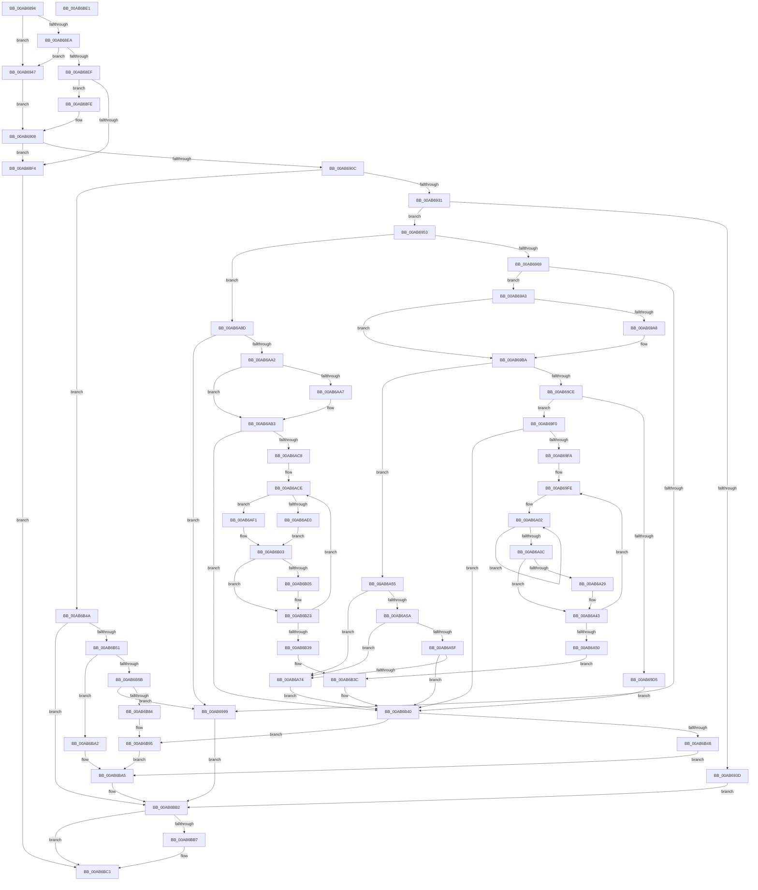

# PiDevCfgResolveMultiSzValue

- RVA: `0x00AB6894`–`0x00AB6BE2` (길이 `846` bytes)
- VA: `0x0000000140AB6894`
- 실행 섹션: `PAGE`
- PDB 이름 있음: `예`; PDB Function 태그: `아니요`
- unwind 정보 RVA: `0x000BCEF0`
- 디코드: `251`개 명령, `846/846` bytes 표시
- 미해석 바이트: `0` (있으면 어셈블리에 `.byte`로 보존)

> 이 문서는 커널 이미지의 기계어와 PDB 기호를 분석해 생성했습니다. 4번과 5번은 함수 원형과 자료형을 바이너리 사용 방식에서 추정한 C 해석이며 원본 소스 복구 결과는 아닙니다.

## 1. Dependencies

- 직접 호출 지점: **20**; 고유 호출 대상: **10**
- 직접 호출자로 확인된 함수: **2**
- RIP 상대 이미지 참조: **0**

### Outgoing calls
- `0x00AB6903` → [PnpValidateMultiSzData](../../text/4B/PnpValidateMultiSzData_function_004BD294.md) (function, `0x004BD294`)
- `0x00AB691B` → [IopGetRegistryValue](../99/IopGetRegistryValue_function_009990EC.md) (function, `0x009990EC`)
- `0x00AB6934` → [PnpValidateRegistryMultiSz](../../text/4D/PnpValidateRegistryMultiSz_function_004DC170.md) (function, `0x004DC170`)
- `0x00AB694C` → [PnpValidateStringData](../../text/4B/PnpValidateStringData_function_004B7678.md) (function, `0x004B7678`)
- `0x00AB698A` → [ExAllocatePool2](../../poolcode/B8/ExAllocatePool2_function_00B820F0.md) (function, `0x00B820F0`)
- `0x00AB69B2` → [memcpy](../../text/6C/memcpy_function_006C6840.md) (function, `0x006C6840`)
- `0x00AB69E0` → [memcpy](../../text/6C/memcpy_function_006C6840.md) (function, `0x006C6840`)
- `0x00AB6A1D` → [PnpMultiSzContainsString](../../text/4C/PnpMultiSzContainsString_function_004C2740.md) (function, `0x004C2740`)
- `0x00AB6A35` → [memcpy](../../text/6C/memcpy_function_006C6840.md) (function, `0x006C6840`)
- `0x00AB6A66` → [PnpMultiSzContainsString](../../text/4C/PnpMultiSzContainsString_function_004C2740.md) (function, `0x004C2740`)
- `0x00AB6A80` → [memcpy](../../text/6C/memcpy_function_006C6840.md) (function, `0x006C6840`)
- `0x00AB6A91` → [ExAllocatePool2](../../poolcode/B8/ExAllocatePool2_function_00B820F0.md) (function, `0x00B820F0`)
- `0x00AB6AAE` → [RtlInitUnicodeString](../../text/42/RtlInitUnicodeString_function_0042A780.md) (function, `0x0042A780`)
- `0x00AB6AD5` → [RtlInitUnicodeString](../../text/42/RtlInitUnicodeString_function_0042A780.md) (function, `0x0042A780`)
- `0x00AB6AE7` → [PnpMultiSzContainsString](../../text/4C/PnpMultiSzContainsString_function_004C2740.md) (function, `0x004C2740`)
- `0x00AB6AFC` → [RtlEqualUnicodeString](../93/RtlEqualUnicodeString_function_00932A20.md) (function, `0x00932A20`)
- `0x00AB6B18` → [memcpy](../../text/6C/memcpy_function_006C6840.md) (function, `0x006C6840`)
- `0x00AB6B73` → [ExAllocatePool2](../../poolcode/B8/ExAllocatePool2_function_00B820F0.md) (function, `0x00B820F0`)
- `0x00AB6B8D` → [memcpy](../../text/6C/memcpy_function_006C6840.md) (function, `0x006C6840`)
- `0x00AB6BBC` → [ExFreePoolWithTag](../../poolcode/B8/ExFreePoolWithTag_function_00B82870.md) (function, `0x00B82870`)

### Direct callers
- [PiDevCfgCopyDeviceKey](../99/PiDevCfgCopyDeviceKey_function_00997374.md) at `0x00997792`
- [sub_00B2C5F4](../B2/Unknown_function_00B2C5F4.md) at `0x00B2C7C4`

### Static image references
- 디코드된 RIP-relative 메모리 참조가 없습니다.

## 2. Other-region calls and transfers

- 다른 실행 섹션으로 향하는 call: **18**
  - `0x00AB6903` → [PnpValidateMultiSzData](../../text/4B/PnpValidateMultiSzData_function_004BD294.md) (`PAGE` → `.text`)
  - `0x00AB6934` → [PnpValidateRegistryMultiSz](../../text/4D/PnpValidateRegistryMultiSz_function_004DC170.md) (`PAGE` → `.text`)
  - `0x00AB694C` → [PnpValidateStringData](../../text/4B/PnpValidateStringData_function_004B7678.md) (`PAGE` → `.text`)
  - `0x00AB698A` → [ExAllocatePool2](../../poolcode/B8/ExAllocatePool2_function_00B820F0.md) (`PAGE` → `POOLCODE`)
  - `0x00AB69B2` → [memcpy](../../text/6C/memcpy_function_006C6840.md) (`PAGE` → `.text`)
  - `0x00AB69E0` → [memcpy](../../text/6C/memcpy_function_006C6840.md) (`PAGE` → `.text`)
  - `0x00AB6A1D` → [PnpMultiSzContainsString](../../text/4C/PnpMultiSzContainsString_function_004C2740.md) (`PAGE` → `.text`)
  - `0x00AB6A35` → [memcpy](../../text/6C/memcpy_function_006C6840.md) (`PAGE` → `.text`)
  - `0x00AB6A66` → [PnpMultiSzContainsString](../../text/4C/PnpMultiSzContainsString_function_004C2740.md) (`PAGE` → `.text`)
  - `0x00AB6A80` → [memcpy](../../text/6C/memcpy_function_006C6840.md) (`PAGE` → `.text`)
  - `0x00AB6A91` → [ExAllocatePool2](../../poolcode/B8/ExAllocatePool2_function_00B820F0.md) (`PAGE` → `POOLCODE`)
  - `0x00AB6AAE` → [RtlInitUnicodeString](../../text/42/RtlInitUnicodeString_function_0042A780.md) (`PAGE` → `.text`)
  - `0x00AB6AD5` → [RtlInitUnicodeString](../../text/42/RtlInitUnicodeString_function_0042A780.md) (`PAGE` → `.text`)
  - `0x00AB6AE7` → [PnpMultiSzContainsString](../../text/4C/PnpMultiSzContainsString_function_004C2740.md) (`PAGE` → `.text`)
  - `0x00AB6B18` → [memcpy](../../text/6C/memcpy_function_006C6840.md) (`PAGE` → `.text`)
  - `0x00AB6B73` → [ExAllocatePool2](../../poolcode/B8/ExAllocatePool2_function_00B820F0.md) (`PAGE` → `POOLCODE`)
  - `0x00AB6B8D` → [memcpy](../../text/6C/memcpy_function_006C6840.md) (`PAGE` → `.text`)
  - `0x00AB6BBC` → [ExFreePoolWithTag](../../poolcode/B8/ExFreePoolWithTag_function_00B82870.md) (`PAGE` → `POOLCODE`)
- 별도 외부 분기/꼬리 이동을 확인하지 못했습니다.

## 3. Assembly (complete function range)

```asm
00AB6894  48 8B C4                        mov rax, rsp
00AB6897  48 89 58 10                     mov qword ptr [rax + 0x10], rbx
00AB689B  48 89 70 18                     mov qword ptr [rax + 0x18], rsi
00AB689F  48 89 78 20                     mov qword ptr [rax + 0x20], rdi
00AB68A3  89 48 08                        mov dword ptr [rax + 8], ecx
00AB68A6  55                              push rbp
00AB68A7  41 54                           push r12
00AB68A9  41 55                           push r13
00AB68AB  41 56                           push r14
00AB68AD  41 57                           push r15
00AB68AF  48 8B EC                        mov rbp, rsp
00AB68B2  48 83 EC 50                     sub rsp, 0x50
00AB68B6  48 8B 45 60                     mov rax, qword ptr [rbp + 0x60]
00AB68BA  45 33 FF                        xor r15d, r15d
00AB68BD  0F 57 C0                        xorps xmm0, xmm0
00AB68C0  8B DA                           mov ebx, edx
00AB68C2  0F 57 C9                        xorps xmm1, xmm1
00AB68C5  4C 89 7D D8                     mov qword ptr [rbp - 0x28], r15
00AB68C9  45 8B E1                        mov r12d, r9d
00AB68CC  4D 8B F0                        mov r14, r8
00AB68CF  44 89 38                        mov dword ptr [rax], r15d
00AB68D2  8B F1                           mov esi, ecx
00AB68D4  48 8B 45 68                     mov rax, qword ptr [rbp + 0x68]
00AB68D8  0F 11 45 F0                     movups xmmword ptr [rbp - 0x10], xmm0
00AB68DC  0F 11 4D E0                     movups xmmword ptr [rbp - 0x20], xmm1
00AB68E0  4C 89 38                        mov qword ptr [rax], r15
00AB68E3  8B C1                           mov eax, ecx
00AB68E5  83 E8 01                        sub eax, 1
00AB68E8  74 5D                           je 0x140ab6947
00AB68EA  83 E8 01                        sub eax, 1
00AB68ED  74 58                           je 0x140ab6947
00AB68EF  83 F8 05                        cmp eax, 5
00AB68F2  74 0A                           je 0x140ab68fe
00AB68F4  BF 01 00 00 C0                  mov edi, 0xc0000001
00AB68F9  E9 C3 02 00 00                  jmp 0x140ab6bc1
00AB68FE  8B D3                           mov edx, ebx
00AB6900  49 8B CE                        mov rcx, r14
00AB6903  E8 8C 69 A0 FF                  call 0x1404bd294
00AB6908  84 C0                           test al, al
00AB690A  74 E8                           je 0x140ab68f4
00AB690C  48 8B 55 58                     mov rdx, qword ptr [rbp + 0x58]
00AB6910  4C 8D 4D D8                     lea r9, [rbp - 0x28]
00AB6914  48 8B 4D 50                     mov rcx, qword ptr [rbp + 0x50]
00AB6918  45 33 C0                        xor r8d, r8d
00AB691B  E8 CC 27 EE FF                  call 0x1409990ec
00AB6920  4C 8B 6D D8                     mov r13, qword ptr [rbp - 0x28]
00AB6924  8B F8                           mov edi, eax
00AB6926  89 45 D0                        mov dword ptr [rbp - 0x30], eax
00AB6929  85 C0                           test eax, eax
00AB692B  0F 88 19 02 00 00               js 0x140ab6b4a
00AB6931  49 8B CD                        mov rcx, r13
00AB6934  E8 37 58 A2 FF                  call 0x1404dc170
00AB6939  84 C0                           test al, al
00AB693B  75 16                           jne 0x140ab6953
00AB693D  BF 01 00 00 C0                  mov edi, 0xc0000001
00AB6942  E9 6B 02 00 00                  jmp 0x140ab6bb2
00AB6947  8B D3                           mov edx, ebx
00AB6949  49 8B CE                        mov rcx, r14
00AB694C  E8 27 0D A0 FF                  call 0x1404b7678
00AB6951  EB B5                           jmp 0x140ab6908
00AB6953  B9 00 01 00 00                  mov ecx, 0x100
00AB6958  41 B8 50 70 64 63               mov r8d, 0x63647050
00AB695E  41 0F BA E4 12                  bt r12d, 0x12
00AB6963  0F 83 24 01 00 00               jae 0x140ab6a8d
00AB6969  41 8B 75 0C                     mov esi, dword ptr [r13 + 0xc]
00AB696D  41 8B 45 08                     mov eax, dword ptr [r13 + 8]
00AB6971  49 03 C5                        add rax, r13
00AB6974  48 89 45 E0                     mov qword ptr [rbp - 0x20], rax
00AB6978  85 F6                           test esi, esi
00AB697A  B8 02 00 00 00                  mov eax, 2
00AB697F  0F 44 F0                        cmove esi, eax
00AB6982  8D 04 1E                        lea eax, [rsi + rbx]
00AB6985  8B D0                           mov edx, eax
00AB6987  89 45 D4                        mov dword ptr [rbp - 0x2c], eax
00AB698A  E8 61 B7 0C 00                  call 0x140b820f0
00AB698F  33 C9                           xor ecx, ecx
00AB6991  4C 8B F8                        mov r15, rax
00AB6994  48 85 C0                        test rax, rax
00AB6997  75 0A                           jne 0x140ab69a3
00AB6999  BF 9A 00 00 C0                  mov edi, 0xc000009a
00AB699E  E9 0F 02 00 00                  jmp 0x140ab6bb2
00AB69A3  83 FE 02                        cmp esi, 2
00AB69A6  76 12                           jbe 0x140ab69ba
00AB69A8  48 8B 55 E0                     mov rdx, qword ptr [rbp - 0x20]
00AB69AC  49 8B CF                        mov rcx, r15
00AB69AF  44 8B C6                        mov r8d, esi
00AB69B2  E8 89 FE C0 FF                  call 0x1406c6840
00AB69B7  8D 4E FE                        lea ecx, [rsi - 2]
00AB69BA  41 81 E4 00 00 02 00            and r12d, 0x20000
00AB69C1  89 4D D0                        mov dword ptr [rbp - 0x30], ecx
00AB69C4  83 7D 30 07                     cmp dword ptr [rbp + 0x30], 7
00AB69C8  0F 85 87 00 00 00               jne 0x140ab6a55
00AB69CE  33 D2                           xor edx, edx
00AB69D0  45 85 E4                        test r12d, r12d
00AB69D3  74 1B                           je 0x140ab69f0
00AB69D5  8B C9                           mov ecx, ecx
00AB69D7  4C 8B C3                        mov r8, rbx
00AB69DA  49 03 CF                        add rcx, r15
00AB69DD  49 8B D6                        mov rdx, r14
00AB69E0  E8 5B FE C0 FF                  call 0x1406c6840
00AB69E5  8B 75 D4                        mov esi, dword ptr [rbp - 0x2c]
00AB69E8  83 C6 FE                        add esi, -2
00AB69EB  E9 50 01 00 00                  jmp 0x140ab6b40
00AB69F0  66 41 39 16                     cmp word ptr [r14], dx
00AB69F4  0F 84 46 01 00 00               je 0x140ab6b40
00AB69FA  4C 8B 6D E0                     mov r13, qword ptr [rbp - 0x20]
00AB69FE  48 83 C8 FF                     or rax, 0xffffffffffffffff
00AB6A02  48 FF C0                        inc rax
00AB6A05  66 41 39 14 46                  cmp word ptr [r14 + rax*2], dx
00AB6A0A  75 F6                           jne 0x140ab6a02
00AB6A0C  44 8D 24 45 02 00 00 00         lea r12d, [rax*2 + 2]
00AB6A14  49 8B D6                        mov rdx, r14
00AB6A17  49 8B CD                        mov rcx, r13
00AB6A1A  41 8B DC                        mov ebx, r12d
00AB6A1D  E8 1E BD A0 FF                  call 0x1404c2740
00AB6A22  33 D2                           xor edx, edx
00AB6A24  48 85 C0                        test rax, rax
00AB6A27  75 1A                           jne 0x140ab6a43
00AB6A29  8B 4D D0                        mov ecx, dword ptr [rbp - 0x30]
00AB6A2C  44 8B C3                        mov r8d, ebx
00AB6A2F  49 03 CF                        add rcx, r15
00AB6A32  49 8B D6                        mov rdx, r14
00AB6A35  E8 06 FE C0 FF                  call 0x1406c6840
00AB6A3A  44 01 65 D0                     add dword ptr [rbp - 0x30], r12d
00AB6A3E  41 03 F4                        add esi, r12d
00AB6A41  33 D2                           xor edx, edx
00AB6A43  48 D1 EB                        shr rbx, 1
00AB6A46  4D 8D 34 5E                     lea r14, [r14 + rbx*2]
00AB6A4A  66 41 39 16                     cmp word ptr [r14], dx
00AB6A4E  75 AE                           jne 0x140ab69fe
00AB6A50  E9 E7 00 00 00                  jmp 0x140ab6b3c
00AB6A55  45 85 E4                        test r12d, r12d
00AB6A58  75 1A                           jne 0x140ab6a74
00AB6A5A  83 FE 02                        cmp esi, 2
00AB6A5D  74 15                           je 0x140ab6a74
00AB6A5F  48 8B 4D E0                     mov rcx, qword ptr [rbp - 0x20]
00AB6A63  49 8B D6                        mov rdx, r14
00AB6A66  E8 D5 BC A0 FF                  call 0x1404c2740
00AB6A6B  48 85 C0                        test rax, rax
00AB6A6E  0F 85 CC 00 00 00               jne 0x140ab6b40
00AB6A74  8B 4D D0                        mov ecx, dword ptr [rbp - 0x30]
00AB6A77  4C 8B C3                        mov r8, rbx
00AB6A7A  49 03 CF                        add rcx, r15
00AB6A7D  49 8B D6                        mov rdx, r14
00AB6A80  E8 BB FD C0 FF                  call 0x1406c6840
00AB6A85  8B 75 D4                        mov esi, dword ptr [rbp - 0x2c]
00AB6A88  E9 B3 00 00 00                  jmp 0x140ab6b40
00AB6A8D  41 8B 55 0C                     mov edx, dword ptr [r13 + 0xc]
00AB6A91  E8 5A B6 0C 00                  call 0x140b820f0
00AB6A96  4C 8B F8                        mov r15, rax
00AB6A99  48 85 C0                        test rax, rax
00AB6A9C  0F 84 F7 FE FF FF               je 0x140ab6999
00AB6AA2  83 FE 07                        cmp esi, 7
00AB6AA5  74 0C                           je 0x140ab6ab3
00AB6AA7  49 8B D6                        mov rdx, r14
00AB6AAA  48 8D 4D F0                     lea rcx, [rbp - 0x10]
00AB6AAE  E8 CD 3C 97 FF                  call 0x14042a780
00AB6AB3  45 8B 65 08                     mov r12d, dword ptr [r13 + 8]
00AB6AB7  33 DB                           xor ebx, ebx
00AB6AB9  4D 03 E5                        add r12, r13
00AB6ABC  BE 02 00 00 00                  mov esi, 2
00AB6AC1  66 41 39 1C 24                  cmp word ptr [r12], bx
00AB6AC6  74 78                           je 0x140ab6b40
00AB6AC8  44 8B 6D 30                     mov r13d, dword ptr [rbp + 0x30]
00AB6ACC  8B FB                           mov edi, ebx
00AB6ACE  49 8B D4                        mov rdx, r12
00AB6AD1  48 8D 4D E0                     lea rcx, [rbp - 0x20]
00AB6AD5  E8 A6 3C 97 FF                  call 0x14042a780
00AB6ADA  41 83 FD 07                     cmp r13d, 7
00AB6ADE  75 11                           jne 0x140ab6af1
00AB6AE0  48 8B 55 E8                     mov rdx, qword ptr [rbp - 0x18]
00AB6AE4  49 8B CE                        mov rcx, r14
00AB6AE7  E8 54 BC A0 FF                  call 0x1404c2740
00AB6AEC  48 85 C0                        test rax, rax
00AB6AEF  EB 12                           jmp 0x140ab6b03
00AB6AF1  41 B0 01                        mov r8b, 1
00AB6AF4  48 8D 55 E0                     lea rdx, [rbp - 0x20]
00AB6AF8  48 8D 4D F0                     lea rcx, [rbp - 0x10]
00AB6AFC  E8 1F BF E7 FF                  call 0x140932a20
00AB6B01  84 C0                           test al, al
00AB6B03  75 1E                           jne 0x140ab6b23
00AB6B05  0F B7 5D E0                     movzx ebx, word ptr [rbp - 0x20]
00AB6B09  48 8B 55 E8                     mov rdx, qword ptr [rbp - 0x18]
00AB6B0D  83 C3 02                        add ebx, 2
00AB6B10  8B CF                           mov ecx, edi
00AB6B12  44 8B C3                        mov r8d, ebx
00AB6B15  49 03 CF                        add rcx, r15
00AB6B18  E8 23 FD C0 FF                  call 0x1406c6840
00AB6B1D  03 FB                           add edi, ebx
00AB6B1F  03 F3                           add esi, ebx
00AB6B21  33 DB                           xor ebx, ebx
00AB6B23  0F B7 45 E0                     movzx eax, word ptr [rbp - 0x20]
00AB6B27  48 D1 E8                        shr rax, 1
00AB6B2A  4D 8D 24 44                     lea r12, [r12 + rax*2]
00AB6B2E  49 83 C4 02                     add r12, 2
00AB6B32  66 41 39 1C 24                  cmp word ptr [r12], bx
00AB6B37  75 95                           jne 0x140ab6ace
00AB6B39  8B 7D D0                        mov edi, dword ptr [rbp - 0x30]
00AB6B3C  4C 8B 6D D8                     mov r13, qword ptr [rbp - 0x28]
00AB6B40  45 33 F6                        xor r14d, r14d
00AB6B43  4D 85 FF                        test r15, r15
00AB6B46  75 4D                           jne 0x140ab6b95
00AB6B48  EB 5B                           jmp 0x140ab6ba5
00AB6B4A  3D 34 00 00 C0                  cmp eax, 0xc0000034
00AB6B4F  75 61                           jne 0x140ab6bb2
00AB6B51  41 8B FF                        mov edi, r15d
00AB6B54  41 0F BA E4 12                  bt r12d, 0x12
00AB6B59  73 47                           jae 0x140ab6ba2
00AB6B5B  83 FE 07                        cmp esi, 7
00AB6B5E  8D 43 02                        lea eax, [rbx + 2]
00AB6B61  B9 00 01 00 00                  mov ecx, 0x100
00AB6B66  41 B8 50 70 64 63               mov r8d, 0x63647050
00AB6B6C  0F 44 C3                        cmove eax, ebx
00AB6B6F  8B D0                           mov edx, eax
00AB6B71  8B F0                           mov esi, eax
00AB6B73  E8 78 B5 0C 00                  call 0x140b820f0
00AB6B78  4C 8B F8                        mov r15, rax
00AB6B7B  48 85 C0                        test rax, rax
00AB6B7E  0F 84 15 FE FF FF               je 0x140ab6999
00AB6B84  4C 8B C3                        mov r8, rbx
00AB6B87  49 8B D6                        mov rdx, r14
00AB6B8A  48 8B C8                        mov rcx, rax
00AB6B8D  E8 AE FC C0 FF                  call 0x1406c6840
00AB6B92  45 33 F6                        xor r14d, r14d
00AB6B95  8B C6                           mov eax, esi
00AB6B97  48 D1 E8                        shr rax, 1
00AB6B9A  66 45 89 74 47 FE               mov word ptr [r15 + rax*2 - 2], r14w
00AB6BA0  EB 03                           jmp 0x140ab6ba5
00AB6BA2  41 8B F7                        mov esi, r15d
00AB6BA5  48 8B 45 60                     mov rax, qword ptr [rbp + 0x60]
00AB6BA9  89 30                           mov dword ptr [rax], esi
00AB6BAB  48 8B 45 68                     mov rax, qword ptr [rbp + 0x68]
00AB6BAF  4C 89 38                        mov qword ptr [rax], r15
00AB6BB2  4D 85 ED                        test r13, r13
00AB6BB5  74 0A                           je 0x140ab6bc1
00AB6BB7  33 D2                           xor edx, edx
00AB6BB9  49 8B CD                        mov rcx, r13
00AB6BBC  E8 AF BC 0C 00                  call 0x140b82870
00AB6BC1  4C 8D 5C 24 50                  lea r11, [rsp + 0x50]
00AB6BC6  8B C7                           mov eax, edi
00AB6BC8  49 8B 5B 38                     mov rbx, qword ptr [r11 + 0x38]
00AB6BCC  49 8B 73 40                     mov rsi, qword ptr [r11 + 0x40]
00AB6BD0  49 8B 7B 48                     mov rdi, qword ptr [r11 + 0x48]
00AB6BD4  49 8B E3                        mov rsp, r11
00AB6BD7  41 5F                           pop r15
00AB6BD9  41 5E                           pop r14
00AB6BDB  41 5D                           pop r13
00AB6BDD  41 5C                           pop r12
00AB6BDF  5D                              pop rbp
00AB6BE0  C3                              ret
00AB6BE1  CC                              int3
```

## 4. C-style interpretation (structured pseudocode)

```c
__int64 __fastcall PiDevCfgResolveMultiSzValue(int a1, int a2, __int64 a3, int a4, __int64 a5, __int64 a6, __int64 a7, __int64 a8)
{
    __int64 result;
    __int64 v_r12;
    __int64 v_r14;
    __int64 v_r15;
    __int64 v_rbx;
    __int64 v_rdi;
    __int64 v_rsi;
    __int64 v_rsp;
    unsigned __int64 v_stack_m28;
    unsigned __int64 v_stack_m38;
    unsigned __int64 v_stack_m40;
    unsigned __int64 v_stack_m48;
    unsigned __int64 v_stack_m50;
    unsigned int v_stack_m54;
    unsigned int v_stack_m58;
    unsigned int v_stack_p8;

    *(unsigned __int64 *)(v_rsp + 16) = v_rbx;
    *(unsigned __int64 *)(v_rsp + 24) = v_rsi;
    *(unsigned __int64 *)(v_rsp + 32) = v_rdi;
    *(unsigned int *)(v_rsp + 8) = a1;
    v_rsp = (v_rsp) - (80);
    v_r15 = 0;
    v_stack_m50 = 0;
    *(unsigned int *)(a7) = 0;
    v_stack_m38 = v_xmm0;
    v_stack_m48 = v_xmm1;
    *(unsigned __int64 *)(a8) = 0;
    result = (unsigned int)(((unsigned int)(a1)) - (1));
    if (condition_is_equal) goto loc_00AB6947;
    result = (unsigned int)((result) - (1));
    if (condition_is_equal) goto loc_00AB6947;
    if (((unsigned int)(result)) == 5) goto loc_00AB68FE;
loc_00AB68F4:
    goto loc_00AB6BC1;
loc_00AB68FE:
    result = PnpValidateMultiSzData(a3, (unsigned int)((unsigned int)((unsigned int)(a2))), a3, a4);
loc_00AB6908:
    if ((unsigned __int8)(result) == 0) goto loc_00AB68F4;
    a3 = 0;
    result = IopGetRegistryValue(a5, a6, a3, v_stack_m50);
    v_stack_m58 = (unsigned int)(result);
    if (sign_flag) goto loc_00AB6B4A;
    result = PnpValidateRegistryMultiSz(v_stack_m50, a6, a3, v_stack_m50);
    if ((unsigned __int8)(result) != 0) goto loc_00AB6953;
    goto loc_00AB6BB2;
loc_00AB6947:
    result = PnpValidateStringData(0, (unsigned int)((unsigned int)((unsigned int)(a2))), a3, v_stack_m50);
    goto loc_00AB6908;
loc_00AB6953:
    if (condition_is_above_or_equal) goto loc_00AB6A8D;
    result = ((unsigned int)(*(unsigned int *)(v_stack_m50 + 8))) + (v_stack_m50);
    v_stack_m48 = result;
    v_rsi = (unsigned int)(*(unsigned int *)(v_stack_m50 + 12));
    if ((unsigned int)((unsigned int)(*(unsigned int *)(v_stack_m50 + 12))) == 0) { v_rsi = 2; }
    v_stack_m54 = (unsigned int)(v_rsi + (unsigned int)(a2) * 1);
    result = ExAllocatePool2(256, (unsigned int)((unsigned int)(v_rsi + (unsigned int)(a2) * 1)), (unsigned int)(0x63647050ULL), v_stack_m50);
    a1 = 0;
    if (result != 0) goto loc_00AB69A3;
loc_00AB6999:
    goto loc_00AB6BB2;
loc_00AB69A3:
    if (((unsigned int)(v_rsi)) >= = 2) {
        a2 = v_stack_m48;
        a1 = result;
        a3 = (unsigned int)(v_rsi);
        result = memcpy(a1, a2, a3, v_stack_m50);
        a1 = v_rsi - 2;
    }
    v_r12 = (unsigned int)(((unsigned int)(a4)) & (0x20000ULL));
    v_stack_m58 = a1;
    if (v_stack_p8 != 7) goto loc_00AB6A55;
    a2 = 0;
    if ((unsigned int)(v_r12) == 0) goto loc_00AB69F0;
    a1 = ((unsigned int)(a1)) + (result);
    result = memcpy(a1, a3, (unsigned int)(a2), v_stack_m50);
    v_rsi = (unsigned int)(((unsigned int)(v_stack_m54)) + (-2));
    goto loc_00AB6B40;
loc_00AB69F0:
    if ((*(unsigned __int16 *)(a3)) == ((unsigned __int16)(a3))) goto loc_00AB6B40;
loc_00AB69FE:
    result = (result) | (-1);
loc_00AB6A02:
    result = (result) + 1;
    if ((*(unsigned __int16 *)(a3 + result * 2)) != ((unsigned __int16)(a3))) goto loc_00AB6A02;
    result = PnpMultiSzContainsString(v_stack_m48, a3, (unsigned int)(a2), v_stack_m50);
    a2 = 0;
    if (result == 0) {
        a1 = v_stack_m58;
        a3 = (unsigned int)((unsigned int)((unsigned int)(result * 2 + 2)));
        a1 = (a1) + (result);
        a2 = a3;
        result = memcpy(a1, a2, a3, v_stack_m50);
        v_rsi = (unsigned int)((v_rsi) + ((unsigned int)(result * 2 + 2)));
        a2 = 0;
    }
    v_rbx = ((unsigned int)((unsigned int)(result * 2 + 2))) >> (1);
    if ((*(unsigned __int16 *)(a3 + v_rbx * 2)) != 0) goto loc_00AB69FE;
    goto loc_00AB6B3C;
loc_00AB6A55:
    if ((unsigned int)(result * 2 + 2) != 0) goto loc_00AB6A74;
    if (((unsigned int)(v_rsi)) == 2) goto loc_00AB6A74;
    result = PnpMultiSzContainsString(v_stack_m48, a3 + v_rbx * 2, a3, v_stack_m50);
    if (result != 0) goto loc_00AB6B40;
loc_00AB6A74:
    a1 = ((unsigned int)(v_stack_m58)) + (result);
    result = memcpy(a1, a3 + v_rbx * 2, v_rbx, v_stack_m50);
    goto loc_00AB6B40;
loc_00AB6A8D:
    result = ExAllocatePool2(a1, (unsigned int)(*(unsigned int *)(v_stack_m48 + 12)), v_rbx, v_stack_m50);
    if (result == 0) goto loc_00AB6999;
    if (((unsigned int)((unsigned int)(v_stack_m54))) != 7) {
        a2 = a3 + v_rbx * 2;
        a1 = v_stack_m38;
        result = RtlInitUnicodeString(a1, a2, v_rbx, v_stack_m50);
    }
    v_rbx = 0;
    v_r12 = ((unsigned int)(*(unsigned int *)(v_stack_m48 + 8))) + (v_stack_m48);
    if ((*(unsigned __int16 *)(v_r12)) == 0) goto loc_00AB6B40;
loc_00AB6ACE:
    result = RtlInitUnicodeString(v_stack_m48, v_r12, v_rbx, v_stack_m50);
    if (((unsigned int)((unsigned int)(v_stack_p8))) != 7) goto loc_00AB6AF1;
    result = PnpMultiSzContainsString(a3 + v_rbx * 2, v_stack_m40, v_rbx, v_stack_m50);
    goto loc_00AB6B03;
loc_00AB6AF1:
    result = RtlEqualUnicodeString(v_stack_m38, v_stack_m48, 1, v_stack_m50);
loc_00AB6B03:
    v_rsi = 2;
    v_rdi = 0;
    if ((unsigned __int8)(result) == 0) {
        v_rbx = v_stack_m48;
        a2 = v_stack_m40;
        v_rbx = (unsigned int)((v_rbx) + (2));
        a1 = 0;
        a3 = (unsigned int)(v_rbx);
        a1 = (a1) + (result);
        result = memcpy(a1, a2, a3, v_stack_m50);
        v_rdi = (unsigned int)((0) + ((unsigned int)(v_rbx)));
        v_rsi = (unsigned int)((2) + ((unsigned int)(v_rbx)));
        v_rbx = 0;
    }
    result = (v_stack_m48) >> (1);
    v_r12 = (v_r12 + result * 2) + (2);
    if ((*(unsigned __int16 *)(v_r12)) != 0) goto loc_00AB6ACE;
loc_00AB6B3C:
loc_00AB6B40:
    v_r14 = 0;
    if (result != 0) goto loc_00AB6B95;
    goto loc_00AB6BA5;
loc_00AB6B4A:
    if (((unsigned int)(result)) != 0xC0000034ULL) goto loc_00AB6BB2;
    if (((unsigned int)(result)) >= 0xC0000034ULL) goto loc_00AB6BA2;
    result = v_rbx + 2;
    if (((unsigned int)(v_rsi)) == 7) { result = 0; }
    result = ExAllocatePool2(256, (unsigned int)((unsigned int)(result)), (unsigned int)(0x63647050ULL), v_stack_m50);
    if (result == 0) goto loc_00AB6999;
    result = memcpy(result, 0, 0, v_stack_m50);
    v_r14 = 0;
loc_00AB6B95:
    result = ((unsigned int)((unsigned int)((unsigned int)((unsigned int)(result))))) >> (1);
    *(unsigned __int16 *)(result + result * 2 - 2) = 0;
    goto loc_00AB6BA5;
loc_00AB6BA2:
loc_00AB6BA5:
    *(unsigned int *)(a7) = (unsigned int)((unsigned int)((unsigned int)(result)));
    *(unsigned __int64 *)(a8) = result;
loc_00AB6BB2:
    result = a8;
    if (v_stack_m50 != 0) {
        a2 = 0;
        a1 = v_stack_m50;
        result = ExFreePoolWithTag(a1, a2, 0, v_stack_m50);
    }
    return (unsigned int)((unsigned int)((unsigned int)((unsigned int)(result))));
}
```

## 5. (Beta) C Style

```c
int64_t PiDevCfgResolveMultiSzValue(int32_t Arg1, void *Arg2, void *Arg3, int32_t Arg4, int64_t Arg5, int64_t Arg6, void *Arg7, void *Arg8)
{
    uint8_t *arg2 = (uint8_t *)Arg2;
    uint8_t *arg3 = (uint8_t *)Arg3;
    uint8_t *arg7 = (uint8_t *)Arg7;
    uint8_t *arg8 = (uint8_t *)Arg8;

    int64_t result;
    int64_t local_r12;
    int64_t local_r14;
    int64_t local_r15;
    int64_t local_rbx;
    int64_t local_rdi;
    int64_t local_rsi;
    int64_t local_rsp;
    uint64_t v_stack_m28;
    uint64_t v_stack_m38;
    uint64_t v_stack_m40;
    uint64_t v_stack_m48;
    uint64_t v_stack_m50;
    uint32_t v_stack_m54;
    uint32_t v_stack_m58;
    uint32_t v_stack_p8;

    *(uint64_t *)(local_rsp + 0x10) = local_rbx;
    *(uint64_t *)(local_rsp + 0x18) = local_rsi;
    *(uint64_t *)(local_rsp + 0x20) = local_rdi;
    *(uint32_t *)(local_rsp + 0x8) = Arg1;
    local_rsp = (local_rsp) - (80);
    local_r15 = 0;
    v_stack_m50 = 0;
    *(uint32_t *)(arg7) = 0;
    v_stack_m38 = v_xmm0;
    v_stack_m48 = v_xmm1;
    *(uint64_t *)(arg8) = 0;
    result = (uint32_t)(((uint32_t)(Arg1)) - (1));
    if (condition_is_equal) goto loc_00AB6947;
    result = (uint32_t)((result) - (1));
    if (condition_is_equal) goto loc_00AB6947;
    if (((uint32_t)(result)) == 5) goto loc_00AB68FE;
loc_00AB68F4:
    goto loc_00AB6BC1;
loc_00AB68FE:
    result = PnpValidateMultiSzData(Arg3, (uint32_t)((uint32_t)((uint32_t)(Arg2))), Arg3, Arg4);
loc_00AB6908:
    if ((uint8_t)(result) == 0) goto loc_00AB68F4;
    Arg3 = 0;
    result = IopGetRegistryValue(Arg5, Arg6, Arg3, v_stack_m50);
    v_stack_m58 = (uint32_t)(result);
    if (sign_flag) goto loc_00AB6B4A;
    result = PnpValidateRegistryMultiSz(v_stack_m50, Arg6, Arg3, v_stack_m50);
    if ((uint8_t)(result) != 0) goto loc_00AB6953;
    goto loc_00AB6BB2;
loc_00AB6947:
    result = PnpValidateStringData(0, (uint32_t)((uint32_t)((uint32_t)(Arg2))), Arg3, v_stack_m50);
    goto loc_00AB6908;
loc_00AB6953:
    if (condition_is_above_or_equal) goto loc_00AB6A8D;
    result = ((uint32_t)(*(uint32_t *)(v_stack_m50 + 0x8))) + (v_stack_m50);
    v_stack_m48 = result;
    local_rsi = (uint32_t)(*(uint32_t *)(v_stack_m50 + 0xC));
    if ((uint32_t)((uint32_t)(*(uint32_t *)(v_stack_m50 + 0xC))) == 0) { local_rsi = 2; }
    v_stack_m54 = (uint32_t)(local_rsi + (uint32_t)(Arg2) * 1);
    result = ExAllocatePool2(256, (uint32_t)((uint32_t)(local_rsi + (uint32_t)(Arg2) * 1)), (uint32_t)(0x63647050ULL), v_stack_m50);
    Arg1 = 0;
    if (result != 0) goto loc_00AB69A3;
loc_00AB6999:
    goto loc_00AB6BB2;
loc_00AB69A3:
    if (((uint32_t)(local_rsi)) >= = 2) {
        Arg2 = v_stack_m48;
        Arg1 = result;
        Arg3 = (uint32_t)(local_rsi);
        result = memcpy(Arg1, Arg2, Arg3, v_stack_m50);
        Arg1 = local_rsi - 2;
    }
    local_r12 = (uint32_t)(((uint32_t)(Arg4)) & (0x20000ULL));
    v_stack_m58 = Arg1;
    if (v_stack_p8 != 7) goto loc_00AB6A55;
    Arg2 = 0;
    if ((uint32_t)(local_r12) == 0) goto loc_00AB69F0;
    Arg1 = ((uint32_t)(Arg1)) + (result);
    result = memcpy(Arg1, Arg3, (uint32_t)(Arg2), v_stack_m50);
    local_rsi = (uint32_t)(((uint32_t)(v_stack_m54)) + (-2));
    goto loc_00AB6B40;
loc_00AB69F0:
    if ((*(uint16_t *)(arg3)) == ((uint16_t)(Arg3))) goto loc_00AB6B40;
loc_00AB69FE:
    result = (result) | (-1);
loc_00AB6A02:
    result = (result) + 1;
    if ((*(uint16_t *)(arg3 + result * 2)) != ((uint16_t)(Arg3))) goto loc_00AB6A02;
    result = PnpMultiSzContainsString(v_stack_m48, Arg3, (uint32_t)(Arg2), v_stack_m50);
    Arg2 = 0;
    if (result == 0) {
        Arg1 = v_stack_m58;
        Arg3 = (uint32_t)((uint32_t)((uint32_t)(result * 2 + 2)));
        Arg1 = (Arg1) + (result);
        Arg2 = Arg3;
        result = memcpy(Arg1, Arg2, Arg3, v_stack_m50);
        local_rsi = (uint32_t)((local_rsi) + ((uint32_t)(result * 2 + 2)));
        Arg2 = 0;
    }
    local_rbx = ((uint32_t)((uint32_t)(result * 2 + 2))) >> (1);
    if ((*(uint16_t *)(arg3 + local_rbx * 2)) != 0) goto loc_00AB69FE;
    goto loc_00AB6B3C;
loc_00AB6A55:
    if ((uint32_t)(result * 2 + 2) != 0) goto loc_00AB6A74;
    if (((uint32_t)(local_rsi)) == 2) goto loc_00AB6A74;
    result = PnpMultiSzContainsString(v_stack_m48, Arg3 + local_rbx * 2, Arg3, v_stack_m50);
    if (result != 0) goto loc_00AB6B40;
loc_00AB6A74:
    Arg1 = ((uint32_t)(v_stack_m58)) + (result);
    result = memcpy(Arg1, Arg3 + local_rbx * 2, local_rbx, v_stack_m50);
    goto loc_00AB6B40;
loc_00AB6A8D:
    result = ExAllocatePool2(Arg1, (uint32_t)(*(uint32_t *)(v_stack_m48 + 0xC)), local_rbx, v_stack_m50);
    if (result == 0) goto loc_00AB6999;
    if (((uint32_t)((uint32_t)(v_stack_m54))) != 7) {
        Arg2 = Arg3 + local_rbx * 2;
        Arg1 = v_stack_m38;
        result = RtlInitUnicodeString(Arg1, Arg2, local_rbx, v_stack_m50);
    }
    local_rbx = 0;
    local_r12 = ((uint32_t)(*(uint32_t *)(v_stack_m48 + 0x8))) + (v_stack_m48);
    if ((*(uint16_t *)(local_r12)) == 0) goto loc_00AB6B40;
loc_00AB6ACE:
    result = RtlInitUnicodeString(v_stack_m48, local_r12, local_rbx, v_stack_m50);
    if (((uint32_t)((uint32_t)(v_stack_p8))) != 7) goto loc_00AB6AF1;
    result = PnpMultiSzContainsString(Arg3 + local_rbx * 2, v_stack_m40, local_rbx, v_stack_m50);
    goto loc_00AB6B03;
loc_00AB6AF1:
    result = RtlEqualUnicodeString(v_stack_m38, v_stack_m48, 1, v_stack_m50);
loc_00AB6B03:
    local_rsi = 2;
    local_rdi = 0;
    if ((uint8_t)(result) == 0) {
        local_rbx = v_stack_m48;
        Arg2 = v_stack_m40;
        local_rbx = (uint32_t)((local_rbx) + (2));
        Arg1 = 0;
        Arg3 = (uint32_t)(local_rbx);
        Arg1 = (Arg1) + (result);
        result = memcpy(Arg1, Arg2, Arg3, v_stack_m50);
        local_rdi = (uint32_t)((0) + ((uint32_t)(local_rbx)));
        local_rsi = (uint32_t)((2) + ((uint32_t)(local_rbx)));
        local_rbx = 0;
    }
    result = (v_stack_m48) >> (1);
    local_r12 = (local_r12 + result * 2) + (2);
    if ((*(uint16_t *)(local_r12)) != 0) goto loc_00AB6ACE;
loc_00AB6B3C:
loc_00AB6B40:
    local_r14 = 0;
    if (result != 0) goto loc_00AB6B95;
    goto loc_00AB6BA5;
loc_00AB6B4A:
    if (((uint32_t)(result)) != 0xC0000034ULL) goto loc_00AB6BB2;
    if (((uint32_t)(result)) >= 0xC0000034ULL) goto loc_00AB6BA2;
    result = local_rbx + 2;
    if (((uint32_t)(local_rsi)) == 7) { result = 0; }
    result = ExAllocatePool2(256, (uint32_t)((uint32_t)(result)), (uint32_t)(0x63647050ULL), v_stack_m50);
    if (result == 0) goto loc_00AB6999;
    result = memcpy(result, 0, 0, v_stack_m50);
    local_r14 = 0;
loc_00AB6B95:
    result = ((uint32_t)((uint32_t)((uint32_t)((uint32_t)(result))))) >> (1);
    *(uint16_t *)(result + result * 2 - 0x2) = 0;
    goto loc_00AB6BA5;
loc_00AB6BA2:
loc_00AB6BA5:
    *(uint32_t *)(arg7) = (uint32_t)((uint32_t)((uint32_t)(result)));
    *(uint64_t *)(arg8) = result;
loc_00AB6BB2:
    result = Arg8;
    if (v_stack_m50 != 0) {
        Arg2 = 0;
        Arg1 = v_stack_m50;
        result = ExFreePoolWithTag(Arg1, Arg2, 0, v_stack_m50);
    }
    return (uint32_t)((uint32_t)((uint32_t)((uint32_t)(result))));
}
```

### 관측된 메모리 오프셋

구조체 형식이 확인되지 않은 접근은 인자 기준의 오프셋으로만 기록했습니다.

| 기준 인자 | 오프셋 표현 | 폭 (bit) | 접근 |
|---|---:|---:|---|
| `Arg2` | `+ 0x2` | `32` | `R` |
| `Arg3` | `+ 0x0` | `16` | `R` |
| `Arg3` | `+ 0x0 + rax*2` | `16` | `R` |
| `Arg3` | `+ 0x0 + rbx*2` | `64` | `R` |
| `Arg7` | `+ 0x0` | `32` | `W` |
| `Arg8` | `+ 0x0` | `64` | `W` |

## 6. Execution-region graph

[열기: 2D/3D 그래프와 함수 탐색 컨트롤 패널](../../../control-panel.html?section=page&rva=0x00AB6894&view=graph)

- 2D 그래프는 위에서 아래로 흐르고, 3D 그래프는 빈 공간을 드래그해 회전합니다. Shift+드래그는 이동, 휠은 확대·축소, 함수 노드 선택은 대상 보고서 이동입니다.

### Static fallback


